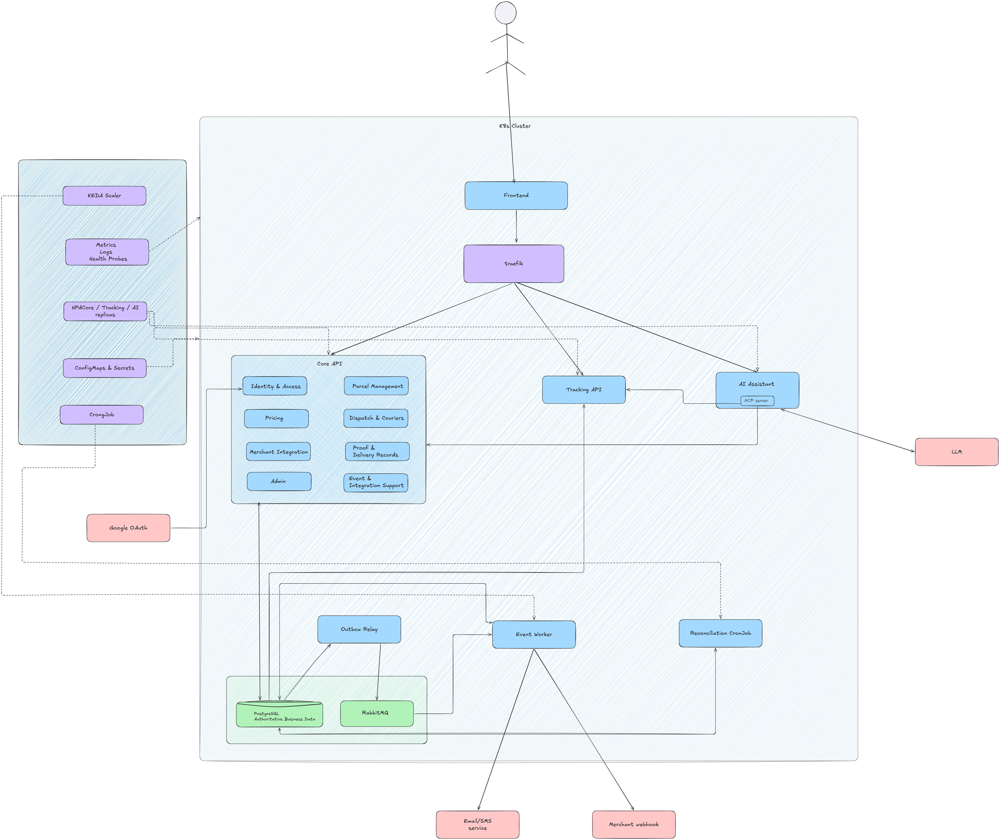
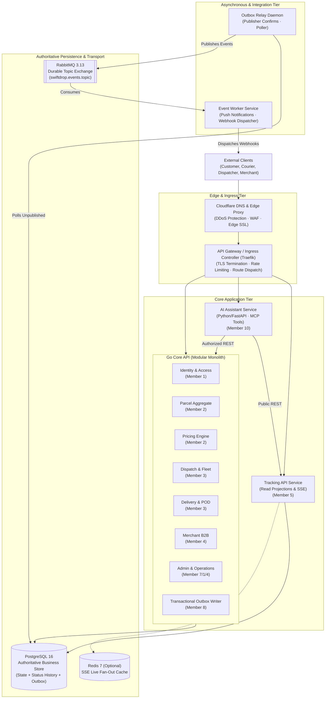
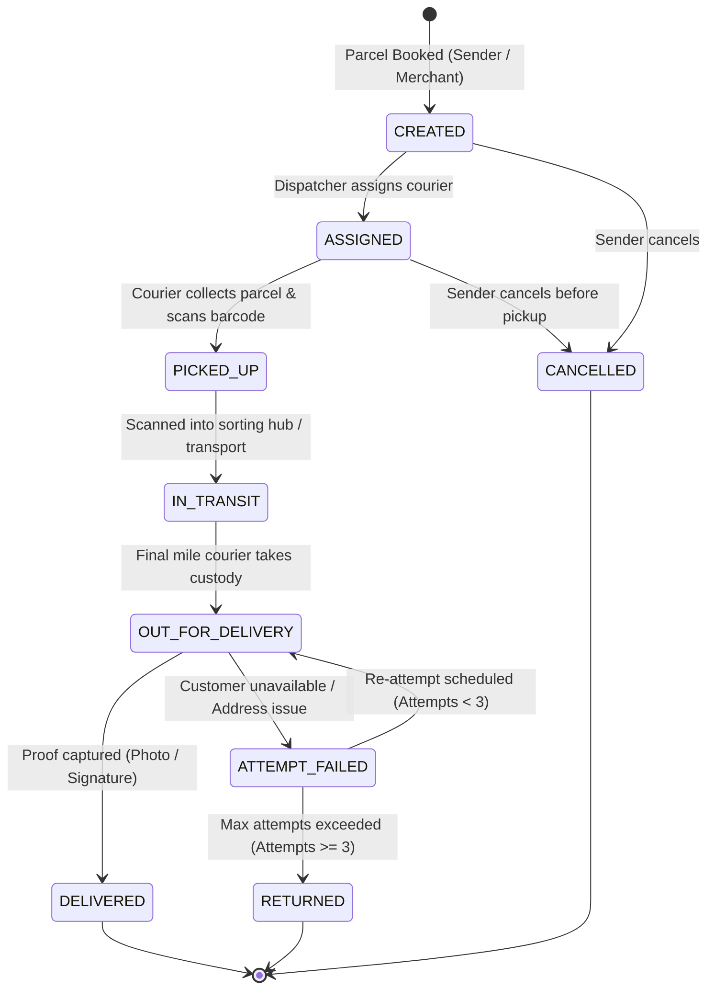

<div align="center">

# 📦 SwiftDrop
### Enterprise Parcel Delivery & Courier Management Platform

[](.github/workflows/ci.yml)
[](#1-system-architecture--topology)
[](https://go.dev/)
[](https://www.typescriptlang.org/)
[](https://www.postgresql.org/)
[](https://www.rabbitmq.com/)
[](https://fastapi.tiangolo.com/)

<p align="center">
  A high-throughput, fault-tolerant logistics and parcel lifecycle platform engineering solution. Designed around <strong>Domain-Driven Design (DDD)</strong> principles, featuring an authoritative Go modular monolith, real-time read-optimized tracking projections, transactional outbox messaging, and strict multi-agent AI coding governance.
</p>

[System Architecture](#1-system-architecture--topology) •
[Domain Ownership](#2-10-member-capability-ownership-matrix) •
[Parcel Lifecycle](#3-canonical-parcel-state-machine) •
[AI Agent Rules](#4-ai-coding-agent-governance--living-documentation) •
[Getting Started](#6-local-development--quick-start) •
[Verification](#7-automated-quality-gates--testing)

</div>

---

## Executive Summary

**SwiftDrop** transforms conventional courier operations into an automated, auditable, and resilient logistics ecosystem. The platform replaces fragmented spreadsheets and manual dispatch boards with:

- **B2C Customer Self-Service:** Instant price calculation, online parcel booking, recipient address management, and proof-of-delivery receipts.
- **Real-Time Tracking Stream:** Read-optimized projection service powering low-latency Server-Sent Events (SSE) tracking feeds with strict recipient data masking.
- **Courier Run & POD Execution:** Responsive mobile web interface for couriers to scan barcodes, record delivery attempts, attach digital signatures, and upload photographic proof-of-delivery.
- **Dispatcher Operations Board:** Real-time visibility into zone workloads, active fleet capacity, and parcel assignment optimization.
- **B2B Merchant Programmatic Integration:** Secured REST API for bulk parcel dispatch and cryptographically signed, SSRF-defended webhook notifications.
- **Sandboxed AI Assistant:** Python/FastAPI assistant executing strictly read-only Model Context Protocol (MCP) tools for tariff estimation and tracking queries without direct database exposure.

---

## 1. System Architecture & Topology

SwiftDrop balances the operational simplicity of a **Go Modular Monolith** with the scaling advantages of dedicated background daemons and projection engines.

### 1.1 Architecture Blueprint

<div align="center">



*Figure 1.1: SwiftDrop Full System Architecture, Component Topology & Service Boundaries.*

</div>



### 1.2 Clean Layering Inside Core API Modules
Within every bounded context (e.g., `core-api/internal/parcels/`), strict Clean/Hexagonal Architecture boundaries are enforced:
- **Domain Layer (`domain/`):** Pure domain logic, aggregate roots, entities, value objects, and domain errors. **Zero external imports** (no `net/http`, no `database/sql`, no broker drivers).
- **Application Layer (`application/`):** Use cases, command/query handlers, transaction boundaries, and repository interface definitions.
- **Infrastructure Layer (`infrastructure/`):** Concrete PostgreSQL repository implementations, outbox adapters, and external driver clients.
- **Transport Layer (`transport/`):** Thin HTTP handlers, routing, request validation, status mapping, and response DTO serialization.

---

## 2. 10-Member Capability Ownership Matrix

Every team member has formal domain ownership. Each capability owner maintains living documentation and API specifications co-located with their code:

| Member | Domain Capability | Primary Scope & Responsibilities | Code Path | Co-Located Living Documentation |
| :---: | :--- | :--- | :--- | :---: |
| **01** | **Identity, Access & Security** | Authentication, JWT issuance, password hashing (Argon2id/bcrypt), RBAC roles, tenant isolation primitives. | `core-api/internal/identity/` | [README](core-api/internal/identity/README.md) · [API.md](core-api/internal/identity/API.md) |
| **02** | **Parcel Management & Pricing** | Parcel aggregate root, state machine, booking invariants, volumetric weight calculation, dynamic tariffs. | `core-api/internal/parcels/`<br>`core-api/internal/pricing/` | [Parcels README](core-api/internal/parcels/README.md) · [API.md](core-api/internal/parcels/API.md)<br>[Pricing README](core-api/internal/pricing/README.md) · [API.md](core-api/internal/pricing/API.md) |
| **03** | **Dispatch, Couriers & Proof of Delivery** | Courier profiles, vehicle capacity, dispatch board use cases, delivery attempts, photographic proof-of-delivery, signatures. | `core-api/internal/dispatch/`<br>`core-api/internal/delivery/` | [Dispatch README](core-api/internal/dispatch/README.md) · [API.md](core-api/internal/dispatch/API.md)<br>[Delivery README](core-api/internal/delivery/README.md) · [API.md](core-api/internal/delivery/API.md) |
| **04** | **Merchant Integration** | B2B merchant onboarding, API key issuance, webhook configuration, SSRF target destination validation. | `core-api/internal/merchants/` | [README](core-api/internal/merchants/README.md) · [API.md](core-api/internal/merchants/API.md) |
| **05** | **Tracking API & Real-Time Updates** | Read-optimized tracking projection service, Server-Sent Events (SSE) streaming, public milestone query masking. | `services/tracking/` | [README](services/tracking/README.md) · [API.md](services/tracking/API.md) |
| **06** | **Customer & Merchant Frontend** | React/TypeScript single SPA: customer booking wizard, parcel tracking, address book, merchant order creation dashboard. | `web/src/features/customer-merchant/` | [Frontend README](web/README.md) |
| **07** | **Dispatcher/Admin UI & API Gateway** | Dispatcher operations portal, courier mobile web view, admin backoffice screens, Traefik gateway routing & policy maps. | `web/src/features/dispatcher-admin/`<br>`core-api/internal/admin/` | [Frontend README](web/README.md)<br>[Admin README](core-api/internal/admin/README.md) · [API.md](core-api/internal/admin/API.md) |
| **08** | **Event-Driven Backend & Integrations** | Transactional outbox relay, RabbitMQ broker setup, consumer event worker, webhook dispatcher, retry/DLQ handling. | `core-api/internal/events/`<br>`services/messaging/` | [Events README](core-api/internal/events/README.md)<br>[Messaging README](services/messaging/README.md) |
| **09** | **DevOps, Kubernetes & Observability** | Containerization, Docker Compose, Kubernetes manifests, Helm charts, CI/CD quality pipelines, Prometheus/Grafana metrics. | `deploy/`, `.github/` | Deployment & Cluster Manifests |
| **10** | **AI Assistant/MCP & Cross-Workflow QA** | Python/FastAPI assistant service, read-only MCP tool execution, prompt sandboxing, end-to-end integration test coordination. | `services/ai-assistant/` | [README](services/ai-assistant/README.md) · [API.md](services/ai-assistant/API.md) |

---

## 3. Canonical Parcel State Machine

To prevent invalid business transitions, the parcel lifecycle is strictly guarded by the `Parcel` aggregate root. **Direct, unvalidated SQL updates modifying parcel status columns are strictly prohibited.**



### 3.1 Transactional Invariant Execution Flow
Every state change follows an atomic 5-stage pipeline:
1. **Transport Layer:** Parses input, validates syntax, extracts authenticated caller credentials.
2. **Application Layer:** Initiates a PostgreSQL transaction (`*sql.Tx`) and retrieves the `Parcel` aggregate root.
3. **Domain Layer:** Aggregate root evaluates business invariants (valid status transition, courier assignment verification, proof validation).
4. **Single PostgreSQL Transaction Commit:** Atomically commits:
   - Updated `parcels` state record.
   - Immutable audit entry in `parcel_status_history`.
   - New event row in `outbox_events`.
5. **Asynchronous Outbox Publication:** The Outbox Relay polls committed rows and publishes persistent messages to RabbitMQ with publisher confirms.

---

## 4. AI Coding Agent Governance & Living Documentation

Because 10 developers use automated AI coding tools (Claude Code, Cursor, GitHub Copilot, Codex), the repository enforces strict machine-actionable boundaries defined in **[`AGENTS.md`](AGENTS.md)**.

### 4.1 The Four Layers of Control
- **Layer 1 — Universal Project Rules:** Architecture, security, module isolation, and prohibitions defined in `AGENTS.md`.
- **Layer 2 — Domain & Interface Contracts:** Bounded contexts, OpenAPI specs, and event schemas in `docs/architecture/` and `docs/contracts/`.
- **Layer 3 — Automated Machine Enforcement:** Linters (`golangci-lint` with `depguard`), test suites, secret scanners, and CI quality gates.
- **Layer 4 — Human Review & Domain Ownership:** Mandatory PR sign-off by the assigned capability owner.

### 4.2 Multi-Tool Configuration Pointers
All AI tools are routed back to the central rulebook to eliminate documentation drift:
- **Claude Code:** Configured via [`CLAUDE.md`](CLAUDE.md)
- **Cursor IDE:** Configured via [`.cursor/rules/swiftdrop.mdc`](.cursor/rules/swiftdrop.mdc) and [`.cursorrules`](.cursorrules)
- **GitHub Copilot:** Configured via [`.github/copilot-instructions.md`](.github/copilot-instructions.md)

### 4.3 Strict Living Documentation Mandate
- **Zero-Drift Policy:** Any pull request modifying domain rules, database schemas, or API endpoints WITHOUT updating the co-located `README.md` and `API.md` in the exact same commit is **automatically rejected**.
- **Living API Contracts:** Every endpoint must detail required headers, JSON schemas, realistic payloads, HTTP status codes, and error envelopes.

---

## 5. Repository Directory Layout

```
swiftdrop/
├── AGENTS.md                                # Central rulebook for AI coding agents
├── CLAUDE.md                                # Claude Code entry point & run commands
├── README.md                                # Authoritative project documentation
├── .cursor/rules/swiftdrop.mdc              # Cursor IDE rules (glob: *)
├── .github/
│   ├── copilot-instructions.md             # GitHub Copilot workspace directives
│   └── workflows/ci.yml                     # GitHub Actions CI quality workflow
├── .golangci.yml                            # Go linter config with depguard architecture rules
├── core-api/                                # Authoritative Go Modular Monolith
│   ├── cmd/api/main.go                      # Entrypoint & dependency injection wiring
│   ├── internal/
│   │   ├── identity/                        # Auth, JWT, RBAC & Users (Member 1)
│   │   ├── parcels/                         # Parcel aggregate & state machine (Member 2)
│   │   ├── pricing/                         # Tariff engine & fee calculation (Member 2)
│   │   ├── dispatch/                        # Courier assignments & fleet load (Member 3)
│   │   ├── delivery/                        # Proof of delivery & failure tracking (Member 3)
│   │   ├── merchants/                       # B2B profiles, API keys & webhooks (Member 4)
│   │   ├── admin/                           # Delivery zones & operational reports (Member 7/1/4)
│   │   ├── events/                          # Transactional outbox writer & envelopes (Member 8)
│   │   └── platform/                        # Postgres pool, auth middleware, HTTP helpers
│   ├── migrations/                          # Canonical PostgreSQL schema migrations
│   └── tests/                               # Cross-module integration test suites
├── services/
│   ├── tracking/                            # Read-optimized SSE projection service (Member 5)
│   ├── messaging/                           # Outbox Relay & Event Worker daemons (Member 8)
│   └── ai-assistant/                        # Python/FastAPI assistant & MCP server (Member 10)
├── web/                                     # Unified React 18+ / TS / Tailwind SPA
│   ├── README.md                            # Frontend living doc & RBAC routing guide
│   └── src/
│       ├── app/                             # Router shell, auth context & global layouts
│       ├── shared/                          # Reusable UI library, HTTP client & types
│       └── features/
│           ├── customer-merchant/           # Customer portal & tracking UI (Member 6)
│           └── dispatcher-admin/            # Dispatch board & admin backoffice (Member 7)
├── deploy/
│   ├── docker-compose.yml                   # Local developer full stack orchestration
│   └── gateway/                             # Traefik configuration, middlewares & living docs
├── docs/
│   ├── architecture/
│   │   ├── domain-boundaries.md             # Bounded contexts, invariants & ownership table
│   │   ├── adr-001-traefik-ingress.md       # ADR: Traefik edge ingress controller
│   │   └── adr-002-kubernetes-hosting.md    # ADR: Kubernetes & Hosting Architecture
│   ├── contracts/api-conventions.md         # REST standards, error envelopes & idempotency
│   ├── contracts/event-contracts.md         # Event schemas, Transactional Outbox & RabbitMQ
│   └── intial/                              # Authoritative SRS, Standards & Work Division docs
└── scripts/
    ├── verify.sh                            # Local pre-commit verification (Linux / macOS)
    └── verify.ps1                           # Local pre-commit verification (Windows PowerShell)
```

---

## 6. Local Development & Quick Start

### 6.1 Prerequisites
Ensure the following tools are installed on your workstation:
- **Go:** `v1.22+`
- **Docker & Docker Compose:** `v24.0+`
- **Node.js & npm:** `v20.x+` (for frontend workspaces)
- **Python:** `v3.11+` (for AI Assistant service)
- **golangci-lint:** `v1.57+` (optional for local linting; enforced in CI)

### 6.2 Running Infrastructure Services
Start the authoritative PostgreSQL instance and RabbitMQ message broker:
```bash
# Start background infrastructure (PostgreSQL, RabbitMQ, Redis)
docker compose up -d postgres rabbitmq redis
```

### 6.3 Running Core API Service
```bash
# Navigate to Core API
cd core-api

# Execute database migrations
go run cmd/migrate/main.go up

# Start the Core API modular monolith
go run cmd/api/main.go
```
The Core API serves traffic on `http://localhost:8080`. Health probes are available at:
- Liveness Probe: `GET http://localhost:8080/health/live`
- Readiness Probe: `GET http://localhost:8080/health/ready`

### 6.4 Running the Asynchronous Workers
```bash
# In a separate terminal, launch Outbox Relay
cd services/messaging && go run cmd/relay/main.go

# Launch Event Worker (Notifications & Webhooks)
cd services/messaging && go run cmd/worker/main.go
```

---

## 7. Automated Quality Gates & Testing

SwiftDrop uses automated mechanical gates to guarantee code safety, adherence to architecture boundaries, and secret-free commits.

### 7.1 One-Command Local Verification
Before opening a pull request, run the local verification suite:

```bash
# Linux / macOS
./scripts/verify.sh

# Windows (PowerShell)
.\scripts\verify.ps1
```

The verification script executes four mandatory stages:
1. **Secret & Credential Scan:** Scans files for exposed private keys, OAuth tokens, and passwords.
2. **Go Code Formatting:** Enforces standard `gofmt` compliance across all Go packages.
3. **Architecture Boundary Linter:** Runs `golangci-lint` with `depguard` rules ensuring `domain/` packages remain pure and free from SQL/HTTP imports.
4. **Race-Condition Test Suite:** Executes `go test -v -race ./...` across all packages.

### 7.2 Continuous Integration (GitHub Actions)
Every push and pull request against `main` or `develop` triggers [`.github/workflows/ci.yml`](.github/workflows/ci.yml) validating:
- TruffleHog verified secret scanning.
- Go formatting (`gofmt`).
- `golangci-lint` architectural compliance.
- Unit and integration test suites with data-race detection (`-race`).

---

## 8. API Design Conventions

All HTTP endpoints adhere to the formal specification in [`docs/contracts/api-conventions.md`](docs/contracts/api-conventions.md):
- **Base Versioning:** All endpoints are scoped under `/api/v1/`.
- **Standard Success Envelope:** Single objects return `{"data": { ... }}`; collections return `{"data": [ ... ], "meta": { "page": 1, "per_page": 20, "total_items": 142 }}`.
- **Structured Error Responses:** Errors return an actionable envelope containing an application error code, human message, and distributed `correlation_id`:
```json
{
  "error": {
    "code": "PARCEL_INVALID_TRANSITION",
    "message": "Cannot transition parcel from DELIVERED to OUT_FOR_DELIVERY",
    "correlation_id": "corr_c8a9f24e-7b12-4f33-912a",
    "timestamp": "2026-10-21T13:30:00Z",
    "details": [
      { "field": "status", "issue": "Terminal state reached; transitions disallowed" }
    ]
  }
}
```
- **Mutation Idempotency:** Critical POST requests (e.g. parcel booking) require an `Idempotency-Key: <uuid-v4>` header to protect against network retry duplication.

---

## 9. Team Workflow & Contribution Rules

1. **Short-Lived Feature Branches:** Create branches named `feat/<member>-<topic>`, `fix/<member>-<issue>`, or `chore/<member>-<task>`. Direct commits to `main` are restricted.
2. **Order of Precedence:** If specifications conflict, always resolve according to:
   $$\text{SRS} \ > \ \text{Contracts} \ > \ \text{Engineering Standards} \ > \ \text{AGENTS.md} \ > \ \text{Existing Code}$$
3. **Owner Review Gate:** Changes to shared contracts (DTOs, database migrations, event payloads) require review and approval from the designated domain owner.
4. **Living Docs Synchronization:** Every code change MUST concurrently update the module's `README.md` and `API.md`.

---

## 10. Reference Documentation & Baseline Specifications

### 10.1 Core Baselines & Governance
- **Requirements Specification:** [`docs/intial/SwiftDrop_SRS_v1.md`](docs/intial/SwiftDrop_SRS_v1.md) (`SWD-SRS-001`)
- **Engineering Standards:** [`docs/intial/SwiftDrop_Engineering_Standards_and_Best_Practices_v1.0.md`](docs/intial/SwiftDrop_Engineering_Standards_and_Best_Practices_v1.0.md)
- **Work Division Agreement:** [`docs/intial/SwiftDrop_Team_Work_Division_v1.0.md`](docs/intial/SwiftDrop_Team_Work_Division_v1.0.md)
- **AI Agent Rulebook:** [`AGENTS.md`](AGENTS.md)

### 10.2 Architecture & Technical Decisions
- **Domain Boundaries & Capability Ownership:** [`docs/architecture/domain-boundaries.md`](docs/architecture/domain-boundaries.md)
- **Architecture Decision Record (ADR) Index:** [`docs/architecture/adr-index.md`](docs/architecture/adr-index.md)
  - [ADR-001: Traefik Ingress Gateway](docs/architecture/adr-001-traefik-ingress.md)
  - [ADR-002: Kubernetes & Hosting Architecture](docs/architecture/adr-002-kubernetes-hosting.md)
  - [ADR-003: Authentication & Session Strategy](docs/architecture/adr-003-authentication-strategy.md)
  - [ADR-004: Failed Delivery & Reattempt Semantics](docs/architecture/adr-004-failed-delivery-semantics.md)
- **Database Schema & ER Design:** [`docs/architecture/database-schema.md`](docs/architecture/database-schema.md)
- **Key Architecture Sequence Diagrams:** [`docs/architecture/sequence-diagrams.md`](docs/architecture/sequence-diagrams.md)

### 10.3 API, Event & Domain Contracts
- **REST API Conventions:** [`docs/contracts/api-conventions.md`](docs/contracts/api-conventions.md)
- **Event Contracts & Outbox Specification:** [`docs/contracts/event-contracts.md`](docs/contracts/event-contracts.md)
- **Pricing Engine & Tariff Rules (LKR):** [`docs/contracts/pricing-rules.md`](docs/contracts/pricing-rules.md)
- **Webhook Security & SSRF Prevention:** [`docs/contracts/webhook-security.md`](docs/contracts/webhook-security.md)

### 10.4 Operations & Security
- **Security Notes & Threat Model (SEC-001 to SEC-017):** [`docs/security/security-notes.md`](docs/security/security-notes.md)
- **Environment Variables Reference:** [`docs/operations/environment-variables.md`](docs/operations/environment-variables.md)
- **Operational Runbook & Incident Playbooks:** [`docs/operations/runbook.md`](docs/operations/runbook.md)
- **Local Development Setup Guide:** [`docs/operations/local-development.md`](docs/operations/local-development.md)
- **Production Deployment Guide (Docker & K3s):** [`docs/operations/deployment-guide.md`](docs/operations/deployment-guide.md)

### 10.5 Quality & Project Management
- **Master Test Strategy & Traceability Matrix (AT-001 to AT-016):** [`docs/testing/test-strategy.md`](docs/testing/test-strategy.md)
- **Team Contribution Record Sheet:** [`docs/project/contribution-record.md`](docs/project/contribution-record.md)

---

<div align="center">
  <sub>SwiftDrop Parcel Delivery & Courier Management System • Academic Team Baseline • October 2026</sub>
</div>
