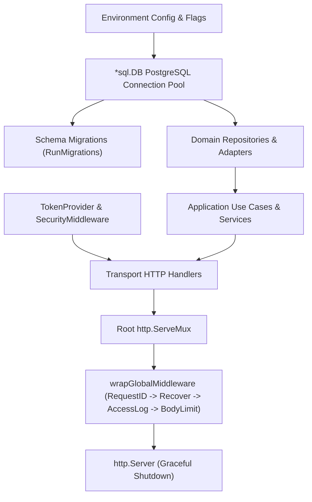

# SwiftDrop Core API — Application Entrypoint & Startup Wiring

> **Package:** `cmd/api` (`main`)  
> **Role:** Application Bootstrap, Dependency Injection Container, Middleware Pipeline & Route Wiring

---

## 1. Overview

`cmd/api` serves as the authoritative entrypoint for the SwiftDrop Go Modular Monolith. It initializes cross-cutting infrastructure drivers (PostgreSQL pool, password hasher, JWT token provider), runs database auto-migrations, wires bounded context dependencies (repositories, use cases, HTTP handlers), configures platform middleware, and exposes unified REST routes on `http.ServeMux`.

---

## 2. File Organization

```
core-api/cmd/api/
├── main.go                     # Process entrypoint, HTTP server lifecycle, graceful shutdown (SIGTERM/SIGINT)
├── wiring.go                   # BuildAppContainer: DB pool, migrations, fallback mock stores, health endpoints
├── wiring_events.go            # Member 8: Global middleware pipeline, events routes, Swagger UI routes
├── wiring_merchants.go         # Member 4: Merchant onboarding, credentials, and webhook endpoints
├── wiring_member02.go          # Member 2: Pricing quotes & Parcel booking/retrieval/history endpoints
├── wiring_merchants_test.go    # Unit tests for merchant module wiring and encryption key validation
├── wiring_member02_test.go     # Unit tests for Member 2 route registration, validation, and security
└── wiring_test.go              # Health probes, local mock fallback, and Swagger configuration tests
```

---

## 3. Dependency Injection Architecture

Dependencies are wired hierarchically according to clean architecture rules:



---

## 4. Module Registration Pattern

All database-backed domain modules observe a consistent registration contract:
- Each module provides an isolated `register<Domain>Module(mux, db, ...)` function in a dedicated `wiring_<domain>.go` file.
- Registration functions validate all required dependencies and return explicit `error` values rather than panicking or calling `log.Fatal` internally.
- `wiring.go` orchestrates registration inside `BuildAppContainer()` guarded by `if dbConn != nil`:
  - **Local/Offline Development (`APP_ENV=local`):** If PostgreSQL is unreachable, modules log an informational `[NOTICE]` and the server starts in mock authentication mode.
  - **Production (`APP_ENV=production`):** Registration failures immediately halt application startup via `log.Fatalf` to prevent degraded deployments.

### Member 02 Registration Functions (`wiring_member02.go`)

- **`registerPricingModule(mux *http.ServeMux, db *sql.DB, sec *identitytransport.SecurityMiddleware) error`**
  - Connects `PostgresTariffRepository`, `PostgresQuoteRepository`, `SystemClock`, `UUIDv7QuoteIDGenerator`, and `MerchantRepoAdapter`.
  - Constructs `GenerateQuoteUseCase` and `pricingtransport.Handler`.
  - Registers `POST /api/v1/pricing/quotes` protected by Bearer JWT and `RequireRole(CUSTOMER, MERCHANT, ADMIN)`.

- **`registerParcelsModule(mux *http.ServeMux, db *sql.DB, sec *identitytransport.SecurityMiddleware) error`**
  - Connects `DBTransactionManager`, `PostgresQuoteConsumer`, `PostgresParcelRepository`, `PostgresStatusHistoryRepository`, `PostgresIdempotencyRepository`, `PostgresOutboxWriter`, tracking/UUID generators, system clock, and `MerchantRepoAdapter`.
  - Constructs `BookParcelUseCase` (configured with persistent 24-hour idempotency via `.WithIdempotency`), `GetParcelUseCase`, `GetParcelHistoryUseCase`, and `parcelstransport.Handler`.
  - Registers the following routes protected by Bearer JWT and `RequireRole(CUSTOMER, MERCHANT, ADMIN)`:
    - `POST /api/v1/parcels`
    - `GET /api/v1/parcels/{id}`
    - `GET /api/v1/parcels/{id}/history`

---

## 5. Endpoints Exposed

| Method | URI Path | Bounded Context | Auth / Role Protection | Description |
| :--- | :--- | :--- | :--- | :--- |
| `GET` | `/health/live` | System | Public | Kubernetes liveness probe |
| `GET` | `/health/ready` | System | Public | Kubernetes readiness probe (verifies PostgreSQL) |
| `GET` | `/api/v1/health` | System | Public | Legacy operational health status |
| `GET` | `/swagger/*` | Swagger | Public / Env Gated | Interactive OpenAPI Swagger UI & JSON specifications |
| `POST` | `/api/v1/auth/login` | Identity | Public | Authenticates user credentials and issues JWT |
| `GET` | `/api/v1/auth/me` | Identity | Bearer JWT | Returns authenticated user profile |
| `POST` | `/api/v1/pricing/quotes` | Pricing | Bearer JWT (CUSTOMER, MERCHANT, ADMIN) | Calculates and persists 15-minute price quote |
| `POST` | `/api/v1/parcels` | Parcels | Bearer JWT (CUSTOMER, MERCHANT, ADMIN) | Atomically books parcel with quote and idempotency |
| `GET` | `/api/v1/parcels/{id}` | Parcels | Bearer JWT (CUSTOMER, MERCHANT, ADMIN) | Retrieves authorized parcel aggregate |
| `GET` | `/api/v1/parcels/{id}/history` | Parcels | Bearer JWT (CUSTOMER, MERCHANT, ADMIN) | Chronological lifecycle status history audit trail |

---

## 6. Swagger / OpenAPI Integration

OpenAPI 2.0 specifications are compiled using `swag`:

```bash
# From repository root:
make swagger

# Equivalent direct command:
cd core-api && go run github.com/swaggo/swag/cmd/swag@latest init -g cmd/api/main.go -o docs --ot json,yaml --parseDependency --parseInternal
cp core-api/docs/swagger.json core-api/internal/events/swagger/swagger.json
```

The embedded specification (`UnifiedSwaggerJSON`) serves the Swagger UI at `http://localhost:8080/swagger/`.

