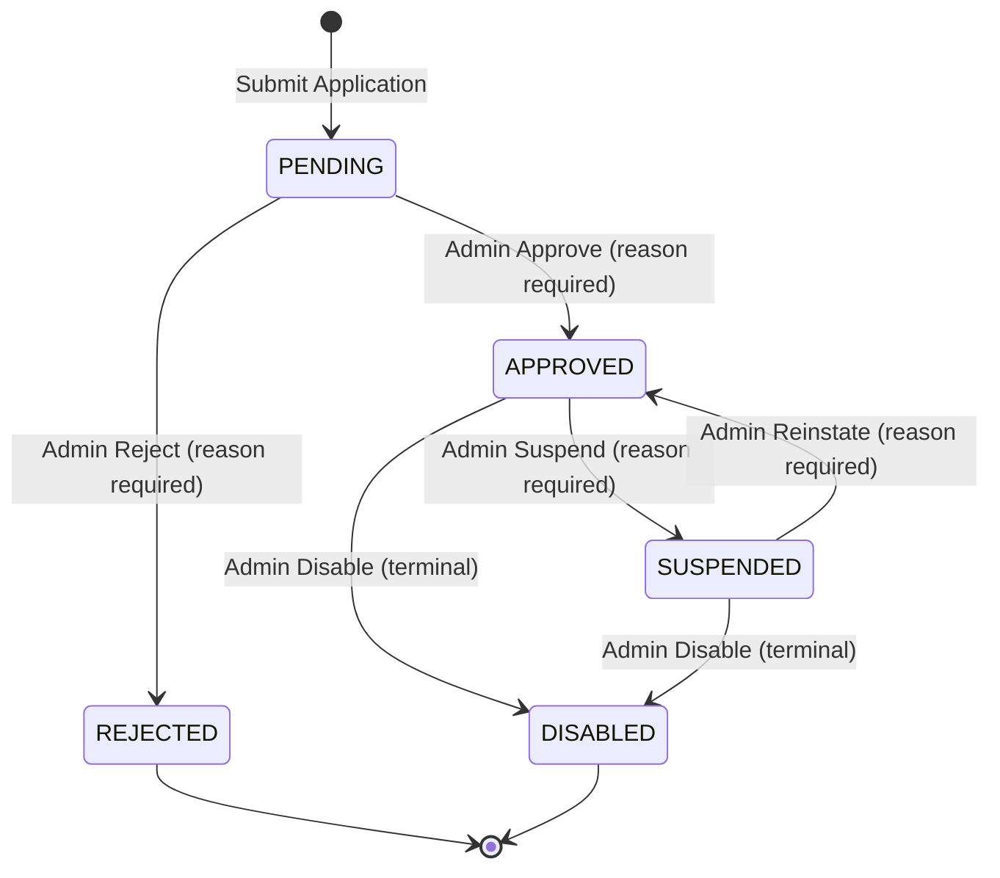

# Merchant Integration Module (`internal/merchants`)

> **Domain:** Merchant Profiles, Tenant Management, Programmatic API Keys & Webhook Subscriptions  
> **Primary Owner:** Member 4 — Merchant Integration  
> **Clean Architecture Boundary:** Modular Monolith Internal Module (`github.com/swiftdrop/core-api/internal/merchants`)

---

## 1. Module Overview & Responsibilities

The `merchants` module provides B2B capabilities for external merchant partners: managing merchant tenant onboarding and approval lifecycles, issuing and verifying cryptographic API keys (`sd_live_*`) for programmatic parcel operations, and managing webhook subscriptions with strict SSRF defenses.

### Key Capabilities:
- **Merchant Onboarding & Lifecycle Management:** Customer submits business application; administrators review and transition through the authoritative status state machine.
- **Cryptographic API Key Management:** Generates high-entropy base62 API keys (`sd_live_<8prefix>_<32secret>`), stores versioned HMAC-SHA256 hashes with pepper rotation support, enforces max active key limits, and enables constant-time verification.
- **Webhook Endpoint Management:** Self-service registration of HTTPS callback URLs, server-side generated signing secrets encrypted at rest with AES-256-GCM, and multi-layer SSRF validation.
- **B2B Order Ingestion:** Ingests external orders via authenticated `X-API-Key` or Bearer JWT, enforces UUID `Idempotency-Key` headers with SHA-256 payload binding, and interfaces with the parcel booking engine.
- **Read-Optimized Projections for Event Worker:** Exposes the `merchant_webhook_targets` database view consumed by Member 8's background webhook dispatcher.

---

## 2. Business Invariants & Security Configurations

### 2.1 Cryptographic & Security Environment Variables
The module requires two primary cryptographic secrets configured via environment variables:

| Variable | Format / Constraint | Purpose & Production Rule |
| :--- | :--- | :--- |
| `MERCHANT_API_KEY_PEPPER` | String ($\ge 32$ bytes of entropy) | Server-side HMAC pepper. In production, startup fails if unset or $< 32$ bytes. Never logged. |
| `WEBHOOK_SECRET_ENCRYPTION_KEY` | Base64-encoded 32-byte binary (AES-256) | Master key encrypting webhook signing secrets at rest. Decoded key must be exactly 32 bytes. Startup fails if missing or malformed in production. Never logged. |
| `MERCHANT_KEY_ENV_PREFIX` | `sd_live_` or `sd_test_` | API key environment prefix. Production strictly enforces `sd_live_`. |

### 2.2 Merchant Status State Machine
Merchants transition across 5 explicit states with optimistic concurrency control (`expected_version`):



- Status changes require an administrative reason (5–500 characters) and exact `expected_version` matching.
- Only merchants in `APPROVED` status can generate API keys, register webhooks, or book B2B orders.
- Suspending or disabling a merchant immediately invalidates all active API keys and suspends webhook deliveries.

### 2.3 API Key Cryptographic Invariants (ADR-003)
1. **Format:** `sd_live_[0-9A-Za-z]{8}_[0-9A-Za-z]{32}` (8-char prefix + 32-char secret).
2. **Database Alignment:** The database lookup index and constraint `ck_credentials_key_prefix` enforce `key_prefix ~ '^sd_(live|test)_[0-9A-Za-z]{8}$'` (16 characters). Both creation and lookup queries index on the authoritative 16-character public prefix.
3. **Zero Plaintext Storage:** Plaintext is generated using `crypto/rand` rejection sampling, displayed to the caller exactly once at creation time, and never persisted or logged.
4. **Storage Hash:** Stored as `HMAC-SHA256(pepper[v], full_key)` with versioned pepper configuration for zero-downtime rotation. Lookup is indexed by prefix; verification is constant-time (`subtle.ConstantTimeCompare`).
5. **Active Limits:** Maximum of 5 active (non-revoked, non-expired) keys per merchant tenant.
6. **Scopes:** Supported scopes: `parcels:create`, `parcels:read`.

### 2.4 Webhook Security & SSRF Protection
1. **HTTPS Scheme Enforcement:** Only `https://` URLs are accepted in production (configurable override for local dev).
2. **SSRF Guardrails:** URL hostnames are resolved with a 2-second timeout. Any IP matching loopback (`127.0.0.0/8`, `::1`), RFC 1918 private ranges (`10.0.0.0/8`, `172.16.0.0/12`, `192.168.0.0/16`), cloud metadata services (`169.254.169.254`), or IPv6 Unique Local Addresses (`fc00::/7`) is rejected immediately.
3. **DNS Address Limit:** DNS responses returning more than 16 IP addresses are rejected to prevent address smuggling.
4. **Secret Generation:** Webhook signing secrets (`whsec_[0-9A-Za-z]{43}`) are generated server-side using `crypto/rand`. Callers cannot specify custom secrets.
5. **Secret Encryption at Rest:** Signing secrets are encrypted with AES-256-GCM (`nonce || ciphertext || tag`) before persisting to `webhook_endpoints.secret_ciphertext`. Minimum ciphertext length (`nonceSize + tagSize`) is strictly validated.
6. **Active Limits:** Maximum of 10 live webhook endpoints per merchant tenant.

### 2.5 B2B Order Ingestion & Idempotency
- Requires `Idempotency-Key` header formatted as a UUID.
- Request body is hashed with SHA-256. Subsequent requests with the same idempotency key and matching hash return the cached result with `Idempotent-Replay: true`. Reusing an idempotency key with a mismatched payload returns `409 IDEMPOTENCY_KEY_PAYLOAD_MISMATCH`.
- Rejects requests presenting both `X-API-Key` and `Authorization: Bearer` with `400 AMBIGUOUS_CREDENTIALS`.

---

## 3. Internal Clean Architecture Layer Organization

```
core-api/internal/merchants/
├── domain/                      # Pure business logic (Zero external imports)
│   ├── merchant.go              # Merchant aggregate root & status state transitions
│   ├── credential.go            # PlainAPIKey, ApiKeyPrefix, ScopeSet value objects
│   ├── webhook_url.go           # WebhookURL VO & IP-range SSRF filter
│   ├── profile.go               # Contact info & business address validation
│   └── errors.go                # Domain-level sentinel errors
├── application/                 # Use cases and port interfaces
│   ├── ports.go                 # Primary repository, crypto, and cross-module interfaces
│   ├── service.go               # Central application service & application use cases
│   ├── keys.go                  # API key generation, revocation, and authentication
│   ├── webhooks.go              # Webhook subscription management & event catalog
│   ├── orders.go                # B2B order ingestion orchestration
│   └── errors.go                # Application validation and conflict errors
├── infrastructure/              # Adapters and external drivers
│   ├── postgres.go              # PostgreSQL repository implementations (database/sql + lib/pq)
│   ├── crypto.go                # KeyGenerator, HMAC Hasher, AES-GCM Cipher, Host Resolver
│   └── booking_stub.go          # In-memory booking engine stub (stand-in for Member 2)
└── transport/                   # HTTP REST delivery layer
    ├── http.go                  # HTTP routes, request decoding, error mapping (httpx)
    └── auth.go                  # TokenVerifier adapter interface and JWT claims
```

---

## 4. Database Ownership & Schema Migrations

The merchants module owns migrations `000100` through `000400` in `core-api/migrations/`:

| Migration File | Object Created | Purpose |
| :--- | :--- | :--- |
| `20261101000100_create_merchants.up.sql` | Table `merchants` | Stores merchant profile, status, version, and owner |
| `20261101000200_create_merchant_api_credentials.up.sql` | Table `merchant_api_credentials` | Stores hashed API keys, prefixes, and scopes |
| `20261101000300_create_webhook_endpoints.up.sql` | Table `webhook_endpoints` | Stores registered URLs, encrypted secrets, and event filters |
| `20261101000400_create_merchant_webhook_targets_view.up.sql` | View `merchant_webhook_targets` | Read-optimized join consumed by Member 8's outbox worker |

---

## 5. Cross-Member Interactions & Dependencies

| Dependency | Owner | Current Implementation Status |
| :--- | :--- | :--- |
| **Token Verification & Role Assignment** | Member 1 (Identity) | Wired via `jwtVerifierAdapter` in `cmd/api/wiring_merchants.go`. Role assignment stubbed via `RoleAssigner` until `user_roles` schema is published. |
| **Audit Logging** | Member 1 / Platform | Stand-in via `infrastructure.AuditWriter` pending canonical `audit_logs` schema migration. |
| **Parcel Booking Engine** | Member 2 (Parcels) | Integrated with `infrastructure.BookingStub`; will switch to Member 2's `ParcelService` once published. |
| **Admin UI & Action Endpoints** | Member 7 (Admin) | Stand-in handlers implemented at `/api/v1/admin/merchants/*`; ready for gateway routing. |
| **Webhook Delivery Worker** | Member 8 (Messaging) | View `merchant_webhook_targets` exposes active webhook subscriptions joined with merchant status for consumer worker dispatch. |

---

## 6. Changelog & Implementation Status

| Date | Change Summary | Author / Agent |
| :--- | :--- | :--- |
| 2026-10-21 | Initial module architecture baseline created | Architecture Setup |
| 2026-11-07 | Completed Steps 1–4: Migrations, Domain, Application, Infrastructure, Transport & Wiring | Member 4 / Antigravity |
| 2026-11-07 | Hardened Security & Config: Base64 AES-256 keys, pepper validation, non-panicking DB querier, full prefix DB alignment | Member 4 / Antigravity |
