# SwiftDrop — Authoritative Database Schema & ER Design

> **Authority:** Derived from SRS §7 (Data Requirements), §13.2 (Decisions), and `domain-boundaries.md`.  
> **Database Engine:** PostgreSQL 16+  
> **Storage Standard:** Authoritative Single Relational Store for Core Operations.

---

## 1. Entity-Relationship (ER) Diagram

```mermaid
erDiagram
    users ||--o{ refresh_tokens : "owns"
    users ||--o{ oauth_identities : "authenticates via"
    users ||--o| couriers : "profile"
    users ||--o| merchants : "primary contact/owner"
    users ||--o{ parcels : "books as customer"
    
    merchants ||--o{ merchant_api_credentials : "owns"
    merchants ||--o{ webhook_endpoints : "registers"
    merchants ||--o{ parcels : "ships as merchant"
    
    delivery_zones ||--o{ parcels : "origin/dest zone"
    delivery_zones ||--o{ pricing_rules : "zoned tariffs"
    
    parcels ||--o{ parcel_addresses : "pickup & dropoff"
    parcels ||--o{ parcel_status_history : "audit timeline"
    parcels ||--o{ courier_assignments : "dispatched to"
    parcels ||--o{ delivery_attempts : "attempt logs"
    parcels ||--o| pricing_quotes : "billed quote"
    
    couriers ||--o{ courier_assignments : "undertakes"
    couriers ||--o{ delivery_attempts : "executes"
    
    webhook_endpoints ||--o{ webhook_deliveries : "receives"
    
    outbox_events ||--o{ webhook_deliveries : "triggers"
    outbox_events ||--o{ notification_deliveries : "triggers"

    users {
        uuid id PK
        varchar email UK
        varchar password_hash "nullable for OIDC"
        varchar full_name
        varchar phone
        varchar role "ADMIN, DISPATCHER, COURIER, MERCHANT, CUSTOMER"
        varchar status "PENDING_VERIFICATION, ACTIVE, SUSPENDED, DEACTIVATED"
        timestamptz created_at
        timestamptz updated_at
    }

    refresh_tokens {
        uuid id PK
        uuid user_id FK
        varchar token_hash UK
        uuid family_id
        boolean is_revoked
        timestamptz expires_at
        timestamptz used_at
        timestamptz created_at
    }

    roles {
        varchar id PK "ADMIN, DISPATCHER, COURIER, MERCHANT, CUSTOMER"
        varchar description
    }

    oauth_identities {
        uuid id PK
        uuid user_id FK
        varchar provider "GOOGLE"
        varchar provider_subject
        varchar email
        timestamptz created_at
    }

    merchants {
        uuid id PK
        uuid owner_user_id FK
        varchar business_name
        varchar status "PENDING, APPROVED, REJECTED, SUSPENDED"
        varchar contact_phone
        varchar contact_email
        jsonb address
        uuid approved_by FK "nullable"
        timestamptz approved_at "nullable"
        timestamptz created_at
        timestamptz updated_at
    }

    merchant_api_credentials {
        uuid id PK
        uuid merchant_id FK
        varchar key_prefix "First 8 chars public"
        varchar key_hash "Argon2id or SHA-256 hash"
        varchar label
        text_array scopes "parcels:read, parcels:write, tracking:read"
        timestamptz expires_at "nullable"
        timestamptz revoked_at "nullable"
        timestamptz created_at
    }

    couriers {
        uuid user_id PK,FK
        varchar employee_code UK
        varchar vehicle_type "BIKE, MOTORCYCLE, VAN, TRUCK"
        varchar operational_status "AVAILABLE, BUSY, OFF_DUTY"
        varchar current_zone_id FK
        timestamptz last_active_at
    }

    delivery_zones {
        varchar id PK "e.g. ZONE_COLOMBO_01"
        varchar name
        varchar code UK
        boolean enabled
        jsonb boundary_polygon "GeoJSON / coordinates"
        timestamptz created_at
    }

    pricing_rules {
        uuid id PK
        integer version
        varchar origin_zone_id FK
        varchar destination_zone_id FK
        bigint base_fee_cents "LKR minor units"
        bigint per_kg_fee_cents
        bigint per_volumetric_kg_fee_cents
        timestamptz effective_from
        timestamptz effective_to "nullable"
        boolean enabled
    }

    pricing_quotes {
        uuid id PK
        uuid requester_id "user or merchant id"
        jsonb input_snapshot "weight, dims, zones"
        uuid rule_version_id FK
        bigint fee_cents "LKR minor units"
        varchar currency "LKR"
        timestamptz expires_at
        uuid accepted_parcel_id FK "nullable"
        timestamptz created_at
    }

    parcels {
        uuid id PK
        varchar tracking_number UK "SD-YYYYMMDD-XXXXX"
        uuid sender_id FK "user or merchant owner"
        uuid merchant_id FK "nullable, set if merchant shipment"
        varchar current_status "CREATED, ASSIGNED, PICKED_UP, IN_TRANSIT, OUT_FOR_DELIVERY, DELIVERED, ATTEMPT_FAILED, RETURNED, CANCELLED"
        decimal weight_kg "precision 6,3"
        decimal length_cm "precision 6,2"
        decimal width_cm "precision 6,2"
        decimal height_cm "precision 6,2"
        varchar service_level "STANDARD, EXPRESS, SAME_DAY"
        bigint price_cents "Accepted price snapshot"
        varchar currency "LKR"
        integer attempt_count "Default 0, max 3"
        integer version "Optimistic lock counter"
        timestamptz created_at
        timestamptz updated_at
    }

    parcel_addresses {
        uuid id PK
        uuid parcel_id FK
        varchar address_type "PICKUP, DROPOFF"
        varchar contact_name
        varchar contact_phone
        text address_line1
        text address_line2 "nullable"
        varchar city
        varchar postal_code
        varchar zone_id FK
        timestamptz created_at
    }

    parcel_status_history {
        uuid id PK
        uuid parcel_id FK
        varchar from_status
        varchar to_status
        uuid actor_id FK "User who triggered event"
        varchar actor_role
        varchar reason_code "nullable, e.g. RECIPIENT_UNAVAILABLE"
        text note "nullable"
        integer parcel_version "Version at transition"
        timestamptz occurred_at
    }

    courier_assignments {
        uuid id PK
        uuid parcel_id FK
        uuid courier_id FK
        uuid assigned_by FK "Dispatcher user id"
        varchar status "ASSIGNED, ACCEPTED, REJECTED, COMPLETED, CANCELLED"
        text notes "nullable"
        timestamptz assigned_at
        timestamptz ended_at "nullable"
    }

    delivery_attempts {
        uuid id PK
        uuid parcel_id FK
        uuid courier_id FK
        integer attempt_number "1, 2, or 3"
        varchar outcome "SUCCESS, FAILED"
        varchar failure_reason_code "nullable"
        text failure_note "nullable"
        varchar proof_type "SIGNATURE, PHOTO, OTP, NONE"
        text proof_attachment_url "Private object storage path"
        text proof_signature_data "nullable svg/base64"
        decimal latitude "nullable"
        decimal longitude "nullable"
        timestamptz attempted_at
    }

    outbox_events {
        uuid id PK
        varchar aggregate_type "PARCEL, DISPATCH, MERCHANT"
        uuid aggregate_id
        integer aggregate_version
        varchar event_type "e.g. parcel.status.updated"
        varchar schema_version "1.0.0"
        jsonb payload
        varchar status "PENDING, PUBLISHED, FAILED"
        integer attempt_count
        timestamptz next_attempt_at "nullable"
        text last_error "nullable"
        timestamptz created_at
        timestamptz published_at "nullable"
    }

    notification_deliveries {
        uuid id PK
        uuid event_id FK
        varchar recipient "email address or phone number"
        varchar channel "EMAIL, SMS"
        varchar status "PENDING, SENT, FAILED"
        varchar provider_message_id "nullable"
        integer attempts "Default 0"
        text last_error "nullable"
        timestamptz next_attempt_at "nullable"
        timestamptz created_at
        timestamptz sent_at "nullable"
    }

    webhook_endpoints {
        uuid id PK
        uuid merchant_id FK
        text url "Target endpoint (HTTPS validated)"
        varchar secret_hash "HMAC signing secret"
        text_array subscribed_event_types
        boolean enabled "Default true"
        timestamptz created_at
        timestamptz updated_at
    }

    webhook_deliveries {
        uuid id PK
        uuid endpoint_id FK
        uuid event_id FK
        varchar status "PENDING, SUCCESS, FAILED"
        integer attempt_count "Max 5"
        integer response_status_code "nullable"
        text response_body_snippet "nullable, max 500 chars"
        text last_error "nullable"
        timestamptz next_attempt_at "nullable"
        timestamptz created_at
        timestamptz delivered_at "nullable"
    }

    idempotency_keys {
        varchar key PK "Caller client key"
        varchar caller_scope "USER:uuid or MERCHANT:uuid"
        varchar operation "e.g. POST /parcels"
        varchar request_hash "SHA-256 of payload"
        integer response_status
        jsonb response_body
        uuid created_resource_id "nullable"
        timestamptz created_at
        timestamptz expires_at
    }

    audit_logs {
        uuid id PK
        uuid actor_id FK "nullable for unauthenticated attempts"
        varchar actor_role
        varchar action "e.g. MERCHANT_APPROVED, DISPATCH_OVERRIDE"
        varchar target_type "PARCEL, MERCHANT, USER"
        uuid target_id
        jsonb previous_state "nullable"
        jsonb new_state "nullable"
        inet client_ip
        varchar user_agent
        varchar request_id
        timestamptz created_at
    }

    ai_conversations {
        uuid id PK
        uuid user_id FK
        varchar session_title
        integer tool_call_count
        timestamptz created_at
        timestamptz last_interacted_at
    }
```



---

## 2. Table Ownership Matrix

Every table is owned by a single domain capability in compliance with the **10-Member Capability Ownership Matrix** (see `domain-boundaries.md` and `AGENTS.md`). No module may write directly to another module's tables.

| Table Name | Owning Bounded Context | Assigned Owner | Write Path / Primary Aggregate |
| :--- | :--- | :--- | :--- |
| `users` | Identity & Access | Member 1 | `core-api/internal/identity` |
| `roles`, `refresh_tokens` | Identity & Access | Member 1 | `core-api/internal/identity` |
| `oauth_identities` | Identity & Access | Member 1 | `core-api/internal/identity` |
| `couriers` | Dispatch Context | Member 3 | `core-api/internal/dispatch` |
| `merchants` | Merchant Integration | Member 4 | `core-api/internal/merchants` |
| `merchant_api_credentials` | Merchant Integration | Member 4 | `core-api/internal/merchants` |
| `delivery_zones` | Admin Context | Member 7 / 1 | `core-api/internal/admin` |
| `pricing_rules` | Pricing Context | Member 2 | `core-api/internal/pricing` |
| `pricing_quotes` | Pricing Context | Member 2 | `core-api/internal/pricing` |
| `parcels` | Parcel Management | Member 2 | `core-api/internal/parcels/domain/Parcel` |
| `parcel_addresses` | Parcel Management | Member 2 | `core-api/internal/parcels` |
| `parcel_status_history` | Parcel Management | Member 2 | Atomically written with `parcels` |
| `courier_assignments` | Dispatch Context | Member 3 | `core-api/internal/dispatch` |
| `delivery_attempts` | Delivery Records | Member 3 | `core-api/internal/delivery` |
| `outbox_events` | Event Support | Member 8 | Written by use case transaction; published by Relay |
| `notification_deliveries` | Event Worker | Member 8 | `services/messaging/worker` |
| `webhook_endpoints` | Merchant Integration | Member 4 | `core-api/internal/merchants` |
| `webhook_deliveries` | Event Worker | Member 8 | `services/messaging/worker` |
| `idempotency_keys` | Platform Technical Driver | Shared / Platform | Middleware & Application use-cases |
| `audit_logs` | Admin / Identity | Member 7 / 1 | Centralized audit middleware & handlers |
| `ai_conversations` | AI Assistant Service | Member 10 | `services/ai-assistant` |

---

## 3. Data Integrity & Schema Standards

Per **SRS §7.2** and **Engineering Standards §5**, the following database integrity rules are strictly enforced:

### 3.1 Primary Keys & Identifiers
1. **Internal Keys:** Every relational entity uses UUIDv4 or UUIDv7 stored as native PostgreSQL `uuid`.
2. **Public Tracking Number:** Tracking numbers are human-readable, unique, and non-sequential to prevent enumeration attacks (e.g. `SD-20261021-99812`).
3. **Foreign Keys:** Every relational dependency must be backed by a database-level `FOREIGN KEY ... REFERENCES ... ON DELETE RESTRICT` (soft deletes only for domain entities). Cascades (`ON DELETE CASCADE`) are permitted only on tightly bound child tables (e.g. `parcel_addresses` when parcel is draft/cancelled).

### 3.2 Monetary Representation
- **Monetary Rule:** Floating-point data types (`FLOAT`, `DOUBLE`, `REAL`) are **STRICTLY PROHIBITED** for financial values.
- All monetary amounts (e.g. `price_cents`, `base_fee_cents`, `fee_cents`) are stored as **64-bit integer minor units (`bigint`)** in Sri Lankan Rupees (cents) or `NUMERIC(12, 2)`.
- Currency code is explicitly tracked as `varchar(3)` and defaults to `LKR`.

### 3.3 Concurrency Control & Versioning
- Mutable domain aggregates (`parcels`, `merchants`) contain an integer `version` column.
- Updates must utilize **optimistic concurrency control**:
  ```sql
  UPDATE parcels
  SET current_status = $1, version = version + 1, updated_at = NOW()
  WHERE id = $2 AND version = $3;
  ```
- If the rows affected equals zero, the repository returns a domain `ErrConcurrentConflict`, resulting in HTTP `409 Conflict`.

### 3.4 Transactional State Invariants
- Direct status update queries on `parcels` are forbidden outside the aggregate execution path.
- A status transition must commit atomically within a single PostgreSQL transaction:
  1. `UPDATE parcels` (incrementing version)
  2. `INSERT INTO parcel_status_history`
  3. `INSERT INTO outbox_events`

### 3.5 Timestamps & Timezones
- All date/time fields must use `timestamptz` (`timestamp with time zone`).
- Application layers must write all timestamps in **UTC**. Conversion to local timezone (`Asia/Colombo` / `UTC+05:30`) occurs strictly at the presentation layer.

---

## 4. Authoritative Indexing Strategy

To satisfy SRS §7.2 and §9.1 query performance targets (<200 ms p95 response time), the following indexes are required:

| Table | Index Name | Columns | Purpose |
| :--- | :--- | :--- | :--- |
| `parcels` | `idx_parcels_tracking_number` | `tracking_number` (UNIQUE) | Public & courier tracking lookups |
| `parcels` | `idx_parcels_sender_id` | `sender_id, created_at DESC` | Customer dashboard listing |
| `parcels` | `idx_parcels_merchant_id` | `merchant_id, created_at DESC` | Merchant portal order queries |
| `parcels` | `idx_parcels_status` | `current_status` | Dispatcher board filtering |
| `parcel_status_history` | `idx_history_parcel_id` | `parcel_id, occurred_at ASC` | Audit timeline reconstruction |
| `courier_assignments` | `idx_assignments_courier_active` | `courier_id, status` WHERE `status = 'ASSIGNED'` | Courier active route lookups |
| `delivery_attempts` | `idx_attempts_parcel_id` | `parcel_id, attempt_number ASC` | Attempt history verification |
| `outbox_events` | `idx_outbox_pending` | `status, created_at ASC` WHERE `status = 'PENDING'` | Fast polling for Outbox Relay poller |
| `webhook_deliveries` | `idx_webhook_retry_queue` | `status, next_attempt_at ASC` WHERE `status = 'PENDING'` | Webhook worker retry polling |
| `idempotency_keys` | `idx_idempotency_lookup` | `key, caller_scope` | Idempotency middleware verification |

---

## 5. Data Retention & Privacy Baseline

In accordance with **SRS §7.3** and **SEC-008**:
- **Audit Logs & Parcel History:** Retained for a minimum of 2 years for regulatory and dispute resolution purposes.
- **Proof-of-Delivery Attachments:** Stored in private object storage; access URLs expire after 15 minutes via pre-signed URLs. Retention: 90 days after delivery completion.
- **Outbox Published Events:** Cleaned up by an asynchronous database maintenance job 7 days after publication confirmation (`status = 'PUBLISHED'`).
- **Webhook Delivery Logs:** Retained for 30 days for debugging, then purged.
- **Personal Identifiable Information (PII):** Soft-deletion or anonymization supported upon request for non-active customer profiles; recipient phone/address scrubbed from public tracking responses.
