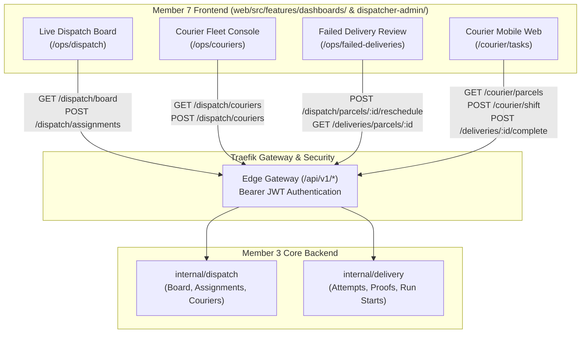

# SwiftDrop Dispatch & Delivery Module — Frontend Integration Specification

> **Audience:** Frontend Engineers (Member 7: Dispatcher/Admin UI & Courier Mobile Web)  
> **Backend Service / Module:** `core-api` — `internal/dispatch` & `internal/delivery` (Member 3)  
> **Base URL:** `/api/v1`  
> **Security Protocol:** Bearer JWT in `Authorization: Bearer <token>` (Strict RBAC: `DISPATCHER`, `ADMIN`, `COURIER`)

---

## 1. Architectural Overview & Frontend Responsibilities

In SwiftDrop, operational logistics are split between two core internal modules implemented by **Member 3** and consumed directly by **Member 7**'s frontend screens:

1. **Dispatch Context (`/api/v1/dispatch/*`, `/api/v1/couriers`):**
   - Active courier fleet roster, shift status, and live vehicle capacity tracking.
   - Dispatch Board live aggregation (unassigned/failed parcels awaiting courier match).
   - Single & batch courier assignments and cancellations.
   - Dispatcher review and reattempt scheduling for failed deliveries.
2. **Delivery & Courier Operations Context (`/api/v1/courier/*`, `/api/v1/deliveries/*`):**
   - Courier daily active manifest and shift toggling.
   - Transit milestone triggers (`OUT_FOR_DELIVERY` pickup scans).
   - Doorstep Proof of Delivery (POD) photo uploads and signature captures.
   - Structured delivery failure classification and attempt counting.



---

## 2. Complete Endpoints Master Directory

| # | HTTP Method & URI Path | Frontend Screen | Primary Role | Idempotent |
| :---: | :--- | :--- | :--- | :---: |
| **D-01** | `GET /api/v1/dispatch/board` | Live Dispatch Board | `DISPATCHER`, `ADMIN` | Yes |
| **D-02** | `POST /api/v1/dispatch/assignments` | Dispatch Board (Assign Modal/Drop) | `DISPATCHER`, `ADMIN` | Yes (`Idempotency-Key`) |
| **D-03** | `POST /api/v1/dispatch/assignments/{id}/cancel` | Dispatch Board (Unassign / Reassign) | `DISPATCHER`, `ADMIN` | Yes |
| **D-04** | `GET /api/v1/dispatch/couriers` | Fleet Management Roster | `DISPATCHER`, `ADMIN` | Yes |
| **D-05** | `GET /api/v1/dispatch/couriers/{id}` | Courier Workload Modal | `DISPATCHER`, `ADMIN` | Yes |
| **D-06** | `POST /api/v1/dispatch/couriers` | Fleet Management (Add Courier) | `ADMIN`, `DISPATCHER` | No |
| **D-07** | `POST /api/v1/dispatch/parcels/{id}/reschedule` | Failed Delivery Review Screen | `DISPATCHER`, `ADMIN` | Yes |
| **C-01** | `POST /api/v1/courier/shift` | Courier Mobile Header | `COURIER` | No |
| **C-02** | `GET /api/v1/courier/parcels` | Courier Mobile Manifest | `COURIER` | Yes |
| **C-03** | `POST /api/v1/courier/parcels/{id}/start-run` | Courier Manifest (Single Run) | `COURIER` | Yes |
| **C-04** | `POST /api/v1/courier/runs/start-batch` | Courier Manifest (Batch Run) | `COURIER` | Yes |
| **P-01** | `POST /api/v1/deliveries/{id}/proof-photo` | POD Modal (Camera Capture) | `COURIER` | No |
| **P-02** | `POST /api/v1/deliveries/{id}/complete` | POD Modal (Confirm Delivery) | `COURIER` | Yes (`Idempotency-Key`) |
| **P-03** | `POST /api/v1/deliveries/{id}/failed` | Doorstep Exception Modal | `COURIER` | Yes |
| **P-04** | `GET /api/v1/deliveries/parcels/{id}` | Parcel Tracking / Audit Drawer | `DISPATCHER`, `ADMIN`, `COURIER` | Yes |

---

## 3. Dispatcher Board & Fleet Endpoints

### 3.1 `GET /api/v1/dispatch/board` — Query Dispatch Board
- **Purpose:** Primary data source for the Dispatcher Board. Displays unassigned bookings, reattempt-eligible parcels, and the active courier fleet with real-time capacity loads.
- **Access:** `DISPATCHER`, `ADMIN`
- **Headers:** `Authorization: Bearer <jwt>`
- **Query Parameters:**
  - `zone_id` (*required*, string): Canonical delivery zone code (e.g., `ZONE_COLOMBO_01`, `ZONE_KANDY_01`).
  - `status` (*optional*, string, default: `ELIGIBLE`): Filter parcels by `CREATED` or `ATTEMPT_FAILED`.
- **Response (`200 OK`):**
```json
{
  "data": {
    "zone_id": "ZONE_COLOMBO_01",
    "summary": {
      "total_unassigned_parcels": 2,
      "total_active_couriers": 2,
      "total_fleet_capacity": 85,
      "utilized_fleet_capacity": 4
    },
    "unassigned_parcels": [
      {
        "id": "prcl_01HXYZ1234567890",
        "tracking_number": "SD-20261024-04921",
        "current_status": "CREATED",
        "destination_zone": "ZONE_COLOMBO_01",
        "weight_kg": 2.50,
        "recipient_city": "Colombo 03",
        "created_at": "2026-10-24T09:00:00Z"
      },
      {
        "id": "prcl_01HXYZ9988776655",
        "tracking_number": "SD-20261024-09812",
        "current_status": "ATTEMPT_FAILED",
        "destination_zone": "ZONE_COLOMBO_01",
        "attempt_count": 1,
        "weight_kg": 4.10,
        "recipient_city": "Colombo 03",
        "created_at": "2026-10-23T14:00:00Z"
      }
    ],
    "active_couriers": [
      {
        "courier_id": "usr_courier_bob",
        "name": "Bob Miller",
        "employee_code": "CR-0012",
        "vehicle_type": "MOTORCYCLE",
        "active_assignments": 3,
        "max_capacity": 25,
        "shift_status": "ON_SHIFT",
        "capacity_available": 22
      }
    ]
  }
}
```
- **Error Codes:**
  - `400 Bad Request`: `MISSING_ZONE_ID` — The `zone_id` query parameter is required.
  - `401 Unauthorized`: Missing or expired JWT.
  - `403 Forbidden`: User does not hold `DISPATCHER` or `ADMIN` role.

---

### 3.2 `POST /api/v1/dispatch/assignments` — Assign Courier to Parcel
- **Purpose:** Assigns an unassigned or reattempt-ready parcel to a specific active courier.
- **Access:** `DISPATCHER`, `ADMIN`
- **Headers:** 
  - `Authorization: Bearer <jwt>`
  - `Content-Type: application/json`
  - `Idempotency-Key: <uuid-v4>` *(Recommended to prevent duplicate assignments on rapid clicks)*
- **Request Body:**
```json
{
  "parcel_id": "prcl_01HXYZ1234567890",
  "courier_id": "usr_courier_bob"
}
```
- **Response (`200 OK`):**
```json
{
  "data": {
    "assignment_id": "asgn_01HJ0987654321",
    "parcel_id": "prcl_01HXYZ1234567890",
    "courier_id": "usr_courier_bob",
    "status": "ASSIGNED",
    "assigned_by": "usr_dispatcher_dan",
    "assigned_at": "2026-10-24T09:30:00Z"
  }
}
```
- **Error Codes:**
  - `400 Bad Request`: `COURIER_NOT_ON_SHIFT` — Driver is currently `OFF_SHIFT` or `ON_BREAK`.
  - `400 Bad Request`: `PARCEL_NOT_ELIGIBLE_FOR_ASSIGNMENT` — Parcel is already in transit or completed.
  - `409 Conflict`: `COURIER_CAPACITY_EXCEEDED` — Courier active deliveries equal `max_capacity`.
  - `409 Conflict`: `PARCEL_ALREADY_ASSIGNED` — Concurrent assignment detected (another dispatcher assigned it first).

---

### 3.3 `POST /api/v1/dispatch/assignments/{id}/cancel` — Cancel Assignment / Unassign
- **Purpose:** Releases a parcel from a courier back to the unassigned queue.
  > **Frontend Rule:** SwiftDrop does not have a single-step "reassign" endpoint. Reassigning is performed as **Cancel Assignment**, followed by **Assign Courier**, ensuring an audit trail.
- **Access:** `DISPATCHER`, `ADMIN`
- **Request Path:** `id` is the `assignment_id` (or assignment aggregate ID).
- **Request Body:**
```json
{
  "cancellation_reason": "Courier vehicle flat tire; reassigning to relief driver."
}
```
- **Response (`200 OK`):**
```json
{
  "data": {
    "assignment_id": "asgn_01HJ0987654321",
    "parcel_id": "prcl_01HXYZ1234567890",
    "courier_id": "usr_courier_bob",
    "status": "CANCELLED",
    "ended_at": "2026-10-24T09:45:00Z",
    "notes": "Courier vehicle flat tire; reassigning to relief driver."
  }
}
```
- **Error Codes:**
  - `404 Not Found`: `ASSIGNMENT_NOT_FOUND`.
  - `409 Conflict`: `ASSIGNMENT_ALREADY_CLOSED` — Already marked delivered, cancelled, or finished.

---

### 3.4 `GET /api/v1/dispatch/couriers` — List & Filter Fleet
- **Purpose:** Powers the Courier Fleet Management table and courier selection dropdowns.
- **Access:** `DISPATCHER`, `ADMIN`
- **Query Parameters:**
  - `zone_id` (*optional*): e.g. `ZONE_COLOMBO_01`.
  - `status` (*optional*): `ON_SHIFT`, `OFF_SHIFT`, `ON_BREAK`, `SUSPENDED`.
  - `vehicle_type` (*optional*): `MOTORCYCLE`, `VAN`, `TRUCK`.
- **Response (`200 OK`):**
```json
{
  "data": {
    "total_couriers": 1,
    "couriers": [
      {
        "user_id": "usr_courier_bob",
        "employee_code": "CR-0012",
        "name": "Bob Miller",
        "phone_number": "+94771112233",
        "vehicle_type": "MOTORCYCLE",
        "max_capacity": 25,
        "status": "ON_SHIFT",
        "current_zone_id": "ZONE_COLOMBO_01",
        "active_assignments": 3,
        "is_active": true
      }
    ]
  }
}
```

---

### 3.5 `GET /api/v1/dispatch/couriers/{id}` — Individual Courier Profile
- **Purpose:** Workload breakdown modal when clicking on a courier card.
- **Access:** `DISPATCHER`, `ADMIN`
- **Path Parameter:** `id` is the courier's `user_id`.
- **Response (`200 OK`):**
```json
{
  "data": {
    "user_id": "usr_courier_bob",
    "employee_code": "CR-0012",
    "name": "Bob Miller",
    "phone_number": "+94771112233",
    "vehicle_type": "MOTORCYCLE",
    "max_capacity": 25,
    "status": "ON_SHIFT",
    "current_zone_id": "ZONE_COLOMBO_01",
    "active_assignments": 3,
    "capacity_available": 22,
    "is_active": true,
    "created_at": "2026-10-21T08:00:00Z"
  }
}
```

---

### 3.6 `POST /api/v1/dispatch/couriers` — Provision Courier Fleet Profile
- **Purpose:** Onboards an existing user account into the operational courier fleet.
- **Access:** `ADMIN`, `DISPATCHER`
- **Request Body:**
```json
{
  "user_id": "usr_99887766-aaaa-bbbb-cccc-112233445566",
  "employee_code": "CR-0042",
  "vehicle_type": "MOTORCYCLE",
  "max_capacity": 25,
  "current_zone_id": "ZONE_COLOMBO_01"
}
```
- **Response (`201 Created`):**
```json
{
  "data": {
    "user_id": "usr_99887766-aaaa-bbbb-cccc-112233445566",
    "employee_code": "CR-0042",
    "vehicle_type": "MOTORCYCLE",
    "max_capacity": 25,
    "status": "OFF_SHIFT",
    "current_zone_id": "ZONE_COLOMBO_01",
    "is_active": true,
    "created_at": "2026-10-24T08:00:00Z"
  }
}
```
- **Error Codes:**
  - `400 Bad Request`: `INVALID_VEHICLE_TYPE` — Allowed: `MOTORCYCLE`, `VAN`, `TRUCK`.
  - `409 Conflict`: `COURIER_PROFILE_EXISTS` — Operational profile already registered for this user ID.

---

### 3.7 `POST /api/v1/dispatch/parcels/{id}/reschedule` — Dispatcher Authorizes Reattempt
- **Purpose:** Resolves an `ATTEMPT_FAILED` parcel. Under ADR-004, couriers cannot unilaterally reattempt deliveries; only an authenticated Dispatcher or Admin can review failure notes and schedule a reattempt.
- **Access:** `DISPATCHER`, `ADMIN`
- **Path Parameter:** `id` is the parcel ID (`parcels.id`).
- **Request Body:**
```json
{
  "target_courier_id": "usr_courier_bob",
  "scheduled_date": "2026-10-25",
  "preferred_time_window": "AFTERNOON_14_18",
  "dispatch_notes": "Customer confirmed home after 2:00 PM via support phone call."
}
```
- **Response (`200 OK`):**
```json
{
  "data": {
    "parcel_id": "prcl_01HXYZ9988776655",
    "status": "ASSIGNED",
    "attempt_count": 1,
    "max_attempts": 3,
    "scheduled_date": "2026-10-25",
    "preferred_time_window": "AFTERNOON_14_18",
    "assigned_courier_id": "usr_courier_bob",
    "rescheduled_at": "2026-10-24T10:15:00Z"
  }
}
```
- **Error Codes:**
  - `400 Bad Request`: `MAX_ATTEMPTS_EXCEEDED` — Parcel has reached 3 attempts; must return to sender.
  - `409 Conflict`: `INVALID_STATE_FOR_RESCHEDULE` — Parcel is not in `ATTEMPT_FAILED` status.

---

## 4. Courier Operations & Proof of Delivery (POD) Endpoints

These endpoints power the mobile-responsive Courier web view (`web/src/features/dashboards/CourierDashboard.tsx`), which is also within Member 7's scope.

### 4.1 `POST /api/v1/courier/shift` — Toggle Courier Shift Status
- **Access:** `COURIER`
- **Request Body:**
```json
{
  "status": "ON_SHIFT"
}
```
*(Permitted values: `ON_SHIFT`, `OFF_SHIFT`, `ON_BREAK`)*
- **Response (`200 OK`):**
```json
{
  "data": {
    "courier_id": "usr_courier_bob",
    "status": "ON_SHIFT",
    "max_capacity": 25,
    "active_assignments": 3,
    "updated_at": "2026-10-24T07:45:00Z"
  }
}
```

---

### 4.2 `GET /api/v1/courier/parcels` — Active Delivery Manifest
- **Access:** `COURIER` (Automatically scoped to the authenticated caller's JWT)
- **Response (`200 OK`):**
```json
{
  "data": {
    "courier_id": "usr_courier_bob",
    "shift_status": "ON_SHIFT",
    "active_count": 1,
    "parcels": [
      {
        "parcel_id": "prcl_01HXYZ1234567890",
        "tracking_number": "SD-20261024-04921",
        "current_status": "OUT_FOR_DELIVERY",
        "destination_zone": "ZONE_COLOMBO_01",
        "recipient_name": "Jane Smith",
        "recipient_phone": "+94771234567",
        "delivery_street": "No 42, Galle Road",
        "delivery_city": "Colombo 03",
        "weight_kg": 2.50,
        "handling_instructions": "Fragile: glassware inside. Leave at door if gate locked.",
        "attempt_count": 0,
        "assigned_at": "2026-10-24T09:30:00Z"
      }
    ]
  }
}
```

---

### 4.3 `POST /api/v1/courier/parcels/{id}/start-run` — Start Delivery Run (Single)
- **Purpose:** Courier confirms physical package pickup from hub/depot; moves parcel status from `ASSIGNED` to `OUT_FOR_DELIVERY`.
- **Access:** `COURIER`
- **Request Body:**
```json
{
  "depot_hub_code": "HUB_COLOMBO_CENTRAL",
  "notes": "Collected from rack B-12"
}
```
- **Response (`200 OK`):**
```json
{
  "data": {
    "parcel_id": "prcl_01HXYZ1234567890",
    "tracking_number": "SD-20261024-04921",
    "status": "OUT_FOR_DELIVERY",
    "started_at": "2026-10-24T10:15:00Z"
  }
}
```

---

### 4.4 `POST /api/v1/courier/runs/start-batch` — Start Batch Delivery Run
- **Purpose:** Courier marks all morning assigned parcels as picked up and out for delivery in one tap.
- **Access:** `COURIER`
- **Request Body:**
```json
{
  "parcel_ids": [
    "prcl_01HXYZ1234567890",
    "prcl_01HXYZ9988776655"
  ],
  "depot_hub_code": "HUB_COLOMBO_CENTRAL"
}
```
- **Response (`200 OK`):**
```json
{
  "data": {
    "total_started": 2,
    "started_at": "2026-10-24T10:15:00Z",
    "parcels": [
      { "parcel_id": "prcl_01HXYZ1234567890", "status": "OUT_FOR_DELIVERY" },
      { "parcel_id": "prcl_01HXYZ9988776655", "status": "OUT_FOR_DELIVERY" }
    ]
  }
}
```

---

### 4.5 `POST /api/v1/deliveries/{id}/proof-photo` — Upload Proof-of-Delivery Photo
- **Purpose:** Pre-uploads the delivery photo to Cloudflare R2 / S3 storage before submitting final completion.
- **Access:** `COURIER`
- **Headers:** `Content-Type: multipart/form-data`
- **Multipart Form Payload:**
  - `photo`: Binary image file (JPEG, PNG, WebP; max 10 MB).
- **Response (`200 OK`):**
```json
{
  "data": {
    "parcel_id": "prcl_01HXYZ1234567890",
    "proof_attachment_url": "proofs/2026/10/prcl_01HXYZ1234567890_pod.jpg",
    "file_size_bytes": 1420850,
    "uploaded_at": "2026-10-24T11:14:00Z"
  }
}
```
- **Frontend Step:** Store `proof_attachment_url` in component state; supply it in `POST /deliveries/{id}/complete`.

---

### 4.6 `POST /api/v1/deliveries/{id}/complete` — Complete Delivery with Proof
- **Purpose:** Final doorstep confirmation. Transitions parcel from `OUT_FOR_DELIVERY` to `DELIVERED`.
- **Access:** `COURIER`
- **Headers:** `Idempotency-Key: <uuid-v4>`
- **Request Body:**
```json
{
  "proof_type": "SIGNATURE",
  "signature_data": "data:image/svg+xml;base64,PHN2ZyB4bWxucz0iaHR0cDovL3d3dy53My5vcmcvMjAwMC9zdmciIHdpZHRoPSIxMDAiIGhlaWdodD0iMTAwIj48cGF0aCBkPSJNIDEwIDEwIEwgOTAgOTAgWiIgc3Ryb2tlPSJibGFjayIgZmlsbD0ibm9uZSIvPjwvc3ZnPg==",
  "proof_url": "proofs/2026/10/prcl_01HXYZ1234567890_pod.jpg",
  "received_by_name": "Jane Smith (Self)",
  "notes": "Handed directly to recipient at front entrance",
  "latitude": 6.9271,
  "longitude": 79.8612
}
```
- **Response (`200 OK`):**
```json
{
  "data": {
    "delivery_attempt_id": "atm_01HK9988776655",
    "parcel_id": "prcl_01HXYZ1234567890",
    "status": "DELIVERED",
    "delivered_at": "2026-10-24T11:15:00Z",
    "proof_type": "SIGNATURE",
    "received_by_name": "Jane Smith (Self)"
  }
}
```
- **Error Codes:**
  - `400 Bad Request`: `MISSING_DELIVERY_PROOF` — Neither valid photo URL nor signature string provided.
  - `403 Forbidden`: `NOT_ASSIGNED_COURIER` — Current courier is not assigned to this package.
  - `409 Conflict`: `INVALID_STATE_FOR_DELIVERY` — Parcel not in `OUT_FOR_DELIVERY` state.

---

### 4.7 `POST /api/v1/deliveries/{id}/failed` — Record Failed Attempt
- **Purpose:** Logs an unsuccessful doorstep drop.
- **Access:** `COURIER`
- **Request Body:**
```json
{
  "reason_code": "RECIPIENT_UNAVAILABLE",
  "notes": "No answer at intercom after 2 calls. Notice slip left at door.",
  "latitude": 6.9271,
  "longitude": 79.8612
}
```
  > **Approved Whitelist for `reason_code`:**
  > - `RECIPIENT_UNAVAILABLE`: Recipient was not present at the address.
  > - `INCORRECT_ADDRESS`: Delivery address not found or faulty.
  > - `PREMISES_INACCESSIBLE`: Gate locked, guard refused entry, dog on loose.
  > - `RECIPIENT_REJECTED`: Recipient refused package acceptance.
  > - `OTHER`: Miscellaneous exception (requires `notes` length $\ge 15$ characters).

- **Response — Recoverable Attempt ($< 3$ attempts, `200 OK`):**
```json
{
  "data": {
    "attempt_id": "atm_01HK9988776699",
    "parcel_id": "prcl_01HXYZ1234567890",
    "attempt_number": 1,
    "max_attempts": 3,
    "status": "ATTEMPT_FAILED",
    "reason_code": "RECIPIENT_UNAVAILABLE",
    "next_action": "RETURN_TO_HUB_FOR_REVIEW",
    "recorded_at": "2026-10-24T11:35:00Z"
  }
}
```
- **Response — Terminal 3rd Attempt ($= 3$ attempts, `200 OK`):**
```json
{
  "data": {
    "attempt_id": "atm_01HK9988776700",
    "parcel_id": "prcl_01HXYZ1234567890",
    "attempt_number": 3,
    "max_attempts": 3,
    "status": "RETURNED",
    "reason_code": "RECIPIENT_UNAVAILABLE",
    "next_action": "RETURN_TO_SENDER",
    "recorded_at": "2026-10-24T11:35:00Z"
  }
}
```

---

### 4.8 `GET /api/v1/deliveries/parcels/{id}` — Delivery Attempt Audit History
- **Purpose:** Displays previous delivery attempts, failure reasons, and timestamps inside the Dispatcher review drawer.
- **Access:** `DISPATCHER`, `ADMIN`, `COURIER`
- **Response (`200 OK`):**
```json
{
  "data": {
    "parcel_id": "prcl_01HXYZ1234567890",
    "tracking_number": "SD-20261024-04921",
    "current_status": "DELIVERED",
    "attempt_count": 2,
    "attempts": [
      {
        "attempt_id": "atm_01HK9988776699",
        "attempt_number": 1,
        "outcome": "FAILED",
        "reason_code": "RECIPIENT_UNAVAILABLE",
        "notes": "Intercom not answering",
        "courier_id": "usr_courier_bob",
        "attempted_at": "2026-10-24T11:35:00Z"
      },
      {
        "attempt_id": "atm_01HK9988776655",
        "attempt_number": 2,
        "outcome": "SUCCESS",
        "proof_type": "SIGNATURE",
        "received_by_name": "Jane Smith",
        "courier_id": "usr_courier_bob",
        "attempted_at": "2026-10-25T14:15:00Z"
      }
    ]
  }
}
```

---

## 5. Standard Error Envelopes

All errors returned by the dispatch-delivery modules adhere to the RFC 7807 problem structure:

```json
{
  "error": {
    "code": "COURIER_CAPACITY_EXCEEDED",
    "message": "Assigned courier has reached maximum capacity of 25 active parcels.",
    "request_id": "req_01HJ99223344",
    "timestamp": "2026-10-24T14:32:00Z"
  }
}
```

### Key Frontend Error Mapping Guide:

| Backend Error Code | HTTP Status | Recommended Frontend User Feedback |
| :--- | :---: | :--- |
| `MISSING_ZONE_ID` | `400` | Highlight the Zone Selector dropdown; a zone must be selected to view the board. |
| `COURIER_NOT_ON_SHIFT` | `400` | Toast alert: *"Selected courier is currently off shift or on break."* |
| `PARCEL_NOT_ELIGIBLE_FOR_ASSIGNMENT` | `400` | Refresh the queue; parcel was already processed or moved to a non-assignable state. |
| `COURIER_CAPACITY_EXCEEDED` | `409` | Badge courier card in red: *"Courier workload full (25/25 parcels). Rebalance to another driver."* |
| `PARCEL_ALREADY_ASSIGNED` | `409` | Optimistic lock collision: *"Another dispatcher just assigned this parcel. Refreshing board..."* |
| `MAX_ATTEMPTS_EXCEEDED` | `400` | Disable the Reschedule button: *"Maximum 3 attempts reached. Parcel must be returned to merchant."* |
| `NOT_ASSIGNED_COURIER` | `403` | In courier mobile view: *"You are not assigned to deliver this parcel."* |
| `MISSING_DELIVERY_PROOF` | `400` | Prevent submission: *"Please capture a photo or collect a signature before completing delivery."* |

---

## 6. Frontend Developer Implementation Checklist

1. **Zone Filter Persistence:**
   - Store the active `zone_id` in URL search params (e.g., `/ops/dispatch?zone_id=ZONE_COLOMBO_01`) or LocalStorage so dispatchers remain in their operating zone upon refresh.
2. **Auto-Polling:**
   - Poll `GET /api/v1/dispatch/board?zone_id={activeZone}` every 30 seconds to reflect newly booked parcels and courier load changes.
3. **Idempotency Keys:**
   - On `POST /dispatch/assignments` and `POST /deliveries/{id}/complete`, generate a client UUID (`crypto.randomUUID()`) and send via `Idempotency-Key` header to protect against accidental double-clicks.
4. **Optimistic Locking Handlers:**
   - When a `409 Conflict` occurs during assignment, trigger an immediate board re-fetch rather than crashing.
5. **Two-Step Proof-of-Delivery Flow:**
   - For camera uploads: Call `POST /deliveries/{id}/proof-photo` first, retrieve the `proof_attachment_url`, then call `POST /deliveries/{id}/complete` passing the returned URL.
6. **UI Component Tokens (AGENTS.md Compliance):**
   - Use role preset `[data-role="DISPATCHER"]` on the Dispatcher dashboard layout.
   - Compose exclusively from `@/shared/components/ui/` primitives (no direct `@radix-ui/*` imports or raw `<button>` / `<input>` elements). Conserve semantic tokens (`bg-surface`, `text-primary`, `border-border`).
