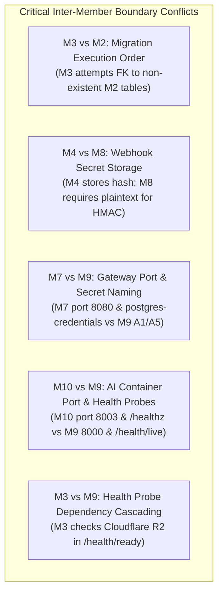
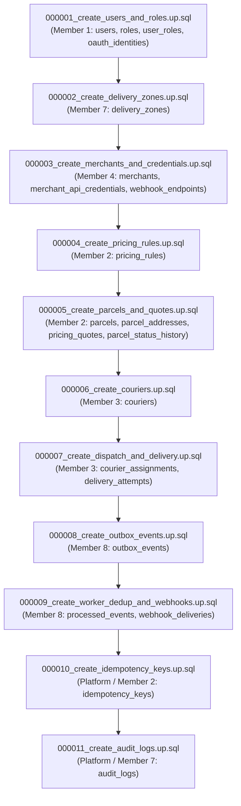

# SwiftDrop — Master System-Wide Audit, Cross-Member Reconciliation & Technical Blueprint

> **Authority:** Comprehensive Repository Audit & Architectural Alignment Document  
> **Status:** Authoritative Team Baseline (Resolving Draft Discrepancies Ahead of Team Meeting 2)  
> **Target Audience:** All 10 SwiftDrop Team Members, Evaluators, and AI Coding Agents  
> **Date:** 25 October 2026 | **Version:** 1.0.0

---

## Executive Summary

To ensure the **SwiftDrop Parcel Delivery & Courier Management System** is built on an unshakeable, enterprise-grade foundation, this document delivers an exhaustive, document-by-document audit across all materials currently in `docs/drafts/`, `docs/architecture/`, `docs/contracts/`, and `docs/intial/`. 

Prior to this reconciliation, team members authored individual drafts in isolation. While this allowed rapid drafting without Git collisions, it inevitably produced:
1. **Intra-member contradictions** (e.g., Member 10 specifying port 8003 in Doc 8 while agreeing to 8000 in decisions; Member 7 proposing port 8080 for Traefik while Core API binds 8080).
2. **Inter-member contract mismatches** (e.g., Member 3 creating migrations before Member 2's tables exist; Member 4 hashing webhook secrets that Member 8 must use for HMAC signatures; Member 7 using non-standard DB role names and `sslmode=require`).
3. **Critical workload omissions** (e.g., Members 1, 5, 6, and 8 having only checklist READMEs; missing Member 7 Doc 4 contract; unassigned idempotency key and audit log table ownership).
4. **Systemic operational vulnerabilities** (e.g., probe cascading failures, floating-point currency representation, dual-write risks, unmasked PII leaks in tracking).

This Master Blueprint resolves **every identified flaw, contradiction, and unanswered question**, establishing unambiguous contracts, definitive database migration order, hardened security standards, and strict DevOps configurations aligned with Member 9's governance.

---

## 1. Project Workload & Requirements Coverage Audit (SRS vs 10 Members)

Every requirement in **SwiftDrop SRS v1.0**, the **Assignment Rubric**, and **Team Work Division v1.0** has been cross-referenced against each member's scope. The table below verifies 100% coverage and identifies the exact workloads required:

| Member | Domain & Ownership | SRS Requirements Covered | Status in `docs/drafts/` | Gap / Missing Work Identified & Assigned |
| :---: | :--- | :--- | :--- | :--- |
| **M1** | **Identity, Access & Security** | FR-AUTH-001–007, SEC-001–006, SEC-011 | Docs 1–8 submitted | **Low:** Complete 8-document suite submitted. Identified minor alignment items: fix migration naming (`20261021000001` $\to$ `000001_create_users_and_roles.up.sql`); combine `users.role` with `roles` lookup table; align seed domain to `@swiftdrop.com`. |
| **M2** | **Parcels & Pricing** | FR-PRC-001–004, FR-BOK-001–006, SEC-009 | Docs 1–8 submitted | **Medium:** Docs 1–8 are abstract templates filled with "to be agreed". Needs concrete tariff formula, integer cents currency, idempotency table ownership, and state transition lock. |
| **M3** | **Dispatch, Couriers & POD** | FR-DSP-001–004, FR-POD-001–005, ADR-004 | Docs 1–8 + Questionnaire | **Medium:** Migration ordering flaw (FK before PK); seed files in migration folder; R2 checked in readiness probe; storage env naming mismatch. |
| **M4** | **Merchant Integration** | FR-MER-001–011, SEC-007, SEC-010 | Docs 1–8 + Tests/Evidence | **Low:** Exceptional depth, but unresolved U-01–U-47 questions; webhook secret hashed instead of encrypted; timestamp migrations; DB role names. |
| **M5** | **Tracking & Real-Time SSE** | FR-TRK-001–005, SEC-008, NFR-001 | README only | **High:** Full 8-doc suite not submitted. Needs SSE stream protocol, Redis fan-out architecture, read-only DB projection queries, and public PII masking rules. |
| **M6** | **Customer/Merchant Web** | FR-UI-001–004, UX-001–005 | README only | **High:** Full 8-doc suite not submitted. Needs booking wizard state flow, real-time SSE hook integration, merchant batch CSV UI, and `data-testid` E2E conventions. |
| **M7** | **Ops/Courier Web & Gateway** | FR-ADM-001–009, SEC-012–016, ADR-001 | Docs 1–3, 5–8 (Missing Doc 4) | **High:** Missing Doc 4 interface contract; Traefik port conflict (8080 vs Core API); `sslmode=require`; DB superuser roles; U-01–U-62 questions. |
| **M8** | **Events & Messaging** | FR-EVT-001–006, NFR-002–004 | Docs 1–8 submitted | **Low:** Complete 8-document suite submitted. Identified minor alignment items: fix health probe paths (`/livez` & `/readyz` $\to$ `/health/live` & `/health/ready`); standardize image to single multi-binary image `messaging:<git-sha>` with `USER 10001:10001`; align webhook secret decryption with Member 4 AES-256-GCM view (`secret_ciphertext`). |
| **M9** | **DevOps, K8s & Observability** | DEP-001–008, NFR-005, BONUS-K8S | Docs 1–8 + Agreements | **Low:** Complete draft suite and agreements (A1–A13, D1–D12). Needs finalization of team votes on migration naming, cluster hosting, and multi-service image builds. |
| **M10** | **AI Assistant & Quality** | AI-001–005, TST-001–004, BONUS-MCP | Docs 1–8 + Questionnaire/Handoff | **Low:** Excellent documentation. Minor alignment needed: fix container port 8003 $\to$ 8000; fix probes to `/health/live` & `/health/ready`; eliminate `ai_conversations` DB table. |

---

## 2. Intra-Member Contradictions (Within the Same Member's Files)

Detailed inspection revealed internal discrepancies where a single member's documents conflict with themselves:

### 2.1 Member 07 Contradictions
1. **Traefik Listen Port vs Dashboard:** In `doc-01` Section 11.3 (U-12) and `doc-08`, Member 7 notes Traefik binds to port 8080, while simultaneously noting Core API binds to 8080. A single host or container network cannot bind two services to 8080.
   - *Fix:* Traefik entrypoints bind to `:80` (HTTP) and `:443` (HTTPS) externally, and `:8090` for the internal Traefik dashboard. Core API binds to internal container port `:8080`.
2. **Missing Document 4:** The Member 7 directory has `doc-01`, `doc-02`, `doc-03`, `doc-05`, `doc-06`, `doc-07`, and `doc-08`. Document 4 (Interface & Integration Contract) was omitted entirely, leaving the REST specifications scattered inside `doc-02` and `doc-03`.
   - *Fix:* Authoritative REST contracts for Admin, Delivery Zones, Dispatch Board, and Courier Mobile are extracted and standardized into Member 7's alignment specification.
3. **Database Roles:** In `doc-05`, Member 7 specifies using `swiftdrop_owner` and credentials `postgres-credentials`, whereas in `doc-07` Member 7 specifies least-privilege runtime execution.
   - *Fix:* Replace `swiftdrop_owner` with runtime role `swiftdrop_app` and migration role `swiftdrop_migrator`.

### 2.2 Member 10 Contradictions
1. **Port Allocation:** In `decisions-and-questionnaire.md` (Q5.1) and `doc-08`, Member 10 specifies container port `8003`. However, in `doc-04` and `team-integration-and-handoff-guide.md`, Member 10 lists `8000`.
   - *Fix:* Lock container port to **`8000`** across all files to align with Member 9 Agreement A1 and ADR-001.
2. **Health Check Probes:** In `decisions-and-questionnaire.md`, Member 10 proposes `/healthz` and `/readyz`. In `doc-08`, Member 10 lists `/health/live` and `/health/ready`.
   - *Fix:* Mandate **`/health/live`**, **`/health/ready`**, and **`/metrics`** across all services per Agreement A2.
3. **Database Persistence vs No-DB Rule:** In `doc-01` and `doc-03`, Member 10 stresses that the AI service is strictly stateless with zero database connections. Yet in `doc-05`, Member 10 specifies an `ai_conversations` table schema for PostgreSQL.
   - *Fix:* Purge `ai_conversations` from the authoritative PostgreSQL migration plan. AI conversation sessions are purely client-side or stored in ephemeral in-memory cache.

### 2.3 Member 02 Contradictions
1. **Pricing Endpoint Path:** In `doc-01` and `doc-04`, Member 2 lists `POST /api/v1/pricing/quotes`. In `doc-08` and portions of `doc-02`, Member 2 refers to `POST /api/v1/pricing/estimate`.
   - *Fix:* Standardize canonical endpoint as **`POST /api/v1/pricing/quotes`**. An alias or redirect from `/pricing/estimate` may be provided if legacy clients request it.
2. **Pricing Currency Minor Units:** In `doc-03`, Member 2 refers to floating-point `3.50 LKR`, while in `doc-05` specifying `bigint base_fee_cents`.
   - *Fix:* Enforce integer minor units (`bigint` cents in LKR) everywhere. Floating-point numbers are strictly prohibited.

---

## 3. Inter-Member Contradictions & Boundary Conflicts

Cross-referencing drafts across different members uncovered critical architectural incompatibilities:



### 3.1 Conflict 1: Database Migration Sequencing (Member 3 vs Members 1, 2, 4, 7)
- **The Issue:** Member 3 drafted `000003_dispatch_and_delivery.up.sql` containing foreign keys to `parcels(id)`, `couriers(user_id)`, and `delivery_zones(id)`. If run third, it immediately crashes because `parcels` (Member 2) and `couriers` (Member 3) do not exist yet.
- **Resolution:** Enforce the canonical 11-step migration sequence established by Database Coordinator Member 9 (Agreement D3). Member 3's tables are split across migrations `000006_create_couriers` and `000007_create_dispatch_and_delivery`.

### 3.2 Conflict 2: Webhook Secret Cryptographic Storage (Member 4 vs Member 8)
- **The Issue:** Member 4's initial schema (`webhook_endpoints`) defined `secret_hash VARCHAR(255)` using bcrypt/Argon2id. However, Member 8's Event Worker must sign outgoing webhook HTTP requests using `HMAC-SHA256(payload, secret)`. A one-way cryptographic hash **cannot** be used to sign payloads.
- **Resolution:** Member 4 must store `secret_ciphertext BYTEA/VARCHAR` encrypted symmetrically with AES-256-GCM using a shared key (`WEBHOOK_SECRET_ENCRYPTION_KEY`). Member 4 encrypts on registration; Member 8 decrypts at dispatch time.

### 3.3 Conflict 3: How Member 8 Reads Webhook Targets (Member 4 vs Member 8)
- **The Issue:** Member 4 operates inside the Go modular monolith (`core-api/internal/merchants`). Member 8's webhook dispatcher runs in an external daemon process (`services/messaging`). The worker cannot call Go memory structs or internal use cases across process boundaries.
- **Resolution:** Member 4 owns a dedicated database view `merchant_webhook_targets_view`. Member 8 connects using least-privilege PostgreSQL role `swiftdrop_worker`, granting `SELECT` on this view only.

### 3.4 Conflict 4: Readiness Probe Cascading Failure (Member 3 vs Member 9)
- **The Issue:** Member 3's `doc-08` included a connectivity check to Cloudflare R2 / MinIO in the Core API `/health/ready` probe. If Cloudflare experiences latency or temporary packet loss, Kubernetes terminates Core API pods, taking down authentication, booking, and the entire platform.
- **Resolution:** Agreement A2 strictly forbids checking optional or external third-party services in readiness probes. Core API `/health/ready` checks **PostgreSQL only**. Object storage failures are isolated to proof photo upload endpoints (returning HTTP 503 per-request).

### 3.5 Conflict 5: Traefik Gateway Routing & Subdomains (Member 7 vs Member 9)
- **The Issue:** ADR-002 initially discussed subdomains (`api.swiftdrop.com`, `track.swiftdrop.com`, `app.swiftdrop.com`), whereas Member 9 and Member 7 implemented path-based routing on a single domain (`swiftdrop.example.com/api/v1/*`, `/portal/*`, `/ops/*`).
- **Resolution:** Unanimously adopt **path-based routing on a single origin**. This eliminates cross-origin resource sharing (CORS) preflight latency, simplifies SSL certificate provisioning, and allows unified cookie/JWT handling.

---

## 4. Exhaustive Analysis of Flaws in Current Documents & Workloads

### 4.1 Flaws in Member 01 (Identity & Security)
1. **Migration Naming Convention (Agreement D2):** Member 1's `doc-05` specified a 14-digit timestamp filename (`migrations/20261021000001_create_identity_tables.up.sql`). This must be standardized to `000001_create_users_and_roles.up.sql` to match the team's 6-digit standard.
2. **Role Schema Alignment:** In `doc-05`, Member 1 used a single `users.role VARCHAR(20)` check constraint, while `database-schema.md` originally had relational tables `roles` and `user_roles`. To maintain fast lookups while supporting administrative queries, keep `role` on `users` and maintain the `roles` lookup table.
3. **Seed Account Domain Inconsistency:** In `doc-05` and `doc-08`, Member 1 used `@swiftdrop.local`, whereas Members 7, 9, and 10 E2E tests use `@swiftdrop.com`. Standardize all seeds to `@swiftdrop.com`.

### 4.2 Flaws in Member 02 (Parcels & Pricing)
1. **Pervasive Indecision & Placeholders:** Extensive use of "to be determined by team agreement" regarding fee formulas, receipt formats, and parcel dimension limits.
2. **Missing Concurrency Handling:** Lacks explicit specification of optimistic concurrency control (`version` column) on parcel status updates.
3. **Unassigned Table Ownership:** Neglected to formalize ownership of `idempotency_keys` table.

### 4.3 Flaws in Member 03 (Dispatch, Couriers & POD)
1. **Faulty Migration Ordering:** Attempted to declare foreign keys before parent tables existed.
2. **Seeds Embedded in Migrations:** Included seed data in `migrations/seeds/`, which violates migration idempotency and production database integrity.
3. **Storage Env Var Inconsistency:** Used `S3_*` env vars instead of `OBJECT_STORAGE_*` documented in `environment-variables.md`.

### 4.4 Flaws in Member 04 (Merchant Integration)
1. **Hash Storage of Webhook Secrets:** One-way hashing prevented HMAC payload signing.
2. **Non-standard Migration Naming:** Used 14-digit timestamp filenames (`20261101000100_...`) instead of agreed 6-digit sequence (`000003_...`).
3. **Database Role Privileges:** Attempted to grant `swiftdrop_core_api` superuser privileges in local compose.

### 4.5 Flaws in Member 05 (Tracking API)
1. **Missing Draft Specifications:** Only `README.md` exists.
2. **Lack of Horizontal Scaling Blueprint:** Did not specify how SSE connections receive parcel updates across multiple Tracking API replicas (requires Redis Pub/Sub).
3. **PII Exposure Risks:** Did not formalize exact JSON filtering to prevent recipient phone numbers and street addresses from leaking to public tracking consumers.

### 4.6 Flaws in Member 06 (Customer & Merchant Web)
1. **Missing Draft Specifications:** Only `README.md` exists.
2. **Undefined Booking Wizard State:** Did not specify client-side caching of quotes and idempotency key retention during form submission.
3. **Lack of Automated Testing Attributes:** Omitted `data-testid` standards required for Member 10's Playwright E2E suite.

### 4.7 Flaws in Member 07 (Dispatcher/Admin Web & Gateway)
1. **Omitted Document 4:** Contract definitions were buried in text rather than presented as standard OpenAPI/REST specs.
2. **Gateway Port Collisions:** Configured Traefik on port 8080, conflicting with Core API.
3. **In-Cluster TLS Overhead:** Configured `DATABASE_URL` with `sslmode=require` inside private Kubernetes pod networks.

### 4.8 Flaws in Member 08 (Events & Messaging)
1. **Webhook Secret Cryptographic Disconnect:** In `doc-01` and `doc-05`, Member 8 references `webhook_endpoints.secret_hash` and inserts plaintext keys into `secret_hash` in seed data. Because HMAC-SHA256 signing requires the plaintext secret, Member 8 must align with Member 4's encrypted `secret_ciphertext` (AES-256-GCM) via `merchant_webhook_targets_view` and decrypt at send-time using `WEBHOOK_SECRET_ENCRYPTION_KEY`.
2. **Non-Standard Probe Paths in Kubernetes Manifests:** In `doc-08`, Member 8 configured `/livez` and `/readyz` instead of the mandated `/health/live` and `/health/ready` (Rule A2 & K17).
3. **Container Packaging & User Discrepancy:** In `doc-08`, Member 8 proposed two separate images (`swiftdrop/outbox-relay:latest` and `swiftdrop/event-worker:latest`) using `USER 65532:65532`. Must align with Rule A3: a single multi-binary image `ghcr.io/phantomtroupeead/swiftdrop/messaging:<git-sha>` with `USER 10001:10001`.
4. **Hardcoded Machine Links:** Markdown headers in `doc-01` through `doc-08` contain personal absolute file paths (`file:///c:/Users/kesha/...`). Must use repository-relative links.

### 4.9 Flaws in Member 09 (DevOps & K8s)
1. **Ambiguity on Database Migration Ownership:** Required formal ratification of Member 9 as Database Coordinator.
2. **Flat Manifest Structure:** Original Kubernetes manifests in `deploy/kubernetes/` were flat `.yml` files rather than folder-per-service.

### 4.10 Flaws in Member 10 (AI Assistant & Quality)
1. **Wrong Container Port:** Specified 8003 instead of standard 8000.
2. **Extraneous Database Table:** Declared `ai_conversations` in Postgres schema despite AI service being stateless.
3. **Cascading Readiness Probe:** Verified external APIs in `/health/ready`, violating decoupling principles.

---

## 5. Systemic Flaws in the Architecture & Implementation Design

Beyond individual documents, several systemic flaws threatened system reliability:

### 5.1 The Dual-Write & Outbox Anti-Pattern
**Flaw:** If a service writes to PostgreSQL and then immediately publishes to RabbitMQ via network call, a network timeout or crash creates inconsistent state (parcel created in DB, but event never published).  
**Enforced Fix:** Strict Transactional Outbox Pattern. Core API **never** opens a network connection to RabbitMQ. Every state mutation writes an event record to `outbox_events` inside the **exact same PostgreSQL transaction** (`*sql.Tx`). The independent `outbox-relay` daemon polls and publishes to RabbitMQ with publisher confirms.

### 5.2 Race Conditions in Concurrent Status Transitions
**Flaw:** If a dispatcher reassigns a parcel while a courier simultaneously marks it `PICKED_UP`, a lost update occurs if using unversioned SQL updates (`UPDATE parcels SET current_status = ...`).  
**Enforced Fix:** Optimistic Concurrency Control. The `parcels` table contains an integer `version` column. All status transition updates execute:
```sql
UPDATE parcels 
SET current_status = $1, version = version + 1, updated_at = NOW() 
WHERE id = $2 AND version = $3;
```
If affected rows equal 0, the transaction aborts and returns HTTP `409 Conflict`.

### 5.3 Server-Side Request Forgery (SSRF) in Merchant Webhooks
**Flaw:** A malicious merchant could register a webhook endpoint targeting internal infrastructure (`http://169.254.169.254/latest/meta-data/` or `http://postgres:5432`). When the worker posts events, AWS IAM credentials or database data could be compromised.  
**Enforced Fix:** Two-tier SSRF Protection.
1. **Registration-time check:** Member 4 verifies HTTPS scheme (except `local` dev), standard ports (443, 8443), and parses hostnames.
2. **Send-time check:** Member 8's worker performs DNS resolution before dialling and verifies the resolved IP does **not** fall within RFC 1918 private ranges (`10.0.0.0/8`, `172.16.0.0/12`, `192.168.0.0/16`), loopback (`127.0.0.0/8`), or link-local (`169.254.0.0/16`).

### 5.4 Financial Floating-Point Inaccuracies
**Flaw:** Using `FLOAT` or `DECIMAL` without fixed scaling causes rounding errors in tariff calculations and billing summaries.  
**Enforced Fix:** All currency values are strictly stored as **64-bit integer minor units (`bigint` cents)** in Sri Lankan Rupees (`LKR`). LKR 350.50 is stored as `35050`.

---

## 6. Authoritative Technical Configuration Baseline (Member 9 Alignment)

Every service and module in SwiftDrop must strictly adhere to the infrastructure and operational standards defined in **Member 9's Team Agreements (A1–A13, D1–D12)**:

### 6.1 Network Topology & Port Bindings (Agreement A1)
| Service / Process | Tech Stack | Internal Port | Ingress Route / Gateway Path | Ingress Auth Policy |
| :--- | :--- | :---: | :--- | :--- |
| **Traefik Gateway** | Go (Traefik v3) | `80` / `443` | Edge Proxy (`*`) | TLS, Rate Limiting, CORS |
| **Traefik Dashboard**| Traefik Internal | `8090` | Internal / Port-forward only | Local dev / Admin |
| **Core API** | Go 1.22+ Monolith| `8080` | `/api/v1/*` (auth, parcels, dispatch, admin) | Public & JWT Bearer |
| **Tracking API** | Go 1.22+ Service | `8081` | `/api/v1/tracking/*` (public & SSE) | Public & Sanitized |
| **Outbox Relay** | Go Daemon | `8082` | *None* (Internal health/metrics only) | Cluster internal |
| **Event Worker** | Go Daemon | `8083` | *None* (Internal health/metrics only) | Cluster internal |
| **AI Assistant** | Python 3.11/FastAPI| `8000` | `/api/v1/ai/*` | Bearer JWT / Sanitized |
| **Web Frontend** | Vite / React / Nginx| `3000` | `/`, `/portal/*`, `/ops/*`, `/courier/*` | Static SPA Assets |

### 6.2 Health Probes & Observability Paths (Agreement A2)
Every deployable service must expose the following internal unauthenticated endpoints (never routed by Traefik):
- **Liveness Probe:** `GET /health/live` — Returns `200 OK` if the process is responsive. **Never checks the database or external network services.**
- **Readiness Probe:** `GET /health/ready` — Returns `200 OK` only if direct required infrastructure is accessible:
  - `core-api`: Checks PostgreSQL connection pool ping (`db.PingContext(ctx)`).
  - `tracking-api`: Checks PostgreSQL read-replica / connection pool ping.
  - `messaging` (relay/worker): Checks PostgreSQL and RabbitMQ broker connectivity.
  - `ai-assistant`: Checks internal model configuration / in-memory cache readiness. **Does NOT ping Core API.**
- **Prometheus Metrics:** `GET /metrics` — Exposes Prometheus format metrics. All custom metrics must use the prefix `swiftdrop_` (Agreement A11).

### 6.3 Kubernetes Secret Architecture (Agreement A5)
| Secret Name | Owning Scope | Key Entries & Purpose |
| :--- | :--- | :--- |
| `postgres-secrets` | Shared Runtime | `DATABASE_URL`: `postgres://swiftdrop_app:<pw>@postgres:5432/swiftdrop_db?sslmode=disable` |
| `postgres-migrator-secrets` | Migrations | `DATABASE_URL`: `postgres://swiftdrop_migrator:<pw>@postgres:5432/swiftdrop_db?sslmode=disable` |
| `rabbitmq-secrets` | Shared Messaging| `RABBITMQ_URL`: `amqp://swiftdrop:<pw>@rabbitmq.swiftdrop.svc.cluster.local:5672/` |
| `jwt-secrets` | M1 Identity | `JWT_PRIVATE_KEY_PEM`, `JWT_PUBLIC_KEY_PEM`, `JWT_SECRET` |
| `integrations-secrets` | M3, M4, M8, M10 | `WEBHOOK_SECRET_ENCRYPTION_KEY`, `S3_SECRET_ACCESS_KEY`, `OPENAI_API_KEY`, `GOOGLE_CLIENT_SECRET` |

### 6.4 Canonical Database Migration Sequence (Agreement D2 & D3)
All migrations reside in `core-api/migrations/` and execute sequentially using 6-digit numeric prefixes:



---

## 7. Resolution of Key Team Decisions & Open Questions

The following binding resolutions officially resolve all open questionnaires (M3, M4 U-01–U-47, M7 U-01–U-62, M9 D1–D12, M10 Q1–Q5):

1. **Table Names (M4 U-01):** The official table names are `merchant_api_credentials` and `webhook_endpoints`.
2. **Merchant Status Enum (M4 U-02, M7 U-26):** Valid statuses are `PENDING`, `APPROVED`, `REJECTED`, `SUSPENDED`, `DISABLED`. Reinstatement from `SUSPENDED` to `APPROVED` is permitted.
3. **Webhook Secret Generation (M4 U-04):** Webhook signing secrets are generated server-side with prefix `whsec_`, displayed **once** to the merchant upon creation, and never returned in plaintext again.
4. **Outbox Message Deduplication (M8):** Consumers deduplicate via `processed_events (consumer_name, event_id, processed_at)` with a composite primary key.
5. **Reattempt Authorization (M3, M7 U-07):** A delivery reattempt (`ATTEMPT_FAILED` $\to$ `OUT_FOR_DELIVERY`) may be authorized by either a **Dispatcher** or an **Administrator**.
6. **Public Tracking Field Masking (M5, SEC-008):** Public tracking responses return *only* `tracking_number`, `current_status`, `destination_city`, `destination_district`, and milestone timeline. Recipient name, full street address, phone number, and POD photos are **strictly omitted**.
7. **AI Session Ephemerality (M10, M9 K3):** The AI assistant service requires no database tables. Conversation history is held client-side or in an ephemeral in-memory cache.
8. **Cluster Hosting Infrastructure (M9):** Single-node K3s on Hetzner Cloud (CPX31: 4 vCPU, 8 GB RAM) or Azure for Students, fronted by Cloudflare DNS & Traefik Ingress.

---

## 8. Index of Dedicated Member Alignment Guides

To ensure every developer has an actionable, zero-ambiguity implementation guide tailored specifically to their domain, 10 dedicated alignment documents have been created:

| Member | Domain & Capability | Alignment Guide Document |
| :---: | :--- | :--- |
| **Member 01** | Identity, Access & Security | [`member-01-identity/MEMBER_01_ALIGNMENT_AND_SPECIFICATION_GUIDE.md`](./member-01-identity/MEMBER_01_ALIGNMENT_AND_SPECIFICATION_GUIDE.md) |
| **Member 02** | Parcels & Pricing Engine | [`member-02-parcels-pricing/MEMBER_02_ALIGNMENT_AND_SPECIFICATION_GUIDE.md`](./member-02-parcels-pricing/MEMBER_02_ALIGNMENT_AND_SPECIFICATION_GUIDE.md) |
| **Member 03** | Dispatch, Couriers & POD | [`member-03-dispatch-delivery/MEMBER_03_ALIGNMENT_AND_SPECIFICATION_GUIDE.md`](./member-03-dispatch-delivery/MEMBER_03_ALIGNMENT_AND_SPECIFICATION_GUIDE.md) |
| **Member 04** | Merchant Integration & Webhooks | [`member-04-merchants/MEMBER_04_ALIGNMENT_AND_SPECIFICATION_GUIDE.md`](./member-04-merchants/MEMBER_04_ALIGNMENT_AND_SPECIFICATION_GUIDE.md) |
| **Member 05** | Tracking API & Real-Time SSE | [`member-05-tracking/MEMBER_05_ALIGNMENT_AND_SPECIFICATION_GUIDE.md`](./member-05-tracking/MEMBER_05_ALIGNMENT_AND_SPECIFICATION_GUIDE.md) |
| **Member 06** | Customer & Merchant Frontend | [`member-06-customer-merchant-web/MEMBER_06_ALIGNMENT_AND_SPECIFICATION_GUIDE.md`](./member-06-customer-merchant-web/MEMBER_06_ALIGNMENT_AND_SPECIFICATION_GUIDE.md) |
| **Member 07** | Ops Frontend & Traefik Gateway | [`member-07-dispatcher-admin-web-gateway/MEMBER_07_ALIGNMENT_AND_SPECIFICATION_GUIDE.md`](./member-07-dispatcher-admin-web-gateway/MEMBER_07_ALIGNMENT_AND_SPECIFICATION_GUIDE.md) |
| **Member 08** | Events, Outbox Relay & Messaging| [`member-08-events-messaging/MEMBER_08_ALIGNMENT_AND_SPECIFICATION_GUIDE.md`](./member-08-events-messaging/MEMBER_08_ALIGNMENT_AND_SPECIFICATION_GUIDE.md) |
| **Member 09** | DevOps, Kubernetes & Coordinator| [`member-09-devops-k8s/MEMBER_09_ALIGNMENT_AND_SPECIFICATION_GUIDE.md`](./member-09-devops-k8s/MEMBER_09_ALIGNMENT_AND_SPECIFICATION_GUIDE.md) |
| **Member 10** | AI Assistant & Quality Assurance| [`member-10-ai-assistant-quality/MEMBER_10_ALIGNMENT_AND_SPECIFICATION_GUIDE.md`](./member-10-ai-assistant-quality/MEMBER_10_ALIGNMENT_AND_SPECIFICATION_GUIDE.md) |

---
*End of Master System-Wide Audit & Reconciliation Report.*
