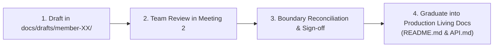

# SwiftDrop — Module Specifications & Initial Workload Drafts

> **Branch:** `docs/module-spec-reviews`  
> **Purpose:** Centralized draft hub for all 10 members to author, review, and align their module specifications prior to Team Meeting 2.  
> **Status:** Reconciled Team Baseline & Master Audit Completed

---

## 1. Master System Audit & Reconciliation Report

To eliminate boundary conflicts, sequencing errors, and workload gaps, a repository-wide engineering audit has been completed:

👉 **[Master System-Wide Audit, Cross-Member Reconciliation & Technical Blueprint](./MASTER_SYSTEM_AUDIT_AND_ALIGNMENT.md)**

This master document provides:
- Complete requirements traceability from SwiftDrop SRS v1.0 across all 10 members.
- Intra-member and inter-member contradiction resolutions.
- Systemic architectural flaw remediation (dual-writes, outbox atomicity, SSRF protection, integer minor units).
- Authoritative service configurations aligned with Database Coordinator Member 9 (Agreements A1–A13, D1–D12).
- The canonical 11-step database migration sequence.

---

## 2. Dedicated Member Alignment Guides

Every member has a dedicated, action-oriented specification and alignment guide tailored to their specific domain:

| Member | Directory | Domain & Responsibilities | Authoritative Alignment Guide |
| :---: | :--- | :--- | :--- |
| **Member 1** | [`member-01-identity/`](./member-01-identity/) | Auth, JWT, RBAC, Google OIDC, User Accounts | [Member 01 Alignment Guide](./member-01-identity/MEMBER_01_ALIGNMENT_AND_SPECIFICATION_GUIDE.md) |
| **Member 2** | [`member-02-parcels-pricing/`](./member-02-parcels-pricing/) | Parcel Aggregate Root, Booking, Pricing & Tariffs | [Member 02 Alignment Guide](./member-02-parcels-pricing/MEMBER_02_ALIGNMENT_AND_SPECIFICATION_GUIDE.md) |
| **Member 3** | [`member-03-dispatch-delivery/`](./member-03-dispatch-delivery/) | Dispatch Board, Courier Routing, Proof of Delivery | [Member 03 Alignment Guide](./member-03-dispatch-delivery/MEMBER_03_ALIGNMENT_AND_SPECIFICATION_GUIDE.md) |
| **Member 4** | [`member-04-merchants/`](./member-04-merchants/) | Merchant Profiles, Approvals, API Keys, Webhooks | [Member 04 Alignment Guide](./member-04-merchants/MEMBER_04_ALIGNMENT_AND_SPECIFICATION_GUIDE.md) |
| **Member 5** | [`member-05-tracking/`](./member-05-tracking/) | Tracking API (SSE, read-optimized public queries) | [Member 05 Alignment Guide](./member-05-tracking/MEMBER_05_ALIGNMENT_AND_SPECIFICATION_GUIDE.md) |
| **Member 6** | [`member-06-customer-merchant-web/`](./member-06-customer-merchant-web/) | Customer & Merchant React UI, Booking Wizard, Tracker | [Member 6 Alignment Guide](./member-06-customer-merchant-web/MEMBER_06_ALIGNMENT_AND_SPECIFICATION_GUIDE.md) |
| **Member 7** | [`member-07-dispatcher-admin-web-gateway/`](./member-07-dispatcher-admin-web-gateway/) | Dispatcher/Admin UI, Courier Web, Traefik Gateway | [Member 7 Alignment Guide](./member-07-dispatcher-admin-web-gateway/MEMBER_07_ALIGNMENT_AND_SPECIFICATION_GUIDE.md) |
| **Member 8** | [`member-08-events-messaging/`](./member-08-events-messaging/) | Transactional Outbox, RabbitMQ, Event Worker, DLQ | [Member 8 Alignment Guide](./member-08-events-messaging/MEMBER_08_ALIGNMENT_AND_SPECIFICATION_GUIDE.md) |
| **Member 9** | [`member-09-devops-k8s/`](./member-09-devops-k8s/) | Docker Compose, Kubernetes, Helm, Observability | [Member 09 Alignment Guide](./member-09-devops-k8s/MEMBER_09_ALIGNMENT_AND_SPECIFICATION_GUIDE.md) |
| **Member 10** | [`member-10-ai-assistant-quality/`](./member-10-ai-assistant-quality/) | AI Assistant (Python/FastAPI), MCP Tools, E2E Tests | [Member 10 Alignment Guide](./member-10-ai-assistant-quality/MEMBER_10_ALIGNMENT_AND_SPECIFICATION_GUIDE.md) |

---

## 3. Mandatory 8 Documents Per Member

Every member must author the following 8 standardized markdown files inside their allocated directory:

```text
member-XX-<capability>/
├── doc-01-scope-and-responsibilities.md
├── doc-02-functional-flows-and-business-rules.md
├── doc-03-internal-architecture-and-design.md
├── doc-04-interface-and-integration-contract.md
├── doc-05-data-and-persistence.md
├── doc-06-testing-strategy-and-acceptance.md
├── doc-07-security-failure-and-recovery.md
└── doc-08-implementation-deployment-and-ops.md
```

### Document Descriptions:
- **`doc-01-scope-and-responsibilities.md`**: Purpose, boundaries, functional scope, explicit exclusions, and owned tables/APIs.
- **`doc-02-functional-flows-and-business-rules.md`**: Step-by-step flows (happy, alternate, failure), sequence diagrams, and state machines.
- **`doc-03-internal-architecture-and-design.md`**: Internal package structure, DDD components, layers, and design patterns.
- **`doc-04-interface-and-integration-contract.md`**: Machine-readable API contracts (REST, DTOs, status codes) and event payloads.
- **`doc-05-data-and-persistence.md`**: ER diagram, tables, fields, constraints, indexes, and isolation boundaries.
- **`doc-06-testing-strategy-and-acceptance.md`**: Test-case matrix, unit/integration tests, mocking, and acceptance criteria.
- **`doc-07-security-failure-and-recovery.md`**: Auth/tenant checks, PII protection, failure modes, timeouts, retries, and rate limits.
- **`doc-08-implementation-deployment-and-ops.md`**: Local run instructions, `.env` variables, health endpoints, Docker, and operational runbook.

---

## 4. Canonical Database Migration Sequence (Ratified D3)

All migrations in `core-api/migrations/` follow the strict 6-digit prefix format:
1. `000001_create_users_and_roles.up.sql` (Member 1: users, roles, user_roles, oauth_identities)
2. `000002_create_delivery_zones.up.sql` (Member 7: delivery_zones)
3. `000003_create_merchants_and_credentials.up.sql` (Member 4: merchants, merchant_api_credentials, webhook_endpoints)
4. `000004_create_pricing_rules.up.sql` (Member 2: pricing_rules)
5. `000005_create_parcels_and_quotes.up.sql` (Member 2: parcels, parcel_addresses, pricing_quotes, parcel_status_history)
6. `000006_create_couriers.up.sql` (Member 3: couriers)
7. `000007_create_dispatch_and_delivery.up.sql` (Member 3: courier_assignments, delivery_attempts)
8. `000008_create_outbox_events.up.sql` (Member 8: outbox_events)
9. `000009_create_worker_dedup_and_webhooks.up.sql` (Member 8: processed_events, webhook_deliveries)
10. `000010_create_idempotency_keys.up.sql` (Member 2 / Platform: idempotency_keys)
11. `000011_create_audit_logs.up.sql` (Member 7 / Platform: audit_logs)

---

## 5. Review & Graduation Workflow



1. **Reviewing:** Use each member's alignment guide and the Master Audit Report to verify contracts and eliminate all contradictions.
2. **Approval:** Once signed off in Team Meeting 2, this branch is merged into `main`.
3. **Graduation:** Approved contracts become binding and are transferred to their respective module living documents (`core-api/internal/<module>/README.md`, `API.md`) and canonical architecture guides (`docs/architecture/`).
