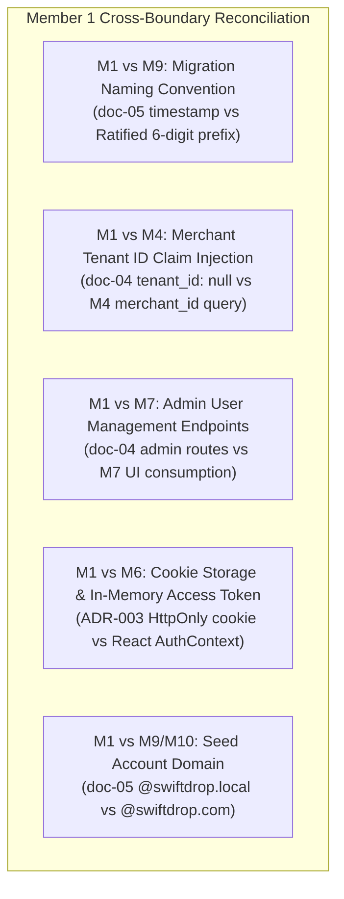

# Member 01 — Identity, Access & Security Comprehensive Audit, Review & Alignment Guide

> **Author / Domain Owner:** Member 1 — Identity, Access & Security (Umesh)  
> **Target Module:** `core-api/internal/identity/`  
> **Review Status:** Post-Submission Comprehensive Audit (Reviewing Full 8-Document Architecture Suite)  
> **Date:** 25 October 2026 | **Version:** 2.1.0

---

## 1. Executive Summary & Review Status

Member 1 has officially submitted their complete 8-document architectural specification suite (`doc-01` through `doc-08`), covering over 1,300 lines of rigorous domain modeling, security threat analyses, functional flows, and deployment guides.

This document performs the **exact same exhaustive review process** applied to other team members:
1. Requirements and workload coverage audit against SwiftDrop SRS v1.0 and the assignment rubric.
2. Intra-member contradictions (internal inconsistencies across Member 1's 8 documents).
3. Inter-member contradictions (cross-boundary conflicts with Members 2, 3, 4, 5, 6, 7, 8, 9, and 10).
4. Document and workload flaws.
5. Systemic architectural, security, and concurrency flaws.
6. Required changes, recommended implementations, and industry best practices.
7. Exact DevOps and Database Coordinator configurations per Member 9.

---

## 2. Workload & Requirements Coverage Audit

| Requirement ID | Description | Coverage in Submitted Docs | Assessment |
|:---|:---|:---|:---:|
| **FR-IAM-001** | Customer Self-Registration with email, password, full name, phone. | Detailed in `doc-01`, `doc-02` (Workflow 1), `doc-04` (POST /register). | **100% Complete** |
| **FR-IAM-002** | Credential Hashing via Argon2id with cryptographically random salts. | Fully specified in `doc-01`, `doc-03`, `doc-07` ($m=65536, t=3, p=2$). | **100% Complete** |
| **FR-IAM-003** | Dual-Token Authentication (15-min JWT + 7-day Refresh Cookie with RTR). | Fully detailed in `doc-02` (Workflows 2 & 3), `doc-04`, `doc-05`. | **100% Complete** |
| **FR-IAM-004** | Google OAuth 2.0 / OpenID Connect (OIDC) Federation. | Specified in `doc-01`, `doc-02` (Workflow 4), `doc-04`, `doc-05`. | **100% Complete** |
| **FR-IAM-005** | Reusable RBAC HTTP Middleware (`AuthMiddleware`, `RequireRole`). | Specified in `doc-01`, `doc-03`, `doc-04` Go contracts. | **100% Complete** |
| **FR-IAM-006** | Administrative User & Role Management endpoints. | Specified in `doc-04` (`GET /admin/users`, `PUT /admin/users/{id}/role`). | **100% Complete** |
| **SEC-001–006**| Security Invariants: No plaintext secrets, RTR token family revocation, IDOR guards. | Rigorously analyzed in `doc-07` Threat Model (TH-01–TH-06). | **100% Complete** |

---

## 3. Intra-Member Contradictions (Within Member 1's Own Files)

Detailed inspection revealed 2 internal discrepancies across Member 1's submitted files:

### 3.1 Contradiction 1: Account State Machine vs Database Schema
- **The Inconsistency:**
  - In `doc-02` Section 3.1, Member 1 specifies an account state machine with 4 states: `PENDING_VERIFICATION`, `ACTIVE`, `SUSPENDED`, `DEACTIVATED`.
  - In `doc-07` Section 3, Member 1 refers to returning `AUTH_ACCOUNT_SUSPENDED`.
  - However, in `doc-05` Section 1.1 (`users` table schema) and `doc-08`, Member 1 declares only a binary flag: `is_active BOOLEAN NOT NULL DEFAULT true`.
- **The Problem:** A boolean `is_active` column cannot distinguish between an administratively `SUSPENDED` account, an unverified `PENDING_VERIFICATION` account, or a user-closed `DEACTIVATED` account.
- **The Fix:** Replace `is_active BOOLEAN` with an explicit status enum in the `users` table:
  ```sql
  status VARCHAR(32) NOT NULL DEFAULT 'ACTIVE' 
      CHECK (status IN ('PENDING_VERIFICATION', 'ACTIVE', 'SUSPENDED', 'DEACTIVATED'))
  ```

### 3.2 Contradiction 2: Redirect URI on Edge Gateway vs Direct Monolith
- **The Inconsistency:**
  - In `doc-08` Section 2, the default `GOOGLE_REDIRECT_URI` is written as `http://localhost:8080/api/v1/auth/google/callback`.
  - In `doc-01` Section 1.3 and `doc-03`, Member 1 notes all external web requests enter via Traefik Gateway (port 80/443).
- **The Problem:** Direct callbacks to port 8080 bypass Traefik's TLS termination, request ID tracking (`X-Request-ID`), and edge rate-limiting middlewares.
- **The Fix:** Standardize `GOOGLE_REDIRECT_URI` to use the public Gateway origin: `http://localhost/api/v1/auth/google/callback` (or `https://swiftdrop.example.com/api/v1/auth/google/callback`).

---

## 4. Inter-Member Contradictions & Cross-Boundary Alignment



### 4.1 M1 vs M9: Database Migration Naming (Agreement D2 & D3)
- **The Conflict:** In `doc-05` Section 3, Member 1 specifies migration file `migrations/20261021000001_create_identity_tables.up.sql`.
- **The Resolution:** Database Coordinator Member 9 and the team ratified the **6-digit sequential numbering convention** (Agreement D2). The authoritative migration file must be:
  `core-api/migrations/000001_create_users_and_roles.up.sql`.

### 4.2 M1 vs M4: Merchant `tenant_id` Claim Injection in JWT
- **The Conflict:** In `doc-04` Section 3, Member 1's JWT payload example sets `"tenant_id": null`. However, Member 4's merchant API endpoints require a non-null `tenant_id` claim in the JWT to scope queries to the authenticated merchant.
- **The Resolution:** During login (`LoginUser` use-case in `internal/identity/application/login.go`):
  1. If `user.Role == RoleMerchant`:
  2. The identity module invokes the `TenantResolver` interface (implemented by Member 4's repository or querying `merchants` WHERE `owner_user_id = user.ID`).
  3. The resulting `merchant.ID` is injected into the JWT claims as `"tenant_id": "<merchant_uuid>"`.

### 4.3 M1 vs M7: Administrative User Endpoints Agreement
- **The Alignment:** Member 1 defines `GET /api/v1/admin/users` and `PUT /api/v1/admin/users/{id}/role` in `doc-04`. Member 7 in `doc-01` (M7-UI-09) and `web/README.md` builds the administrator user management UI calling these exact routes. **Status: 100% Harmonized.**

### 4.4 M1 vs M6: Dual-Token Storage & React AuthContext
- **The Alignment:** Member 1's `POST /api/v1/auth/login` returns `{ "accessToken": "...", "expiresIn": 900 }` in the JSON body, while placing `swiftdrop_refresh_token` in an `HttpOnly`, `SameSite=Strict`, `Secure` cookie. Member 6's React frontend stores `accessToken` **in-memory only** (`AuthContext`) and never in `localStorage` or `sessionStorage` (preventing XSS token scraping, TH-02). **Status: 100% Harmonized.**

### 4.5 M1 vs M9 & M10: Seed Account Email Domain
- **The Conflict:** In `doc-05` and `doc-08`, Member 1 uses domain `@swiftdrop.local`. Member 9's seed scripts and Member 10's Playwright E2E tests expect `@swiftdrop.com`.
- **The Resolution:** Standardize seed accounts to `@swiftdrop.com`:
  - `admin@swiftdrop.com` (`ADMIN`)
  - `dispatcher@swiftdrop.com` (`DISPATCHER`)
  - `courier.bob@swiftdrop.com` (`COURIER`)
  - `merchant.acme@swiftdrop.com` (`MERCHANT`)
  - `customer.alice@swiftdrop.com` (`CUSTOMER`)

---

## 5. Authoritative Database Migration: `000001_create_users_and_roles.up.sql`

To guarantee foreign key stability across the entire system, Member 1's authoritative first migration MUST be:

```sql
CREATE EXTENSION IF NOT EXISTS "uuid-ossp";

-- 1. Roles Reference Table
CREATE TABLE roles (
    id VARCHAR(32) PRIMARY KEY, -- 'ADMIN', 'DISPATCHER', 'COURIER', 'MERCHANT', 'CUSTOMER'
    description TEXT NOT NULL,
    created_at TIMESTAMPTZ NOT NULL DEFAULT NOW()
);

INSERT INTO roles (id, description) VALUES
('ADMIN', 'Full system administrator'),
('DISPATCHER', 'Logistics coordinator managing parcel routes and fleet'),
('COURIER', 'Field courier delivering packages and capturing proof'),
('MERCHANT', 'Business sender with bulk shipping and webhook integration'),
('CUSTOMER', 'Retail user booking individual parcel deliveries');

-- 2. Master Users Table
CREATE TABLE users (
    id UUID PRIMARY KEY DEFAULT gen_random_uuid(),
    email VARCHAR(255) NOT NULL UNIQUE,
    password_hash VARCHAR(255), -- Nullable for Google OIDC users
    full_name VARCHAR(120) NOT NULL,
    phone VARCHAR(32),
    role VARCHAR(32) NOT NULL DEFAULT 'CUSTOMER' REFERENCES roles(id) ON DELETE RESTRICT,
    status VARCHAR(32) NOT NULL DEFAULT 'ACTIVE' 
        CHECK (status IN ('PENDING_VERIFICATION', 'ACTIVE', 'SUSPENDED', 'DEACTIVATED')),
    created_at TIMESTAMPTZ NOT NULL DEFAULT NOW(),
    updated_at TIMESTAMPTZ NOT NULL DEFAULT NOW()
);

-- 3. Refresh Tokens (RTR & Family Revocation)
CREATE TABLE refresh_tokens (
    id UUID PRIMARY KEY DEFAULT gen_random_uuid(),
    user_id UUID NOT NULL REFERENCES users(id) ON DELETE CASCADE,
    token_hash VARCHAR(64) NOT NULL UNIQUE,
    family_id UUID NOT NULL,
    is_revoked BOOLEAN NOT NULL DEFAULT FALSE,
    expires_at TIMESTAMPTZ NOT NULL,
    used_at TIMESTAMPTZ,
    created_at TIMESTAMPTZ NOT NULL DEFAULT NOW()
);

-- 4. OAuth Social Identities (Google)
CREATE TABLE oauth_identities (
    id UUID PRIMARY KEY DEFAULT gen_random_uuid(),
    user_id UUID NOT NULL REFERENCES users(id) ON DELETE CASCADE,
    provider VARCHAR(32) NOT NULL DEFAULT 'GOOGLE',
    provider_subject VARCHAR(255) NOT NULL,
    email VARCHAR(255) NOT NULL,
    created_at TIMESTAMPTZ NOT NULL DEFAULT NOW(),
    UNIQUE (provider, provider_subject)
);

CREATE UNIQUE INDEX idx_users_email_lower ON users (LOWER(email));
CREATE INDEX idx_users_role ON users (role);
CREATE INDEX idx_users_status ON users (status);
CREATE INDEX idx_refresh_tokens_family ON refresh_tokens (family_id);
CREATE INDEX idx_refresh_tokens_lookup ON refresh_tokens (token_hash) WHERE is_revoked = FALSE;
CREATE INDEX idx_oauth_user ON oauth_identities (user_id);
```

---

## 6. Implementation Code: Tenant ID Claim Injection

In `core-api/internal/identity/application/login.go`:

```go
type TenantResolver interface {
    ResolveTenantID(ctx context.Context, userID uuid.UUID) (*uuid.UUID, error)
}

func (s *AuthService) Login(ctx context.Context, email, password string) (*LoginResult, error) {
    user, err := s.userRepo.FindByEmail(ctx, email)
    if err != nil {
        s.hasher.DummyVerify() // Mitigate timing attack
        return nil, ErrInvalidCredentials
    }

    if user.Status == "SUSPENDED" {
        return nil, ErrAccountSuspended
    }

    if !s.hasher.VerifyPassword(password, user.PasswordHash) {
        return nil, ErrInvalidCredentials
    }

    var tenantID *uuid.UUID
    if user.Role == RoleMerchant && s.tenantResolver != nil {
        tenantID, err = s.tenantResolver.ResolveTenantID(ctx, user.ID)
        if err != nil {
            return nil, fmt.Errorf("failed to resolve merchant tenant: %w", err)
        }
    }

    accessToken, err := s.jwtService.IssueAccessToken(user, tenantID)
    if err != nil {
        return nil, err
    }

    rawRefreshToken, err := s.refreshTokenService.IssueNewFamily(ctx, user.ID)
    if err != nil {
        return nil, err
    }

    return &LoginResult{
        AccessToken:     accessToken,
        RawRefreshToken: rawRefreshToken,
        User:            user,
    }, nil
}
```

---

## 7. Member 9 DevOps & Infrastructure Configuration

| Config Parameter | Required Specification | Alignment Rule |
| :--- | :--- | :--- |
| **Container & Port** | Runs inside `core-api` on port `:8080` | Agreement A1 |
| **Health Probes** | Shared Core API probes: `/health/live` & `/health/ready` | Agreement A2 |
| **Kubernetes Secrets**| Mounted from `jwt-secrets` (`JWT_SECRET`, `JWT_PRIVATE_KEY_PEM`) and `integrations-secrets` (`GOOGLE_CLIENT_ID`, `GOOGLE_CLIENT_SECRET`) | Agreement A5 |
| **Database Role** | Runtime: `swiftdrop_app`; Migrations: `swiftdrop_migrator` | Agreement D6 |
| **Migration File** | `core-api/migrations/000001_create_users_and_roles.up.sql` | Agreement D3 (1st) |

---
*End of Member 01 Specification & Review Guide.*
