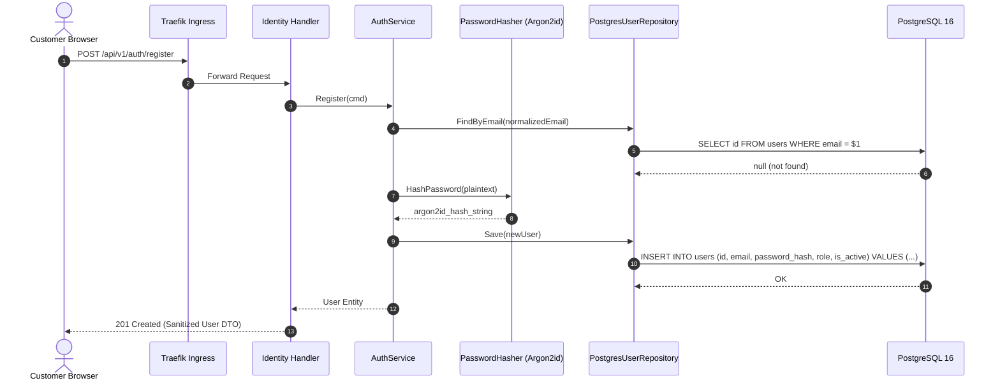
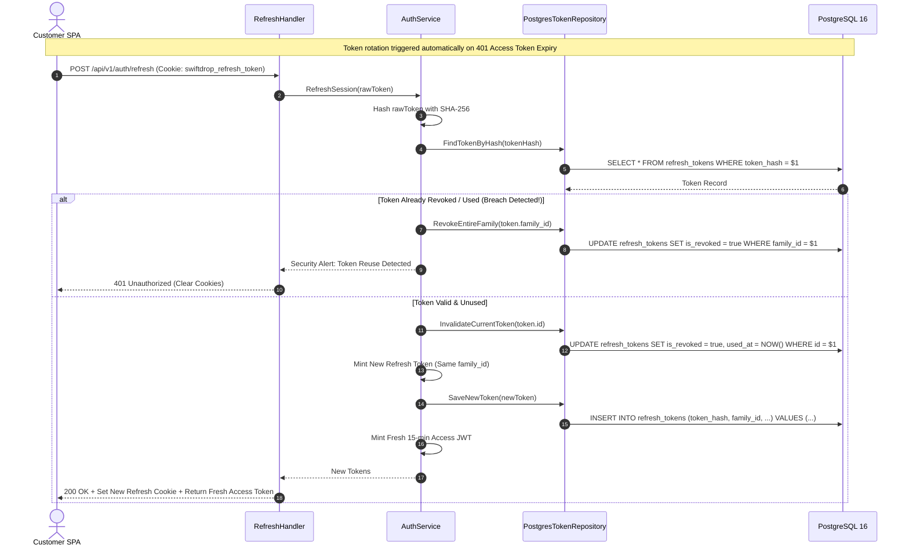
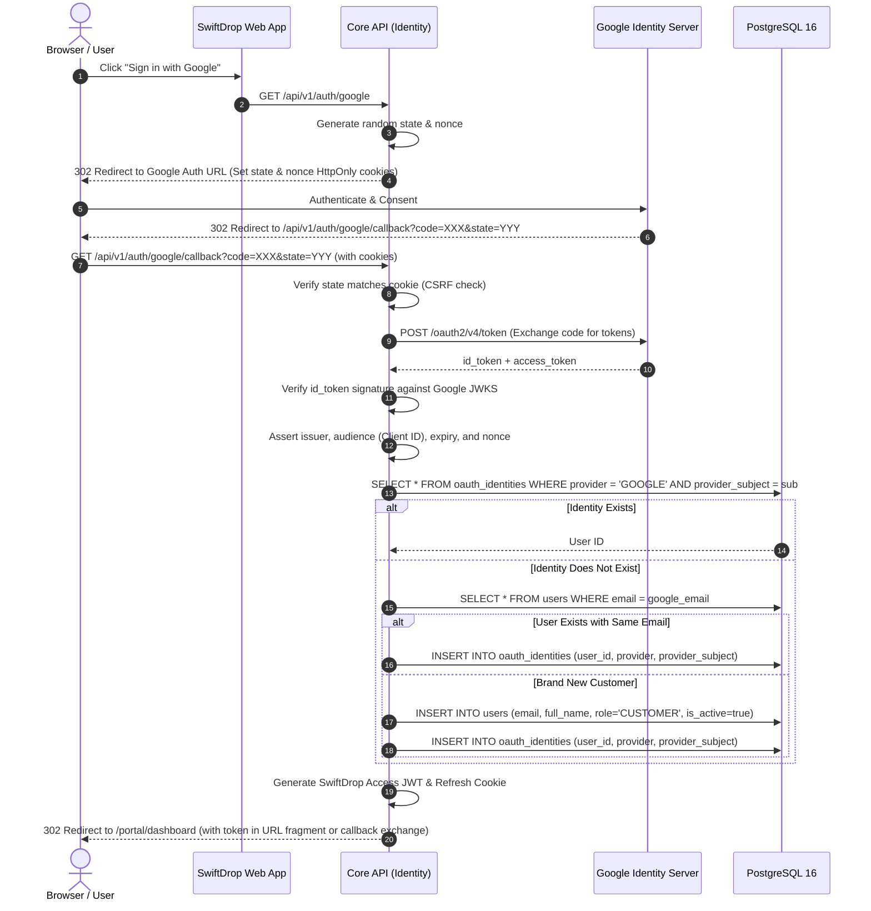
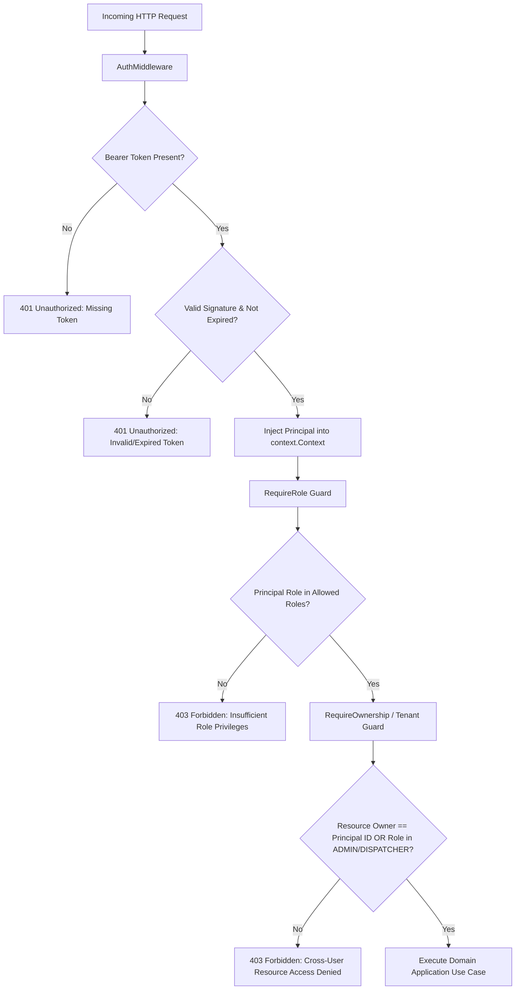

# Document 2 — Functional Flows & Business Rules

> **Module:** Identity, Access Control & Security  
> **Owning Member:** Member 1 — Identity, Access & Security  
> **Status:** Proposed Draft (For Review in Team Meeting 2)  
> **Target Production Location:** `core-api/internal/identity/`

---

## 1. Actors & Triggering Conditions

| Actor | Description | Triggering Conditions |
|:---|:---|:---|
| **Anonymous Customer** | Unauthenticated public visitor on web portal. | Registers for an account, signs in via email/password, or clicks "Sign in with Google". |
| **Authenticated User** | User holding a valid access JWT or refresh cookie. | Navigates application screens, calls protected REST endpoints, refreshes expired session, or logs out. |
| **System Administrator** | User with verified `ADMIN` role. | Queries user lists, inspects user status, updates user roles, or suspends malicious accounts. |
| **Downstream Monolith Modules** | `parcels`, `dispatch`, `delivery`, `merchants`, `admin`. | Executes HTTP handlers requiring authenticated principal identity and role verification. |

---

## 2. Core Workflows & Detailed Step-by-Step Flows

### 2.1 Workflow 1: Customer Local Registration (Email & Password)

#### Preconditions:
- Visitor provides valid email, password, full name, and phone.
- Email is not already registered in `users` table.

#### Postconditions:
- New `users` record inserted with `role = 'CUSTOMER'` and `is_active = true`.
- Password hashed with Argon2id and stored in `password_hash`.
- `201 Created` returned with sanitized user profile (no password hash).

#### Flow Steps:
1. **Request Received:** Client submits `POST /api/v1/auth/register`.
2. **Syntax Validation:** Transport layer validates:
   - `email`: valid RFC 5322 format, normalized to lower-case.
   - `password`: min 8 characters, at least 1 uppercase, 1 lowercase, 1 digit, 1 special character.
   - `full_name`: 2–100 characters.
3. **Email Collision Check:** Application layer queries `UserRepository.FindByEmail(email)`.
   - *Failure Path 1A (Conflict):* Email exists $\rightarrow$ Returns `409 Conflict` (`AUTH_EMAIL_ALREADY_EXISTS`).
4. **Password Hashing:** Hasher computes Argon2id hash with random salt.
5. **Persistence:** `UserRepository.Create(user)` commits user to PostgreSQL.
6. **Response:** Returns `201 Created` with DTO `{ "id": "...", "email": "...", "full_name": "...", "role": "CUSTOMER" }`.



---

### 2.2 Workflow 2: User Login & Dual-Token Issuance

#### Preconditions:
- Registered user account exists and `is_active = true`.

#### Postconditions:
- Short-lived JWT access token issued (15-minute expiry).
- Cryptographically secure refresh token generated, hashed (SHA-256), and persisted in `refresh_tokens`.
- Refresh token set in `HttpOnly`, `SameSite=Strict`, `Secure` cookie.
- Access token and user profile returned in response body.

#### Flow Steps:
1. **Submission:** Client calls `POST /api/v1/auth/login` with email and password.
2. **Account Retrieval:** System queries `users` by normalized email.
   - *Failure Path 2A (Account Not Found):* System executes dummy password verification (to equalize execution time against timing attacks) and returns `401 Unauthorized` (`AUTH_INVALID_CREDENTIALS`).
3. **Status Check:** If `is_active = false`:
   - *Failure Path 2B (Suspended):* Return `403 Forbidden` (`AUTH_ACCOUNT_SUSPENDED`).
4. **Password Verification:** Hasher verifies submitted password against stored `password_hash`.
   - *Failure Path 2C (Mismatch):* Return `401 Unauthorized` (`AUTH_INVALID_CREDENTIALS`).
5. **Token Generation:**
   - Mints RS256/HS256 Access Token containing claims (`sub`, `email`, `role`, `tenant_id`, `iat`, `exp`).
   - Generates 32-byte cryptographically random string for refresh token.
   - Computes SHA-256 hash of refresh token string.
   - Creates new session in `refresh_tokens` with unique `family_id` (UUIDv7).
6. **Response Delivery:**
   - Sets cookie: `swiftdrop_refresh_token=<raw_refresh_token>; Path=/api/v1/auth; HttpOnly; Secure; SameSite=Strict; Max-Age=604800`.
   - Returns `200 OK` with JSON `{ "access_token": "...", "expires_in": 900, "user": { ... } }`.

---

### 2.3 Workflow 3: Single-Use Refresh Token Rotation (RTR) & Reuse Detection

#### Invariant:
A refresh token can only be used **once**. Any attempt to reuse an expired or already rotated refresh token triggers family-wide session invalidation (indicating theft).



---

### 2.4 Workflow 4: Google OAuth 2.0 / OpenID Connect (OIDC) Flow



---

### 2.5 Workflow 5: Role-Based Access Control (RBAC) & Ownership Enforcement



---

## 3. State Machines & Status Transitions

### 3.1 User Account State Machine
```
    [*] --> PENDING_VERIFICATION (Optional email verification phase)
    PENDING_VERIFICATION --> ACTIVE (Email verified or Google OIDC login)
    [*] --> ACTIVE (Standard local registration)
    ACTIVE --> SUSPENDED (Administrator lock or excessive malicious activity)
    SUSPENDED --> ACTIVE (Administrator reinstatement)
    ACTIVE --> DEACTIVATED (User-requested account closure)
    SUSPENDED --> DEACTIVATED (Permanent administrative deletion)
    DEACTIVATED --> [*]
```

### 3.2 Refresh Token Lineage State Machine
```
    [*] --> ISSUED (Active single-use token in client cookie)
    ISSUED --> ROTATED (Presented for refresh; exchanged for child token in same family)
    ROTATED --> EXPIRED (Passed 7-day maximum family lifetime)
    ISSUED --> REVOKED (Explicit logout)
    ROTATED --> REVOKED (Detected token replay: entire family revoked immediately)
```

---

## 4. Idempotency, Concurrency & Edge Case Rules

1. **Concurrent Registration Submissions:**
   - If two identical registration requests arrive simultaneously, the database `UNIQUE(email)` constraint acts as the synchronization gate. One succeeds; the second receives a database duplicate key violation and returns `409 Conflict`.
2. **Concurrent Refresh Token Rotations:**
   - If a frontend sends two refresh requests in rapid parallel succession (e.g. multi-tab race condition), the first request rotates the token successfully. The second request presents the rotated token.
   - *Mitigation Grace Window:* A 10-second grace window allows near-simultaneous multi-tab refreshes to receive the newly minted access token without triggering an immediate fraud family revocation.
3. **Session Revocation on Password Change:**
   - When a user updates their password, all active refresh tokens belonging to that `user_id` are updated to `is_revoked = true` to force re-authentication across all devices.
