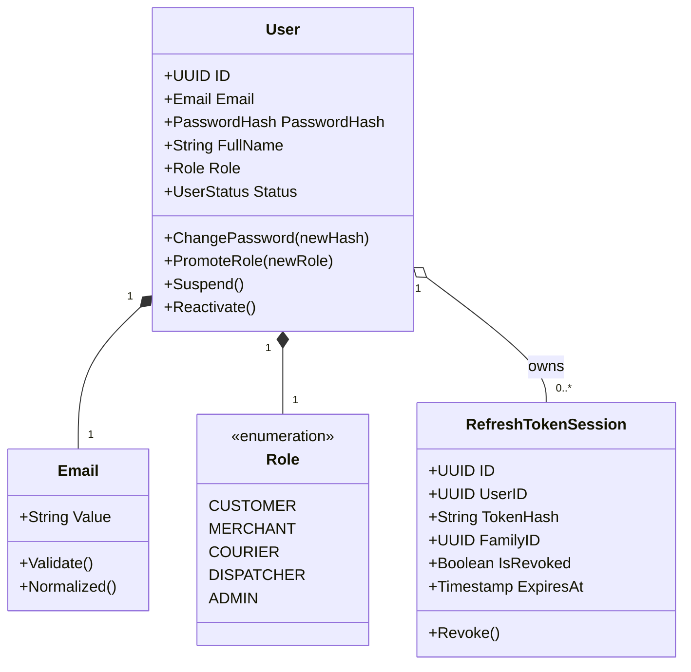

# Document 3 — Internal Architecture & Design Specification

> **Module:** Identity, Access Control & Security  
> **Owning Member:** Member 1 — Identity, Access & Security  
> **Status:** Proposed Draft (For Review in Team Meeting 2)  
> **Target Production Location:** `core-api/internal/identity/`

---

## 1. Package & Component Structure

To comply with the SwiftDrop Engineering Standards (§2.5) and pass automated architecture linter rules (`golangci-lint` `depguard`), the Identity module strictly adheres to Clean/Hexagonal Architecture:

```
core-api/internal/identity/
├── domain/                                 # PURE DOMAIN LAYER (Zero external dependencies)
│   ├── user.go                             # User aggregate root & entity invariants
│   ├── role.go                             # Role enum & permission definitions
│   ├── email.go                            # Email value object (RFC 5322 validation)
│   ├── password.go                         # Password value object & complexity rules
│   ├── session.go                          # Refresh token session entity & lineage tracking
│   ├── oauth.go                            # OAuth identity entity
│   └── errors.go                           # Ubiquitous domain errors
│
├── application/                            # APPLICATION LAYER (Orchestration & use cases)
│   ├── ports.go                            # Input/Output repository & service interfaces
│   ├── auth_service.go                     # Registration, login, logout, refresh use cases
│   ├── user_service.go                     # Profile, search, role-management use cases
│   ├── oauth_service.go                    # OIDC code exchange & identity linking use cases
│   └── commands.go                         # Command and Query DTO definitions
│
├── infrastructure/                         # INFRASTRUCTURE LAYER (Technical adapters)
│   ├── postgres_user_repo.go               # PostgreSQL implementation of UserRepository
│   ├── postgres_token_repo.go              # PostgreSQL implementation of TokenRepository
│   ├── postgres_oauth_repo.go              # PostgreSQL implementation of OAuthRepository
│   ├── argon2_hasher.go                    # Argon2id password hashing adapter
│   ├── jwt_token_provider.go               # RS256 / HS256 JWT minting & verification engine
│   └── google_oidc_client.go               # HTTP client for Google discovery & code exchange
│
└── transport/                              # TRANSPORT LAYER (HTTP, DTOs & Middleware)
    ├── handlers.go                         # HTTP handlers for /api/v1/auth/*
    ├── admin_handlers.go                   # HTTP handlers for /api/v1/admin/users/*
    ├── middleware.go                       # AuthMiddleware, RequireRole, RequireOwnership
    ├── requests.go                         # JSON request DTOs & validation tags
    ├── responses.go                        # JSON response serialization & envelopes
    └── routes.go                           # Gin / standard http.ServeMux route wiring
```

---

## 2. Layer Responsibilities & Component Responsibilities

| Layer | Component | Responsibility |
|:---|:---|:---|
| **Domain** | `User` Aggregate Root | Enforces user state transitions, account suspension, role mutations, and password validation invariants. |
| **Domain** | Value Objects (`Email`, `Role`, `Password`) | Immutable, self-validating types. Guarantees that an invalid email or weak password cannot exist in memory. |
| **Domain** | Domain Errors | Centralized sentinel errors (`ErrUserNotFound`, `ErrEmailAlreadyExists`, `ErrInvalidCredentials`, `ErrTokenReused`). |
| **Application** | `AuthService` | Coordinates database transactions, invokes password hashing, generates token pairs, and logs audit events. |
| **Application** | `OAuthService` | Orchestrates OIDC exchange, validates state/nonce, and handles account auto-provisioning. |
| **Application** | Port Interfaces | Declarative boundaries (`UserRepository`, `TokenRepository`, `PasswordHasher`, `TokenProvider`). |
| **Infrastructure** | `PostgresUserRepository` | Translates application queries into parameterized SQL using `pgx/v5`. Implements optimistic locking where appropriate. |
| **Infrastructure** | `Argon2Hasher` | Applies Argon2id cryptographic parameters ($m=65536, t=3, p=2$). |
| **Infrastructure** | `JWTTokenProvider` | Handles cryptographic signing (RS256/HS256), claims parsing, JWKS validation, and clock skew tolerance. |
| **Transport** | `AuthMiddleware` | Extracts `Bearer` token from `Authorization` header, parses claims, injects `Principal` into `context.Context`. |
| **Transport** | `RequireRole` | Validates that `context.Context` contains an authorized role before delegating to downstream handlers. |
| **Transport** | HTTP Handlers | Decodes JSON, enforces request size caps, handles HTTP status code mappings. |

---

## 3. Tactical Domain-Driven Design (DDD) Implementation



### Justification of Tactical Patterns:
- **Value Objects:** `Email` and `Role` encapsulate formatting and validation. String primitives are forbidden in domain method signatures to eliminate string-typing errors.
- **Aggregate Invariants:** The `User` aggregate prevents arbitrary role modifications. A user cannot promote themselves; promotion is an explicit method requiring administrative context.
- **Separation of Concerns:** Password hashing is an infrastructure concern (`PasswordHasher` interface); the domain aggregate only handles verified hashes.

---

## 4. Dependency Direction & Allowed Imports (`depguard`)

To comply with `.golangci.yml`, the following dependency rules are strictly enforced:

```
[Transport Layer]       ──▶ Imports Application & Domain
       │
       ▼
[Application Layer]     ──▶ Imports Domain only (and Ports)
       │
       ▼
[Domain Layer]          ──▶ ZERO EXTERNAL IMPORTS (Pure Go standard library)
       ▲
       │
[Infrastructure Layer]  ──▶ Implements Application Ports; Imports Domain & Database/Crypto
```

### Linter Rule Enforcements:
- Files in `domain/` **MUST NOT** import: `net/http`, `database/sql`, `github.com/jackc/pgx`, `github.com/golang-jwt/jwt`, or any internal transport/infrastructure packages.
- Files in `application/` **MUST NOT** import `net/http` or transport DTOs.
- Circular dependencies between `internal/identity` and other modules (`parcels`, `merchants`) are strictly prohibited. Downstream modules consume Identity via HTTP middleware or public Go interfaces.

---

## 5. Design Patterns & Architectural Justification

1. **Dependency Injection via Composition Root (`cmd/api/wiring.go`):**
   - Repositories and hashers are instantiated in `wiring.go` and injected into use-case constructors (`NewAuthService(repo, tokenProvider, hasher)`). Facilitates 100% unit test coverage via mocks.
2. **Strategy Pattern for Password Hashing:**
   - Abstracted through `PasswordHasher` interface. Allows the system to verify legacy bcrypt hashes while migrating newly updated passwords to Argon2id automatically.
3. **Decorator / Pipeline Pattern for HTTP Middleware:**
   - Standard Go HTTP middleware chaining (`AuthMiddleware(RequireRole(RoleAdmin)(handler))`) allows composable, reusable access guards across all monolith endpoints.
4. **Token Family Lineage (Single-Use RTR):**
   - Refresh tokens share a persistent `family_id`. When a token is rotated, its successor inherits the `family_id`. Any replay of a previous generation invalidates all tokens with that `family_id`.

---

## 6. Transaction Boundaries & Consistency Requirements

- **Local Registration:** Single atomic database transaction. Inserts `users` record. If email uniqueness fails, transaction rolls back cleanly.
- **OAuth Identity Provisioning:** Atomic transaction inserting both `users` and `oauth_identities`. If identity linking fails, user creation rolls back.
- **Refresh Token Rotation:** Atomic transaction:
  1. `UPDATE refresh_tokens SET is_revoked = true, used_at = NOW() WHERE id = $1`
  2. `INSERT INTO refresh_tokens (new_token_hash, family_id, ...) VALUES (...)`
  Guarantees that a crash between revocation and issuance does not leave an unrotated orphaned token.
- **Isolation Level:** Standard PostgreSQL `READ COMMITTED` is sufficient for user authentication. Refresh token rotation uses `SELECT ... FOR UPDATE` on token lookup to eliminate concurrent race conditions.

---

## 7. Alternatives Considered & Trade-Offs

| Decision Area | Selected Approach | Alternative Considered | Rationale & Trade-Off |
|:---|:---|:---|:---|
| **Token Architecture** | Dual-Token (JWT + HttpOnly Cookie) | Session ID stored in Redis | Redis session store adds operational dependency; JWT allows stateless horizontal scaling of Core and Tracking APIs. |
| **JWT Algorithm** | Asymmetric RS256 / HS256 configurable | Stateful OAuth Server (Ory Hydra / Keycloak) | Separate identity server is over-engineered for course scope and increases container memory footprints on single VPS hosting. |
| **Password Hashing** | Argon2id | PBKDF2 / SHA-256 | Argon2id provides superior resistance against GPU/ASIC-based offline cracking attacks. |
| **Google Login Flow** | Server-Side Code Exchange | Client-Side Google Token Relay | Server-side authorization code flow keeps client secret protected and allows direct cryptographic nonce and state verification. |

---

## 8. Scaling & Performance Considerations

1. **CPU Overhead of Password Hashing:**
   - Argon2id is intentionally CPU and memory intensive. To prevent denial-of-service via login floods, Traefik enforces edge rate limiting (5 req/min per IP on `/api/v1/auth/login`).
2. **Database Connection Footprint:**
   - In accordance with team agreements (Member 9 §2, D8), Identity operations use the shared `swiftdrop_app` pool with bounded connections and a 5-second statement timeout.
3. **Stateless Access Token Verification:**
   - Access token validation requires **zero database queries**. Middleware cryptographically verifies the token signature in-memory in $<0.1\text{ ms}$, preserving high throughput for protected parcel operations.
