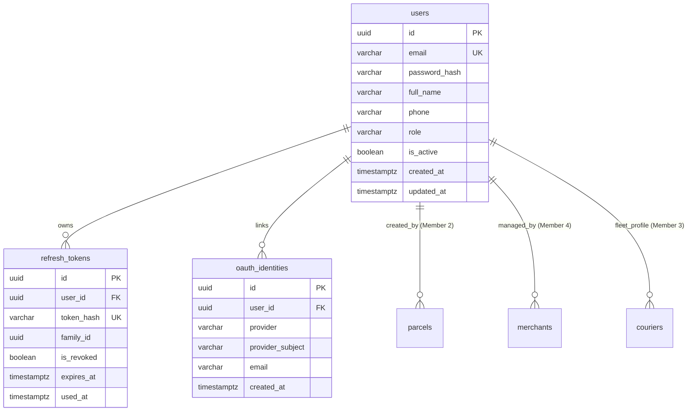

# Document 5 — Data & Persistence Specification

> **Module:** Identity, Access Control & Security  
> **Owning Member:** Member 1 — Identity, Access & Security  
> **Status:** Proposed Draft (For Review in Team Meeting 2)  
> **Target Production Location:** `core-api/internal/identity/`

---

## 1. Schema Design & Data Dictionary

Member 1 exclusively owns three relational tables in the PostgreSQL 16 database: `users`, `refresh_tokens`, and `oauth_identities`.

### 1.1 `users` Table (Master Human Accounts)

Stores authoritative credentials and global application roles for all human actors.

| Column | Data Type | Constraints | Description |
|:---|:---|:---|:---|
| `id` | `UUID` | `PRIMARY KEY DEFAULT gen_random_uuid()` | Immutable unique account identifier (UUIDv7 recommended). |
| `email` | `VARCHAR(255)` | `NOT NULL UNIQUE` | Normalized lower-case login email. |
| `password_hash` | `VARCHAR(255)` | `NULL` | Argon2id/bcrypt salted hash. Nullable for Google-only users. |
| `full_name` | `VARCHAR(255)` | `NOT NULL` | User's full display name. |
| `phone` | `VARCHAR(30)` | `NULL` | Contact phone number. |
| `role` | `VARCHAR(20)` | `NOT NULL DEFAULT 'CUSTOMER'` | Role enum: `CUSTOMER`, `MERCHANT`, `COURIER`, `DISPATCHER`, `ADMIN`. |
| `is_active` | `BOOLEAN` | `NOT NULL DEFAULT true` | Soft-state flag. If `false`, login and token refresh fail. |
| `created_at` | `TIMESTAMPTZ` | `NOT NULL DEFAULT NOW()` | UTC account creation timestamp. |
| `updated_at` | `TIMESTAMPTZ` | `NOT NULL DEFAULT NOW()` | UTC last modification timestamp. |

#### Check Constraints & Indexes:
```sql
ALTER TABLE users ADD CONSTRAINT chk_users_role 
CHECK (role IN ('CUSTOMER', 'MERCHANT', 'COURIER', 'DISPATCHER', 'ADMIN'));

CREATE UNIQUE INDEX idx_users_email_lower ON users (LOWER(email));
CREATE INDEX idx_users_role ON users (role);
CREATE INDEX idx_users_active ON users (is_active) WHERE is_active = true;
```

---

### 1.2 `refresh_tokens` Table (Session Lineage & RTR)

Maintains active and historical refresh tokens for session rotation and reuse detection.

| Column | Data Type | Constraints | Description |
|:---|:---|:---|:---|
| `id` | `UUID` | `PRIMARY KEY DEFAULT gen_random_uuid()` | Unique record identifier. |
| `user_id` | `UUID` | `NOT NULL REFERENCES users(id) ON DELETE CASCADE` | Owner account ID. |
| `token_hash` | `VARCHAR(64)` | `NOT NULL UNIQUE` | SHA-256 digest of the client-held raw token secret. |
| `family_id` | `UUID` | `NOT NULL` | Shared identifier across an entire lineage of rotated tokens. |
| `is_revoked` | `BOOLEAN` | `NOT NULL DEFAULT false` | Revocation status (set to true on rotation or logout). |
| `created_at` | `TIMESTAMPTZ` | `NOT NULL DEFAULT NOW()` | UTC issuance timestamp. |
| `expires_at` | `TIMESTAMPTZ` | `NOT NULL` | Absolute expiry (typically `created_at + 7 days`). |
| `used_at` | `TIMESTAMPTZ` | `NULL` | Timestamp when exchanged during token rotation. |

#### Indexes:
```sql
CREATE UNIQUE INDEX idx_refresh_tokens_hash ON refresh_tokens (token_hash);
CREATE INDEX idx_refresh_tokens_family ON refresh_tokens (family_id);
CREATE INDEX idx_refresh_tokens_user_active ON refresh_tokens (user_id) WHERE is_revoked = false;
```

---

### 1.3 `oauth_identities` Table (External Social Linking)

Maps external OpenID Connect provider identities to SwiftDrop internal accounts.

| Column | Data Type | Constraints | Description |
|:---|:---|:---|:---|
| `id` | `UUID` | `PRIMARY KEY DEFAULT gen_random_uuid()` | Unique link identifier. |
| `user_id` | `UUID` | `NOT NULL REFERENCES users(id) ON DELETE CASCADE` | Linked SwiftDrop user account. |
| `provider` | `VARCHAR(50)` | `NOT NULL` | Identity provider name (`GOOGLE`). |
| `provider_subject` | `VARCHAR(255)` | `NOT NULL` | External subject identifier (`sub` claim). |
| `email` | `VARCHAR(255)` | `NOT NULL` | Email reported by provider during linkage. |
| `created_at` | `TIMESTAMPTZ` | `NOT NULL DEFAULT NOW()` | Linkage creation timestamp. |

#### Constraints:
```sql
ALTER TABLE oauth_identities ADD CONSTRAINT uq_provider_subject 
UNIQUE (provider, provider_subject);

CREATE INDEX idx_oauth_user ON oauth_identities (user_id);
```

---

## 2. Entity Relationship Diagram (ERD)



---

## 3. Migration Strategy & Ordering

In accordance with team agreements with Member 9 (Database Coordinator §2, D3):
- **Foreign Key Ordering:** `users` is the **first table created** in the entire system because `merchants`, `parcels`, `couriers`, and `audit_logs` reference `users.id`.
- **Tooling:** Managed via `golang-migrate`.
- **Migration Script Name:**
  - `migrations/20261021000001_create_identity_tables.up.sql`
  - `migrations/20261021000001_create_identity_tables.down.sql`
- **Database Role Grants:**
  - Grants `SELECT, INSERT, UPDATE` on `users`, `refresh_tokens`, and `oauth_identities` to the application role `swiftdrop_app`.
  - `DELETE` is prohibited on `users` in production.

---

## 4. Privacy, Retention & Seed Data

### 4.1 Data Privacy & GDPR Rules
- Passwords are encrypted irreversibly using Argon2id with cryptographically random salts.
- Raw refresh tokens exist only in client HTTP cookies; the database stores one-way SHA-256 hashes.
- Inactive or expired refresh tokens older than 30 days are purged via background cleanup.

### 4.2 Seed Data Inventory (`core-api/cmd/seed/`)

| Email | Role | Full Name | Purpose |
|:---|:---|:---|:---|
| `admin@swiftdrop.local` | `ADMIN` | Super Administrator | System configuration & role management |
| `dispatcher@swiftdrop.local` | `DISPATCHER` | Fleet Dispatcher | Courier routing & parcel assignments |
| `courier1@swiftdrop.local` | `COURIER` | Kamal Perera | Mobile delivery execution & POD uploads |
| `merchant@vendor.com` | `MERCHANT` | Urban Store Logistics | Merchant portal & order management |
| `customer@swiftdrop.local` | `CUSTOMER` | Jane Customer | Parcel booking & personal tracking |
