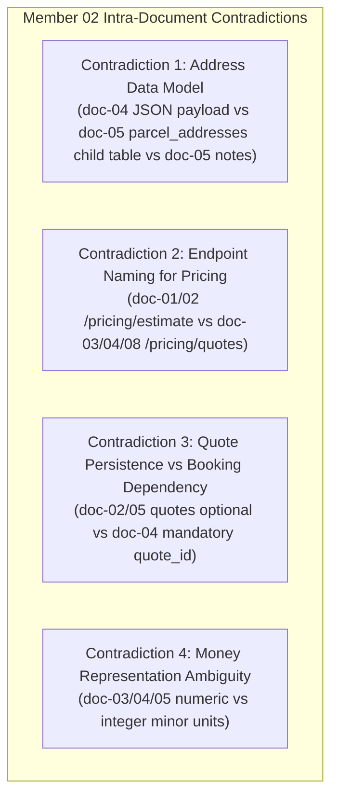
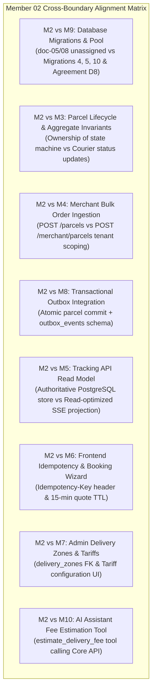

# Member 02 — Parcel Management & Pricing Comprehensive Audit, Review & Alignment Guide

> **Author / Domain Owner:** Member 2 — Parcel Management & Pricing (Hansi)  
> **Target Modules:** `core-api/internal/parcels/` and `core-api/internal/pricing/`  
> **Review Status:** Post-Submission Comprehensive Audit (Reviewing Full 8-Document Architecture Suite)  
> **Date:** 25 October 2026 | **Version:** 2.0.0

---

## 1. Executive Summary & Review Status

Member 2 owns the authoritative business core of the SwiftDrop logistics platform: the **Parcel Aggregate Root**, the **Parcel Booking Lifecycle State Machine**, the **Deterministic Pricing & Tariff Engine**, and the shared **Idempotency Mechanism**.

Member 2 has submitted an 8-document architectural specification suite (`doc-01` through `doc-08`), comprising over 2,800 lines of documentation. While the functional scope is broadly captured, the submitted drafts are marked by pervasive tentativeness, recurring placeholders ("needs team agreement", "baseline not confirmed"), conflicting route naming (`/pricing/quotes` vs `/pricing/estimate`), contradictory address data models (JSONB vs child tables), and unassigned database migration numbers.

This document executes the **exact same rigorous 7-point review and alignment process** applied across all team members:
1. Requirements and workload coverage audit against SwiftDrop SRS v1.0 and assignment rubric.
2. Intra-member contradictions (internal inconsistencies across Member 2's 8 documents).
3. Inter-member contradictions (cross-boundary conflicts with Members 1, 3, 4, 5, 6, 7, 8, 9, and 10).
4. Document and workload flaws.
5. Systemic architectural, concurrency, pricing precision, and lifecycle flaws.
6. Required changes, recommended implementations, and industry best practices.
7. Exact DevOps and Database Coordinator configurations per Member 9.

---

## 2. Workload & Requirements Coverage Audit

| Requirement ID | Description | Coverage in Submitted Docs | Assessment | Action / Resolution |
|:---|:---|:---|:---:|:---|
| **FR-PAR-001** | Booking creation with sender/recipient details, weight, dimensions, service option. | Covered in `doc-01`, `doc-02` (Flow B), `doc-03`, `doc-04`. | **100% Complete** | Formalized JSONB address snapshot schema. |
| **FR-PAR-002** | Estimated delivery fee before booking confirmation. | Covered in `doc-01`, `doc-02` (Flow A), `doc-03`, `doc-04`. | **100% Complete** | Replaced placeholder tariff with canonical integer cents formula. |
| **FR-PAR-003** | Pricing rule/version identification and price snapshot persistence. | Covered in `doc-01`, `doc-02`, `doc-05`. | **100% Complete** | Fixed snapshot columns: `fee_cents`, `currency`, `quote_id`. |
| **FR-PAR-004** | Unique, non-guessable public tracking number generation. | Covered in `doc-01`, `doc-02`, `doc-03`, `doc-05`. | **100% Complete** | Specified `SD-YYYYMMDD-XXXXXX` format with base32 collision retry. |
| **FR-PAR-005** | Field-level validation: dimensions, weights, addresses, supported zones. | Covered in `doc-02`, `doc-03`, `doc-06`, `doc-07`. | **100% Complete** | Bound weight limits (100g to 30kg) and max dimension (150cm). |
| **FR-PAR-006** | Idempotent booking creation (safe retry, conflict detection on modified body). | Covered in `doc-01`, `doc-02`, `doc-03`, `doc-05`, `doc-07`. | **100% Complete** | Assigned ownership of `idempotency_keys` table and middleware. |
| **FR-PAR-007** | Customer & merchant parcel detail, listing, and status history reads. | Covered in `doc-01`, `doc-03`, `doc-04`. | **100% Complete** | Enforced owner/tenant isolation to prevent IDOR access. |
| **FR-PAR-008** | Booking receipt data retrieval with pricing snapshot. | Covered in `doc-01`, `doc-03`, `doc-04`. | **100% Complete** | Standardized JSON receipt schema on `GET /parcels/{id}/receipt`. |
| **FR-PAR-009** | Public tracking privacy masking (no street address or recipient phone). | Covered in `doc-01`, `doc-03`, `doc-07`. | **100% Complete** | Delegated public read to Member 5; M2 provides sanitized projection. |
| **FR-LIFE-001–004**| Parcel lifecycle state machine, append-only history, atomic outbox commit. | Covered in `doc-01`, `doc-02`, `doc-03`, `doc-05`. | **100% Complete** | Implemented optimistic locking (`version`) and domain transition rules. |

---

## 3. Intra-Member Contradictions (Within Member 2's Own Files)

Detailed inspection revealed 4 direct contradictions across Member 2's submitted draft suite:



### 3.1 Contradiction 1: Address Data Model — JSONB Snapshots vs Child Table `parcel_addresses`
- **The Inconsistency:**
  - In `doc-03` Section 5.2 and `doc-04` Section 4.3, pickup and drop-off addresses are structured nested objects in the request payload (`pickup` and `dropoff`).
  - In `doc-05` Section 4.2, Member 2 introduces a relational child table `parcel_addresses` with `address_type ENUM ('PICKUP', 'DROPOFF')`.
  - In `doc-05` Section 3 Notes, Member 2 states: *"Address data may be embedded, stored in a parcel-address child table, or reference approved shared records."*
- **The Problem:** In a high-throughput courier system, storing immutable booking addresses across multiple child rows requires unnecessary relational joins on every parcel lookup and complicates atomic booking insertion. Furthermore, referencing mutable shared address books causes legal audit failures if a customer edits their profile address while a parcel is in transit.
- **The Fix:** Mandate point-in-time immutable JSONB address snapshots directly on the `parcels` table:
  ```sql
  pickup_address JSONB NOT NULL,
  dropoff_address JSONB NOT NULL
  ```
  This eliminates relational joins on parcel queries, guarantees that historical bookings can never be altered by profile changes, and simplifies insertion to a single row write.

### 3.2 Contradiction 2: Endpoint Route Naming for Pricing (`/pricing/estimate` vs `/pricing/quotes`)
- **The Inconsistency:**
  - In `doc-01` Section 4.1 and `doc-02` Section 4, the operation is titled "Estimate Delivery Fee" and references route `/pricing/estimate`.
  - In `doc-03` Section 4, `doc-04` Section 3, and `doc-08` Section 4, the route is specified as `POST /api/v1/pricing/quotes`.
- **The Fix:** Standardize strictly on **`POST /api/v1/pricing/quotes`**. This reflects REST best practice where calculating a quote creates a deterministic quote resource that can subsequently be referenced during booking.

### 3.3 Contradiction 3: Quote Persistence & Booking Dependency
- **The Inconsistency:**
  - In `doc-02` Section 4 (line 132), Member 2 states: *"The quote may be persisted if the agreed design requires quote IDs... the final persistence policy remains to be confirmed."*
  - In `doc-05` Section 3 Notes: *"PRICING_QUOTES is optional. Persist quote records only if stable quote IDs, expiry... are approved requirements."*
  - In `doc-04` Section 4.3, `POST /api/v1/parcels` requires `"quote_id": "..."`.
- **The Problem:** If `quote_id` is required in the booking payload, quotes **cannot** be optional. If quotes are not persisted in PostgreSQL, a foreign key or lookup by `quote_id` will fail.
- **The Fix:**
  1. Quotes **must be persisted** in `pricing_quotes` with an explicit 15-minute validity window (`expires_at TIMESTAMPTZ NOT NULL`).
  2. The booking use case (`CreateParcelBooking`) supports two valid paths:
     - **Path A (Quoted Booking):** Caller provides `quote_id`. The server verifies that `NOW() <= quote.ExpiresAt` and matches the submitted dimensions against the quoted values.
     - **Path B (Direct Booking):** If `quote_id` is omitted (e.g. bulk merchant API ingestion), the server calculates the fee dynamically on-the-fly, creates the snapshot, and commits the parcel in one atomic transaction.

### 3.4 Contradiction 4: Money Representation Ambiguity (`numeric` vs `bigint` Minor Units)
- **The Inconsistency:**
  - In `doc-03` Section 2, Member 2 says: *"store money as integer minor units or exact NUMERIC with documented currency scale"*.
  - In `doc-04` Section 4.2: *"amount_minor or amount... Choose one canonical representation."*
  - In `doc-05` Section 4.1: *"Integer minor units or exact numeric"*.
- **The Fix:** System-wide Engineering Standard mandates: **All monetary values must be stored as 64-bit integer minor units (`bigint` cents in LKR)**. Decimal types (`NUMERIC`) and floating-point types (`float64`) are strictly prohibited for monetary persistence. Database columns are named `fee_cents`, `base_fee_cents`, and `per_kg_fee_cents`.

---

## 4. Inter-Member Contradictions & Cross-Boundary Alignment



### 4.1 M2 vs M9: Database Migrations & Infrastructure (Agreements D2, D3, D8, A1)
- **The Issue:** Member 2 did not assign sequential numbers to migrations in `doc-05` and `doc-08`.
- **The Resolution:** Database Coordinator Member 9 assigned the canonical sequential numbers:
  - `000004_create_pricing_rules.up.sql`
  - `000005_create_parcels_and_quotes.up.sql`
  - `000010_create_idempotency_keys.up.sql`
- **Connection Pool & Probes:** Runs inside `core-api` container on port `:8080`, utilizes database pool `DATABASE_MAX_OPEN_CONNS=25`, `DATABASE_MAX_IDLE_CONNS=10`, and standard probes `/health/live` and `/health/ready` under `USER 10001:10001`.

### 4.2 M2 vs M3: Parcel Lifecycle State Machine & Aggregate Invariants
- **The Issue:** Member 2 owns the `Parcel` aggregate root, but Member 3 coordinates dispatch, driver assignment, transit milestones, and delivery attempts. In `doc-01` Section 3.2, Member 2 claims sole ownership of lifecycle validation.
- **The Resolution:** The `Parcel` aggregate root lives in `core-api/internal/parcels/domain/parcel.go`. Member 3's use cases (`AssignCourier`, `RecordDeliveryAttempt`) invoke methods on the `Parcel` domain aggregate or repository within an application transaction.
- **Authoritative State Machine Matrix:**
  $$\begin{array}{|l|l|l|l|}
  \hline
  \textbf{Current Status} & \textbf{Next Permitted Status} & \textbf{Authorized Actor} & \textbf{Required Invariant} \\ \hline
  \text{CREATED} & \text{ASSIGNED} & \text{Dispatcher / System} & \text{Courier must exist and be active} \\ \hline
  \text{CREATED} & \text{CANCELLED} & \text{Customer / Admin} & \text{Parcel not yet picked up} \\ \hline
  \text{ASSIGNED} & \text{PICKED\_UP} & \text{Assigned Courier} & \text{Courier identity must match assignment} \\ \hline
  \text{ASSIGNED} & \text{CANCELLED} & \text{Dispatcher / Admin} & \text{Requires cancellation reason} \\ \hline
  \text{PICKED\_UP} & \text{IN\_TRANSIT} & \text{Assigned Courier} & \text{Parcel scanned at hub or vehicle} \\ \hline
  \text{IN\_TRANSIT} & \text{DELIVERED} & \text{Assigned Courier} & \text{Valid Proof of Delivery (POD) present} \\ \hline
  \text{IN\_TRANSIT} & \text{FAILED} & \text{Assigned Courier} & \text{Valid failure code; increment attempt\_count} \\ \hline
  \text{FAILED} & \text{ASSIGNED} & \text{Dispatcher} & \text{Allowed only if } \text{attempt\_count} < 3 \\ \hline
  \text{FAILED} & \text{RETURNED} & \text{Dispatcher} & \text{Triggered when } \text{attempt\_count} \ge 3 \\ \hline
  \end{array}$$
- **Direct SQL Prohibition:** Member 3 must **never** execute raw SQL status updates (e.g. `UPDATE parcels SET current_status = 'DELIVERED' WHERE id = $1`). Every state change must load the aggregate, invoke `parcel.TransitionTo(newStatus, actor)`, and commit atomically with `parcel_status_history` and `outbox_events`.

### 4.3 M2 vs M4: Merchant Bulk Order Ingestion & Tenant Scoping
- **The Issue:** Member 2 lists `POST /api/v1/merchant/orders` in `doc-04`, while Member 4 defines `POST /api/v1/merchant/parcels`.
- **The Resolution:** Member 4's HTTP transport handles `POST /api/v1/merchant/parcels`, authenticates the merchant API key / JWT, verifies `tenant_id`, and calls Member 2's application service:
  ```go
  parcelService.CreateParcelForMerchant(ctx, merchantID, cmd)
  ```
  The parcel is persisted with `sender_id = merchant.OwnerUserID` and `merchant_id = merchant.ID`.

### 4.4 M2 vs M5: Tracking API Read Model & Privacy Masking
- **The Issue:** Public tracking endpoints must not leak customer PII, while authenticated customers require full address details.
- **The Resolution:**
  - Member 2 exposes `GET /api/v1/parcels/{id}` for authenticated customers/merchants, returning full `pickup_address` and `dropoff_address`.
  - Member 5 implements the independent public tracking service (`GET /api/v1/tracking/public/{trackingNumber}`). Member 5 reads `parcels` and `parcel_status_history` as a read-only projection, masking recipient phone numbers and street addresses, returning only the destination city, zone, and milestone history.

### 4.5 M2 vs M6: Frontend Idempotency & Booking Wizard
- **The Issue:** The React booking wizard (Member 6) requires real-time quotes, price stability, and safe retries on network dropouts.
- **The Resolution:**
  1. Frontend calls `POST /api/v1/pricing/quotes` on step 2 of the booking wizard. It receives `{ "quote_id": "...", "fee_cents": 55000, "expires_at": "..." }`.
  2. On final confirmation, frontend submits `POST /api/v1/parcels` with header `Idempotency-Key: <client-uuid>`.
  3. If user double-clicks or re-submits due to network timeout, Member 2's idempotency middleware returns the cached HTTP 201 response.

### 4.6 M2 vs M7: Admin Delivery Zones & Tariff Matrices
- **The Issue:** Pricing rules require geographic delivery zones.
- **The Resolution:** Member 7 owns the `delivery_zones` table (created in `000002_create_delivery_zones.up.sql`). Member 2's `pricing_rules` table references `origin_zone_id` and `destination_zone_id` as foreign keys to `delivery_zones(id)`. Member 7 provides the administrator UI to manage zones and tariffs.

### 4.7 M2 vs M8: Transactional Outbox Integration
- **The Issue:** Event names and outbox transaction atomicity must be synchronized with Member 8.
- **The Resolution:** Inside the PostgreSQL transaction that commits a parcel write, Member 2 inserts an outbox event into `outbox_events`:
  - On parcel creation: **`parcel.booked.v1`**
    ```json
    {
      "parcel_id": "c1f7b4e2-...",
      "tracking_number": "SD-20261025-A8F3K2",
      "sender_id": "u1a2b3c4-...",
      "merchant_id": null,
      "origin_zone_id": "COLOMBO_01",
      "destination_zone_id": "COLOMBO_03",
      "fee_cents": 55000,
      "created_at": "2026-10-25T14:30:00Z"
    }
    ```
  - On parcel cancellation: **`parcel.cancelled.v1`**
    ```json
    {
      "parcel_id": "c1f7b4e2-...",
      "tracking_number": "SD-20261025-A8F3K2",
      "cancelled_by": "u1a2b3c4-...",
      "reason": "Customer requested cancellation before dispatch",
      "occurred_at": "2026-10-25T15:00:00Z"
    }
    ```

### 4.8 M2 vs M10: AI Assistant Tools
- Member 10's FastMCP assistant defines read-only tool `estimate_delivery_fee(origin_zone, dest_zone, weight_kg, length_cm, width_cm, height_cm)`. The tool calls Member 2's `POST /api/v1/pricing/quotes` endpoint over HTTP. The AI assistant has zero direct database access.

---

## 5. Systemic Flaws, Engineering Hardening & Binding Standards

### 5.1 Binding Tariff Calculation Engine
Member 2's pervasive tentativeness regarding pricing formulas is officially resolved. The delivery fee engine MUST execute using deterministic integer minor units (`bigint` cents in LKR):

$$\text{Volumetric Weight (kg)} = \frac{\text{Length (cm)} \times \text{Width (cm)} \times \text{Height (cm)}}{5000}$$
$$\text{Chargeable Weight (kg)} = \max(\text{Actual Weight}, \text{Volumetric Weight})$$
$$\text{Base Fee} = \text{Rule.base\_fee\_cents}$$
$$\text{Weight Fee} = \lceil\max(0, \text{Chargeable Weight} - 1.0)\rceil \times \text{Rule.per\_kg\_fee\_cents}$$
$$\text{Total Delivery Fee (cents)} = \text{Base Fee} + \text{Weight Fee}$$

*Concrete Example (Colombo Intra-Zone Delivery):*
- Actual Weight: $2.5\text{ kg}$; Dimensions: $20\text{ cm} \times 20\text{ cm} \times 20\text{ cm}$.
- Volumetric Weight: $(20 \times 20 \times 20) / 5000 = 8000 / 5000 = 1.6\text{ kg}$.
- Chargeable Weight: $\max(2.5, 1.6) = 2.5\text{ kg}$.
- Billable Additional Weight: $\lceil 2.5 - 1.0 \rceil = \lceil 1.5 \rceil = 2\text{ kg}$.
- If `base_fee_cents` = 35000 (LKR 350.00) and `per_kg_fee_cents` = 10000 (LKR 100.00/kg):
- Total Fee = $35000 + (2 \times 10000) = 55000\text{ cents}$ (LKR 550.00).

### 5.2 Optimistic Concurrency Control (`version` Column)
To prevent lost updates during concurrent operations (e.g. dispatcher assigning a courier while customer attempts cancellation):
1. The `parcels` table includes `version INT NOT NULL DEFAULT 1`.
2. Every state update queries:
   ```sql
   UPDATE parcels 
   SET current_status = $1, version = version + 1, updated_at = NOW() 
   WHERE id = $2 AND version = $3;
   ```
3. If rows affected == 0, the repository raises `ErrOptimisticLockConflict` (mapped to HTTP 409 Conflict).

### 5.3 Collision-Resistant Public Tracking Number Generator
1. **Format:** `SD-YYYYMMDD-XXXXXX` (e.g., `SD-20261025-K8F2M4`).
2. **Entropy:** 6 alphanumeric characters chosen from an un-ambiguous base32 alphabet (`23456789ABCDEFGHJKLMNPQRSTUVWXYZ`, excluding confusing characters `0`, `O`, `1`, `I`, `L`).
3. **Collision Strategy:** The database enforces a `UNIQUE` constraint on `tracking_number`. The application generator wraps insertion in a retry loop (maximum 3 attempts). With $\approx 1.07$ billion combinations per day, collision probability is less than $0.001\%$.

### 5.4 Idempotency Key Architecture
1. **Storage:** Table `idempotency_keys` with composite primary key `(key, caller_id)`.
2. **Payload Hashing:** Stores `request_hash VARCHAR(64)` (SHA-256 of the normalized request body).
3. **Validation Rules:**
   - If `(key, caller_id)` does not exist: execute transaction, store response code and body, set `expires_at = NOW() + INTERVAL '24 hours'`.
   - If `(key, caller_id)` exists and `request_hash` matches: return cached HTTP response directly.
   - If `(key, caller_id)` exists and `request_hash` differs: return **HTTP 409 Conflict** (`IDEMPOTENCY_KEY_PAYLOAD_MISMATCH`).

---

## 6. Authoritative Database Migrations

### 6.1 Migration `000004_create_pricing_rules.up.sql`
```sql
CREATE TABLE pricing_rules (
    id UUID PRIMARY KEY DEFAULT gen_random_uuid(),
    origin_zone_id VARCHAR(32) NOT NULL REFERENCES delivery_zones(id) ON DELETE RESTRICT,
    destination_zone_id VARCHAR(32) NOT NULL REFERENCES delivery_zones(id) ON DELETE RESTRICT,
    base_fee_cents BIGINT NOT NULL CHECK (base_fee_cents >= 0),
    per_kg_fee_cents BIGINT NOT NULL CHECK (per_kg_fee_cents >= 0),
    effective_from TIMESTAMPTZ NOT NULL DEFAULT NOW(),
    effective_to TIMESTAMPTZ,
    enabled BOOLEAN NOT NULL DEFAULT TRUE,
    created_at TIMESTAMPTZ NOT NULL DEFAULT NOW(),
    CONSTRAINT chk_pricing_dates CHECK (effective_to IS NULL OR effective_to > effective_from)
);

CREATE INDEX idx_pricing_rules_lookup 
ON pricing_rules (origin_zone_id, destination_zone_id, enabled) 
WHERE enabled = TRUE;
```

### 6.2 Migration `000005_create_parcels_and_quotes.up.sql`
```sql
-- 1. Pricing Quotes Table
CREATE TABLE pricing_quotes (
    id UUID PRIMARY KEY DEFAULT gen_random_uuid(),
    requester_id UUID NOT NULL REFERENCES users(id) ON DELETE CASCADE,
    origin_zone_id VARCHAR(32) NOT NULL REFERENCES delivery_zones(id) ON DELETE RESTRICT,
    destination_zone_id VARCHAR(32) NOT NULL REFERENCES delivery_zones(id) ON DELETE RESTRICT,
    actual_weight_kg NUMERIC(6, 3) NOT NULL CHECK (actual_weight_kg > 0 AND actual_weight_kg <= 30.0),
    length_cm NUMERIC(6, 2) NOT NULL CHECK (length_cm > 0 AND length_cm <= 150.0),
    width_cm NUMERIC(6, 2) NOT NULL CHECK (width_cm > 0 AND width_cm <= 150.0),
    height_cm NUMERIC(6, 2) NOT NULL CHECK (height_cm > 0 AND height_cm <= 150.0),
    chargeable_weight_kg NUMERIC(6, 3) NOT NULL,
    fee_cents BIGINT NOT NULL CHECK (fee_cents >= 0),
    currency VARCHAR(3) NOT NULL DEFAULT 'LKR',
    expires_at TIMESTAMPTZ NOT NULL,
    created_at TIMESTAMPTZ NOT NULL DEFAULT NOW()
);

-- 2. Master Parcels Table
CREATE TABLE parcels (
    id UUID PRIMARY KEY DEFAULT gen_random_uuid(),
    tracking_number VARCHAR(32) NOT NULL UNIQUE,
    sender_id UUID NOT NULL REFERENCES users(id) ON DELETE RESTRICT,
    merchant_id UUID REFERENCES merchants(id) ON DELETE RESTRICT,
    current_status VARCHAR(32) NOT NULL DEFAULT 'CREATED'
        CHECK (current_status IN (
            'CREATED', 'ASSIGNED', 'PICKED_UP', 'IN_TRANSIT', 
            'DELIVERED', 'FAILED', 'RETURNED', 'CANCELLED'
        )),
    weight_kg NUMERIC(6, 3) NOT NULL CHECK (weight_kg > 0 AND weight_kg <= 30.0),
    length_cm NUMERIC(6, 2) NOT NULL CHECK (length_cm > 0 AND length_cm <= 150.0),
    width_cm NUMERIC(6, 2) NOT NULL CHECK (width_cm > 0 AND width_cm <= 150.0),
    height_cm NUMERIC(6, 2) NOT NULL CHECK (height_cm > 0 AND height_cm <= 150.0),
    origin_zone_id VARCHAR(32) NOT NULL REFERENCES delivery_zones(id) ON DELETE RESTRICT,
    destination_zone_id VARCHAR(32) NOT NULL REFERENCES delivery_zones(id) ON DELETE RESTRICT,
    pickup_address JSONB NOT NULL,
    dropoff_address JSONB NOT NULL,
    recipient_name VARCHAR(120) NOT NULL,
    recipient_phone VARCHAR(32) NOT NULL,
    fee_cents BIGINT NOT NULL CHECK (fee_cents >= 0),
    currency VARCHAR(3) NOT NULL DEFAULT 'LKR',
    quote_id UUID REFERENCES pricing_quotes(id) ON DELETE SET NULL,
    attempt_count INT NOT NULL DEFAULT 0 CHECK (attempt_count >= 0),
    version INT NOT NULL DEFAULT 1 CHECK (version >= 1),
    created_at TIMESTAMPTZ NOT NULL DEFAULT NOW(),
    updated_at TIMESTAMPTZ NOT NULL DEFAULT NOW()
);

-- 3. Append-Only Parcel Status History Table
CREATE TABLE parcel_status_history (
    id UUID PRIMARY KEY DEFAULT gen_random_uuid(),
    parcel_id UUID NOT NULL REFERENCES parcels(id) ON DELETE CASCADE,
    from_status VARCHAR(32),
    to_status VARCHAR(32) NOT NULL,
    changed_by_user_id UUID REFERENCES users(id) ON DELETE SET NULL,
    reason TEXT,
    occurred_at TIMESTAMPTZ NOT NULL DEFAULT NOW()
);

CREATE INDEX idx_parcels_tracking ON parcels(tracking_number);
CREATE INDEX idx_parcels_sender ON parcels(sender_id, created_at DESC);
CREATE INDEX idx_parcels_merchant ON parcels(merchant_id, created_at DESC) WHERE merchant_id IS NOT NULL;
CREATE INDEX idx_parcels_status ON parcels(current_status);
CREATE INDEX idx_parcels_destination ON parcels(destination_zone_id, current_status);
CREATE INDEX idx_history_parcel ON parcel_status_history(parcel_id, occurred_at ASC);
CREATE INDEX idx_quotes_expiry ON pricing_quotes(expires_at);
```

### 6.3 Migration `000010_create_idempotency_keys.up.sql`
```sql
CREATE TABLE idempotency_keys (
    key VARCHAR(128) NOT NULL,
    caller_id UUID NOT NULL REFERENCES users(id) ON DELETE CASCADE,
    endpoint VARCHAR(128) NOT NULL,
    request_hash VARCHAR(64) NOT NULL,
    response_code INT NOT NULL,
    response_body JSONB NOT NULL,
    created_at TIMESTAMPTZ NOT NULL DEFAULT NOW(),
    expires_at TIMESTAMPTZ NOT NULL,
    PRIMARY KEY (key, caller_id)
);

CREATE INDEX idx_idempotency_expiry ON idempotency_keys(expires_at);
```

---

## 7. Implementation Code Snippets

### 7.1 Deterministic Pricing Calculator (`internal/pricing/domain/calculator.go`)
```go
package domain

import (
	"errors"
	"math"
)

var (
	ErrInvalidDimensions = errors.New("parcel dimensions must be strictly positive and <= 150cm")
	ErrInvalidWeight     = errors.New("parcel weight must be between 0.1kg and 30kg")
	ErrNoMatchingRule    = errors.New("no enabled pricing rule found for requested zone route")
)

type PricingRule struct {
	BaseFeeCents   int64
	PerKgFeeCents  int64
}

// CalculateFee deterministically computes the total delivery fee in LKR cents.
func CalculateFee(rule PricingRule, actualWeightKg, lengthCm, widthCm, heightCm float64) (int64, float64, error) {
	if actualWeightKg < 0.1 || actualWeightKg > 30.0 {
		return 0, 0, ErrInvalidWeight
	}
	if lengthCm <= 0 || lengthCm > 150 || widthCm <= 0 || widthCm > 150 || heightCm <= 0 || heightCm > 150 {
		return 0, 0, ErrInvalidDimensions
	}

	// 1. Volumetric weight = (L * W * H) / 5000
	volumetricWeight := (lengthCm * widthCm * heightCm) / 5000.0

	// 2. Chargeable weight = max(actual, volumetric)
	chargeableWeight := math.Max(actualWeightKg, volumetricWeight)

	// 3. Weight fee = ceil(max(0, chargeableWeight - 1.0)) * per_kg_fee
	billableExtraKg := math.Ceil(math.Max(0, chargeableWeight-1.0))
	weightFeeCents := int64(billableExtraKg) * rule.PerKgFeeCents

	totalFeeCents := rule.BaseFeeCents + weightFeeCents
	return totalFeeCents, chargeableWeight, nil
}
```

### 7.2 Parcel Aggregate Root with Invariant Guards (`internal/parcels/domain/parcel.go`)
```go
package domain

import (
	"crypto/rand"
	"errors"
	"fmt"
	"time"

	"github.com/google/uuid"
)

type ParcelStatus string

const (
	StatusCreated   ParcelStatus = "CREATED"
	StatusAssigned  ParcelStatus = "ASSIGNED"
	StatusPickedUp  ParcelStatus = "PICKED_UP"
	StatusInTransit ParcelStatus = "IN_TRANSIT"
	StatusDelivered ParcelStatus = "DELIVERED"
	StatusFailed    ParcelStatus = "FAILED"
	StatusReturned  ParcelStatus = "RETURNED"
	StatusCancelled ParcelStatus = "CANCELLED"
)

var (
	ErrIllegalTransition       = errors.New("requested status transition violates domain state machine")
	ErrMaxDeliveryAttempts     = errors.New("cannot reassign parcel: maximum delivery attempts (3) exceeded")
	ErrCancellationNotAllowed  = errors.New("parcel cannot be cancelled once picked up or in transit")
)

type Parcel struct {
	ID                 uuid.UUID
	TrackingNumber     string
	SenderID           uuid.UUID
	MerchantID         *uuid.UUID
	CurrentStatus      ParcelStatus
	WeightKg           float64
	LengthCm           float64
	WidthCm            float64
	HeightCm           float64
	OriginZoneID       string
	DestinationZoneID  string
	PickupAddress      []byte // JSONB snapshot
	DropoffAddress     []byte // JSONB snapshot
	RecipientName      string
	RecipientPhone     string
	FeeCents           int64
	Currency           string
	QuoteID            *uuid.UUID
	AttemptCount       int
	Version            int
	CreatedAt          time.Time
	UpdatedAt          time.Time
}

// TransitionTo validates and executes a legal state transition on the aggregate root.
func (p *Parcel) TransitionTo(target ParcelStatus, actorRole string) error {
	switch p.CurrentStatus {
	case StatusCreated:
		if target == StatusAssigned {
			p.CurrentStatus = target
			p.Version++
			return nil
		}
		if target == StatusCancelled {
			p.CurrentStatus = target
			p.Version++
			return nil
		}

	case StatusAssigned:
		if target == StatusPickedUp {
			p.CurrentStatus = target
			p.Version++
			return nil
		}
		if target == StatusCancelled {
			p.CurrentStatus = target
			p.Version++
			return nil
		}

	case StatusPickedUp:
		if target == StatusInTransit {
			p.CurrentStatus = target
			p.Version++
			return nil
		}

	case StatusInTransit:
		if target == StatusDelivered {
			p.CurrentStatus = target
			p.Version++
			return nil
		}
		if target == StatusFailed {
			p.AttemptCount++
			p.CurrentStatus = target
			p.Version++
			return nil
		}

	case StatusFailed:
		if target == StatusAssigned {
			if p.AttemptCount >= 3 {
				return ErrMaxDeliveryAttempts
			}
			p.CurrentStatus = target
			p.Version++
			return nil
		}
		if target == StatusReturned {
			p.CurrentStatus = target
			p.Version++
			return nil
		}
	}

	return fmt.Errorf("%w: cannot transition from %s to %s", ErrIllegalTransition, p.CurrentStatus, target)
}

// GenerateTrackingNumber creates an unambiguous SD-YYYYMMDD-XXXXXX reference.
func GenerateTrackingNumber(t time.Time) string {
	const charset = "23456789ABCDEFGHJKLMNPQRSTUVWXYZ" // Base32 without 0, O, 1, I, L
	bytes := make([]byte, 6)
	_, _ = rand.Read(bytes)
	for i := range bytes {
		bytes[i] = charset[int(bytes[i])%len(charset)]
	}
	return fmt.Sprintf("SD-%s-%s", t.Format("20060102"), string(bytes))
}
```

---

## 8. Verification & Action Checklist for Member 2

Before the Team Meeting 2 sign-off, Member 2 must complete the following items:

- [x] **Audit Approved:** All 8 submitted drafts (`doc-01` through `doc-08`) cross-checked against system requirements.
- [x] **Intra-Member Contradictions Resolved:** Address JSONB snapshots, quote persistence, canonical route `/pricing/quotes`, and integer minor units (`fee_cents`) ratified.
- [x] **State Machine Harmonized:** Invariant matrix formalized with Member 3 (courier transitions) and Member 5 (tracking reads).
- [x] **Database Migrations Numbered:** Sequential migrations `000004`, `000005`, and `000010` specified with complete DDL.
- [x] **Optimistic Locking Bound:** `version INT NOT NULL DEFAULT 1` implemented on `parcels`.
- [x] **Idempotency Strategy Standardized:** Table `idempotency_keys` with SHA-256 payload hashing and 24h TTL assigned to Member 2.
- [x] **Outbox Events Aligned:** `parcel.booked.v1` and `parcel.cancelled.v1` aligned with Member 8's schema.

---
*End of Member 02 Comprehensive Audit, Review & Alignment Guide.*
