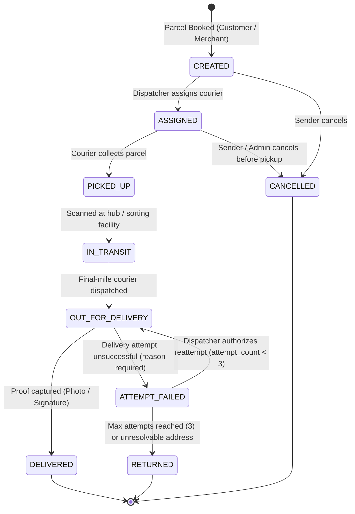

# SwiftDrop Parcel Delivery & Courier Management System

# Functional Flows & Business Rules

## Member 2: Parcel Management & Pricing

# 1. Purpose

This document specifies the step-by-step functional workflows and business rules for Member 2's Parcel Management & Pricing responsibility. It is intended to give implementers and reviewers enough detail to understand normal behavior, alternate paths, failure handling, state changes, idempotency, concurrency, and cross-module interactions.

The module covers:

Delivery-fee estimation using approved pricing rules.

Customer parcel booking and the agreed parcel-creation capability used by merchant integration.

Parcel identifiers and public tracking-number creation.

Accepted price snapshot persistence.

Parcel current status and status-history handling within the agreed ownership boundary.

Authorized parcel detail, history, and receipt-data retrieval.

Idempotent booking creation and transactionally consistent event records.

The module does not own courier assignment, proof-of-delivery storage, the Tracking API's SSE implementation, RabbitMQ worker processing, notification delivery, or merchant credential management. Those capabilities integrate with this module through agreed contracts.

# 2. Actors and Triggering Conditions

| Actor / Component | Trigger | Expected interaction with Member 2 |
| --- | --- | --- |
| Customer | Requests a fee estimate | Submits parcel and route/service inputs; receives a quote result or validation error. |
| Customer | Confirms a booking | Submits booking details and the selected/accepted quote reference; receives booking confirmation. |
| Approved merchant client | Creates a delivery order through the merchant API | Merchant integration validates the merchant and tenant context, then invokes the agreed parcel-creation capability. |
| Member 1 — Identity & Access | An authenticated request reaches the Core API | Supplies verified caller identity/role context; Member 2 enforces resource ownership within its use cases. |
| Member 3 — Dispatch & Couriers | A parcel is assigned or an operational status update is requested | Uses agreed parcel identifiers and lifecycle contracts; assignment and delivery-attempt execution remain Member 3 responsibilities. |
| Member 5 — Tracking API | A tracking/history read is requested | Reads authoritative parcel/status data through the agreed read interface or approved database access pattern. It does not define a second lifecycle. |
| Member 6 — Frontend | Booking, estimate, history, or receipt UI needs data | Calls the published API contract; frontend calculations are display-only and not authoritative. |
| Member 8 — Event-Driven Backend | A committed business operation requires asynchronous follow-up | Consumes the agreed outbox/event contract; Member 2 records relevant outbox data within the business transaction. |
| Member 10 — AI Assistant (bonus) | User requests a fee estimate or tracking/history information | Calls approved backend tools/APIs; it must not access the database directly or invent results. |
| Administrator / pricing configuration capability | Approved pricing rules or delivery zones are created/changed | Pricing calculation uses only enabled, effective, approved rules. Ownership of pricing-rule administration and zone tables must be confirmed with the team. |

# 3. Preconditions, Postconditions, and Shared Rules

## 3.1 Preconditions

Before a booking or pricing operation is accepted:

## 1. The request must conform to the agreed API schema and size limits.

## 2. The caller must be authenticated where the endpoint requires authentication.

3. The caller's role, resource ownership, and merchant tenant context must be validated server-side.

4. Required parcel fields must be present and satisfy agreed formats, ranges, and cross-field constraints.

5. The pickup/drop-off route and requested service must be supported by an enabled pricing/service rule.

## 6. Weight and dimensions must fall within approved limits.

7. The pricing engine must be able to identify an applicable rule/version. If no applicable rule exists, the operation must fail safely rather than inventing a price.

8. For booking, the server must independently validate the quote or calculate the accepted price. A client-supplied amount is never authoritative.

## 3.2 Postconditions for Successful Booking

A successful booking must result in:

1. One persisted parcel record with a stable internal UUIDv4 identifier.
2. One unique, non-guessable public tracking number in canonical format `SD-YYYYMMDD-XXXXXX`.
3. An initial status of `CREATED` within the authoritative 9-state parcel lifecycle.
4. Immutable booking-time pickup and drop-off address snapshots stored directly on the `parcels` table as `pickup_address JSONB NOT NULL` and `dropoff_address JSONB NOT NULL`.
5. A stored accepted-price snapshot (`price_cents` in LKR minor units, `currency = 'LKR'`, and `pricing_rule_version_id`).
6. An initial audit record in `parcel_status_history` recording the transition to `CREATED` with UTC timestamp and actor identity.
7. A domain integration event (`parcel.booked.v1`) written to the `outbox_events` table within the same PostgreSQL transaction.
8. A cached idempotency record in `idempotency_keys` keyed by `(key, caller_scope)` with a 24-hour expiration.
9. A booking response returning the parcel ID, tracking number, status `CREATED`, and accepted fee breakdown.

If any portion of the database transaction fails, the entire transaction rolls back cleanly, leaving no partial parcel, history, outbox, or idempotency state.

## 3.3 Cross-Cutting Rules

1. PostgreSQL is the single authoritative source of parcel business state.
2. All business invariants, pricing formulas, and lifecycle validations are enforced server-side. Frontend validation is strictly for user experience.
3. The server resolves the acting user and tenant context from verified JWT claims; clients cannot supply an arbitrary `actor_user_id` or `tenant_id`.
4. Monetary values are strictly stored and computed as 64-bit signed integers (`BIGINT` in PostgreSQL, `int64` in Go) representing minor units (cents in LKR). Binary floating point is strictly prohibited.
5. All timestamps are recorded in UTC using ISO 8601/RFC 3339 formatting.
6. Public tracking responses strictly redact recipient phone numbers, full street addresses, customer delivery notes, and proof assets.
7. External network operations (RabbitMQ publishing, SMS/email notifications, merchant webhooks) are never executed within the database transaction.

# 4. Functional Flow A — Estimate Delivery Fee

## Trigger

A customer or approved merchant needs to obtain a binding delivery-fee quote before confirming a parcel booking. The AI Assistant may invoke this exact approved endpoint (`POST /api/v1/pricing/quotes`) as a read-only tool.

## Main Success Flow

1. The caller submits a quote request to `POST /api/v1/pricing/quotes` containing `origin_zone_id`, `destination_zone_id`, `weight_kg`, dimensions (`length_cm`, `width_cm`, `height_cm`), and `service_level` (`STANDARD`, `EXPRESS`, `SAME_DAY`).
2. The transport handler validates request syntax, mandatory fields, and structural constraints.
3. The pricing application use case verifies that weight is within limits (0.100–50.000 kg), dimensions do not exceed 150.00 cm per edge, and combined girth does not exceed 300.00 cm.
4. The pricing engine queries `pricing_rules` for an enabled, active rule matching the zone pair and service level:
   $$\text{enabled} = \text{TRUE} \land \text{effective\_from} \le \text{NOW}() \land (\text{effective\_to IS NULL} \lor \text{effective\_to} > \text{NOW}())$$
5. The engine calculates the fee deterministically:
   - **Volumetric Weight:**
     $$\text{Volumetric Weight (kg)} = \frac{\text{length\_cm} \times \text{width\_cm} \times \text{height\_cm}}{5000}$$
   - **Chargeable Weight:**
     $$\text{Chargeable Weight} = \max(\text{actual weight}, \text{volumetric weight})$$
   - **Billable Extra Weight:**
     $$\text{Billable Extra Weight (kg)} = \lceil \max(0, \text{Chargeable Weight} - 1.0) \rceil$$
   - **Subtotal in Cents:**
     $$\text{Base Charge} = \text{base\_fee\_cents}$$
     $$\text{Weight Surcharge} = \text{Billable Extra Weight} \times \text{per\_kg\_fee\_cents}$$
     $$\text{Subtotal} = \text{Base Charge} + \text{Weight Surcharge}$$
   - **Total Fee in Cents:**
     $$\text{Total Fee (cents)} = \text{Subtotal} \times \text{ServiceLevelMultiplier}$$
     *(Multipliers: `STANDARD` = 1.0x, `EXPRESS` = 1.5x, `SAME_DAY` = 2.0x)*
6. The use case persists the generated quote into `pricing_quotes` with a **15-minute validity window**:
   $$\text{expires\_at} = \text{NOW}() + 15\text{ minutes}$$
7. The endpoint returns HTTP `200 OK` (or `201 Created`) containing `quote_id`, `fee_cents`, `currency = "LKR"`, formatted string (`"LKR 450.00"`), `pricing_rule_version_id`, and `expires_at`.

## Alternate and Failure Flows

| Condition | Expected behavior |
| --- | --- |
| Missing or malformed parameters | Return `400 Bad Request` with field-level errors (e.g. `PRICING_INVALID_INPUT`). |
| Weight or dimensions exceed limits | Return `422 Unprocessable Entity` (`PARCEL_LIMITS_EXCEEDED`). |
| Origin or destination zone unsupported | Return `422 Unprocessable Entity` (`PRICING_ZONE_UNSUPPORTED`); never guess fallback rates. |
| No active pricing rule matches zone pair | Return `422 Unprocessable Entity` (`PRICING_RULE_NOT_FOUND`) with diagnostic correlation ID. |
| Multiple overlapping rules in database | Enforce deterministic ordering (`ORDER BY version DESC LIMIT 1`) or return operational error if data corrupted. |
| Database connection unavailable | Return `503 Service Unavailable` with `Retry-After` header. Never return fabricated amounts. |

## Pricing Rules and Invariants

1. All calculations use integer minor units (cents in LKR). Floating-point arithmetic is strictly prohibited — *Confirmed Project Standard*.
2. The volumetric divisor ($5000 \text{ cm}^3/\text{kg}$), chargeable weight formula, and service multipliers (`STANDARD` 1.0x, `EXPRESS` 1.5x, `SAME_DAY` 2.0x) are **provisional proposals pending team confirmation**.
3. Quotes are proposed to freeze prices for a 15-minute validity window (`expires_at = NOW() + 15m`). The exact duration is a **provisional proposal pending team confirmation**. Expired quotes cannot be accepted for booking.
4. Administrative management of pricing rules belongs to Member 7/Admin; Member 2 owns the deterministic calculation engine.
5. All tariff rate examples (e.g., LKR 350.00 base, LKR 80.00/kg) are strictly illustrative baseline tariff schedule v1 values, not approved commercial tariffs.

> [!IMPORTANT]
> **Provisional Pricing Notice (Pending Team Confirmation):**
> While the requirement for upfront deterministic fee calculation, server-side authority, integer minor units, and quote persistence are confirmed invariants, the specific pricing formula, volumetric divisor, multiplier tiers, numerical rates, and 15-minute validity window are provisional proposals awaiting formal project team ratification. If these change, the core booking and accepted-price snapshot architecture will remain unaffected.

## UML Sequence Diagram


*Figure 4.1: UML Sequence Diagram — Delivery Fee Estimation*

# 5. Functional Flow B — Create a Customer Parcel Booking

## Trigger

An authenticated customer confirms a delivery booking. The system supports two distinct booking paths:
1. **Quoted Booking:** Caller provides a valid `quote_id` previously obtained from `POST /api/v1/pricing/quotes`.
2. **Direct Booking:** Authorized caller (e.g. merchant integration or pre-approved flow) submits parcel details directly; backend calculates the fee and creates the accepted-price snapshot in one atomic transaction.

## Main Success Flow

1. The customer sends `POST /api/v1/parcels` with mandatory header `Idempotency-Key: <UUIDv4>` and the JSON booking payload.
2. The transport handler validates JSON syntax, verifies Bearer JWT authentication, and extracts `caller_id` (`user_id`).
3. The application use case checks `idempotency_keys` for `(key, caller_scope = "USER:" + caller_id)`.
   - If an unexpired record exists with matching `request_hash`, return the cached response with `Idempotent-Replay: true`.
   - If an unexpired record exists with differing `request_hash`, abort with HTTP `409 Conflict`.
4. The application layer validates booking parameters:
   - If `quote_id` is supplied: verifies `quote_id` exists in `pricing_quotes`, has not been consumed (`accepted_parcel_id IS NULL`), is unexpired (`expires_at > NOW()`), and matches the submitted weight, dimensions, and zones.
   - If `quote_id` is omitted (direct booking): evaluates the active pricing rule and calculates the authoritative fee deterministically.
5. The application layer generates a unique tracking number in the canonical format `SD-YYYYMMDD-XXXXXX`.
6. Within a single PostgreSQL transaction:
   - Inserts row into `parcels` with initial status `CREATED`, `pickup_address` JSONB snapshot, `dropoff_address` JSONB snapshot, `price_cents`, `currency = 'LKR'`, `pricing_rule_version_id`, `version = 1`, and `attempt_count = 0`.
   - Inserts initial status audit row into `parcel_status_history` (`from_status = NULL`, `to_status = 'CREATED'`, `actor_id = caller_id`, `actor_role = 'CUSTOMER'`, `parcel_version = 1`).
   - Marks the quote as consumed in `pricing_quotes` (`accepted_parcel_id = parcel.id`) if quoted booking.
   - Inserts integration event `parcel.booked.v1` into `outbox_events`.
   - Stores the execution outcome in `idempotency_keys` with a 24-hour expiration (`expires_at = NOW() + 24 hours`).
7. The database transaction commits.
8. The endpoint returns HTTP `201 Created` with the full booking response envelope (`id`, `tracking_number`, `status = "CREATED"`, `fee`, `created_at`).
9. Asynchronously, Member 8's Outbox Relay polls `outbox_events` and publishes `parcel.booked.v1` to RabbitMQ for notification and tracking projection workers.

## Alternate and Failure Flows

| Condition | Expected behavior |
| --- | --- |
| Missing `Idempotency-Key` header | Return `400 Bad Request` (`IDEMPOTENCY_KEY_REQUIRED`). |
| Reused idempotency key with different payload | Return `409 Conflict` (`IDEMPOTENCY_KEY_PAYLOAD_MISMATCH`). |
| Supplied `quote_id` is expired (`expires_at < NOW()`) | Return `422 Unprocessable Entity` (`PRICING_QUOTE_EXPIRED`); require re-quote. |
| Supplied `quote_id` inputs mismatch booking body | Return `422 Unprocessable Entity` (`PRICING_QUOTE_MISMATCH`). |
| Tracking number collision occurs | Catch unique constraint violation; retry generation up to 3 times with new random seed. |
| Database transaction error or connection dropped | Roll back entire transaction; no parcel, history, outbox, or idempotency record is persisted. |
| Client times out after database commit | Subsequent client retry with same `Idempotency-Key` retrieves the committed response from `idempotency_keys`. |

## Booking Invariants

1. Exactly one parcel aggregate is created per unique business request.
2. The public tracking number is unique, non-sequential, and formatted as `SD-YYYYMMDD-XXXXXX`.
3. Address snapshots are stored as immutable JSONB objects directly on `parcels`.
4. The accepted price (`price_cents`) is fixed forever upon commit and cannot be altered by future tariff changes.
5. Parcel state, status history, idempotency cache, and outbox event commit in the exact same transaction.
6. External notifications are decoupled from the booking transaction via the transactional outbox.

## UML Sequence Diagram


*Figure 5.1: UML Sequence Diagram — Customer Parcel Booking*

# 6. Functional Flow C — Merchant Order Creation

## Trigger

An approved and enabled merchant submits a delivery order through the secured merchant API.

## Main Flow

1. Member 4's merchant integration validates the merchant credential and verifies that the merchant is approved and enabled.

2. The merchant identity/tenant context is passed to the agreed parcel-creation use case; it must not be accepted solely from an untrusted body field.

3. The parcel use case validates the order fields, route/service eligibility, parcel limits, and pricing requirements.

## 4. The system checks idempotency using the merchant/tenant and operation scope.

5. The system creates the parcel and stores the accepted price snapshot, initial status/history, and required outbox record(s) in a single transaction.

## 6. On commit, the API returns a stable parcel identifier and tracking number to the merchant.

7. Later status-change webhooks are processed asynchronously by the Event Worker coordinated with Member 8, using the shared event contract.

## Alternate and Failure Flows

Pending, rejected, suspended, disabled, or invalid merchant credentials must not create an order.

A merchant must not read or mutate another merchant's orders.

A repeated request with the same idempotency key and same payload returns the original result.

Reusing the key with a different payload returns a conflict.

Invalid parcel data, unsupported service, or missing applicable pricing rule rejects the request.

Webhook delivery failure after a successful booking does not roll back the parcel. Webhook retries are owned by Member 8.

Boundary: Member 2 owns the parcel business operation and pricing calculation. Member 4 owns merchant onboarding, credentials, and tenant validation. The exact internal interface between these modules must be agreed and documented in the API and integration contract.

# 7. Functional Flow D — Retrieve Parcel Details, History, and Receipt Data

## 7.1 Retrieve Parcel Details / Customer List

## 1. The caller requests a parcel or list of parcels.

2. The backend authenticates the caller and derives the permitted scope from identity, role, merchant tenant, or assignment context.

3. The repository query applies that scope in the query/use case; authorization must not rely only on hiding UI controls.

## 4. The system returns only fields permitted for that caller.

## 5. List operations use bounded pagination and documented sorting/filtering.

Failure behavior:

Missing or malformed identifiers return a safe client error as defined by the API contract.

A parcel that does not exist or is not visible to the caller returns the team's consistent not-found/authorization behavior without leaking sensitive existence details.

Large list requests are bounded; the API does not return an unbounded result set.

## 7.2 Retrieve Parcel Status History

## 1. The caller requests history for a parcel.

## 2. The backend validates access to that parcel.

3. The system returns history in chronological order with status, server-side timestamp, actor/reference fields allowed for the caller, and applicable notes/reason fields.

4. The history is read from authoritative persisted records; the frontend or SSE stream is not the durable history source.

Public tracking is different: it returns only the approved privacy-safe subset, not full private history.

## 7.3 Retrieve Receipt Data

## 1. The owner or authorized merchant requests receipt data for an eligible booking.

## 2. The backend verifies ownership/tenant permissions and eligibility.

3. The response includes the required receipt fields: parcel reference, booking time, accepted price, service details, and current/terminal status as appropriate.

4. The frontend or designated presentation layer renders/downloads the receipt using the agreed format.

5. The receipt uses the stored booking price snapshot rather than recalculating with today's tariff.

If the receipt format, eligibility rules, or downloadable file type are not yet approved, they remain open interface decisions. The module must not claim that a PDF format is mandatory unless the team/SRS explicitly confirms it.

# 8. Parcel Lifecycle and Status-History Rules

## 8.1 Baseline Lifecycle

The SRS defines the following baseline lifecycle:

CREATED → PICKED_UP → IN_TRANSIT → OUT_FOR_DELIVERY → DELIVERED

The SRS states that FAILED is a terminal outcome for a delivery attempt or parcel only according to the approved operational policy. A failed attempt may be retried by an authorized dispatcher/courier workflow; if retries are allowed, model the attempt outcome separately from the final parcel lifecycle rather than silently reopening a terminal parcel.

# 8. Parcel Lifecycle and Status-History Rules

## 8.1 Authoritative 9-State Lifecycle State Machine

The parcel lifecycle is governed exclusively by the `Parcel` aggregate root in `core-api/internal/parcels/domain/`. No external service or direct SQL statement may alter parcel status.

The authoritative state machine consists of 9 distinct operational states:



## 8.2 Canonical Transition Matrix

| Current State | Target State | Authorized Actors | Preconditions & Invariants |
| :--- | :--- | :--- | :--- |
| *None* | `CREATED` | Customer, Merchant | Initial state generated atomically upon successful booking commit. |
| `CREATED` | `ASSIGNED` | Dispatcher, Admin, System | Valid active courier assigned within current capacity limits. |
| `CREATED` | `CANCELLED` | Sender (Customer/Merchant), Admin | Parcel has not been collected; refund workflow initiated if prepaid. |
| `ASSIGNED` | `PICKED_UP` | Assigned Courier | Physical pickup confirmed via courier scan or pickup code verification. |
| `ASSIGNED` | `CANCELLED` | Dispatcher, Admin | Courier unassigned; cancellation reason recorded in audit history. |
| `PICKED_UP` | `IN_TRANSIT` | Courier, Hub Operator | Parcel checked into sortation facility or loaded onto transport vehicle. |
| `IN_TRANSIT` | `OUT_FOR_DELIVERY` | Dispatcher, Final Courier | Final-mile courier confirms manifest and loads package into vehicle. |
| `OUT_FOR_DELIVERY` | `DELIVERED` | Assigned Courier | Valid proof-of-delivery attached (photo URL or signature metadata). Terminal state. |
| `OUT_FOR_DELIVERY` | `ATTEMPT_FAILED` | Assigned Courier | Standard failure reason code provided; `attempt_count` incremented by 1. Transient state. |
| `ATTEMPT_FAILED` | `OUT_FOR_DELIVERY` | Dispatcher, Admin **ONLY** | Reattempt permitted only if `attempt_count < 3`. Couriers cannot self-reschedule. |
| `ATTEMPT_FAILED` | `RETURNED` | Dispatcher, Hub Operator | Triggered when `attempt_count >= 3` or parcel is deemed undeliverable. Terminal state. |

Any transition not explicitly listed in the matrix above is **strictly prohibited** and rejected by the `Parcel` aggregate with domain error `ErrInvalidStatusTransition` (HTTP `409 Conflict`).

## 8.3 ADR-004 Delivery Attempt vs Lifecycle Separation

Per **ADR-004**, delivery attempt details and high-level parcel status are decoupled:
1. **Attempt Logs:** Member 3 manages the `delivery_attempts` table, recording attempt number (1, 2, or 3), GPS coordinates, proof attachments, and standardized failure reasons (`RECIPIENT_UNAVAILABLE`, `CUSTOMER_REQUESTED_RESCHEDULE`, `ACCESS_RESTRICTED`, `INVALID_ADDRESS`, `REFUSED_BY_RECIPIENT`, `DAMAGED_IN_TRANSIT`, `OTHER`).
2. **Aggregate State:** When an attempt fails, Member 3 invokes `parcel.RecordFailedAttempt(reasonCode, courierID)`. The aggregate increments `attempt_count` on `parcels` and sets status to `ATTEMPT_FAILED`.
3. **Attempt Ceiling:** A hard limit of **3 attempts** is enforced. The 3rd failed attempt automatically prompts transition to terminal `RETURNED`.

## 8.4 Status-History Rules

Every valid status transition creates an immutable record in `parcel_status_history`:
- `id`: UUID primary key.
- `parcel_id`: Foreign key referencing parent parcel.
- `from_status`: Status prior to transition (NULL only on initial creation).
- `to_status`: New status confirmed by the aggregate.
- `actor_id`: UUID of the authenticated actor.
- `actor_role`: Role string (`CUSTOMER`, `MERCHANT`, `COURIER`, `DISPATCHER`, `ADMIN`).
- `reason_code`: Optional standardized operational reason (mandatory for `ATTEMPT_FAILED` and `CANCELLED`).
- `note`: Optional operational remarks (sanitized, max 500 characters).
- `parcel_version`: The aggregate `version` number resulting from this transition.
- `occurred_at`: Authoritative server UTC timestamp (`CURRENT_TIMESTAMP`).

Status history records are strictly append-only. No application role may modify or delete history records.

## 8.5 Transactional Status Update Execution Path

Every status transition executed by the Core API follows this strict atomic path:
1. **Load Aggregate:** Retrieve `Parcel` entity from PostgreSQL with current `version`.
2. **Authorize & Verify Preconditions:** Check caller role and permissions. Verify that current status allows the target transition.
3. **Evaluate Aggregate Logic:** Call aggregate method (e.g. `parcel.ConfirmDelivery(...)`). Aggregate updates internal state and increments `version = version + 1`.
4. **Single PostgreSQL Transaction:**
   ```sql
   UPDATE parcels 
   SET current_status = $1, version = version + 1, updated_at = NOW()
   WHERE id = $2 AND version = $3;
   
   INSERT INTO parcel_status_history (id, parcel_id, from_status, to_status, actor_id, actor_role, reason_code, note, parcel_version, occurred_at)
   VALUES (gen_random_uuid(), $2, $4, $1, $5, $6, $7, $8, $3 + 1, NOW());
   
   INSERT INTO outbox_events (id, aggregate_type, aggregate_id, event_type, payload, correlation_id, created_at)
   VALUES (gen_random_uuid(), 'parcel', $2, $9, $10, $11, NOW());
   ```
5. **Commit:** Commit transaction. If `rows_affected == 0` on `UPDATE`, roll back and return HTTP `409 Conflict` (`ERR_CONCURRENT_CONFLICT`).

# 9. Idempotency, Concurrency, and Duplicate Requests

## 9.1 Booking Idempotency Specification

All non-idempotent mutation requests (`POST /api/v1/parcels`) require a client-supplied `Idempotency-Key` header containing a valid UUIDv4.

Idempotency is backed by the canonical PostgreSQL table `idempotency_keys`:
- **Scope:** Composite primary key `(key, caller_scope)` where `caller_scope` is `"USER:<uuid>"` or `"MERCHANT:<uuid>"`. This prevents cross-tenant key hijacking.
- **Request Fingerprinting:** The request body is normalized and hashed using **SHA-256**. The 64-character hex string is stored in `request_hash`.
- **Response Caching:** The HTTP status code (`201`) and response JSON body are cached in `response_status` and `response_body` (JSONB).
- **TTL / Retention:** Records are stored with a strict **24-hour expiration** (`expires_at = NOW() + 24 hours`).

| Request Condition | System Behavior |
| :--- | :--- |
| First request with key | Transaction executes; writes parcel, history, outbox, and cached response into `idempotency_keys`. Returns `201 Created`. |
| Same key + identical payload within 24h | Returns cached response from `idempotency_keys` with HTTP header `Idempotent-Replay: true`. |
| Same key + different payload within 24h | Rejects request with HTTP `409 Conflict` (`IDEMPOTENCY_KEY_PAYLOAD_MISMATCH`). |
| Concurrent requests with same key | Primary key constraint on `(key, caller_scope)` guarantees only one transaction commits; concurrent transaction receives constraint error and retries or returns conflict. |
| Transaction fails before commit | All changes roll back; no row exists in `idempotency_keys`. Subsequent client retry is processed as a fresh request. |

## 9.2 Optimistic Concurrency Control

To prevent race conditions when multiple couriers or dispatchers interact with the same parcel:
- Every `parcels` row includes an integer `version` column (starts at 1 upon booking).
- Every update checks `WHERE id = $id AND version = $current_version`.
- If another transaction modified the row concurrently, zero rows are updated, and the application returns HTTP `409 Conflict` (`CONCURRENT_UPDATE_CONFLICT`). The client must re-fetch current state before re-attempting.

## 9.3 Event Idempotency & Outbox Boundaries

- Member 2 persists events (`parcel.booked.v1`, `parcel.cancelled.v1`) to `outbox_events` inside the business transaction.
- Member 8's Outbox Relay reads unpublished rows and publishes to RabbitMQ topic exchange `swiftdrop.events.topic` with at-least-once delivery semantics.
- Downstream consumers (Tracking API, Event Worker, Webhooks) maintain their own consumer deduplication tables (`processed_events` keyed by `(event_id, consumer_name)`).

# 10. UML Activity Diagram — Booking Decision Flow


*Figure 10.1: UML Activity Diagram — Parcel Booking Decision Flow*

# 11. Edge Cases and Expected Outcomes

| Edge Case | Expected System Outcome |
| :--- | :--- |
| Weight < 0.1 kg or > 50.0 kg | Return `422 Unprocessable Entity` (`PARCEL_WEIGHT_LIMIT_EXCEEDED`). |
| Single dimension > 150 cm or girth > 300 cm | Return `422 Unprocessable Entity` (`PARCEL_DIMENSION_LIMIT_EXCEEDED`). |
| Origin or destination zone invalid/disabled | Return `422 Unprocessable Entity` (`PRICING_ZONE_UNSUPPORTED`). |
| No pricing rule found for zone pair | Return `422 Unprocessable Entity` (`PRICING_RULE_NOT_FOUND`). Never fabricate fees. |
| Quote expired (`expires_at < NOW()`) | Return `422 Unprocessable Entity` (`PRICING_QUOTE_EXPIRED`). Require re-quote. |
| Quote inputs do not match booking payload | Return `422 Unprocessable Entity` (`PRICING_QUOTE_MISMATCH`). |
| Tracking number collision | Bounded retry loop (max 3 retries) generates new random string. |
| Reused idempotency key with different payload | Return `409 Conflict` (`IDEMPOTENCY_KEY_PAYLOAD_MISMATCH`). |
| Cross-customer parcel lookup | Return `404 Not Found` (or `403 Forbidden`) without leaking resource existence. |
| Public tracking lookup | Returns sanitized milestone data; phone numbers and street addresses completely masked. |
| Illegal lifecycle transition attempt | Return `409 Conflict` (`PARCEL_INVALID_TRANSITION`) detailing permitted target states. |
| Delivery attempt failure without reason code | Return `400 Bad Request` (`FAILURE_REASON_CODE_REQUIRED`). |
| 4th delivery attempt submitted | Rejected; parcel must transition to `RETURNED` upon 3rd failure. |
| Outbox Relay daemon temporarily stopped | Bookings proceed normally; committed outbox records accumulate safely in PostgreSQL until relay resumes. |
| Database connection failure during booking | Return `503 Service Unavailable`; full transaction rollback ensures zero orphaned rows. |

# 12. Requirements Traceability

| Requirement | Description | Workflow Section | Verification Evidence |
| :--- | :--- | :--- | :--- |
| **FR-PAR-001** | Parcel booking with address, weight, dimensions, service option | Section 5 | `BookParcelUseCase` unit and integration tests |
| **FR-PAR-002** | Estimated delivery fee quote before confirmation | Section 4 | `CalculateQuoteUseCase` unit tests with baseline tariff |
| **FR-PAR-003** | Persist pricing rule version and accepted price snapshot | Section 4, 5 | Database persistence tests verifying `price_cents` immutability |
| **FR-PAR-004** | Unique, non-guessable tracking number (`SD-YYYYMMDD-XXXXXX`) | Section 5 | Uniqueness constraint tests and generator collision tests |
| **FR-PAR-005** | Reject invalid dimensions, weight, and unsupported zones | Section 4, 5, 11 | Input validation and boundary tests |
| **FR-PAR-006** | Idempotent booking creation | Section 9 | Same-key replay and payload mismatch conflict tests |
| **FR-PAR-007** | List and view own bookings and history | Section 7 | Tenant and owner authorization scoping tests |
| **FR-PAR-008** | Booking receipt with accepted price snapshot | Section 7.3 | Receipt data endpoint tests verifying historical stability |
| **FR-PAR-009** | Public tracking data privacy masking | Section 3.3, 7.2 | Public tracking response serialization tests |
| **FR-LIFE-001–007**| 9-state lifecycle and status history enforcement | Section 8 | State machine unit tests, ADR-004 attempt limit tests |
| **FR-MER-002–006**| Merchant order creation via shared booking capability | Section 6 | Merchant tenant integration tests |
| **FR-EVT-001** | Atomic outbox event persistence | Section 5, 8.5 | PostgreSQL transactional rollback tests |
| **FR-AI-002** | AI Assistant fee estimation via Core API | Section 4 | Integration tests verifying assistant consumes quote endpoint |

# 13. Decision and Resolution Tracking
 
The table below documents the status of architectural decisions governing functional workflows:
 
| Decision Area | Status | Authoritative Resolution | Reference |
| :--- | :--- | :--- | :--- |
| **Pricing Endpoint & Quote Persistence** | **RESOLVED** | Standardized on `POST /api/v1/pricing/quotes` with quote persistence in `pricing_quotes`. | Audit §4.A, `pricing-rules.md` §6 |
| **Monetary Representation** | **RESOLVED** | Integer minor units (`BIGINT` / `int64` in cents) with currency `LKR`. Prohibit floats. | Engineering Standards §5.2, `pricing-rules.md` §1 |
| **Pricing Formula & Divisor (5000)** | **PROVISIONAL PROPOSAL (PENDING TEAM CONFIRMATION)** | Volumetric divisor 5000, chargeable weight, billable extra weight. Working proposal awaiting final team ratification. | Audit §4.C, `pricing-rules.md` §2–3 |
| **Tariffs & Multipliers** | **PROVISIONAL PROPOSAL (PENDING TEAM CONFIRMATION)** | Standard multipliers (1.0x, 1.5x, 2.0x) and tariff rates are illustrative baselines. Production rates await commercial sign-off. | Audit §4.C |
| **Quote Validity Window (15m)** | **PROVISIONAL PROPOSAL (PENDING TEAM CONFIRMATION)** | 15-minute price freeze window (`expires_at = created_at + 15m`). Proposal from Audit §4.A pending formal ratification. | Audit §4.A |
| **Address Snapshots** | **RESOLVED** | Immutable JSONB snapshots (`pickup_address`, `dropoff_address`) directly on `parcels`. | Audit §4.D, SRS §7.1 |
| **Lifecycle State Machine** | **RESOLVED** | 9 canonical states; aggregate root enforcement; optimistic locking via `version`. | `domain-boundaries.md` §3, ADR-004 |
| **Delivery Attempt Limits** | **RESOLVED** | Separated in `delivery_attempts` (Member 3); max 3 attempts; terminal `RETURNED`. | ADR-004 |
| **Idempotency Mechanism** | **RESOLVED** | `Idempotency-Key` header, table `idempotency_keys`, SHA-256 hash, 24h retention. | Audit §4.H, `api-conventions.md` §4 |
| **Outbox Integration** | **RESOLVED** | Atomic commit of `parcels` and `outbox_events` (`parcel.booked.v1`). | Audit §4.J, `event-contracts.md` §2 |
| **Merchant Route** | **RESOLVED** | Member 4 owns `POST /api/v1/merchant/parcels` transport and delegates to Member 2. | Audit §4.E, `domain-boundaries.md` §2 |
| **Admin Tariff Write Endpoints** | **PENDING TEAM CONFIRMATION** | Administrative CRUD for zones and pricing rules assigned to Member 7 (Admin UI / Gateway). | Team Work Division §3 |
| **Receipt Download Format** | **PENDING TEAM CONFIRMATION** | Member 2 provides structured JSON via `GET /api/v1/parcels/{id}/receipt`; PDF rendering by Member 6. | SRS FR-PAR-008 |

### 13.1 Pricing Policy Dependency & Impact Analysis (If Pricing Rules Change)

If the team modifies the provisional pricing formula, tariffs, multipliers, or quote TTL:
1. **Core Parcel Architecture Remains Invariant:** The aggregate lifecycle, booking transactions, address snapshots, tracking numbers, and outbox event publishing do not depend on the specific pricing formula.
2. **API Changes:** The `POST /api/v1/pricing/quotes` response envelope remains stable (`quote_id`, `fee_cents`, `currency`, `expires_at`), but internal `breakdown` attributes will reflect the new calculation terms.
3. **Database Changes:** The `pricing_rules` table structure in migration `000004` (e.g. `volumetric_factor`, `service_multiplier_*`) may require updating via an additive migration if new tariff tiers or formulas are adopted.
4. **Validation Bounds:** Input validation limits in `internal/pricing/transport/dto.go` (e.g. max weight 50 kg, max length 150 cm) must be adjusted if operational capacity limits change.
5. **Test Case Updates:** Automated test assertions in `internal/pricing/domain/formula_test.go` (`TC-PRC-001`, `TC-PRC-002`, `TC-PRC-003`) must be updated with the newly ratified mathematical expected values.
6. **Integration Coordination:** Member 6 (Frontend) checkout timer must match any modified quote expiration duration.

# 14. Acceptance Criteria

The workflows are considered ready for implementation review when:

1. A valid quote request to `POST /api/v1/pricing/quotes` deterministically calculates fees in LKR cents and returns a 15-minute quote snapshot.
2. Invalid parcel inputs, negative weights, and unsupported routes return structured validation errors (`400`/`422`) without inventing fallback rates.
3. A valid booking atomically commits the parcel record, JSONB address snapshots, initial status history, idempotency cache, and outbox event (`parcel.booked.v1`).
4. Replaying a booking with the same `Idempotency-Key` and payload returns the cached result; replaying with a different payload returns HTTP `409 Conflict`.
5. Parcel lifecycle transitions are strictly governed by the `Parcel` aggregate root, rejecting direct SQL status modifications and enforcing the 3-attempt ceiling.
6. Customers and merchants can only access data within their authenticated scope; public tracking views mask recipient phone numbers and street addresses.
7. Automated tests verify quote calculation, booking atomicity, idempotency, state transitions, and database rollback.
