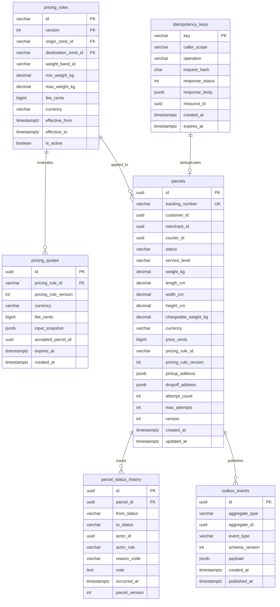
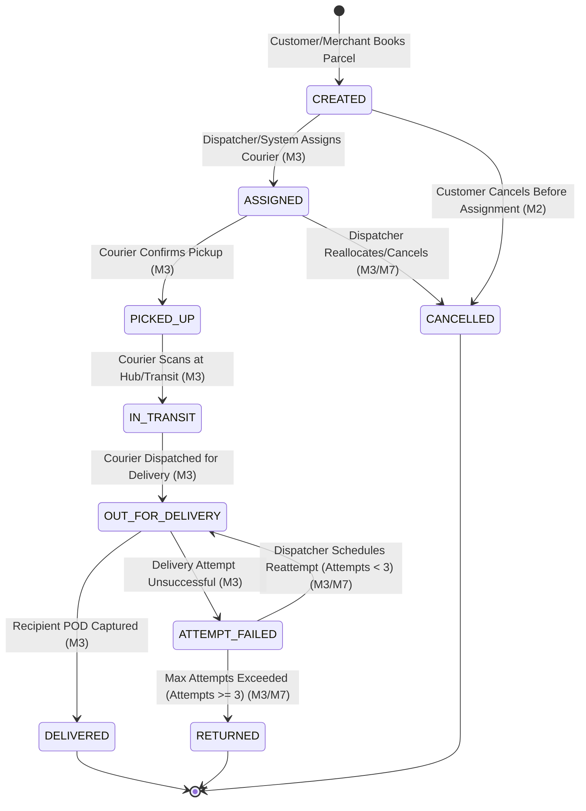

# SwiftDrop Parcel Delivery & Courier Management System

## Document 3 — API & Data Model Specification

> **Module:** Member 2 — Parcel Management & Pricing (`core-api/internal/parcels/`, `core-api/internal/pricing/`)
> **Status:** Aligned Specification (Post-Audit v2.0.0 Alignment)
> **Date:** 25 October 2026
> **Order of Precedence:** SwiftDrop SRS v1.0 > Approved Architecture & Contracts > Engineering Standards v1.0 > AI Rulebook (`AGENTS.md`) > Member 2 Specifications

---

## 1. Purpose and Scope

This document defines the formal RESTful API contracts, request/response DTO schemas, HTTP error envelopes, and logical data models for Member 2's **Parcel Management & Pricing** bounded contexts within the SwiftDrop Core API Go modular monolith.

### 1.1 In-Scope Capabilities
- **Pricing Calculation & Quote Generation:** Deterministic tariff evaluation across seven weight bands, Option A threshold volumetric calculation (divisor 6000 cm³/kg, 1 kg actual weight threshold, 30 kg max limits), quote persistence, and 15-minute quote validity enforcement with backend expiration checks (`POST /api/v1/pricing/quotes`).
- **Parcel Booking & Invariant Enforcement:** Idempotent customer booking (`POST /api/v1/parcels`), quote verification, deterministic fallback calculation for direct bookings, tracking number generation (`SD-YYYYMMDD-XXXXXX`), immutable JSONB address snapshots, and atomic transactional outbox writes.
- **Parcel Queries & Reporting:** Secure, tenant/customer-scoped parcel retrieval (`GET /api/v1/parcels/{id}`, `GET /api/v1/parcels`), chronological status audit history (`GET /api/v1/parcels/{id}/history`), and booking receipt snapshot generation (`GET /api/v1/parcels/{id}/receipt`).
- **State Machine & Concurrency Control:** Authoritative 9-state parcel lifecycle management with optimistic concurrency control (`version` column) and integration with ADR-004 delivery failure semantics.
- **Idempotency Management:** Header-driven request deduplication (`Idempotency-Key`), SHA-256 payload fingerprinting, response caching, and 24-hour TTL window via the canonical `idempotency_keys` table.

### 1.2 Out-of-Scope Capabilities (Delegated Boundaries)
- **Identity & Access Management:** User authentication, JWT issuance, password hashing, and role extraction (owned by Member 1; Member 2 consumes authenticated claims).
- **Courier Assignment & Physical Dispatch:** Dispatch board, courier route sequencing, capacity tracking, and fleet management (owned by Member 3).
- **Physical Delivery Execution & POD:** Recording driver delivery attempts, GPS telemetry, recipient signature/photo captures in `delivery_attempts` (owned by Member 3; Member 3 invokes Member 2's application service to record transition outcomes).
- **Merchant Tenant & Credential Management:** Merchant onboarding, API key issuance, and webhook subscriptions (owned by Member 4; Member 4 exposes `POST /api/v1/merchant/parcels` and delegates aggregate creation to Member 2).
- **Public Tracking Read Projection:** Unauthenticated, privacy-masked tracking lookups and real-time SSE streaming (owned by Member 5).
- **Asynchronous Event Publishing & Consumption:** Outbox polling daemon, RabbitMQ message publication, DLQ management, and notification consumers (owned by Member 8).

---

## 2. Requirements & Invariant Baseline

The following architectural and domain invariants are strictly enforced by Member 2 across all API handlers and data models:

| ID | Requirement Baseline | Architectural Enforcement |
| :--- | :--- | :--- |
| **FR-PAR-001** | Booking Details Capture | Pickup/dropoff address and contact details, weight, dimensions, and service option captured in an immutable snapshot. |
| **FR-PAR-002** | Upfront Delivery Fee Estimation | Deterministic complete fee calculation via `POST /api/v1/pricing/quotes` across 7 weight bands with a guaranteed 15-minute price freeze window and controlled `pricing_unavailable` rejection. |
| **FR-PAR-003** | Accepted-Price Snapshot & Rule Traceability | Persist exact `pricing_rule_id`, rule version, and calculated complete fee `price_cents` directly on `parcels`. |
| **FR-PAR-004** | Non-Guessable Tracking Number | Generate Crockford Base32 tracking numbers matching pattern `SD-YYYYMMDD-XXXXXX`. |
| **FR-PAR-005** | Strict Field & Boundary Validation | Reject missing fields, negative dimensions, weights exceeding 30.0 kg, or dimensions exceeding 150 cm with structured HTTP 400/422 responses. |
| **FR-PAR-006** | Strict Request Idempotency | Require `Idempotency-Key` header; identical payload returns cached response; altered payload with same key returns HTTP 409 Conflict. |
| **FR-PAR-007** | Owner & Tenant Scoped Queries | Restrict `GET /api/v1/parcels` and detail endpoints strictly to the authenticated `customer_id` or `tenant_id` (IDOR prevention). |
| **FR-PAR-008** | Historical Receipt Snapshot | Generate receipts based solely on the immutable booking-time price snapshot, immune to future tariff revisions. |
| **FR-PAR-009** | Public Tracking Masking & Privacy | Strict separation of internal parcel models from public tracking DTOs; redact recipient street address, phone numbers, and internal notes. |
| **FR-LIFE-001–004** | Lifecycle Transitions & Outbox Atomicity | Enforce 9-state machine; reject unauthorized transitions; commit parcel state, audit history, and outbox event (`parcel.booked.v1`) in one transaction. |

---

## 3. Global API Conventions & Transport Standards

### 3.1 Transport Rules
- **Base URI Path:** All Core API endpoints are prefixed with `/api/v1`.
- **Wire Format:** Standard JSON (`application/json; charset=utf-8`).
- **Identifier Strategy:** Internal entities utilize RFC 4122 Version 4 UUIDs (`id UUID PRIMARY KEY`). Public tracking uses business tracking numbers (`SD-YYYYMMDD-XXXXXX`).
- **Timestamp Standard:** All timestamps in JSON payloads and database records are formatted in UTC per ISO 8601 / RFC 3339 (e.g., `2026-10-25T14:30:00Z`).
- **Monetary Unit Convention:** All monetary amounts are represented as exact **integer minor units** (`BIGINT` in SQL, `int64` in Go) with ISO 4217 currency code `LKR` (cents). Binary floating-point types (`float32`, `float64`) are strictly prohibited in financial calculations and persistence.

### 3.2 Standard HTTP Status Codes
- `200 OK`: Request succeeded; returns resource or query results.
- `201 Created`: Resource successfully created and transaction committed; returns created resource with `Location` header.
- `400 Bad Request`: Syntactic parsing error or malformed JSON payload.
- `401 Unauthorized`: Missing, expired, or cryptographically invalid JWT token.
- `403 Forbidden`: Authenticated user lacks required RBAC role or attempts cross-tenant/cross-user access.
- `404 Not Found`: Resource ID does not exist or is invisible under caller's tenant boundary.
- `409 Conflict`: Business state conflict (e.g., invalid state machine transition, optimistic concurrency version mismatch, or idempotency key reused with mismatched payload hash).
- `422 Unprocessable Entity`: Semantic validation failure (e.g., weight out of bounds, unserviceable zone pair, expired quote).
- `500 Internal Server Error`: Unhandled server exception (sanitized; zero stack traces or internal implementation details leaked).

### 3.3 Standard Error Response Envelope
All error responses adhere to the unified SwiftDrop API error envelope:

```json
{
  "code": "VALIDATION_FAILED",
  "message": "The submitted parcel dimensions exceed operational limits.",
  "request_id": "req-98e3b4a2-11c5-4a7b-8912-32b5091a1a7f",
  "field_errors": [
    {
      "field": "dimensions.length_cm",
      "code": "MAX_DIMENSION_EXCEEDED",
      "message": "Length cannot exceed 150 cm."
    }
  ]
}
```

---

## 4. Member 2 Endpoint Inventory

| HTTP Method & Path | Primary Operation | Required RBAC Role | Idempotent | Description |
| :--- | :--- | :--- | :--- | :--- |
| `POST /api/v1/pricing/quotes` | Create Pricing Quote | `CUSTOMER`, `MERCHANT`, `ADMIN` | Safe / No | Evaluates zone-pair tariffs across 7 weight bands, calculates threshold volumetric weight (divisor 6000), and persists a 15-minute quote. |
| `POST /api/v1/parcels` | Book Customer Parcel | `CUSTOMER` | Yes (`Idempotency-Key`) | Validates quote/direct booking, generates tracking number, commits parcel and outbox event. |
| `GET /api/v1/parcels/{id}` | Get Parcel Details | `CUSTOMER`, `MERCHANT`, `COURIER`, `ADMIN` | Safe | Retrieves full parcel domain model scoped to authenticated caller. |
| `GET /api/v1/parcels` | List Parcels | `CUSTOMER`, `MERCHANT`, `ADMIN` | Safe | Returns paginated list of parcels filtered by status and tenant ownership. |
| `GET /api/v1/parcels/{id}/history` | Get Status History | `CUSTOMER`, `MERCHANT`, `COURIER`, `ADMIN` | Safe | Returns chronological, append-only status transition audit trail. |
| `GET /api/v1/parcels/{id}/receipt` | Get Booking Receipt | `CUSTOMER`, `MERCHANT`, `ADMIN` | Safe | Returns immutable financial and service snapshot for the parcel. |
| `POST /api/v1/merchant/parcels` | Create Merchant Parcel | `MERCHANT` | Yes (`Idempotency-Key`) | *Owned by Member 4 for transport/auth; invokes Member 2 application use case.* |

---

## 5. Detailed API Contracts & Schemas

### 5.1 POST /api/v1/pricing/quotes
Calculates the estimated delivery fee based on weight, dimensions (if actual weight $> 1$ kg), and pickup/dropoff zones. Persists the calculated quote in `pricing_quotes` with a 15-minute expiration timestamp.

#### Request Headers
- `Authorization: Bearer <jwt>` (Optional)
- `Content-Type: application/json` (Required)

#### Request Payload
```json
{
  "pickup_zone_id": "ZONE-WESTERN-01",
  "dropoff_zone_id": "ZONE-CENTRAL-01",
  "weight_kg": 2.50,
  "dimensions": {
    "length_cm": 30.0,
    "width_cm": 25.0,
    "height_cm": 15.0
  }
}
```

#### Field Specifications (Request)
- `pickup_zone_id` (`string`, required): Identifier of origin zone (must match active `delivery_zones.id`).
- `dropoff_zone_id` (`string`, required): Identifier of destination zone (must match active `delivery_zones.id`).
- `weight_kg` (`number`, required): Actual measured physical weight in kilograms ($0 < W \le 30.00\text{ kg}$, max 2 decimal places).
- `dimensions` (`object`, required if `weight_kg > 1.0 kg`; optional if `weight_kg \le 1.0 kg`):
  - `length_cm` (`number`, required if dimensions provided): Length in centimeters ($1.0 \le l \le 150.0\text{ cm}$).
  - `width_cm` (`number`, required if dimensions provided): Width in centimeters ($1.0 \le w \le 150.0\text{ cm}$).
  - `height_cm` (`number`, required if dimensions provided): Height in centimeters ($1.0 \le h \le 150.0\text{ cm}$).

#### Response Payload (`201 Created`)
```json
{
  "quote_id": "d3b07384-d113-494b-9c8e-aa672580c822",
  "pricing_rule_id": "pr-rule-zone-w-c-v2",
  "pricing_rule_version": 2,
  "currency": "LKR",
  "fee_cents": 55000,
  "breakdown": {
    "actual_weight_kg": 2.50,
    "volumetric_weight_kg": 1.88,
    "chargeable_weight_kg": 2.50,
    "weight_band": "BAND_4",
    "weight_band_range": "2 < W <= 5 kg"
  },
  "expires_at": "2026-10-25T14:45:00Z",
  "created_at": "2026-10-25T14:30:00Z"
}
```

> [!NOTE]
> **Provisional Pricing Proposal Notice:**
> The mathematical parameters (seven weight bands, 1 kg threshold policy, volumetric divisor 6000 cm³/kg, 30 kg weight limits, fixed complete tariff per zone-pair/band, and 15-minute quote validity) represent the **current proposed design baseline, pending formal team approval**. The payload envelope (`quote_id`, `fee_cents`, `currency`, `expires_at`), integer LKR cents standard, server-side authority, and quote persistence are stable requirements.

#### Error Codes
- `400 Bad Request`: Malformed JSON, non-positive parameters, or dimensions omitted when actual weight $> 1.0\text{ kg}$ (`DIMENSIONS_REQUIRED_ABOVE_1KG`).
- `422 Unprocessable Entity`:
  - `ZONE_NOT_FOUND`: Pickup or dropoff zone does not exist.
  - `PRICING_UNAVAILABLE`: No active, enabled pricing rule covers the requested zone combination and weight band.
  - `PARCEL_LIMITS_EXCEEDED`: Actual weight exceeds 30.00 kg or calculated chargeable weight exceeds 30.00 kg.
  - `DIMENSIONS_LIMIT_EXCEEDED`: Any dimension exceeds 150.00 cm or combined girth exceeds 300.00 cm.
- `500 Internal Server Error`:
  - `PRICING_CONFIGURATION_ERROR`: Multiple overlapping rules match ambiguously; fails safely.

---

### 5.2 POST /api/v1/parcels
Books a parcel for delivery. Supports both **Quoted Booking** (providing an unexpired `quote_id`) and **Direct Booking** (calculating price synchronously within the booking transaction).

#### Request Headers
- `Authorization: Bearer <jwt>` (Required)
- `Idempotency-Key: <uuid-or-string>` (Required; max 255 chars)
- `Content-Type: application/json` (Required)

#### Request Payload
```json
{
  "quote_id": "d3b07384-d113-494b-9c8e-aa672580c822",
  "service_level": "STANDARD",
  "weight_kg": 2.50,
  "dimensions": {
    "length_cm": 30.0,
    "width_cm": 25.0,
    "height_cm": 15.0
  },
  "pickup": {
    "contact_name": "Kasun Perera",
    "contact_phone": "+94771234567",
    "address_line1": "45 Galle Road",
    "address_line2": "Apartment 3B",
    "city": "Colombo 03",
    "postal_code": "00300",
    "zone_id": "ZONE-WESTERN-01",
    "instructions": "Ring intercom 3B"
  },
  "dropoff": {
    "contact_name": "Nimal Fernando",
    "contact_phone": "+94719876543",
    "address_line1": "12 Kandy Road",
    "address_line2": "",
    "city": "Peradeniya",
    "postal_code": "20400",
    "zone_id": "ZONE-CENTRAL-01",
    "instructions": "Leave at front security desk"
  },
  "item_description": "Electronics - Replacement Laptop Battery",
  "special_instructions": "Handle with care. Fragile."
}
```

#### Response Payload (`201 Created`)
```json
{
  "id": "7f8b3c10-e29b-4b14-9f44-8d961234ef01",
  "tracking_number": "SD-20261025-A3X9K7",
  "customer_id": "usr-8812c9b4-3312-4aa8-b112-998877665544",
  "status": "CREATED",
  "service_level": "STANDARD",
  "weight_kg": 2.50,
  "dimensions": {
    "length_cm": 30.0,
    "width_cm": 25.0,
    "height_cm": 15.0
  },
  "chargeable_weight_kg": 2.50,
  "price": {
    "currency": "LKR",
    "price_cents": 55000,
    "pricing_rule_id": "pr-rule-zone-w-c-v2",
    "pricing_rule_version": 2
  },
  "pickup": {
    "contact_name": "Kasun Perera",
    "contact_phone": "+94771234567",
    "address_line1": "45 Galle Road",
    "address_line2": "Apartment 3B",
    "city": "Colombo 03",
    "postal_code": "00300",
    "zone_id": "ZONE-WESTERN-01",
    "instructions": "Ring intercom 3B"
  },
  "dropoff": {
    "contact_name": "Nimal Fernando",
    "contact_phone": "+94719876543",
    "address_line1": "12 Kandy Road",
    "address_line2": "",
    "city": "Peradeniya",
    "postal_code": "20400",
    "zone_id": "ZONE-CENTRAL-01",
    "instructions": "Leave at front security desk"
  },
  "attempt_count": 0,
  "max_attempts": 3,
  "version": 1,
  "created_at": "2026-10-25T14:32:00Z",
  "updated_at": "2026-10-25T14:32:00Z"
}
```

#### Error Codes
- `400 Bad Request`: Missing mandatory fields or malformed JSON.
- `401 Unauthorized`: Missing or invalid authentication token.
- `403 Forbidden`: `QUOTE_FORBIDDEN` — The supplied `quote_id` belongs to another caller or tenant.
- `409 Conflict`:
  - `IDEMPOTENCY_KEY_PAYLOAD_MISMATCH`: The provided `Idempotency-Key` was previously used with a different request payload.
- `422 Unprocessable Entity`:
  - `QUOTE_EXPIRED`: The supplied `quote_id` has expired (`current_time >= expires_at`).
  - `QUOTE_PARAM_MISMATCH`: Weight, dimensions, or zones do not match the frozen quote.
  - `PRICING_UNAVAILABLE`: No applicable tariff covers the requested route and weight band (for direct booking).
  - `PARCEL_LIMITS_EXCEEDED`: Weight exceeds 30.00 kg.

---

### 5.3 GET /api/v1/parcels/{id}
Retrieves authoritative details of a single parcel.

#### Request Headers
- `Authorization: Bearer <jwt>` (Required)

#### Authorization & Scope Rules
- Customers may only access parcels where `customer_id == caller.user_id`.
- Merchants may only access parcels where `merchant_id == caller.tenant_id`.
- Couriers may only access parcels actively assigned to them (`courier_id == caller.user_id`).
- Dispatchers and Admins have global read visibility.
- Unauthorized access attempts return `403 Forbidden` (or `404 Not Found` if hiding resource existence).

#### Response Payload (`200 OK`)
Matches the complete parcel entity response schema shown in Section 5.2.

---

### 5.4 GET /api/v1/parcels
Retrieves a paginated list of parcels visible to the calling principal.

#### Query Parameters
- `status` (`string`, optional): Filter by parcel status (e.g., `CREATED`, `IN_TRANSIT`, `DELIVERED`).
- `page` (`integer`, optional, default `1`): 1-indexed page number.
- `page_size` (`integer`, optional, default `20`, max `100`): Results per page.
- `created_from` (`string`, optional): Filter bookings created at or after UTC timestamp.
- `created_to` (`string`, optional): Filter bookings created at or before UTC timestamp.

#### Response Payload (`200 OK`)
```json
{
  "items": [
    {
      "id": "7f8b3c10-e29b-4b14-9f44-8d961234ef01",
      "tracking_number": "SD-20261025-A3X9K7",
      "status": "CREATED",
      "service_level": "STANDARD",
      "price_cents": 55000,
      "currency": "LKR",
      "pickup_city": "Colombo 03",
      "dropoff_city": "Peradeniya",
      "created_at": "2026-10-25T14:32:00Z"
    }
  ],
  "pagination": {
    "current_page": 1,
    "page_size": 20,
    "total_items": 1,
    "total_pages": 1
  }
}
```

---

### 5.5 GET /api/v1/parcels/{id}/history
Returns the chronological, append-only status transition log for a parcel.

#### Response Payload (`200 OK`)
```json
{
  "parcel_id": "7f8b3c10-e29b-4b14-9f44-8d961234ef01",
  "tracking_number": "SD-20261025-A3X9K7",
  "history": [
    {
      "id": "his-11a2b3c4-9988-4433-2211-abcdef012345",
      "from_status": null,
      "to_status": "CREATED",
      "actor_id": "usr-8812c9b4-3312-4aa8-b112-998877665544",
      "actor_role": "CUSTOMER",
      "reason": "Initial customer booking confirmation",
      "occurred_at": "2026-10-25T14:32:00Z",
      "parcel_version": 1
    }
  ]
}
```

---

### 5.6 GET /api/v1/parcels/{id}/receipt
Returns the immutable booking financial receipt, generated from the accepted-price snapshot.

#### Response Payload (`200 OK`)
```json
{
  "receipt_number": "RCP-SD-20261025-A3X9K7",
  "parcel_id": "7f8b3c10-e29b-4b14-9f44-8d961234ef01",
  "tracking_number": "SD-20261025-A3X9K7",
  "booking_date": "2026-10-25T14:32:00Z",
  "customer_name": "Kasun Perera",
  "service_level": "STANDARD",
  "financial_summary": {
    "currency": "LKR",
    "price_cents": 55000,
    "total_fee_formatted": "LKR 550.00",
    "pricing_rule_id": "pr-rule-zone-w-c-v2",
    "pricing_rule_version": 2
  },
  "package_summary": {
    "chargeable_weight_kg": 2.50,
    "origin_zone": "ZONE-WESTERN-01",
    "destination_zone": "ZONE-CENTRAL-01"
  },
  "payment_status": "PAID"
}
```

---

## 6. Logical Data Model & Relational Schema Mapping

Member 2 owns the persistence definitions for parcels, status history, pricing rules, pricing quotes, and idempotency keys.

### 6.1 Database Entity Relationship Diagram (ERD)



### 6.2 Data Model Definitions

#### 6.2.1 `parcels` Table
Authoritative business store for parcel aggregate roots.
- `id` (`UUID`, PK): Internal unique identifier.
- `tracking_number` (`VARCHAR(32)`, UNIQUE, NOT NULL): Public tracking reference (`SD-YYYYMMDD-XXXXXX`).
- `customer_id` (`UUID`, NULLABLE): References booking user (if retail customer booking).
- `merchant_id` (`UUID`, NULLABLE): References merchant tenant (if merchant booking).
- `courier_id` (`UUID`, NULLABLE): References assigned courier (updated by Member 3).
- `status` (`VARCHAR(32)`, NOT NULL): Current lifecycle state (one of the 9 canonical states).
- `service_level` (`VARCHAR(32)`, NOT NULL): `STANDARD`, `EXPRESS`, or `SAME_DAY`.
- `weight_kg` (`NUMERIC(6,2)`, NOT NULL): Measured physical weight ($0 < w \le 30.00\text{ kg}$).
- `length_cm`, `width_cm`, `height_cm` (`NUMERIC(6,2)`, NULLABLE): Physical dimensions in cm (mandatory if `weight_kg > 1.0 kg`; max 150 cm per edge).
- `chargeable_weight_kg` (`NUMERIC(6,2)`, NOT NULL): Max of physical and volumetric weight ($0 < w \le 30.00\text{ kg}$).
- `currency` (`VARCHAR(3)`, NOT NULL, DEFAULT `'LKR'`): Monetary currency code.
- `price_cents` (`BIGINT`, NOT NULL): Total charged complete delivery fee in integer cents.
- `pricing_rule_id` (`VARCHAR(64)`, NOT NULL): Identifier of rule used.
- `pricing_rule_version` (`INT`, NOT NULL): Version of rule used for historical traceability.
- `pickup_address` (`JSONB`, NOT NULL): Immutable pickup address and contact snapshot (or child table foreign key if normalized model ratified).
- `dropoff_address` (`JSONB`, NOT NULL): Immutable dropoff address and contact snapshot (or child table foreign key if normalized model ratified).
- `attempt_count` (`INT`, NOT NULL, DEFAULT `0`): Current number of failed delivery attempts (ADR-004).
- `max_attempts` (`INT`, NOT NULL, DEFAULT `3`): Maximum allowed delivery attempts before return.
- `version` (`INT`, NOT NULL, DEFAULT `1`): Optimistic concurrency control counter.
- `created_at`, `updated_at` (`TIMESTAMPTZ`, NOT NULL): Audit timestamps.

#### 6.2.2 Address Model Specifications (Dual Specification Pending Ratification)
To preserve point-in-time snapshot immutability, Member 2 specifies two compatible models:
1. **Embedded JSONB Snapshots (Proposed by Member 2):** Stored directly on `parcels` as `pickup_address JSONB NOT NULL` and `dropoff_address JSONB NOT NULL`, eliminating relational joins and shielding historical orders from retroactive profile edits.
2. **Normalized Child Table (`parcel_addresses`, Authoritative per `database-schema.md`):** Child table keyed by `(id UUID PK, parcel_id UUID FK, address_type VARCHAR(32), contact_name, contact_phone, address_line1, address_line2, city, postal_code, zone_id FK)` with foreign key `ON DELETE RESTRICT`.

*JSONB Address Snapshot Schema Example:*
```json
{
  "contact_name": "Kasun Perera",
  "contact_phone": "+94771234567",
  "address_line1": "45 Galle Road",
  "address_line2": "Apartment 3B",
  "city": "Colombo 03",
  "postal_code": "00300",
  "zone_id": "ZONE-WESTERN-01",
  "instructions": "Ring intercom 3B"
}
```

#### 6.2.3 `pricing_quotes` Table
Persists generated delivery quotes for 15 minutes to guarantee price stability during checkout.
- `id` (`UUID`, PK): Quote identifier.
- `pricing_rule_id` (`VARCHAR(64)`, NOT NULL): Applied pricing rule ID.
- `pricing_rule_version` (`INT`, NOT NULL): Applied rule version.
- `currency` (`VARCHAR(3)`, NOT NULL, DEFAULT `'LKR'`): Currency code.
- `fee_cents` (`BIGINT`, NOT NULL): Total calculated complete fee in integer cents.
- `input_snapshot` (`JSONB`, NOT NULL): Complete frozen input parameters (zones, dimensions, weight, band).
- `accepted_parcel_id` (`UUID`, NULLABLE): References the booked parcel upon checkout confirmation.
- `expires_at` (`TIMESTAMPTZ`, NOT NULL): Exactly `created_at + INTERVAL '15 minutes'`.
- `created_at` (`TIMESTAMPTZ`, NOT NULL): Quote generation timestamp.

#### 6.2.4 `idempotency_keys` Table
Ensures safe request retries without duplicate parcel creation. Keyed by client token and caller scope without a foreign key to `users` to permit merchant tenant scopes.
- `key` (`VARCHAR(255)`, PK): Client-provided token.
- `caller_scope` (`VARCHAR(64)`, NOT NULL): Authenticated customer or merchant scope (e.g., `'USER:<uuid>'` or `'MERCHANT:<uuid>'`).
- `operation` (`VARCHAR(64)`, NOT NULL): Operation identifier (e.g., `'BOOK_PARCEL'`).
- `request_hash` (`CHAR(64)`, NOT NULL): SHA-256 hash of normalized request body.
- `response_status` (`INT`, NOT NULL): Cached HTTP status code (e.g., 201).
- `response_body` (`JSONB`, NOT NULL): Cached HTTP response payload.
- `resource_id` (`UUID`, NULLABLE): ID of created parcel.
- `created_at` (`TIMESTAMPTZ`, NOT NULL): Initial request timestamp.
- `expires_at` (`TIMESTAMPTZ`, NOT NULL): Expiration timestamp (`created_at + INTERVAL '24 hours'`).

#### 6.2.5 `parcel_status_history` Table
Authoritative append-only audit log of all parcel status transitions.
- `id` (`UUID`, PK): History record identifier.
- `parcel_id` (`UUID`, FK, NOT NULL): References `parcels.id` with `ON DELETE RESTRICT`.
- `from_status` (`VARCHAR(32)`, NULLABLE): Status prior to transition (NULL on creation).
- `to_status` (`VARCHAR(32)`, NOT NULL): New status confirmed by aggregate.
- `actor_id` (`UUID`, NULLABLE): Authenticated user ID.
- `actor_role` (`VARCHAR(32)`, NOT NULL): Role of actor (`CUSTOMER`, `MERCHANT`, `COURIER`, `DISPATCHER`, `ADMIN`).
- `reason_code` (`VARCHAR(64)`, NULLABLE): Standardized failure/cancellation code.
- `note` (`TEXT`, NULLABLE): Operational internal note (strictly redacted from public tracking).
- `parcel_version` (`INT`, NOT NULL): Version number of parcel after transition.
- `occurred_at` (`TIMESTAMPTZ`, NOT NULL): UTC timestamp of event.

---

## 7. Lifecycle State Machine & Transition Rules

Member 2 owns the authoritative parcel lifecycle state machine. State changes are strictly validated against allowed transitions:



### 7.1 Transition Matrix & Actor Authorization

| From State | Allowed To State | Authorized Actor | Pre-Conditions & Invariants |
| :--- | :--- | :--- | :--- |
| `[*] (None)` | `CREATED` | `CUSTOMER`, `MERCHANT` | Valid inputs, active zone pair, accepted price persisted. |
| `CREATED` | `ASSIGNED` | `DISPATCHER`, `ADMIN` | Courier selected, vehicle capacity validated (Member 3). |
| `CREATED` | `CANCELLED` | `CUSTOMER`, `MERCHANT`, `ADMIN` | Booking not yet assigned to a courier. |
| `ASSIGNED` | `PICKED_UP` | `COURIER` | Assigned courier confirms physical collection from sender. |
| `ASSIGNED` | `CANCELLED` | `DISPATCHER`, `ADMIN` | Courier assignment retracted prior to pickup. |
| `PICKED_UP` | `IN_TRANSIT` | `COURIER`, `DISPATCHER` | Parcel scanned into distribution hub or line-haul transit. |
| `IN_TRANSIT` | `OUT_FOR_DELIVERY` | `COURIER`, `DISPATCHER` | Courier departs on final delivery run. |
| `OUT_FOR_DELIVERY` | `DELIVERED` | `COURIER` | Valid Proof of Delivery (signature or photo) recorded (Member 3). |
| `OUT_FOR_DELIVERY` | `ATTEMPT_FAILED` | `COURIER` | Delivery attempt failed; `attempt_count` incremented by 1. |
| `ATTEMPT_FAILED` | `OUT_FOR_DELIVERY` | `DISPATCHER`, `ADMIN` | `attempt_count < max_attempts` (max 3 per ADR-004). |
| `ATTEMPT_FAILED` | `RETURNED` | `DISPATCHER`, `ADMIN` | `attempt_count >= max_attempts`; terminal return to sender. |

---

## 8. Transactional Outbox Integration

To ensure reliable, at-least-once asynchronous event delivery across the distributed architecture, Member 2 writes integration events directly into the `outbox_events` table within the same PostgreSQL transaction that mutates parcel state.

### 8.1 Event: `parcel.booked.v1`
Emitted immediately when a parcel booking is successfully committed.

```json
{
  "event_id": "evt-77a1b2c3-d4e5-4f6a-8b9c-123456789abc",
  "aggregate_type": "PARCEL",
  "aggregate_id": "7f8b3c10-e29b-4b14-9f44-8d961234ef01",
  "event_type": "parcel.booked.v1",
  "schema_version": 1,
  "occurred_at": "2026-10-25T14:32:00Z",
  "payload": {
    "parcel_id": "7f8b3c10-e29b-4b14-9f44-8d961234ef01",
    "tracking_number": "SD-20261025-A3X9K7",
    "customer_id": "usr-8812c9b4-3312-4aa8-b112-998877665544",
    "merchant_id": null,
    "pickup_zone_id": "ZONE-WESTERN-01",
    "dropoff_zone_id": "ZONE-CENTRAL-01",
    "service_level": "STANDARD",
    "weight_kg": 2.50,
    "price_cents": 55000,
    "currency": "LKR",
    "created_at": "2026-10-25T14:32:00Z"
  }
}
```

### 8.2 Event: `parcel.cancelled.v1`
Emitted when a customer or admin cancels a booking prior to courier pickup.

```json
{
  "event_id": "evt-88b2c3d4-e5f6-4a7b-9c0d-234567890bcd",
  "aggregate_type": "PARCEL",
  "aggregate_id": "7f8b3c10-e29b-4b14-9f44-8d961234ef01",
  "event_type": "parcel.cancelled.v1",
  "schema_version": 1,
  "occurred_at": "2026-10-25T14:35:00Z",
  "payload": {
    "parcel_id": "7f8b3c10-e29b-4b14-9f44-8d961234ef01",
    "tracking_number": "SD-20261025-A3X9K7",
    "cancelled_by": "usr-8812c9b4-3312-4aa8-b112-998877665544",
    "reason": "Customer requested cancellation prior to pickup",
    "cancelled_at": "2026-10-25T14:35:00Z"
  }
}
```

## 9. Alignment & Decision Tracking Matrix

| Architectural Topic | Pre-Audit Draft State | Post-Audit Aligned Decision | Authoritative Source / Status |
| :--- | :--- | :--- | :--- |
| **Pricing Endpoint & Quote Persistence** | Ambiguous (`/estimate` vs `/quotes`) | Standardized on canonical `POST /api/v1/pricing/quotes` with persistence in `pricing_quotes`. | Aligned with Member 10 / Team Standards |
| **Pricing Model & Tariffs** | Complete tariff proposal vs legacy formula | Fixed complete tariff per (pickup zone, destination zone, weight band) across 7 weight bands proposed by Member 2. `docs/contracts/pricing-rules.md` specifies base fee + surcharge + multipliers. | **PROVISIONAL PROPOSAL (PENDING TEAM RATIFICATION)** |
| **Volumetric Threshold & Divisor (6000)** | Divisor 5000 vs 6000 | Option A threshold (weight $\le 1$ kg exempt from volumetric pricing); divisor 6000 cm³/kg for $> 1$ kg; 30 kg max limits. Differs from divisor 5000 in `pricing-rules.md`. | **PROVISIONAL PROPOSAL (PENDING TEAM RATIFICATION)** |
| **Quote Validity Window (15m)** | Arbitrary TTL | 15-minute price freeze window (`expires_at = created_at + 15m`). Backend strictly enforces expiry at `current_time >= expires_at`. | **PROVISIONAL PROPOSAL (PENDING TEAM APPROVAL)** |
| **Monetary Data Type** | Floating-point / arbitrary decimal | Exact integer cents (`BIGINT` in SQL, `int64` in Go, LKR) | Engineering Standards v1.0 Section 6 |
| **Address Data Model** | Normalized child table vs JSONB snapshots | Member 2 proposes immutable `pickup_address` & `dropoff_address` JSONB on `parcels`; `database-schema.md` defines relational child table `parcel_addresses`. Both models documented. | **PENDING TEAM RATIFICATION (Dual Specification)** |
| **Tracking Number Format** | Unspecified / numeric | `SD-YYYYMMDD-XXXXXX` (Crockford Base32, uppercase) | Aligned with Member 5 & SRS FR-PAR-004 |
| **Delivery Failure Lifecycle** | Vague `FAILED` terminal state | Transient `ATTEMPT_FAILED` (max 3) vs terminal `RETURNED`. Generic `FAILED` state removed. | ADR-004 Failed Delivery Semantics |
| **Idempotency Persistence** | Table with FK to `users` | Canonical `idempotency_keys` table with `caller_scope` (24h TTL, SHA-256 hash). No FK to `users` to permit merchant tenant scopes. | Engineering Standards v1.0 Section 7 |
| **Tariff Administration** | Mixed Member 2 / Member 7 claims | Member 2 provides `/api/v1/admin/pricing-rules` REST CRUD endpoints; Member 7 owns Admin UI screens and workflows. | Coordinated Boundary / SRS FR-ADM-007 |
| **Receipt Presentation Format** | Undecided JSON vs PDF rendering | Member 2 returns JSON snapshot; Member 6 renders UI/PDF | `PENDING TEAM CONFIRMATION` |
| **Arithmetic Baseline Discrepancy** | 55000 vs 51000 at baseline 8000 | Old formula in `pricing-rules.md` yields 51000 cents ($35000 + 2 \times 8000$); older draft used rate 10000 yielding 55000 cents; new proposed complete tariff Band 4 uses illustrative 55000 cents. | **UNRESOLVED / PENDING RATIFICATION** |

### 9.1 Pricing Policy Dependency & Impact Analysis (If Pricing Rules Change)

| Impacted Area | What Changes If Pricing Policy Is Modified | Files & Interfaces to Update |
| :--- | :--- | :--- |
| **API Quote DTO** | The fields in `breakdown` object reflect chargeable weight and selected band (Bands 1–7). | `core-api/internal/pricing/transport/dto.go`, `doc-03 §5.1` |
| **Database Schema** | Table `pricing_rules` stores complete zone-pair/band tariffs. DDL check constraints update if 30 kg limit changes. | `migrations/000004_create_pricing_rules.up.sql`, `doc-05 §3.1` |
| **Quote Expiry Validation** | If 15-minute freeze duration is altered, config `PRICING_QUOTE_TTL_MINUTES` and backend check `current_time >= expires_at` adapt. | `core-api/internal/pricing/application/`, `doc-08 §4` |
| **Validation Boundaries** | If operational maximum weight (30 kg) or dimension (150 cm) changes, handler boundary checks update. | `core-api/internal/parcels/transport/dto.go`, `doc-03 §5.2` |
| **Core Architecture Stability** | **ZERO IMPACT:** Parcel aggregate root, 9-state machine, tracking number format, address snapshots, and outbox integration remain completely unchanged. | `parcels` domain and persistence layers |

---

## 10. Verification & Acceptance Criteria

1. **Deterministic Calculation:** Given identical zones, dimensions, weight, and active tariff version, `POST /api/v1/pricing/quotes` returns identical `fee_cents`.
2. **Quote Lifecycle Validation:** Booking within the quote validity window locks the price; submitting booking after expiration fails with `422 QUOTE_EXPIRED`.
3. **Idempotency Guarantees:** Sending identical request with the same `Idempotency-Key` returns original `201 Created` without duplicate database rows; altering payload returns `409 Conflict`.
4. **Optimistic Locking:** Concurrent state mutations on the same parcel verify that stale `version` increments trigger `409 Conflict`.
5. **Address Immutability:** Updating a user profile address in the Identity module has zero effect on existing parcel records in `parcels.pickup_address`.
6. **Transaction Atomicity:** An error during outbox event creation rolls back the entire parcel booking transaction, ensuring zero orphan records.
