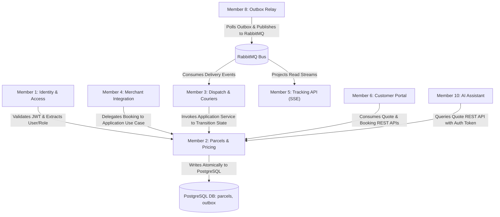

# SwiftDrop Parcel Delivery & Courier Management System

## Document 4 — Interface & Integration Contract

> **Module:** Member 2 — Parcel Management & Pricing (`core-api/internal/parcels/`, `core-api/internal/pricing/`)  
> **Status:** Aligned Integration Contract (Post-Audit v2.0.0 Alignment)  
> **Date:** 25 October 2026  
> **Order of Precedence:** SwiftDrop SRS v1.0 > Approved Architecture & Contracts > Engineering Standards v1.0 > AI Rulebook (`AGENTS.md`) > Member 2 Specifications

---

## 1. Purpose and Authority

This document defines the authoritative external and inter-module interface contracts for Member 2 — **Parcel Management & Pricing** in the SwiftDrop Parcel Delivery & Courier Management System. It establishes explicit HTTP route contracts, JSON payload DTOs, query parameters, header requirements, authorization rules, idempotency semantics, transactional outbox contracts, and public tracking privacy masking rules.

### 1.1 Source Baseline & Alignment
- **SwiftDrop SRS v1.0:** Core functional requirements (FR-PAR-001 through FR-PAR-009, FR-LIFE-001 through FR-LIFE-004).
- **Engineering Standards & Best Practices v1.0:** Monetary integer cents convention, UTC timestamps, UUID primary keys, and transaction management.
- **ADR-004:** Failed delivery semantics, transient `ATTEMPT_FAILED` state, and the 3-attempt ceiling.
- **Shared Event Contracts (`docs/contracts/event-contracts.md`):** Canonical event envelope and schema versioning.
- **Member 02 Comprehensive Audit (v2.0.0):** Standardized route naming, quote lifecycle, deterministic volumetric pricing, and address persistence models.

---

## 2. Core Interface Principles & Conventions

1. **Uniform Base Path & Protocol:** All endpoints are served over TLS under the base URI `/api/v1`. Payloads are formatted as UTF-8 encoded `application/json`.
2. **Identifier Isolation:** Internal database entities use RFC 4122 Version 4 UUIDs. Public lookups use business tracking numbers (`SD-YYYYMMDD-XXXXXX`). Internal UUIDs are never exposed in public tracking streams.
3. **Monetary Representation:** Stored and exchanged strictly as **integer minor units** (LKR cents, PostgreSQL `BIGINT`, Go `int64`). Floating-point arithmetic is strictly prohibited.
4. **Time Representation:** Timestamps use ISO 8601 / RFC 3339 format with second or millisecond precision in UTC (`YYYY-MM-DDTHH:MM:SSZ`).
5. **Server-Side Authority:** The backend is the sole authority for pricing calculation, quote validation, and state machine transitions. Client-supplied price values or state parameters are rejected.
6. **Unified Error Contract:** All error responses follow the standard SwiftDrop error envelope with contextual error codes and request correlation IDs.
7. **Zero-PII Public Masking:** Public tracking endpoints (owned by Member 5) consume authoritative parcel data but must never expose recipient phone numbers, full street addresses, or private courier notes.

---

## 3. Member 2 Endpoint Inventory

| Method & Path | Operation Name | Primary Actor | Idempotency | Auth / Scope |
| :--- | :--- | :--- | :--- | :--- |
| `POST /api/v1/pricing/quotes` | Create Pricing Quote | Customer, Merchant, Admin | Safe (No) | JWT / Public |
| `POST /api/v1/parcels` | Book Customer Parcel | Customer | Yes (`Idempotency-Key`) | JWT (`ROLE_CUSTOMER`) |
| `GET /api/v1/parcels/{id}` | Get Parcel Details | Customer, Merchant, Courier, Admin | Safe (Yes) | JWT (Resource Owner / Assigned Staff) |
| `GET /api/v1/parcels` | List Visible Parcels | Customer, Merchant, Admin | Safe (Yes) | JWT (Scoped to caller ID / Tenant ID) |
| `GET /api/v1/parcels/{id}/history` | Get Parcel History | Customer, Merchant, Courier, Admin | Safe (Yes) | JWT (Resource Owner / Assigned Staff) |
| `GET /api/v1/parcels/{id}/receipt` | Get Booking Receipt | Customer, Merchant, Admin | Safe (Yes) | JWT (Resource Owner / Admin) |
| `POST /api/v1/merchant/parcels` | Create Merchant Parcel | Merchant | Yes (`Idempotency-Key`) | *Member 4 owns transport/auth; invokes Member 2 use case* |

---

## 4. Detailed Request and Response Contracts

### 4.1 Fee Quote Contract

#### Endpoint
`POST /api/v1/pricing/quotes`

#### Purpose
Generates a deterministic delivery quote based on weight, dimensions, pickup/dropoff zones, and service tier. Persists the quote in `pricing_quotes` with a 15-minute price guarantee window.

#### Request Headers
```http
POST /api/v1/pricing/quotes HTTP/1.1
Host: api.swiftdrop.io
Authorization: Bearer <jwt-token>
Content-Type: application/json
```

#### Request Payload
```json
{
  "pickup_zone_id": "ZONE-WESTERN-01",
  "dropoff_zone_id": "ZONE-CENTRAL-01",
  "weight_kg": 2.50,
  "dimensions": {
    "length_cm": 30.0,
    "width_cm": 25.0,
    "height_cm": 15.0
  },
  "service_level": "STANDARD"
}
```

#### Field Specifications (Request)
| Field | Type | Constraint | Description |
| :--- | :--- | :--- | :--- |
| `pickup_zone_id` | String | Required, matches `delivery_zones.id` | Alphanumeric zone code (e.g., `ZONE-WESTERN-01`). |
| `dropoff_zone_id` | String | Required, matches `delivery_zones.id` | Alphanumeric zone code (e.g., `ZONE-CENTRAL-01`). |
| `weight_kg` | Float | Required, $0.01 \le w \le 50.00$ | Physical measured weight in kilograms. |
| `dimensions.length_cm` | Float | Required, $1.0 \le l \le 150.0$ | Parcel length in centimeters. |
| `dimensions.width_cm` | Float | Required, $1.0 \le w \le 150.0$ | Parcel width in centimeters. |
| `dimensions.height_cm` | Float | Required, $1.0 \le h \le 150.0$ | Parcel height in centimeters. |
| `service_level` | String | Required, Enum: `STANDARD`, `EXPRESS`, `SAME_DAY` | Target speed tier. |

#### Response Payload (`201 Created`)
```json
{
  "quote_id": "d3b07384-d113-494b-9c8e-aa672580c822",
  "pricing_rule_id": "pr-rule-zone-w-c-v2",
  "pricing_rule_version": 2,
  "service_level": "STANDARD",
  "currency": "LKR",
  "breakdown": {
    "actual_weight_kg": 2.50,
    "volumetric_weight_kg": 2.25,
    "chargeable_weight_kg": 2.50,
    "billable_extra_weight_kg": 2.0,
    "base_fee_cents": 35000,
    "per_kg_fee_cents": 10000,
    "additional_fee_cents": 20000,
    "service_multiplier": 1.0
  },
  "fee_cents": 55000,
  "expires_at": "2026-10-25T14:45:00Z",
  "created_at": "2026-10-25T14:30:00Z"
}
```

> [!NOTE]
> **Provisional Pricing Notice (Pending Team Confirmation):**
> The mathematical breakdown shown above (volumetric divisor 5000, billable extra weight, multiplier tiers, illustrative rates, and 15-minute quote validity) represents a **provisional design proposal pending team confirmation**. The payload envelope (`quote_id`, `fee_cents`, `currency`, `expires_at`), integer cents standard, and quote persistence are stable requirements.

---

### 4.2 Customer Parcel Booking Contract

#### Endpoint
`POST /api/v1/parcels`

#### Purpose
Executes parcel booking under the caller's authenticated user ID. Evaluates quote validity or calculates price synchronously, generates a Crockford Base32 tracking number (`SD-YYYYMMDD-XXXXXX`), snapshots pickup and dropoff addresses, inserts initial status history (`CREATED`), records idempotency response cache, and writes `parcel.booked.v1` to the outbox inside a single PostgreSQL transaction.

#### Request Headers
```http
POST /api/v1/parcels HTTP/1.1
Host: api.swiftdrop.io
Authorization: Bearer <jwt-token>
Idempotency-Key: 9b1deb4d-3b7d-4bad-9bdd-2b0d7b3dcb6d
Content-Type: application/json
```

#### Request Payload
```json
{
  "quote_id": "d3b07384-d113-494b-9c8e-aa672580c822",
  "service_level": "STANDARD",
  "weight_kg": 2.50,
  "dimensions": {
    "length_cm": 30.0,
    "width_cm": 25.0,
    "height_cm": 15.0
  },
  "pickup": {
    "contact_name": "Kasun Perera",
    "contact_phone": "+94771234567",
    "address_line1": "45 Galle Road",
    "address_line2": "Apartment 3B",
    "city": "Colombo 03",
    "postal_code": "00300",
    "zone_id": "ZONE-WESTERN-01",
    "instructions": "Ring intercom 3B"
  },
  "dropoff": {
    "contact_name": "Nimal Fernando",
    "contact_phone": "+94719876543",
    "address_line1": "12 Kandy Road",
    "address_line2": "",
    "city": "Peradeniya",
    "postal_code": "20400",
    "zone_id": "ZONE-CENTRAL-01",
    "instructions": "Leave at front security desk"
  },
  "item_description": "Electronics - Replacement Laptop Battery",
  "special_instructions": "Handle with care. Fragile."
}
```

#### Response Payload (`201 Created`)
```json
{
  "id": "7f8b3c10-e29b-4b14-9f44-8d961234ef01",
  "tracking_number": "SD-20261025-A3X9K7",
  "customer_id": "usr-8812c9b4-3312-4aa8-b112-998877665544",
  "status": "CREATED",
  "service_level": "STANDARD",
  "weight_kg": 2.50,
  "dimensions": {
    "length_cm": 30.0,
    "width_cm": 25.0,
    "height_cm": 15.0
  },
  "chargeable_weight_kg": 2.50,
  "price": {
    "currency": "LKR",
    "base_fee_cents": 35000,
    "additional_fee_cents": 20000,
    "price_cents": 55000,
    "pricing_rule_id": "pr-rule-zone-w-c-v2",
    "pricing_rule_version": 2
  },
  "pickup": {
    "contact_name": "Kasun Perera",
    "contact_phone": "+94771234567",
    "address_line1": "45 Galle Road",
    "address_line2": "Apartment 3B",
    "city": "Colombo 03",
    "postal_code": "00300",
    "zone_id": "ZONE-WESTERN-01",
    "instructions": "Ring intercom 3B"
  },
  "dropoff": {
    "contact_name": "Nimal Fernando",
    "contact_phone": "+94719876543",
    "address_line1": "12 Kandy Road",
    "address_line2": "",
    "city": "Peradeniya",
    "postal_code": "20400",
    "zone_id": "ZONE-CENTRAL-01",
    "instructions": "Leave at front security desk"
  },
  "attempt_count": 0,
  "max_attempts": 3,
  "version": 1,
  "created_at": "2026-10-25T14:32:00Z",
  "updated_at": "2026-10-25T14:32:00Z"
}
```

---

### 4.3 Idempotency Contract & Behavior

All mutating parcel creation requests (`POST /api/v1/parcels` and `POST /api/v1/merchant/parcels`) require the HTTP header `Idempotency-Key`.

#### Processing Rules
1. **Header Validation:** If `Idempotency-Key` is missing, empty, or exceeds 255 characters, the request is rejected with `400 Bad Request`.
2. **Caller Scoping:** The key is combined with the authenticated caller ID: `(key, caller_id)`. Keys from different users/tenants do not collide.
3. **Fingerprint Verification:** The server computes a SHA-256 hash of the normalized request JSON body.
4. **Existing Key Lookup:**
   - **Case A (Exact Match):** If the key exists and the computed SHA-256 matches the stored `request_hash`, the operation is bypassed and the previously recorded HTTP status (201) and JSON response body are returned immediately.
   - **Case B (Payload Mismatch):** If the key exists but the SHA-256 hash differs from the stored record, the request is rejected with `409 Conflict` (`IDEMPOTENCY_KEY_PAYLOAD_MISMATCH`).
   - **Case C (In-Flight Concurrency):** If a concurrent transaction is currently processing the exact same key, subsequent requests block briefly or fail fast with `409 Conflict` (`CONCURRENT_REQUEST_IN_FLIGHT`).
5. **Retention Window:** Idempotency records are retained in PostgreSQL for exactly 24 hours (`expires_at = created_at + INTERVAL '24 hours'`), after which keys expire and can be safely recycled.

---

## 5. Read Contracts & Privacy Allow-Lists

### 5.1 GET /api/v1/parcels/{id} (Authorized Resource Detail)
Returns the complete parcel aggregate model. Accessible only by the booking customer, merchant tenant, assigned courier, or administrative staff.

### 5.2 GET /api/v1/parcels (Paginated Query)
Returns caller-visible parcels filtered by status and dates.
- Supported query parameters: `status` (string), `page` (int, default 1), `page_size` (int, default 20, max 100), `from_date` (ISO UTC), `to_date` (ISO UTC).
- Enforces strict tenant/customer scoping: customer queries implicitly include `WHERE customer_id = $1`; merchant queries implicitly include `WHERE merchant_id = $1`.

### 5.3 Public Tracking Masking Policy (Member 5 Integration)
To comply with global privacy standards and project security rules, the public tracking lookup endpoint (`/api/v1/tracking/public/{trackingNumber}`, served by Member 5 from read projections) must strictly redact private data.

| Field Name | Internal Parcel Model | Public Tracking Projection | Privacy Justification |
| :--- | :--- | :--- | :--- |
| `tracking_number` | Visible | **Visible** | Public operational lookup key. |
| `status` | Visible | **Visible** | Public milestone indicator. |
| `pickup.contact_name` | Visible | **REDACTED** | Protects sender privacy. |
| `pickup.contact_phone` | Visible | **REDACTED** | High-risk PII; telecommunications privacy. |
| `pickup.address_line1` | Visible | **REDACTED** | Physical residence/facility privacy. |
| `pickup.city` | Visible | **Visible** (City only) | Safe milestone origin (e.g., "Colombo 03"). |
| `dropoff.contact_name` | Visible | **REDACTED** | Protects recipient privacy. |
| `dropoff.contact_phone` | Visible | **REDACTED** | High-risk PII; telecommunications privacy. |
| `dropoff.address_line1` | Visible | **REDACTED** | Recipient residence privacy. |
| `dropoff.city` | Visible | **Visible** (City only) | Safe milestone destination (e.g., "Peradeniya"). |
| `price_cents` | Visible | **REDACTED** | Commercial confidentiality between sender and courier. |
| `special_instructions` | Visible | **REDACTED** | May contain security access codes or intercom details. |

---

## 6. Centralized Error Contract & Catalogue

### 6.1 Standard Error Payload Schema
```json
{
  "code": "QUOTE_PARAM_MISMATCH",
  "message": "The submitted parcel dimensions do not match the frozen quote parameters.",
  "request_id": "req-98e3b4a2-11c5-4a7b-8912-32b5091a1a7f",
  "field_errors": [
    {
      "field": "dimensions.length_cm",
      "code": "FIELD_VALUE_MISMATCH",
      "message": "Length was 30.0 cm in quote, but 45.0 cm was submitted."
    }
  ]
}
```

### 6.2 Error Code Mapping Catalogue

| HTTP Status | Error Code | Trigger Condition |
| :--- | :--- | :--- |
| `400 Bad Request` | `MALFORMED_JSON` | Syntactically invalid JSON payload. |
| `400 Bad Request` | `MISSING_IDEMPOTENCY_KEY` | Header `Idempotency-Key` was not provided on booking. |
| `401 Unauthorized` | `AUTHENTICATION_REQUIRED` | Missing, expired, or cryptographically invalid JWT. |
| `403 Forbidden` | `FORBIDDEN_RESOURCE_ACCESS` | Authenticated user lacks permission to access parcel. |
| `404 Not Found` | `PARCEL_NOT_FOUND` | Parcel ID does not exist or is invisible to caller. |
| `409 Conflict` | `IDEMPOTENCY_KEY_PAYLOAD_MISMATCH` | Idempotency key reused with altered payload body. |
| `409 Conflict` | `INVALID_STATE_TRANSITION` | Parcel state cannot transition to the target state. |
| `409 Conflict` | `VERSION_CONFLICT` | Stale update detected; concurrent update modified parcel. |
| `422 Unprocessable` | `QUOTE_EXPIRED` | Quote timestamp is older than 15 minutes. |
| `422 Unprocessable` | `QUOTE_PARAM_MISMATCH` | Booking inputs do not match frozen quote parameters. |
| `422 Unprocessable` | `UNSERVICEABLE_ZONE_PAIR` | No active pricing rule covers the requested zone combination. |
| `422 Unprocessable` | `WEIGHT_LIMIT_EXCEEDED` | Parcel weight exceeds maximum allowable threshold (50 kg). |
| `422 Unprocessable` | `DIMENSION_LIMIT_EXCEEDED` | Dimension exceeds maximum allowable threshold (150 cm). |
| `500 Server Error` | `INTERNAL_SYSTEM_ERROR` | Unhandled internal error; sanitized response returned. |

---

## 7. Status & Event Integration Contract

### 7.1 Authoritative 9-State Lifecycle
Member 2 owns the parcel aggregate root and state machine. The 9 canonical states are:
1. `CREATED`: Booking recorded; awaiting courier assignment.
2. `ASSIGNED`: Courier assigned by dispatch board (Member 3).
3. `PICKED_UP`: Physical collection confirmed by courier (Member 3).
4. `IN_TRANSIT`: Sorting hub / line-haul movement in progress (Member 3).
5. `OUT_FOR_DELIVERY`: Courier departs on final delivery run (Member 3).
6. `DELIVERED`: Terminal successful delivery; POD signature/photo verified (Member 3).
7. `ATTEMPT_FAILED`: Transient failed delivery attempt; `attempt_count` incremented (Member 3).
8. `RETURNED`: Terminal failed state after 3 failed attempts; returned to sender (Member 3/7).
9. `CANCELLED`: Terminal cancellation prior to courier pickup (Member 2/7).

### 7.2 Outbox Event Contracts
Committed atomically into `outbox_events` table during state mutations. Published asynchronously to RabbitMQ by Member 8's Outbox Relay daemon.

#### Event Envelope Specification
- `event_id`: RFC 4122 UUID.
- `aggregate_type`: String (`"PARCEL"`).
- `aggregate_id`: UUID matching `parcels.id`.
- `event_type`: Formatted string (`"parcel.booked.v1"`, `"parcel.cancelled.v1"`).
- `schema_version`: Integer (`1`).
- `occurred_at`: UTC timestamp ISO 8601.
- `payload`: Structured JSON payload.

---

## 8. Cross-Member Integration & Responsibility Boundaries



| Member / Domain | Boundary Responsibility | Contract Touchpoint |
| :--- | :--- | :--- |
| **Member 1 (Identity)** | Authenticates incoming HTTP requests; supplies claims (`user_id`, `role`, `tenant_id`). | `platform/auth/middleware.go` attaches user context to `context.Context`. |
| **Member 3 (Dispatch)** | Manages fleet, couriers, and delivery attempts. Records attempts in `delivery_attempts`. | Calls Member 2 application service (`RecordAttemptOutcome`) to update parcel state. |
| **Member 4 (Merchants)** | Exposes `POST /api/v1/merchant/parcels`, validates API keys, handles webhook registrations. | Invokes Member 2's `CreateParcelUseCase` directly with verified merchant context. |
| **Member 5 (Tracking)** | Exposes public read endpoints and SSE streaming. | Reads authoritative state from database/read projection; redacts private PII fields. |
| **Member 6 (Frontend)** | Implements React booking and tracking portals. | Consumes `POST /api/v1/pricing/quotes` and `POST /api/v1/parcels` via OpenAPI DTOs. |
| **Member 7 (Admin)** | Implements dispatcher and administration dashboards. | Consumes zone and parcel admin endpoints; monitors attempt counts. |
| **Member 8 (Events)** | Implements Outbox Relay publisher and RabbitMQ consumer workers. | Polls `outbox_events` table populated by Member 2; relays messages to RabbitMQ exchanges. |
| **Member 10 (AI Assistant)** | Implements conversational support bot. | Calls `POST /api/v1/pricing/quotes` using authorized client credentials; zero direct DB access. |

---

## 9. Alignment & Open Decisions

| Decision Topic | Aligned Specification Baseline | Status / Source |
| :--- | :--- | :--- |
| **Canonical Quote Route & Persistence** | `POST /api/v1/pricing/quotes` with persistence in `pricing_quotes` | Aligned with Member 10 & API Conventions |
| **Pricing Formula & Divisor (5000)** | Volumetric divisor 5000, chargeable weight, billable extra weight | **PROVISIONAL PROPOSAL (PENDING TEAM CONFIRMATION)** |
| **Tariffs & Multipliers** | Multipliers (1.0x, 1.5x, 2.0x) and illustrative base/per-kg rates | **PROVISIONAL PROPOSAL (PENDING TEAM CONFIRMATION)** |
| **Quote Expiration Window** | Guaranteed 15 minutes (`expires_at = created_at + 15m`) | **PROVISIONAL PROPOSAL (PENDING TEAM CONFIRMATION)** |
| **Monetary Data Type** | Exact integer cents (`BIGINT` in SQL, `int64` in Go, LKR) | Engineering Standards v1.0 Section 6 |
| **Address Snapshot Model** | Immutable `pickup_address` & `dropoff_address` JSONB on `parcels` | Database Schema Standards & Audit |
| **Tracking Number Format** | `SD-YYYYMMDD-XXXXXX` (Crockford Base32 uppercase) | SRS FR-PAR-004 & Member 5 Alignment |
| **Delivery Failure Lifecycle** | Transient `ATTEMPT_FAILED` (max 3) vs terminal `RETURNED` | ADR-004 Failed Delivery Semantics |
| **Idempotency Mechanism** | Header `Idempotency-Key`, `idempotency_keys` table, SHA-256 | Engineering Standards v1.0 Section 7 |
| **Tariff Administration** | Admin write endpoints owned by Member 7 / Member 1 | `PENDING TEAM CONFIRMATION` |
| **Receipt Rendering Format** | Member 2 outputs JSON; Member 6 renders UI/PDF | `PENDING TEAM CONFIRMATION` |

### 9.1 Pricing Policy Dependency & Cross-Contract Impact Analysis

| Integration Boundary | Invariant Contract Elements | Impact If Pricing Policy Changes |
| :--- | :--- | :--- |
| **Member 6 (Customer UI)** | Endpoint `POST /api/v1/pricing/quotes`, `quote_id`, and `fee_cents` binding. | Checkout countdown timer must adapt to ratified quote validity duration. |
| **Member 4 (Merchant Ingress)** | `POST /api/v1/merchant/parcels` delegates to Member 2 booking use case. | Direct bookings evaluate the new tariff rules; no change to merchant transport layer. |
| **Member 10 (AI Assistant)** | Tool calls approved Core API `POST /api/v1/pricing/quotes` with auth context. | AI Tool returns updated fee amounts deterministically; prompt guides reflect new validity window. |
| **Database Migrations** | Core `parcels` and `pricing_quotes` schema and foreign keys remain fixed. | Multiplier columns or divisor checks in `pricing_rules` update via additive migration. |

---

## 10. Definition of Done & Acceptance Criteria

1. **Deterministic Pricing Contract:** Repeated calls to `POST /api/v1/pricing/quotes` with identical parameters and active rule version yield identical `fee_cents`.
2. **Quote Validity Contract:** Booking succeeds within the quote validity window; fails with `422 QUOTE_EXPIRED` after expiration.
3. **Idempotency Contract:** Identical requests with same `Idempotency-Key` return identical `201 Created` payloads without creating secondary database records; payload variations trigger `409 Conflict`.
4. **State Machine Verification:** Direct SQL updates to parcel status are blocked; all status transitions pass through the domain aggregate and record an immutable entry in `parcel_status_history`.
5. **Outbox Atomicity Contract:** Every successful parcel booking commits an outbox event (`parcel.booked.v1`) within the same PostgreSQL transaction.
6. **Privacy Masking Compliance:** Public tracking projections exclude recipient contact names, phone numbers, and street addresses.
