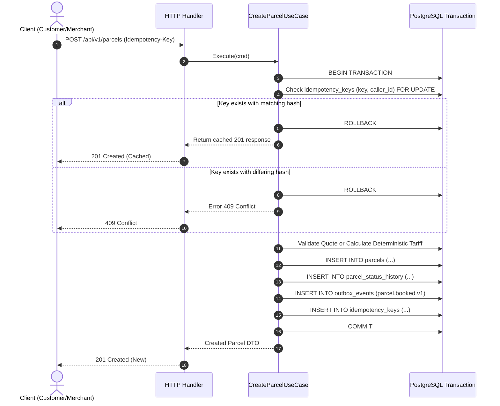

# SwiftDrop Parcel Delivery & Courier Management System

## Document 5 — Data & Persistence Specification

> **Module:** Member 2 — Parcel Management & Pricing (`core-api/internal/parcels/`, `core-api/internal/pricing/`)
> **Status:** Aligned Specification (Post-Audit v2.0.0 Alignment)
> **Date:** 25 October 2026
> **Order of Precedence:** SwiftDrop SRS v1.0 > Approved Architecture & Contracts > Engineering Standards v1.0 > AI Rulebook (`AGENTS.md`) > Member 2 Specifications

---

## 1. Purpose and Scope

This document defines the physical and logical database schema, data dictionary, integrity constraints, indexing strategies, transaction boundaries, and migration sequences for Member 2 (**Parcel Management & Pricing**) in the SwiftDrop Core API PostgreSQL database.

### 1.1 In-Scope Persistence Boundaries
- **Core Parcel Records:** `parcels` table storing aggregate state, dimensions, chargeable weight, accepted pricing snapshot, attempt counters, and optimistic locking version.
- **Address Snapshots:** Immutable JSONB snapshots (`pickup_address`, `dropoff_address`) stored directly on `parcels`.
- **Status Audit Trail:** `parcel_status_history` append-only audit table.
- **Pricing & Quotes:** `pricing_rules` tariff definitions and `pricing_quotes` pre-booking quotation store with 15-minute expiration.
- **Request Deduplication:** `idempotency_keys` table providing caller-scoped idempotent retries over a 24-hour retention window.
- **Transactional Outbox Integration:** Writing `parcel.booked.v1` and `parcel.cancelled.v1` events to `outbox_events` in the same transaction as parcel state changes.

### 1.2 Out-of-Scope (Delegated Persistence Ownership)
- `users`, `roles`, `refresh_tokens`: Owned by Member 1 (Identity).
- `merchants`, `merchant_api_keys`, `webhooks`: Owned by Member 4 (Merchants).
- `delivery_zones`: Owned by Member 7 / Member 1 (Admin/Zones; referenced via `VARCHAR(64)` FK).
- `courier_profiles`, `delivery_attempts`: Owned by Member 3 (Dispatch/Delivery).
- `outbox_events` publishing lifecycle and RabbitMQ consumption: Owned by Member 8 (Events).
- Read projections and caching infrastructure: Owned by Member 5 (Tracking) and Member 9 (DevOps).

---

## 2. Data Ownership and Authoritative Source of Truth

PostgreSQL is the single authoritative source of truth for all parcel, pricing, and financial transactions. RabbitMQ serves purely as an asynchronous integration bus and is never treated as a system of record.

| Data Entity | Primary Authority | Write Access Boundary | Read Access Boundary |
| :--- | :--- | :--- | :--- |
| `parcels` | Member 2 | Exclusively via Member 2 Domain Use Cases | Scoped by tenant/user ID; Public masked |
| `pickup_address` / `dropoff_address` | Member 2 | Immutable JSONB write upon booking creation | Scoped to owner/courier; Redacted for public |
| `parcel_status_history` | Member 2 | Append-only via Member 2 State Machine | Chronological audit queries |
| `pricing_rules` | Member 2 / Admin | Evaluated by Member 2; Admin writes (M7/M1) | Internal pricing use cases |
| `pricing_quotes` | Member 2 | Created by `POST /api/v1/pricing/quotes` | Validated by booking use case |
| `idempotency_keys` | Member 2 / Platform | Written upon mutating HTTP requests | Scoped by `(key, caller_id)` |
| `outbox_events` | Member 8 (Schema) | Written by Member 2 within PostgreSQL Tx | Polled and published by Member 8 relay |

---

## 3. Physical Database Schema & Migration Sequence

All schema migrations use standard sequential `.sql` migration files applied via `golang-migrate`.

```
core-api/migrations/
├── 000004_create_pricing_rules.up.sql
├── 000004_create_pricing_rules.down.sql
├── 000005_create_parcels_and_quotes.up.sql
├── 000005_create_parcels_and_quotes.down.sql
├── 000010_create_idempotency_keys.up.sql
└── 000010_create_idempotency_keys.down.sql
```

### 3.1 Migration `000004_create_pricing_rules`
Creates `pricing_rules` and `pricing_quotes` tables.

> [!NOTE]
> **Provisional Pricing DDL Notice (Pending Team Confirmation):**
> While the table structures `pricing_rules` and `pricing_quotes` are authoritative persistence baselines, the complete tariff schema per zone pair and weight band, the 7 weight bands, volumetric divisor 6000, 30 kg maximum weight limits, and 15-minute quote expiration reflect **provisional proposals pending team confirmation**. Member 7 owns admin UI and tariff-administration workflow; Member 2 owns calculation engine behavior and lookup.

```sql
-- Up Migration: 000004_create_pricing_rules.up.sql

CREATE TABLE IF NOT EXISTS pricing_rules (
    id VARCHAR(64) NOT NULL,
    version INT NOT NULL DEFAULT 1,
    name VARCHAR(128) NOT NULL,
    pickup_zone_id VARCHAR(64) NOT NULL,
    destination_zone_id VARCHAR(64) NOT NULL,
    weight_band_id INT NOT NULL CHECK (weight_band_id BETWEEN 1 AND 7),
    min_weight_kg NUMERIC(6,2) NOT NULL CHECK (min_weight_kg >= 0),
    max_weight_kg NUMERIC(6,2) NOT NULL CHECK (max_weight_kg > min_weight_kg AND max_weight_kg <= 30.00),
    fee_cents BIGINT NOT NULL CHECK (fee_cents >= 0),
    currency VARCHAR(3) NOT NULL DEFAULT 'LKR',
    effective_from TIMESTAMPTZ NOT NULL,
    effective_to TIMESTAMPTZ,
    is_active BOOLEAN NOT NULL DEFAULT TRUE,
    created_at TIMESTAMPTZ NOT NULL DEFAULT NOW(),
    updated_at TIMESTAMPTZ NOT NULL DEFAULT NOW(),
    PRIMARY KEY (id, version),
    CONSTRAINT chk_effective_window CHECK (effective_to IS NULL OR effective_to > effective_from),
    CONSTRAINT uq_zone_band_version UNIQUE (pickup_zone_id, destination_zone_id, weight_band_id, version)
);

CREATE INDEX idx_pricing_rules_lookup
ON pricing_rules (pickup_zone_id, destination_zone_id, weight_band_id, is_active, effective_from);

CREATE TABLE IF NOT EXISTS pricing_quotes (
    id UUID PRIMARY KEY DEFAULT gen_random_uuid(),
    pricing_rule_id VARCHAR(64) NOT NULL,
    pricing_rule_version INT NOT NULL,
    service_level VARCHAR(32) NOT NULL DEFAULT 'STANDARD',
    currency VARCHAR(3) NOT NULL DEFAULT 'LKR',
    fee_cents BIGINT NOT NULL CHECK (fee_cents >= 0),
    input_snapshot JSONB NOT NULL,
    expires_at TIMESTAMPTZ NOT NULL,
    created_at TIMESTAMPTZ NOT NULL DEFAULT NOW(),
    accepted_parcel_id UUID,
    FOREIGN KEY (pricing_rule_id, pricing_rule_version) REFERENCES pricing_rules(id, version) ON DELETE RESTRICT
);

CREATE INDEX idx_pricing_quotes_expiry ON pricing_quotes (id, expires_at);
```

```sql
-- Down Migration: 000004_create_pricing_rules.down.sql
DROP TABLE IF EXISTS pricing_quotes;
DROP TABLE IF EXISTS pricing_rules;
```

---

### 3.2 Migration `000005_create_parcels_and_quotes`
Creates `parcels` and `parcel_status_history` tables.

```sql
-- Up Migration: 000005_create_parcels_and_quotes.up.sql

CREATE TABLE IF NOT EXISTS parcels (
    id UUID PRIMARY KEY DEFAULT gen_random_uuid(),
    tracking_number VARCHAR(32) NOT NULL UNIQUE,
    customer_id UUID,
    merchant_id UUID,
    courier_id UUID,
    status VARCHAR(32) NOT NULL DEFAULT 'CREATED',
    service_level VARCHAR(32) NOT NULL DEFAULT 'STANDARD',
    weight_kg NUMERIC(6,2) NOT NULL CHECK (weight_kg > 0 AND weight_kg <= 30.00),
    length_cm NUMERIC(6,2) CHECK (length_cm > 0 AND length_cm <= 150.00),
    width_cm NUMERIC(6,2) CHECK (width_cm > 0 AND width_cm <= 150.00),
    height_cm NUMERIC(6,2) CHECK (height_cm > 0 AND height_cm <= 150.00),
    chargeable_weight_kg NUMERIC(6,2) NOT NULL CHECK (chargeable_weight_kg > 0 AND chargeable_weight_kg <= 30.00),
    currency VARCHAR(3) NOT NULL DEFAULT 'LKR',
    price_cents BIGINT NOT NULL CHECK (price_cents >= 0),
    pricing_rule_id VARCHAR(64) NOT NULL,
    pricing_rule_version INT NOT NULL,
    pickup_address JSONB NOT NULL,
    dropoff_address JSONB NOT NULL,
    attempt_count INT NOT NULL DEFAULT 0 CHECK (attempt_count >= 0),
    max_attempts INT NOT NULL DEFAULT 3 CHECK (max_attempts > 0),
    version INT NOT NULL DEFAULT 1 CHECK (version >= 1),
    created_at TIMESTAMPTZ NOT NULL DEFAULT NOW(),
    updated_at TIMESTAMPTZ NOT NULL DEFAULT NOW(),
    CONSTRAINT chk_parcel_status CHECK (status IN (
        'CREATED', 'ASSIGNED', 'PICKED_UP', 'IN_TRANSIT',
        'OUT_FOR_DELIVERY', 'DELIVERED', 'ATTEMPT_FAILED',
        'RETURNED', 'CANCELLED'
    )),
    CONSTRAINT chk_owner_present CHECK (customer_id IS NOT NULL OR merchant_id IS NOT NULL)
);

CREATE INDEX idx_parcels_customer_created ON parcels (customer_id, created_at DESC) WHERE customer_id IS NOT NULL;
CREATE INDEX idx_parcels_merchant_created ON parcels (merchant_id, created_at DESC) WHERE merchant_id IS NOT NULL;
CREATE INDEX idx_parcels_status_created ON parcels (status, created_at DESC);
CREATE INDEX idx_parcels_tracking_number ON parcels (tracking_number);

CREATE TABLE IF NOT EXISTS parcel_status_history (
    id UUID PRIMARY KEY DEFAULT gen_random_uuid(),
    parcel_id UUID NOT NULL REFERENCES parcels(id) ON DELETE CASCADE,
    from_status VARCHAR(32),
    to_status VARCHAR(32) NOT NULL,
    actor_id UUID,
    actor_role VARCHAR(32) NOT NULL,
    reason TEXT,
    parcel_version INT NOT NULL,
    occurred_at TIMESTAMPTZ NOT NULL DEFAULT NOW()
);

CREATE INDEX idx_parcel_status_history_timeline ON parcel_status_history (parcel_id, occurred_at ASC);
```

```sql
-- Down Migration: 000005_create_parcels_and_quotes.down.sql
DROP TABLE IF EXISTS parcel_status_history;
DROP TABLE IF EXISTS parcels;
```

---

### 3.3 Migration `000010_create_idempotency_keys`
Creates `idempotency_keys` table for request deduplication across the API.

```sql
-- Up Migration: 000010_create_idempotency_keys.up.sql

CREATE TABLE IF NOT EXISTS idempotency_keys (
    key VARCHAR(255) NOT NULL,
    caller_id VARCHAR(64) NOT NULL,
    operation VARCHAR(64) NOT NULL,
    request_hash CHAR(64) NOT NULL,
    response_status INT NOT NULL,
    response_body JSONB NOT NULL,
    resource_id UUID,
    created_at TIMESTAMPTZ NOT NULL DEFAULT NOW(),
    expires_at TIMESTAMPTZ NOT NULL,
    PRIMARY KEY (key, caller_id)
);

CREATE INDEX idx_idempotency_keys_expiry ON idempotency_keys (expires_at);
```

```sql
-- Down Migration: 000010_create_idempotency_keys.down.sql
DROP TABLE IF EXISTS idempotency_keys;
```

---

## 4. Comprehensive Data Dictionary

### 4.1 Table: `parcels`

| Column Name | Data Type | Nullable | Default | Description & Constraints |
| :--- | :--- | :--- | :--- | :--- |
| `id` | `UUID` | No | `gen_random_uuid()` | Internal surrogate primary key. |
| `tracking_number` | `VARCHAR(32)` | No | None | Public tracking reference (`SD-YYYYMMDD-XXXXXX`), unique index. |
| `customer_id` | `UUID` | Yes | `NULL` | ID of retail customer (references Member 1 `users.id`). |
| `merchant_id` | `UUID` | Yes | `NULL` | Tenant ID of business merchant (references Member 4 `merchants.id`). |
| `courier_id` | `UUID` | Yes | `NULL` | Assigned courier user ID (updated by Member 3). |
| `status` | `VARCHAR(32)` | No | `'CREATED'` | Current state constrained to 9 canonical values. |
| `service_level` | `VARCHAR(32)` | No | `'STANDARD'` | Speed tier: `STANDARD`, `EXPRESS`, `SAME_DAY`. |
| `weight_kg` | `NUMERIC(6,2)` | No | None | Measured physical weight in kilograms ($0.01 \le w \le 30.00$). |
| `length_cm` | `NUMERIC(6,2)` | Yes | None | Physical length in cm ($1.0 \le l \le 150.0$); required if weight > 1 kg. |
| `width_cm` | `NUMERIC(6,2)` | Yes | None | Physical width in cm ($1.0 \le w \le 150.0$); required if weight > 1 kg. |
| `height_cm` | `NUMERIC(6,2)` | Yes | None | Physical height in cm ($1.0 \le h \le 150.0$); required if weight > 1 kg. |
| `chargeable_weight_kg` | `NUMERIC(6,2)` | No | None | Actual weight if $\le 1\text{ kg}$, else $\max(\text{actual}, \frac{L \times W \times H}{6000})$ ($0 < w \le 30.00$). |
| `currency` | `VARCHAR(3)` | No | `'LKR'` | ISO 4217 currency code. |
| `price_cents` | `BIGINT` | No | None | Immutable accepted complete delivery fee snapshot in integer cents. |
| `pricing_rule_id` | `VARCHAR(64)` | No | None | Identifier of pricing rule applied at booking. |
| `pricing_rule_version` | `INT` | No | None | Version of pricing rule applied. |
| `pickup_address` | `JSONB` | No | None | Immutable snapshot of pickup contact and address. |
| `dropoff_address` | `JSONB` | No | None | Immutable snapshot of dropoff contact and address. |
| `attempt_count` | `INT` | No | `0` | Failed delivery count (ADR-004; max 3). |
| `max_attempts` | `INT` | No | `3` | Maximum allowed delivery attempts. |
| `version` | `INT` | No | `1` | Optimistic concurrency control counter. |
| `created_at` | `TIMESTAMPTZ` | No | `NOW()` | Booking creation timestamp in UTC. |
| `updated_at` | `TIMESTAMPTZ` | No | `NOW()` | Last state update timestamp in UTC. |

### 4.2 Table: `pricing_rules`

| Column Name | Data Type | Nullable | Default | Description & Constraints |
| :--- | :--- | :--- | :--- | :--- |
| `id` | `VARCHAR(64)` | No | None | Unique pricing rule identifier; part of composite PK `(id, version)`. |
| `version` | `INT` | No | `1` | Version number; incremented on tariff edits by Member 7 admin workflow. |
| `name` | `VARCHAR(128)` | No | None | Human-readable tariff description. |
| `pickup_zone_id` | `VARCHAR(64)` | No | None | Canonical pickup zone identifier (FK to `delivery_zones.id`). |
| `destination_zone_id` | `VARCHAR(64)` | No | None | Canonical destination zone identifier (FK to `delivery_zones.id`). |
| `weight_band_id` | `INT` | No | None | Weight band index ($1 \le \text{band} \le 7$). |
| `min_weight_kg` | `NUMERIC(6,2)` | No | None | Lower bound of chargeable weight band ($W_{\min} \ge 0$). |
| `max_weight_kg` | `NUMERIC(6,2)` | No | None | Upper bound of chargeable weight band ($W_{\max} \le 30.00$). |
| `fee_cents` | `BIGINT` | No | None | Complete configured delivery fee in integer cents (`fee_cents >= 0`). |
| `currency` | `VARCHAR(3)` | No | `'LKR'` | ISO 4217 currency code. |
| `effective_from` | `TIMESTAMPTZ` | No | None | Start timestamp of tariff validity window. |
| `effective_to` | `TIMESTAMPTZ` | Yes | `NULL` | Optional end timestamp; must satisfy `effective_to > effective_from`. |
| `is_active` | `BOOLEAN` | No | `TRUE` | Administrative active flag. |
| `created_at` | `TIMESTAMPTZ` | No | `NOW()` | Audit creation timestamp. |
| `updated_at` | `TIMESTAMPTZ` | No | `NOW()` | Audit modification timestamp. |

Uniqueness constraint: `UNIQUE (pickup_zone_id, destination_zone_id, weight_band_id, version)` prevents ambiguous rules.

### 4.3 Table: `pricing_quotes`

| Column Name | Data Type | Nullable | Default | Description & Constraints |
| :--- | :--- | :--- | :--- | :--- |
| `id` | `UUID` | No | `gen_random_uuid()` | Quote identifier (UUID v4). Primary key. |
| `pricing_rule_id` | `VARCHAR(64)` | No | None | Applied rule ID (FK references `pricing_rules.id`). |
| `pricing_rule_version` | `INT` | No | None | Applied rule version (FK references `pricing_rules.version`). |
| `service_level` | `VARCHAR(32)` | No | `'STANDARD'` | Speed tier requested. |
| `currency` | `VARCHAR(3)` | No | `'LKR'` | Currency code. |
| `fee_cents` | `BIGINT` | No | None | Calculated complete delivery fee in integer cents. |
| `input_snapshot` | `JSONB` | No | None | Frozen snapshot of calculation inputs (zones, actual weight, dimensions, chargeable weight, weight band). |
| `expires_at` | `TIMESTAMPTZ` | No | None | Quote expiration timestamp (`created_at + INTERVAL '15 minutes'`). |
| `created_at` | `TIMESTAMPTZ` | No | `NOW()` | Quote creation timestamp in UTC. |
| `accepted_parcel_id` | `UUID` | Yes | `NULL` | Optional parcel ID that consumed this quote (enforces single-use consumption policy). |

### 4.4 JSONB Address Schemas (`pickup_address`, `dropoff_address`)
Addresses are embedded directly into `parcels` to guarantee snapshot isolation:

```json
{
  "contact_name": "Kasun Perera",
  "contact_phone": "+94771234567",
  "address_line1": "45 Galle Road",
  "address_line2": "Apartment 3B",
  "city": "Colombo 03",
  "postal_code": "00300",
  "zone_id": "ZONE-WESTERN-01",
  "instructions": "Ring intercom 3B"
}
```

---

## 5. Transaction Boundaries and Concurrency Management

### 5.1 Booking Transaction Flow
Every parcel booking executes within a single PostgreSQL transaction (`BEGIN ... COMMIT`) to guarantee ACID atomicity across business entities:



### 5.2 Optimistic Concurrency Control (OCC)
To prevent lost updates during concurrent state transitions (e.g., dispatcher reassigning a parcel while courier marks it picked up), all updates enforce version checks:

```sql
UPDATE parcels
SET
    status = $1,
    attempt_count = $2,
    version = version + 1,
    updated_at = NOW()
WHERE id = $3 AND version = $4;
```
If rows affected == 0, the transaction aborts and returns `409 Conflict` (`VERSION_CONFLICT`).

---

## 6. Alignment & Decision Tracking Matrix

| Data Item | Initial Draft State | Aligned Final Specification | Source / Status |
| :--- | :--- | :--- | :--- |
| **Address Model** | Child table `parcel_addresses` | JSONB snapshots on `parcels` | Database Schema Standards & Audit |
| **Monetary Type** | Float / Arbitrary Decimal | `BIGINT` integer cents, `LKR` | Engineering Standards v1.0 Section 6 |
| **Migration Files** | Unnumbered / arbitrary names | `000004`, `000005`, `000010` | Database Migration Baseline |
| **Zone Reference Type** | Ambiguous UUID vs VARCHAR | `VARCHAR(64)` matching `delivery_zones.id` | Database Schema Standards |
| **Tracking Number** | Arbitrary text format | `SD-YYYYMMDD-XXXXXX` (Crockford Base32) | SRS FR-PAR-004 & Audit |
| **Quote Persistence** | Optional / unpersisted | Persisted in `pricing_quotes` table | Engineering Standards & Audit |
| **Pricing Model & Complete Tariff** | Unspecified / base+per-kg formula | Complete tariff per zone-pair and weight band: `tariff(pickup, dest, band)`; no separate base/per-kg/distance fees. | **PROVISIONAL PROPOSAL (PENDING TEAM CONFIRMATION)** |
| **Weight Bands (7 Bands)** | Undefined band boundaries | 7 non-overlapping bands: (0, 0.5], (0.5, 1], (1, 2], (2, 5], (5, 10], (10, 20], (20, 30] kg; proposed max 30 kg weight limits. | **PROVISIONAL PROPOSAL (PENDING TEAM CONFIRMATION)** |
| **Volumetric Policy & Divisor (6000)** | Unspecified weight calculation | Option A: actual weight <= 1 kg uses actual weight only; > 1 kg requires dimensions and uses `max(actual, (L*W*H)/6000)`. | **PROVISIONAL PROPOSAL (PENDING TEAM CONFIRMATION)** |
| **Quote Expiry Window (15m)** | Arbitrary / missing duration | 15-minute price freeze window (`expires_at = created_at + 15m`); backend enforced `current_time >= expires_at`. | **PROVISIONAL PROPOSAL (PENDING TEAM CONFIRMATION)** |
| **Idempotency Model** | Module-local vs duplicate | Canonical `idempotency_keys` table (24h TTL) | Engineering Standards v1.0 Section 7 |
| **Failure States** | Unclear `FAILED` state | Transient `ATTEMPT_FAILED` (max 3), `RETURNED` | ADR-004 Failed Delivery Semantics |
| **Tariff Admin Rights** | Unassigned | Admin write UI & workflow owned by M7; calculation engine owned by M2 | Coordinated Boundary |
| **Receipt Rendering** | Undecided JSON vs PDF | Member 2 stores JSON snapshot; M6 renders | `PENDING TEAM CONFIRMATION` |

### 6.1 Pricing Policy Dependency & Persistence Impact Analysis

| Persistence Element | Invariant (Unaffected by Pricing Changes) | Impact If Pricing Policy Changes |
| :--- | :--- | :--- |
| **`parcels` Table** | Stores immutable `price_cents`, currency, `pricing_rule_id`, and `pricing_rule_version`. | **Zero Schema Impact:** Column `price_cents` stores the final agreed integer cents snapshot regardless of internal tariff tiering. |
| **`pricing_quotes` Table** | Stores frozen quote inputs, total fee, and expiration timestamp. | **Zero Schema Impact:** `input_snapshot JSONB` accommodates any revised formula parameters cleanly without DDL changes. |
| **`pricing_rules` Table** | Stores zone-pair weight-band tariffs with effective dates. | **Additive Migration:** If band count or zone schema is altered, new rules are inserted or updated by Member 7 admin workflow without altering `parcels`. |
| **Check Constraints** | Positive weight and dimension checks ($0 < W \le 30.00\text{ kg}$). | If maximum parcel limits change, table CHECK constraints in `parcels` and `pricing_rules` update via sequential migration. |

---

## 7. Definition of Done & Persistence Acceptance Criteria

1. **Clean Migration Execution:** Running `migrate -path migrations -database $DB_URL up` builds the complete database without syntax or constraint errors.
2. **Reversible Migrations:** Running down migrations (`000010`, `000005`, `000004`) cleanly removes all objects without leftover artifacts.
3. **Financial Precision:** Insertion of fractional cents is prevented by integer typing (`BIGINT`); fees are exactly computed and stored.
4. **Referential Integrity:** Deleting a parcel cascades to its `parcel_status_history` rows; deleting an active pricing rule referenced by historical parcels is blocked (`ON DELETE RESTRICT`).
5. **Snapshot Isolation:** Modifying a user's address in the `users` table does not alter existing `parcels.pickup_address` JSONB records.
6. **Transaction Atomicity:** Outbox event insertion and parcel persistence commit or roll back together under all failure scenarios.
