# SwiftDrop Parcel Delivery & Courier Management System

## Document 7 — Security, Failure & Recovery Specification

> **Module:** Member 2 — Parcel Management & Pricing (`core-api/internal/parcels/`, `core-api/internal/pricing/`)
> **Status:** Aligned Security Specification (Post-Audit v2.0.0 Alignment)
> **Date:** 25 October 2026
> **Order of Precedence:** SwiftDrop SRS v1.0 > Approved Architecture & Contracts > Engineering Standards v1.0 > AI Rulebook (`AGENTS.md`) > Member 2 Specifications

---

## 1. Purpose and Authority

This document defines the application security guardrails, data privacy boundaries, failure modes, error recovery procedures, and fault-tolerance mechanisms for Member 2 (**Parcel Management & Pricing**) in the SwiftDrop Core API Go modular monolith.

### 1.1 In-Scope Security Capabilities
- **Server-Side Enforcement & Authority:** Strict rejection of client-supplied prices, status values, or unauthorized user/tenant identifiers.
- **Tenant & Object Isolation (IDOR Prevention):** Scoping all queries by authenticated `customer_id` or `merchant_id` extracted from verified JWT claims.
- **Public Tracking Privacy Masking:** Strict redaction of recipient phone numbers, exact street addresses, pricing, and internal delivery notes from public tracking projections.
- **Idempotency Protection:** Enforcing unique `(key, caller_id)` constraints in PostgreSQL with SHA-256 payload fingerprinting and 24-hour TTL.
- **Quote Expiration & Price Lock Security:** Rejection of expired ($> 15$m) or parameter-mismatched quotes to prevent tariff tampering.
- **State Machine Integrity & OCC:** Enforcing the 9-state machine and optimistic concurrency control (`version` checks) to eliminate race conditions and unauthorized transitions.
- **Transactional Atomicity:** Ensuring parcel state, status history, idempotency cache, and outbox integration records commit or roll back together.

---

## 2. Security Principles and Protected Assets

1. **Zero Client Trust:** All delivery fees, tax calculations, chargeable weights, tracking numbers, and state transitions are calculated and validated server-side.
2. **Least Privilege & Role Enforcement:** Access is strictly mediated via role-based access control (RBAC). A valid JWT token alone does not authorize access to foreign parcels.
3. **Data Minimization & Public Masking:** Public endpoints must never leak customer PII, recipient phone numbers, or commercial pricing details.
4. **Single System of Record:** PostgreSQL is the authoritative business store. Event brokers and read caches are non-authoritative.
5. **Fail-Closed Semantics:** Any failure in authentication, permission evaluation, or parameter validation halts request processing and returns structured HTTP 400, 401, 403, 409, or 422 errors.

### 2.1 Critical Protected Assets
- **Customer & Recipient PII:** Names, mobile phone numbers, exact physical delivery addresses, and building access codes stored in `pickup_address` and `dropoff_address` JSONB snapshots.
- **Financial & Commercial Data:** Tariff rules, configured complete fees, weight band boundaries, accepted price snapshots, and merchant-specific discounts.
- **System State & History:** Immutable status transition logs in `parcel_status_history` and integration events in `outbox_events`.
- **System Credentials:** PostgreSQL database credentials, JWT signing keys, and internal API secrets.

---

## 3. Authentication, Authorization, Ownership and Tenant Isolation

### 3.1 Authentication Boundary
All incoming HTTP requests to Member 2 endpoints pass through the platform authentication middleware (`core-api/internal/platform/auth/middleware.go`, owned by Member 1). The middleware validates JWT cryptographic signatures, checks expiration, and injects authenticated claims into `context.Context`:
- `user_id` (`UUID`): Authenticated user identifier.
- `tenant_id` (`UUID` / `string`): Authenticated merchant tenant identifier (for merchant principals).
- `role` (`string`): Principal role (`CUSTOMER`, `MERCHANT`, `COURIER`, `DISPATCHER`, `ADMIN`).

### 3.2 Authorization Matrix

| Endpoint | Method | Allowed Roles | Enforcement Mechanism |
| :--- | :--- | :--- | :--- |
| `/api/v1/pricing/quotes` | `POST` | `CUSTOMER`, `MERCHANT`, `ADMIN`, Anonymous* | Evaluates active tariff rules; rate-limited. |
| `/api/v1/parcels` | `POST` | `CUSTOMER` | Requires valid JWT; sets `customer_id = caller.user_id`. |
| `/api/v1/parcels/{id}` | `GET` | `CUSTOMER`, `MERCHANT`, `COURIER`, `ADMIN` | Verifies `customer_id == caller.user_id` OR `merchant_id == caller.tenant_id` OR assigned courier. |
| `/api/v1/parcels` | `GET` | `CUSTOMER`, `MERCHANT`, `ADMIN` | Injects `WHERE customer_id = $1` or `WHERE merchant_id = $1`. |
| `/api/v1/parcels/{id}/history`| `GET` | `CUSTOMER`, `MERCHANT`, `COURIER`, `ADMIN` | Enforces ownership check; redacts courier internal notes. |
| `/api/v1/parcels/{id}/receipt`| `GET` | `CUSTOMER`, `MERCHANT`, `ADMIN` | Enforces ownership check; returns frozen financial snapshot. |
| `/api/v1/merchant/parcels` | `POST` | `MERCHANT` | Owned by Member 4 for transport/API-key auth; delegates to Member 2. |

*\*Note: Anonymous quote queries are subject to edge API Gateway rate limiting.*

### 3.3 Tenant Isolation & Anti-IDOR Protections
To prevent Insecure Direct Object References (IDOR):
1. **Repository Query Scoping:** SQL queries never execute unconstrained `SELECT * FROM parcels WHERE id = $1`. Queries from customer principals implicitly append `AND customer_id = $2`. Queries from merchant principals append `AND merchant_id = $2`.
2. **Uniform Rejection Responses:** When a user requests a parcel ID that exists but belongs to a different user/tenant, the system returns `403 Forbidden` (or privacy-preserving `404 Not Found` if hiding resource existence) without confirming whether the ID is valid.

---

## 4. Data Privacy & Public Disclosure Boundary

Public parcel tracking (`/api/v1/tracking/public/{trackingNumber}`, implemented by Member 5) exposes milestone tracking for end-recipients. Member 2's domain data must be sanitized before exposure:

```mermaid
flowchart LR
    subgraph M2Private["Member 2 Core Database (Authoritative)"]
        P1["tracking_number"]
        P2["current_status"]
        P3["pickup_address (JSONB)"]
        P4["dropoff_address (JSONB)"]
        P5["price_cents (Complete Fee)"]
        P6["special_instructions"]
    end

    subgraph MaskingFilter["Privacy Masking & Projection Engine"]
        MF["Filter & Redact Private Fields"]
    end

    subgraph M5Public["Member 5 Public Tracking Stream"]
        PUB1["tracking_number: Visible"]
        PUB2["status: Visible"]
        PUB3["origin_city: Visible (City only)"]
        PUB4["destination_city: Visible (City only)"]
        PUB5["Phone & Street: REDACTED"]
        PUB6["Financials: REDACTED"]
    end

    M2Private --> MaskingFilter --> M5Public
```

### 4.1 Field-Level Privacy Classification

| Data Attribute | Storage Representation | Public Tracking View | Security Rationale |
| :--- | :--- | :--- | :--- |
| `tracking_number` | `VARCHAR(32)` | **Exposed** | Public operational lookup identifier. |
| `status` | `VARCHAR(32)` | **Exposed** | Delivery milestone indicator. |
| `pickup_address.contact_phone` | `JSONB` | **REDACTED** | High-risk personal contact information. |
| `pickup_address.address_line1` | `JSONB` | **REDACTED** | Residential address privacy. |
| `pickup_address.city` | `JSONB` | **Exposed** | General routing context (e.g., "Colombo 03"). |
| `dropoff_address.contact_phone`| `JSONB` | **REDACTED** | High-risk personal contact information. |
| `dropoff_address.address_line1`| `JSONB` | **REDACTED** | Residential address privacy. |
| `dropoff_address.city` | `JSONB` | **Exposed** | General routing destination (e.g., "Peradeniya"). |
| `price_cents` / `fee_cents` | `BIGINT` | **REDACTED** | Commercial confidentiality. |
| `special_instructions` | `TEXT` | **REDACTED** | May contain security access codes or sensitive notes. |

---

## 5. Input Validation & Abuse Prevention

### 5.1 Request Sanitization & Boundary Rules
- **Physical Weight:** Constrained strictly between $0.01$ kg and $30.00$ kg. Actual weight $> 30.00$ kg is rejected with `422 PARCEL_LIMITS_EXCEEDED`.
- **Dimensions & Volumetric Threshold (Option A):**
  - For actual weight $\le 1.00$ kg: dimensions are optional and do not alter the delivery price (`chargeable_weight = actual_weight`).
  - For actual weight $> 1.00$ kg: dimensions (length, width, height in cm) are strictly required. Missing dimensions are rejected with `422 DIMENSIONS_REQUIRED_ABOVE_1KG`.
  - Dimensions are constrained between $1.0$ cm and $150.0$ cm per side. Single dimension $> 150.0$ cm is rejected with `422 DIMENSION_LIMIT_EXCEEDED`.
  - Volumetric weight is calculated as $(L \times W \times H) / 6000$.
- **Chargeable Weight Limit:** Maximum chargeable weight is $30.00$ kg. If $\max(\text{actual}, \text{volumetric}) > 30.00$ kg, the request is rejected with `422 PARCEL_LIMITS_EXCEEDED`.
- **Address Strings:** Contact names, address lines, and cities are trimmed and bounded to 255 characters to prevent buffer and memory exhaustion attacks.
- **Tracking Number Format:** Validated against pattern `^SD-[0-9]{8}-[0-9A-Z]{6}$`.

### 5.2 SQL Injection & Sanitization
All database interactions in Member 2 utilize parameterized prepared statements via `jackc/pgx/v5`. Direct SQL string concatenation is strictly prohibited across all repositories and query builders.

---

## 6. Failure Modes, Edge Cases, and Recovery Procedures

| Failure Scenario | Root Cause | Impact | Automated Recovery / System Behavior |
| :--- | :--- | :--- | :--- |
| **Missing Tariff Rule** | Requested route/weight-band combination has no active rule configured. | Pricing cannot be evaluated. | Server rejects request with `422 PRICING_UNAVAILABLE`. Server never fabricates a price or falls back to an arbitrary default. |
| **Ambiguous Tariff Match** | Misconfiguration introduces multiple active rules for same zone pair and weight band. | Tariff ambiguity. | Server fails safely with `500 PRICING_CONFIGURATION_ERROR`, logs error with correlation ID, and alerts Member 7 admin. |
| **Quote Expired (>= 15m)** | User delays checkout past quote TTL (`current_time >= expires_at`). | Booking submission with expired quote ID. | Server rejects with `422 QUOTE_EXPIRED`. Expiry is enforced strictly on the backend; client must request a fresh quote via `POST /api/v1/pricing/quotes`. |
| **Quote Parameter Mismatch** | Client tampers with weight, dimensions, or route after quote. | Attempted tariff circumvention. | Server verifies quote input snapshot against booking payload and rejects with `422 QUOTE_PARAM_MISMATCH`. |
| **Cross-Customer Quote Reuse** | Customer B attempts to use Quote ID issued to Customer A. | IDOR / quote stealing attempt. | Server verifies caller context against quote ownership and rejects with `403 QUOTE_FORBIDDEN`. |
| **Idempotency Key Reuse** | Network timeout causes client retry with different body. | Potential duplicate or corrupted booking. | Server computes SHA-256 hash. If hash matches: returns cached 201. If hash differs: returns `409 IDEMPOTENCY_KEY_PAYLOAD_MISMATCH`. |
| **Tracking Number Collision** | Random 6-char Base32 collision. | Database unique constraint violation on `tracking_number`. | Generator catches unique constraint error and automatically retries with a new seed up to 3 times before failing. |
| **Database Failure Mid-Tx** | PostgreSQL crashes or connection drops during commit. | Incomplete transaction. | PostgreSQL rolls back entire transaction atomically; no orphan parcel, status history, or outbox record is committed. |
| **Outbox Relay Failure** | RabbitMQ broker is temporarily down. | Integration events remain in `outbox_events`. | Core API booking succeeds. Outbox Relay (Member 8) retries publishing with exponential backoff once broker recovers. |
| **Concurrent State Mutation** | Dispatcher and Courier update parcel status simultaneously. | Race condition / lost update. | Optimistic Concurrency Control checks `version`. The second transaction affects 0 rows and returns `409 VERSION_CONFLICT`. |
| **Exceeded Delivery Attempts** | Courier fails 3rd delivery attempt. | Undeliverable shipment. | ADR-004 logic sets `attempt_count = 3`, marks status `ATTEMPT_FAILED`, and triggers terminal return transition to `RETURNED`. |

---

## 7. Operational Logging and Observability

### 7.1 Sanitized Logging Standards
All log entries generated by Member 2 packages use structured JSON via `log/slog`.
- **Mandatory Correlation IDs:** Every log entry must include `request_id` (propagated from HTTP header `X-Request-ID`) and `trace_id`.
- **Strict PII Redaction:** Logs must NEVER contain passwords, JWT tokens, customer mobile numbers, street addresses, or credit card numbers.
- **Non-Sensitive Operational Identifiers:** Logs may safely include `parcel_id`, `tracking_number`, `status`, `attempt_count`, and `fee_cents`.

### 7.2 Core Health Checks & Metrics
Member 2 exposes operational signals for platform monitoring (Member 9):
- **Liveness Probe:** `GET /healthz` (returns 200 OK if service process is running).
- **Readiness Probe:** `GET /readyz` (verifies PostgreSQL database connection pool health with `SELECT 1`).
- **Operational Metrics:**
  - `swiftdrop_parcel_bookings_total{status="created|failed"}`: Booking counter.
  - `swiftdrop_pricing_quote_duration_seconds`: Histogram of tariff calculation latency.
  - `swiftdrop_idempotency_conflicts_total`: Counter for 409 idempotency mismatches.
  - `swiftdrop_state_machine_violations_total`: Counter for invalid state transitions.

---

## 8. Alignment & Decision Tracking Matrix

| Security / Failure Topic | Initial Draft State | Aligned Final Specification | Source / Status |
| :--- | :--- | :--- | :--- |
| **Public Tracking Privacy** | Vague field list | Explicit masking matrix: redacts phone, street address, notes, fees | AGENTS.md Section 8 & SRS FR-PAR-009 |
| **Pricing Model & Complete Tariff** | Unspecified / base+per-kg rates | Complete tariff per zone-pair and weight band: `tariff(pickup, dropoff, band)`; no separate base/per-kg fees | **PROVISIONAL PROPOSAL (PENDING TEAM CONFIRMATION)** |
| **Weight Bands (7 Bands)** | Undefined band boundaries | 7 non-overlapping bands up to 30 kg; max actual and chargeable weight 30.00 kg | **PROVISIONAL PROPOSAL (PENDING TEAM CONFIRMATION)** |
| **Volumetric Threshold & Divisor (6000)** | Divisor 5000 / arbitrary calculation | Option A: weight <= 1 kg uses actual weight only; > 1 kg requires dimensions and uses `max(actual, (L*W*H)/6000)` | **PROVISIONAL PROPOSAL (PENDING TEAM CONFIRMATION)** |
| **Quote TTL & Backend Expiry** | Undefined quote TTL | 15-minute expiration window (`current_time >= expires_at` enforced on server) | **PROVISIONAL PROPOSAL (PENDING TEAM CONFIRMATION)** |
| **Quote Tampering Protection** | Client supplied price | Server verifies inputs against frozen quote snapshot; rejects tampering with `422` and foreign callers with `403` | Engineering Standards & Audit |
| **Missing Tariff Behavior** | Undefined fallback | Server rejects with `422 PRICING_UNAVAILABLE`; zero price fabrication | Proposed Baseline |
| **Monetary Data Type** | Allowed binary floats | Integer LKR cents (`BIGINT`); prevents precision rounding exploits | Engineering Standards v1.0 Section 6 |
| **Address Snapshot Integrity** | Child table `parcel_addresses` | Immutable JSONB snapshots on `parcels` | Database Schema Standards & Audit |
| **Idempotency Mechanism** | Duplicate local ideas | Canonical `idempotency_keys` table (24h TTL, SHA-256 hash) | Engineering Standards v1.0 Section 7 |
| **Delivery Failure Semantics**| Ambiguous terminal failure | ADR-004 3-attempt ceiling (`ATTEMPT_FAILED` $\to$ `RETURNED`) | ADR-004 Failed Delivery Semantics |
| **Tariff Administration** | Mixed Member 2 admin claims | Admin write UI & workflow owned by M7; M2 owns calculation engine | Coordinated Boundary |
| **Receipt Rendering** | Undecided JSON vs PDF | Member 2 stores JSON snapshot; M6 renders | `PENDING TEAM CONFIRMATION` |

### 8.1 Pricing Policy Dependency & Security Impact Analysis

| Security & Failure Control | Invariant Aspect | Impact If Pricing Policy Changes |
| :--- | :--- | :--- |
| **Server Authority** | Frontend-supplied price is NEVER authoritative; price always validated server-side. | **Zero Impact:** Any future tariff formula will still be enforced strictly by server use cases. |
| **Anti-Tampering** | Input parameters submitted at booking must match the quote parameters. | **Zero Impact:** Tampering with weights, dimensions, or zones will still be rejected with `422 QUOTE_PARAM_MISMATCH`. |
| **Quote TTL Expiration** | Bookings submitted after quote expiry are rejected with `422 QUOTE_EXPIRED`. | Expiration evaluates strictly on the backend (`current_time >= expires_at`) using the 15-minute window. |
| **Financial Integrity** | Integer minor units prevent floating-point rounding vulnerabilities. | **Zero Impact:** No floating-point precision exploits can occur under any future pricing schedule. |

---

## 9. Definition of Done & Security Checklist

- [ ] All protected parcel endpoints require authenticated JWT context and enforce tenant/user scoping.
- [ ] Direct SQL string interpolation is eliminated; 100% of repository queries use prepared statements.
- [ ] Public tracking responses are verified by automated tests to ensure zero recipient phone numbers or street addresses leak.
- [ ] Expired quotes ($> 15$m) and parameter-mismatched quotes are rejected with structured HTTP 422 errors.
- [ ] Reused idempotency keys with differing payloads trigger HTTP 409 Conflict without creating secondary records.
- [ ] Concurrent state mutations with stale version numbers trigger HTTP 409 Conflict via OCC.
- [ ] Booking transactions roll back completely if outbox event insertion fails.
- [ ] Structured logs contain zero customer PII, tokens, or plaintext secrets.
