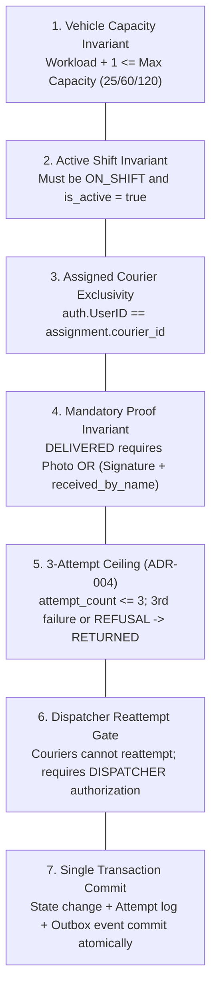
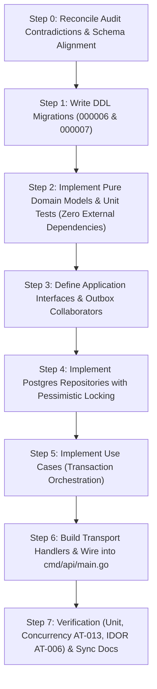

# Member 3 — Requirements Analysis & Detailed Implementation Plan

> **Domain:** Dispatch, Couriers & Proof of Delivery  
> **Production Code Paths:** `core-api/internal/dispatch/` and `core-api/internal/delivery/`  
> **Governing Standards:** SwiftDrop SRS v1.0 (§4.6, §4.7), ADR-004, `domain-boundaries.md`, and `AGENTS.md`.  
> **Target Migrations:** `000006_create_couriers.up.sql` & `000007_create_dispatch_and_delivery.up.sql`  
> **Date:** November 2026 | **Version:** 1.0.0

---

## 1. Executive Understanding of Requirements for Member 3

Member 3 owns the **operational logistics heartbeat** of SwiftDrop: managing the physical courier fleet, executing concurrency-safe parcel dispatching, tracking doorstep delivery execution, enforcing Proof of Delivery (POD), and recording auditable delivery failure attempts.

Within the Go Core API Modular Monolith, Member 3 is responsible for **two highly cohesive, cleanly separated bounded contexts**:

```
                              ┌─────────────────────────────────────────┐
                              │            Member 3 Mandate             │
                              └───────────────────┬─────────────────────┘
                                                  │
                 ┌────────────────────────────────┴────────────────────────────────┐
                 ▼                                                                 ▼
┌─────────────────────────────────┐                             ┌─────────────────────────────────┐
│     internal/dispatch/          │                             │      internal/delivery/         │
│  Fleet, Shifts & Assignments    │                             │ Doorstep Execution, POD & ADR-004│
├─────────────────────────────────┤                             ├─────────────────────────────────┤
│ • Courier operational profiles  │                             │ • Courier personalized manifest │
│ • Vehicle capacities (25/60/120)│                             │ • Run start & depot collection  │
│ • Shift lifecycle state machine │                             │ • Proof of Delivery verification│
│ • Dispatch board aggregation    │                             │ • Photo upload (R2/S3 storage)  │
│ • Concurrency-safe assignments  │                             │ • Attempt logging & reason codes│
│ • Assignment cancellations      │                             │ • 3-attempt ceiling & reattempts│
└─────────────────────────────────┘                             └─────────────────────────────────┘
```

### 1.1 Traceability to SRS Requirements & Acceptance Tests

| SRS Requirement ID | Capability Description | Primary Owner | Module Location |
| :--- | :--- | :---: | :--- |
| **FR-COU-001** | Courier views daily assigned deliveries and active runs. | Member 3 | `internal/delivery` |
| **FR-COU-002** | Courier views necessary operational details (data minimization). | Member 3 | `internal/delivery` |
| **FR-COU-003** | Courier can update status **only** for parcels assigned to them (IDOR defense). | Member 3 | `internal/delivery` |
| **FR-COU-004** | Mandatory proof of delivery capture (photo URL / signature + recipient name). | Member 3 | `internal/delivery` |
| **FR-COU-005** | Mandatory failure reason code and attempt audit logging. | Member 3 | `internal/delivery` |
| **FR-COU-006** | Reject stale or conflicting updates when parcel state/assignment changed. | Member 3 | `internal/delivery` |
| **FR-COU-007** | Object storage abstraction for proof photos (storing only URL/key in Postgres). | Member 3 | `internal/delivery` |
| **FR-ADM-001** | Dispatcher lists unassigned parcels eligible for dispatch. | Member 3 | `internal/dispatch` |
| **FR-ADM-002** | Dispatcher assigns eligible parcels to enabled, on-shift couriers. | Member 3 | `internal/dispatch` |
| **FR-ADM-003** | Prevent concurrent conflicting active assignments (**AT-013**). | Member 3 | `internal/dispatch` |
| **FR-ADM-004** | Dispatcher board displays courier workloads against maximum capacity. | Member 3 | `internal/dispatch` |
| **ADR-004** | Failed delivery reattempt gate: couriers cannot unilaterally reattempt; max 3 attempts. | Member 3 & 2 | `internal/delivery` |
| **AT-006** | Acceptance Test: Courier IDOR access isolation. | Member 3 | `tests/integration` |
| **AT-013** | Acceptance Test: Concurrency race condition on parcel assignment. | Member 3 | `tests/integration` |

---

## 2. Core Business Invariants & Rules Protected

Member 3's code must strictly enforce 7 non-negotiable domain invariants:



1. **The Capacity Ceiling Invariant:** A courier cannot be assigned more than their vehicle's maximum configured capacity (`MOTORCYCLE`: 25, `VAN`: 60, `TRUCK`: 120). Violations return `409 Conflict` (`COURIER_CAPACITY_EXCEEDED`).
2. **The Active Shift Invariant:** Assignments can only be made to couriers whose shift status is `ON_SHIFT` and `is_active = true`. Couriers in `OFF_SHIFT`, `ON_BREAK`, or `SUSPENDED` are rejected.
3. **The Assigned Courier Exclusivity Invariant (IDOR Defense):** Operational state changes (`OUT_FOR_DELIVERY`, `DELIVERED`, `ATTEMPT_FAILED`) are rejected with `403 Forbidden` (`NOT_ASSIGNED_COURIER`) if `auth.UserID` does not match the active courier assignment.
4. **The Mandatory Proof Invariant:** A parcel cannot transition to `DELIVERED` without verified proof:
   - `PHOTO`: Valid object storage key/URL.
   - `SIGNATURE`: Base64/SVG stroke vector data ($\ge 50$ chars) **and** mandatory `received_by_name` ($\ge 2$ chars).
   - `RECIPIENT_CONFIRMATION`: Valid `received_by_name`.
5. **The 3-Attempt Ceiling Invariant (ADR-004):** A package is permitted a maximum of **3 delivery attempts**. On the 3rd failed attempt (or immediately upon `REFUSED_BY_RECIPIENT`), the parcel transitions to terminal `RETURNED`.
6. **The Dispatcher Reattempt Authorization Gate:** Couriers cannot unilaterally reschedule or reattempt a failed parcel. Rescheduling requires an explicit dispatcher action (`POST /api/v1/dispatch/parcels/{id}/reschedule`).
7. **The Single Database Transaction Invariant:** Parcel state transition, assignment record, attempt record, audit history row, and outbox event record must execute within a single PostgreSQL transaction (`*sql.Tx`).

---

## 3. Explicit System Boundaries & Cross-Member Contracts

To avoid architecture drift, Member 3 must maintain strict boundaries with other team members:

| Domain / Responsibility | Owner | Member 3 Architectural Boundary |
| :--- | :---: | :--- |
| **Authentication, JWT & Passwords** | **Member 1** | Reads `auth.UserID` and `auth.Role` from JWT context. Never manages passwords or issues tokens. |
| **Parcel Aggregate Root & Pricing** | **Member 2** | Never executes raw SQL updates (`UPDATE parcels SET status = ...`). Calls Member 2's aggregate methods / status updater interface. |
| **Merchant Portals & Webhooks** | **Member 4** | Zero merchant API logic. Merchant webhooks are triggered downstream via Member 8 consuming M3's outbox events. |
| **Public Tracking & SSE Projections** | **Member 5** | Never serves public tracking. Member 5 reads `delivery_attempts` and outbox events to project sanitized tracking milestones. |
| **Frontend Web Portals (React)** | **Member 7** | Member 3 implements Go REST backend endpoints. Member 7 builds the React Dispatcher Board and Courier Web UI. |
| **Transactional Outbox & Broker** | **Member 8** | Appends rows to `outbox_events` in the same `*sql.Tx`. Outbox Relay daemon polls and publishes to RabbitMQ. M3 never imports RabbitMQ. |
| **Cloud Storage & Health Probes** | **Member 9** | Object storage failures must **never** take down the Core API pod readiness probe (`/health/ready` checks PostgreSQL only). |

---

## 4. What Needs to Be Done First? (Critical Path Analysis)

Before implementing HTTP endpoints, three foundational issues identified in the repository audit must be addressed:



### Critical Items to Establish First:
1. **Database Migration Sequencing & Column Harmonization:**
   - Create migrations as `000006_create_couriers.up.sql` and `000007_create_dispatch_and_delivery.up.sql` (dependent on `000001_users`, `000002_delivery_zones`, and `000005_parcels`).
   - Use `current_zone_id VARCHAR(32) REFERENCES delivery_zones(id)` (not `zone_code REFERENCES delivery_zones(code)`).
   - Standardize assignment status constraint: `status IN ('ACTIVE', 'COMPLETED', 'REASSIGNED', 'CANCELLED')`.
   - Add a partial unique index on `courier_assignments (parcel_id) WHERE status = 'ACTIVE'` to enforce at the DB level that a parcel can have at most one active courier assignment.
2. **Decouple Aggregate Transitions from Raw SQL:**
   - Define a clean collaborator interface (`ParcelLifecycleUpdater`) so that `internal/dispatch` and `internal/delivery` do not write unvalidated SQL updates against `parcels`.
3. **Harmonize Event Schemas with Member 8:**
   - Ensure outbox inserts include `aggregate_type`, `aggregate_id`, `aggregate_version`, `event_type`, `schema_version`, and `correlation_id`.
   - Never leak unmasked recipient PII (e.g. phone numbers, street addresses) into public tracking events.

---

## 5. Detailed Phase-by-Phase Implementation Plan

### Phase 1: Database Migrations & Persistence Design

#### 1.1 `migrations/000006_create_couriers.up.sql`
- Table: `couriers`
  - `user_id UUID PRIMARY KEY REFERENCES users(id) ON DELETE RESTRICT`
  - `employee_code VARCHAR(20) NOT NULL UNIQUE`
  - `vehicle_type VARCHAR(20) NOT NULL CHECK (vehicle_type IN ('MOTORCYCLE', 'VAN', 'TRUCK'))`
  - `max_capacity INTEGER NOT NULL DEFAULT 25 CHECK (max_capacity BETWEEN 1 AND 200)`
  - `status VARCHAR(20) NOT NULL DEFAULT 'OFF_SHIFT' CHECK (status IN ('OFF_SHIFT', 'ON_SHIFT', 'ON_BREAK', 'SUSPENDED'))`
  - `current_zone_id VARCHAR(32) REFERENCES delivery_zones(id) ON DELETE SET NULL`
  - `is_active BOOLEAN NOT NULL DEFAULT TRUE`
  - `created_at TIMESTAMPTZ NOT NULL DEFAULT NOW()`, `updated_at TIMESTAMPTZ NOT NULL DEFAULT NOW()`
- Down migration: `migrations/000006_create_couriers.down.sql` (`DROP TABLE IF EXISTS couriers CASCADE;`)

#### 1.2 `migrations/000007_create_dispatch_and_delivery.up.sql`
- Table: `courier_assignments`
  - `id UUID PRIMARY KEY DEFAULT gen_random_uuid()`
  - `parcel_id UUID NOT NULL REFERENCES parcels(id) ON DELETE RESTRICT`
  - `courier_id UUID NOT NULL REFERENCES couriers(user_id) ON DELETE RESTRICT`
  - `assigned_by UUID NOT NULL REFERENCES users(id) ON DELETE RESTRICT`
  - `status VARCHAR(20) NOT NULL DEFAULT 'ACTIVE' CHECK (status IN ('ACTIVE', 'COMPLETED', 'REASSIGNED', 'CANCELLED'))`
  - `assigned_at TIMESTAMPTZ NOT NULL DEFAULT NOW()`, `ended_at TIMESTAMPTZ`
  - `notes TEXT`
  - Partial Unique Index: `CREATE UNIQUE INDEX idx_courier_assignments_active_parcel ON courier_assignments (parcel_id) WHERE status = 'ACTIVE';`
  - Index: `CREATE INDEX idx_courier_assignments_courier_active ON courier_assignments (courier_id) WHERE status = 'ACTIVE';`
- Table: `delivery_attempts`
  - `id UUID PRIMARY KEY DEFAULT gen_random_uuid()`
  - `parcel_id UUID NOT NULL REFERENCES parcels(id) ON DELETE RESTRICT`
  - `courier_id UUID NOT NULL REFERENCES couriers(user_id) ON DELETE RESTRICT`
  - `attempt_number INTEGER NOT NULL CHECK (attempt_number BETWEEN 1 AND 3)`
  - `outcome VARCHAR(20) NOT NULL CHECK (outcome IN ('SUCCESS', 'FAILED'))`
  - `failure_reason_code VARCHAR(50) CHECK (failure_reason_code IN ('RECIPIENT_UNAVAILABLE', 'CUSTOMER_REQUESTED_RESCHEDULE', 'ACCESS_RESTRICTED', 'INVALID_ADDRESS', 'REFUSED_BY_RECIPIENT', 'DAMAGED_IN_TRANSIT', 'OTHER'))`
  - `proof_type VARCHAR(30) CHECK (proof_type IN ('PHOTO', 'SIGNATURE', 'RECIPIENT_CONFIRMATION'))`
  - `proof_attachment_url TEXT`, `proof_signature_data TEXT`, `received_by_name VARCHAR(100)`
  - `latitude DECIMAL(9,6)`, `longitude DECIMAL(9,6)`, `notes TEXT`
  - `attempted_at TIMESTAMPTZ NOT NULL DEFAULT NOW()`
  - Index: `CREATE INDEX idx_delivery_attempts_parcel ON delivery_attempts (parcel_id, attempt_number);`
- Down migration: `migrations/000007_create_dispatch_and_delivery.down.sql`

---

### Phase 2: Domain Layer Implementation (`domain/`)

*Strict Prohibition: Zero external imports (`net/http`, `database/sql`, etc.). Pure Go logic and domain errors only.*

#### 2.1 Fleet & Dispatch Domain (`core-api/internal/dispatch/domain/`)
- `vehicle_type.go`:
  - Enum: `VehicleTypeMotorcycle` (25), `VehicleTypeVan` (60), `VehicleTypeTruck` (120).
  - Method: `(v VehicleType) DefaultCapacity() int`, `(v VehicleType) Validate() error`.
- `shift_status.go`:
  - Enum: `ShiftStatusOffShift`, `ShiftStatusOnShift`, `ShiftStatusOnBreak`, `ShiftStatusSuspended`.
  - Method: `(s ShiftStatus) CanTransitionTo(target ShiftStatus, isSelfService bool) bool`.
- `courier.go`:
  - Entity: `Courier` struct with `UserID`, `EmployeeCode`, `Vehicle`, `MaxCapacity`, `Status`, `CurrentZoneID`, `IsActive`.
  - Invariant Method: `(c *Courier) CanAcceptAssignment(currentActiveWorkload int) error`.
  - Invariant Method: `(c *Courier) ToggleShift(target ShiftStatus) error`.
- `assignment.go`:
  - Entity: `CourierAssignment` struct.
  - Invariant Methods: `Complete()`, `Cancel(reason string)`.
- `errors.go`:
  - Standardized errors: `ErrCourierOverloaded`, `ErrCourierNotOnShift`, `ErrCourierSuspended`, `ErrInvalidVehicleType`, `ErrInvalidShiftTransition`, `ErrAssignmentAlreadyClosed`.

#### 2.2 Delivery & Proof Domain (`core-api/internal/delivery/domain/`)
- `failure_reason.go`:
  - Enum: 7 ADR-004 reason codes (`RecipientUnavailable`, `AccessRestricted`, `RefusedByRecipient`, etc.).
  - Invariant Method: `Validate(notes string) error` (enforcing $\ge 15$ characters when code is `OTHER`).
- `proof_of_delivery.go`:
  - Value Object: `ProofOfDelivery` struct (`ProofType`, `URL`, `SignatureData`, `ReceivedByName`).
  - Invariant Method: `Validate() error` (checks photo URL presence, signature length $\ge 50$, and `received_by_name` $\ge 2$).
- `delivery_attempt.go`:
  - Entity: `DeliveryAttempt` struct.
  - Invariant Methods: `IsTerminal() bool` (returns true on attempt 3 or `REFUSED_BY_RECIPIENT`).
- `errors.go`:
  - Standardized errors: `ErrMissingDeliveryProof`, `ErrRecipientNameRequired`, `ErrInvalidSignatureData`, `ErrInvalidFailureReasonCode`, `ErrFailureNoteTooShort`, `ErrAttemptLimitExceeded`, `ErrNotAssignedCourier`.

---

### Phase 3: Application Layer & Port Interfaces (`application/`)

#### 3.1 Collaborator Interfaces
- `ParcelLifecycleUpdater`:
  ```go
  type ParcelLifecycleUpdater interface {
      TransitionStatus(ctx context.Context, tx *sql.Tx, parcelID uuid.UUID, fromStatus, toStatus string, actorID uuid.UUID, actorRole, note string) error
      RecordAttemptFailure(ctx context.Context, tx *sql.Tx, parcelID uuid.UUID, actorID uuid.UUID, reasonCode, note string) (newStatus string, newAttemptCount int, err error)
  }
  ```
- `OutboxWriter`:
  ```go
  type OutboxWriter interface {
      Write(ctx context.Context, tx *sql.Tx, aggregateType string, aggregateID uuid.UUID, aggregateVersion int, eventType string, payload any, correlationID string) error
  }
  ```
- `StorageClient`:
  ```go
  type StorageClient interface {
      UploadProofPhoto(ctx context.Context, key string, data io.Reader, contentType string) (string, error)
      GeneratePresignedURL(ctx context.Context, key string, ttl time.Duration) (string, error)
  }
  ```

#### 3.2 Dispatch Use Cases (`core-api/internal/dispatch/application/`)
1. `AssignCourierUseCase`:
   - Enters `*sql.Tx`.
   - Acquires pessimistic lock on parcel (`SELECT id, status FROM parcels WHERE id = $1 FOR UPDATE`).
   - Verifies parcel is in `CREATED` or `ATTEMPT_FAILED`.
   - Acquires pessimistic lock on courier (`SELECT ... FROM couriers WHERE user_id = $1 FOR UPDATE`).
   - Counts active assignments: `SELECT COUNT(*) FROM courier_assignments WHERE courier_id = $1 AND status = 'ACTIVE'`.
   - Calls `courier.CanAcceptAssignment(count)`.
   - Inserts `courier_assignments` row (`status = 'ACTIVE'`).
   - Calls `ParcelLifecycleUpdater.TransitionStatus(..., "ASSIGNED")`.
   - Appends `parcel.assigned.v1` outbox event.
   - Commits `*sql.Tx`.
2. `CancelAssignmentUseCase`:
   - Cancels active assignment, reverts parcel to `CREATED`, emits `courier.unassigned.v1`.
3. `ToggleShiftUseCase`:
   - Validates courier transition, updates `couriers.status`.
4. `GetDispatchBoardQueryHandler`:
   - Returns unassigned parcels and active courier capacity loads for a `zone_id`.
5. `RescheduleParcelUseCase`:
   - Authorized dispatcher reviews failed attempt, transitions `ATTEMPT_FAILED` $\to$ `ASSIGNED` with assigned courier.

#### 3.3 Delivery Use Cases (`core-api/internal/delivery/application/`)
1. `StartDeliveryRunUseCase` (Single & Batch):
   - Verifies courier assignment.
   - Transitions parcel status from `ASSIGNED` to `OUT_FOR_DELIVERY`.
   - Appends `parcel.out_for_delivery.v1` outbox event.
2. `CompleteDeliveryUseCase`:
   - Verifies assigned courier (`auth.UserID == assignment.courier_id`).
   - Validates proof payload (`proof.Validate()`).
   - Inserts `delivery_attempts` with `outcome = 'SUCCESS'`.
   - Updates `courier_assignments` status to `COMPLETED`.
   - Calls `ParcelLifecycleUpdater.TransitionStatus(..., "DELIVERED")`.
   - Appends `parcel.delivered.v1` outbox event.
3. `RecordFailedAttemptUseCase`:
   - Verifies assigned courier.
   - Validates failure reason code (`reason.Validate(notes)`).
   - Queries previous attempt count on parcel.
   - Computes `attemptNumber = previousCount + 1`.
   - Inserts `delivery_attempts` row with `outcome = 'FAILED'`.
   - If `attemptNumber >= 3` or reason is `REFUSED_BY_RECIPIENT`:
     - Updates assignment to `COMPLETED`.
     - Transitions parcel to `RETURNED`.
     - Appends `parcel.returned.v1` outbox event.
   - Else:
     - Transitions parcel to `ATTEMPT_FAILED`.
     - Appends `parcel.delivery_failed.v1` outbox event.
4. `GetCourierManifestQueryHandler`:
   - Returns daily active parcels assigned to `auth.UserID` with operational data minimization.
5. `GetParcelDeliveryHistoryQueryHandler`:
   - Returns chronological attempt records and sanitized proof URLs.

---

### Phase 4: Infrastructure Layer (`infrastructure/`)

1. **PostgreSQL Repositories:**
   - `PostgresCourierRepository`: Implements `CourierRepository` (`GetByIDWithLock`, `ListByZone`, `UpdateShiftStatus`).
   - `PostgresAssignmentRepository`: Implements `AssignmentRepository` (`Create`, `GetActiveByParcelID`, `CountActiveByCourierID`, `CloseAssignment`).
   - `PostgresDeliveryAttemptRepository`: Implements `DeliveryAttemptRepository` (`InsertAttempt`, `ListAttemptsByParcelID`).
2. **Object Storage Driver (`storage_client.go`):**
   - Cloudflare R2 / AWS S3 client using `aws-sdk-go-v2/service/s3` with presigned URL generator.
   - Local disk / mock storage driver for deterministic offline test execution and CI.

---

### Phase 5: Transport Layer (`transport/`) & API Contracts

All endpoints live under `/api/v1` and implement RFC 7807 problem details:

| Method & Route | Auth Role | Description |
| :--- | :---: | :--- |
| `POST /api/v1/dispatch/couriers` | `ADMIN`, `DISPATCHER` | Register operational courier fleet profile. |
| `GET /api/v1/dispatch/couriers` | `DISPATCHER`, `ADMIN` | List/filter couriers with workload counts. |
| `GET /api/v1/dispatch/board` | `DISPATCHER`, `ADMIN` | Unassigned parcels & courier loads by `zone_id`. |
| `POST /api/v1/dispatch/assignments` | `DISPATCHER`, `ADMIN` | Assign parcel to courier (`Idempotency-Key` supported). |
| `POST /api/v1/dispatch/assignments/{id}/cancel`| `DISPATCHER`, `ADMIN` | Cancel assignment and restore driver capacity. |
| `POST /api/v1/dispatch/parcels/{id}/reschedule` | `DISPATCHER`, `ADMIN` | Dispatcher authorizes reattempt for failed parcel. |
| `POST /api/v1/courier/shift` | `COURIER` | Courier toggles shift (`ON_SHIFT`, `OFF_SHIFT`, `ON_BREAK`). |
| `GET /api/v1/courier/parcels` | `COURIER` | Daily active assignment manifest (strictly `auth.UserID`). |
| `POST /api/v1/courier/parcels/{id}/start-run` | `COURIER` | Move parcel from `ASSIGNED` $\to$ `OUT_FOR_DELIVERY`. |
| `POST /api/v1/courier/runs/start-batch` | `COURIER` | Batch start run for morning route manifest. |
| `POST /api/v1/deliveries/{id}/proof-photo` | `COURIER` | Upload POD photo to Cloudflare R2 / local mock. |
| `POST /api/v1/deliveries/{id}/complete` | `COURIER` | Complete delivery with verified POD (`DELIVERED`). |
| `POST /api/v1/deliveries/{id}/failed` | `COURIER` | Record failed attempt & reason code (`ATTEMPT_FAILED`/`RETURNED`). |
| `GET /api/v1/deliveries/parcels/{id}` | `DISPATCHER`, `ADMIN`, `COURIER` | Get attempt history and proof metadata. |

---

### Phase 6: System Wiring & Dependency Injection

- Register dispatch and delivery repositories, use cases, and HTTP routes in `core-api/internal/app/wiring.go`.
- Ensure environment variable loader reads `OBJECT_STORAGE_DRIVER` (with fallback to `STORAGE_DRIVER`).
- **Health Check Rule:** Ensure `/health/ready` checks PostgreSQL only; never add R2/S3 checks to the Kubernetes readiness probe.

---

### Phase 7: Verification & Testing Suite

1. **Unit Tests (`go test -race ./internal/dispatch/... ./internal/delivery/...`):**
   - Vehicle capacity validations (25, 60, 120).
   - Shift status transitions (`OFF_SHIFT` $\to$ `ON_SHIFT` allowed; self-transition to `SUSPENDED` rejected).
   - POD validation: photo URL check, signature length $\ge 50$, missing `received_by_name` rejected.
   - Failure reason code validation: reason `OTHER` with $< 15$ chars rejected.
2. **Integration & Concurrency Tests:**
   - **AT-013 Concurrency Test (`dispatch_concurrency_test.go`):** 10 concurrent goroutines attempt to assign the same parcel to different couriers. Exactly 1 succeeds with `200 OK`; 9 fail with `409 Conflict` or `400 Bad Request`. Parcel has exactly 1 active assignment.
   - **AT-006 Courier IDOR Test (`courier_idor_test.go`):** Courier A attempts to call `POST /api/v1/deliveries/{id}/complete` on a parcel assigned to Courier B. Assert `403 Forbidden` (`NOT_ASSIGNED_COURIER`).
   - **ADR-004 Attempt Ceiling Test:** 3 failed attempts record sequentially; parcel state becomes `RETURNED`; 4th attempt is blocked.
   - **Atomicity Test:** Force outbox failure or DB constraint error; verify parcel status and attempt logs roll back completely.

---

### Phase 8: Living Documentation Synchronization

Synchronously update co-located documentation to maintain zero-drift:
- `core-api/internal/dispatch/README.md` & `core-api/internal/dispatch/API.md`
- `core-api/internal/delivery/README.md` & `core-api/internal/delivery/API.md`

---

## 6. Summary Checklist for Implementation Kickoff

When ready to begin coding:
- [ ] Check out working branch `feature/member-03-dispatch-delivery`.
- [ ] Implement Phase 1: Migrations `000006_create_couriers.up.sql` and `000007_create_dispatch_and_delivery.up.sql`.
- [ ] Implement Phase 2: Domain entities, value objects, and domain errors in `internal/dispatch/domain` and `internal/delivery/domain`.
- [ ] Run pure domain unit tests to 100% pass rate.
- [ ] Implement Phase 3 & 4: Application use cases, repository interfaces, Postgres implementations, and R2/local storage adapter.
- [ ] Implement Phase 5: Transport handlers, DTOs, and error mappers.
- [ ] Wire dependencies in `internal/app/wiring.go`.
- [ ] Run test suite with `-race` including AT-006 and AT-013.
- [ ] Update `README.md` and `API.md` in both modules.
- [ ] Deliver structured Task Completion Report per `AGENTS.md` §12.

