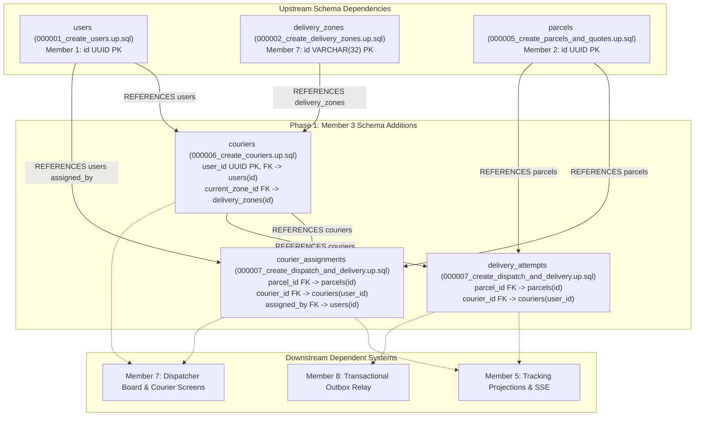
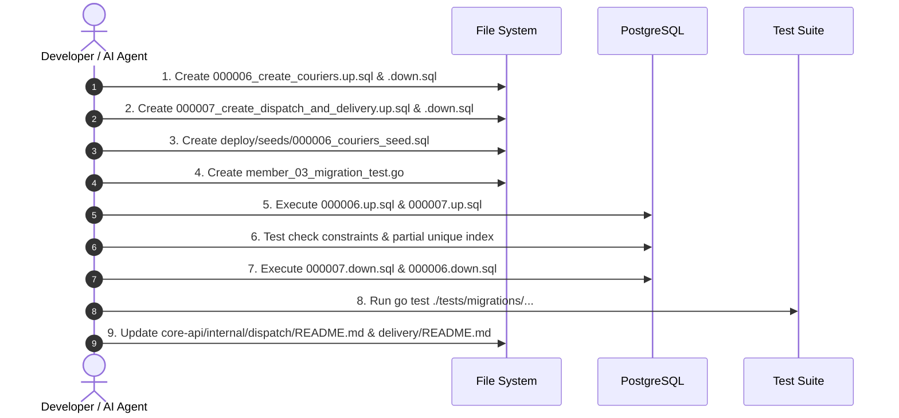

# Member 3 — Phase 1 Detailed Implementation Plan: Database Migrations & Persistence Design

> **Domain:** Dispatch, Couriers & Proof of Delivery  
> **Phase:** Phase 1 of 8 (Foundational Persistence Layer)  
> **Target Files:**  
> - `core-api/migrations/000006_create_couriers.up.sql`  
> - `core-api/migrations/000006_create_couriers.down.sql`  
> - `core-api/migrations/000007_create_dispatch_and_delivery.up.sql`  
> - `core-api/migrations/000007_create_dispatch_and_delivery.down.sql`  
> - `deploy/seeds/000006_couriers_seed.sql`  
> - `core-api/tests/migrations/member_03_migration_test.go`  
> **Governing Specifications:** SRS v1.0 (§4.6, §4.7), ADR-004, `database-schema.md`, `AGENTS.md` (§7.2), Agreement D3 & D12.  
> **Date:** November 2026 | **Version:** 1.0.0

---

## 1. Executive Summary & Objective

The objective of **Phase 1** is to establish the complete, immutable relational database foundation for Member 3's capabilities in PostgreSQL 16+. 

No Go domain or transport code can function safely without these tables, foreign keys, check constraints, and partial unique indexes. Phase 1 guarantees:
1. **Migration Sequence Integrity (Agreement D3):** Clean split across `000006` and `000007`, resolving prior cross-dependency deadlocks.
2. **Database-Level Invariant Enforcement:** Check constraints preventing corrupted fleet statuses, capacity overflows, and unvalidated delivery attempts.
3. **Hardware-Level Concurrency Protection:** A partial unique index guaranteeing that a parcel can **never** have more than one active courier assignment concurrently (**AT-013**).
4. **Reversible Rollbacks:** Fully tested, symmetrical `.down.sql` scripts ensuring zero orphaned database artifacts.
5. **Strict DDL/Seed Isolation (Agreement D12):** DDL only in migration files; deterministic development data isolated in `deploy/seeds/`.

---

## 2. Upstream & Downstream Schema Dependencies



---

## 3. Detailed DDL Specifications & Schema Artifacts

### 3.1 Migration 000006: `core-api/migrations/000006_create_couriers.up.sql`

```sql
-- ============================================================================
-- SwiftDrop Core API: Migration 000006 - Courier Operational Profiles
-- Author: Member 03 (Dispatch, Couriers & Proof of Delivery)
-- Dependencies: 000001_create_users, 000002_create_delivery_zones
-- Standards: AGENTS.md §7.2, database-schema.md
-- ============================================================================

CREATE TABLE IF NOT EXISTS couriers (
    user_id UUID PRIMARY KEY REFERENCES users(id) ON DELETE RESTRICT,
    employee_code VARCHAR(20) NOT NULL UNIQUE,
    vehicle_type VARCHAR(20) NOT NULL,
    max_capacity INTEGER NOT NULL DEFAULT 25,
    status VARCHAR(20) NOT NULL DEFAULT 'OFF_SHIFT',
    current_zone_id VARCHAR(32) REFERENCES delivery_zones(id) ON DELETE SET NULL,
    is_active BOOLEAN NOT NULL DEFAULT TRUE,
    created_at TIMESTAMPTZ NOT NULL DEFAULT NOW(),
    updated_at TIMESTAMPTZ NOT NULL DEFAULT NOW(),

    -- Invariant: Permitted vehicle classifications
    CONSTRAINT chk_couriers_vehicle_type CHECK (
        vehicle_type IN ('MOTORCYCLE', 'VAN', 'TRUCK')
    ),
    -- Invariant: Sensible capacity boundary (1 to 200 parcels)
    CONSTRAINT chk_couriers_max_capacity CHECK (
        max_capacity BETWEEN 1 AND 200
    ),
    -- Invariant: Valid shift lifecycle statuses
    CONSTRAINT chk_couriers_status CHECK (
        status IN ('OFF_SHIFT', 'ON_SHIFT', 'ON_BREAK', 'SUSPENDED')
    )
);

-- Comments for documentation & tooling
COMMENT ON TABLE couriers IS 'Operational courier profiles linked 1:1 with authenticated users';
COMMENT ON COLUMN couriers.user_id IS 'Foreign key to users(id), role must be COURIER';
COMMENT ON COLUMN couriers.employee_code IS 'Unique company employee code (e.g., CR-0012)';
COMMENT ON COLUMN couriers.vehicle_type IS 'Fleet vehicle type: MOTORCYCLE (25), VAN (60), TRUCK (120)';
COMMENT ON COLUMN couriers.max_capacity IS 'Maximum concurrent active parcels allowed for this courier';
COMMENT ON COLUMN couriers.status IS 'Shift state: OFF_SHIFT, ON_SHIFT, ON_BREAK, SUSPENDED';
COMMENT ON COLUMN couriers.current_zone_id IS 'Assigned delivery zone referencing delivery_zones(id)';

-- Performance Indexes
-- 1. Fast lookup for dispatch board filtering by zone and active shift
CREATE INDEX idx_couriers_zone_status 
ON couriers (current_zone_id, status) 
WHERE is_active = TRUE;

-- 2. Lookup by employee code
CREATE INDEX idx_couriers_employee_code 
ON couriers (employee_code);
```

### 3.2 Rollback 000006: `core-api/migrations/000006_create_couriers.down.sql`

```sql
-- ============================================================================
-- SwiftDrop Core API: Rollback 000006 - Courier Operational Profiles
-- ============================================================================

DROP TABLE IF EXISTS couriers CASCADE;
```

---

### 3.3 Migration 000007: `core-api/migrations/000007_create_dispatch_and_delivery.up.sql`

```sql
-- ============================================================================
-- SwiftDrop Core API: Migration 000007 - Dispatch Assignments & Delivery Attempts
-- Author: Member 03 (Dispatch, Couriers & Proof of Delivery)
-- Dependencies: 000001_create_users, 000005_create_parcels, 000006_create_couriers
-- Standards: AGENTS.md §7.2, ADR-004, database-schema.md
-- ============================================================================

-- ----------------------------------------------------------------------------
-- 1. Table: courier_assignments
-- Description: Historical and active assignments of parcels to couriers
-- ----------------------------------------------------------------------------
CREATE TABLE IF NOT EXISTS courier_assignments (
    id UUID PRIMARY KEY DEFAULT gen_random_uuid(),
    parcel_id UUID NOT NULL REFERENCES parcels(id) ON DELETE RESTRICT,
    courier_id UUID NOT NULL REFERENCES couriers(user_id) ON DELETE RESTRICT,
    assigned_by UUID NOT NULL REFERENCES users(id) ON DELETE RESTRICT,
    status VARCHAR(20) NOT NULL DEFAULT 'ACTIVE',
    assigned_at TIMESTAMPTZ NOT NULL DEFAULT NOW(),
    ended_at TIMESTAMPTZ NULL,
    notes TEXT NULL,

    -- Invariant: Valid assignment lifecycle states
    CONSTRAINT chk_assignments_status CHECK (
        status IN ('ACTIVE', 'COMPLETED', 'REASSIGNED', 'CANCELLED')
    ),
    -- Invariant: Active assignments have no ended_at; terminal assignments MUST have ended_at
    CONSTRAINT chk_assignments_ended_at CHECK (
        (status = 'ACTIVE' AND ended_at IS NULL) OR
        (status IN ('COMPLETED', 'REASSIGNED', 'CANCELLED') AND ended_at IS NOT NULL)
    )
);

COMMENT ON TABLE courier_assignments IS 'Historical audit and active assignment links between parcels and couriers';
COMMENT ON COLUMN courier_assignments.status IS 'Lifecycle: ACTIVE, COMPLETED, REASSIGNED, CANCELLED';
COMMENT ON COLUMN courier_assignments.assigned_by IS 'Dispatcher user ID who authorized the assignment';

-- Indexes for courier_assignments
-- 1. Critical Concurrency Guard (AT-013): Exactly ONE active assignment per parcel
CREATE UNIQUE INDEX idx_assignments_parcel_single_active 
ON courier_assignments (parcel_id) 
WHERE status = 'ACTIVE';

-- 2. High-speed courier active load count (active_workload <= max_capacity check)
CREATE INDEX idx_assignments_courier_active 
ON courier_assignments (courier_id) 
WHERE status = 'ACTIVE';

-- 3. Chronological lookup of courier assignment history
CREATE INDEX idx_assignments_courier_history 
ON courier_assignments (courier_id, assigned_at DESC);


-- ----------------------------------------------------------------------------
-- 2. Table: delivery_attempts
-- Description: Immutable doorstep attempt logs, failure reasons & POD references
-- ----------------------------------------------------------------------------
CREATE TABLE IF NOT EXISTS delivery_attempts (
    id UUID PRIMARY KEY DEFAULT gen_random_uuid(),
    parcel_id UUID NOT NULL REFERENCES parcels(id) ON DELETE RESTRICT,
    courier_id UUID NOT NULL REFERENCES couriers(user_id) ON DELETE RESTRICT,
    attempt_number INTEGER NOT NULL,
    outcome VARCHAR(20) NOT NULL,
    failure_reason_code VARCHAR(50) NULL,
    proof_type VARCHAR(30) NULL,
    proof_attachment_url TEXT NULL,
    proof_signature_data TEXT NULL,
    received_by_name VARCHAR(150) NULL,
    latitude DECIMAL(10, 8) NULL,
    longitude DECIMAL(11, 8) NULL,
    notes TEXT NULL,
    attempted_at TIMESTAMPTZ NOT NULL DEFAULT NOW(),

    -- Invariant: ADR-004 maximum 3 delivery attempts ceiling
    CONSTRAINT chk_delivery_attempts_number CHECK (
        attempt_number BETWEEN 1 AND 3
    ),
    -- Invariant: Outcome must be SUCCESS or FAILED
    CONSTRAINT chk_delivery_attempts_outcome CHECK (
        outcome IN ('SUCCESS', 'FAILED')
    ),
    -- Invariant: ADR-004 approved standard reason codes
    CONSTRAINT chk_delivery_attempts_reason CHECK (
        failure_reason_code IS NULL OR failure_reason_code IN (
            'RECIPIENT_UNAVAILABLE',
            'CUSTOMER_REQUESTED_RESCHEDULE',
            'ACCESS_RESTRICTED',
            'INVALID_ADDRESS',
            'REFUSED_BY_RECIPIENT',
            'DAMAGED_IN_TRANSIT',
            'OTHER'
        )
    ),
    -- Invariant: Supported proof-of-delivery types
    CONSTRAINT chk_delivery_attempts_proof_type CHECK (
        proof_type IS NULL OR proof_type IN ('PHOTO', 'SIGNATURE', 'RECIPIENT_CONFIRMATION')
    ),
    -- Invariant: Outcome consistency (SUCCESS requires proof; FAILED requires reason code)
    CONSTRAINT chk_delivery_attempts_outcome_consistency CHECK (
        (outcome = 'SUCCESS' AND proof_type IS NOT NULL) OR
        (outcome = 'FAILED' AND failure_reason_code IS NOT NULL)
    ),
    -- Invariant: Signature proof MUST capture recipient name (length >= 2)
    CONSTRAINT chk_delivery_attempts_signature_recipient CHECK (
        proof_type != 'SIGNATURE' OR (received_by_name IS NOT NULL AND length(trim(received_by_name)) >= 2)
    )
);

COMMENT ON TABLE delivery_attempts IS 'Immutable doorstep delivery attempts, proof references, and ADR-004 failure logs';
COMMENT ON COLUMN delivery_attempts.attempt_number IS 'Attempt sequence (1, 2, or 3)';
COMMENT ON COLUMN delivery_attempts.outcome IS 'Outcome: SUCCESS or FAILED';
COMMENT ON COLUMN delivery_attempts.proof_attachment_url IS 'Private storage path in Cloudflare R2 / S3';
COMMENT ON COLUMN delivery_attempts.proof_signature_data IS 'SVG or Base64 vector stroke data';

-- Indexes for delivery_attempts
-- 1. Sequential attempt history retrieval per parcel
CREATE INDEX idx_delivery_attempts_parcel_seq 
ON delivery_attempts (parcel_id, attempt_number ASC);

-- 2. Courier performance audit index
CREATE INDEX idx_delivery_attempts_courier_audit 
ON delivery_attempts (courier_id, attempted_at DESC);
```

### 3.4 Rollback 000007: `core-api/migrations/000007_create_dispatch_and_delivery.down.sql`

```sql
-- ============================================================================
-- SwiftDrop Core API: Rollback 000007 - Dispatch Assignments & Delivery Attempts
-- ============================================================================

DROP TABLE IF EXISTS delivery_attempts CASCADE;
DROP TABLE IF EXISTS courier_assignments CASCADE;
```

---

### 3.5 Development & CI Seed Fixture: `deploy/seeds/000006_couriers_seed.sql`

In compliance with Agreement D12, migration directories remain strictly DDL. Deterministic seed fixtures are placed in `deploy/seeds/`:

```sql
-- ============================================================================
-- SwiftDrop Seed Data: 000006_couriers_seed.sql
-- Dependencies: Requires users and delivery_zones seeds
-- ============================================================================

-- Insert sample operational couriers linked to Member 1 user UUIDs
INSERT INTO couriers (user_id, employee_code, vehicle_type, max_capacity, status, current_zone_id, is_active)
VALUES 
    ('018e3a2b-1111-7000-8000-000000000001', 'CR-0012', 'MOTORCYCLE', 25, 'ON_SHIFT', 'ZONE_COLOMBO_01', TRUE),
    ('018e3a2b-2222-7000-8000-000000000002', 'CR-0015', 'VAN', 60, 'ON_SHIFT', 'ZONE_KANDY_01', TRUE),
    ('018e3a2b-3333-7000-8000-000000000003', 'CR-0019', 'MOTORCYCLE', 25, 'OFF_SHIFT', 'ZONE_COLOMBO_01', TRUE),
    ('018e3a2b-4444-7000-8000-000000000004', 'CR-0025', 'TRUCK', 120, 'ON_SHIFT', 'ZONE_COLOMBO_01', TRUE)
ON CONFLICT (user_id) DO UPDATE SET
    employee_code = EXCLUDED.employee_code,
    vehicle_type = EXCLUDED.vehicle_type,
    max_capacity = EXCLUDED.max_capacity,
    status = EXCLUDED.status,
    current_zone_id = EXCLUDED.current_zone_id,
    is_active = EXCLUDED.is_active;
```

---

## 4. Constraint & Invariant Verification Matrix

Phase 1 includes automated schema verification testing each PostgreSQL constraint:

| Test Case ID | Target Constraint / Index | Test Condition | Expected PostgreSQL Behavior |
| :--- | :--- | :--- | :--- |
| **TC-MIG-001** | `chk_couriers_vehicle_type` | Insert `vehicle_type = 'BICYCLE'` | `ERROR: check constraint "chk_couriers_vehicle_type" violated` |
| **TC-MIG-002** | `chk_couriers_max_capacity` | Insert `max_capacity = 250` | `ERROR: check constraint "chk_couriers_max_capacity" violated` |
| **TC-MIG-003** | `chk_couriers_status` | Insert `status = 'VACATION'` | `ERROR: check constraint "chk_couriers_status" violated` |
| **TC-MIG-004** | `idx_assignments_parcel_single_active` | Insert two rows for same `parcel_id` with `status = 'ACTIVE'` | `ERROR: duplicate key value violates unique constraint "idx_assignments_parcel_single_active"` |
| **TC-MIG-005** | `chk_assignments_ended_at` | Insert `status = 'COMPLETED'` with `ended_at = NULL` | `ERROR: check constraint "chk_assignments_ended_at" violated` |
| **TC-MIG-006** | `chk_delivery_attempts_number` | Insert `attempt_number = 4` | `ERROR: check constraint "chk_delivery_attempts_number" violated` |
| **TC-MIG-007** | `chk_delivery_attempts_reason` | Insert `failure_reason_code = 'TRAFFIC_JAM'` | `ERROR: check constraint "chk_delivery_attempts_reason" violated` |
| **TC-MIG-008** | `chk_delivery_attempts_outcome_consistency` | Insert `outcome = 'SUCCESS'` with `proof_type = NULL` | `ERROR: check constraint "chk_delivery_attempts_outcome_consistency" violated` |
| **TC-MIG-009** | `chk_delivery_attempts_signature_recipient` | Insert `proof_type = 'SIGNATURE'` with `received_by_name = ''` | `ERROR: check constraint "chk_delivery_attempts_signature_recipient" violated` |
| **TC-MIG-010** | Symmetrical Migration Rollback | Run `.up.sql` $\to$ `.down.sql` $\to$ `.up.sql` | Successfully drops and recreates tables with zero residue |

---

## 5. Automated Migration Test: `member_03_migration_test.go`

A Go test will be implemented to automatically verify Phase 1 migrations against a test database:

```go
package migrations_test

import (
	"database/sql"
	"os"
	"testing"

	_ "github.com/jackc/pgx/v5/stdlib"
	"github.com/stretchr/testify/assert"
	"github.com/stretchr/testify/require"
)

func TestMember03_Migrations(t *testing.T) {
	dbURL := os.Getenv("TEST_DATABASE_URL")
	if dbURL == "" {
		t.Skip("TEST_DATABASE_URL not set; skipping database migration integration test")
	}

	db, err := sql.Open("pgx", dbURL)
	require.NoError(t, err)
	defer db.Close()

	// 1. Execute up migrations
	up06, err := os.ReadFile("../../migrations/000006_create_couriers.up.sql")
	require.NoError(t, err)
	_, err = db.Exec(string(up06))
	require.NoError(t, err)

	up07, err := os.ReadFile("../../migrations/000007_create_dispatch_and_delivery.up.sql")
	require.NoError(t, err)
	_, err = db.Exec(string(up07))
	require.NoError(t, err)

	// 2. Validate tables exist
	var tableName string
	err = db.QueryRow("SELECT table_name FROM information_schema.tables WHERE table_name = 'couriers'").Scan(&tableName)
	assert.NoError(t, err)
	assert.Equal(t, "couriers", tableName)

	err = db.QueryRow("SELECT table_name FROM information_schema.tables WHERE table_name = 'courier_assignments'").Scan(&tableName)
	assert.NoError(t, err)
	assert.Equal(t, "courier_assignments", tableName)

	err = db.QueryRow("SELECT table_name FROM information_schema.tables WHERE table_name = 'delivery_attempts'").Scan(&tableName)
	assert.NoError(t, err)
	assert.Equal(t, "delivery_attempts", tableName)

	// 3. Test Rollbacks
	down07, err := os.ReadFile("../../migrations/000007_create_dispatch_and_delivery.down.sql")
	require.NoError(t, err)
	_, err = db.Exec(string(down07))
	require.NoError(t, err)

	down06, err := os.ReadFile("../../migrations/000006_create_couriers.down.sql")
	require.NoError(t, err)
	_, err = db.Exec(string(down06))
	require.NoError(t, err)
}
```

---

## 6. Step-by-Step Execution Checklist for Phase 1



### Execution Steps:
- [ ] **Step 1:** Create `core-api/migrations/000006_create_couriers.up.sql`.
- [ ] **Step 2:** Create `core-api/migrations/000006_create_couriers.down.sql`.
- [ ] **Step 3:** Create `core-api/migrations/000007_create_dispatch_and_delivery.up.sql`.
- [ ] **Step 4:** Create `core-api/migrations/000007_create_dispatch_and_delivery.down.sql`.
- [ ] **Step 5:** Create `deploy/seeds/000006_couriers_seed.sql`.
- [ ] **Step 6:** Create `core-api/tests/migrations/member_03_migration_test.go`.
- [ ] **Step 7:** Run syntax and constraint validation against PostgreSQL test container or local instance.
- [ ] **Step 8:** Synchronously update Section 4 of `core-api/internal/dispatch/README.md` and `core-api/internal/delivery/README.md` to reflect the migration files.
- [ ] **Step 9:** Generate Task Completion Report for Phase 1.

---

## 7. Phase 1 Definition of Done (DoD)

Phase 1 is complete and approved for advancement to **Phase 2 (Domain Layer)** only when:
1. Both migration pairs (`000006` and `000007`) execute cleanly without errors or warnings.
2. Symmetrical `.down.sql` scripts drop all tables and indexes cleanly, leaving zero database residue.
3. The partial unique index `idx_assignments_parcel_single_active` rejects duplicate active parcel assignments with a PostgreSQL unique constraint violation.
4. All 9 check constraints prevent invalid vehicle types, excessive capacity numbers, illegal shift statuses, and corrupt delivery attempt outcomes.
5. Seed data is strictly kept in `deploy/seeds/` and does not contaminate migration files.
6. Co-located module `README.md` files in `internal/dispatch/` and `internal/delivery/` are updated.

