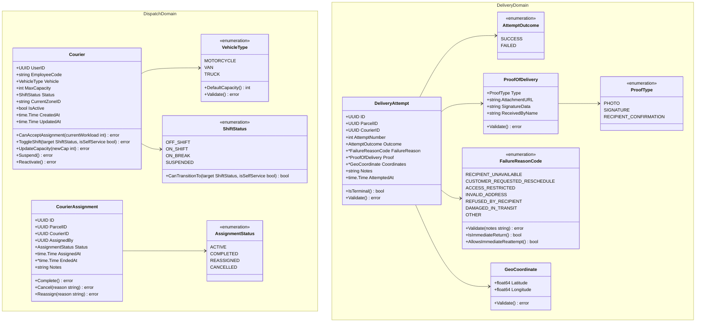
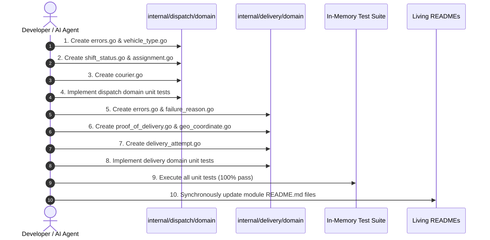

# Member 3 — Phase 2 Detailed Implementation Plan: Pure Domain Layer Architecture

> **Domain:** Dispatch, Couriers & Proof of Delivery  
> **Phase:** Phase 2 of 8 (Pure Business Logic & Domain Invariants)  
> **Target Directories:**  
> - `core-api/internal/dispatch/domain/`  
> - `core-api/internal/delivery/domain/`  
> **Governing Standards:** `AGENTS.md` (§4.2 Clean Layer Dependency Rules, §9 Coding & Testing Standards), ADR-004, and SRS v1.0 (§4.6, §4.7).  
> **Date:** November 2026 | **Version:** 1.0.0

---

## 1. Executive Summary & Core Architectural Mandates

The objective of **Phase 2** is to implement the pure domain core for both Member 3 bounded contexts:
1. **Fleet Capacity, Shift Governance & Assignments** (`core-api/internal/dispatch/domain/`)
2. **Doorstep Delivery Execution, Proof-of-Delivery & ADR-004 Failure Invariants** (`core-api/internal/delivery/domain/`)

### Strict Domain Purity Rules (`AGENTS.md` §4.2):
- **Zero External Infrastructure Imports:** The `domain/` packages must **NEVER** import `net/http`, `database/sql`, `pgx`, `amqp091-go`, AWS SDK, or any transport/infrastructure package.
- **Allowed Dependencies:** Pure Go standard library packages (`errors`, `fmt`, `time`, `strings`, `math`) and standard UUID value typing (`github.com/google/uuid`).
- **Encapsulated Invariant Enforcement:** State mutations, capacity checks, shift transitions, and POD validations must occur directly on domain entity and value object methods—not inside HTTP handlers or database query callbacks.
- **100% In-Memory Testability:** All domain invariants must be fully verified via unit tests (`*_test.go`) running in microseconds without database or network I/O.

---

## 2. Domain Model Architecture & Class Diagrams



---

## 3. Package 1: Fleet & Dispatch Domain (`internal/dispatch/domain/`)

### 3.1 File: `vehicle_type.go`
- **Enum Type:** `type VehicleType string`
  - `VehicleTypeMotorcycle VehicleType = "MOTORCYCLE"`
  - `VehicleTypeVan VehicleType = "VAN"`
  - `VehicleTypeTruck VehicleType = "TRUCK"`
- **Methods:**
  - `(v VehicleType) DefaultCapacity() int`:
    - `MOTORCYCLE`: 25 active parcels
    - `VAN`: 60 active parcels
    - `TRUCK`: 120 active parcels
  - `(v VehicleType) Validate() error`:
    - Validates string matches approved motorized vehicle set.
    - Rejects invalid strings (e.g., `BICYCLE`, `CAR`, `DRONE`) with `ErrInvalidVehicleType`.

### 3.2 File: `shift_status.go`
- **Enum Type:** `type ShiftStatus string`
  - `ShiftStatusOffShift ShiftStatus = "OFF_SHIFT"`
  - `ShiftStatusOnShift ShiftStatus = "ON_SHIFT"`
  - `ShiftStatusOnBreak ShiftStatus = "ON_BREAK"`
  - `ShiftStatusSuspended ShiftStatus = "SUSPENDED"`
- **Methods:**
  - `(s ShiftStatus) CanTransitionTo(target ShiftStatus, isSelfService bool) bool`:
    - **Self-Service Rules (Courier):**
      - `OFF_SHIFT` $\leftrightarrow$ `ON_SHIFT`
      - `ON_SHIFT` $\leftrightarrow$ `ON_BREAK`
      - Couriers cannot transition themselves to `SUSPENDED` or un-suspend themselves (`isSelfService = true` returns `false`).
    - **Administrative Rules (`isSelfService = false`):**
      - Any state $\to$ `SUSPENDED` (disciplinary/documentation action).
      - `SUSPENDED` $\to$ `OFF_SHIFT` (reinstatement).

### 3.3 File: `courier.go`
- **Aggregate Root Struct:** `Courier`
  ```go
  type Courier struct {
      UserID        uuid.UUID
      EmployeeCode  string
      Vehicle       VehicleType
      MaxCapacity   int
      Status        ShiftStatus
      CurrentZoneID string
      IsActive      bool
      CreatedAt     time.Time
      UpdatedAt     time.Time
  }
  ```
- **Constructor:** `NewCourier(userID uuid.UUID, employeeCode string, vehicle VehicleType, maxCapacity int, zoneID string) (*Courier, error)`
- **Domain Methods:**
  - `(c *Courier) CanAcceptAssignment(currentActiveWorkload int) error`:
    - Invariant 1: `c.IsActive == true`, else `ErrCourierInactive`.
    - Invariant 2: `c.Status == ShiftStatusOnShift`, else `ErrCourierNotOnShift` (or `ErrCourierSuspended`).
    - Invariant 3: `currentActiveWorkload + 1 <= c.MaxCapacity`, else `ErrCourierOverloaded`.
  - `(c *Courier) ToggleShift(target ShiftStatus, isSelfService bool) error`:
    - Evaluates `c.Status.CanTransitionTo(target, isSelfService)`.
    - Updates `c.Status` and `c.UpdatedAt`.
  - `(c *Courier) UpdateCapacity(newCap int) error`:
    - Validates `newCap BETWEEN 1 AND 200`, else `ErrInvalidCapacity`.
  - `(c *Courier) Suspend() error` & `(c *Courier) Reactivate() error`

### 3.4 File: `assignment.go`
- **Enum Type:** `type AssignmentStatus string`
  - `AssignmentStatusActive AssignmentStatus = "ACTIVE"`
  - `AssignmentStatusCompleted AssignmentStatus = "COMPLETED"`
  - `AssignmentStatusReassigned AssignmentStatus = "REASSIGNED"`
  - `AssignmentStatusCancelled AssignmentStatus = "CANCELLED"`
- **Entity Struct:** `CourierAssignment`
  ```go
  type CourierAssignment struct {
      ID         uuid.UUID
      ParcelID   uuid.UUID
      CourierID  uuid.UUID
      AssignedBy uuid.UUID
      Status     AssignmentStatus
      AssignedAt time.Time
      EndedAt    *time.Time
      Notes      string
  }
  ```
- **Constructor:** `NewCourierAssignment(parcelID, courierID, assignedBy uuid.UUID, notes string) *CourierAssignment`
- **Domain Methods:**
  - `(a *CourierAssignment) Complete() error`:
    - Verifies `a.Status == AssignmentStatusActive`.
    - Sets `Status = AssignmentStatusCompleted`, `EndedAt = time.Now().UTC()`.
  - `(a *CourierAssignment) Cancel(reason string) error`:
    - Verifies active status.
    - Sets `Status = AssignmentStatusCancelled`, `EndedAt = time.Now().UTC()`, `Notes = reason`.
  - `(a *CourierAssignment) Reassign(reason string) error`:
    - Sets `Status = AssignmentStatusReassigned`, `EndedAt = time.Now().UTC()`, `Notes = reason`.

### 3.5 File: `errors.go`
Standardized sentinel domain errors:
- `ErrCourierOverloaded`: Courier has reached maximum active capacity.
- `ErrCourierNotOnShift`: Courier is not currently on duty.
- `ErrCourierSuspended`: Courier profile is administratively suspended.
- `ErrCourierInactive`: Courier operational record is inactive.
- `ErrInvalidVehicleType`: Vehicle type must be `MOTORCYCLE`, `VAN`, or `TRUCK`.
- `ErrInvalidCapacity`: Capacity must be between 1 and 200 parcels.
- `ErrInvalidShiftTransition`: Shift transition is not permitted.
- `ErrUnauthorizedShiftChange`: Courier cannot self-assign administrative states.
- `ErrAssignmentAlreadyClosed`: Assignment has already ended and cannot be modified.
- `ErrEmptyReason`: Cancellation or reassignment requires an explanatory reason.

---

## 4. Package 2: Delivery & Proof Domain (`internal/delivery/domain/`)

### 4.1 File: `failure_reason.go`
- **Enum Type:** `type FailureReasonCode string`
  - `FailureReasonRecipientUnavailable FailureReasonCode = "RECIPIENT_UNAVAILABLE"`
  - `FailureReasonCustomerRequestedReschedule FailureReasonCode = "CUSTOMER_REQUESTED_RESCHEDULE"`
  - `FailureReasonAccessRestricted FailureReasonCode = "ACCESS_RESTRICTED"`
  - `FailureReasonInvalidAddress FailureReasonCode = "INVALID_ADDRESS"`
  - `FailureReasonRefusedByRecipient FailureReasonCode = "REFUSED_BY_RECIPIENT"`
  - `FailureReasonDamagedInTransit FailureReasonCode = "DAMAGED_IN_TRANSIT"`
  - `FailureReasonOther FailureReasonCode = "OTHER"`
- **Methods:**
  - `(f FailureReasonCode) Validate(notes string) error`:
    - Ensures enum is one of the 7 approved ADR-004 reason codes.
    - If `f == FailureReasonOther`, enforces `len(strings.TrimSpace(notes)) >= 15`, else `ErrFailureNoteTooShort`.
  - `(f FailureReasonCode) IsImmediateReturn() bool`:
    - Returns `true` if `f == FailureReasonRefusedByRecipient`.
  - `(f FailureReasonCode) AllowsImmediateReattempt() bool`:
    - Returns `true` for `RECIPIENT_UNAVAILABLE`, `CUSTOMER_REQUESTED_RESCHEDULE`, `ACCESS_RESTRICTED`.

### 4.2 File: `proof_of_delivery.go`
- **Enum Type:** `type ProofType string`
  - `ProofTypePhoto ProofType = "PHOTO"`
  - `ProofTypeSignature ProofType = "SIGNATURE"`
  - `ProofTypeRecipientConfirmation ProofType = "RECIPIENT_CONFIRMATION"`
- **Value Object Struct:** `ProofOfDelivery`
  ```go
  type ProofOfDelivery struct {
      Type           ProofType
      AttachmentURL  string
      SignatureData  string
      ReceivedByName string
  }
  ```
- **Constructor & Invariant Method:**
  - `(p *ProofOfDelivery) Validate() error`:
    - If `Type == ProofTypePhoto`: `AttachmentURL` must not be blank, else `ErrMissingProofPhotoURL`.
    - If `Type == ProofTypeSignature`:
      - `SignatureData` length must be $\ge 50$ characters, else `ErrInvalidSignatureData`.
      - `ReceivedByName` length must be $\ge 2$ characters, else `ErrRecipientNameRequired`.
    - If `Type == ProofTypeRecipientConfirmation`:
      - `ReceivedByName` length must be $\ge 2$ characters, else `ErrRecipientNameRequired`.

### 4.3 File: `geo_coordinate.go`
- **Value Object Struct:** `GeoCoordinate`
  ```go
  type GeoCoordinate struct {
      Latitude  float64
      Longitude float64
  }
  ```
- **Constructor & Method:**
  - `NewGeoCoordinate(lat, lng float64) (*GeoCoordinate, error)`:
    - Validates $-90.0 \le \text{lat} \le 90.0$ and $-180.0 \le \text{lng} \le 180.0$.
    - Returns `ErrInvalidCoordinates` if out of bounds.

### 4.4 File: `delivery_attempt.go`
- **Enum Type:** `type AttemptOutcome string` (`AttemptOutcomeSuccess = "SUCCESS"`, `AttemptOutcomeFailed = "FAILED"`)
- **Entity Struct:** `DeliveryAttempt`
  ```go
  type DeliveryAttempt struct {
      ID            uuid.UUID
      ParcelID      uuid.UUID
      CourierID     uuid.UUID
      AttemptNumber int
      Outcome       AttemptOutcome
      FailureReason *FailureReasonCode
      Proof         *ProofOfDelivery
      Coordinates   *GeoCoordinate
      Notes         string
      AttemptedAt   time.Time
  }
  ```
- **Constructor:**
  - `NewSuccessfulAttempt(...) (*DeliveryAttempt, error)`: Enforces proof presence, attempt number 1-3.
  - `NewFailedAttempt(...) (*DeliveryAttempt, error)`: Enforces failure reason, notes validation, attempt number 1-3.
- **Domain Methods:**
  - `(d *DeliveryAttempt) IsTerminal() bool`:
    - Returns `true` if `AttemptNumber >= 3` OR (FailureReason is not nil and `FailureReason.IsImmediateReturn()`).
  - `(d *DeliveryAttempt) Validate() error`:
    - Enforces attempt number between 1 and 3.
    - Enforces outcome consistency (`SUCCESS` cannot have failure reason; `FAILED` cannot have proof).

### 4.5 File: `errors.go`
Standardized sentinel domain errors:
- `ErrMissingDeliveryProof`: Proof is mandatory for successful delivery completion.
- `ErrRecipientNameRequired`: Recipient name is required for signature/confirmation proof.
- `ErrInvalidSignatureData`: Vector signature stroke data is empty or too short ($< 50$ chars).
- `ErrMissingProofPhotoURL`: Photo URL/key is missing for photo proof.
- `ErrInvalidFailureReasonCode`: Unrecognized failure classification code.
- `ErrFailureNoteTooShort`: Note must be at least 15 characters when reason is `OTHER`.
- `ErrAttemptLimitExceeded`: Attempt number must be between 1 and 3.
- `ErrInvalidAttemptOutcome`: Outcome must be `SUCCESS` or `FAILED`.
- `ErrOutcomeConflict`: Conflicting proof and failure reason fields.
- `ErrInvalidCoordinates`: Latitude or longitude out of geographic bounds.
- `ErrNotAssignedCourier`: Courier ID does not match active assignment.

---

## 5. Comprehensive Unit Test Suite Design (`*_test.go`)

Each domain file will have a co-located unit test file running completely in-memory with `go test`:

| Test File | Struct / Method Under Test | Test Cases Covered |
| :--- | :--- | :--- |
| `vehicle_type_test.go` | `VehicleType.Validate`, `DefaultCapacity` | Valid vehicle types; invalid strings (`BICYCLE`, `CAR`); standard capacity defaults (25/60/120). |
| `shift_status_test.go` | `ShiftStatus.CanTransitionTo` | Self-service vs admin transitions; courier self-suspension rejection; pause/resume break. |
| `courier_test.go` | `Courier.CanAcceptAssignment`, `ToggleShift` | Active workload < max capacity; workload == max capacity (overload); off-shift rejection; suspended rejection. |
| `assignment_test.go` | `CourierAssignment.Complete`, `Cancel`, `Reassign` | Normal assignment lifecycle; double completion rejection; cancellation note recording. |
| `failure_reason_test.go` | `FailureReasonCode.Validate`, `IsTerminal` | 7 ADR-004 reason codes; `OTHER` with short note ($< 15$ chars); `REFUSED_BY_RECIPIENT` immediate return flag. |
| `proof_of_delivery_test.go`| `ProofOfDelivery.Validate` | Photo URL check; signature stroke data $\ge 50$ chars; missing recipient name; confirmation proof. |
| `geo_coordinate_test.go` | `GeoCoordinate.Validate` | Valid lat/lng; latitude $> 90$ or $< -90$; longitude $> 180$ or $< -180$. |
| `delivery_attempt_test.go` | `DeliveryAttempt.IsTerminal`, `Validate` | Attempt 1, 2, 3 failure; Attempt 3 terminal flag; `REFUSED_BY_RECIPIENT` terminal flag; outcome consistency. |

---

## 6. Implementation Sequence & Checklist



### Execution Tasks:
- [ ] **Step 1:** Implement `core-api/internal/dispatch/domain/errors.go`.
- [ ] **Step 2:** Implement `core-api/internal/dispatch/domain/vehicle_type.go` & `vehicle_type_test.go`.
- [ ] **Step 3:** Implement `core-api/internal/dispatch/domain/shift_status.go` & `shift_status_test.go`.
- [ ] **Step 4:** Implement `core-api/internal/dispatch/domain/assignment.go` & `assignment_test.go`.
- [ ] **Step 5:** Implement `core-api/internal/dispatch/domain/courier.go` & `courier_test.go`.
- [ ] **Step 6:** Implement `core-api/internal/delivery/domain/errors.go`.
- [ ] **Step 7:** Implement `core-api/internal/delivery/domain/failure_reason.go` & `failure_reason_test.go`.
- [ ] **Step 8:** Implement `core-api/internal/delivery/domain/proof_of_delivery.go` & `proof_of_delivery_test.go`.
- [ ] **Step 9:** Implement `core-api/internal/delivery/domain/geo_coordinate.go` & `geo_coordinate_test.go`.
- [ ] **Step 10:** Implement `core-api/internal/delivery/domain/delivery_attempt.go` & `delivery_attempt_test.go`.
- [ ] **Step 11:** Run test suite with `-race` across both domain packages.
- [ ] **Step 12:** Update `core-api/internal/dispatch/README.md` and `core-api/internal/delivery/README.md`.
- [ ] **Step 13:** Deliver Task Completion Report per `AGENTS.md` §12.

---

## 7. Definition of Done (DoD) for Phase 2

Phase 2 is considered complete and approved for advancement to **Phase 3 (Application Layer & Port Interfaces)** only when:
1. Zero infrastructure or HTTP packages are imported in any file under `domain/`.
2. All 7 business invariants from Section 2 of `MEMBER_03_IMPLEMENTATION_PLAN.md` are encoded as domain methods.
3. All 8 unit test suites achieve 100% test passing rate with the race detector enabled.
4. Co-located module living documentation (`core-api/internal/dispatch/README.md` and `core-api/internal/delivery/README.md`) reflects the domain entities and value objects.

