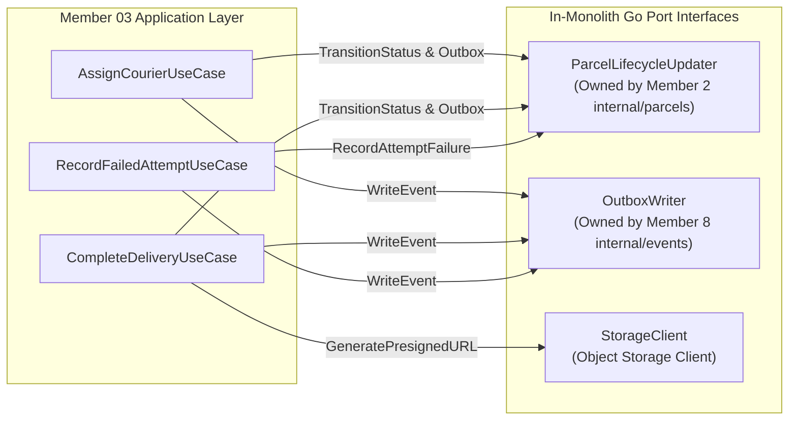
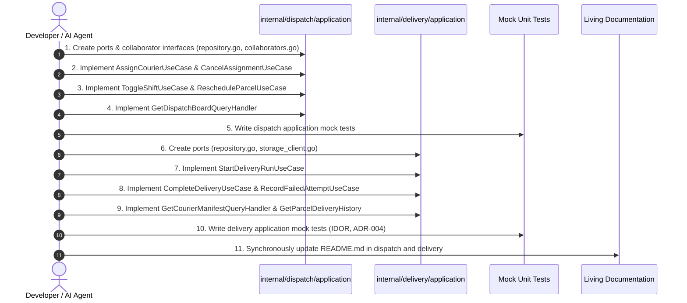

# Member 3 — Phase 3 Detailed Implementation Plan: Application Layer & Port Interfaces

> **Domain:** Dispatch, Couriers & Proof of Delivery  
> **Phase:** Phase 3 of 8 (Use Cases, Transaction Boundaries & Collaborator Ports)  
> **Target Directories:**  
> - `core-api/internal/dispatch/application/`  
> - `core-api/internal/delivery/application/`  
> **Governing Standards:** `AGENTS.md` (§4.2, §4.3 Transactional State Transitions, §8 Security & IDOR Defense), ADR-004, and SRS v1.0 (§4.6, §4.7).  
> **Date:** November 2026 | **Version:** 1.0.0

---

## 1. Executive Summary & Architectural Positioning

The objective of **Phase 3** is to implement the orchestration engine of Member 3: the **Application Layer**.

The Application Layer is the intermediary between inbound transport requests (HTTP) and outbound persistence drivers (PostgreSQL and Object Storage). It coordinates business workflows, enforces database transaction boundaries (`*sql.Tx`), validates user authorizations, prevents courier IDOR attacks, and guarantees atomic outbox event emission.

```
       +-------------------------------------------------------+
       | Transport Layer (HTTP Handlers, Inbound DTOs)         |
       +---------------------------+---------------------------+
                                   |
                                   v
       +-------------------------------------------------------+
       | Application Layer (Phase 3 Use Cases & Query Handlers)|
       |   - Transaction Management (sql.Tx)                   |
       |   - Pessimistic Row Locking (SELECT FOR UPDATE)       |
       |   - Courier IDOR Isolation (auth.UserID Scoping)      |
       |   - Domain Aggregate Invariant Orchestration          |
       |   - Atomic Outbox Event Emission                      |
       +---------------------------+---------------------------+
                 |                             |
                 v                             v
       +--------------------+      +---------------------------+
       | Domain Layer       |      | Collaborator & Repository |
       | (Phase 2 Entities) |      | Port Interfaces (Phase 3) |
       +--------------------+      +---------------------------+
```

---

## 2. Port Interfaces & Collaborator Contracts

The Application Layer defines Go interfaces (ports) implemented by the Infrastructure Layer or other Core API modules.

### 2.1 Cross-Module Collaborator Interfaces



#### 1. `ParcelLifecycleUpdater` (Cross-Module: Member 2 `internal/parcels`)
Enforces the mandatory rule that Member 3 must **never** execute raw SQL updates (`UPDATE parcels SET status = ...`). Status changes and audit logs must route through Member 2's aggregate interface within the caller's transaction:
```go
type ParcelLifecycleUpdater interface {
    // TransitionStatus moves a parcel between legal state machine milestones within the provided transaction.
    TransitionStatus(
        ctx context.Context, 
        tx *sql.Tx, 
        parcelID uuid.UUID, 
        fromStatus, toStatus string, 
        actorID uuid.UUID, 
        actorRole, note string,
    ) error

    // RecordAttemptFailure atomically increments parcel attempt_count and transitions status to ATTEMPT_FAILED or RETURNED.
    RecordAttemptFailure(
        ctx context.Context, 
        tx *sql.Tx, 
        parcelID uuid.UUID, 
        actorID uuid.UUID, 
        actorRole string, 
        reasonCode, note string,
    ) (newStatus string, newAttemptCount int, err error)
}
```

#### 2. `OutboxWriter` (Cross-Module: Member 8 `internal/events`)
Commits versioned domain events to PostgreSQL within the exact same database transaction:
```go
type OutboxWriter interface {
    Write(
        ctx context.Context, 
        tx *sql.Tx, 
        aggregateType string, 
        aggregateID uuid.UUID, 
        aggregateVersion int, 
        eventType string, 
        payload any, 
        correlationID string,
    ) error
}
```

#### 3. `StorageClient` (Infrastructure Port: Cloudflare R2 / S3 / Local)
Manages file uploads and presigned download URLs for proof-of-delivery photos:
```go
type StorageClient interface {
    UploadProofPhoto(ctx context.Context, key string, data io.Reader, contentType string) (string, error)
    GeneratePresignedURL(ctx context.Context, key string, ttl time.Duration) (string, error)
}
```

---

### 2.2 Domain Repository Interfaces

#### 1. Dispatch Repositories (`core-api/internal/dispatch/application/repository.go`)
```go
type CourierRepository interface {
    GetByID(ctx context.Context, userID uuid.UUID) (*domain.Courier, error)
    GetByIDWithLock(ctx context.Context, tx *sql.Tx, userID uuid.UUID) (*domain.Courier, error)
    Save(ctx context.Context, tx *sql.Tx, courier *domain.Courier) error
    List(ctx context.Context, zoneID string, status *domain.ShiftStatus, vehicleType *domain.VehicleType) ([]*domain.Courier, error)
}

type AssignmentRepository interface {
    Create(ctx context.Context, tx *sql.Tx, asgn *domain.CourierAssignment) error
    GetActiveByParcelID(ctx context.Context, tx *sql.Tx, parcelID uuid.UUID) (*domain.CourierAssignment, error)
    GetActiveByParcelIDReadOnly(ctx context.Context, parcelID uuid.UUID) (*domain.CourierAssignment, error)
    CountActiveByCourierID(ctx context.Context, tx *sql.Tx, courierID uuid.UUID) (int, error)
    Update(ctx context.Context, tx *sql.Tx, asgn *domain.CourierAssignment) error
}

type DispatchBoardReader interface {
    GetUnassignedParcels(ctx context.Context, zoneID string) ([]UnassignedParcelDTO, error)
    GetCourierLoads(ctx context.Context, zoneID string) ([]CourierLoadDTO, error)
}
```

#### 2. Delivery Repositories (`core-api/internal/delivery/application/repository.go`)
```go
type DeliveryAttemptRepository interface {
    InsertAttempt(ctx context.Context, tx *sql.Tx, attempt *domain.DeliveryAttempt) error
    ListAttemptsByParcelID(ctx context.Context, parcelID uuid.UUID) ([]*domain.DeliveryAttempt, error)
    GetAttemptCount(ctx context.Context, tx *sql.Tx, parcelID uuid.UUID) (int, error)
}

type CourierManifestReader interface {
    GetActiveManifest(ctx context.Context, courierID uuid.UUID) ([]CourierManifestItemDTO, error)
}
```

---

## 3. Dispatch Use Cases (`core-api/internal/dispatch/application/`)

### 3.1 `AssignCourierUseCase` (Pessimistic Concurrency Safe — **AT-013**)
- **Purpose:** Assigns an unassigned parcel (`CREATED` or `ATTEMPT_FAILED`) to an on-shift courier.
- **Transaction Flow:**
  1. Begin PostgreSQL transaction (`tx, err := db.BeginTx(...)`).
  2. Acquire pessimistic lock on parcel row: `SELECT current_status FROM parcels WHERE id = $1 FOR UPDATE`.
  3. Validate parcel status is `CREATED` or `ATTEMPT_FAILED`, else return `ErrParcelNotEligibleForAssignment`.
  4. Acquire pessimistic lock on courier: `courierRepo.GetByIDWithLock(ctx, tx, courierID)`.
  5. Count active assignments: `assignmentRepo.CountActiveByCourierID(ctx, tx, courierID)`.
  6. Enforce domain invariant: `courier.CanAcceptAssignment(activeCount)`. Returns `ErrCourierOverloaded` (`409 Conflict`) if full.
  7. Create assignment entity: `asgn := domain.NewCourierAssignment(parcelID, courierID, assignedBy, notes)`.
  8. Persist assignment: `assignmentRepo.Create(ctx, tx, asgn)`.
  9. Transition parcel aggregate: `parcelUpdater.TransitionStatus(ctx, tx, parcelID, currentStatus, "ASSIGNED", assignedBy, "DISPATCHER", "Assigned to courier")`.
  10. Emit outbox event: `outboxWriter.Write(..., "parcel.assigned.v1", payload)`.
  11. Commit transaction (`tx.Commit()`).

### 3.2 `CancelAssignmentUseCase`
- **Purpose:** Cancels an active assignment prior to driver departure, immediately restoring driver capacity.
- **Transaction Flow:**
  1. Begin transaction.
  2. Lock and load active assignment by parcel ID: `assignmentRepo.GetActiveByParcelID(ctx, tx, parcelID)`.
  3. Domain aggregate transition: `asgn.Cancel(reason)`.
  4. Persist updated assignment: `assignmentRepo.Update(ctx, tx, asgn)`.
  5. Revert parcel state: `parcelUpdater.TransitionStatus(ctx, tx, parcelID, "ASSIGNED", "CREATED", actorID, actorRole, reason)`.
  6. Emit outbox event: `outboxWriter.Write(..., "courier.unassigned.v1", payload)`.
  7. Commit transaction.

### 3.3 `RescheduleParcelUseCase` (ADR-004 Dispatcher Gate)
- **Purpose:** Allows a dispatcher to review a failed attempt and reschedule the parcel for a new run.
- **Transaction Flow:**
  1. Verify caller has `DISPATCHER` or `ADMIN` role.
  2. Begin transaction.
  3. Verify parcel is currently in `ATTEMPT_FAILED` status.
  4. Load and validate courier capacity.
  5. Create new assignment row with `status = 'ACTIVE'`.
  6. Move parcel from `ATTEMPT_FAILED` $\to$ `ASSIGNED`.
  7. Emit outbox event `parcel.assigned.v1`.
  8. Commit transaction.

### 3.4 `ToggleShiftUseCase`
- **Purpose:** Courier toggles shift state (`OFF_SHIFT`, `ON_SHIFT`, `ON_BREAK`).
- **Flow:**
  1. Load courier profile: `courierRepo.GetByID(ctx, courierID)`.
  2. Call domain method: `courier.ToggleShift(targetStatus, isSelfService)`.
  3. Save courier record: `courierRepo.Save(ctx, nil, courier)`.

### 3.5 `GetDispatchBoardQueryHandler`
- **Purpose:** Aggregates unassigned parcels and active courier capacity loads for a given `zone_id`.
- **Flow:**
  1. Query `dispatchBoardReader.GetUnassignedParcels(ctx, zoneID)`.
  2. Query `dispatchBoardReader.GetCourierLoads(ctx, zoneID)`.
  3. Assemble `DispatchBoardDTO` containing both collections.

---

## 4. Delivery Use Cases (`core-api/internal/delivery/application/`)

### 4.1 `StartDeliveryRunUseCase` (Single & Batch)
- **Purpose:** Courier confirms package collection from depot and starts field run (`OUT_FOR_DELIVERY`).
- **Flow (Per Parcel):**
  1. Begin transaction.
  2. Verify parcel assignment: caller (`auth.UserID`) must match the active assignment's `courier_id`.
  3. Move parcel from `ASSIGNED` $\to$ `OUT_FOR_DELIVERY`.
  4. Emit outbox event: `parcel.out_for_delivery.v1`.
  5. Commit transaction.

### 4.2 `CompleteDeliveryUseCase` (Proof Verification)
- **Purpose:** Records successful delivery with verified proof (photo, signature, or confirmation).
- **Flow:**
  1. Begin transaction.
  2. Check active assignment: `assignmentRepo.GetActiveByParcelID(ctx, tx, parcelID)`.
  3. **IDOR Check:** Enforce `asgn.CourierID == callerUserID`. If not, return `ErrNotAssignedCourier` (`403 Forbidden`).
  4. Build and validate proof VO: `proof.Validate()`.
  5. Create attempt entity: `domain.NewSuccessfulAttempt(parcelID, callerUserID, attemptCount+1, proof, coords, notes)`.
  6. Insert attempt record: `deliveryRepo.InsertAttempt(ctx, tx, attempt)`.
  7. Close assignment: `asgn.Complete()` and `assignmentRepo.Update(ctx, tx, asgn)`.
  8. Transition parcel state: `parcelUpdater.TransitionStatus(ctx, tx, parcelID, "OUT_FOR_DELIVERY", "DELIVERED", callerUserID, "COURIER", "Delivery completed")`.
  9. Emit outbox event: `parcel.delivered.v1` (with `proof_type`, `proof_url`, `received_by_name`).
  10. Commit transaction.

### 4.3 `RecordFailedAttemptUseCase` (ADR-004 Semantics)
- **Purpose:** Logs an unsuccessful delivery attempt and manages the 3-attempt ceiling.
- **Flow:**
  1. Begin transaction.
  2. Check active assignment and enforce IDOR check (`asgn.CourierID == callerUserID`).
  3. Validate failure reason code and notes: `reasonCode.Validate(notes)`.
  4. Query current attempt count on parcel: `currentCount := deliveryRepo.GetAttemptCount(ctx, tx, parcelID)`.
  5. Compute `newAttemptNumber := currentCount + 1`.
  6. Create failed attempt entity: `domain.NewFailedAttempt(parcelID, callerUserID, newAttemptNumber, reasonCode, coords, notes)`.
  7. Insert attempt record: `deliveryRepo.InsertAttempt(ctx, tx, attempt)`.
  8. If `attempt.IsTerminal()` (attempt 3 OR `REFUSED_BY_RECIPIENT`):
     - Complete assignment: `asgn.Complete()` and `assignmentRepo.Update(ctx, tx, asgn)`.
     - Move parcel to terminal `RETURNED`: `parcelUpdater.TransitionStatus(ctx, tx, parcelID, "OUT_FOR_DELIVERY", "RETURNED", callerUserID, "COURIER", "Exceeded max attempts or refused")`.
     - Emit outbox event: `parcel.returned.v1`.
  9. Else (Recoverable failure):
     - Move parcel to transient `ATTEMPT_FAILED`: `parcelUpdater.TransitionStatus(ctx, tx, parcelID, "OUT_FOR_DELIVERY", "ATTEMPT_FAILED", callerUserID, "COURIER", string(reasonCode))`.
     - Emit outbox event: `parcel.delivery_failed.v1`.
  10. Commit transaction.

### 4.4 `GetCourierManifestQueryHandler` (Data Minimization)
- **Purpose:** Retrieves assigned deliveries for `auth.UserID`.
- **Security Invariant:** Exposes only recipient name, address, contact phone, weight, instructions, and attempt count. Redacts merchant billing details and unrelated shipments.

### 4.5 `GetParcelDeliveryHistoryQueryHandler`
- **Purpose:** Retrieves full chronological attempt records and generates 15-minute presigned URLs for proof photos.

---

## 5. Application Data Transfer Objects (DTOs)

```go
package application

import "time"

type AssignCourierCommand struct {
    ParcelID   string `json:"parcel_id"`
    CourierID  string `json:"courier_id"`
    AssignedBy string `json:"assigned_by"`
    Notes      string `json:"notes"`
}

type AssignmentResultDTO struct {
    AssignmentID string    `json:"assignment_id"`
    ParcelID     string    `json:"parcel_id"`
    CourierID    string    `json:"courier_id"`
    AssignedAt   time.Time `json:"assigned_at"`
    AssignedBy   string    `json:"assigned_by"`
}

type CompleteDeliveryCommand struct {
    ParcelID       string   `json:"parcel_id"`
    CourierID      string   `json:"courier_id"`
    ProofType      string   `json:"proof_type"`
    ProofURL       string   `json:"proof_url"`
    SignatureData  string   `json:"signature_data"`
    ReceivedByName string   `json:"received_by_name"`
    Latitude       *float64 `json:"latitude"`
    Longitude      *float64 `json:"longitude"`
    Notes          string   `json:"notes"`
}

type RecordFailedAttemptCommand struct {
    ParcelID   string   `json:"parcel_id"`
    CourierID  string   `json:"courier_id"`
    ReasonCode string   `json:"reason_code"`
    Latitude   *float64 `json:"latitude"`
    Longitude  *float64 `json:"longitude"`
    Notes      string   `json:"notes"`
}

type FailedAttemptResultDTO struct {
    AttemptNumber int       `json:"attempt_number"`
    MaxAttempts   int       `json:"max_attempts"`
    Status        string    `json:"status"`
    NextAction    string    `json:"next_action"`
    RecordedAt    time.Time `json:"recorded_at"`
}
```

---

## 6. Comprehensive Application Unit Test Strategy (Mocks)

All Phase 3 use cases will be verified using pure Go in-memory mock repositories:

| Test File | Target Use Case | Scenarios Verified |
| :--- | :--- | :--- |
| `assign_courier_test.go` | `AssignCourierUseCase` | 1. Success path: Courier active and capacity available.<br>2. Courier capacity exceeded $\to$ Returns `ErrCourierOverloaded`.<br>3. Courier off-shift $\to$ Returns `ErrCourierNotOnShift`.<br>4. Rollback validation on outbox or collaborator failure. |
| `cancel_assignment_test.go` | `CancelAssignmentUseCase` | 1. Success path: Active assignment cancelled, capacity restored.<br>2. Blank reason $\to$ Returns `ErrEmptyReason`.<br>3. Non-existent assignment $\to$ Returns `ErrAssignmentAlreadyClosed`. |
| `complete_delivery_test.go` | `CompleteDeliveryUseCase` | 1. Success path with Photo proof $\to$ Emits `parcel.delivered.v1`.<br>2. Success path with Signature proof $\to$ Emits `parcel.delivered.v1`.<br>3. **IDOR Defense:** Unassigned courier calls complete $\to$ Returns `ErrNotAssignedCourier`.<br>4. Missing proof data $\to$ Returns validation error. |
| `record_failed_attempt_test.go` | `RecordFailedAttemptUseCase` | 1. Attempt 1 failure $\to$ Moves to `ATTEMPT_FAILED`.<br>2. Attempt 3 failure $\to$ Moves to `RETURNED`.<br>3. Attempt 1 failure with `REFUSED_BY_RECIPIENT` $\to$ Moves to `RETURNED`.<br>4. Reason `OTHER` with short note $\to$ Returns `ErrFailureNoteTooShort`. |
| `reschedule_parcel_test.go` | `RescheduleParcelUseCase` | 1. Dispatcher authorizes reattempt $\to$ Moves `ATTEMPT_FAILED` to `ASSIGNED`.<br>2. Parcel in non-failed status $\to$ Returns error. |

---

## 7. Implementation Sequence & Checklist



### Execution Tasks:
- [ ] **Step 1:** Create `core-api/internal/dispatch/application/collaborators.go` & `repository.go`.
- [ ] **Step 2:** Implement `core-api/internal/dispatch/application/commands.go` (DTOs).
- [ ] **Step 3:** Implement `core-api/internal/dispatch/application/assign_courier.go` & `assign_courier_test.go`.
- [ ] **Step 4:** Implement `core-api/internal/dispatch/application/cancel_assignment.go` & `cancel_assignment_test.go`.
- [ ] **Step 5:** Implement `core-api/internal/dispatch/application/reschedule_parcel.go` & `reschedule_parcel_test.go`.
- [ ] **Step 6:** Implement `core-api/internal/dispatch/application/toggle_shift.go` & `get_dispatch_board.go`.
- [ ] **Step 7:** Create `core-api/internal/delivery/application/collaborators.go` & `repository.go`.
- [ ] **Step 8:** Implement `core-api/internal/delivery/application/commands.go` (DTOs).
- [ ] **Step 9:** Implement `core-api/internal/delivery/application/start_delivery_run.go`.
- [ ] **Step 10:** Implement `core-api/internal/delivery/application/complete_delivery.go` & `complete_delivery_test.go`.
- [ ] **Step 11:** Implement `core-api/internal/delivery/application/record_failed_attempt.go` & `record_failed_attempt_test.go`.
- [ ] **Step 12:** Implement `core-api/internal/delivery/application/get_courier_manifest.go` & `get_delivery_history.go`.
- [ ] **Step 13:** Update `core-api/internal/dispatch/README.md` and `core-api/internal/delivery/README.md`.
- [ ] **Step 14:** Deliver Task Completion Report per `AGENTS.md` §12.

---

## 8. Definition of Done (DoD) for Phase 3

Phase 3 is considered complete and approved for advancement to **Phase 4 (Infrastructure Layer & Persistence)** only when:
1. All application command and query handlers are implemented without raw SQL strings or HTTP transport types.
2. Cross-module collaborator interfaces (`ParcelLifecycleUpdater` and `OutboxWriter`) are formally declared as Go interfaces.
3. Every mutating use case manages an explicit database transaction boundary (`*sql.Tx`) committing state changes, audit records, and outbox events atomically.
4. Courier IDOR defense is verified: `CompleteDelivery` and `RecordFailedAttempt` reject calls from couriers not assigned to the parcel with `ErrNotAssignedCourier`.
5. ADR-004 reattempt rules and the 3-attempt ceiling are verified via application tests.
6. Co-located living documentation (`README.md`) reflects all use cases and port interfaces.

