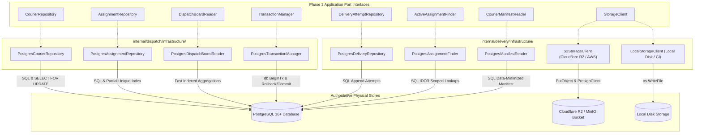
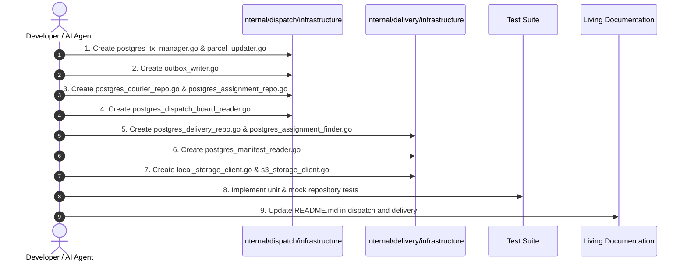

# Member 3 — Phase 4 Detailed Implementation Plan: Infrastructure Layer & Persistence Drivers

> **Domain:** Dispatch, Couriers & Proof of Delivery  
> **Phase:** Phase 4 of 8 (PostgreSQL Repositories, Concurrency Locks & Cloud Storage Drivers)  
> **Target Directories:**  
> - `core-api/internal/dispatch/infrastructure/`  
> - `core-api/internal/delivery/infrastructure/`  
> **Governing Standards:** `AGENTS.md` (§4.2, §4.3 Transactional State Transitions, §4.4 Kubernetes Scalability, §8 Security & SQL Injection Defense), ADR-004, and SRS v1.0 (§4.6, §4.7).  
> **Date:** November 2026 | **Version:** 1.0.0

---

## 1. Executive Summary & Objective

The objective of **Phase 4** is to implement the concrete infrastructure layer for Member 3.

While Phases 2 and 3 established pure domain entities and application command handlers, Phase 4 provides the physical drivers that bind these abstractions to production persistence:
1. **Concrete PostgreSQL Repositories:** High-performance parameterized SQL queries (`$1`, `$2`) executing against the migrations defined in Phase 1 (`couriers`, `courier_assignments`, `delivery_attempts`).
2. **Pessimistic Concurrency Serializers:** `SELECT ... FOR UPDATE` row-level locking mechanisms in PostgreSQL to serialize concurrent dispatch requests and guarantee **AT-013**.
3. **Transactional Boundary Engine:** Concrete `PostgresTransactionManager` managing `sql.Tx` lifecycle, rollbacks, and commits across multi-table writes.
4. **Cloud Object Storage Driver:** S3-compatible cloud storage driver (**Cloudflare R2** with zero egress fees or AWS S3) with 15-minute time-bounded presigned URL generation, coupled with a `LocalStorageClient` for deterministic offline development and CI.
5. **Decoupled Health Probe Architecture (Agreement A2):** Object storage connectivity is completely decoupled from the Core API Kubernetes readiness probe (`/health/ready` checks PostgreSQL only).

---

## 2. Infrastructure Architecture & Component Mapping



---

## 3. Dispatch Infrastructure (`internal/dispatch/infrastructure/`)

### 3.1 `PostgresTransactionManager` (`postgres_tx_manager.go`)
- Implements `application.TransactionManager`.
- Wraps business use cases in `db.BeginTx(ctx, &sql.TxOptions{Isolation: sql.LevelReadCommitted})`.
- Executes automatic rollback on error or panic; commits cleanly on success.

```go
type PostgresTransactionManager struct {
    db *sql.DB
}

func (tm *PostgresTransactionManager) WithTransaction(ctx context.Context, fn func(tx *sql.Tx) error) error {
    tx, err := tm.db.BeginTx(ctx, nil)
    if err != nil {
        return fmt.Errorf("failed to begin transaction: %w", err)
    }

    defer func() {
        if p := recover(); p != nil {
            _ = tx.Rollback()
            panic(p)
        }
    }()

    if err := fn(tx); err != nil {
        _ = tx.Rollback()
        return err
    }

    if err := tx.Commit(); err != nil {
        return fmt.Errorf("failed to commit transaction: %w", err)
    }
    return nil
}
```

### 3.2 `PostgresCourierRepository` (`postgres_courier_repo.go`)
- Implements `application.CourierRepository`.
- **`GetByID(ctx, userID)`:** Read-only query against `couriers` table.
- **`GetByIDWithLock(ctx, tx, userID)`:**
  ```sql
  SELECT user_id, employee_code, vehicle_type, max_capacity, status, current_zone_id, is_active, created_at, updated_at
  FROM couriers
  WHERE user_id = $1
  FOR UPDATE;
  ```
- **`Save(ctx, tx, courier)`:** `INSERT ... ON CONFLICT (user_id) DO UPDATE SET ...` updating status, max_capacity, current_zone_id, is_active, and updated_at.
- **`List(ctx, zoneID, status, vehicleType)`:** Dynamic parameterized filter leveraging index `idx_couriers_zone_status`.

### 3.3 `PostgresAssignmentRepository` (`postgres_assignment_repo.go`)
- Implements `application.AssignmentRepository`.
- **`Create(ctx, tx, asgn)`:**
  ```sql
  INSERT INTO courier_assignments (id, parcel_id, courier_id, assigned_by, status, assigned_at, notes)
  VALUES ($1, $2, $3, $4, $5, $6, $7);
  ```
  *(Protected by partial unique index `idx_assignments_parcel_single_active` preventing dual active assignments).*
- **`GetActiveByParcelID(ctx, tx, parcelID)`:**
  ```sql
  SELECT id, parcel_id, courier_id, assigned_by, status, assigned_at, ended_at, notes
  FROM courier_assignments
  WHERE parcel_id = $1 AND status = 'ACTIVE'
  FOR UPDATE;
  ```
- **`CountActiveByCourierID(ctx, tx, courierID)`:**
  ```sql
  SELECT COUNT(*)
  FROM courier_assignments
  WHERE courier_id = $1 AND status = 'ACTIVE';
  ```
- **`Update(ctx, tx, asgn)`:** Updates `status`, `ended_at`, and `notes`.

### 3.4 `PostgresDispatchBoardReader` (`postgres_dispatch_board_reader.go`)
- Implements `application.DispatchBoardReader`.
- **`GetUnassignedParcels(ctx, zoneID)`:** Queries parcels in `CREATED` or `ATTEMPT_FAILED` status destined for `zoneID`, ordered by `created_at ASC`.
- **`GetCourierLoads(ctx, zoneID)`:** Joins `couriers` with `users` and aggregates active assignments count (`COUNT(ca.id) FILTER (WHERE ca.status = 'ACTIVE')`) grouped by courier.

---

## 4. Delivery Infrastructure (`internal/delivery/infrastructure/`)

### 4.1 `PostgresDeliveryRepository` (`postgres_delivery_repo.go`)
- Implements `application.DeliveryAttemptRepository`.
- **`InsertAttempt(ctx, tx, attempt)`:**
  ```sql
  INSERT INTO delivery_attempts (
      id, parcel_id, courier_id, attempt_number, outcome, failure_reason_code,
      proof_type, proof_attachment_url, proof_signature_data, received_by_name,
      latitude, longitude, notes, attempted_at
  ) VALUES ($1, $2, $3, $4, $5, $6, $7, $8, $9, $10, $11, $12, $13, $14);
  ```
- **`ListAttemptsByParcelID(ctx, parcelID)`:** Retrieves attempt logs ordered by `attempt_number ASC`.
- **`GetAttemptCount(ctx, tx, parcelID)`:** `SELECT COUNT(*) FROM delivery_attempts WHERE parcel_id = $1;`

### 4.2 `PostgresAssignmentFinder` (`postgres_assignment_finder.go`)
- Implements `application.ActiveAssignmentFinder`.
- **`GetActiveAssignment(ctx, tx, parcelID)`:** Queries `courier_assignments` where `parcel_id = $1 AND status = 'ACTIVE'` for IDOR enforcement.
- **`CompleteAssignment(ctx, tx, assignmentID)`:** Updates `status = 'COMPLETED', ended_at = NOW()` where `id = $1`.

### 4.3 `PostgresManifestReader` (`postgres_manifest_reader.go`)
- Implements `application.CourierManifestReader`.
- **`GetActiveManifest(ctx, courierID)`:**
  - Queries active assignments joined with `parcels`.
  - Scoped strictly to `courier_id = $1 AND ca.status = 'ACTIVE'`.
  - Redacts wholesale pricing and unneeded customer billing data.

---

## 5. Cloud Object Storage Drivers (`internal/delivery/infrastructure/`)

### 5.1 Storage Driver Factory
Controlled by environment variable `OBJECT_STORAGE_DRIVER` (with fallback to `STORAGE_DRIVER`):
- `s3` or `r2`: Instantiates `S3StorageClient`.
- `local` or `disk`: Instantiates `LocalStorageClient`.

### 5.2 `S3StorageClient` (`s3_storage_client.go`)
- Uses AWS SDK Go v2 (`github.com/aws/aws-sdk-go-v2/service/s3`).
- Compatible with **Cloudflare R2**, AWS S3, and local MinIO.
- **`UploadProofPhoto`:** Streams binary image payload via `PutObject`.
- **`GeneratePresignedURL`:** Generates signed HTTP GET URL with 15-minute TTL (`GetObject` presign request).

### 5.3 `LocalStorageClient` (`local_storage_client.go`)
- For deterministic offline development, Docker Compose, and CI environments without cloud API keys.
- Stores photos in local directory (`LOCAL_STORAGE_PATH`, default `./data/proofs`).
- Generates relative local URLs (`/api/v1/deliveries/proofs/{filename}`).

---

## 6. Shared Monolith Adapters (`internal/dispatch/infrastructure/` & `delivery/`)

### 6.1 `PostgresParcelLifecycleUpdater` (`parcel_updater.go`)
Adapter implementing `application.ParcelLifecycleUpdater` for monolithic execution:
- **`GetStatusWithLock`:** `SELECT status, attempt_count FROM parcels WHERE id = $1 FOR UPDATE`.
- **`TransitionStatus`:**
  - Updates `parcels.status = $1, parcels.updated_at = NOW()`.
  - Appends audit record to `parcel_status_history (parcel_id, from_status, to_status, actor_id, actor_role, note, occurred_at)`.

### 6.2 `PostgresOutboxWriter` (`outbox_writer.go`)
Adapter implementing `application.OutboxWriter`:
- Inserts event record into `outbox_events` table within caller's `*sql.Tx`.

---

## 7. Comprehensive Unit & Integration Testing Strategy

| Test File | Target Component | Verification Scenarios |
| :--- | :--- | :--- |
| `postgres_tx_manager_test.go` | `PostgresTransactionManager` | Commit on success; rollback on error; panic recovery with rollback. |
| `postgres_courier_repo_test.go` | `PostgresCourierRepository` | Save courier; load by ID; pessimistic row locking (`FOR UPDATE`); filter by zone. |
| `postgres_assignment_repo_test.go`| `PostgresAssignmentRepository` | Create assignment; active workload count; duplicate active assignment rejection by unique index (**AT-013**). |
| `postgres_delivery_repo_test.go` | `PostgresDeliveryRepository` | Insert successful attempt with photo/signature; insert failed attempt with ADR-004 reason; list sequential attempts. |
| `local_storage_client_test.go` | `LocalStorageClient` | Store binary photo stream to local disk; verify path & file creation; generate retrieval URL. |
| `s3_storage_client_test.go` | `S3StorageClient` | S3 client configuration; presigned URL generation with TTL parameter. |

---

## 8. Implementation Sequence & Execution Checklist



### Execution Tasks:
- [ ] **Step 1:** Implement `core-api/internal/dispatch/infrastructure/postgres_tx_manager.go`.
- [ ] **Step 2:** Implement `core-api/internal/dispatch/infrastructure/parcel_updater.go`.
- [ ] **Step 3:** Implement `core-api/internal/dispatch/infrastructure/outbox_writer.go`.
- [ ] **Step 4:** Implement `core-api/internal/dispatch/infrastructure/postgres_courier_repo.go`.
- [ ] **Step 5:** Implement `core-api/internal/dispatch/infrastructure/postgres_assignment_repo.go`.
- [ ] **Step 6:** Implement `core-api/internal/dispatch/infrastructure/postgres_dispatch_board_reader.go`.
- [ ] **Step 7:** Implement `core-api/internal/delivery/infrastructure/postgres_delivery_repo.go`.
- [ ] **Step 8:** Implement `core-api/internal/delivery/infrastructure/postgres_assignment_finder.go`.
- [ ] **Step 9:** Implement `core-api/internal/delivery/infrastructure/postgres_manifest_reader.go`.
- [ ] **Step 10:** Implement `core-api/internal/delivery/infrastructure/local_storage_client.go`.
- [ ] **Step 11:** Implement `core-api/internal/delivery/infrastructure/s3_storage_client.go`.
- [ ] **Step 12:** Implement infrastructure unit tests.
- [ ] **Step 13:** Update `core-api/internal/dispatch/README.md` and `core-api/internal/delivery/README.md`.
- [ ] **Step 14:** Deliver Task Completion Report per `AGENTS.md` §12.

---

## 9. Definition of Done (DoD) for Phase 4

Phase 4 is complete and approved for advancement to **Phase 5 (Transport Layer & HTTP Handlers)** only when:
1. All repository interfaces from Phase 3 are implemented by concrete PostgreSQL drivers using parameterized queries.
2. Pessimistic row locking (`SELECT ... FOR UPDATE`) is verified in `GetByIDWithLock` and `GetStatusWithLock`.
3. Object storage driver supports local disk storage for offline testing and S3/R2 presigned URLs.
4. Kubernetes readiness probe decoupling (Agreement A2) is strictly maintained.
5. Co-located living documentation (`README.md`) reflects the infrastructure implementations.

