# Phase 6 Implementation Plan: System Wiring & Dependency Injection

> **Module:** Core API Entrypoint & DI Container (`cmd/api/wiring_dispatch_delivery.go`)  
> **Author:** Member 3 — Dispatch, Couriers & Proof of Delivery  
> **Governing Standards:** SRS v1.0 (§4.6, §4.7), ADR-004, Agreement A2, `AGENTS.md` (§4.1, §4.4)  
> **Status:** Pending Review & Execution

---

## 1. Executive Summary & Architectural Scope

Phase 6 integrates Member 3's Dispatch and Delivery modules into the central **SwiftDrop Core API Modular Monolith Dependency Injection Container** (`core-api/cmd/api/`).

### Key Objectives:
1. **Modular Monolith Wiring (`cmd/api/wiring_dispatch_delivery.go`):**
   - Wire PostgreSQL persistence drivers (`PostgresCourierRepository`, `PostgresAssignmentRepository`, `PostgresDeliveryRepository`, `PostgresDispatchBoardReader`, `PostgresAssignmentFinder`, `PostgresManifestReader`).
   - Wire monolith adapters (`PostgresParcelLifecycleUpdater`, `PostgresOutboxWriter`, `PostgresTransactionManager`).
   - Wire cloud object storage driver via factory (`NewStorageClientFromEnv()`).
   - Construct all application use cases and query handlers.
   - Wire transport HTTP handlers and register all 14 REST routes onto `http.ServeMux` protected by `SecurityMiddleware`.
2. **Central Container Hook (`cmd/api/wiring.go`):**
   - Call `registerDispatchAndDeliveryModules(mux, dbConn, security)` inside `BuildAppContainer()`.
3. **Graceful Fallback for Local Development & CI:**
   - In environments where PostgreSQL is not yet running (`dbConn == nil`), instantiate pre-seeded in-memory mock repositories so all routes remain registered and testable without hard dependency on a local database.
4. **Preservation of Kubernetes Readiness Probe Decoupling (Agreement A2):**
   - `/health/ready` evaluates PostgreSQL connectivity only; object storage (Cloudflare R2 / AWS S3) is decoupled from the pod readiness gate.

---

## 2. Dependency Injection Graph

```mermaid
flowchart TD
    subgraph Env["Configuration & Technical Drivers"]
        DB["*sql.DB (PostgreSQL Pool)"]
        Sec["*transport.SecurityMiddleware (JWT)"]
        Storage["StorageClient (Local / Cloudflare R2 / S3)"]
    end

    subgraph InfraAdapters["Infrastructure Adapters & Repositories"]
        TxMgr["PostgresTransactionManager"]
        CourierRepo["PostgresCourierRepository"]
        AsgnRepo["PostgresAssignmentRepository"]
        BoardReader["PostgresDispatchBoardReader"]
        ParcelUpd["PostgresParcelLifecycleUpdater"]
        Outbox["PostgresOutboxWriter"]
        DelivRepo["PostgresDeliveryRepository"]
        AsgnFinder["PostgresAssignmentFinder"]
        ManifestReader["PostgresManifestReader"]
    end

    subgraph AppUseCases["Application Layer (Use Cases & Queries)"]
        RegCourier["RegisterCourierUseCase"]
        ListCouriers["ListCouriersQueryHandler"]
        GetBoard["GetDispatchBoardQueryHandler"]
        AssignCourier["AssignCourierUseCase"]
        CancelAsgn["CancelAssignmentUseCase"]
        Resched["RescheduleParcelUseCase"]
        ToggleShift["ToggleShiftUseCase"]
        UploadPhoto["UploadProofPhotoUseCase"]
        CompleteDeliv["CompleteDeliveryUseCase"]
        RecordFailed["RecordFailedAttemptUseCase"]
        GetHistory["GetDeliveryHistoryQueryHandler"]
        GetManifest["GetCourierManifestQueryHandler"]
        StartRun["StartDeliveryRunUseCase"]
    end

    subgraph TransportHandlers["Transport Layer (HTTP Handlers)"]
        DH["DispatchHandler"]
        CSH["CourierShiftHandler"]
        DelivH["DeliveryHandler"]
        MH["ManifestHandler"]
    end

    subgraph RootMux["Root HTTP Router"]
        Mux["http.ServeMux (/api/v1/*)"]
    end

    DB --> TxMgr & CourierRepo & AsgnRepo & BoardReader & ParcelUpd & Outbox & DelivRepo & AsgnFinder & ManifestReader
    Storage --> UploadPhoto & GetHistory

    TxMgr & CourierRepo & AsgnRepo & ParcelUpd & Outbox --> AssignCourier & CancelAsgn & Resched
    CourierRepo --> RegCourier & ToggleShift
    BoardReader --> ListCouriers & GetBoard
    TxMgr & AsgnFinder & DelivRepo & ParcelUpd & Outbox --> CompleteDeliv & RecordFailed & StartRun
    ManifestReader --> GetManifest
    DelivRepo & ParcelUpd --> GetHistory

    RegCourier & ListCouriers & GetBoard & AssignCourier & CancelAsgn & Resched --> DH
    ToggleShift --> CSH
    UploadPhoto & CompleteDeliv & RecordFailed & GetHistory --> DelivH
    GetManifest & StartRun --> MH

    Sec & DH & CSH --> Mux
    Sec & DelivH & MH --> Mux
```



---

## 3. Directory & File Implementation Structure

```
core-api/
├── cmd/api/
│   ├── wiring.go                       # Updated: Invoke registerDispatchAndDeliveryModules()
│   ├── wiring_dispatch_delivery.go      # New: Wires Member 03 Dispatch & Delivery dependencies
│   └── wiring_dispatch_delivery_test.go # New: Unit tests verifying container wiring & routes
├── internal/
│   ├── dispatch/
│   │   └── README.md                   # Updated: Document wiring integration
│   └── delivery/
│       └── README.md                   # Updated: Document wiring integration
└── docs/drafts/member-03-dispatch-delivery/
    └── PHASE_6_IMPLEMENTATION_PLAN.md  # Living plan
```

---

## 4. Implementation Details

### 4.1 `cmd/api/wiring_dispatch_delivery.go`
- Declares `registerDispatchAndDeliveryModules(mux *http.ServeMux, db *sql.DB, sec *identitytransport.SecurityMiddleware)`.
- If `db != nil`:
  - Instantiates `PostgresTransactionManager`, `PostgresCourierRepository`, `PostgresAssignmentRepository`, `PostgresDispatchBoardReader`, `PostgresParcelLifecycleUpdater`, `PostgresOutboxWriter`.
  - Instantiates `PostgresDeliveryRepository`, `PostgresAssignmentFinder`, `PostgresManifestReader`.
  - Instantiates object storage client via `deliveryInfra.NewStorageClientFromEnv()`.
- If `db == nil` (local fallback):
  - Instantiates in-memory mock repositories pre-seeded with mock couriers and assignments so routes do not fail with HTTP 500 or 404 during local disconnected runs.
- Instantiates all application use cases and queries.
- Instantiates `DispatchHandler`, `CourierShiftHandler`, `DeliveryHandler`, and `ManifestHandler`.
- Registers all routes on `mux` via `dispatchTransport.RegisterRoutes` and `deliveryTransport.RegisterRoutes`.

### 4.2 Update `cmd/api/wiring.go`
- In `BuildAppContainer()`:
  - Add invocation of `registerDispatchAndDeliveryModules(mux, dbConn, security)` right after `registerEventsModules`.
  - Ensure `/health/ready` remains untouched (evaluating database ping only, no object storage).

### 4.3 Container Wiring Tests (`cmd/api/wiring_dispatch_delivery_test.go`)
- `TestDispatchAndDeliveryWiring_RoutesRegistered`:
  - Builds `AppContainer`.
  - Verifies HTTP routes are present and respond appropriately (e.g. `GET /api/v1/dispatch/couriers` requires auth -> `401 Unauthorized`; `GET /health/ready` -> `200 OK`).
  - Verifies authenticated calls to `/api/v1/dispatch/board` return valid JSON.

---

## 5. Execution Steps Checklist

- [ ] **Step 1:** Create `core-api/cmd/api/wiring_dispatch_delivery.go` with full production & mock fallback wiring.
- [ ] **Step 2:** Update `core-api/cmd/api/wiring.go` to invoke `registerDispatchAndDeliveryModules(mux, dbConn, security)`.
- [ ] **Step 3:** Implement container wiring tests in `core-api/cmd/api/wiring_dispatch_delivery_test.go`.
- [ ] **Step 4:** Run tests and verify zero regressions on existing health probes (`/health/live`, `/health/ready`).
- [ ] **Step 5:** Update living documentation in `core-api/internal/dispatch/README.md` and `core-api/internal/delivery/README.md`.
- [ ] **Step 6:** Deliver Task Completion Report per `AGENTS.md` §12.

---

## 6. Definition of Done (DoD) for Phase 6

Phase 6 is complete and approved for advancement to **Phase 7 (End-to-End Acceptance Tests & Concurrency Verification)** only when:
1. `BuildAppContainer()` wires all Member 3 dispatch and delivery handlers into `Mux`.
2. All 14 endpoints are accessible through the central HTTP router.
3. Offline fallback operates cleanly when PostgreSQL is offline.
4. Kubernetes readiness probe decoupling (Agreement A2) is strictly maintained.
5. All container wiring tests pass.

