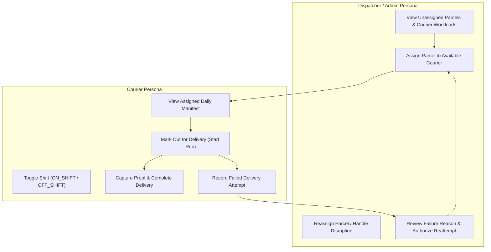
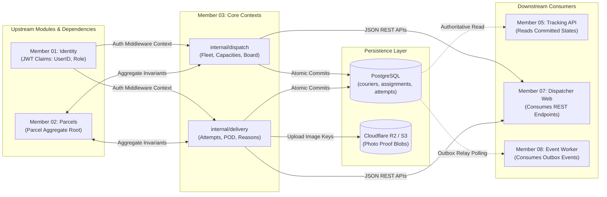

# Document 1 — Module Scope & Responsibility Specification

> **Module:** Dispatch, Couriers & Proof of Delivery  
> **Author / Owner:** Member 03  
> **Status:** Draft / Baseline (For Review in Team Meeting 2)  
> **Target Production Code Paths:** `core-api/internal/dispatch/` and `core-api/internal/delivery/`  
> **Clean Architecture Boundary:** Modular Monolith Internal Contexts  
> **Key Upstream Dependencies:** Member 1 (Auth & RBAC), Member 2 (Parcel Lifecycle & Schema), Member 8 (Transactional Outbox Interface)  
> **Key Downstream Consumers:** Member 5 (Tracking API), Member 7 (Dispatcher & Courier Frontend Web UI), Member 8 (Messaging & Notification Worker)

---

## 1. Executive Summary & Purpose

Member 03 is authoritatively responsible for **operational parcel logistics, courier fleet capacity management, dispatching workflows, and physical delivery execution with verified proof-of-delivery (POD)** within the SwiftDrop Parcel Delivery & Courier Management System.

This mandate spans two closely related, clean-architecture bounded contexts inside the Go Core API modular monolith:
1. **Dispatch & Fleet Management (`core-api/internal/dispatch/`):** Manages courier profiles, vehicle types, active shift availability, courier parcel capacity limits, unassigned parcel queues, workload aggregation, and race-free courier assignments/reassignments.
2. **Delivery Records & Proof of Delivery (`core-api/internal/delivery/`):** Governs physical doorstep interactions by authenticated couriers, capturing tamper-resistant proof of delivery (photo uploads, recipient digital signatures, confirmation details), logging immutable delivery attempts with structured failure codes, enforcing the 3-attempt ceiling, and gating reattempts behind explicit dispatcher approval.

This document formally defines the scope, functional capabilities, explicit exclusions, domain invariants, persona workflows, and architectural boundaries governing Member 03's implementation.

---

## 2. Business Problem & Operational Context

In legacy and spreadsheet-based delivery operations, several chronic operational failures occur:
- **Courier Overload & Inequitable Dispatch:** Parcels are manually distributed without verifying vehicle capacity, leading to overloaded motorbikes, delayed shipments, and driver fatigue.
- **Race Conditions & Dual Assignments:** Multiple dispatchers operating concurrently assign the same package to different drivers, causing confusion and double pickups.
- **Proof-of-Delivery Disputes:** Deliveries marked as completed without verifiable evidence (photo or recipient signature) result in high customer dispute rates and fraudulent claims.
- **Lost Attempt History & Uncontrolled Reattempts:** When a delivery fails (e.g. recipient not home), naive systems either overwrite prior history or let drivers unilaterally reattempt deliveries ad infinitum, driving up fuel costs and destabilizing hub sorting.
- **Privacy Leakage:** Couriers in the field are unnecessarily exposed to merchant billing margins, customer account passwords, or unrelated packages.

SwiftDrop solves these challenges through Member 03's disciplined domain boundaries, transactional state machines, capacity enforcement, and auditable attempt logs.

---

## 3. In-Scope Functional Capabilities

### 3.1 Part A: Fleet Management & Courier Profiles (`internal/dispatch`)
- **Courier Profile Governance:** Maintain operational profiles for couriers linked directly to authenticated accounts (`couriers.user_id` $\rightarrow$ `users.id`).
- **Vehicle Classifications & Capacities:** Classify couriers by motorized vehicle type and enforce hard capacity ceilings:
  - `MOTORCYCLE`: Default max capacity of 25 active parcels (System standard for urban parcel dispatch).
  - `VAN`: Default max capacity of 60 active parcels (Suburban & bulk courier runs).
  - `TRUCK`: Default max capacity of 120 active parcels (Heavy freight & inter-hub bulk deliveries).
- **Shift Lifecycle State Machine:** Maintain courier availability states:
  - `OFF_SHIFT`: Courier is off duty; ineligible for new assignments.
  - `ON_SHIFT`: Courier is active, on duty, and eligible for assignment up to max capacity.
  - `ON_BREAK`: Courier is temporarily paused; existing assignments retained, new assignments blocked.
  - `SUSPENDED`: Administrative operational block due to disciplinary or documentation reasons.
- **Self-Service Shift Management:** Allow authenticated couriers to toggle their own shift state between `ON_SHIFT`, `OFF_SHIFT`, and `ON_BREAK` (`POST /api/v1/courier/shift`).
- **Fleet Parameter Governance:** Permit only `DISPATCHER` or `ADMIN` roles to alter vehicle types, adjust `max_capacity`, or update primary zone assignments.

### 3.2 Part B: Dispatcher Board & Assignment Engine (`internal/dispatch`)
- **Unassigned Parcel Aggregation:** Query and filter parcels eligible for dispatch (parcels in `CREATED` status or approved for reattempt in `ATTEMPT_FAILED` status).
- **Zone-Aware Workload Aggregation:** Aggregate active courier workloads (`active_assignments_count`, `max_capacity`, `shift_status`) for a target delivery zone (`GET /api/v1/dispatch/board`).
- **Concurrency-Safe Parcel Assignment:** Assign eligible parcels to active, on-shift couriers using pessimistic row locking (`SELECT FOR UPDATE`) to eliminate assignment race conditions (`POST /api/v1/dispatch/assignments`).
- **Capacity Overload Guard:** Enforce $\text{active\_assignments} + 1 \le \text{max\_capacity}$, returning `409 Conflict` (`COURIER_CAPACITY_EXCEEDED`) if violated.
- **Reassignment Workflow:** Provide an auditable reassignment path. If a parcel must be reassigned before departure, the prior assignment is marked `CANCELLED` and a new assignment is created for the replacement courier.
- **Automatic Revocation on Sender Cancellation:** If a customer or merchant cancels a booked parcel while it is in `ASSIGNED` status, the active courier assignment is revoked automatically (`CANCELLED`), instantly restoring driver capacity.

### 3.3 Part C: Courier Workload & Field Execution (`internal/delivery`)
- **Personalized Workload Endpoint:** Provide authenticated couriers with their daily active assignment manifest (`GET /api/v1/courier/parcels`), strictly scoped to `auth.UserID`.
- **Operational Data Minimization:** Expose only operational details necessary for physical delivery (recipient name, address, contact phone, parcel weight, handling instructions, and attempt count). Merchant wholesale pricing, merchant API credentials, and unrelated shipments are strictly redacted.
- **Pickup Confirmation & Delivery Run Start:** Allow couriers to confirm physical package collection at the depot and initiate their field delivery run via single (`POST /api/v1/courier/parcels/{id}/start-run`) or batch (`POST /api/v1/courier/runs/start-batch`) actions, transitioning parcel status directly to `OUT_FOR_DELIVERY`.

### 3.4 Part D: Proof of Delivery (POD) & Verification (`internal/delivery`)
- **Mandatory Proof for Completion:** Disallow any parcel from reaching the terminal `DELIVERED` status without verified proof data (`POST /api/v1/deliveries/{id}/complete`).
- **Supported Proof Types (`proof_type`):**
  1. `PHOTO`: High-resolution photo of the parcel placed safely at the doorstep or recipient premises.
  2. `SIGNATURE`: Digitized SVG or Base64 vector signature drawn by the recipient on the courier's screen, accompanied by mandatory `received_by_name`.
  3. `RECIPIENT_CONFIRMATION`: Attended handover capturing recipient full name and relationship.
- **Recipient Verification Invariant:** When `SIGNATURE` is submitted, the API **strictly requires** `received_by_name` (e.g., "Jane Doe - Recipient" or "Mark Perera - Receptionist") alongside the stroke data.
- **Courier Identity Integrity:** The courier's identity (`courier_id`, employee code) is automatically extracted from verified JWT claims (`auth.UserID`) and stamped into the proof audit record. Couriers do not enter their own names.
- **Cloud Object Storage Abstraction:** Upload proof photos to S3-compatible cloud storage (**Cloudflare R2** with zero egress fees, AWS S3, or local MinIO). PostgreSQL stores only the immutable storage key and relative URL; raw binary blobs are never stored in the database.
- **Pre-Signed URL Security:** Access to proof photos is protected by time-bounded pre-signed URLs (15-minute TTL) generated dynamically for authorized actors.

### 3.5 Part E: Failed Delivery Attempts & Reattempt Semantics ([ADR-004](file:///e:/Projects/SwiftDrop/docs/architecture/adr-004-failed-delivery-semantics.md))
- **Attempt vs. Lifecycle Decoupling:** Physical delivery attempts (`delivery_attempts` table) are modeled as immutable historical event logs separate from the mutable parcel lifecycle table (`parcels`).
- **Standardized Failure Classifications:** Require couriers to classify unsuccessful attempts using strict reason codes:
  - `RECIPIENT_UNAVAILABLE`: Recipient not at address; phone unanswered.
  - `CUSTOMER_REQUESTED_RESCHEDULE`: Recipient answered and requested alternative delivery slot.
  - `ACCESS_RESTRICTED`: Gated premises, security denied access, impassable road.
  - `INVALID_ADDRESS`: Incomplete address, incorrect street, building nonexistent.
  - `REFUSED_BY_RECIPIENT`: Recipient actively refused delivery (terminal intent).
  - `DAMAGED_IN_TRANSIT`: Outer package breached or contents compromised.
  - `OTHER`: Unclassified field anomaly.
- **Configurable Failure Note Validation:** When `reason_code == 'OTHER'`, a detailed explanation is mandatory and validated against a configurable minimum character length (`DELIVERY_FAILURE_NOTE_MIN_LENGTH`, default: 15 characters).
- **3-Attempt Ceiling Invariant:** Each recorded attempt increments `parcels.attempt_count`. A package is permitted a maximum of **3 delivery attempts** ($\text{attempt\_count} \le 3$).
- **Dispatcher Gate for Reattempts:** Couriers **cannot** unilaterally reschedule a package. Only a `DISPATCHER` or `ADMIN` can authorize a reattempt (`POST /api/v1/dispatch/parcels/{id}/reschedule`), evaluating failure notes and reassigning the package to an active run.
- **Terminal `RETURNED` Transition:** On the 3rd failed attempt, or immediately upon `REFUSED_BY_RECIPIENT`, the parcel transitions to terminal `RETURNED`, locking out further attempts and triggering reverse logistics to the origin hub or merchant.

---

## 4. Explicit Exclusions (What Member 03 Does NOT Own)

To maintain strict system isolation and adhere to DDD bounded contexts, Member 03 is strictly prohibited from implementing or owning the following capabilities:

| Functional Area | Designated Capability Owner | Architectural Rule for Member 03 |
| :--- | :--- | :--- |
| **Authentication, JWT & Password Storage** | **Member 01** (`internal/identity`) | Member 03 reads JWT claims (`auth.UserID`, `auth.Role`). Member 03 does **not** issue tokens, hash passwords, or manage login sessions. |
| **Parcel Aggregate Root & Fee Pricing** | **Member 02** (`internal/parcels`, `internal/pricing`) | Member 03 does **not** calculate delivery fees, validate parcel dimensions, or create initial parcel records. Status transitions must invoke the aggregate root; raw SQL status updates are strictly prohibited. |
| **Merchant Portals & API Key Management** | **Member 04** (`internal/merchants`) | Member 03 does **not** register merchants, issue API keys, or manage merchant profile data. |
| **Public Tracking Projections & SSE Streaming** | **Member 05** (`services/tracking/`) | Member 03 does **not** maintain public tracking endpoints or SSE fan-out connections. Member 05 reads authoritative data committed by Member 03. |
| **React Frontend Web Portals** | **Member 07** (`web/src/features/dispatcher-admin/`) | Member 03 writes pure Go backend REST APIs. Member 07 builds the Dispatcher dashboard, courier mobile web views, and UI controls. |
| **Asynchronous Message Broker & Outbox Polling** | **Member 08** (`core-api/internal/events/`, `services/messaging/`) | Member 03 commits outbox event records to PostgreSQL. Member 08's Outbox Relay daemon polls and publishes them to RabbitMQ. Member 03 never connects directly to RabbitMQ. |
| **Live GPS Telematics & Route Optimization** | *Explicitly Out-of-Scope (SRS §1.3)* | Turn-by-turn navigation, continuous driver telematics, and automated TSP (Traveling Salesperson) route optimization are excluded from the project baseline. Deliveries record single-point lat/long coordinates upon attempt completion. |

---

## 5. Core Business Invariants & Rules Protected

Member 03's codebase enforces the following mandatory business invariants:

1. **The Capacity Invariant:**  
   $$\sum \text{Active Assignments for Courier } C \le \text{Max Capacity of Courier } C$$  
   Assignments exceeding this ceiling are rejected atomically with `409 Conflict`.
2. **The Active Shift Invariant:**  
   Assignments can only be awarded to couriers whose profile status is explicitly `ON_SHIFT` and `is_active = true`.
3. **The Assigned Courier Exclusivity Invariant:**  
   An operational status update (`OUT_FOR_DELIVERY`, `DELIVERED`, `ATTEMPT_FAILED`) is rejected with `403 Forbidden` if the authenticated user (`auth.UserID`) is not the courier actively assigned to that parcel.
4. **The Mandatory Proof Invariant:**  
   A parcel cannot transition to `DELIVERED` without a valid proof record:
   - `PHOTO`: Valid storage key / URL reference present.
   - `SIGNATURE`: Base64/SVG stroke points ($\text{length} \ge 50$) AND `received_by_name` ($\text{length} \ge 2$).
   - `RECIPIENT_CONFIRMATION`: `received_by_name` present ($\text{length} \ge 2$).
5. **The 3-Attempt Ceiling Invariant:**  
   $$\text{parcels.attempt\_count} \le 3$$  
   When $\text{attempt\_count} = 3$ fails, the parcel is barred from further reattempts and must transition to `RETURNED`.
6. **The Dispatcher Reattempt Authorization Gate:**  
   A parcel in `ATTEMPT_FAILED` status cannot be moved back to `OUT_FOR_DELIVERY` by a courier. Transition requires an authenticated `DISPATCHER` or `ADMIN` action.
7. **The Single Database Transaction Invariant:**  
   Every state transition, assignment change, attempt record, audit history row, and outbox event must execute and commit within a **single PostgreSQL transaction (`sql.Tx`)**. Zero detached asynchronous writes.

---

## 6. Stakeholder & Persona Use Cases

### 6.1 Dispatcher Persona
- **Primary Goal:** Ensure all eligible parcels are assigned to couriers efficiently without exceeding vehicle capacity limits, and review failed attempts for timely redelivery.
- **Key Interventions:**
  - Opens dispatch board, filters by local zone (e.g. `ZONE_COLOMBO_METRO`), views unassigned packages.
  - Inspects driver load bars; clicks "Assign" to link parcel to an on-shift driver.
  - In the event of a driver breakdown, reviews parcels in `ATTEMPT_FAILED` and reassigns them to a relief courier.
  - Reviews attempt failure notes (e.g., recipient requested delivery after 4:00 PM) and schedules a second attempt.

### 6.2 Courier Persona
- **Primary Goal:** View assigned parcels for the shift, navigate to delivery destinations, record delivery status accurately, and collect valid proof.
- **Key Interventions:**
  - Logs into mobile web portal at depot; sets shift to `ON_SHIFT`.
  - Reviews assigned parcel manifest with recipient names, delivery addresses, and phone numbers.
  - Starts delivery run, transitioning parcels to `OUT_FOR_DELIVERY`.
  - Upon arrival, hands parcel to recipient, selects `SIGNATURE`, enters recipient's name, and captures signature on glass.
  - If recipient is absent after calling, selects `RECORD FAILED ATTEMPT`, chooses `RECIPIENT_UNAVAILABLE`, and submits. Package returns to depot.

### 6.3 Administrator Persona (Supervisory Oversight)
- **Primary Goal:** Monitor fleet metrics, provision courier fleet parameters, and execute audited administrative corrections.
- **Key Interventions:**
  - Provisions new courier profiles with approved vehicle classifications.
  - Intervenes on the dispatch board with supervisory override privileges when an emergency arises.
  - Evaluates courier delivery completion rates and failure classifications across the system.

---

## 7. Upstream & Downstream Integration Boundaries

---

## 8. Asset Ownership & Data Persistence Boundaries

Member 03 strictly owns the schema definitions, migrations, and repository implementations for:

| Table Name | Primary Responsibility | Key Fields Owned | Mutability |
| :--- | :--- | :--- | :--- |
| **`couriers`** | Courier operational fleet metadata | `user_id` (PK, FK), `employee_code`, `vehicle_type`, `max_capacity`, `status`, `current_zone_id`, `created_at` | Mutable (via Dispatcher/Admin & Shift toggles) |
| **`courier_assignments`** | Historical parcel assignments | `id` (PK), `parcel_id` (FK), `courier_id` (FK), `assigned_by` (FK), `status`, `assigned_at`, `ended_at`, `notes` | Append-only with status closure (`ACTIVE`, `COMPLETED`, `REASSIGNED`, `CANCELLED`) |
| **`delivery_attempts`** | Doorstep attempt event logs | `id` (PK), `parcel_id` (FK), `courier_id` (FK), `attempt_number`, `outcome`, `failure_reason_code`, `proof_type`, `proof_attachment_url`, `proof_signature_data`, `received_by_name`, `latitude`, `longitude`, `notes`, `attempted_at` | **Strictly Immutable** append-only |

### Outbox Events Emitted:
1. `parcel.assigned.v1`: Published atomically when a courier is assigned to a parcel.
2. `parcel.out_for_delivery.v1`: Published when the final-mile courier begins the delivery run.
3. `parcel.delivered.v1`: Published when a parcel is successfully delivered with verified proof.
4. `parcel.delivery_failed.v1`: Published when an attempt fails, containing attempt number, reason code, and scheduled next action.
5. `parcel.returned.v1`: Published when a parcel exceeds maximum attempts and transitions to terminal return.

---

## 9. Verification & Acceptance Criteria

Document 1 sets the baseline against which Member 03's deliverables are evaluated:
- **AC-M03-001 (Capacity Rejection):** Attempting to assign a 26th parcel to a motorcycle courier capped at 25 returns `409 Conflict` with `COURIER_CAPACITY_EXCEEDED`.
- **AC-M03-002 (Race-Free Assignment):** Under 20 concurrent assignment requests for the same parcel, exactly 1 succeeds with `200 OK`; the remaining 19 fail safely with `409 Conflict`.
- **AC-M03-003 (Courier IDOR Protection):** A courier cannot view or update parcels assigned to another courier (`403 Forbidden`).
- **AC-M03-004 (POD Enforcement):** A request to mark a parcel `DELIVERED` without a valid photo URL, recipient signature data, or recipient name returns `400 Bad Request` (`MISSING_DELIVERY_PROOF`).
- **AC-M03-005 (3-Attempt Ceiling):** A parcel recording its 3rd failed attempt transitions to `RETURNED`. Any subsequent attempt is rejected.
- **AC-M03-006 (Dispatcher Reattempt Gate):** A courier cannot transition a parcel from `ATTEMPT_FAILED` to `OUT_FOR_DELIVERY`. Only a `DISPATCHER` or `ADMIN` token is accepted.
