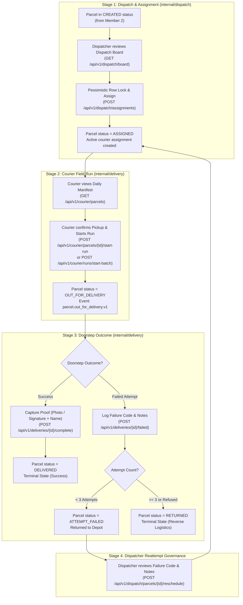
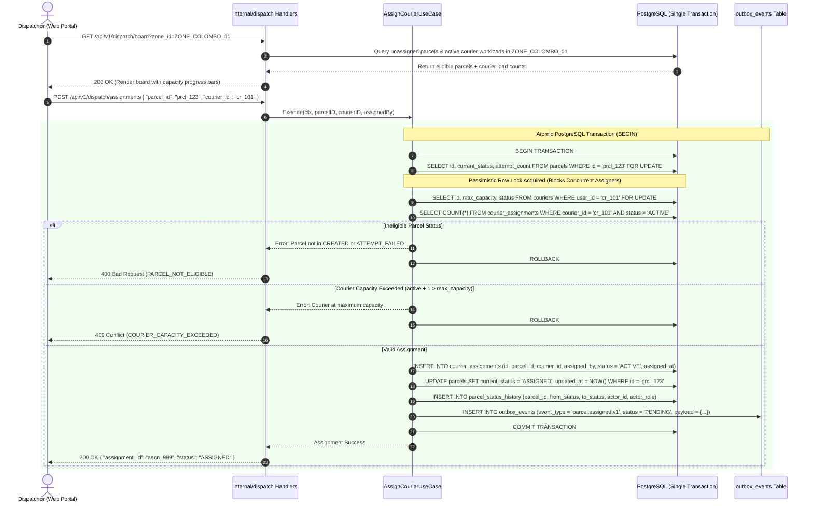
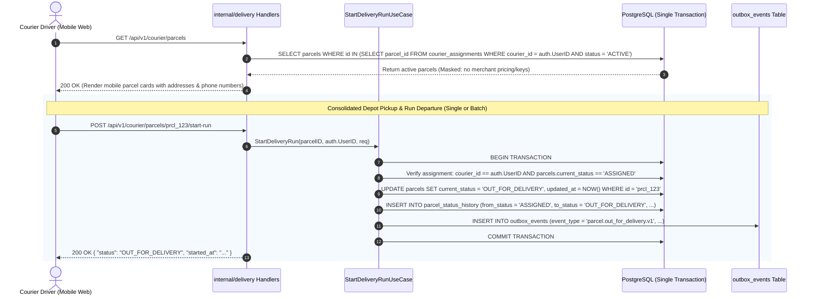
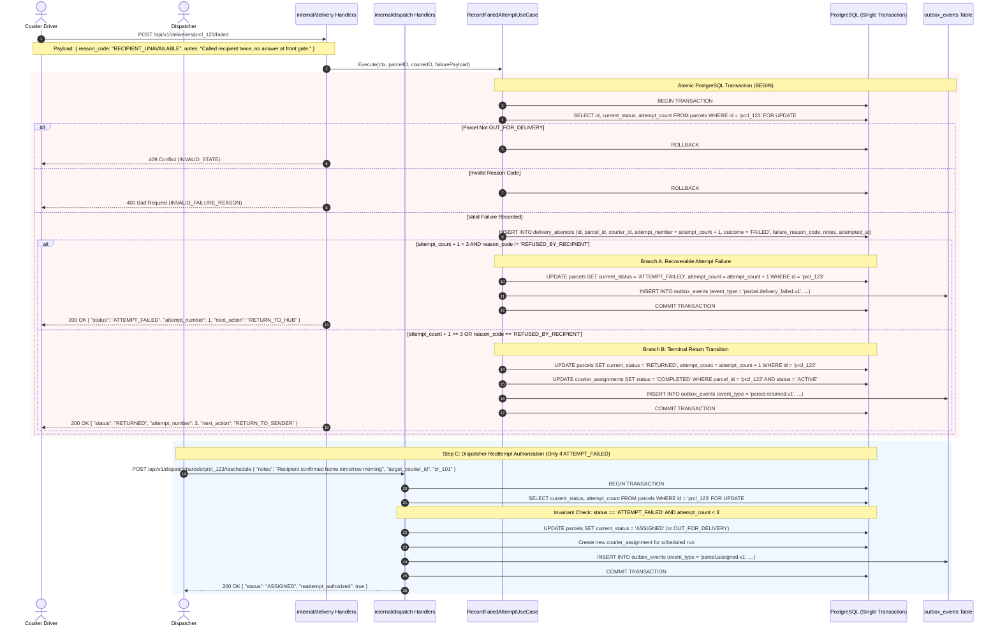

# Document 2 — Functional Flows & Business Rules Specification

> **Module:** Dispatch, Couriers & Proof of Delivery  
> **Author / Owner:** Member 03  
> **Status:** Draft / Baseline (For Review in Team Meeting 2)  
> **Target Production Code Paths:** `core-api/internal/dispatch/` and `core-api/internal/delivery/`  
> **Clean Architecture Boundary:** Modular Monolith Internal Contexts  
> **Key Upstream Dependencies:** Member 1 (Auth & RBAC), Member 2 (Parcel Lifecycle & Schema), Member 8 (Transactional Outbox Interface)  
> **Key Downstream Consumers:** Member 5 (Tracking API), Member 7 (Dispatcher & Courier Frontend Web UI), Member 8 (Messaging & Notification Worker)

---

## 1. Operational Overview & Master Lifecycle Map

The operational lifecycle of a parcel under Member 03 begins the moment a parcel is booked and confirmed (`CREATED` status) and ends when the parcel reaches its terminal destination: either successfully handed over with verified proof (`DELIVERED`) or returned to the origin depot/merchant after failing delivery attempts (`RETURNED`).



---

## 2. Flow 1: Courier Onboarding & Shift Lifecycle (`internal/dispatch`)

### 2.1 Description & Preconditions
- **Actor:** Administrator (profile provisioning), Courier (shift toggle), Dispatcher (suspension/reassignment).
- **Trigger:** A courier starts work, takes a rest break, ends their shift, or is newly added to the fleet.
- **Preconditions:** Courier user account created in `users` table by Member 01 with role `COURIER`.
- **Postconditions:** Operational record in `couriers` table reflects active shift status; assignment eligibility updated immediately.

### 2.2 Sequence Diagram
```mermaid
sequenceDiagram
    autonumber
    actor Courier as Courier Driver
    actor Admin as Admin / Dispatcher
    participant Gateway as Traefik / Auth Middleware
    participant DispatchAPI as internal/dispatch Handlers
    participant DB as PostgreSQL (couriers table)

    rect rgb(240, 248, 255)
    Note over Admin,DB: Step A: Profile Provisioning (One-Time)
    Admin->>Gateway: POST /api/v1/dispatch/couriers (user_id, vehicle_type, max_capacity, current_zone_id)
    Gateway->>DispatchAPI: Authenticated (Role: ADMIN or DISPATCHER)
    DispatchAPI->>DB: INSERT INTO couriers (user_id, vehicle_type, max_capacity, status = 'OFF_SHIFT')
    DB-->>DispatchAPI: 201 Created (Profile linked)
    DispatchAPI-->>Admin: 201 Created
    end

    rect rgb(245, 255, 250)
    Note over Courier,DB: Step B: Daily Shift Management (Self-Service)
    Courier->>Gateway: POST /api/v1/courier/shift { "status": "ON_SHIFT" }
    Gateway->>DispatchAPI: Authenticated JWT (Role: COURIER, UserID: cr_101)
    DispatchAPI->>DB: UPDATE couriers SET status = 'ON_SHIFT', updated_at = NOW() WHERE user_id = 'cr_101'
    DB-->>DispatchAPI: Row updated
    DispatchAPI-->>Courier: 200 OK { "status": "ON_SHIFT", "active_assignments": 0, "max_capacity": 25 }
    end

    rect rgb(255, 245, 245)
    Note over Courier,DB: Step C: Off-Duty / Break Toggle
    Courier->>Gateway: POST /api/v1/courier/shift { "status": "ON_BREAK" }
    Gateway->>DispatchAPI: Authenticated JWT
    DispatchAPI->>DB: UPDATE couriers SET status = 'ON_BREAK' WHERE user_id = 'cr_101'
    DispatchAPI-->>Courier: 200 OK (New assignments blocked; active kept)
    end
```

### 2.3 Business Rules for Flow 1
| Rule ID | Rule Statement | Validation Check | Error Response |
| :--- | :--- | :--- | :--- |
| **BR-FLT-001** | **Unique Operational Profile:** Each courier user may have exactly one profile in `couriers`. | `user_id` is PK and unique FK to `users.id`. | `409 Conflict` (`COURIER_PROFILE_EXISTS`) |
| **BR-FLT-002** | **Motorized Vehicle Whitelist:** Vehicle type must be one of: `MOTORCYCLE`, `VAN`, `TRUCK`. | Enum validation on `vehicle_type`. | `400 Bad Request` (`INVALID_VEHICLE_TYPE`) |
| **BR-FLT-003** | **Default Capacity Ceilings:** Max capacity defaults to 25 (`MOTORCYCLE`), 60 (`VAN`), or 120 (`TRUCK`) unless explicitly overridden by Admin. | `max_capacity BETWEEN 1 AND 200`. | `400 Bad Request` (`CAPACITY_OUT_OF_BOUNDS`) |
| **BR-FLT-004** | **Restricted Capacity Modification:** Couriers cannot modify their own vehicle type or capacity limits. | Role must be `ADMIN` or `DISPATCHER`. | `403 Forbidden` (`INSUFFICIENT_PERMISSIONS`) |
| **BR-FLT-005** | **Shift Transitions:** Couriers may only self-transition between `OFF_SHIFT`, `ON_SHIFT`, and `ON_BREAK`. | `status IN ('OFF_SHIFT', 'ON_SHIFT', 'ON_BREAK')`. | `400 Bad Request` (`INVALID_SHIFT_STATE`) |
| **BR-FLT-006** | **Administrative Suspension:** The `SUSPENDED` status can only be applied by `ADMIN` or `DISPATCHER`. | Requires role `ADMIN` or `DISPATCHER`. | `403 Forbidden` (`ADMIN_ACTION_REQUIRED`) |

---

## 3. Flow 2: Dispatcher Board & Concurrency-Safe Parcel Assignment (`internal/dispatch`)

### 3.1 Description & Preconditions
- **Actor:** Dispatcher or Administrator.
- **Trigger:** Dispatcher loads dispatch board, reviews eligible unassigned parcels, and assigns packages to active couriers.
- **Preconditions:** Parcel is in `CREATED` or approved `ATTEMPT_FAILED` status; courier is `ON_SHIFT` and within capacity.
- **Postconditions:** Single atomic transaction locks parcel, creates active `courier_assignments` record, updates parcel status to `ASSIGNED`, appends to `parcel_status_history`, and writes `parcel.assigned.v1` to `outbox_events`.

### 3.2 Sequence Diagram


### 3.3 Business Rules for Flow 2
| Rule ID | Rule Statement | Validation Check | Error Response |
| :--- | :--- | :--- | :--- |
| **BR-DSP-001** | **Assignment Eligibility:** Only parcels in `CREATED` or `ATTEMPT_FAILED` status may be assigned. | `parcels.current_status IN ('CREATED', 'ATTEMPT_FAILED')`. | `400 Bad Request` (`PARCEL_NOT_ELIGIBLE_FOR_ASSIGNMENT`) |
| **BR-DSP-002** | **Active Shift Requirement:** Parcels can only be assigned to couriers currently `ON_SHIFT` and `is_active = true`. | `couriers.status == 'ON_SHIFT' AND is_active == true`. | `400 Bad Request` (`COURIER_NOT_ON_SHIFT`) |
| **BR-DSP-003** | **Hard Capacity Limit:** Assignment is rejected if active assignments equal or exceed courier max capacity. | $\text{active\_count} + 1 \le \text{max\_capacity}$. | `409 Conflict` (`COURIER_CAPACITY_EXCEEDED`) |
| **BR-DSP-004** | **Pessimistic Concurrency Guard:** Parcel row must be locked with `FOR UPDATE` before assignment checks. | SQL row lock acquired. Under concurrent requests, only 1 proceeds; second receives locked row already marked `ASSIGNED`. | `409 Conflict` (`PARCEL_ALREADY_ASSIGNED`) |
| **BR-DSP-005** | **Reassignment at Depot:** Reassigning an `ASSIGNED` parcel closes the old assignment as `CANCELLED` and creates a new `ASSIGNED` record. | Authenticated caller role is `DISPATCHER` or `ADMIN`. | `403 Forbidden` (`UNAUTHORIZED_REASSIGNMENT`) |
| **BR-DSP-006** | **In-Flight Sender Cancellation:** If sender cancels a parcel while `ASSIGNED`, active assignment row is automatically marked `CANCELLED`, freeing capacity. | Application hook in `internal/parcels` calls `RevokeActiveAssignment(parcelID)`. | Handled atomically |

---

## 4. Flow 3: Courier Daily Manifest & Delivery Run Initiation (`internal/delivery`)

### 4.1 Description & Preconditions
- **Actor:** Authenticated Courier.
- **Trigger:** Courier arrives at depot, inspects mobile manifest, confirms parcel pickup, and initiates field delivery run.
- **Preconditions:** Courier is authenticated via Bearer JWT (`COURIER`); parcels are in `ASSIGNED` status linked to `auth.UserID`.
- **Postconditions:** Parcel status transitions atomically from `ASSIGNED` to `OUT_FOR_DELIVERY`. Corresponding outbox event `parcel.out_for_delivery.v1` is committed. Supports single parcel start or bulk batch start for morning departure.

### 4.2 Sequence Diagram


### 4.3 Business Rules for Flow 3
| Rule ID | Rule Statement | Validation Check | Error Response |
| :--- | :--- | :--- | :--- |
| **BR-RUN-001** | **Ownership Exclusivity:** Couriers may only view and mutate parcels actively assigned to them. | `assignment.courier_id == auth.UserID`. | `403 Forbidden` (`NOT_ASSIGNED_COURIER`) |
| **BR-RUN-002** | **Data Masking in Field:** Manifest API must omit merchant billing tariffs, customer passwords, and merchant API keys. | Transport DTO projection scrubs financial data. | Enforced by Go DTO mapping |
| **BR-RUN-003** | **Direct Run Departure:** A parcel must be in `ASSIGNED` status to initiate run, transitioning directly to `OUT_FOR_DELIVERY`. | State machine verification in Domain Aggregate. | `409 Conflict` (`INVALID_STATE_TRANSITION`) |
| **BR-RUN-004** | **Batch Run Start Support:** A courier may start their run for multiple assigned packages with a single action (`POST /api/v1/courier/runs/start-batch`). | Validates all parcels belong to courier and are in `ASSIGNED`. | Atomically transitions eligible set |

---

## 5. Flow 4: Successful Delivery Completion with Proof of Delivery (POD)

### 5.1 Description & Preconditions
- **Actor:** Authenticated Courier at recipient doorstep.
- **Trigger:** Courier successfully hands over package and captures proof (Photo, Digital Signature, or Recipient Name).
- **Preconditions:** Parcel is in `OUT_FOR_DELIVERY` status; caller is the assigned courier; proof payload is valid.
- **Postconditions:** Delivery attempt logged (`outcome = 'SUCCESS'`), parcel status set to `DELIVERED`, courier assignment marked `COMPLETED`, outbox event `parcel.delivered.v1` committed.

### 5.2 Sequence Diagram
```mermaid
sequenceDiagram
    autonumber
    actor Courier as Courier Driver
    participant DeliveryAPI as internal/delivery Handlers
    participant Storage as Cloudflare R2 / S3 Storage
    participant UseCase as CompleteDeliveryUseCase
    participant DB as PostgreSQL (Single Transaction)
    participant Outbox as outbox_events Table
    participant OBR as Outbox Relay (Async Poller)
    participant RMQ as RabbitMQ (Message Bus)
    participant Worker as Event Worker (Member 8)

    alt Proof Type: PHOTO (Contactless / Doorstep)
        Courier->>DeliveryAPI: POST /api/v1/deliveries/prcl_123/proof-photo (multipart image)
        DeliveryAPI->>Storage: Upload to R2: proofs/2026/10/prcl_123_pod.jpg
        Storage-->>DeliveryAPI: Return storage key / path
        DeliveryAPI-->>Courier: 200 OK { "proof_url": "proofs/2026/10/prcl_123_pod.jpg" }
    end

    Courier->>DeliveryAPI: POST /api/v1/deliveries/prcl_123/complete
    Note over Courier,DeliveryAPI: Payload: { proof_type: "SIGNATURE", signature_data: "data:image/svg+xml;...", received_by_name: "Jane Smith", notes: "Handed to recipient" }

    DeliveryAPI->>UseCase: Execute(ctx, parcelID, courierID, proofPayload)

    rect rgb(240, 255, 240)
    Note over UseCase,Outbox: Single Atomic PostgreSQL Transaction
    UseCase->>DB: BEGIN TRANSACTION
    UseCase->>DB: SELECT id, current_status FROM parcels WHERE id = 'prcl_123' FOR UPDATE
    UseCase->>DB: Verify assignment: courier_id == auth.UserID AND status == 'ACTIVE'
    
    UseCase->>DB: INSERT INTO delivery_attempts (id, parcel_id, courier_id, attempt_number, outcome = 'SUCCESS', proof_type, proof_attachment_url, proof_signature_data, received_by_name, notes, attempted_at)
    UseCase->>DB: UPDATE parcels SET current_status = 'DELIVERED', updated_at = NOW() WHERE id = 'prcl_123'
    UseCase->>DB: UPDATE courier_assignments SET status = 'COMPLETED', ended_at = NOW() WHERE parcel_id = 'prcl_123' AND status = 'ACTIVE'
    UseCase->>DB: INSERT INTO parcel_status_history (from_status = 'OUT_FOR_DELIVERY', to_status = 'DELIVERED', ...)
    UseCase->>Outbox: INSERT INTO outbox_events (event_type = 'parcel.delivered.v1', status = 'PENDING', payload = {...})
    UseCase->>DB: COMMIT TRANSACTION
    end

    DeliveryAPI-->>Courier: 200 OK { "status": "DELIVERED", "delivered_at": "2026-10-24T14:30:00Z" }

    rect rgb(250, 250, 250)
    Note over Outbox,Worker: Asynchronous Downstream Propagation
    OBR->>Outbox: Poll pending rows (FOR UPDATE SKIP LOCKED)
    OBR->>RMQ: Publish parcel.delivered.v1
    RMQ-->>OBR: Broker Confirmation (ACK)
    OBR->>Outbox: UPDATE outbox_events SET status = 'PUBLISHED'
    RMQ->>Worker: Consume parcel.delivered.v1
    Worker->>DB: Read customer phone/email & merchant webhook endpoint
    Worker-->>Courier: Dispatch SMS to customer & Signed Webhook to Merchant
    end
```

### 5.3 Business Rules for Flow 4
| Rule ID | Rule Statement | Validation Check | Error Response |
| :--- | :--- | :--- | :--- |
| **BR-POD-001** | **Mandatory Proof for Completion:** A parcel cannot transition to `DELIVERED` without a valid proof record. | `proof_type IN ('PHOTO', 'SIGNATURE', 'RECIPIENT_CONFIRMATION')`. | `400 Bad Request` (`MISSING_DELIVERY_PROOF`) |
| **BR-POD-002** | **Recipient Name Mandate for Signatures:** When `SIGNATURE` is submitted, recipient name is strictly required. | `proof_type == 'SIGNATURE'` requires `received_by_name != ""` ($\text{length} \ge 2$). | `422 Unprocessable Entity` (`RECIPIENT_NAME_REQUIRED`) |
| **BR-POD-003** | **Signature Data Integrity:** Vector signature strings must meet minimum entropy criteria. | `length(signature_data) >= 50`. | `422 Unprocessable Entity` (`INVALID_SIGNATURE_DATA`) |
| **BR-POD-004** | **Delivery State Prerequisite:** Delivery completion can only be recorded when current status is `OUT_FOR_DELIVERY`. | `parcels.current_status == 'OUT_FOR_DELIVERY'`. | `409 Conflict` (`INVALID_STATE_FOR_DELIVERY`) |
| **BR-POD-005** | **Automatic Assignment Closure:** Marking a parcel `DELIVERED` automatically updates the active `courier_assignments` row to `COMPLETED`, freeing courier capacity. | Updated in same `sql.Tx`. | Enforced atomically |
| **BR-POD-006** | **Cloudflare R2 Storage Security:** Images uploaded to R2 bucket must be validated for MIME type (`image/jpeg`, `image/png`, `image/webp`) and size ($\le 10\text{ MB}$). | Header sniffing & size validation in HTTP handler. | `400 Bad Request` (`INVALID_FILE_TYPE_OR_SIZE`) |

---

## 6. Flow 5: Failed Delivery Attempt, 3-Attempt State Machine & Reattempt Governance ([ADR-004](file:///e:/Projects/SwiftDrop/docs/architecture/adr-004-failed-delivery-semantics.md))

### 6.1 Description & Preconditions
- **Actor:** Authenticated Courier (reporting failure), Dispatcher / Administrator (authorizing reattempt).
- **Trigger:** Courier arrives at destination but cannot complete delivery (e.g., recipient absent, gate locked, address nonexistent).
- **Preconditions:** Parcel is currently `OUT_FOR_DELIVERY`.
- **Postconditions:** Immutable attempt row created in `delivery_attempts` with `outcome = 'FAILED'`, `attempt_count` incremented.
  - If $\text{attempt\_count} < 3$: Status becomes `ATTEMPT_FAILED`. Awaiting dispatcher review.
  - If $\text{attempt\_count} \ge 3$ or reason is `REFUSED_BY_RECIPIENT`: Status becomes terminal `RETURNED`.

### 6.2 Sequence Diagram


### 6.3 Business Rules for Flow 5
| Rule ID | Rule Statement | Validation Check | Error Response |
| :--- | :--- | :--- | :--- |
| **BR-ATM-001** | **Standardized Reason Whitelist:** Failure reason code must strictly be one of: `RECIPIENT_UNAVAILABLE`, `CUSTOMER_REQUESTED_RESCHEDULE`, `ACCESS_RESTRICTED`, `INVALID_ADDRESS`, `REFUSED_BY_RECIPIENT`, `DAMAGED_IN_TRANSIT`, `OTHER`. | Whitelist check against domain enum. | `400 Bad Request` (`INVALID_FAILURE_REASON_CODE`) |
| **BR-ATM-002** | **Configurable Note Length for OTHER:** When `reason_code == 'OTHER'`, notes is mandatory and must meet minimum configured length (`DELIVERY_FAILURE_NOTE_MIN_LENGTH`, default 15). | `length(notes) >= config.MinNoteLength`. | `422 Unprocessable Entity` (`FAILURE_NOTE_TOO_SHORT`) |
| **BR-ATM-003** | **3-Attempt Ceiling:** No parcel may receive more than 3 delivery attempts. Attempt 3 failure immediately triggers terminal `RETURNED`. | If $\text{attempt\_count} + 1 \ge 3$, set `RETURNED`. | Terminal state enforced |
| **BR-ATM-004** | **Immediate Return on Refusal:** If recipient explicitly refuses acceptance (`REFUSED_BY_RECIPIENT`), parcel transitions immediately to `RETURNED` regardless of attempt count. | Bypasses remaining attempts. | Terminal state enforced |
| **BR-ATM-005** | **Dispatcher Reattempt Gate:** Couriers cannot self-reschedule a failed parcel. Rescheduling requires authenticated `DISPATCHER` or `ADMIN` role. | Caller role must be in `['DISPATCHER', 'ADMIN']`. | `403 Forbidden` (`DISPATCHER_APPROVAL_REQUIRED`) |
| **BR-ATM-006** | **Attempt Immutability:** Attempt records in `delivery_attempts` are append-only historical records; updates and deletions are strictly barred at the database engine level. | SQL `UPDATE` / `DELETE` barred. | Immutable audit log |

---

## 7. Master Business Rules Matrix

| Code | Name | Enforcing Layer | Validation / Invariant | Error Code |
| :--- | :--- | :--- | :--- | :--- |
| **BR-FLT-001** | Unique Courier Profile | DB / Application | `user_id` is PK and unique in `couriers`. | `COURIER_PROFILE_EXISTS` |
| **BR-FLT-002** | Motorized Vehicles Only | Domain | Whitelist: `MOTORCYCLE`, `VAN`, `TRUCK`. | `INVALID_VEHICLE_TYPE` |
| **BR-FLT-003** | Default Capacity Bounds | Domain | Capacity between 1 and 200. | `CAPACITY_OUT_OF_BOUNDS` |
| **BR-DSP-001** | Assignment Eligibility | Domain / Agg | Status in `('CREATED', 'ATTEMPT_FAILED')`. | `PARCEL_NOT_ELIGIBLE` |
| **BR-DSP-002** | Active Shift Invariant | Application | Courier status must be `ON_SHIFT`. | `COURIER_NOT_ON_SHIFT` |
| **BR-DSP-003** | Courier Capacity Limit | Domain / DB | $\text{active} + 1 \le \text{max\_capacity}$. | `COURIER_CAPACITY_EXCEEDED` |
| **BR-DSP-004** | Race Condition Guard | Database | Row locked via `FOR UPDATE` in `sql.Tx`. | `PARCEL_ALREADY_ASSIGNED` |
| **BR-RUN-001** | Assigned Driver Check | Application | `courier_id == auth.UserID`. | `NOT_ASSIGNED_COURIER` |
| **BR-RUN-002** | Sensitive Data Scrub | Transport | DTO strips merchant tariffs/secrets. | *N/A (Masked DTO)* |
| **BR-RUN-003** | Run Start Transition | Domain / Agg | `ASSIGNED` $\rightarrow$ `OUT_FOR_DELIVERY`. | `INVALID_STATE_TRANSITION` |
| **BR-POD-001** | Proof Required for Delivery | Domain | Mandatory `PHOTO`, `SIGNATURE`, or `NAME`. | `MISSING_DELIVERY_PROOF` |
| **BR-POD-002** | Recipient Name for Signatures | Domain | `received_by_name` required if `SIGNATURE`. | `RECIPIENT_NAME_REQUIRED` |
| **BR-POD-003** | Signature Entropy Check | Domain | Vector stroke length $\ge 50$ chars. | `INVALID_SIGNATURE_DATA` |
| **BR-ATM-001** | Standard Reason Code | Domain | 7 approved standard codes. | `INVALID_FAILURE_REASON` |
| **BR-ATM-002** | Configurable Note Length | Domain / Config | Note length $\ge$ `config.MinNoteLength`. | `FAILURE_NOTE_TOO_SHORT` |
| **BR-ATM-003** | 3-Attempt Hard Ceiling | Domain / Agg | Max 3 attempts before terminal `RETURNED`. | *Enforced State Machine* |
| **BR-ATM-005** | Dispatcher Reattempt Gate | Application | Only `DISPATCHER` or `ADMIN` can reschedule. | `DISPATCHER_APPROVAL_REQUIRED` |
