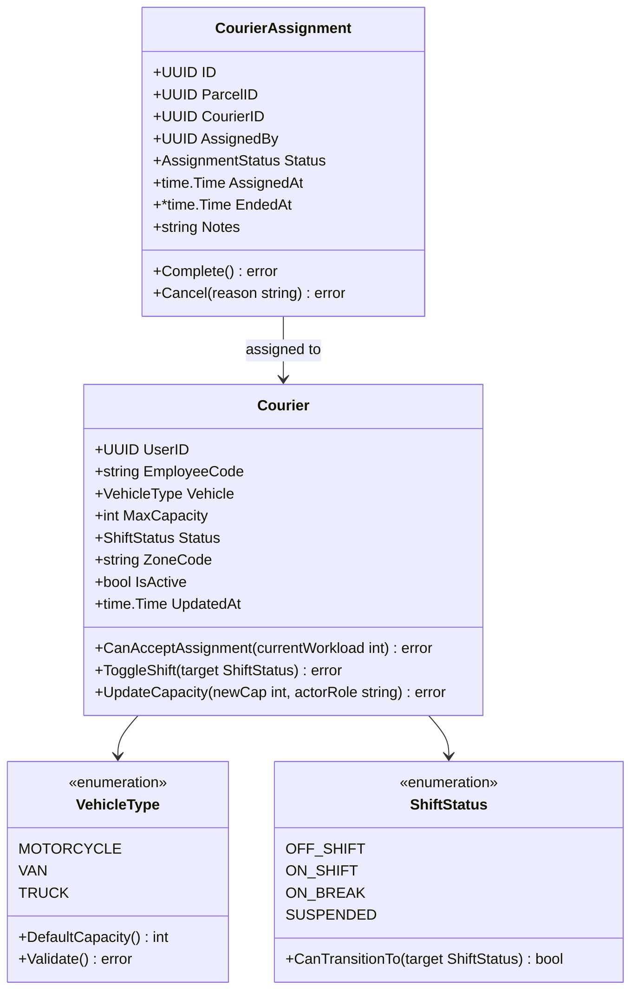
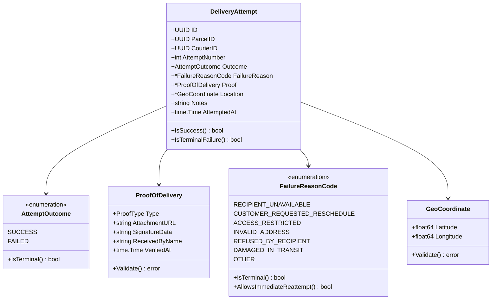
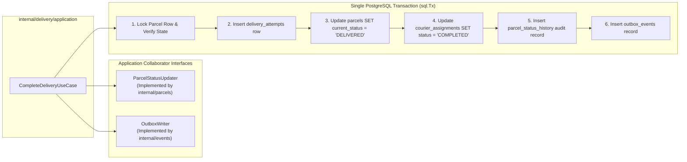

# Document 3 — Internal Architecture & Design Specification

> **Module:** Dispatch, Couriers & Proof of Delivery  
> **Author / Owner:** Member 03  
> **Status:** Draft / Baseline (For Review in Team Meeting 2)  
> **Target Production Code Paths:** `core-api/internal/dispatch/` and `core-api/internal/delivery/`  
> **Clean Architecture Boundary:** Modular Monolith Internal Contexts  
> **Key Upstream Dependencies:** Member 1 (Auth & RBAC), Member 2 (Parcel Lifecycle & Schema), Member 8 (Transactional Outbox Interface)  
> **Key Downstream Consumers:** Member 5 (Tracking API), Member 7 (Dispatcher & Courier Frontend Web UI), Member 8 (Messaging & Notification Worker)

---

## 1. Architectural Principles & Clean Monolith Boundaries

Member 03's capabilities are implemented within the **Go Core API Modular Monolith**, divided into two distinct, highly cohesive bounded contexts:
1. **`core-api/internal/dispatch/`**: Owns fleet operational capacity, courier shift availability, dispatch board query models, and assignment lifecycle.
2. **`core-api/internal/delivery/`**: Owns field delivery execution, proof-of-delivery (POD) capture, doorstep attempt logs, standardized failure classifications, and reattempt policies.

### 1.1 Strict Dependency Inversion & Layer Isolation
Both contexts strictly adhere to **Clean Architecture** as mandated by `AGENTS.md` (§4.2):

```
       +-------------------------------------------------------+
       | Transport Layer (HTTP Handlers, DTOs, Routing)        |
       +---------------------------+---------------------------+
                                   |
                                   v
       +-------------------------------------------------------+
       | Application Layer (Use Cases, Transaction Boundaries)  |
       +---------------------------+---------------------------+
                                   |
                                   v
       +-------------------------------------------------------+
       | Domain Layer (Entities, Value Objects, Domain Errors) |  <-- ZERO external imports
       +-------------------------------------------------------+
                                   ^
                                   | (implements interfaces)
       +---------------------------+---------------------------+
       | Infrastructure Layer (PostgreSQL Repos, R2/S3 Client) |
       +-------------------------------------------------------+
```

- **Domain (`domain/`):** Pure Go structs, business invariants, value objects, and domain errors. **Strictly prohibited** from importing `net/http`, `database/sql`, external cloud SDKs, or transport packages. Zero external dependencies.
- **Application (`application/`):** Command and query handlers, transaction boundaries (`sql.Tx`), and repository interface definitions. Depends only on `domain/`.
- **Infrastructure (`infrastructure/`):** Concrete implementations of repository interfaces using `pgx`/`database/sql` queries, S3/Cloudflare R2 object storage drivers, and transactional outbox writers.
- **Transport (`transport/`):** HTTP handlers, routing, JSON parsing, schema validation, and transport DTO $\leftrightarrow$ domain entity mappers.

---

## 2. Directory Layout & Go Package Structure

```text
core-api/internal/
├── dispatch/                                 # Bounded Context 1: Fleet & Dispatch
│   ├── domain/                               # Pure Domain Logic
│   │   ├── courier.go                        # Courier entity & shift rules
│   │   ├── assignment.go                     # CourierAssignment aggregate
│   │   ├── vehicle_type.go                   # Motorized vehicle enum & capacity VO
│   │   ├── shift_status.go                   # Shift lifecycle value object
│   │   └── errors.go                         # Domain errors (ErrCourierOverloaded, etc.)
│   ├── application/                          # Use Cases & Interfaces
│   │   ├── assign_courier.go                 # AssignCourierUseCase (Pessimistic lock)
│   │   ├── reassign_courier.go               # ReassignCourierUseCase
│   │   ├── toggle_shift.go                   # ToggleShiftUseCase
│   │   ├── get_dispatch_board.go             # GetDispatchBoardQueryHandler
│   │   ├── repository.go                     # CourierRepository & AssignmentRepository
│   │   └── collaborators.go                  # OutboxWriter & ParcelUpdater interfaces
│   ├── infrastructure/                       # External Drivers & Persistence
│   │   ├── postgres_courier_repo.go          # Courier SQL queries & row scans
│   │   └── postgres_assignment_repo.go       # Assignment SQL queries & locks
│   └── transport/                            # HTTP / REST Controllers
│       ├── http_handler.go                   # Route registration & middleware bindings
│       ├── requests.go                       # Inbound JSON DTOs & validation
│       └── responses.go                      # Outbound JSON envelopes
│
└── delivery/                                 # Bounded Context 2: Delivery & Proof
    ├── domain/                               # Pure Domain Logic
    │   ├── delivery_attempt.go               # DeliveryAttempt entity (Immutable log)
    │   ├── proof_of_delivery.go              # ProofOfDelivery value object & invariants
    │   ├── failure_reason.go                 # Standardized failure codes enum
    │   ├── geo_coordinate.go                 # Lat/Long coordinate value object
    │   └── errors.go                         # Domain errors (ErrMissingProof, etc.)
    ├── application/                          # Use Cases & Interfaces
    │   ├── complete_delivery.go              # CompleteDeliveryUseCase (POD + State)
    │   ├── record_failed_attempt.go          # RecordFailedAttemptUseCase (ADR-004)
    │   ├── authorize_reattempt.go            # AuthorizeReattemptUseCase (Dispatcher gate)
    │   ├── get_courier_manifest.go           # GetCourierManifestQuery (Data minimization)
    │   ├── storage_client.go                 # ObjectStorageClient interface
    │   └── repository.go                     # DeliveryAttemptRepository interface
    ├── infrastructure/                       # External Drivers & Storage
    │   ├── postgres_delivery_repo.go         # Attempt & proof persistence
    │   ├── r2_storage_client.go              # Cloudflare R2 / AWS S3 client
    │   └── local_storage_client.go           # Local disk driver for offline dev & CI
    └── transport/                            # HTTP / REST Controllers
        ├── http_handler.go                   # Route registration & auth bindings
        ├── requests.go                       # Completion & Failure JSON DTOs
        └── responses.go                      # Sanitized courier response DTOs
```

---

## 3. Domain Model Architecture (`domain/`)

### 3.1 Dispatch Domain Models (`internal/dispatch/domain`)



#### Go Domain Entity: `Courier`
```go
package domain

import (
	"time"
	"github.com/google/uuid"
)

type Courier struct {
	UserID       uuid.UUID
	EmployeeCode string
	Vehicle      VehicleType
	MaxCapacity  int
	Status       ShiftStatus
	ZoneCode     string
	IsActive     bool
	CreatedAt    time.Time
	UpdatedAt    time.Time
}

func (c *Courier) CanAcceptAssignment(activeCount int) error {
	if !c.IsActive {
		return ErrCourierInactive
	}
	if c.Status != ShiftStatusOnShift {
		return ErrCourierNotOnShift
	}
	if activeCount >= c.MaxCapacity {
		return ErrCourierOverloaded
	}
	return nil
}

func (c *Courier) ToggleShift(target ShiftStatus) error {
	if !c.IsActive {
		return ErrCourierInactive
	}
	if c.Status == ShiftStatusSuspended {
		return ErrCourierSuspended
	}
	if !c.Status.CanTransitionTo(target) {
		return ErrInvalidShiftTransition
	}
	c.Status = target
	c.UpdatedAt = time.Now().UTC()
	return nil
}
```

---

### 3.2 Delivery Domain Models (`internal/delivery/domain`)



#### Go Domain Value Object: `ProofOfDelivery`
```go
package domain

import (
	"strings"
	"time"
)

type ProofType string

const (
	ProofTypePhoto                 ProofType = "PHOTO"
	ProofTypeSignature             ProofType = "SIGNATURE"
	ProofTypeRecipientConfirmation ProofType = "RECIPIENT_CONFIRMATION"
)

type ProofOfDelivery struct {
	Type           ProofType
	AttachmentURL  string
	SignatureData  string
	ReceivedByName string
	VerifiedAt     time.Time
}

func (p *ProofOfDelivery) Validate() error {
	switch p.Type {
	case ProofTypePhoto:
		if strings.TrimSpace(p.AttachmentURL) == "" {
			return ErrMissingProofPhotoURL
		}
	case ProofTypeSignature:
		if len(strings.TrimSpace(p.SignatureData)) < 50 {
			return ErrInvalidSignatureData
		}
		if len(strings.TrimSpace(p.ReceivedByName)) < 2 {
			return ErrRecipientNameRequired
		}
	case ProofTypeRecipientConfirmation:
		if len(strings.TrimSpace(p.ReceivedByName)) < 2 {
			return ErrRecipientNameRequired
		}
	default:
		return ErrUnsupportedProofType
	}
	return nil
}
```

---

## 4. Application Layer Architecture (`application/`)

### 4.1 Use Case Inventory

| Use Case Name | Primary Actor | Responsibilities & Invariants Enforced |
| :--- | :--- | :--- |
| **`AssignCourierUseCase`** | Dispatcher / Admin | Initiates `sql.Tx`, acquires pessimistic row lock on `parcels`, locks `couriers`, counts active assignments, validates $\text{active} < \text{max}$, inserts `courier_assignments`, transitions parcel status to `ASSIGNED`, writes `parcel.assigned.v1` outbox event. |
| **`ReassignCourierUseCase`** | Dispatcher / Admin | Closes previous assignment row as `CANCELLED`, opens new assignment for target courier, updates operational notes. |
| **`ToggleShiftUseCase`** | Courier | Validates self-ownership (`auth.UserID`), evaluates shift transition rules (`ON_SHIFT`, `OFF_SHIFT`, `ON_BREAK`), updates status. |
| **`GetDispatchBoardQuery`** | Dispatcher / Admin | Aggregates eligible unassigned parcels and courier workload counts for a specific zone. |
| **`GetCourierManifestQuery`** | Courier | Returns active parcel manifest filtered by `courier_id == auth.UserID`. Scrubs sensitive financial and merchant data. |
| **`StartDeliveryRunUseCase`** | Courier | Confirms physical depot pickup and begins field run for a single parcel; transitions status from `ASSIGNED` to `OUT_FOR_DELIVERY` and writes `parcel.out_for_delivery.v1`. |
| **`BatchStartDeliveryRunUseCase`** | Courier | Confirms physical depot pickup and begins run for courier's active manifest batch; atomically transitions eligible assigned parcels to `OUT_FOR_DELIVERY`. |
| **`CompleteDeliveryUseCase`** | Courier | Validates mandatory proof (`Validate()`), confirms parcel is `OUT_FOR_DELIVERY`, logs success attempt, sets `DELIVERED`, closes assignment to `COMPLETED`, writes `parcel.delivered.v1`. |
| **`RecordFailedAttemptUseCase`** | Courier | Enforces ADR-004: logs attempt failure, increments `attempt_count`. If $< 3 \rightarrow$ `ATTEMPT_FAILED`; if $\ge 3$ or refusal $\rightarrow$ `RETURNED`, closes assignment, writes outbox events. |
| **`AuthorizeReattemptUseCase`** | Dispatcher / Admin | Enforces Dispatcher Gate: checks $\text{attempt\_count} < 3$ and status `ATTEMPT_FAILED`, assigns to run. |

---

### 4.2 Inversion of Control & Interface Contracts

To keep the application layer pure and testable, all external interactions are governed by Go interfaces defined in `application/`:

```go
package application

import (
	"context"
	"database/sql"
	"io"
	"time"
	"github.com/google/uuid"
	"swiftdrop/core-api/internal/dispatch/domain"
)

// CourierRepository abstracts persistence for courier fleet entities
type CourierRepository interface {
	GetByUserID(ctx context.Context, userID uuid.UUID) (*domain.Courier, error)
	GetByUserIDForUpdate(ctx context.Context, tx *sql.Tx, userID uuid.UUID) (*domain.Courier, error)
	GetActiveWorkload(ctx context.Context, tx *sql.Tx, courierID uuid.UUID) (int, error)
	ListActiveInZone(ctx context.Context, zoneCode string) ([]*domain.Courier, error)
	Save(ctx context.Context, courier *domain.Courier) error
	UpdateShift(ctx context.Context, userID uuid.UUID, status domain.ShiftStatus) error
}

// AssignmentRepository abstracts persistence for courier assignments
type AssignmentRepository interface {
	Create(ctx context.Context, tx *sql.Tx, assignment *domain.CourierAssignment) error
	GetActiveByParcelID(ctx context.Context, tx *sql.Tx, parcelID uuid.UUID) (*domain.CourierAssignment, error)
	CloseActiveAssignment(ctx context.Context, tx *sql.Tx, parcelID uuid.UUID, status string, notes string) error
	ListActiveByCourierID(ctx context.Context, courierID uuid.UUID) ([]*domain.CourierAssignment, error)
}

// ObjectStorageClient abstracts photo proof storage (Cloudflare R2 / S3 / Local)
type ObjectStorageClient interface {
	Upload(ctx context.Context, key string, data io.Reader, contentType string) (string, error)
	GeneratePreSignedURL(ctx context.Context, key string, ttl time.Duration) (string, error)
}
```

---

## 5. Cross-Context Collaboration & Transaction Invariants

### 5.1 Intra-Monolith Collaboration Contract
Per `AGENTS.md` (§4.2), internal modules must **never** make internal HTTP calls or RabbitMQ calls to communicate. Cross-context interactions inside `core-api` must use Go interface contracts.

When `CompleteDeliveryUseCase` executes, it requires collaboration between Member 3 (Delivery), Member 2 (Parcels Aggregate), and Member 8 (Transactional Outbox):



### 5.2 The Atomic Single Transaction Contract (`sql.Tx`)
```go
func (uc *CompleteDeliveryUseCase) Execute(ctx context.Context, req CompleteDeliveryRequest) error {
    tx, err := uc.db.BeginTx(ctx, &sql.TxOptions{Isolation: sql.LevelReadCommitted})
    if err != nil {
        return fmt.Errorf("failed to begin tx: %w", err)
    }
    defer tx.Rollback()

    // 1. Pessimistic lock on parcel & ownership check
    parcel, err := uc.parcelRepo.GetByIDForUpdate(ctx, tx, req.ParcelID)
    if err != nil { return err }
    if parcel.CurrentStatus != "OUT_FOR_DELIVERY" { return domain.ErrInvalidStateForDelivery }

    // 2. Insert Delivery Attempt
    attempt := domain.NewSuccessfulAttempt(req.ParcelID, req.CourierID, parcel.AttemptCount+1, req.Proof)
    if err := uc.deliveryRepo.CreateAttempt(ctx, tx, attempt); err != nil { return err }

    // 3. Complete Parcel Status & Append History
    if err := uc.parcelRepo.UpdateStatus(ctx, tx, req.ParcelID, "DELIVERED", req.CourierID); err != nil { return err }

    // 4. Close Courier Assignment
    if err := uc.assignmentRepo.CloseActiveAssignment(ctx, tx, req.ParcelID, "COMPLETED", "Delivered with POD"); err != nil { return err }

    // 5. Write Transactional Outbox Event
    eventPayload := map[string]any{
        "parcel_id": req.ParcelID,
        "courier_id": req.CourierID,
        "proof_type": req.Proof.Type,
        "received_by": req.Proof.ReceivedByName,
        "delivered_at": time.Now().UTC(),
    }
    if err := uc.outboxRepo.WriteEvent(ctx, tx, "parcel.delivered.v1", req.ParcelID, eventPayload); err != nil { return err }

    return tx.Commit()
}
```

---

## 6. Infrastructure & Cloud Storage Adapters (`infrastructure/`)

### 6.1 S3 & Cloudflare R2 Client Implementation
The `R2StorageClient` implements `ObjectStorageClient` using the official `aws-sdk-go-v2` suite:
- **Cloudflare R2 Compatibility:** R2 is fully compatible with the S3 API. The client connects using an S3 custom endpoint (`https://<account-id>.r2.cloudflarestorage.com`) and standard AWS credentials (`ACCESS_KEY_ID`, `SECRET_ACCESS_KEY`).
- **Zero Egress Advantage:** Serving proof images through R2 incurs zero egress bandwidth charges.
- **Pre-Signed Viewing URLs:** Pre-signed GET requests are generated with a strict **15-minute TTL** (`time.Minute * 15`), ensuring proof URLs cannot be leaked or permanently bookmarked.

### 6.2 Offline Local Development & CI Driver
For clean local setup without external cloud credentials:
- When `OBJECT_STORAGE_DRIVER=local` (or fallback `STORAGE_DRIVER=local`, default in local Docker Compose and automated tests), `LocalStorageClient` stores uploaded photos in `core-api/uploads/proofs/` and serves them via an authenticated Core API media endpoint (`/api/v1/deliveries/proofs/{id}`).
- Ensures CI test suites (`verify.sh`) run deterministically without internet access or paid credentials.

---

## 7. Transport Layer & Data Minimization (`transport/`)

### 7.1 Separation of Persistence Models from Transport DTOs
To prevent internal schema leakage and enforce customer/merchant privacy:
- **Never expose raw DB structs:** Handlers must never serialize internal PostgreSQL rows directly to HTTP responses.
- **Courier Manifest Projection (`CourierParcelDTO`):**
  - **Included:** `id`, `tracking_number`, `recipient_name`, `delivery_street`, `delivery_city`, `recipient_phone`, `weight_kg`, `handling_notes`, `attempt_count`.
  - **Excluded / Redacted:** `merchant_billing_rate`, `delivery_fee`, `merchant_api_key_id`, `sender_private_notes`.

### 7.2 Central HTTP Error Mapping
Domain errors returned from use cases are mapped to standard RFC 7807 problem responses:

```go
func MapDomainError(err error) (int, string) {
    switch {
    case errors.Is(err, domain.ErrCourierOverloaded):
        return http.StatusConflict, "COURIER_CAPACITY_EXCEEDED"
    case errors.Is(err, domain.ErrCourierNotOnShift):
        return http.StatusBadRequest, "COURIER_NOT_ON_SHIFT"
    case errors.Is(err, domain.ErrParcelNotEligible):
        return http.StatusBadRequest, "PARCEL_NOT_ELIGIBLE_FOR_ASSIGNMENT"
    case errors.Is(err, domain.ErrNotAssignedCourier):
        return http.StatusForbidden, "NOT_ASSIGNED_COURIER"
    case errors.Is(err, domain.ErrMissingProofPhotoURL), errors.Is(err, domain.ErrRecipientNameRequired):
        return http.StatusBadRequest, "MISSING_DELIVERY_PROOF"
    case errors.Is(err, domain.ErrMaxAttemptsExceeded):
        return http.StatusConflict, "MAX_DELIVERY_ATTEMPTS_EXCEEDED"
    case errors.Is(err, domain.ErrInvalidStateForDelivery):
        return http.StatusConflict, "INVALID_STATE_FOR_DELIVERY"
    default:
        return http.StatusInternalServerError, "INTERNAL_SERVER_ERROR"
    }
}
```

---

## 8. Scalability, Concurrency & Resilience Controls

1. **Pessimistic Locking (`SELECT FOR UPDATE`):**
   - Eliminates concurrent assignment collisions.
   - Database row-level locks are held only for the duration of the short `sql.Tx` (typically $< 15\text{ ms}$), preventing database connection starvation.
2. **Database Connection Pooling:**
   - PostgreSQL connection pool configured via `pgxpool`:
     - `MaxConns`: 50
     - `MinConns`: 10
     - `MaxConnIdleTime`: 5 minutes
     - `MaxConnLifetime`: 1 hour
3. **Storage Circuit Breaker & Retries:**
   - Object storage photo uploads employ bounded exponential backoff with jitter (max 3 retries, initial delay 200ms).
   - If Cloudflare R2 is temporarily unreachable, the courier client receives a clear `503 Service Unavailable` with `RETRY_AFTER: 5`.
4. **Zero-Panic Guarantee:**
   - Explicit error checking throughout; zero usage of `panic()` in ordinary runtime or HTTP handler execution.
