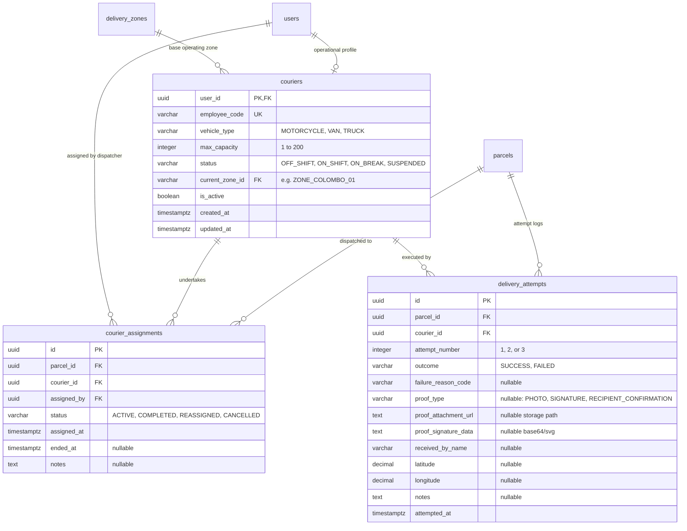

# Document 5 — Data & Persistence Specification

> **Module:** Dispatch, Couriers & Proof of Delivery  
> **Author / Owner:** Member 03  
> **Status:** Draft / Baseline (For Review in Team Meeting 2)  
> **Target Production Code Paths:** `core-api/internal/dispatch/` and `core-api/internal/delivery/`  
> **Target Migration Files:** `core-api/migrations/000006_create_couriers.up.sql` & `core-api/migrations/000007_create_dispatch_and_delivery.up.sql`  
> **Authoritative Persistence:** PostgreSQL (Authoritative Business Store) & Cloudflare R2 / S3 (Proof Image Blobs)  
> **Key Upstream Dependencies:** Member 1 (`users`), Member 2 (`parcels`), Member 7 / Admin (`delivery_zones`)  
> **Key Downstream Dependencies:** Member 5 (Tracking API read models), Member 8 (`outbox_events`)

---

## 1. Executive Summary & Data Ownership Boundaries

PostgreSQL is the single authoritative source of truth for all operational fleet data, assignments, and delivery attempt logs in SwiftDrop. In accordance with `AGENTS.md` (§4.2 and §7.2):
- Member 03 authoritatively owns the schema, migrations, DDL, and repository operations for three tables split across two sequential migrations (Agreement D3):
  1. **Migration 000006 (`000006_create_couriers.up.sql`):**
     - **`couriers`:** Operational fleet metadata, motorized vehicle classifications, max capacities, and shift statuses (foreign keys to `users` and `delivery_zones`).
  2. **Migration 000007 (`000007_create_dispatch_and_delivery.up.sql`):**
     - **`courier_assignments`:** Historical parcel assignments and unassignment lifecycles (foreign keys to `parcels` and `couriers`).
     - **`delivery_attempts`:** Chronological doorstep attempt event logs, structured failure codes, and proof-of-delivery references (foreign keys to `parcels` and `couriers`).
- External binary image blobs (photos) are stored in S3-compatible cloud storage (**Cloudflare R2** with zero egress fees or local MinIO), storing only the relative storage path/key in PostgreSQL.

---

## 2. Entity-Relationship Architecture



---

## 3. Canonical PostgreSQL DDL Specification

The following DDL represents the authoritative schemas implemented in `core-api/migrations/`:

### 3.1 Migration `000006_create_couriers.up.sql`

```sql
-- ============================================================================
-- SwiftDrop Core API: Migration 000006 - Courier Profiles
-- Author: Member 03 (Dispatch, Couriers & Proof of Delivery)
-- Dependencies: 000001_create_users, 000002_create_delivery_zones
-- ============================================================================

CREATE TABLE IF NOT EXISTS couriers (
    user_id UUID PRIMARY KEY REFERENCES users(id) ON DELETE RESTRICT,
    employee_code VARCHAR(20) NOT NULL UNIQUE,
    vehicle_type VARCHAR(20) NOT NULL,
    max_capacity INTEGER NOT NULL DEFAULT 25,
    status VARCHAR(20) NOT NULL DEFAULT 'OFF_SHIFT',
    current_zone_id VARCHAR(32) REFERENCES delivery_zones(id) ON DELETE SET NULL,
    is_active BOOLEAN NOT NULL DEFAULT TRUE,
    created_at TIMESTAMPTZ NOT NULL DEFAULT NOW(),
    updated_at TIMESTAMPTZ NOT NULL DEFAULT NOW(),

    -- Invariants & Check Constraints
    CONSTRAINT chk_couriers_vehicle_type CHECK (
        vehicle_type IN ('MOTORCYCLE', 'VAN', 'TRUCK')
    ),
    CONSTRAINT chk_couriers_max_capacity CHECK (
        max_capacity BETWEEN 1 AND 200
    ),
    CONSTRAINT chk_couriers_status CHECK (
        status IN ('OFF_SHIFT', 'ON_SHIFT', 'ON_BREAK', 'SUSPENDED')
    )
);

COMMENT ON TABLE couriers IS 'Operational fleet profiles linked to authenticated user accounts';
COMMENT ON COLUMN couriers.vehicle_type IS 'Motorized vehicle classification: MOTORCYCLE, VAN, or TRUCK';
COMMENT ON COLUMN couriers.max_capacity IS 'Maximum concurrent active parcels allowed for this courier';
COMMENT ON COLUMN couriers.current_zone_id IS 'Assigned delivery zone referencing delivery_zones(id)';
COMMENT ON COLUMN couriers.status IS 'Current shift availability: OFF_SHIFT, ON_SHIFT, ON_BREAK, SUSPENDED';
```

### 3.2 Migration `000007_create_dispatch_and_delivery.up.sql`

```sql
-- ============================================================================
-- SwiftDrop Core API: Migration 000007 - Dispatch & Delivery Records
-- Author: Member 03 (Dispatch, Couriers & Proof of Delivery)
-- Dependencies: 000005_create_parcels_and_quotes, 000006_create_couriers
-- ============================================================================

CREATE TABLE IF NOT EXISTS courier_assignments (
    id UUID PRIMARY KEY DEFAULT gen_random_uuid(),
    parcel_id UUID NOT NULL REFERENCES parcels(id) ON DELETE RESTRICT,
    courier_id UUID NOT NULL REFERENCES couriers(user_id) ON DELETE RESTRICT,
    assigned_by UUID NOT NULL REFERENCES users(id) ON DELETE RESTRICT,
    status VARCHAR(20) NOT NULL DEFAULT 'ACTIVE',
    assigned_at TIMESTAMPTZ NOT NULL DEFAULT NOW(),
    ended_at TIMESTAMPTZ NULL,
    notes TEXT NULL,

    -- Invariants & Check Constraints
    CONSTRAINT chk_assignments_status CHECK (
        status IN ('ACTIVE', 'COMPLETED', 'REASSIGNED', 'CANCELLED')
    ),
    CONSTRAINT chk_assignments_ended_at CHECK (
        (status = 'ACTIVE' AND ended_at IS NULL) OR
        (status IN ('COMPLETED', 'REASSIGNED', 'CANCELLED') AND ended_at IS NOT NULL)
    )
);

COMMENT ON TABLE courier_assignments IS 'Historical and active assignments of parcels to couriers';
COMMENT ON COLUMN courier_assignments.status IS 'Assignment lifecycle: ACTIVE, COMPLETED, REASSIGNED, or CANCELLED';

-- ----------------------------------------------------------------------------
-- 3. Table: delivery_attempts
-- Description: Immutable doorstep attempt event logs, failure reasons & proof
-- ----------------------------------------------------------------------------
CREATE TABLE IF NOT EXISTS delivery_attempts (
    id UUID PRIMARY KEY DEFAULT gen_random_uuid(),
    parcel_id UUID NOT NULL REFERENCES parcels(id) ON DELETE RESTRICT,
    courier_id UUID NOT NULL REFERENCES couriers(user_id) ON DELETE RESTRICT,
    attempt_number INTEGER NOT NULL,
    outcome VARCHAR(20) NOT NULL,
    failure_reason_code VARCHAR(50) NULL,
    proof_type VARCHAR(30) NULL,
    proof_attachment_url TEXT NULL,
    proof_signature_data TEXT NULL,
    received_by_name VARCHAR(150) NULL,
    latitude DECIMAL(10, 8) NULL,
    longitude DECIMAL(11, 8) NULL,
    notes TEXT NULL,
    attempted_at TIMESTAMPTZ NOT NULL DEFAULT NOW(),

    -- Invariants & Check Constraints
    CONSTRAINT chk_delivery_attempts_number CHECK (
        attempt_number BETWEEN 1 AND 3
    ),
    CONSTRAINT chk_delivery_attempts_outcome CHECK (
        outcome IN ('SUCCESS', 'FAILED')
    ),
    CONSTRAINT chk_delivery_attempts_reason CHECK (
        failure_reason_code IS NULL OR failure_reason_code IN (
            'RECIPIENT_UNAVAILABLE',
            'CUSTOMER_REQUESTED_RESCHEDULE',
            'ACCESS_RESTRICTED',
            'INVALID_ADDRESS',
            'REFUSED_BY_RECIPIENT',
            'DAMAGED_IN_TRANSIT',
            'OTHER'
        )
    ),
    CONSTRAINT chk_delivery_attempts_proof_type CHECK (
        proof_type IS NULL OR proof_type IN ('PHOTO', 'SIGNATURE', 'RECIPIENT_CONFIRMATION')
    ),
    -- Consistency check: Success requires proof; Failure requires reason code
    CONSTRAINT chk_delivery_attempts_outcome_consistency CHECK (
        (outcome = 'SUCCESS' AND proof_type IS NOT NULL) OR
        (outcome = 'FAILED' AND failure_reason_code IS NOT NULL)
    ),
    -- Signature proof must capture recipient name
    CONSTRAINT chk_delivery_attempts_signature_recipient CHECK (
        proof_type != 'SIGNATURE' OR (received_by_name IS NOT NULL AND length(received_by_name) >= 2)
    )
);

COMMENT ON TABLE delivery_attempts IS 'Immutable doorstep delivery attempt records, POD references, and failure classifications';
```

---

## 4. Performance Indexes & Partial Index Strategy

High-frequency queries executed during dispatching and courier mobile synchronization must be protected from full table scans:

```sql
-- 1. Fast dispatch board active courier lookups
-- Filter couriers by operating zone and active shift
CREATE INDEX idx_couriers_zone_shift 
ON couriers (current_zone_id, status) 
WHERE is_active = TRUE;

-- 2. Fast courier active workload aggregation
-- Computes COUNT(*) of active parcels for a courier in < 1ms
CREATE INDEX idx_assignments_courier_active 
ON courier_assignments (courier_id) 
WHERE status = 'ACTIVE';

-- 3. Concurrency guard: Ensure a parcel can have at most ONE active assignment
CREATE UNIQUE INDEX idx_assignments_parcel_single_active 
ON courier_assignments (parcel_id) 
WHERE status = 'ACTIVE';

-- 4. Chronological doorstep attempt reconstruction
-- Used by Tracking API and Admin audit timelines
CREATE INDEX idx_delivery_attempts_parcel_seq 
ON delivery_attempts (parcel_id, attempt_number ASC);

-- 5. Dispatch board unassigned parcel lookup
-- Optimizes GET /api/v1/dispatch/board for parcels in CREATED or ATTEMPT_FAILED
CREATE INDEX idx_parcels_dispatch_eligible 
ON parcels (destination_zone_id, current_status, created_at ASC) 
WHERE current_status IN ('CREATED', 'ATTEMPT_FAILED');
```

---

## 5. Concurrency Controls & Row-Level Locking Patterns

### 5.1 Pessimistic Concurrency Pattern (`SELECT FOR UPDATE`)
To guarantee that two dispatchers clicking "Assign" at the exact same millisecond cannot double-assign a parcel or overload a courier:

```sql
BEGIN;

-- 1. Acquire exclusive lock on target parcel
SELECT id, current_status, attempt_count 
FROM parcels 
WHERE id = $1 
FOR UPDATE;

-- 2. Acquire exclusive lock on target courier
SELECT user_id, max_capacity, status 
FROM couriers 
WHERE user_id = $2 
FOR UPDATE;

-- 3. Calculate active workload with lock held
SELECT COUNT(*) 
FROM courier_assignments 
WHERE courier_id = $2 AND status = 'ACTIVE';

-- Application validates:
-- a) current_status IN ('CREATED', 'ATTEMPT_FAILED')
-- b) status == 'ON_SHIFT'
-- c) active_count + 1 <= max_capacity

-- 4. Execute inserts and state update
INSERT INTO courier_assignments (parcel_id, courier_id, assigned_by, status)
VALUES ($1, $2, $3, 'ACTIVE');

UPDATE parcels 
SET current_status = 'ASSIGNED', updated_at = NOW() 
WHERE id = $1;

-- 5. Commit atomically releases both row locks
COMMIT;
```

---

## 6. The Atomic Transaction Boundary Contract

All state transitions managed by Member 03 execute in a single PostgreSQL transaction (`sql.Tx`). If any individual step fails, the entire transaction rolls back cleanly:

```
+-------------------------------------------------------------------------------------------------------+
| Single Atomic PostgreSQL Transaction (sql.Tx)                                                         |
|                                                                                                       |
|  1. SELECT ... FOR UPDATE (Lock Parcel & Courier Rows)                                                |
|  2. INSERT INTO delivery_attempts (Write Immutable Attempt / POD Record)                              |
|  3. UPDATE parcels SET current_status = 'DELIVERED' (Transition Aggregate State)                      |
|  4. UPDATE courier_assignments SET status = 'COMPLETED', ended_at = NOW() (Free Courier Workload)     |
|  5. INSERT INTO parcel_status_history (Append-Only Chronological Audit Log)                            |
|  6. INSERT INTO outbox_events (Commit Versioned Integration Event for Outbox Relay)                   |
+-------------------------------------------------------------------------------------------------------+
                                  |
                                  v
                    COMMIT (All 6 succeed)  OR  ROLLBACK (Zero partial mutations)
```

---

## 7. Data Lifecycle, Archiving & Storage Retention

| Data Asset | Storage Medium | Retention Policy | Archival / Cleanup Mechanism |
| :--- | :--- | :--- | :--- |
| **Courier Profiles (`couriers`)** | PostgreSQL | Indefinite (Active records) | Soft-delete via `is_active = FALSE`. Hard deletes barred by FK constraints on assignments. |
| **Assignment Logs (`courier_assignments`)** | PostgreSQL | 2 Years | Retained for courier payroll, dispute resolution, and operational performance audits. |
| **Delivery Attempts (`delivery_attempts`)** | PostgreSQL | 2 Years (Active) | Immutable audit logs; partitioned by year in high-volume production. |
| **Proof Photos (Doorstep Images)** | Cloudflare R2 / S3 | **90 Days** | Automated R2 bucket lifecycle rule deletes image objects 90 days after creation. URLs expire in 15 minutes. |
| **Signature Vector Data** | PostgreSQL (`TEXT`) | 2 Years | Vector stroke data retained alongside delivery attempt record. |

---

## 8. Deterministic Seed Data (Local Development & CI)

In accordance with Agreement D12, migration directories contain strictly DDL. Deterministic seed records are maintained in `deploy/seeds/000006_couriers_seed.sql` to enable instant, repeatable local demonstrations and automated tests:

```sql
-- deploy/seeds/000006_couriers_seed.sql
-- Seed Couriers (Linked to Member 1 Seed Users)
INSERT INTO couriers (user_id, employee_code, vehicle_type, max_capacity, status, current_zone_id, is_active)
VALUES 
    ('018e3a2b-1111-7000-8000-000000000001', 'CR-0012', 'MOTORCYCLE', 25, 'ON_SHIFT', 'ZONE_COLOMBO_01', TRUE),
    ('018e3a2b-2222-7000-8000-000000000002', 'CR-0015', 'VAN', 60, 'ON_SHIFT', 'ZONE_KANDY_01', TRUE),
    ('018e3a2b-3333-7000-8000-000000000003', 'CR-0019', 'MOTORCYCLE', 25, 'OFF_SHIFT', 'ZONE_COLOMBO_01', TRUE)
ON CONFLICT (user_id) DO NOTHING;

-- Seed Sample Active Assignment (Courier 1 has 1 active delivery)
INSERT INTO courier_assignments (id, parcel_id, courier_id, assigned_by, status, assigned_at)
VALUES (
    '018e3a2b-aaaa-7000-8000-000000000001',
    '018e3a2b-9999-7000-8000-000000000001',
    '018e3a2b-1111-7000-8000-000000000001',
    '018e3a2b-0000-7000-8000-000000000001',
    'ACTIVE',
    NOW() - INTERVAL '1 hour'
) ON CONFLICT (id) DO NOTHING;
```

---

## 9. Rollback Migration Specifications (`down.sql`)

### 9.1 `core-api/migrations/000007_create_dispatch_and_delivery.down.sql`
```sql
DROP TABLE IF EXISTS delivery_attempts CASCADE;
DROP TABLE IF EXISTS courier_assignments CASCADE;
```

### 9.2 `core-api/migrations/000006_create_couriers.down.sql`
```sql
DROP TABLE IF EXISTS couriers CASCADE;
```
