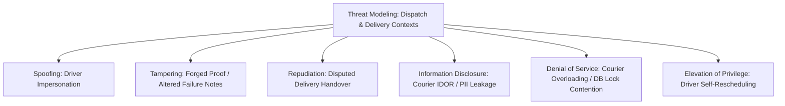
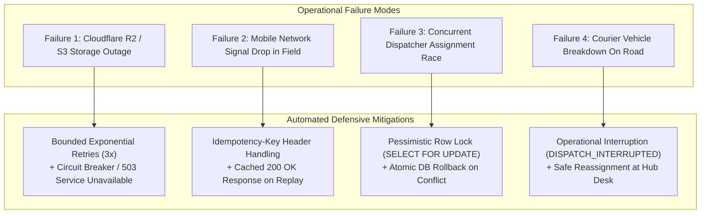

# Document 7 — Security, Failure & Recovery Specification

> **Module:** Dispatch, Couriers & Proof of Delivery  
> **Author / Owner:** Member 03  
> **Status:** Draft / Baseline (For Review in Team Meeting 2)  
> **Target Production Code Paths:** `core-api/internal/dispatch/` and `core-api/internal/delivery/`  
> **Authority:** Supplements repository security rules (`AGENTS.md`) and operational standards  
> **Traceability:** SRS §6 (Security Requirements `SEC-001` to `SEC-017`), ADR-003, ADR-004

---

## 1. Overview & Security Philosophy

Operational parcel delivery interacts directly with physical human actors (drivers, warehouse dispatchers, and package recipients) across mobile and desktop environments. Member 03's security and resilience strategy is built upon three foundational tenets:

1. **Zero Client Trust & Backend Authorization Enforcement:**  
   The system never relies on frontend mobile checks or client-supplied driver IDs. Every operational action (viewing manifest, starting runs, completing delivery, logging failure) validates server-side object ownership against the authenticated Bearer JWT (`auth.UserID`).
2. **Non-Repudiation of Proof of Delivery (POD):**  
   Proof attachments (photos, vector signatures, recipient names) must be tamper-resistant, verifiable, time-stamped, and cryptographically linked to the authenticated courier and parcel.
3. **Operational Fail-Safe & Concurrency Resilience:**  
   Under adverse conditions (driver mobile signal dropouts, cloud object storage outages, concurrent dispatcher assignments), the system must degrade gracefully without producing duplicate deliveries, phantom outbox events, or database deadlocks.

---

## 2. Threat Modeling & Attack Surface Analysis (STRIDE)



| STRIDE Category | Threat Description | Attack Vector | Defensive Control / Mitigation |
| :--- | :--- | :--- | :--- |
| **Spoofing** | Attacker impersonates a courier to complete or steal parcels. | Submitting requests with forged driver IDs in the JSON body. | Driver ID is **never** accepted from JSON body. It is strictly extracted from verified RSA-signed JWT claims (`auth.UserID`). |
| **Tampering** | Malicious actor uploads executable files disguised as photos. | Uploading PHP/shell scripts via `POST /proof-photo`. | Server-side MIME sniffing (magic bytes inspection: JPEG, PNG, WebP) + file extension sanitization + strict 10 MB limit. |
| **Tampering** | Courier tampers with past failed attempt records to hide delays. | Direct SQL or API update on `delivery_attempts`. | `delivery_attempts` table is **strictly append-only**; `UPDATE` and `DELETE` queries are prohibited at repository layer. |
| **Repudiation** | Customer claims package was not delivered; courier claims it was. | Disputed contactless doorstep delivery. | Mandatory POD: Photo stored in Cloudflare R2 with metadata + Recipient full name + GPS coordinates stamped at attempt time. |
| **Information Disclosure** | Insecure Direct Object Reference (IDOR) on courier manifests. | Driver Bob changes URL parameter to view Driver Alice's deliveries. | **Object-Level Authorization:** Repository queries filter strictly by `assignment.courier_id == auth.UserID`. Bob receives `403 Forbidden`. |
| **Information Disclosure** | Customer financial details leaked to couriers in the field. | Courier inspects JSON response in mobile browser DevTools. | **Data Minimization:** Transport DTO strips merchant billing margins, delivery fees, and customer passwords before serialization. |
| **Denial of Service** | Race condition attack on parcel assignment. | 2 dispatchers assign the same parcel at the exact same millisecond. | **Pessimistic Locking:** `SELECT ... FOR UPDATE` acquires row lock; 1st succeeds, 2nd fails safely with `409 Conflict`. |
| **Denial of Service** | Courier overloaded beyond physical carrying capacity. | Dispatcher accidentally assigns 100 packages to a motorcycle. | **Capacity Invariant:** System rejects assignment when $\text{active} + 1 > \text{max\_capacity}$ (`409 Conflict`). |
| **Elevation of Privilege** | Courier unilaterally reschedules failed packages. | Driver calls reschedule API to avoid returning to hub. | **Dispatcher Authorization Gate:** Reschedule endpoint strictly requires role `DISPATCHER` or `ADMIN` (`403 Forbidden` for drivers). |

---

## 3. Defensive Security Controls & Safeguards

### 3.1 Object-Level Authorization (IDOR Protection)
Every endpoint in `core-api/internal/delivery` that accesses or mutates a parcel validates ownership using the authenticated context:

```go
func (h *DeliveryHandler) CompleteDelivery(w http.ResponseWriter, r *http.Request) {
    courierID := auth.GetUserIDFromContext(r.Context())
    parcelID := chi.URLParam(r, "id")

    // Invariant check: Is courier assigned to this parcel?
    assignment, err := h.assignmentRepo.GetActiveByParcelID(r.Context(), nil, parcelID)
    if err != nil || assignment.CourierID != courierID {
        response.WriteError(w, http.StatusForbidden, "NOT_ASSIGNED_COURIER", "You are not authorized to complete this parcel")
        return
    }

    // Proceed with verified caller
}
```

### 3.2 Pre-Signed URL Architecture for Proof Photos (Cloudflare R2)
- **Zero Public Bucket Access:** The Cloudflare R2 / S3 storage bucket containing proof photos is strictly private; public read access is disabled (`BlockPublicAccess: true`).
- **Time-Bounded Pre-Signed URLs:** When an authorized Dispatcher, Customer, or Administrator requests to view a delivery photo:
  ```go
  // Generates temporary pre-signed URL with 15-minute TTL
  presignedURL, err := s3Client.GeneratePreSignedURL(ctx, proofAttachmentKey, 15*time.Minute)
  ```
- **Security Impact:** The temporary URL expires automatically after 15 minutes, preventing permanent image bookmarking, external hotlinking, or search engine scraping.

### 3.3 File Upload Hygiene & Sanitization
When couriers upload doorstep proof images via `POST /api/v1/deliveries/{id}/proof-photo`:
1. **Size Restriction:** Multi-part reader enforces a hard limit of **10 MB** (`http.MaxBytesReader`).
2. **MIME Magic Byte Sniffing:** The server reads the first 512 bytes of the payload using `http.DetectContentType` to ensure the file is an actual image (`image/jpeg`, `image/png`, `image/webp`). Client-provided `Content-Type` headers are untrusted.
3. **Key Randomization:** Files are never saved using client-provided filenames. Keys are generated server-side:  
   `proofs/YYYY/MM/<parcel_id>_<crypto_random_16>.jpg`

---

## 4. Failure Modes & Resilience Mechanisms



### 4.1 Failure Mode 1: Cloudflare R2 Storage Outage / Timeout
- **Symptom:** A courier attempts to upload a proof photo, but Cloudflare R2 is temporarily unreachable or returning HTTP 500 errors.
- **Resilience Mechanism:**
  - The Go `ObjectStorageClient` applies **bounded exponential backoff with jitter** (3 retries: 200ms, 600ms, 1200ms).
  - If R2 remains unreachable after 3 attempts, the server returns `503 Service Unavailable` with header `Retry-After: 5`.
  - The courier's mobile client retains the photo in local browser storage (`IndexedDB`) and allows the driver to proceed with recipient signature or confirmation as a temporary fallback.

### 4.2 Failure Mode 2: Mobile Network Signal Drop in Field (Idempotent Recovery)
- **Symptom:** The courier completes a delivery, the database transaction commits successfully, but the driver's cellular connection drops before the HTTP `200 OK` response reaches the mobile device.
- **Resilience Mechanism:**
  - The mobile app detects a network timeout and automatically retries the request using the **same `Idempotency-Key`**.
  - The server's idempotency middleware intercepts the request:
    ```sql
    SELECT response_code, response_body 
    FROM idempotency_keys 
    WHERE key = $1 AND expires_at > NOW();
    ```
  - It finds the cached result and immediately returns `200 OK` with the original delivery confirmation JSON.
  - **Zero duplicate attempts, zero duplicate outbox events, zero driver confusion.**

### 4.3 Failure Mode 3: Concurrent Dispatcher Assignment Collisions
- **Symptom:** Two dispatchers review the board simultaneously and click "Assign" on the same package at the exact same millisecond.
- **Resilience Mechanism:**
  - The first transaction to acquire the row lock on `parcels` via `SELECT id FROM parcels WHERE id = $1 FOR UPDATE` proceeds.
  - The second transaction waits briefly on the row lock ($< 15\text{ ms}$). When the first transaction commits, the second transaction reads the updated parcel status (`ASSIGNED`), triggers domain validation failure (`ErrParcelAlreadyAssigned`), and immediately rolls back with `409 Conflict`.
  - Database integrity remains 100% pristine.

### 4.4 Failure Mode 4: Courier Vehicle Breakdown On Road (`OUT_FOR_DELIVERY`)
- **Symptom:** A courier's motorcycle suffers a flat tire or mechanical breakdown while carrying 15 packages marked `OUT_FOR_DELIVERY`.
- **Resilience Mechanism:**
  - The courier or dispatch coordinator records an operational disruption via `POST /api/v1/deliveries/{id}/failed` with reason code `DISPATCH_INTERRUPTED` or `OTHER`.
  - The parcel transitions safely to `ATTEMPT_FAILED`. Because the failure is flagged as an operational breakdown, it does not penalize the recipient's 3-attempt customer ceiling.
  - When the relief driver physically collects the packages from the disabled vehicle or depot, the Dispatcher reassigns the packages via `POST /api/v1/dispatch/assignments`.

---

## 5. Audit Logging & Non-Repudiation

In compliance with **SRS §6 (`SEC-015`)**, all security-sensitive actions and operational mutations are recorded in immutable audit logs:

### 5.1 Audit Log Schema & Context
Every state transition records an entry in `parcel_status_history`:
- `parcel_id`: Target package UUID.
- `from_status`: Originating state (e.g. `OUT_FOR_DELIVERY`).
- `to_status`: Resulting state (e.g. `DELIVERED` or `ATTEMPT_FAILED`).
- `actor_id`: Authenticated user UUID extracted from JWT.
- `actor_role`: Role of actor (`COURIER`, `DISPATCHER`, `ADMIN`).
- `reason_code`: Standard failure code if applicable.
- `note`: Operational note / dispatch override explanation.
- `occurred_at`: Authoritative server UTC timestamp.

### 5.2 Sanitized Application Logging Directives
- **Zero Sensitive Data in Application Logs:** Loggers must never print JWT tokens, API keys, passwords, customer phone numbers, or recipient street addresses.
- Structured JSON format enforced:
  ```json
  {
    "timestamp": "2026-10-24T11:15:00Z",
    "level": "INFO",
    "module": "delivery",
    "event": "DELIVERY_COMPLETED",
    "parcel_id": "prcl_01HXYZ1234567890",
    "courier_id": "usr_courier_bob",
    "proof_type": "SIGNATURE",
    "request_id": "req_01HK99223344"
  }
  ```

---

## 6. Disaster Recovery & Data Integrity Verification

### 6.1 Orphaned Assignment & Anomaly Detection Query
To detect any potential operational inconsistencies (e.g., a parcel in `OUT_FOR_DELIVERY` status whose courier assignment was terminated):

```sql
-- Operational Audit Query: Detect inconsistent active assignments
SELECT p.id AS parcel_id, p.current_status, ca.id AS assignment_id, ca.status AS assignment_status
FROM parcels p
LEFT JOIN courier_assignments ca ON p.id = ca.parcel_id AND ca.status = 'ACTIVE'
WHERE p.current_status = 'OUT_FOR_DELIVERY' AND ca.id IS NULL;
```
If this query returns rows, the automated reconciliation job (`internal/admin` / Member 8) alerts the on-duty dispatcher to re-link or return the affected parcels to the depot.
