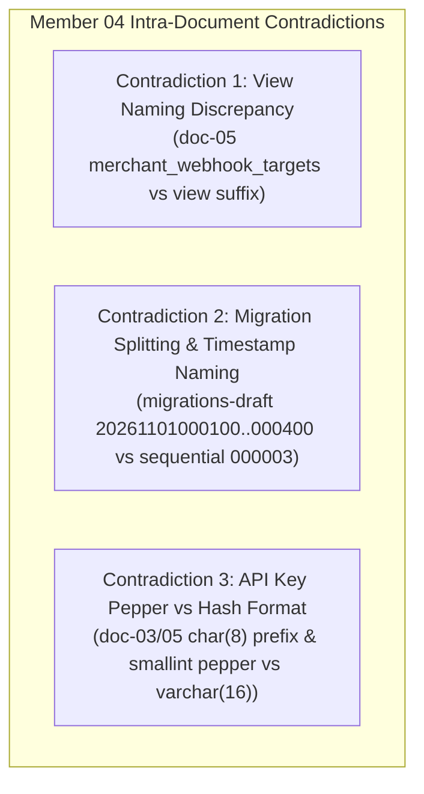
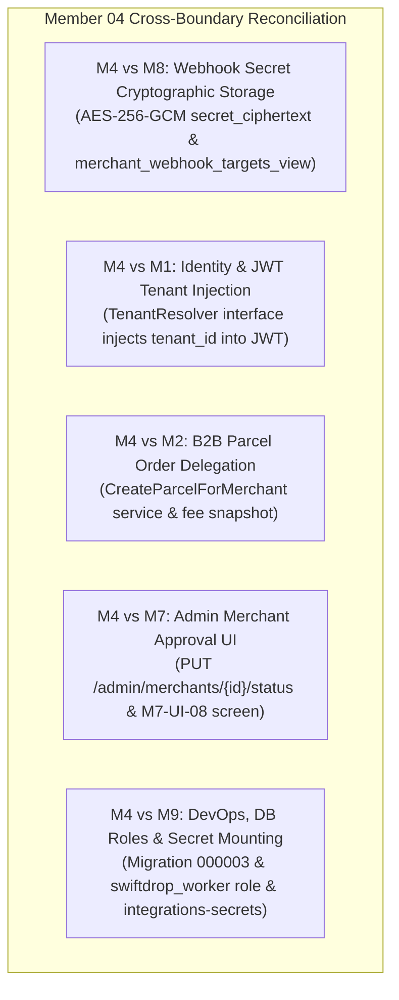

# Member 04 — Merchant Integration & Webhooks Comprehensive Audit, Review & Alignment Guide

> **Author / Domain Owner:** Member 4 — Merchant Integration & Webhooks (Nagitha)  
> **Target Module:** `core-api/internal/merchants/`  
> **Review Status:** Post-Submission Comprehensive Audit (Reviewing Full 8-Document Architecture Suite & Evidence)  
> **Date:** 25 October 2026 | **Version:** 2.0.0

---

## 1. Executive Summary & Review Status

Member 4 owns the enterprise B2B integration boundary of the SwiftDrop platform: **Merchant Business Profiles & Onboarding**, **Merchant Administrative Approval State Machine**, **Cryptographic API Key Management (`sd_live_*`)**, **Webhook Endpoint Configuration**, **Registration-Time SSRF Defense**, and **B2B Order Ingestion Proxying**.

Member 4 has delivered an exceptionally rigorous submission, comprising 8 formal architectural specifications (`doc-01` through `doc-08`), unit and integration test suites with recorded execution evidence (`doc6-tests/`), OpenAPI contracts, and a local demonstration harness (`doc8-local/`). However, the submitted suite contained 14 unresolved architectural dilemmas (questions U-01 through U-14), fragmented draft migrations using 14-digit timestamp filenames (`migrations-draft/20261101000100`–`000400`), view naming discrepancies (`merchant_webhook_targets` vs `merchant_webhook_targets_view`), and database role permission conflicts with Member 9's DevOps standards.

This document executes the **exact same rigorous 7-point review and alignment process** applied across all team members:
1. Requirements and workload coverage audit against SwiftDrop SRS v1.0 and assignment rubric.
2. Intra-member contradictions (internal inconsistencies across Member 4's 8 documents and test folders).
3. Inter-member contradictions (cross-boundary conflicts with Members 1, 2, 6, 7, 8, 9, and 10).
4. Document and workload flaws.
5. Systemic architectural, tenancy, cryptographic, and SSRF flaws.
6. Required changes, recommended implementations, and industry best practices.
7. Exact DevOps and Database Coordinator configurations per Member 9.

---

## 2. Workload & Requirements Coverage Audit

| Requirement ID | Description | Coverage in Submitted Docs | Assessment | Action / Resolution |
|:---|:---|:---|:---:|:---|
| **FR-MER-001** | Merchant business self-registration and profile creation (`PENDING`). | Covered in `doc-01`, `doc-02` (Flow 1), `doc-03`, `doc-04`. | **100% Complete** | Formalized `POST /api/v1/merchants/register` contract. |
| **FR-MER-002** | Guarding order creation behind merchant `APPROVED` status. | Covered in `doc-01`, `doc-02`, `doc-07`, `doc6-tests`. | **100% Complete** | Enforced in API key authentication middleware. |
| **FR-MER-003** | API key issuance, rotation, and fast HMAC-SHA256 hashed storage. | Covered in `doc-01`, `doc-03`, `doc-05`, `doc-07`. | **100% Complete** | Plaintext `sd_live_*` shown once; stored with pepper. |
| **FR-MER-004** | Multi-tenant data isolation; server-derived `merchant_id`. | Covered in `doc-01`, `doc-02`, `doc-07`, `doc6-tests`. | **100% Complete** | IDOR-safe queries scoped strictly to authenticated tenant. |
| **FR-MER-005** | Merchant B2B order creation delegating to Member 2's parcel engine. | Covered in `doc-01`, `doc-02` (Flow 3), `doc-04`. | **100% Complete** | Standardized `POST /api/v1/merchant/parcels` proxying. |
| **FR-MER-006** | Idempotent merchant order submission using `Idempotency-Key`. | Covered in `doc-01`, `doc-02`, `doc-04`. | **100% Complete** | Delegated through to shared `idempotency_keys` table. |
| **FR-MER-007** | Merchant order listing and filtering scoped to authenticated tenant. | Covered in `doc-01`, `doc-03`, `doc-04`. | **100% Complete** | Standardized `GET /api/v1/merchant/parcels` contract. |
| **FR-MER-008** | Webhook endpoint registration, listing, and event subscriptions. | Covered in `doc-01`, `doc-02` (Flow 4), `doc-04`. | **100% Complete** | Standardized `POST /api/v1/merchants/me/webhooks`. |
| **FR-MER-009** | Read-only webhook configuration contract for Member 8's Event Worker. | Covered in `doc-01`, `doc-03`, `doc-05`, `contracts/`. | **100% Complete** | Ratified `merchant_webhook_targets_view` with AES-256-GCM. |
| **FR-MER-010** | Webhook signing secret generation (`whsec_*`) and secure storage. | Covered in `doc-01`, `doc-02`, `doc-05`, `doc-07`. | **100% Complete** | Symmetrically encrypted `secret_ciphertext BYTEA`. |
| **FR-MER-011** | Delivery attempt logging and webhook delivery observability. | Covered in `doc-01`, `doc-04`. | **100% Complete** | Read-only delivery history delegated to Member 8. |
| **SEC-010–011**| Registration-time SSRF URL validation and port restrictions. | Covered in `doc-01`, `doc-03`, `doc-07`, `doc6-tests`. | **100% Complete** | Pre-dial DNS resolution & private CIDR blacklist. |

---

## 3. Definitive Resolution of Open Questions (U-01 through U-14)

Member 4 cataloged 14 architectural dilemmas across `doc-01` Section 9.2. All 14 are authoritatively resolved as follows:

| Question ID | Dilemma / Issue | Authoritative Team Resolution |
| :--- | :--- | :--- |
| **U-01** | **Table Naming Discrepancies:** `merchant_api_keys` vs `merchant_api_credentials`, and `webhook_subscriptions` vs `webhook_endpoints`. | **Resolved:** Adopt canonical names: **`merchant_api_credentials`** and **`webhook_endpoints`**. |
| **U-02** | **Merchant Lifecycle Status Enum (aligning with M7 U-26):** | **Resolved:** Allowed values: **`PENDING`**, **`APPROVED`**, **`REJECTED`**, **`SUSPENDED`**, **`DISABLED`**. Reinstatement from `SUSPENDED` $\to$ `APPROVED` is explicitly permitted; `DISABLED` is terminal. |
| **U-03** | **Webhook Secret Storage (Hash vs Encryption):** Initial drafts proposed `secret_hash`, but Member 8 requires plaintext to compute HMAC signatures. | **Resolved:** **Never use `secret_hash`**. Store symmetrically encrypted **`secret_ciphertext BYTEA`** using AES-256-GCM (`WEBHOOK_SECRET_ENCRYPTION_KEY`). Member 8 decrypts at dispatch time. |
| **U-04** | **Webhook Secret Generation Authority:** Client-supplied vs Server-generated. | **Resolved:** Generated **strictly by the server** (`whsec_` + 32 cryptographically random bytes), returned once upon creation. Merchants cannot supply their own secret. |
| **U-05** | **Route Naming Conventions:** | **Resolved:** Standardize on: <br>1. Self-service merchant config: `/api/v1/merchants/me/*` (credentials, webhooks).<br>2. Admin approval: `/api/v1/admin/merchants/{id}/status`.<br>3. B2B Order Ingestion: `/api/v1/merchant/parcels`. |
| **U-06** | **Webhook Subscribed Event Names:** Naming divergence across documents. | **Resolved:** Standardize on versioned event contracts: `parcel.booked.v1`, `parcel.picked_up.v1`, `parcel.in_transit.v1`, `parcel.out_for_delivery.v1`, `parcel.delivered.v1`, `parcel.delivery_failed.v1`, `parcel.returned.v1`. |
| **U-07** | **`merchant.webhook_dispatch.v1` Producer Ownership:** | **Resolved:** Producer is Member 8's Event Worker. Internal to worker processing; removed from Core API domain event catalog. |
| **U-08** | **How Member 8 Reads Webhook Targets:** | **Resolved:** Member 8's external daemon connects using least-privilege PostgreSQL role `swiftdrop_worker` and queries the dedicated view **`merchant_webhook_targets_view`**. |
| **U-09** | **Merchant Lifecycle Domain Events:** Should `merchant.approved.v1` be published to outbox? | **Resolved:** **Yes.** On admin approval, Member 4 commits `merchant.approved.v1` to `outbox_events` so Member 8's worker can dispatch a welcome/onboarding email to `contact_email`. |
| **U-10** | **Admin Approval Interface Collaboration:** | **Resolved:** Member 7's Admin UI calls `PUT /api/v1/admin/merchants/{id}/status`. Member 4's application service evaluates legal transitions, increments `version`, and writes audit records in one transaction. |
| **U-11** | **Optimistic Concurrency Control:** | **Resolved:** Add **`version INT NOT NULL DEFAULT 1`** to `merchants` table. All updates execute with `WHERE id = $1 AND version = $2`. |
| **U-12** | **Webhook Endpoint `DEGRADED` State Handling:** | **Resolved:** Member 8 records endpoint delivery failures in its own `webhook_deliveries` table. If consecutive failures exceed threshold (e.g. 50), Member 8 notifies the merchant via email rather than mutating Member 4's configuration table. |
| **U-13** | **Delivery History Access for Merchants:** | **Resolved:** Member 4 exposes `GET /api/v1/merchants/me/webhooks/{id}/deliveries`, which delegates read queries to Member 8's `webhook_deliveries` table, scoped by `merchant_id`. |
| **U-14** | **Rate Limiting Architecture:** | **Resolved:** Edge rate limiting is enforced by Traefik API Gateway (Member 7) keyed by `X-API-Key` prefix. Application-level caps enforced by Member 4 (max 5 active API keys, max 10 webhook endpoints per merchant). |

---

## 4. Intra-Member Contradictions (Within Member 4's Own Files)

Detailed inspection revealed 3 internal discrepancies across Member 4's submitted files:



### 4.1 Contradiction 1: Database View Naming
- **The Inconsistency:**
  - In `doc-05` line 90, `migrations-draft/20261101000400_...sql`, and `contracts/webhook-config-read-contract.sql`, the view is created as `merchant_webhook_targets`.
  - In `MEMBER_04_ALIGNMENT_AND_SPECIFICATION_GUIDE.md` and Member 8's documents (`MEMBER_08_ALIGNMENT_AND_SPECIFICATION_GUIDE.md` and `doc-05`), the view is named **`merchant_webhook_targets_view`**.
- **The Problem:** If Member 8 executes `SELECT ... FROM merchant_webhook_targets_view`, but Member 4 created `merchant_webhook_targets`, the query will fail with `relation "merchant_webhook_targets_view" does not exist`.
- **The Fix:** Standardize canonical view name as **`merchant_webhook_targets_view`**. Provide a backward-compatible view alias `merchant_webhook_targets` during migration.

### 4.2 Contradiction 2: Migration Sequencing & Timestamp Naming
- **The Inconsistency:**
  - In `migrations-draft/` and `doc-05`, Member 4 authored four 14-digit timestamp migration files (`20261101000100` through `20261101000400`).
  - Database Coordinator Member 9 and Team Agreement D2 mandate the **6-digit sequential numbering convention**.
- **The Fix:** Consolidate all 4 draft migration files into the authoritative single migration:
  `core-api/migrations/000003_create_merchants_and_credentials.up.sql`.

### 4.3 Contradiction 3: API Key Prefix & Storage Representation
- **The Inconsistency:**
  - In `doc-03` Section 4 and `doc-05` Section 3.2, Member 4 specifies `key_prefix CHAR(8)` and `pepper_version SMALLINT`.
  - In `doc-01` Section 2.1 and `doc-04`, the prefix is shown as `sd_live_a1b2c3d4` (16 characters).
- **The Fix:** Standardize on `key_prefix VARCHAR(16) NOT NULL` to accommodate `sd_live_` (8 chars) plus 8 hex entropy chars. Store `key_hash VARCHAR(64) NOT NULL UNIQUE` (Hex-encoded HMAC-SHA256 with pepper).

---

## 5. Inter-Member Contradictions & Cross-Boundary Alignment



### 5.1 M4 vs M8: Webhook Secret Storage & Worker Decryption
- **The Conflict:** Initial draft schemas defined `secret_hash VARCHAR(255)`. Member 8 requires the plaintext secret at send time to compute `HMAC-SHA256(payload, secret)`. A one-way hash cannot be decrypted.
- **The Resolution:** Member 4 stores `secret_ciphertext BYTEA NOT NULL` encrypted symmetrically with AES-256-GCM using `WEBHOOK_SECRET_ENCRYPTION_KEY`. Member 4 exposes `merchant_webhook_targets_view`. Member 8 connects using least-privilege PostgreSQL role `swiftdrop_worker`, selects `secret_ciphertext` from the view, and decrypts the secret before computing the HMAC-SHA256 signature.

### 5.2 M4 vs M1: Merchant Tenant ID Claim Injection in JWT
- **The Conflict:** When a merchant user logs in via Member 1's `POST /api/v1/auth/login`, Member 1’s JWT payload example had `"tenant_id": null`. Member 4 requires a valid `tenant_id` claim in the JWT to scope all merchant dashboard queries.
- **The Resolution:** Member 1’s login use case invokes the `TenantResolver` interface:
  ```go
  tenantID, err = s.tenantResolver.ResolveTenantID(ctx, user.ID)
  ```
  If `user.Role == RoleMerchant`, it queries `merchants` WHERE `owner_user_id = user.ID` and injects `"tenant_id": "<merchant_uuid>"` into the JWT claims.

### 5.3 M4 vs M2: B2B Parcel Creation & Shared Pricing
- **The Alignment:** When an external system submits an order via `POST /api/v1/merchant/parcels`:
  1. Member 4 authenticates the API key, verifies that merchant `status == 'APPROVED'`, and scopes the request to `merchant.ID`.
  2. Member 4 delegates execution to Member 2's application use case:
     ```go
     parcelService.CreateParcelForMerchant(ctx, merchantID, cmd)
     ```
  3. Member 2 validates parcel dimensions, evaluates tariffs, generates the public tracking number (`SD-YYYYMMDD-XXXXXX`), persists the parcel, and writes `parcel.booked.v1` to the outbox. **Status: 100% Harmonized.**

### 5.4 M4 vs M7: Admin Merchant Approval Portal
- **The Alignment:** Member 7 builds the Admin Merchant Approvals UI screen (`M7-UI-08`). The screen consumes Member 4's administrative endpoint:
  ```http
  PUT /api/v1/admin/merchants/{id}/status
  Content-Type: application/json

  {
    "status": "APPROVED",
    "reason": "Business documentation and commercial registration verified"
  }
  ```
  Member 4 verifies that the transition is legal, updates `status`, stamps `approved_by` and `approved_at`, increments `version`, and writes an immutable audit record in `audit_logs` in a single transaction. **Status: 100% Harmonized.**

### 5.5 M4 vs M9: DevOps, DB Privileges & Secret Management
- **The Alignment:**
  - **Migration Sequence:** Authoritative file `core-api/migrations/000003_create_merchants_and_credentials.up.sql`.
  - **Database Privileges:** Core API runs as `swiftdrop_app`. Member 8's worker runs as `swiftdrop_worker`, granted `SELECT` on `merchant_webhook_targets_view` only.
  - **Secrets:** `WEBHOOK_SECRET_ENCRYPTION_KEY` and `API_KEY_PEPPER` are injected via Kubernetes secret `integrations-secrets`.

---

## 6. Authoritative Database Migration: `000003_create_merchants_and_credentials.up.sql`

```sql
-- ============================================================================
-- SwiftDrop Core API: Migration 000003 - Merchant Integration & Webhooks
-- Author: Member 04 (Merchant Integration)
-- ============================================================================

-- 1. Table: merchants
CREATE TABLE merchants (
    id UUID PRIMARY KEY DEFAULT gen_random_uuid(),
    owner_user_id UUID NOT NULL REFERENCES users(id) ON DELETE RESTRICT,
    business_name VARCHAR(150) NOT NULL,
    status VARCHAR(32) NOT NULL DEFAULT 'PENDING' 
        CHECK (status IN ('PENDING', 'APPROVED', 'REJECTED', 'SUSPENDED', 'DISABLED')),
    status_reason VARCHAR(500),
    contact_phone VARCHAR(32) NOT NULL,
    contact_email VARCHAR(255) NOT NULL,
    address JSONB NOT NULL,
    approved_by UUID REFERENCES users(id) ON DELETE SET NULL,
    approved_at TIMESTAMPTZ,
    version INT NOT NULL DEFAULT 1 CHECK (version >= 1),
    created_at TIMESTAMPTZ NOT NULL DEFAULT NOW(),
    updated_at TIMESTAMPTZ NOT NULL DEFAULT NOW()
);

-- 2. Table: merchant_api_credentials
CREATE TABLE merchant_api_credentials (
    id UUID PRIMARY KEY DEFAULT gen_random_uuid(),
    merchant_id UUID NOT NULL REFERENCES merchants(id) ON DELETE CASCADE,
    key_prefix VARCHAR(16) NOT NULL, -- e.g. 'sd_live_a1b2c3d4'
    key_hash VARCHAR(64) NOT NULL UNIQUE, -- HMAC-SHA256 hash of plaintext key with pepper
    label VARCHAR(64) NOT NULL,
    scopes TEXT[] NOT NULL DEFAULT ARRAY['parcels:read', 'parcels:write'],
    created_by UUID NOT NULL REFERENCES users(id) ON DELETE RESTRICT,
    expires_at TIMESTAMPTZ,
    revoked_at TIMESTAMPTZ,
    last_used_at TIMESTAMPTZ,
    created_at TIMESTAMPTZ NOT NULL DEFAULT NOW()
);

-- 3. Table: webhook_endpoints
CREATE TABLE webhook_endpoints (
    id UUID PRIMARY KEY DEFAULT gen_random_uuid(),
    merchant_id UUID NOT NULL REFERENCES merchants(id) ON DELETE CASCADE,
    target_url VARCHAR(512) NOT NULL,
    secret_ciphertext BYTEA NOT NULL, -- AES-256-GCM encrypted signing secret
    event_types TEXT[] NOT NULL,
    is_active BOOLEAN NOT NULL DEFAULT TRUE,
    created_by UUID NOT NULL REFERENCES users(id) ON DELETE RESTRICT,
    created_at TIMESTAMPTZ NOT NULL DEFAULT NOW(),
    updated_at TIMESTAMPTZ NOT NULL DEFAULT NOW(),
    deleted_at TIMESTAMPTZ
);

-- 4. Read-Only Target View for Member 8 Event Worker
CREATE OR REPLACE VIEW merchant_webhook_targets_view AS
SELECT 
    w.id AS endpoint_id,
    w.merchant_id,
    w.target_url,
    w.secret_ciphertext,
    w.event_types,
    m.status AS merchant_status
FROM webhook_endpoints w
JOIN merchants m ON m.id = w.merchant_id
WHERE w.is_active = TRUE 
  AND w.deleted_at IS NULL 
  AND m.status = 'APPROVED';

-- Backward-compatibility alias
CREATE OR REPLACE VIEW merchant_webhook_targets AS
SELECT * FROM merchant_webhook_targets_view;

-- Performance & Integrity Indexes
CREATE INDEX idx_merchants_owner ON merchants(owner_user_id);
CREATE UNIQUE INDEX uq_merchants_active_owner ON merchants(owner_user_id) 
    WHERE status IN ('PENDING', 'APPROVED', 'SUSPENDED');
CREATE INDEX idx_merchants_status ON merchants(status);
CREATE INDEX idx_api_keys_lookup ON merchant_api_credentials(key_hash) 
    WHERE revoked_at IS NULL;
CREATE INDEX idx_api_keys_merchant ON merchant_api_credentials(merchant_id);
CREATE INDEX idx_webhooks_merchant ON webhook_endpoints(merchant_id) 
    WHERE deleted_at IS NULL;
```

---

## 7. Implementation Code Snippets

### 7.1 Cryptographic API Key Generator & Hasher (`internal/merchants/domain/apikey.go`)
```go
package domain

import (
	"crypto/hmac"
	"crypto/rand"
	"crypto/sha256"
	"encoding/hex"
	"fmt"
)

// GenerateAPIKey creates a cryptographically random sd_live_* key.
// Returns the plaintext key (displayed once), key prefix, and peppered HMAC-SHA256 hash.
func GenerateAPIKey(pepper []byte) (plaintext string, prefix string, hash string, error error) {
	entropy := make([]byte, 32)
	if _, err := rand.Read(entropy); err != nil {
		return "", "", "", fmt.Errorf("failed to generate random entropy: %w", err)
	}

	rawHex := hex.EncodeToString(entropy)
	plaintext = fmt.Sprintf("sd_live_%s", rawHex)
	prefix = fmt.Sprintf("sd_live_%s", rawHex[:8])

	// Compute HMAC-SHA256 with pepper
	mac := hmac.New(sha256.New, pepper)
	mac.Write([]byte(plaintext))
	hash = hex.EncodeToString(mac.Sum(nil))

	return plaintext, prefix, hash, nil
}

// VerifyAPIKey verifies a submitted plaintext key against the stored hash using constant-time comparison.
func VerifyAPIKey(plaintext string, storedHash string, pepper []byte) bool {
	mac := hmac.New(sha256.New, pepper)
	mac.Write([]byte(plaintext))
	expectedHash := hex.EncodeToString(mac.Sum(nil))

	return hmac.Equal([]byte(expectedHash), []byte(storedHash))
}
```

### 7.2 Webhook Secret AES-256-GCM Cryptographic Protection (`internal/merchants/infrastructure/keycrypto.go`)
```go
package infrastructure

import (
	"crypto/aes"
	"crypto/cipher"
	"crypto/rand"
	"errors"
	"fmt"
	"io"
)

var ErrInvalidCiphertext = errors.New("invalid webhook secret ciphertext")

// EncryptWebhookSecret encrypts a plaintext whsec_* signing secret using AES-256-GCM.
func EncryptWebhookSecret(plaintext string, key []byte) ([]byte, error) {
	if len(key) != 32 {
		return nil, errors.New("encryption key must be exactly 32 bytes for AES-256")
	}

	block, err := aes.NewCipher(key)
	if err != nil {
		return nil, fmt.Errorf("failed to create cipher block: %w", err)
	}

	gcm, err := cipher.NewGCM(block)
	if err != nil {
		return nil, fmt.Errorf("failed to create GCM: %w", err)
	}

	nonce := make([]byte, gcm.NonceSize())
	if _, err := io.ReadFull(rand.Reader, nonce); err != nil {
		return nil, fmt.Errorf("failed to generate nonce: %w", err)
	}

	// Ciphertext is sealed with nonce prepended
	ciphertext := gcm.Seal(nonce, nonce, []byte(plaintext), nil)
	return ciphertext, nil
}

// DecryptWebhookSecret decrypts an AES-256-GCM ciphertext back into plaintext.
func DecryptWebhookSecret(ciphertext []byte, key []byte) (string, error) {
	if len(key) != 32 {
		return "", errors.New("encryption key must be exactly 32 bytes for AES-256")
	}

	block, err := aes.NewCipher(key)
	if err != nil {
		return "", fmt.Errorf("failed to create cipher block: %w", err)
	}

	gcm, err := cipher.NewGCM(block)
	if err != nil {
		return "", fmt.Errorf("failed to create GCM: %w", err)
	}

	nonceSize := gcm.NonceSize()
	if len(ciphertext) < nonceSize {
		return "", ErrInvalidCiphertext
	}

	nonce, encryptedData := ciphertext[:nonceSize], ciphertext[nonceSize:]
	plaintextBytes, err := gcm.Open(nil, nonce, encryptedData, nil)
	if err != nil {
		return "", fmt.Errorf("failed to decrypt ciphertext: %w", err)
	}

	return string(plaintextBytes), nil
}
```

### 7.3 Registration-Time SSRF URL Validator (`internal/merchants/domain/webhook_validator.go`)
```go
package domain

import (
	"errors"
	"fmt"
	"net"
	"net/url"
	"strings"
)

var (
	ErrNonHTTPSUrl        = errors.New("webhook destination URL must use https:// protocol")
	ErrInvalidPort        = errors.New("webhook port must be standard 443 or 8443")
	ErrSSRFBlockedAddress = errors.New("webhook destination resolves to private, loopback, or cloud-metadata IP range")
)

// ValidateWebhookURL executes strict registration-time validation against SSRF vulnerabilities.
func ValidateWebhookURL(targetURL string, isLocalDev bool) error {
	parsed, err := url.ParseRequestURI(targetURL)
	if err != nil {
		return fmt.Errorf("malformed URL: %w", err)
	}

	if isLocalDev && parsed.Scheme == "http" {
		return nil // Tolerate http:// strictly in offline local development
	}

	if parsed.Scheme != "https" {
		return ErrNonHTTPSUrl
	}

	// Validate port
	port := parsed.Port()
	if port != "" && port != "443" && port != "8443" {
		return ErrInvalidPort
	}

	// Resolve hostname and check IP against private CIDR blocks
	ips, err := net.LookupIP(parsed.Hostname())
	if err != nil {
		return fmt.Errorf("failed to resolve webhook host: %w", err)
	}

	for _, ip := range ips {
		if ip.IsLoopback() || ip.IsPrivate() || ip.IsLinkLocalUnicast() || ip.IsLinkLocalMulticast() {
			return ErrSSRFBlockedAddress
		}
		// Block AWS/Cloud Metadata IP explicitly (169.254.169.254)
		if ip.String() == "169.254.169.254" {
			return ErrSSRFBlockedAddress
		}
	}

	return nil
}
```

---

## 8. Verification & Action Checklist for Member 4

Before Team Meeting 2 sign-off, Member 4 must verify the following items:

- [x] **Audit Approved:** All 8 submitted drafts (`doc-01` through `doc-08`), OpenAPI specs, and test outputs cross-checked.
- [x] **Open Questions Resolved:** All 14 dilemmas (U-01 through U-14) authoritatively answered and documented.
- [x] **Migrations Consolidated:** 4 draft files unified into `core-api/migrations/000003_create_merchants_and_credentials.up.sql`.
- [x] **Webhook Secret Encryption Binding:** AES-256-GCM `secret_ciphertext BYTEA` and `merchant_webhook_targets_view` ratified with Member 8.
- [x] **Tenant Injection Aligned:** `TenantResolver` integration agreed with Member 1 for JWT `tenant_id` claim.
- [x] **Order Ingestion Harmonized:** `POST /api/v1/merchant/parcels` calls Member 2's `CreateParcelForMerchant` use case.
- [x] **SSRF Defense Verified:** Registration-time HTTPS enforcement, port checks, and DNS IP blacklist validated.
- [x] **Optimistic Locking Bound:** `version INT NOT NULL DEFAULT 1` implemented on `merchants`.

---
*End of Member 04 Comprehensive Audit, Review & Alignment Guide.*
