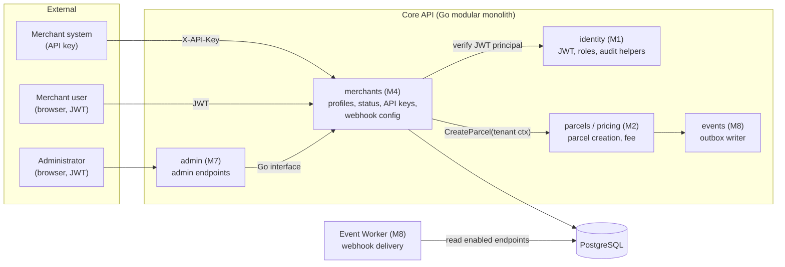
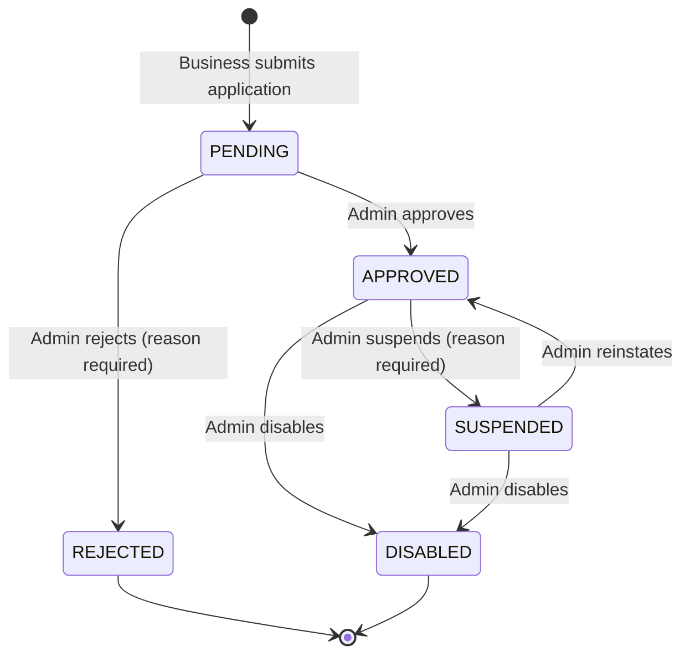
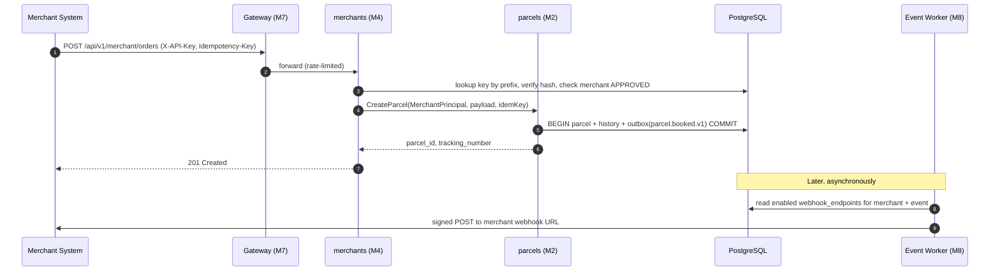

# Document 1 — Module Scope & Responsibility Specification

> **Status:** Draft / Proposed (For Review in Meeting 2)  
> **Author:** Member 4 — Merchant Integration  
> **Target Module / Location:** `core-api/internal/merchants/`  
> **Key Upstream Dependencies:** Member 1 (Auth, RBAC, audit), Member 2 (Parcel creation, Pricing), Member 7 (Admin approval UI, Gateway rate limits), Member 8 (Outbox, Webhook delivery), Member 9 (Secrets, deployment)  
> **Open Questions / Needs Clarification:** See [Section 9](#9-assumptions-unresolved-decisions-and-documentation-conflicts) — 14 items, including table naming, merchant statuses (U-26), webhook secret storage, admin approval interface (U-10), and webhook event names.

---

## 1. Purpose

### 1.1 Module Purpose

The Merchant Integration module lets external businesses (merchants) use SwiftDrop as a delivery provider **from their own systems**. It owns the full merchant tenant lifecycle: registration, approval state, API credentials, and webhook subscription configuration. It is also the **trust boundary** that turns an incoming API key into a verified merchant tenant context before any merchant parcel operation is allowed.

The module is a bounded context inside the Go Core API modular monolith.

### 1.2 Business Problem

Without a dedicated merchant integration:

- Online stores would have to book parcels one-by-one through the customer UI, which does not scale.
- There would be no controlled way to decide **which** businesses may create production orders.
- Shared or unrevocable credentials would make a leaked key a permanent breach.
- Merchants would have to poll for status updates instead of receiving push notifications.
- A single bug in tenant scoping could expose one merchant's orders and customer addresses to another merchant.

### 1.3 Objectives

1. Allow a business to apply as a merchant and have that application reviewed by an administrator (FR-MER-001, FR-ADM-005).
2. Ensure only **approved and enabled** merchants can create production parcel orders (FR-MER-002, AT-011).
3. Issue, rotate, and revoke merchant API keys that are never stored or logged in plaintext (FR-MER-003).
4. Scope every merchant query and mutation to the authenticated merchant tenant (FR-MER-004).
5. Expose versioned, idempotent merchant order endpoints that delegate parcel creation to Member 2's capability (FR-MER-005, FR-MER-006).
6. Let authorized merchant users register and manage webhook endpoints, with server-side URL validation (FR-MER-008, SEC-010, SEC-011).
7. Provide webhook configuration data that Member 8's Event Worker consumes for delivery (FR-MER-009).
8. Provide a merchant API quick-start, sample requests, and a demo merchant for the team demo.

---

## 2. Scope and Responsibilities

### 2.1 In-Scope Responsibilities

| ID | Capability | Responsibility | SRS Trace |
|---|---|---|---|
| M4-01 | Merchant application | Accept a business registration/application and persist it as `PENDING`. | FR-MER-001 |
| M4-02 | Merchant profile | Maintain business name, contact details, address, and owning user link. Allow the merchant to view/update its own non-status fields. | FR-MER-001 |
| M4-03 | Approval state machine | Own the merchant status values and legal transitions (approve, reject, suspend, reinstate, disable). Enforce them in the domain layer, with optimistic locking. | FR-ADM-005 |
| M4-04 | Approval backend capability | Expose the Go interface (and/or admin endpoints, see U-10) that Member 7's admin UI uses to change merchant status. Write the audit record in the same transaction. | FR-ADM-005, FR-IAM-009 |
| M4-05 | API key issuance | Generate high-entropy keys (`sd_live_…`), show plaintext once, store only prefix + hash, support labels, scopes, and optional expiry. | FR-MER-003 |
| M4-06 | API key rotation & revocation | Allow a merchant admin to revoke a key or create a replacement key. Revoked/expired keys must stop authenticating immediately. | FR-MER-003 |
| M4-07 | Merchant authentication | Verify an incoming API key and resolve it to a `MerchantPrincipal` (merchant ID, scopes, status). Reject unknown, revoked, expired, or non-approved merchants. | FR-MER-002, FR-MER-003 |
| M4-08 | Tenant isolation | Ensure `merchant_id` always comes from the verified credential/JWT, never from the request body, path, or query. | FR-MER-004, AT-011 |
| M4-09 | Merchant order API (transport) | Own the merchant-facing order endpoints (`/api/v1/merchant/orders`). Authenticate the merchant, then call Member 2's parcel-creation use case with the merchant tenant context and idempotency key. | FR-MER-005, FR-MER-006 |
| M4-10 | Merchant order listing (transport) | Expose the merchant's own orders, with filtering/pagination, by calling Member 2's tenant-scoped query capability. | FR-MER-007 |
| M4-11 | Webhook configuration | Create, list, update, enable/disable, and delete webhook endpoints. Validate event types and destination URL. | FR-MER-008 |
| M4-12 | Webhook URL validation (registration time) | Reject non-HTTPS URLs (except `local` profile), forbidden ports, and hosts that resolve to blocked CIDR ranges defined in `webhook-security.md`. | SEC-010, SEC-011 |
| M4-13 | Webhook signing secret management | Generate the per-endpoint signing secret, show it once, store it so Member 8 can sign requests, and support secret rotation. | FR-MER-010 |
| M4-14 | Webhook configuration read contract | Provide Member 8 a read-only way to find enabled endpoints for a merchant + event type. | FR-MER-009 |
| M4-15 | Persistence | Own migrations, constraints, and indexes for `merchants`, `merchant_api_credentials`, and `webhook_endpoints`. | — |
| M4-16 | Quality | Unit and integration tests for credentials, tenant isolation, approval transitions, idempotent order calls, and URL validation. | AT-011, AT-012 |
| M4-17 | Documentation | Maintain module `README.md`, `API.md`, merchant quick-start, curl/Postman samples, and a demo merchant seed. | — |

### 2.2 Explicit Exclusions

| Excluded Capability | Owner | Boundary |
|---|---|---|
| Human user registration, password, JWT issuance, Google OAuth, role definitions | Member 1 | Member 4 consumes the JWT principal and the `MERCHANT` role. A merchant *user* is a Member 1 user linked to a merchant. |
| Parcel aggregate, parcel validation, tracking number, status lifecycle, pricing | Member 2 | Member 4 never inserts into `parcels` or calculates a fee. It calls Member 2's use case. |
| Idempotency storage implementation (`idempotency_keys`) | Member 2 / shared | Member 4 passes the `Idempotency-Key` and caller scope `MERCHANT:<uuid>` through. It does not build a second idempotency store. |
| Dispatch, courier assignment, proof of delivery | Member 3 | Not involved. |
| Public tracking / SSE | Member 5 | Merchants may use the public tracking API like anyone else. Member 4 does not build tracking views. |
| Merchant dashboard UI, merchant order submission UI | Member 6 | Member 4 provides the backend endpoints that Member 6 calls. |
| Admin merchant approval UI, gateway routing and edge rate limiting | Member 7 | Member 7 builds the screen and gateway policy. Member 4 owns the status change rules and the API contract. |
| Webhook **delivery**: HTTP POST, HMAC signing at send time, send-time SSRF dial checks, retries, backoff, DLQ, `webhook_deliveries` table | Member 8 | Member 4 **configures** webhooks. Member 8 **delivers** them. |
| Outbox table, event envelope, RabbitMQ topology | Member 8 | Member 4 writes outbox rows only through Member 8's shared interface (if merchant events are approved, see U-09). |
| Secrets injection, Docker, Kubernetes manifests, observability stack | Member 9 | Member 4 documents required env vars and health needs. |
| AI assistant | Member 10 | The assistant has no access to merchant credentials or webhook config. |

### 2.3 Responsibility Matrix (RACI)

**R** = Responsible (does the work), **A** = Accountable (final decision), **C** = Consulted, **I** = Informed.

| Area | M1 | M2 | M4 | M6 | M7 | M8 | M9 |
|---|---|---|---|---|---|---|---|
| Merchant application & profile | C | | **A/R** | C | I | | |
| Merchant status rules & transitions | C | | **A/R** | I | C | I | |
| Admin approval screen | | | C | | **A/R** | | |
| Audit record for approval | C | | **R** | | C | | |
| API key issue / rotate / revoke | C | | **A/R** | C | | | |
| API key verification middleware | C | | **A/R** | | C | | |
| Tenant isolation on merchant data | C | C | **A/R** | | | | |
| Merchant order creation business logic | | **A/R** | C | I | | | |
| Merchant order endpoint (transport + auth) | C | C | **A/R** | C | I | | |
| Webhook endpoint config & URL validation | | | **A/R** | C | | C | |
| Webhook signing & delivery & retry & DLQ | | | C | | | **A/R** | |
| Send-time SSRF protection | | | C | | | **A/R** | |
| Edge rate limiting on merchant API | | | C | | **A/R** | | C |
| Secrets (key pepper, encryption key) | | | C | | | | **A/R** |

---

## 3. Bounded Context and Domain Ownership

### 3.1 Bounded Context

The module's language: **Merchant**, **Merchant Status**, **API Credential**, **Key Prefix**, **Scope**, **Webhook Endpoint**, **Subscribed Event Type**, **Signing Secret**, **Merchant Principal** (the verified tenant identity attached to a request).

### 3.2 Domain Ownership

The module owns:

- The **Merchant** aggregate: identity, profile, status, version.
- The **merchant status state machine** (proposed, pending U-26):

  Only `APPROVED` merchants may authenticate with an API key, create orders, or create new API keys. Exact statuses are confirmed in Document 2 after U-26 is resolved.

- **API credentials** belonging to a merchant (prefix, hash, label, scopes, expiry, revocation).
- **Webhook endpoints** belonging to a merchant (URL, signing secret, subscribed event types, enabled flag).

### 3.3 Authoritative Data

| Data | Authoritative Source | Notes |
|---|---|---|
| Merchant status | `merchants.status` (M4) | No other module may update it directly. Admin changes go through M4's interface. |
| Whether an API key is valid | `merchant_api_credentials` (M4) | A key is valid only if not revoked, not expired, and its merchant is `APPROVED`. |
| Webhook destinations and subscriptions | `webhook_endpoints` (M4) | Member 8 reads, does not write config fields. |
| Merchant parcels | `parcels` (M2) | Linked via `parcels.merchant_id`. M4 reads them only through M2's query capability. |
| Webhook delivery history | `webhook_deliveries` (M8) | M4 may expose it to merchants only through an M8 read interface (future, see U-13). |

---

## 4. Upstream and Downstream Dependencies

### 4.1 Upstream (what Member 4 needs)

| Provider | What Member 4 Needs | Status |
|---|---|---|
| Member 1 | JWT principal (user ID, role `MERCHANT`/`ADMIN`, `tenant_id` = merchant ID per ADR-003), RBAC helper, shared audit-log writer | Requested |
| Member 2 | `CreateParcel` use case accepting a merchant tenant context + idempotency key; tenant-scoped `ListParcelsByMerchant` query | Requested — see M2 doc-01 §8 "Merchant booking" |
| Member 7 | Admin UI calls for approve/reject/suspend/disable; gateway rate-limit policy for `/api/v1/merchant/*` | In discussion (U-10) |
| Member 8 | Final webhook event type names; outbox writer interface (if merchant events are emitted); agreement on how endpoint health (`DEGRADED`) is recorded | Requested |
| Member 9 | Secret injection for API key pepper and webhook-secret encryption key | Requested |
| Team | API conventions (error envelope, `Idempotency-Key`, pagination), DB migration ordering | Available in `docs/contracts/api-conventions.md` |

### 4.2 Downstream (who depends on Member 4)

| Consumer | Interaction |
|---|---|
| Merchant systems (external) | Call merchant order endpoints with an API key. |
| Member 6 — merchant dashboard | Calls profile, API key, webhook config, and merchant order list endpoints with JWT. |
| Member 7 — admin UI / admin module | Calls merchant list and status-change capability. |
| Member 8 — Event Worker | Reads enabled webhook endpoints + signing secret to deliver events. |
| Member 2 — parcels | Receives merchant tenant context on merchant-originated parcel creation. |
| Member 10 — E2E tests | Uses demo merchant and quick-start to script AT-011 / AT-012. |

---

## 5. Invariants This Module Must Protect

### 5.1 Tenant Isolation

1. Every merchant query and mutation is filtered by the `merchant_id` from the **verified principal**. A `merchant_id` in the request body, path, or query is never trusted.
2. A request for another merchant's resource returns `404 Not Found` (not `403`), so it does not reveal that the resource exists.
3. Repository methods that read merchant-owned rows must take `merchantID` as a required parameter. There is no "find by ID only" method for tenant data.

### 5.2 Merchant Status

4. Only `APPROVED` merchants can authenticate via API key, create orders, or issue new API keys.
5. A status change must follow the state machine. Illegal transitions are rejected in the domain layer, not only in the UI.
6. Every status change writes an `audit_logs` row (e.g. `MERCHANT_APPROVED`) **in the same transaction**.
7. Concurrent status changes are protected by the `version` column. The second writer gets `409 Conflict`.
8. Suspension or disablement takes effect immediately for new requests. Parcels already created are not affected.

### 5.3 Credentials

9. API key plaintext is shown exactly once at creation and is never stored, logged, or returned again.
10. Only the key prefix (public, for lookup) and a hash are persisted.
11. Key comparison uses a constant-time function.
12. A revoked or expired key fails authentication on the very next request (no long-lived cache of "valid" results; any cache must be invalidated on revoke).
13. A key cannot be moved to another merchant.

### 5.4 Webhook Configuration

14. A webhook URL must pass validation before it is saved: HTTPS only (HTTP allowed only in `local` profile), port 443 (80 locally), no userinfo in URL, and DNS must not resolve to any blocked range in `webhook-security.md` §3.1.
15. Subscribed event types must come from the approved catalog. Unknown types are rejected with `422`.
16. The signing secret is generated by the server, shown once, and never returned by list/get endpoints.
17. Registration-time URL validation does **not** replace Member 8's send-time check (DNS rebinding). Both are required.

---

## 6. What Other Modules May Request

### 6.1 Allowed Requests

| Caller | May Request | Mechanism |
|---|---|---|
| Member 7 (admin module) | List merchants (filter by status); get merchant details; change merchant status with reason | Go interface `merchants.AdminService` (proposed) |
| Member 1 / gateway middleware | Authenticate an API key → `MerchantPrincipal` | Go interface `merchants.CredentialVerifier` (proposed) |
| Member 2 | Check that a merchant is currently `APPROVED` (defensive check during creation) | Go interface `merchants.StatusReader` (proposed) |
| Member 8 | Enabled endpoints + signing secret for `(merchant_id, event_type)` | Read interface or read-only DB view (decision U-08) |
| Member 6 (via HTTP) | Merchant profile, API keys, webhook endpoints, merchant orders | REST, JWT with `MERCHANT` role |

Exact signatures and DTOs belong in Document 3 and Document 4.

### 6.2 Forbidden Actions

Other modules must not:

- Update `merchants.status` with direct SQL or bypass the state machine.
- Read `merchant_api_credentials.key_hash` or implement their own key verification.
- Insert or modify `webhook_endpoints` rows (Member 8 reads only).
- Accept a `merchant_id` from a client to scope parcel data without a verified `MerchantPrincipal`.
- Log API keys, signing secrets, or full `Authorization` / `X-API-Key` header values.

---

## 7. Ownership of Files, Tables, APIs, Queues, and Configuration

### 7.1 Files

| Path | Owner |
|---|---|
| `core-api/internal/merchants/` (`domain/`, `application/`, `infrastructure/`, `transport/`) | Member 4 |
| `core-api/internal/merchants/README.md`, `API.md` | Member 4 |
| `core-api/migrations/*merchants*`, `*merchant_api_credentials*`, `*webhook_endpoints*` | Member 4 (shared ordering review) |
| `docs/contracts/webhook-security.md` | Member 4 & Member 8 (co-owned) |
| `docs/drafts/member-04-merchants/` | Member 4 |
| Postman collection / merchant quick-start (location TBD in doc-08) | Member 4 |
| `services/messaging/worker/webhook/` | Member 8 — not Member 4 |

### 7.2 Tables

| Table | Owner | Others' Access |
|---|---|---|
| `merchants` | Member 4 | M7 via Go interface only; M2 references `merchants.id` by application ID |
| `merchant_api_credentials` | Member 4 | None |
| `webhook_endpoints` | Member 4 | M8 read-only (config fields) |
| `parcels` | Member 2 | M4 via M2 interface only |
| `webhook_deliveries` | Member 8 | M4 none (future read interface) |
| `audit_logs` | Member 1 (shared writer) | M4 writes via shared helper |
| `idempotency_keys` | Member 2 / shared | M4 passes key through; does not write directly |

### 7.3 APIs

Proposed route inventory (final paths and DTOs in Document 4; see U-05 for path naming):

| Method & Path | Purpose | Caller |
|---|---|---|
| `POST /api/v1/merchants/applications` | Submit merchant application | Authenticated user (becomes merchant owner) |
| `GET /api/v1/merchants/me` | View own merchant profile and status | Merchant user (JWT) |
| `PATCH /api/v1/merchants/me` | Update own contact/profile fields | Merchant admin (JWT) |
| `POST /api/v1/merchants/me/api-keys` | Create API key | Merchant admin (JWT), merchant `APPROVED` |
| `GET /api/v1/merchants/me/api-keys` | List keys (prefix, label, status only) | Merchant user (JWT) |
| `DELETE /api/v1/merchants/me/api-keys/{key_id}` | Revoke key | Merchant admin (JWT) |
| `POST /api/v1/merchants/me/webhooks` | Register webhook endpoint | Merchant admin (JWT) |
| `GET /api/v1/merchants/me/webhooks` | List webhook endpoints (no secret) | Merchant user (JWT) |
| `PATCH /api/v1/merchants/me/webhooks/{id}` | Update URL / events / enabled | Merchant admin (JWT) |
| `POST /api/v1/merchants/me/webhooks/{id}/rotate-secret` | Rotate signing secret | Merchant admin (JWT) |
| `DELETE /api/v1/merchants/me/webhooks/{id}` | Delete webhook endpoint | Merchant admin (JWT) |
| `POST /api/v1/merchant/orders` | Create parcel order (idempotent) | Merchant system (API key) |
| `GET /api/v1/merchant/orders` | List own orders | Merchant system (API key) or merchant user (JWT) |
| `GET /api/v1/merchant/orders/{id}` | Get own order | Merchant system (API key) or merchant user (JWT) |
| Admin: list / approve / reject / suspend / reinstate / disable | Admin merchant management | Admin — route owned by M7 or M4 (U-10) |

### 7.4 Queues and Events

- Member 4 owns **no RabbitMQ queues, exchanges, or consumers**.
- Member 4 does **not** publish parcel events. Merchant-created parcels emit `parcel.booked.v1` from Member 2.
- Member 4 *may* emit merchant lifecycle events (`merchant.approved.v1`, `merchant.suspended.v1`) through Member 8's outbox interface, if a consumer needs them (U-09).
- The catalog entry `merchant.webhook_dispatch.v1` lists `internal/merchants` as producer. This conflicts with the "M4 configures, M8 delivers" boundary (U-07).

### 7.5 Configuration

| Variable (proposed) | Purpose | Owner |
|---|---|---|
| `MERCHANT_API_KEY_PREFIX` | Key prefix, e.g. `sd_live_` / `sd_test_` | M4 |
| `MERCHANT_API_KEY_PEPPER` | Server-side secret mixed into key hash (secret) | M4 defines, M9 injects |
| `WEBHOOK_SECRET_ENCRYPTION_KEY` | Key to encrypt webhook signing secrets at rest (secret) | M4 defines, M9 injects; M8 also needs it to decrypt |
| `WEBHOOK_ALLOW_HTTP` | Allow `http://` URLs (`true` only in `local`) | M4 |
| `WEBHOOK_MAX_ENDPOINTS_PER_MERCHANT` | Resource limit (e.g. 10) | M4 |
| `MERCHANT_MAX_ACTIVE_KEYS` | Resource limit (e.g. 5) | M4 |

Real values never go into source control. Safe examples go in doc-08 and `.env.example`.

---

## 8. Integration Boundary Summary

Member 4 is responsible for steps 2–4 and 7. Member 2 owns steps 5–6. Member 8 owns everything after the commit.

---

## 9. Assumptions, Unresolved Decisions, and Documentation Conflicts

### 9.1 Assumptions

- A1. API keys (not OAuth client credentials) are the selected merchant API authentication method (FR-MER-003 requires choosing one). Rationale: simpler for merchants, already reflected in `API.md` and the `sd_live_` prefix.
- A2. A merchant user is a normal Member 1 user with role `MERCHANT`, linked to one merchant. Multi-user merchants are allowed later but not required for the baseline.
- A3. API keys are high-entropy random values (≥ 32 bytes), so a fast hash (SHA-256 / HMAC-SHA256 with pepper) is sufficient. Argon2id is not needed for random keys and would slow every API call.
- A4. Merchant order creation reuses Member 2's parcel-creation use case. There is exactly one parcel-creation code path.

### 9.2 Open Questions for Meeting 2

| ID | Question | Current Conflict / Position | Needs |
|---|---|---|---|
| U-01 | **Table names** | Module `README.md` says `merchant_api_keys`, `webhook_subscriptions`. `database-schema.md` and SRS say `merchant_api_credentials`, `webhook_endpoints`. **Proposal:** use schema names and update README. | Team |
| U-02 | **Merchant statuses** (= M7 U-26) | README: PENDING/APPROVED/SUSPENDED. Schema: + REJECTED. SRS FR-ADM-005: approve, reject, suspend, **disable**. **Proposal:** PENDING, APPROVED, REJECTED, SUSPENDED, DISABLED; SUSPENDED → APPROVED allowed. | M7, team |
| U-03 | **Webhook secret storage** | Schema and README say `secret_hash`. HMAC signing needs the original secret, so a hash cannot work. **Proposal:** store encrypted (AES-GCM) as `secret_ciphertext`; M8 decrypts at send time. | M8 |
| U-04 | **Who generates the webhook secret** | `API.md` lets the merchant send `secret` in the request. **Proposal:** server generates `whsec_…` and returns it once. Do not accept merchant-chosen secrets. | M8, M6 |
| U-05 | **Route naming** | SRS uses `/api/v1/merchant/orders`, `/api/v1/merchant/webhooks`. `API.md` uses `/api/v1/merchants/webhooks`. **Proposal:** `/api/v1/merchants/me/*` for self-service config, `/api/v1/merchant/orders` kept as the SRS integration path. | M6, M7 |
| U-06 | **Webhook event names** | `webhook-security.md`: `parcel.created`, `parcel.delivery.failed`. `event-contracts.md`: `parcel.booked.v1`, `parcel.delivery_failed.v1`. `API.md`: `parcel.status_changed.v1`. **Proposal:** merchants subscribe to the `event-contracts.md` names. | M8 |
| U-07 | **`merchant.webhook_dispatch.v1` producer** | Event catalog lists `internal/merchants` as producer, but it is triggered by the Event Worker. **Proposal:** M8 owns it, or remove it from the catalog if internal to the worker. | M8 |
| U-08 | **How M8 reads webhook config** | Worker is a separate service; cannot call a Go interface. **Proposal:** M8 reads `webhook_endpoints` through a documented read-only DB role/view; M4 owns the schema. | M8, M9 |
| U-09 | **Merchant lifecycle events** | Is any consumer interested in `merchant.approved.v1` (e.g. notification email)? If none, do not emit. | M8 |
| U-10 | **Admin approval interface** (= M7 U-10) | M7 proposes admin endpoint → M4 Go interface, M4 writes status + audit in one transaction. **Proposal:** accept. | M7, M1 |
| U-11 | **`version` column** | `database-schema.md` §conventions says `merchants` has `version`, but the ERD block omits it. **Proposal:** add `version integer not null default 1`. | DB coordinator |
| U-12 | **Endpoint `DEGRADED` state** | `webhook-security.md` says endpoints become `DEGRADED` after retry exhaustion. That means M8 would write to M4's table. **Proposal:** M8 records health in its own table, or M4 exposes `MarkEndpointDegraded` via an approved path. | M8 |
| U-13 | **Delivery history for merchants** | FR-MER-011 records attempts (M8). Should merchants see their delivery log in the dashboard? If yes, M8 provides the read API. | M8, M6 |
| U-14 | **Rate limits** | SEC-007 requires limits on merchant API and webhook registration. **Proposal:** edge limit at gateway (M7) per API key prefix; app-level resource caps (max keys, max endpoints) in M4. | M7 |

Resolved decisions will be recorded in the team decision log and reflected in Documents 2–8.

---

## 10. Out-of-Scope Work

- Building any frontend screens (merchant dashboard, admin approval UI).
- Implementing webhook HTTP delivery, signing at send time, retries, DLQ, or delivery logging.
- Implementing parcel validation, pricing, tracking numbers, or the parcel state machine.
- OAuth 2.0 client-credentials flow (unless the team overrides A1).
- Merchant billing, invoicing, settlements, or contract pricing.
- Bulk CSV order import.
- Merchant sub-accounts with fine-grained per-user permissions.
- Sandbox/test-mode environment with separate data (only the `sd_test_` prefix is reserved).

---

## 11. Acceptance Criteria

The module is ready for integration when:

1. A business can submit an application; it is stored as `PENDING`.
2. An admin can approve, reject, suspend, reinstate, and disable a merchant through the agreed interface; illegal transitions are rejected; each change writes an audit row.
3. Two concurrent status changes on the same merchant result in one success and one `409`.
4. An approved merchant can create an API key; plaintext is returned once and is not present in DB or logs.
5. A revoked or expired key, or a key of a non-`APPROVED` merchant, is rejected with `401`/`403` on the next request (AT-011).
6. A merchant can create an order via API key; the call reaches Member 2's use case and returns `parcel_id` and `tracking_number` (FR-MER-005).
7. Repeating the order request with the same `Idempotency-Key` returns the original result; no duplicate parcel (FR-MER-006).
8. Merchant A cannot read, list, or modify Merchant B's orders, keys, or webhooks; such requests return `404` (AT-011, FR-MER-004).
9. Webhook registration rejects `http://` (outside `local`), private/loopback/link-local/metadata IPs, non-standard ports, and unknown event types.
10. Webhook secret is server-generated, shown once, and never returned by list endpoints.
11. A configured webhook receives a signed event through Member 8's worker, including retry after a simulated failure (AT-012, joint with M8).
12. Module `README.md`, `API.md`, quick-start, and Postman/curl samples match the implementation.

---

## 12. Definition of Done

- Matches the approved business rules and API contract.
- `gofmt`, `golangci-lint`, and `go test -race ./...` pass.
- Tenant isolation, credential, approval, and URL-validation tests are included.
- Migrations apply cleanly from an empty DB in the documented order.
- No secrets in code, fixtures, or logs; `.env.example` uses placeholders.
- `README.md`, `API.md`, and changelog updated.
- Demo merchant seed works in the local Compose environment.
- Reviewed and merged through a feature branch.
