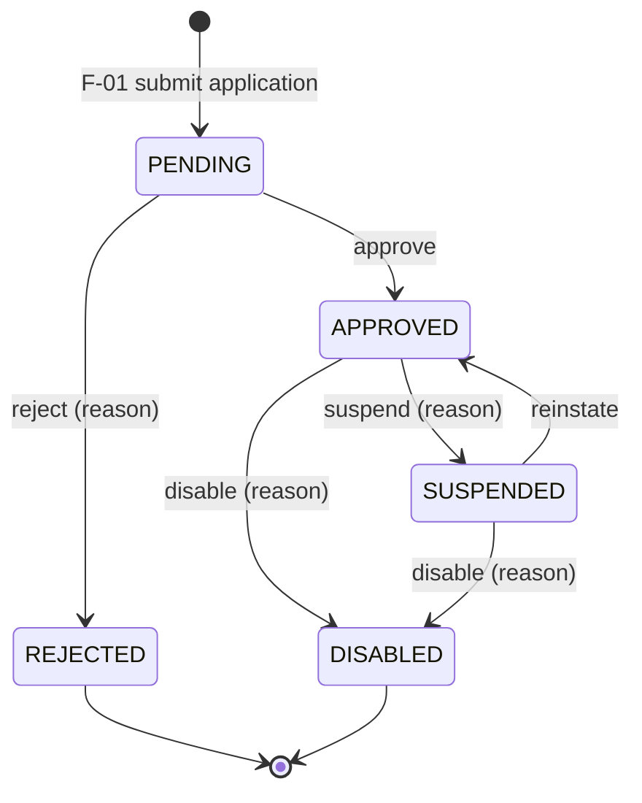
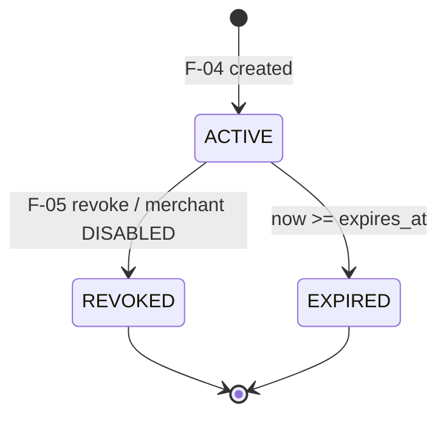
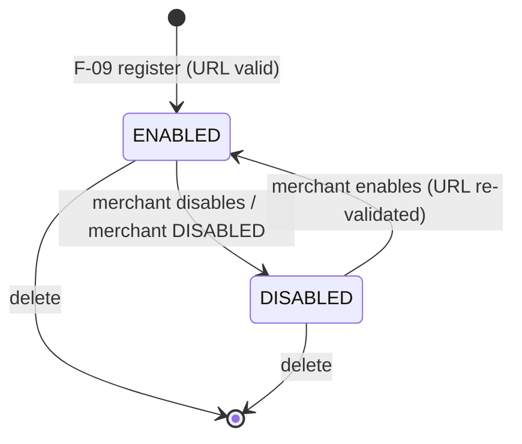
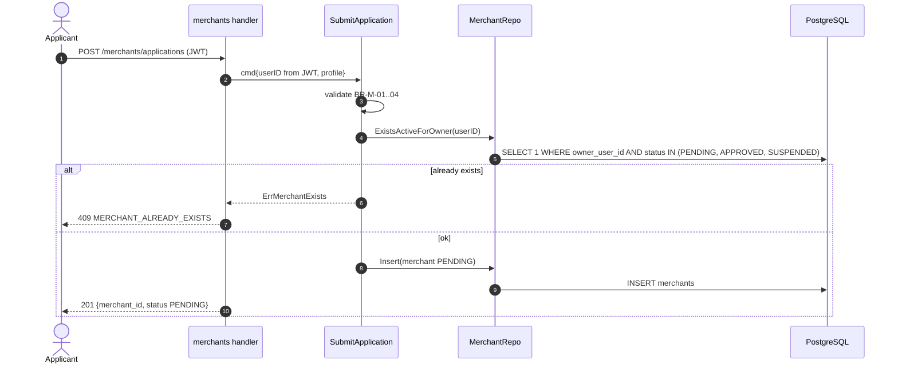
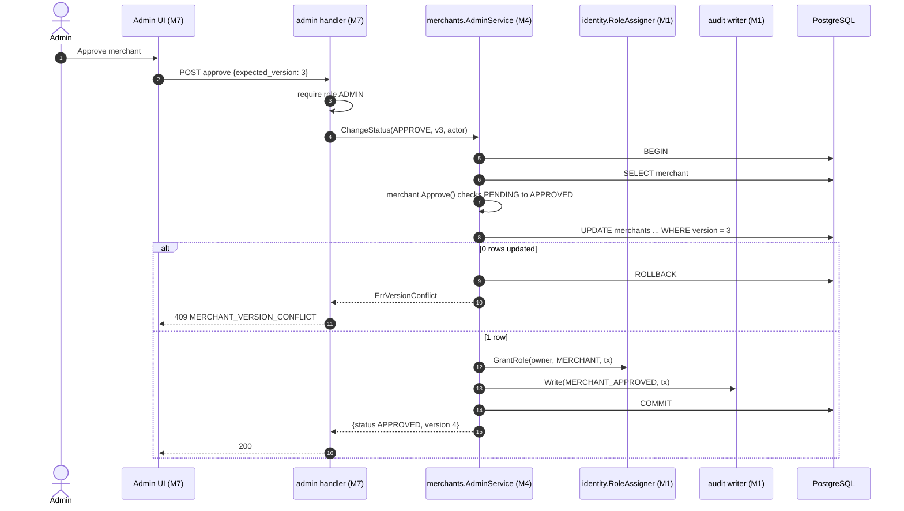
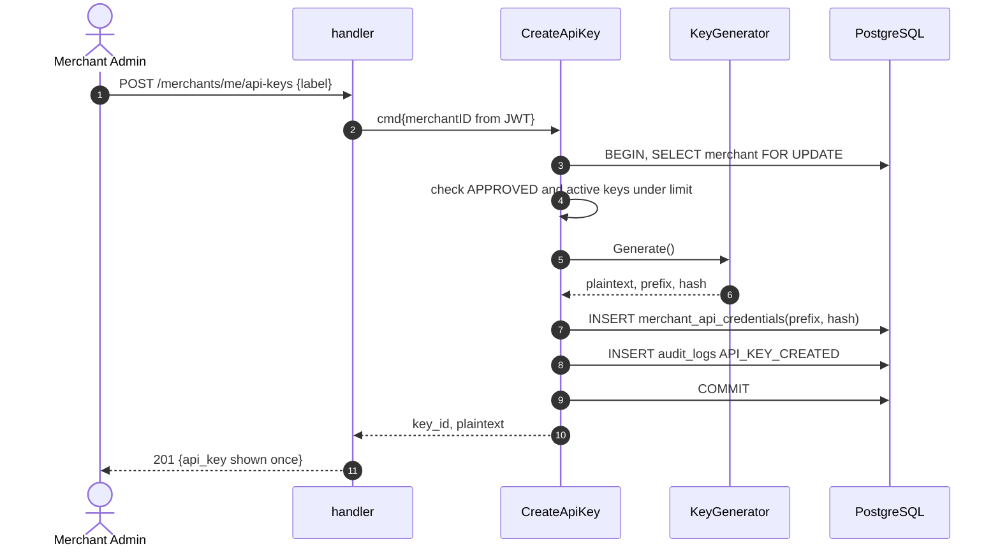
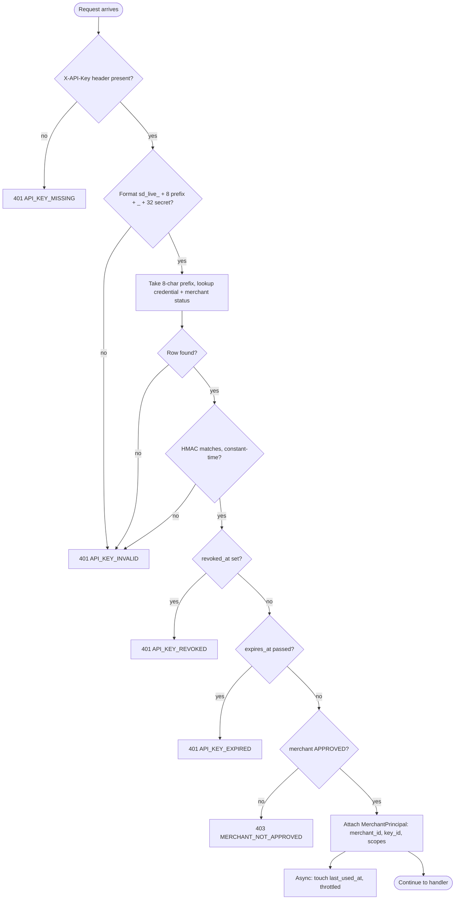
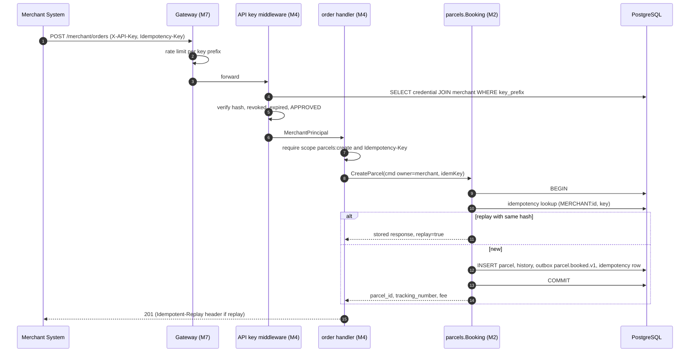
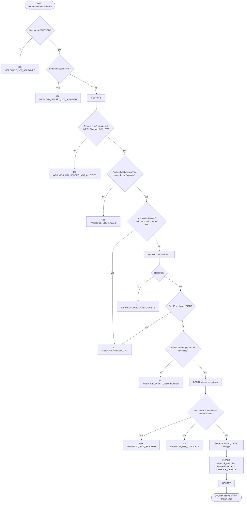
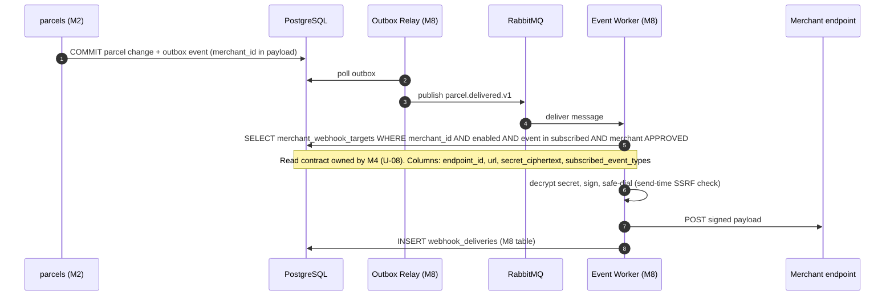

# Document 2 — Functional Flows & Business Rules

> **Status:** Post-Review Aligned (v2.0.0) — 25 October 2026  
> **Author:** Member 4 — Merchant Integration  
> **Target Module / Location:** `core-api/internal/merchants/`  
> **Key Upstream Dependencies:** Member 1 (JWT, roles, audit), Member 2 (`CreateParcel`, merchant order queries, idempotency), Member 7 (admin UI, gateway), Member 8 (webhook delivery, event names)  
> **Alignment Status:** All open questions U-01–U-19 resolved. See `MEMBER_04_ALIGNMENT_AND_SPECIFICATION_GUIDE.md` §3.

---

## 1. Actors and Triggers

### 1.1 Actors

| Actor | Authenticates With | Description |
|---|---|---|
| **Applicant** | JWT (Member 1 user) | A signed-in user who wants to register a business as a merchant. |
| **Merchant Admin** | JWT, role `MERCHANT`, linked to an approved merchant as owner | Manages profile, API keys, and webhooks for their merchant. |
| **Merchant User** | JWT, role `MERCHANT` | Can view profile, keys (metadata only), webhooks, and orders. Read-only for config (baseline: owner is the only user, see Doc 1 A2). |
| **Merchant System** | `X-API-Key: sd_live_…` | The merchant's server calling the order API. No human involved. |
| **Administrator** | JWT, role `ADMIN` | Reviews applications and changes merchant status via Member 7's UI. |
| **Admin module (M7)** | In-process Go call | Calls Member 4's `AdminService` interface. |
| **Parcels module (M2)** | In-process Go call | Executes the actual parcel creation for merchant orders. |
| **Event Worker (M8)** | Read-only DB access (U-08) | Reads webhook config to deliver events. |

### 1.2 Triggers

| ID | Trigger | Actor | Flow |
|---|---|---|---|
| T-01 | Business submits application form | Applicant | F-01 |
| T-02 | Admin approves / rejects / suspends / reinstates / disables | Administrator → M7 → M4 | F-02 |
| T-03 | Merchant admin updates contact details | Merchant Admin | F-03 |
| T-04 | Merchant admin creates an API key | Merchant Admin | F-04 |
| T-05 | Merchant admin revokes or rotates a key | Merchant Admin | F-05 |
| T-06 | Any request carrying `X-API-Key` | Merchant System | F-06 |
| T-07 | Merchant system creates an order | Merchant System | F-07 |
| T-08 | Merchant lists / views its orders | Merchant System / User | F-08 |
| T-09 | Merchant admin registers a webhook | Merchant Admin | F-09 |
| T-10 | Merchant admin updates, disables, deletes, or rotates a webhook secret | Merchant Admin | F-10 |
| T-11 | A parcel event is committed to the outbox | System (M2/M3 → M8) | F-11 |

---

## 2. State Machines

### 2.1 Merchant Status



| From | To | Command | Who | Reason Required | Side Effects |
|---|---|---|---|---|---|
| — | `PENDING` | `SubmitApplication` | Applicant | — | Merchant row created, `version = 1` |
| `PENDING` | `APPROVED` | `Approve` | Admin | No | `approved_by`, `approved_at` set; owner gets `MERCHANT` role (U-15); audit `MERCHANT_APPROVED` |
| `PENDING` | `REJECTED` | `Reject` | Admin | **Yes** | audit `MERCHANT_REJECTED` |
| `APPROVED` | `SUSPENDED` | `Suspend` | Admin | **Yes** | API keys stop working (not revoked); webhooks paused; audit `MERCHANT_SUSPENDED` |
| `SUSPENDED` | `APPROVED` | `Reinstate` | Admin | No | Existing non-revoked keys work again; webhooks resume; audit `MERCHANT_REINSTATED` |
| `APPROVED` / `SUSPENDED` | `DISABLED` | `Disable` | Admin | **Yes** | All active keys **revoked**; all webhooks **disabled**; audit `MERCHANT_DISABLED` |

Any other transition → `409 MERCHANT_INVALID_TRANSITION`. `REJECTED` and `DISABLED` are terminal.

**What each status allows:**

| Capability | PENDING | APPROVED | SUSPENDED | REJECTED | DISABLED |
|---|---|---|---|---|---|
| View own profile / status (JWT) | ✅ | ✅ | ✅ | ✅ | ✅ |
| Update contact details | ✅ | ✅ | ✅ | ❌ | ❌ |
| Create API key | ❌ | ✅ | ❌ | ❌ | ❌ |
| Authenticate with API key | ❌ | ✅ | ❌ | ❌ | ❌ |
| Create order | ❌ | ✅ | ❌ | ❌ | ❌ |
| List / view own existing orders (JWT) | ❌ | ✅ | ✅ | ❌ | ✅ (read-only history) |
| Register / edit webhooks | ❌ | ✅ | ❌ | ❌ | ❌ |
| Receive webhooks | ❌ | ✅ | ❌ (paused) | ❌ | ❌ |

**Note on webhook delivery during suspension:** Events that occur while a merchant is `SUSPENDED` or an endpoint is disabled are **not** back-filled after reinstatement (U-19 resolved: no back-fill; FK stays `ON DELETE RESTRICT` via soft delete).

### 2.2 API Credential Status (derived, not stored as a column)



`status = REVOKED if revoked_at IS NOT NULL, else EXPIRED if expires_at <= now(), else ACTIVE`. A key that is `ACTIVE` but whose merchant is not `APPROVED` still fails authentication (BR-K-06).

### 2.3 Webhook Endpoint



Endpoint health (`DEGRADED` after retry exhaustion) is **not** part of this state machine. It is delivery health, owned by Member 8 (U-12).

---

## 3. Business Rules

### 3.1 Merchant Application & Status (BR-M)

| ID | Rule |
|---|---|
| BR-M-01 | `business_name` required, 2–150 chars, trimmed. |
| BR-M-02 | `contact_email` required, valid email format, max 254 chars. |
| BR-M-03 | `contact_phone` required, E.164 format (e.g. `+94771234567`). |
| BR-M-04 | `address` required: `line1`, `city`, `country` (ISO 3166-1 alpha-2); `line2`, `postal_code` optional. |
| BR-M-05 | A user may have **at most one** merchant in `PENDING`, `APPROVED`, or `SUSPENDED`. A rejected or disabled applicant may apply again (new row) — see U-16. |
| BR-M-06 | New applications always start as `PENDING`. A client-supplied `status` is ignored. |
| BR-M-07 | Status changes follow §2.1 only, and only by `ADMIN`. |
| BR-M-08 | Reject, suspend, and disable require a `reason` of 5–500 chars. Stored in the audit row. |
| BR-M-09 | Every status change uses optimistic locking: `UPDATE … WHERE id = ? AND version = ?`. 0 rows → `409 MERCHANT_VERSION_CONFLICT`. |
| BR-M-10 | Status change + audit row are committed in one transaction. If the audit write fails, the status change is rolled back. |
| BR-M-11 | A merchant cannot change its own status. `business_name` changes after approval require admin action (out of scope for baseline). |

### 3.2 API Keys (BR-K)

| ID | Rule |
|---|---|
| BR-K-01 | Only the merchant admin of an `APPROVED` merchant may create keys. |
| BR-K-02 | Key format (ADR-003 §6.1): `sd_live_<prefix>_<secret>` in production, `sd_test_<prefix>_<secret>` locally (`MERCHANT_API_KEY_PREFIX`). `prefix` = 8 base62 chars (public, stored as `key_prefix`, unique across all keys, regenerate on collision); `secret` = 32 base62 chars from CSPRNG (≈ 190 bits, ADR minimum 128). Example: `sd_live_Ab3dE9xK_q7Lm2Np4Rs6Tu8Vw0Yz1Bc3De5Fg7Hi9`. |
| BR-K-03 | Stored value: `key_hash = HMAC-SHA256(MERCHANT_API_KEY_PEPPER, full_key)`, hex. Plaintext never stored, never logged. |
| BR-K-04 | Plaintext returned **once**, in the `201` response only. |
| BR-K-05 | `label` required, 1–60 chars, unique among the merchant's active keys. |
| BR-K-06 | Authentication succeeds only if: prefix found **and** hash matches (constant-time) **and** not revoked **and** not expired **and** merchant is `APPROVED`. |
| BR-K-07 | Scopes ⊆ `{parcels:create, parcels:read}` (ADR-003 names). Default: both. `webhooks:manage` is **not** grantable to API keys in the baseline (Doc 7 §2 C-3). A request needing a missing scope → `403 MERCHANT_SCOPE_DENIED`. |
| BR-K-08 | `expires_at` optional; if given must be 1–365 days in the future. |
| BR-K-09 | Max active keys per merchant: `MERCHANT_MAX_ACTIVE_KEYS` (default 5). |
| BR-K-10 | Revocation sets `revoked_at = now()`. It is permanent; a revoked key cannot be restored. |
| BR-K-11 | Revoking an already-revoked key returns `204` (idempotent). |
| BR-K-12 | Rotation = create new key, then revoke old key. Both may be active during the merchant's switch-over (bounded by BR-K-09). |
| BR-K-13 | List endpoints return `key_id`, `label`, `key_prefix`, `scopes`, `status`, `created_at`, `expires_at`, `revoked_at`, `last_used_at`. Never the hash. |
| BR-K-14 | `last_used_at` is updated at most once per minute per key, outside the request's critical path (U-17). |

### 3.3 Merchant Orders (BR-O)

| ID | Rule |
|---|---|
| BR-O-01 | Order endpoints require API key (or merchant JWT for reads). Create requires scope `parcels:create`; reads require `parcels:read`. JWT merchant owners have both. |
| BR-O-02 | `Idempotency-Key` header is **required** on `POST /merchant/orders`, UUID v4. Missing → `400 IDEMPOTENCY_KEY_REQUIRED`. Invalid → `400 IDEMPOTENCY_KEY_INVALID`. |
| BR-O-03 | Idempotency scope is `caller_scope = MERCHANT:<merchant_id>` and `operation = POST /api/v1/merchant/orders`. The same key from two different merchants does not collide. |
| BR-O-04 | `merchant_id` in the body is ignored. Owner of the parcel = principal's merchant. |
| BR-O-05 | Parcel field validation, pricing, tracking number, and initial status belong to Member 2. Member 4 does not re-validate parcel fields. |
| BR-O-06 | Response must include `parcel_id`, `tracking_number`, `status`, `fee`, `created_at` (FR-MER-005). |
| BR-O-07 | Reads return only parcels where `parcels.merchant_id = principal.merchant_id`. Another merchant's parcel ID → `404`. |
| BR-O-08 | List supports `status`, `created_from`, `created_to`, `page`, `per_page` (max 100) (FR-MER-007). |
| BR-O-09 | Optional `merchant_reference` (merchant's own order ID, max 64 chars) is passed to Member 2 and returned — uniqueness rules pending U-18. |

### 3.4 Webhooks (BR-W)

| ID | Rule |
|---|---|
| BR-W-01 | Only the merchant admin of an `APPROVED` merchant may create, update, enable, rotate, or delete webhooks. |
| BR-W-02 | URL max 2048 chars, absolute, scheme `https` (or `http` only if `WEBHOOK_ALLOW_HTTP=true`, which is `local` only). |
| BR-W-03 | No userinfo (`user:pass@`), no fragment. Port must be 443 (or 80 when HTTP allowed). |
| BR-W-04 | Host must not be an IP literal or hostname that resolves to any range in `webhook-security.md` §3.1 (loopback, RFC 1918, link-local incl. `169.254.169.254`, `0.0.0.0/8`, IPv6 `::1`, `fe80::/10`, `fc00::/7`). **All** resolved addresses are checked; one bad address → reject. |
| BR-W-05 | Hostnames `localhost`, `*.local`, `*.internal`, `*.svc`, `*.cluster.local` are rejected without DNS lookup. |
| BR-W-06 | DNS lookup timeout: 2 s. Lookup failure → `422 WEBHOOK_URL_UNRESOLVABLE` (do not save an unverifiable URL). |
| BR-W-07 | `events` non-empty, each from the approved catalog (U-06), no duplicates. |
| BR-W-08 | Same `(merchant_id, url)` cannot be registered twice → `409 WEBHOOK_URL_DUPLICATE`. |
| BR-W-09 | Max endpoints per merchant: `WEBHOOK_MAX_ENDPOINTS_PER_MERCHANT` (default 10). |
| BR-W-10 | Signing secret: server-generated `whsec_` + 32 bytes base62, encrypted at rest (U-03), returned **once** on create and on rotate. A client-supplied `secret` is rejected with `400` (U-04). |
| BR-W-11 | Changing the URL or re-enabling re-runs BR-W-02 … BR-W-06. |
| BR-W-12 | Delete is a **soft delete** (`deleted_at = now()`, `enabled = false`), per the repo rule "soft deletes only for domain entities" (`database-schema.md` §3.1). This keeps M8's `webhook_deliveries` FK valid. The same URL can be registered again afterwards. Soft-deleted rows are purged after 30 days (Doc 5 §8). |
| BR-W-13 | Webhooks are only delivered while the merchant is `APPROVED` **and** the endpoint is `enabled`. |

### 3.5 Cross-Cutting (BR-X)

| ID | Rule |
|---|---|
| BR-X-01 | All tenant-owned reads/writes filter by principal's `merchant_id`. Not found or not owned → `404`. |
| BR-X-02 | Errors use the standard envelope in `api-conventions.md` §2.3 with a `correlation_id`. |
| BR-X-03 | Never log: full API key, `X-API-Key` header, webhook secret, `Authorization` header. Log `key_prefix` only. |
| BR-X-04 | Security-sensitive actions write an audit row: status changes, `API_KEY_CREATED`, `API_KEY_REVOKED`, `WEBHOOK_CREATED`, `WEBHOOK_UPDATED`, `WEBHOOK_DELETED`, `WEBHOOK_SECRET_ROTATED`. |
| BR-X-05 | Time values in UTC, RFC 3339. |

---

## 4. Functional Flows

Each flow lists: preconditions, main success flow, alternate flows (A), failure flows (E), and postconditions.

### F-01 Submit Merchant Application

**Preconditions:** Caller authenticated (JWT). BR-M-05 satisfied.

**Main flow:**
1. Applicant sends `POST /api/v1/merchants/applications` with business name, contact email, phone, address.
2. Handler extracts `user_id` from JWT.
3. Use case validates BR-M-01 … BR-M-04.
4. Use case checks BR-M-05 (no active merchant for this user).
5. Domain creates `Merchant{status: PENDING, version: 1, owner_user_id}`.
6. Repository inserts row.
7. Return `201` with `merchant_id`, `status: PENDING`.

**Alternate flows:**
- A1. Applicant calls `GET /api/v1/merchants/me` later to see status.

**Failure flows:**
- E1. Validation fails → `422 VALIDATION_FAILED` with `details[]`.
- E2. User already has an active merchant → `409 MERCHANT_ALREADY_EXISTS`.
- E3. Two concurrent submissions by the same user → partial unique index rejects the second → `409 MERCHANT_ALREADY_EXISTS`.

**Postconditions:** One `PENDING` merchant for the user. No keys, no webhooks.



---

### F-02 Admin Changes Merchant Status

**Preconditions:** Caller is `ADMIN`. Target merchant exists. Admin UI holds the merchant's current `version`.

**Main flow (approve example):**
1. Admin clicks *Approve* in M7's UI; UI sends request with `expected_version` and `Idempotency-Key`.
2. M7 admin handler verifies role `ADMIN` and calls `merchants.AdminService.ChangeStatus(ctx, merchantID, cmd{action: APPROVE, expectedVersion, reason, actor})`.
3. M4 use case begins transaction.
4. Load merchant; domain method `merchant.Approve(actor, now)` checks §2.1 transition.
5. Repository `UPDATE merchants SET status, approved_by, approved_at, version = version + 1 WHERE id = ? AND version = ?`.
6. Grant `MERCHANT` role to owner via Member 1 interface (U-15) in the same transaction.
7. Write audit row `MERCHANT_APPROVED` with previous/new state.
8. Commit. Return new status and version.

**Alternate flows:**
- A1 Reject: reason required; no role grant.
- A2 Suspend: reason required. Keys and webhooks untouched in DB; they stop working because authentication and delivery check status (BR-K-06, BR-W-13).
- A3 Reinstate: SUSPENDED → APPROVED; keys/webhooks work again with no further action.
- A4 Disable: reason required. In the same transaction: `UPDATE merchant_api_credentials SET revoked_at = now() WHERE merchant_id = ? AND revoked_at IS NULL` and `UPDATE webhook_endpoints SET enabled = false WHERE merchant_id = ?`.

**Failure flows:**
- E1. Not `ADMIN` → `403` (checked by M7 before calling M4; M4 re-checks actor role defensively).
- E2. Merchant not found → `404 MERCHANT_NOT_FOUND`.
- E3. Illegal transition (e.g. REJECTED → APPROVED) → `409 MERCHANT_INVALID_TRANSITION`.
- E4. `version` mismatch (another admin acted first) → `409 MERCHANT_VERSION_CONFLICT`; UI reloads.
- E5. Missing reason on reject/suspend/disable → `422 REASON_REQUIRED`.
- E6. Audit or role-grant write fails → whole transaction rolled back → `500`.

**Postconditions:** New status persisted, version incremented, audit row present. All or nothing.



---

### F-03 Update Merchant Profile

**Preconditions:** Merchant admin (JWT). Merchant in `PENDING`, `APPROVED`, or `SUSPENDED`.

**Main flow:** `PATCH /api/v1/merchants/me` with any of `contact_email`, `contact_phone`, `address` and `expected_version` → validate BR-M-02 … 04 → optimistic update → `200`.

**Failure flows:** `422` validation; `409 MERCHANT_VERSION_CONFLICT`; `403 MERCHANT_STATUS_FORBIDS_ACTION` if REJECTED/DISABLED; attempts to change `status` or `business_name` are ignored (BR-M-06, BR-M-11).

---

### F-04 Create API Key

**Preconditions:** Merchant admin (JWT). Merchant `APPROVED`. Active keys < limit.

**Main flow:**
1. `POST /api/v1/merchants/me/api-keys` `{label, scopes?, expires_at?}`.
2. Use case validates BR-K-05, BR-K-07, BR-K-08.
3. Begin transaction; lock merchant row (`SELECT … FOR UPDATE`) to serialise the limit check.
4. Check merchant `APPROVED` and active key count < limit (BR-K-09).
5. Generate key (BR-K-02); compute hash (BR-K-03).
6. Insert credential row (prefix, hash, label, scopes, expires_at).
7. Write audit `API_KEY_CREATED` (prefix only).
8. Commit. Return `201` with plaintext `api_key` once.

**Failure flows:**
- E1. Merchant not `APPROVED` → `403 MERCHANT_NOT_APPROVED`.
- E2. Limit reached → `409 API_KEY_LIMIT_REACHED`.
- E3. Duplicate active label → `409 API_KEY_LABEL_DUPLICATE`.
- E4. Prefix collision on insert (unique violation) → regenerate, retry up to 3 times → then `500`.
- E5. Client drops connection after commit → key exists but plaintext lost. Merchant must revoke it and create another (see EC-08).

**Postconditions:** One new `ACTIVE` key. Plaintext exists only in the HTTP response.



---

### F-05 Revoke / Rotate API Key

**Revoke main flow:**
1. `DELETE /api/v1/merchants/me/api-keys/{key_id}`.
2. `UPDATE merchant_api_credentials SET revoked_at = now() WHERE id = ? AND merchant_id = ? AND revoked_at IS NULL`.
3. If 1 row → audit `API_KEY_REVOKED`; invalidate any auth cache entry for the prefix → `204`.
4. If 0 rows → check whether key exists for this merchant: exists (already revoked) → `204` (BR-K-11); not exists or belongs to another merchant → `404`.

**Rotation (recommended procedure, documented in quick-start):**
1. Create new key (F-04) with label e.g. `prod-2026-11`.
2. Merchant deploys new key to their servers.
3. Merchant confirms traffic on new key (`last_used_at`).
4. Revoke old key.

**Postconditions:** Revoked key fails authentication on the next request (Doc 1 invariant 12).

---

### F-06 API Key Authentication (every merchant API request)

This is middleware in `merchants/transport`, exposed as `CredentialVerifier`.



Notes:
- Lookup is a single indexed query by `key_prefix` joined to `merchants.status`.
- Error codes: the distinction between `API_KEY_INVALID`, `API_KEY_REVOKED`, and `API_KEY_EXPIRED` helps merchants debug. Revealing *revoked/expired* is safe because the caller already holds a correctly hashed key. An unknown key never reveals more than `API_KEY_INVALID`.
- Failed attempts are logged with `key_prefix` (if parseable), client IP, and correlation ID — never the full key.
- Gateway rate limit (M7) applies before this middleware (U-14).

---

### F-07 Create Merchant Order (API key)

**Preconditions:** F-06 passed, scope `parcels:create`, `Idempotency-Key` present.

**Main flow:**
1. Merchant system sends `POST /api/v1/merchant/orders` with parcel payload, `X-API-Key`, `Idempotency-Key`.
2. F-06 attaches `MerchantPrincipal`.
3. Handler checks scope (BR-O-01) and idempotency header (BR-O-02).
4. Handler maps request DTO to Member 2's `CreateParcelCommand`, setting owner = `principal.merchant_id`, `caller_scope = MERCHANT:<id>`, ignoring any body `merchant_id` (BR-O-04).
5. Calls `parcels.Booking.CreateParcel(ctx, cmd, idemKey)`.
6. Member 2, in **one** transaction: idempotency check/insert, defensive `StatusReader.IsApproved(merchantID)` (optional, U-10 detail), validation, pricing, insert parcel + status history + outbox `parcel.booked.v1`, store idempotent response.
7. Member 4 maps the result to the merchant response DTO → `201`.

**Alternate flows:**
- A1. Replay with same key and same payload within 24 h → Member 2 returns stored response → `201` with `Idempotent-Replay: true`.
- A2. Merchant user creates order via JWT from dashboard (Member 6) — same flow, principal built from the JWT `tenant_id` claim (plus per-request status check) instead of the API key (ADR-003, Doc 7 C-4).

**Failure flows:**
- E1. Missing scope → `403 MERCHANT_SCOPE_DENIED`.
- E2. Missing/invalid idempotency key → `400`.
- E3. Same key, different payload → `409 IDEMPOTENCY_KEY_PAYLOAD_MISMATCH` (from M2).
- E4. Same key, first request still in progress → `409 IDEMPOTENCY_REQUEST_IN_PROGRESS` (M2 behaviour to be confirmed).
- E5. Parcel validation/pricing error → M2's `422` code passed through unchanged.
- E6. Merchant suspended between authentication and commit → if M2's defensive check is in the transaction, `403 MERCHANT_NOT_APPROVED`; otherwise the order is accepted (window ≈ one request). See EC-05.
- E7. DB unavailable → `503`/`500` with correlation ID; merchant retries with the same idempotency key safely.

**Postconditions:** Exactly one parcel per `(merchant, idempotency key)`. `parcel.booked.v1` in outbox. Member 4 wrote nothing to its own tables in this flow (except throttled `last_used_at`).



---

### F-08 List / View Own Orders

**Main flow:** `GET /api/v1/merchant/orders?status=&created_from=&created_to=&page=&per_page=` → principal (API key with `parcels:read`, or merchant JWT) → call `parcels.Query.ListByMerchant(merchantID, filter, page)` → `200` paginated.

`GET /api/v1/merchant/orders/{id}` → `parcels.Query.GetForMerchant(merchantID, parcelID)` → `200`, or `404` if the parcel does not exist **or** belongs to another merchant (BR-O-07).

**Failure flows:** `400` invalid filter/date; `per_page > 100` → clamped to 100 (or `400`, per API conventions — confirm with M2); `403` missing scope.

---

### F-09 Register Webhook Endpoint

**Preconditions:** Merchant admin (JWT). Merchant `APPROVED`. Endpoint count < limit.



**Main flow** (summary of the diagram): validate URL (BR-W-02 … 06) → validate events (BR-W-07) → in a transaction check limit and duplicate (BR-W-08, 09) → generate and encrypt secret (BR-W-10) → insert → audit → `201`.

DNS resolution is done **before** the transaction to avoid holding a DB lock during network I/O.

**Postconditions:** Endpoint `enabled = true`. Member 8 will pick it up for the next matching event. Secret plaintext only in the response.

---

### F-10 Update / Enable / Disable / Delete Webhook, Rotate Secret

| Action | Request | Rules | Result |
|---|---|---|---|
| Update URL and/or events | `PATCH /merchants/me/webhooks/{id}` `{url?, events?}` | URL re-validated (BR-W-11); duplicate check | `200`, audit `WEBHOOK_UPDATED` |
| Disable | `PATCH … {enabled: false}` | Always allowed for `APPROVED` merchant | `200`; no new deliveries are created (in-flight retries: see EC-11) |
| Enable | `PATCH … {enabled: true}` | URL re-validated (DNS may have changed) | `200` |
| Rotate secret | `POST /merchants/me/webhooks/{id}/rotate-secret` | New secret replaces old immediately (U-03 / grace period: future) | `200` with new secret once, audit `WEBHOOK_SECRET_ROTATED` |
| Delete | `DELETE /merchants/me/webhooks/{id}` | Tenant-scoped soft delete (BR-W-12); deleting a missing/foreign/already-deleted ID → `404` | `204`, audit `WEBHOOK_DELETED` |

All actions are tenant-scoped by `WHERE id = ? AND merchant_id = ?`.

---

### F-11 Webhook Configuration Hand-off to Member 8

Member 4 does not send webhooks. This flow shows only the boundary.



**Member 4's contract to Member 8:**
1. Only endpoints with `enabled = true` and merchant `APPROVED` are eligible (BR-W-13).
2. `subscribed_event_types` uses the exact event type strings from `event-contracts.md` (U-06).
3. Secret is stored encrypted with `WEBHOOK_SECRET_ENCRYPTION_KEY` (U-03 resolved).
4. Schema changes to these columns follow expand/contract and are announced to Member 8.

---

## 5. Idempotency, Concurrency, and Duplicate Requests

| Operation | Natural Idempotency | Duplicate / Retry Behaviour | Concurrency Control |
|---|---|---|---|
| Submit application (F-01) | No | Second submit → `409 MERCHANT_ALREADY_EXISTS` | Partial unique index on `owner_user_id` for active statuses |
| Change status (F-02) | Effectively yes via version | Retry with old `expected_version` → `409`; UI reloads and sees new state | Optimistic lock on `merchants.version` |
| Update profile (F-03) | Yes (same values) | Same body twice → same result | Optimistic lock |
| Create API key (F-04) | No | Each call creates a new key. `Idempotency-Key` not required (a lost response must not be "replayed", because plaintext is not stored). Limit check prevents runaway creation. | `SELECT … FOR UPDATE` on merchant row for the limit check |
| Revoke key (F-05) | Yes | Already revoked → `204` | Conditional `UPDATE … WHERE revoked_at IS NULL` |
| Create order (F-07) | No → made idempotent | Same key + same payload → stored response, `Idempotent-Replay: true`. Same key + different payload → `409`. | Member 2's `idempotency_keys` row inside the booking transaction |
| Register webhook (F-09) | No | Same URL twice → `409 WEBHOOK_URL_DUPLICATE` | Unique `(merchant_id, url)` + merchant row lock for limit |
| Update / enable / disable webhook (F-10) | Yes | Same body twice → same result | Last-write-wins on endpoint row (low contention; single merchant admin). Optimistic lock can be added later. |
| Delete webhook (F-10) | Yes from client view | Second delete → `404` | — |
| Rotate secret (F-10) | No | Each call produces a new secret; previous response's secret becomes invalid | Row update |

**Race scenarios explicitly handled:**

1. **Two admins approve and reject the same merchant at the same time.** Both send `expected_version = 1`. First commit wins; second gets `409 MERCHANT_VERSION_CONFLICT`.
2. **Merchant revokes a key while a request using it is in flight.** A request that passed F-06 before the revoke commits will complete. Every request that starts after the commit fails. Acceptable: window is one request duration.
3. **Merchant creates 2 keys in parallel when at limit − 1.** Merchant row lock serialises them; second gets `409 API_KEY_LIMIT_REACHED`.
4. **Admin disables merchant while merchant creates a key.** Both lock the merchant row; whichever commits second sees the new state (disable revokes the new key too, or key creation fails `403`).
5. **Merchant retries order after network timeout.** Same idempotency key → no duplicate parcel.

---

## 6. Error Code Catalog (draft)

| HTTP | Code | Flow |
|---|---|---|
| 400 | `IDEMPOTENCY_KEY_REQUIRED`, `IDEMPOTENCY_KEY_INVALID` | F-07 |
| 400 | `WEBHOOK_SECRET_NOT_ALLOWED` | F-09 |
| 400 | `SSRF_PROHIBITED_URL` | F-09, F-10 |
| 401 | `API_KEY_MISSING`, `API_KEY_INVALID`, `API_KEY_REVOKED`, `API_KEY_EXPIRED` | F-06 |
| 403 | `MERCHANT_NOT_APPROVED` | F-04, F-06, F-07, F-09 |
| 403 | `MERCHANT_SCOPE_DENIED` | F-07, F-08 |
| 403 | `MERCHANT_STATUS_FORBIDS_ACTION` | F-03 |
| 404 | `MERCHANT_NOT_FOUND`, `API_KEY_NOT_FOUND`, `WEBHOOK_NOT_FOUND`, `ORDER_NOT_FOUND` | various |
| 409 | `MERCHANT_ALREADY_EXISTS` | F-01 |
| 409 | `MERCHANT_INVALID_TRANSITION`, `MERCHANT_VERSION_CONFLICT` | F-02, F-03 |
| 409 | `API_KEY_LIMIT_REACHED`, `API_KEY_LABEL_DUPLICATE` | F-04 |
| 409 | `WEBHOOK_LIMIT_REACHED`, `WEBHOOK_URL_DUPLICATE` | F-09 |
| 409 | `IDEMPOTENCY_KEY_PAYLOAD_MISMATCH` (from M2) | F-07 |
| 422 | `VALIDATION_FAILED`, `REASON_REQUIRED` | F-01, F-02, F-03 |
| 422 | `WEBHOOK_URL_INVALID`, `WEBHOOK_URL_SCHEME_NOT_ALLOWED`, `WEBHOOK_URL_UNRESOLVABLE`, `WEBHOOK_EVENT_UNSUPPORTED` | F-09, F-10 |
| 429 | `RATE_LIMITED` (gateway) | all |

Final codes and response schemas go into Document 4 (OpenAPI).

---

## 7. Worked Examples

### 7.1 Happy path: from application to first webhook

| Step | Actor | Action | Result |
|---|---|---|---|
| 1 | Nimal (user `usr_01`) | Applies as "Ceylon Tea Shop" | Merchant `mrc_01`, `PENDING`, v1 |
| 2 | Admin Saman | Approves with v1 | `APPROVED`, v2; Nimal gets `MERCHANT` role; audit row |
| 3 | Nimal | Creates key "prod-server" | `sd_live_Ab3dE9xK_…` shown once; stored prefix `Ab3dE9xK` |
| 4 | Nimal | Registers `https://ceylontea.lk/hooks/swiftdrop` for `parcel.booked.v1`, `parcel.delivered.v1` | Endpoint `wh_01`, secret `whsec_…` shown once |
| 5 | Ceylon Tea server | `POST /merchant/orders`, `Idempotency-Key: 7f1c…` | `201`, tracking `SD-20261024-00042` |
| 6 | Ceylon Tea server | Network timeout, retries same request + same key | `201` same body, `Idempotent-Replay: true` |
| 7 | System | Parcel delivered later | Member 8 posts signed `parcel.delivered.v1` to `wh_01` |

### 7.2 Request / response samples (illustrative; final schema in Doc 4)

Create order:

```http
POST /api/v1/merchant/orders HTTP/1.1
X-API-Key: sd_live_Ab3dE9xK_q7Lm2Np4Rs6Tu8Vw0Yz1Bc3De5Fg7Hi9
Idempotency-Key: 7f1c2b9e-4c4f-4a8e-9b1d-2f3a4b5c6d7e
Content-Type: application/json

{
  "merchant_reference": "CTS-ORDER-1001",
  "service_level": "STANDARD",
  "pickup":  { "name": "Ceylon Tea Shop Warehouse", "phone": "+94812223344",
               "address_lines": ["12 Temple Rd"], "city": "Kandy", "zone_id": "ZONE-KANDY" },
  "dropoff": { "name": "Kamala Perera", "phone": "+94771234567",
               "address_lines": ["45 Galle Rd, Apt 3"], "city": "Colombo", "zone_id": "ZONE-COL-03" },
  "parcel":  { "weight_kg": 1.2, "dimensions_cm": { "length": 20, "width": 15, "height": 10 },
               "description": "Tea gift box" }
}
```

```json
{
  "data": {
    "parcel_id": "prcl_01J…",
    "tracking_number": "SD-20261024-00042",
    "merchant_reference": "CTS-ORDER-1001",
    "status": "CREATED",
    "fee": { "currency": "LKR", "amount_minor": 65000 },
    "created_at": "2026-10-24T09:12:00Z"
  }
}
```

Revoked key:

```json
{
  "error": {
    "code": "API_KEY_REVOKED",
    "message": "This API key has been revoked.",
    "correlation_id": "corr_3b1e…",
    "timestamp": "2026-10-24T09:20:00Z"
  }
}
```

---

## 8. Edge Cases

| ID | Scenario | Expected Behaviour |
|---|---|---|
| EC-01 | Merchant sends `merchant_id` of another merchant in order body | Ignored; parcel owned by principal's merchant (BR-O-04). |
| EC-02 | Merchant A requests `GET /merchant/orders/{id}` for Merchant B's parcel | `404 ORDER_NOT_FOUND`. |
| EC-03 | Merchant A tries `DELETE /merchants/me/webhooks/{B's id}` | `404 WEBHOOK_NOT_FOUND`; B's webhook untouched. |
| EC-04 | API key sent in query string `?api_key=` | Not accepted (header only), `401 API_KEY_MISSING`; avoids keys in access logs. |
| EC-05 | Merchant suspended while orders are in flight | Requests started after commit are rejected; already-created parcels continue delivery (M7 E-19). |
| EC-06 | Merchant suspended, then reinstated | Keys that were not revoked work again; webhooks resume for new events. Events during suspension are **not** back-filled (U-19). |
| EC-07 | Merchant disabled | All keys revoked permanently, webhooks disabled. Reinstating is not possible; a new application is required. |
| EC-08 | Merchant loses plaintext key (closed tab) | Cannot be recovered. Revoke and create a new one. |
| EC-09 | Webhook URL `https://169.254.169.254/latest/meta-data` | `400 SSRF_PROHIBITED_URL`. |
| EC-10 | Webhook hostname resolves to one public IP and one `10.x` IP | Rejected (BR-W-04 checks all addresses). |
| EC-11 | Webhook disabled while Member 8 has retries pending | M8 re-checks `is_active` before each retry attempt and stops. Confirmed per U-12 resolution. |
| EC-12 | Hostname is public at registration, later re-pointed to `127.0.0.1` (DNS rebinding) | Registration passes; Member 8's send-time safe dial blocks delivery. Defence in depth. |
| EC-13 | URL `https://shop.lk:8443/hook` | `422 WEBHOOK_URL_INVALID` (non-standard port). |
| EC-14 | URL with IDN / punycode host | Normalised to ASCII (punycode) before validation and storage. |
| EC-15 | Webhook secret rotated while a delivery is being retried | Next attempt signed with new secret; merchant must accept new secret immediately. Grace period is future work. |
| EC-16 | Two keys with same label, one revoked | Allowed; label uniqueness applies only among active keys (BR-K-05). |
| EC-17 | Expired key used | `401 API_KEY_EXPIRED`. |
| EC-18 | `PENDING` merchant calls `POST /merchant/orders` with a guessed key | No key can exist (keys require APPROVED) → `401 API_KEY_INVALID`. |
| EC-19 | Rejected applicant reapplies | Allowed as new row (U-16 resolved: no cool-down for baseline); old rejected row kept for audit. |
| EC-20 | Same `merchant_reference` sent with two different idempotency keys | U-18 resolved: nullable column on `parcels` (M2), partial unique index `(merchant_id, merchant_reference)`; second returns `409 MERCHANT_REFERENCE_DUPLICATE`. |

---

## 9. Requirement Traceability

| Requirement | Flows | Rules |
|---|---|---|
| FR-MER-001 | F-01 | BR-M-01 … 06 |
| FR-MER-002 | F-06, F-07 | BR-K-06, §2.1 capability table |
| FR-MER-003 | F-04, F-05, F-06 | BR-K-01 … 14 |
| FR-MER-004 | F-07, F-08, F-10 | BR-X-01, BR-O-04, BR-O-07 |
| FR-MER-005 | F-07 | BR-O-06 |
| FR-MER-006 | F-07 | BR-O-02, BR-O-03 |
| FR-MER-007 | F-08 | BR-O-08 |
| FR-MER-008 | F-09, F-10 | BR-W-01 … 12 |
| FR-MER-009 | F-11 | BR-W-13 |
| FR-ADM-005, FR-IAM-009 | F-02 | BR-M-07 … 10, BR-X-04 |
| SEC-010, SEC-011 | F-09, F-10 | BR-W-02 … 06 |
| AT-011 | F-06, F-07, F-08 | BR-K-06, BR-X-01 |
| AT-012 | F-09, F-11 | BR-W-10, BR-W-13 |

---

## 10. New Open Questions

| ID | Question | Proposal | Needs |
|---|---|---|---|
| U-15 | How does a merchant user get the `MERCHANT` role, and how is user → merchant resolved for JWT requests? | Role granted by M1's `RoleAssigner` inside the approval transaction. Merchant identified by the JWT `tenant_id` claim (ADR-003 §3.2), which M1 sets at login once the user owns an approved merchant; M4 **still checks the merchant's status on every request** so suspension is effective immediately (Doc 7 §2 C-4). Open detail for M1: a user approved mid-session needs a token refresh to receive `tenant_id`. | M1 |
| U-16 | Can a rejected/disabled business reapply? Cool-down period? | Yes, new row, no cool-down for baseline. | M7, team |
| U-17 | Add `last_used_at` to `merchant_api_credentials`? | Yes, nullable, throttled update (1/min). Helps safe rotation. | DB coordinator |
| U-18 | Should `merchant_reference` exist on parcels and be unique per merchant? | Yes, nullable column on `parcels` (M2 table), partial unique index `(merchant_id, merchant_reference)`. | M2 |
| U-19 | Should events that occurred while a merchant was suspended or an endpoint disabled be delivered later? FK behaviour of `webhook_deliveries.endpoint_id` on endpoint delete? | No back-fill. FK part resolved in Doc 5: endpoints are soft-deleted, FK stays `ON DELETE RESTRICT`. | M8 |
