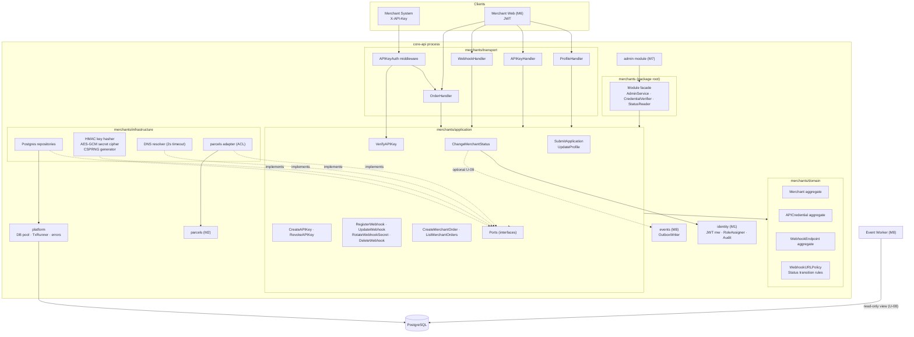
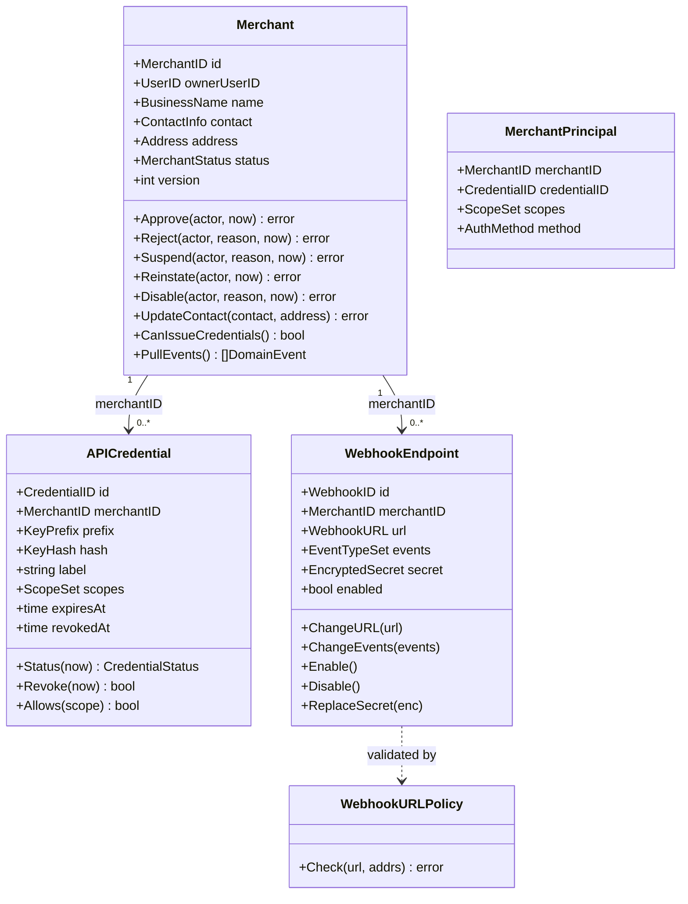
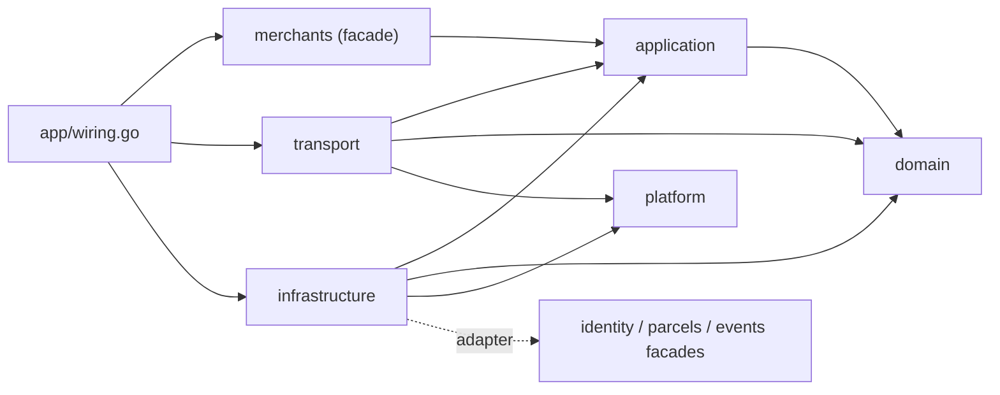

# Document 3 — Internal Architecture & Design Specification

> **Status:** Draft / Proposed (For Review in Meeting 2)  
> **Author:** Member 4 — Merchant Integration  
> **Target Module / Location:** `core-api/internal/merchants/`  
> **Key Upstream Dependencies:** Member 1 (JWT middleware, `RoleAssigner`, audit writer), Member 2 (`CreateParcel`, merchant order queries), Member 7 (admin module calls `AdminService`), Member 8 (`events.OutboxWriter`, worker reads webhook config), shared `internal/platform` (DB pool, transaction runner, HTTP helpers)  
> **Open Questions / Needs Clarification:** Inherits U-01 … U-19 from Documents 1–2. New: U-20 … U-23 (see [§14](#14-new-open-questions)).

---

## 1. Design Goals

| Goal | How the design meets it |
|---|---|
| Tenant isolation cannot be forgotten | Repositories take `MerchantID` as a required typed parameter; there is no "get by ID only" method for tenant data. |
| Secrets never leak | Plaintext key/secret types have a redacting `String()`/`MarshalJSON`; only transport writes plaintext once into the create response. |
| Business rules testable without DB/HTTP | Rules live in `domain/` (pure Go, no I/O). URL policy, status transitions, and key rules are unit-tested in isolation. |
| One parcel-creation path | Merchant orders call Member 2's use case through an adapter; Member 4 has no parcel logic. |
| Follow AGENTS.md layering | `domain` ← `application` ← `infrastructure` / `transport`; enforced by lint (U-21). |
| Small and readable | Four layers, no CQRS, no event sourcing, no extra services (AGENTS.md §9). |

---

## 2. Component Diagram



---

## 3. Package Structure

```text
core-api/internal/merchants/
├── merchants.go                 # Public facade: Module struct, AdminService, CredentialVerifier, StatusReader
├── README.md
├── API.md
│
├── domain/                      # Pure Go. Imports: stdlib only (no net/http, database/sql)
│   ├── merchant.go              # Merchant aggregate root + status transitions
│   ├── status.go                # MerchantStatus value object + transition table
│   ├── profile.go               # BusinessName, ContactEmail, Phone, Address value objects
│   ├── credential.go            # APICredential aggregate, KeyPrefix, KeyHash, ScopeSet
│   ├── apikey.go                # PlainAPIKey (redacting type), format parsing
│   ├── webhook.go               # WebhookEndpoint aggregate, EventTypeSet
│   ├── webhook_url.go           # WebhookURL value object + WebhookURLPolicy (pure CIDR/host rules)
│   ├── secret.go                # PlainSigningSecret (redacting), EncryptedSecret
│   ├── principal.go             # MerchantPrincipal (verified tenant identity)
│   ├── events.go                # Domain events: MerchantApproved, APIKeyRevoked, ...
│   ├── ids.go                   # MerchantID, CredentialID, WebhookID typed IDs
│   └── errors.go                # ErrInvalidTransition, ErrNotApproved, ErrSSRFProhibited, ...
│
├── application/                 # Use cases + ports. Imports: domain, stdlib context
│   ├── ports.go                 # Repository + external service interfaces (§6.2)
│   ├── submit_application.go
│   ├── update_profile.go
│   ├── change_status.go         # Approve / Reject / Suspend / Reinstate / Disable
│   ├── create_api_key.go
│   ├── revoke_api_key.go
│   ├── verify_api_key.go
│   ├── register_webhook.go
│   ├── update_webhook.go
│   ├── rotate_webhook_secret.go
│   ├── delete_webhook.go
│   ├── merchant_orders.go       # CreateMerchantOrder, ListMerchantOrders, GetMerchantOrder
│   ├── queries.go               # Read models: MerchantView, CredentialView, WebhookView
│   └── *_test.go                # Use-case tests with in-memory fakes
│
├── infrastructure/              # Adapters. Imports: application, domain, platform, database/sql, crypto
│   ├── postgres_merchant_repo.go
│   ├── postgres_credential_repo.go
│   ├── postgres_webhook_repo.go
│   ├── hmac_key_hasher.go       # HMAC-SHA256 with pepper
│   ├── aesgcm_secret_cipher.go  # Encrypt/decrypt webhook signing secrets
│   ├── random_generator.go      # crypto/rand key + secret generation (base62)
│   ├── net_resolver.go          # net.Resolver with timeout
│   ├── parcels_adapter.go       # Anti-corruption layer → parcels use cases (M2)
│   ├── identity_adapter.go      # RoleAssigner + AuditWriter adapters → identity (M1)
│   └── *_integration_test.go    # Testcontainers PostgreSQL tests
│
└── transport/                   # HTTP. Imports: application, domain (errors/types), platform/http
    ├── routes.go                # Route registration
    ├── apikey_middleware.go     # X-API-Key → MerchantPrincipal in context
    ├── jwt_principal.go         # JWT tenant_id → MerchantPrincipal + per-request status check (DD-12)
    ├── profile_handler.go
    ├── apikey_handler.go
    ├── webhook_handler.go
    ├── order_handler.go
    ├── dto.go                   # Request/response DTOs (never domain structs)
    ├── errors.go                # Domain error → HTTP status + code mapping
    └── *_test.go                # httptest handler tests
```

Migrations live in the shared `core-api/migrations/` folder (Doc 5). Wiring happens in `core-api/internal/app/wiring.go`.

Anti-boilerplate (AGENTS.md §4.2): all four layers are justified here because the module has real invariants (status machine, credential rules, SSRF policy).

---

## 4. Layer Responsibilities

| Layer | Owns | Must NOT |
|---|---|---|
| **transport** | Route registration; parse/validate JSON shape; read `Idempotency-Key`; build `MerchantPrincipal` (API key or JWT); call one use case; map result to DTO; map errors to `{error:{code,…}}` | Contain business rules; open transactions; touch SQL; log secrets; return domain structs directly |
| **application** | One struct per use case; load aggregates; call domain methods; open/close transactions via `TxRunner`; enforce cross-aggregate rules (limits, duplicates); call ports (hasher, cipher, resolver, parcels, audit); collect domain events and write audit/outbox | Import `net/http`, `database/sql`, or infrastructure packages; build SQL; know HTTP status codes |
| **domain** | Aggregates, value objects, status transition table, URL policy rules, scope rules, domain errors, domain events | Do I/O (DB, DNS, clock, random). Time and randomness are passed in. |
| **infrastructure** | SQL for owned tables; row ↔ aggregate mapping; crypto implementations; DNS; adapters to other modules | Make business decisions; query other modules' tables (except via their published interface) |
| **facade (`merchants.go`)** | The only symbols other modules may import: `AdminService`, `CredentialVerifier`, `StatusReader`, and their DTOs | Expose domain aggregates or repositories |

---

## 5. Domain Model (DDD)

### 5.1 Aggregates and Why

| Aggregate | Root | Contains | Why a separate aggregate |
|---|---|---|---|
| **Merchant** | `Merchant` | `MerchantStatus`, `BusinessName`, `ContactInfo`, `Address`, `approvedBy/At`, `version` | Consistency boundary for status transitions and profile. Optimistic lock on `version`. |
| **APICredential** | `APICredential` | `KeyPrefix`, `KeyHash`, `Label`, `ScopeSet`, `expiresAt`, `revokedAt` | Own lifecycle (create/revoke) independent of profile edits. Loading a merchant must not load all keys. Verification reads one credential by prefix, not the whole merchant. |
| **WebhookEndpoint** | `WebhookEndpoint` | `WebhookURL`, `EventTypeSet`, `EncryptedSecret`, `enabled` | Own lifecycle; read by Member 8 independently; changes do not need the merchant version. |

**Cross-aggregate rules** (max keys, max endpoints, "merchant must be APPROVED", "disable revokes all keys") are enforced by the **application layer** inside one transaction, with `SELECT … FOR UPDATE` on the merchant row as the serialisation point. This is the standard DDD approach: one aggregate per transaction where possible, and explicit locking where a rule spans aggregates.

### 5.2 Value Objects

| Value Object | Invariant enforced in constructor |
|---|---|
| `MerchantID`, `CredentialID`, `WebhookID` | Non-zero UUID; typed so a `WebhookID` cannot be passed where a `MerchantID` is expected |
| `MerchantStatus` | One of PENDING, APPROVED, REJECTED, SUSPENDED, DISABLED |
| `BusinessName` | Trimmed, 2–150 chars (BR-M-01) |
| `ContactEmail`, `Phone`, `Address` | BR-M-02 … 04 |
| `PlainAPIKey` | Matches `sd_(live\|test)_[0-9A-Za-z]{8}_[0-9A-Za-z]{32}` (ADR-003 §6.1); `String()` returns `sd_live_XXXXXXXX_…` (redacted) |
| `KeyPrefix` | 8 base62 chars (the part between the env prefix and `_`) |
| `KeyHash` | 64 hex chars |
| `ScopeSet` | Non-empty subset of `{parcels:create, parcels:read}` (ADR-003 names; `webhooks:manage` not grantable — Doc 7 C-3) |
| `WebhookURL` | Parsed, normalised (lower-case host, punycode), scheme/port/userinfo/fragment checked |
| `EventTypeSet` | Non-empty, deduplicated, each in catalog |
| `PlainSigningSecret` | `whsec_` + 43 base62; redacted `String()` |
| `EncryptedSecret` | Opaque bytes + key version |
| `Reason` | 5–500 chars |

### 5.3 Domain Services / Policies

| Service | Kind | Responsibility |
|---|---|---|
| `WebhookURLPolicy` | Pure domain policy | Given a `WebhookURL` and its resolved `[]netip.Addr`, decide allowed/blocked using the CIDR list from `webhook-security.md` §3.1 and blocked host suffixes. Pure, so it is table-test friendly. |
| `StatusTransitions` | Pure domain table | Map of `(from, action) → to` used by `Merchant` methods. |
| `HostResolver` | Port (infrastructure) | DNS lookup with timeout. Kept out of domain because it is I/O. |
| `KeyGenerator` / `KeyHasher` / `SecretCipher` | Ports (infrastructure) | Randomness and crypto are injected so tests are deterministic. |

### 5.4 Domain Events

Recorded on aggregates (`merchant.PullEvents()`), consumed by the application layer **within the same transaction**:

| Event | Raised by | Used for |
|---|---|---|
| `MerchantApplied` | `NewMerchant` | (no consumer in baseline) |
| `MerchantApproved` / `Rejected` / `Suspended` / `Reinstated` / `Disabled` | `Merchant` methods | Audit row; optional outbox integration event (U-09) |
| `APIKeyCreated` / `APIKeyRevoked` | `APICredential` | Audit row |
| `WebhookRegistered` / `Updated` / `Deleted` / `SecretRotated` | `WebhookEndpoint` | Audit row |

These are **in-process domain events**, not RabbitMQ messages. Only if U-09 is approved does the application layer translate selected ones into outbox rows via Member 8's `OutboxWriter`.

### 5.5 Domain Class Diagram



### 5.6 Domain Code Sketch

```go
// domain/status.go
type MerchantStatus string

const (
    StatusPending   MerchantStatus = "PENDING"
    StatusApproved  MerchantStatus = "APPROVED"
    StatusRejected  MerchantStatus = "REJECTED"
    StatusSuspended MerchantStatus = "SUSPENDED"
    StatusDisabled  MerchantStatus = "DISABLED"
)

type StatusAction string

const (
    ActionApprove   StatusAction = "APPROVE"
    ActionReject    StatusAction = "REJECT"
    ActionSuspend   StatusAction = "SUSPEND"
    ActionReinstate StatusAction = "REINSTATE"
    ActionDisable   StatusAction = "DISABLE"
)

var transitions = map[MerchantStatus]map[StatusAction]MerchantStatus{
    StatusPending:   {ActionApprove: StatusApproved, ActionReject: StatusRejected},
    StatusApproved:  {ActionSuspend: StatusSuspended, ActionDisable: StatusDisabled},
    StatusSuspended: {ActionReinstate: StatusApproved, ActionDisable: StatusDisabled},
}

var reasonRequired = map[StatusAction]bool{
    ActionReject: true, ActionSuspend: true, ActionDisable: true,
}

// domain/merchant.go
func (m *Merchant) apply(action StatusAction, actor ActorID, reason *Reason, now time.Time) error {
    to, ok := transitions[m.status][action]
    if !ok {
        return ErrInvalidTransition{From: m.status, Action: action}
    }
    if reasonRequired[action] && reason == nil {
        return ErrReasonRequired
    }
    from := m.status
    m.status = to
    if to == StatusApproved && from == StatusPending {
        m.approvedBy, m.approvedAt = &actor, &now
    }
    m.record(MerchantStatusChanged{ID: m.id, From: from, To: to, Actor: actor, Reason: reason, At: now})
    return nil
}

func (m *Merchant) Approve(actor ActorID, now time.Time) error { return m.apply(ActionApprove, actor, nil, now) }
// Reject, Suspend, Reinstate, Disable follow the same pattern.
```

```go
// domain/webhook_url.go
var blockedPrefixes = mustPrefixes(
    "0.0.0.0/8", "127.0.0.0/8", "10.0.0.0/8", "172.16.0.0/12", "192.168.0.0/16",
    "169.254.0.0/16", "::1/128", "fe80::/10", "fc00::/7",
)

var blockedHostSuffixes = []string{"localhost", ".local", ".internal", ".svc", ".cluster.local"}

type WebhookURLPolicy struct{ AllowHTTP bool }

// Check is pure: the caller resolves DNS and passes the addresses in.
func (p WebhookURLPolicy) Check(u WebhookURL, addrs []netip.Addr) error {
    if len(addrs) == 0 {
        return ErrURLUnresolvable
    }
    for _, a := range addrs {
        a = a.Unmap() // treat ::ffff:10.0.0.1 as 10.0.0.1
        for _, b := range blockedPrefixes {
            if b.Contains(a) {
                return ErrSSRFProhibited
            }
        }
    }
    return nil
}
```

(`net/netip` is stdlib and performs no I/O, so it is allowed in `domain/`.)

---

## 6. Key Interfaces

### 6.1 Exposed to Other Modules (facade — `merchants.go`)

```go
package merchants

// AdminService is called by the admin module (Member 7). Decision U-10.
type AdminService interface {
    ListMerchants(ctx context.Context, f ListFilter, p Page) (MerchantPage, error)
    GetMerchant(ctx context.Context, id uuid.UUID) (MerchantSummary, error)
    ChangeStatus(ctx context.Context, cmd ChangeStatusCommand) (MerchantSummary, error)
}

type ChangeStatusCommand struct {
    MerchantID      uuid.UUID
    Action          string // APPROVE | REJECT | SUSPEND | REINSTATE | DISABLE
    ExpectedVersion int
    Reason          string // required for REJECT, SUSPEND, DISABLE
    Actor           Actor  // admin user ID, role, request ID, client IP
}

// CredentialVerifier turns a raw X-API-Key value into a verified principal.
// Used by merchants/transport middleware; exposed so gateway-level or other
// modules never implement key verification themselves.
type CredentialVerifier interface {
    Verify(ctx context.Context, rawKey string) (Principal, error)
}

// StatusReader is a defensive check for Member 2 during merchant parcel creation.
type StatusReader interface {
    IsApproved(ctx context.Context, merchantID uuid.UUID) (bool, error)
}
```

Facade types are plain DTOs (`MerchantSummary`, `Principal`), not domain aggregates, so other modules cannot call domain methods.

### 6.2 Ports Required by the Application Layer (`application/ports.go`)

```go
package application

// --- Persistence (implemented in infrastructure) ---

type MerchantRepository interface {
    Insert(ctx context.Context, q Querier, m *domain.Merchant) error
    Get(ctx context.Context, q Querier, id domain.MerchantID) (*domain.Merchant, error)
    GetForUpdate(ctx context.Context, q Querier, id domain.MerchantID) (*domain.Merchant, error)
    GetByOwner(ctx context.Context, q Querier, userID domain.UserID) (*domain.Merchant, error)
    ExistsActiveForOwner(ctx context.Context, q Querier, userID domain.UserID) (bool, error)
    // Update uses optimistic locking; returns domain.ErrVersionConflict on 0 rows.
    Update(ctx context.Context, q Querier, m *domain.Merchant, expectedVersion int) error
    List(ctx context.Context, q Querier, f ListFilter, p Page) ([]*domain.Merchant, int, error)
}

type CredentialRepository interface {
    Insert(ctx context.Context, q Querier, c *domain.APICredential) error
    // FindByPrefix is the ONLY non-tenant-scoped lookup; it is used for authentication.
    FindByPrefix(ctx context.Context, q Querier, p domain.KeyPrefix) (*domain.APICredential, domain.MerchantStatus, error)
    Get(ctx context.Context, q Querier, m domain.MerchantID, id domain.CredentialID) (*domain.APICredential, error)
    List(ctx context.Context, q Querier, m domain.MerchantID) ([]*domain.APICredential, error)
    CountActive(ctx context.Context, q Querier, m domain.MerchantID, now time.Time) (int, error)
    Revoke(ctx context.Context, q Querier, m domain.MerchantID, id domain.CredentialID, now time.Time) (bool, error)
    RevokeAll(ctx context.Context, q Querier, m domain.MerchantID, now time.Time) (int, error)
    TouchLastUsed(ctx context.Context, id domain.CredentialID, now time.Time) error
}

type WebhookRepository interface {
    Insert(ctx context.Context, q Querier, w *domain.WebhookEndpoint) error
    Get(ctx context.Context, q Querier, m domain.MerchantID, id domain.WebhookID) (*domain.WebhookEndpoint, error)
    List(ctx context.Context, q Querier, m domain.MerchantID) ([]*domain.WebhookEndpoint, error)
    Count(ctx context.Context, q Querier, m domain.MerchantID) (int, error)
    Update(ctx context.Context, q Querier, w *domain.WebhookEndpoint) error
    Delete(ctx context.Context, q Querier, m domain.MerchantID, id domain.WebhookID) (bool, error)
    DisableAll(ctx context.Context, q Querier, m domain.MerchantID) (int, error)
}

// --- Transactions (implemented by platform) ---

type Querier interface{} // opaque handle: *sql.DB or *sql.Tx, defined in platform (U-20)

type TxRunner interface {
    // WithinTx runs fn in one PostgreSQL transaction (READ COMMITTED).
    // fn's error rolls back; nil commits.
    WithinTx(ctx context.Context, fn func(ctx context.Context, tx Querier) error) error
    Reader() Querier
}

// --- Security primitives (implemented in infrastructure) ---

type KeyGenerator interface {
    NewAPIKey() (domain.PlainAPIKey, error)
    NewSigningSecret() (domain.PlainSigningSecret, error)
}
type KeyHasher interface {
    Hash(k domain.PlainAPIKey) domain.KeyHash
    Equal(a, b domain.KeyHash) bool // constant-time
}
type SecretCipher interface {
    Encrypt(s domain.PlainSigningSecret) (domain.EncryptedSecret, error)
}
type HostResolver interface {
    LookupAddrs(ctx context.Context, host string) ([]netip.Addr, error) // 2s timeout
}
type Clock interface{ Now() time.Time }

// --- Other modules (consumer-defined, adapted in infrastructure) ---

type ParcelBooking interface { // adapter → Member 2
    CreateForMerchant(ctx context.Context, cmd MerchantParcelCommand, idemKey string) (MerchantParcelResult, error)
}
type ParcelQuery interface { // adapter → Member 2
    ListForMerchant(ctx context.Context, m domain.MerchantID, f OrderFilter, p Page) ([]MerchantParcelResult, int, error)
    GetForMerchant(ctx context.Context, m domain.MerchantID, parcelID string) (MerchantParcelResult, error)
}
type RoleAssigner interface { // adapter → Member 1 (U-15)
    GrantMerchantRole(ctx context.Context, tx Querier, userID domain.UserID) error
}
type AuditWriter interface { // adapter → Member 1 shared audit writer
    Write(ctx context.Context, tx Querier, e AuditEntry) error
}
type OutboxWriter interface { // adapter → Member 8, only if U-09 approved
    Append(ctx context.Context, tx Querier, eventType string, aggregateID string, payload any) error
}
```

**Consumer-defined interfaces:** `ParcelBooking`, `RoleAssigner`, `AuditWriter`, and `OutboxWriter` are declared by Member 4 (the consumer) in Member 4's vocabulary. Small adapters in `infrastructure/` translate to the real Member 1/2/8 APIs. This keeps `application/` free of imports from other modules and stops a change in `parcels` DTOs from rippling into Member 4's use cases.

### 6.3 Use Case Shape (example)

```go
// application/change_status.go
type ChangeMerchantStatus struct {
    tx       TxRunner
    merchants MerchantRepository
    creds    CredentialRepository
    hooks    WebhookRepository
    roles    RoleAssigner
    audit    AuditWriter
    clock    Clock
}

func (uc *ChangeMerchantStatus) Execute(ctx context.Context, cmd ChangeStatusCmd) (MerchantView, error) {
    var out MerchantView
    err := uc.tx.WithinTx(ctx, func(ctx context.Context, tx Querier) error {
        m, err := uc.merchants.Get(ctx, tx, cmd.MerchantID)
        if err != nil {
            return err
        }
        now := uc.clock.Now()
        if err := m.Do(cmd.Action, cmd.Actor.ID, cmd.Reason, now); err != nil {
            return err // ErrInvalidTransition, ErrReasonRequired
        }
        if err := uc.merchants.Update(ctx, tx, m, cmd.ExpectedVersion); err != nil {
            return err // ErrVersionConflict
        }
        switch m.Status() {
        case domain.StatusApproved:
            if cmd.Action == domain.ActionApprove {
                if err := uc.roles.GrantMerchantRole(ctx, tx, m.OwnerUserID()); err != nil {
                    return err
                }
            }
        case domain.StatusDisabled:
            if _, err := uc.creds.RevokeAll(ctx, tx, m.ID(), now); err != nil {
                return err
            }
            if _, err := uc.hooks.DisableAll(ctx, tx, m.ID()); err != nil {
                return err
            }
        }
        for _, e := range m.PullEvents() {
            if err := uc.audit.Write(ctx, tx, auditFrom(e, cmd.Actor)); err != nil {
                return err
            }
        }
        out = toView(m)
        return nil
    })
    return out, err
}
```

---

## 7. Dependency Direction and Allowed Imports



| Package | May import | Must NOT import |
|---|---|---|
| `merchants/domain` | stdlib only (`errors`, `fmt`, `strings`, `time`, `net/netip`, `net/url`, `unicode`) | `net/http`, `database/sql`, any `internal/*` package, third-party libs |
| `merchants/application` | `domain`, `context`, `time`, `net/netip` | `net/http`, `database/sql`, `infrastructure`, `transport`, other modules' packages |
| `merchants/infrastructure` | `application`, `domain`, `internal/platform/*`, `database/sql`, `crypto/*`, `net`, other modules' **facade** packages only | `transport`, other modules' `domain/`, `application/`, `infrastructure/` |
| `merchants/transport` | `application`, `domain` (types, errors), `internal/platform/http`, identity JWT middleware facade | `infrastructure`, `database/sql` |
| `merchants` (facade) | `application`, `domain` | `transport`, `infrastructure` |
| Other modules | `internal/merchants` (facade) only | `internal/merchants/domain|application|infrastructure|transport` |

**Enforcement:** `golangci-lint` `depguard` rules (U-21) plus a review checklist item. Proposed rule snippet:

```yaml
linters-settings:
  depguard:
    rules:
      merchants-domain:
        files: ["**/internal/merchants/domain/**"]
        deny:
          - pkg: "net/http"
          - pkg: "database/sql"
          - pkg: "github.com/swiftdrop/core-api/internal"
      merchants-internals-private:
        files: ["$all", "!**/internal/merchants/**"]
        deny:
          - pkg: "github.com/swiftdrop/core-api/internal/merchants/domain"
          - pkg: "github.com/swiftdrop/core-api/internal/merchants/application"
          - pkg: "github.com/swiftdrop/core-api/internal/merchants/infrastructure"
```

(Module path is a placeholder until `go.mod` exists.)

---

## 8. Transaction Boundaries and Consistency

All transactions use PostgreSQL `READ COMMITTED` (default) plus explicit row locks or optimistic version checks where needed. No transaction contains network I/O (DNS, HTTP).

| Use Case | Transaction Contents | Concurrency Control | Notes |
|---|---|---|---|
| SubmitApplication | INSERT merchant | Partial unique index `(owner_user_id) WHERE status IN (PENDING, APPROVED, SUSPENDED)` | Unique violation → `ErrMerchantExists` |
| UpdateProfile | UPDATE merchant | `version` check | — |
| ChangeMerchantStatus | UPDATE merchant + (grant role) + (revoke all keys, disable all webhooks if DISABLE) + audit rows (+ outbox if U-09) | `version` check | All or nothing (BR-M-10) |
| CreateAPIKey | SELECT merchant FOR UPDATE + COUNT active + INSERT credential + audit | Merchant row lock | Key generated and hashed **before** BEGIN to keep tx short |
| RevokeAPIKey | Conditional UPDATE + audit | `WHERE revoked_at IS NULL` | Idempotent |
| VerifyAPIKey | **No transaction** — single SELECT (credential JOIN merchant status) | — | Read path; hot |
| TouchLastUsed | Single UPDATE, outside request tx, throttled | — | Best effort; failures logged, not surfaced |
| RegisterWebhook | (DNS before tx) → SELECT merchant FOR UPDATE + COUNT + INSERT + audit | Merchant row lock + unique `(merchant_id, url)` | Secret generated/encrypted before BEGIN |
| UpdateWebhook | (DNS before tx if URL/enable changes) → UPDATE + audit | Unique `(merchant_id, url)` | — |
| RotateWebhookSecret | UPDATE secret + audit | Row update | — |
| DeleteWebhook | DELETE + audit | — | — |
| CreateMerchantOrder | **Owned by Member 2's transaction** | Member 2 idempotency row | Member 4 opens no tx; it calls `ParcelBooking` |

**Lock ordering** (deadlock avoidance): always lock `merchants` row first, then child rows (`merchant_api_credentials`, `webhook_endpoints`).

**Time-of-check / time-of-use:** Authentication checks merchant status at request start. If Member 2 also calls `StatusReader.IsApproved` inside its booking transaction, the window between suspension and rejection shrinks to zero for order creation. Recommended but subject to M2 agreement.

---

## 9. Design Patterns and Justification

| Pattern | Where | Why |
|---|---|---|
| **Hexagonal / Ports & Adapters** | `application/ports.go` + `infrastructure/` | Required by AGENTS.md layering; lets use cases be tested with fakes. |
| **Aggregate + Repository** | Merchant, APICredential, WebhookEndpoint | Encapsulates invariants; repositories hide SQL and enforce tenant scoping by signature. |
| **Unit of Work (TxRunner)** | All write use cases | One explicit transaction boundary per use case; same `tx` shared with audit/outbox writers as AGENTS.md §6 requires. |
| **Optimistic Locking** | `merchants.version` | Admin actions are rare but may collide; avoids long locks; gives clear `409`. |
| **Pessimistic row lock** | Merchant row for limit checks | Count-then-insert races cannot be solved by optimistic locking without a counter column. |
| **Facade** | `merchants.go` | Narrow public surface for M1/M2/M7; internals can change freely. |
| **Anti-Corruption Layer / Adapter** | `parcels_adapter.go`, `identity_adapter.go` | Isolates Member 4 from other modules' DTO changes; consumer-defined interfaces. |
| **Middleware / Chain of Responsibility** | `apikey_middleware.go` | Authentication runs once before any merchant handler; handlers receive a ready `MerchantPrincipal`. |
| **Policy / Specification** | `WebhookURLPolicy`, status transition table | Business rules as data + pure functions → exhaustive table tests. |
| **Strategy (config-driven)** | `WebhookURLPolicy{AllowHTTP}` | Local profile allows HTTP without `if env == "local"` scattered in code. |
| **Factory** | `domain.NewMerchant`, `domain.NewAPICredential` | Single place that enforces creation invariants (status PENDING, version 1). |
| **Redacting types** | `PlainAPIKey`, `PlainSigningSecret` | Accidental `log.Printf("%v", key)` prints a redacted value. |

---

## 10. Design Decisions, Alternatives, and Trade-offs

| ID | Decision | Alternatives Considered | Why Selected | Trade-off |
|---|---|---|---|---|
| DD-01 | **API keys** for merchant machine auth | OAuth 2.0 client credentials | Simpler for merchants and for a student project; no token endpoint; already in `API.md`; SRS allows either | No short-lived tokens; mitigated by revocation, optional expiry, scopes |
| DD-02 | **HMAC-SHA256 with server pepper** for key hash | Argon2id / bcrypt; plain SHA-256 | The secret part is ≈ 190-bit random (32 base62), so brute force is infeasible; slow hashes would add ~50–100 ms to every API call. Pepper means a DB leak alone is not enough to test keys offline. | Pepper must be managed as a secret (M9); rotating pepper requires re-issuing keys |
| DD-03 | **Lookup by public prefix, then constant-time compare** | Hash full key and index on hash | Prefix lets logs and UI identify a key without revealing it; supports clear error codes | Prefix must be unique (regenerate on collision) |
| DD-04 | **Three aggregates** (Merchant, APICredential, WebhookEndpoint) | One big Merchant aggregate containing keys and webhooks | Smaller loads; hot auth path reads one row; webhook edits do not bump merchant version | Cross-aggregate rules need explicit locking in application layer |
| DD-05 | **Encrypt** webhook signing secrets (AES-256-GCM) | Hash (current schema); plaintext | HMAC signing needs the original secret (hash cannot work); plaintext violates "no plaintext secrets at rest" | Key management shared with M8; needs key-version field for rotation (U-03, U-22) |
| DD-06 | **Server-generated** signing secret | Merchant supplies secret (`API.md`) | Guarantees entropy; prevents weak/reused secrets | Merchant must store the secret we show |
| DD-07 | **Merchant order endpoint lives in Member 4 transport**, delegating to Member 2 | Member 2 owns `/merchant/orders` and calls M4 for auth | Member 4 owns merchant auth, scopes, and the merchant-facing contract; Member 2 keeps single creation path | Two modules involved per request; contract with M2 must be stable |
| DD-08 | **No auth cache** in baseline; one indexed query per request | In-memory LRU cache of verified keys | Revocation must be immediate (Doc 1 invariant 12); multiple Core API replicas would need distributed invalidation | One DB round-trip per merchant request (~1 ms on indexed lookup) |
| DD-09 | **DNS + CIDR check at registration**, plus M8 check at send | Only check at send time | Gives the merchant immediate feedback; blocks obvious SSRF early; send-time check still covers rebinding | Duplicate CIDR list in two services — share as one documented list (U-23) |
| DD-10 | **Member 8 reads webhook config via read-only DB view** | M8 calls a Core API HTTP endpoint; M4 publishes config change events | Worker already reads PG for outbox; no extra HTTP dependency; simplest | Schema coupling: view is a contract, changes need expand/contract (U-08) |
| DD-11 | **Domain events in-process only** (audit) | Publish all merchant events to RabbitMQ | No consumer needs them yet (AGENTS.md: no speculative infra) | Adding later requires the outbox step (U-09) |
| DD-12 | **(Revised after Doc 7 C-4)** JWT merchant callers are identified by the **`tenant_id` claim** (ADR-003 §3.2), and the merchant's **status is checked on every request** by primary key. Applicants without `tenant_id` (merchant still PENDING) are resolved by `owner_user_id` for `GET /merchants/me` only. | (a) Trust claim only; (b) look up by `owner_user_id` on every request (original draft) | Aligns with accepted ADR-003; claim is signed by M1; per-request status check keeps suspension immediate, which a claim alone cannot | One PK read per JWT merchant request (~1 ms); a newly approved owner needs a token refresh to receive `tenant_id` |

---

## 11. Scaling and Performance

**Expected load (project/demo):** tens of requests per second on merchant APIs; a handful of merchants; ≤ 10 webhooks per merchant. The design targets correctness first but has no obvious bottleneck at 10× that load.

| Concern | Approach |
|---|---|
| Hot path: API key verification | One indexed query: `merchant_api_credentials (key_prefix)` UNIQUE joined to `merchants (id)` PK. Target p95 < 5 ms in-cluster. HMAC-SHA256 cost is microseconds. |
| `last_used_at` writes | Throttled in-memory per replica (≤ 1 write/key/min), done asynchronously; avoids a write on every request. |
| Order creation latency | Dominated by Member 2's transaction. Member 4 adds auth query + mapping only. |
| Webhook registration | DNS lookup with 2 s timeout outside the transaction; low frequency operation. |
| Merchant order listing | Delegated to Member 2; relies on `parcels (merchant_id, created_at DESC)` index (exists in `database-schema.md`). |
| Horizontal scaling | Module is stateless (except throttling map); scales with Core API replicas. No sticky sessions. |
| DB connections | Uses shared `platform` pool; no long transactions; no I/O inside tx. |
| Abuse / rate | Gateway rate limit per key prefix and per IP (M7, U-14); app-level caps on keys/webhooks. |
| Growth path | If auth query becomes hot: short-TTL (≤ 5 s) cache with revoke-time invalidation via PG `LISTEN/NOTIFY`. Not built in baseline (DD-08). |

---

## 12. Error Handling

- Domain returns typed errors (`ErrInvalidTransition`, `ErrNotApproved`, `ErrSSRFProhibited`, `ErrVersionConflict`, `ErrNotFound`, …).
- Infrastructure maps PG errors: unique violation on owner index → `ErrMerchantExists`; on `(merchant_id, url)` → `ErrWebhookDuplicate`; 0 rows on versioned update → `ErrVersionConflict`. Raw PG messages are never surfaced.
- Transport has **one** mapping table from error → HTTP status + code (Doc 2 §6). Unknown errors → `500` with correlation ID, logged with stack trace server-side only.
- Errors from Member 2 (`ParcelBooking`) are passed through with their original code (e.g. `IDEMPOTENCY_KEY_PAYLOAD_MISMATCH`, parcel validation codes) so merchants see one consistent error contract.

---

## 13. Observability Hooks (detailed in Doc 8)

- Structured logs with `correlation_id`, `merchant_id`, `key_prefix`, `use_case`, `outcome`. Never key/secret/full headers.
- Metrics: `merchant_api_auth_total{result}`, `merchant_api_auth_duration_seconds`, `merchant_status_changes_total{action}`, `webhook_registrations_total{result}`, `webhook_ssrf_blocked_total`.
- Traces: span per use case; child span for DNS lookup and for the `ParcelBooking` call.

---

## 14. New Open Questions

| ID | Question | Proposal | Needs |
|---|---|---|---|
| U-20 | Shared transaction convention: how is `*sql.Tx` passed between modules (explicit `Querier` param vs. tx in `context.Context`)? Affects `AuditWriter`, `RoleAssigner`, `OutboxWriter`. | Explicit `Querier` parameter (visible in signatures, no hidden context magic). Defined once in `internal/platform/db`. | M8, M1, platform owner |
| U-21 | Adopt `depguard` import rules for all modules? | Yes; each owner adds their rules to `.golangci.yml`. | M9, team |
| U-22 | Webhook secret encryption key management and rotation (key version column, who rotates). | AES-256-GCM, `key_version` stored with ciphertext, key from K8s Secret; rotation = re-encrypt job. | M8, M9 |
| U-23 | Single source of truth for the SSRF CIDR blocklist used by M4 (registration) and M8 (send time). | `webhook-security.md` §3.1 is canonical; both implementations have a test asserting the same list. Optionally a shared Go package if M8's worker is in the same Go module. | M8 |
