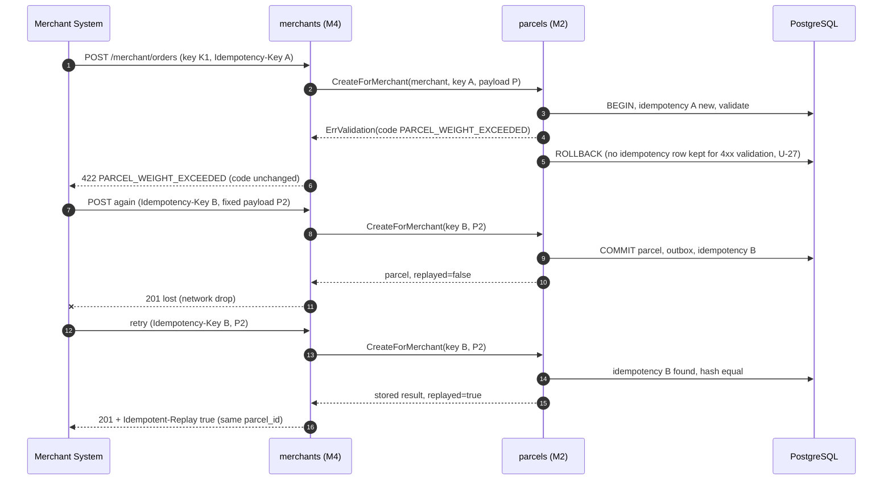
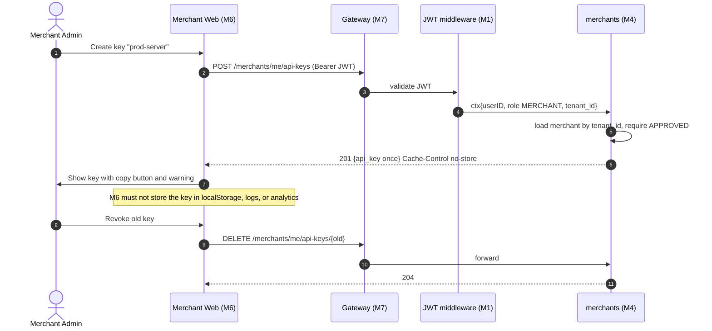
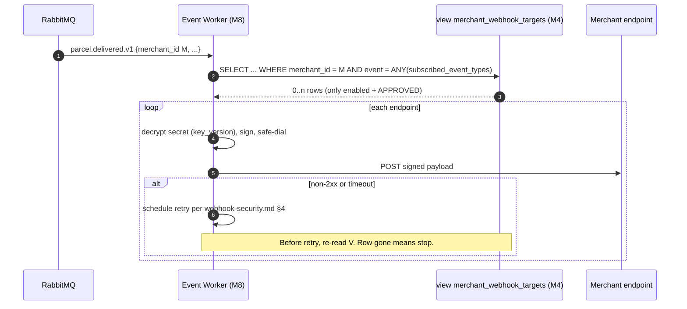

# Document 4 — Interface & Integration Contract

> **Status:** Draft / Proposed (For Review in Meeting 2)  
> **Author:** Member 4 — Merchant Integration  
> **Target Module / Location:** `core-api/internal/merchants/`  
> **Key Upstream Dependencies:** Member 1 (JWT principal, `RoleAssigner`, audit writer), Member 2 (merchant parcel creation/query), Member 7 (admin routes, gateway rate limits), Member 8 (outbox, event catalog, webhook delivery), Member 6 (merchant dashboard consumer)  
> **Open Questions / Needs Clarification:** Inherits U-01 … U-23. New: U-24 … U-27 (see [§12](#12-new-open-questions)).

---

## 1. Contract Artifacts (machine-readable)

| Artifact | File | Format | Validated by |
|---|---|---|---|
| HTTP API (all Member 4 endpoints + admin routes hosted by M7) | [`contracts/merchants-openapi.v1.yaml`](./contracts/merchants-openapi.v1.yaml) | OpenAPI 3.1 | `redocly lint` — **passes, 0 errors** (2 draft warnings: no license, placeholder server URLs) |
| Webhook config read contract for Member 8 | [`contracts/webhook-config-read-contract.sql`](./contracts/webhook-config-read-contract.sql) | PostgreSQL view DDL + grants | Integration test (Doc 6) |
| Proposed integration event (only if U-09 approved) | [`contracts/merchant.status_changed.v1.schema.json`](./contracts/merchant.status_changed.v1.schema.json) | JSON Schema 2020-12 | Schema test (Doc 6) |
| In-process Go interfaces | [§4](#4-in-process-interfaces-exposed-go-facade) and [§5](#5-interfaces-consumed) of this document, full ports in [Doc 3 §6](./doc-03-internal-architecture-and-design.md#6-key-interfaces) | Go | `go build` + compile-time assertions `var _ merchants.AdminService = (*Module)(nil)` |

This document explains the rules around those artifacts. Where prose and an artifact disagree, **the artifact wins** and the prose must be fixed.

To lint locally:

```bash
npx @redocly/cli@1.25.0 lint docs/drafts/member-04-merchants/contracts/merchants-openapi.v1.yaml
```

---

## 2. Integration Matrix

| # | Caller → Callee | Mechanism | Interface | Auth | Owner of contract | Status |
|---|---|---|---|---|---|---|
| I-01 | Merchant system → M4 | HTTPS REST | `POST/GET /merchant/orders…` | `X-API-Key` + scope | M4 | Draft (this doc) |
| I-02 | Merchant web (M6) → M4 | HTTPS REST | `/merchants/applications`, `/merchants/me/**`, `/merchant/orders…` | JWT `MERCHANT` (applications: any user) | M4 | Draft |
| I-03 | Admin web (M7) → M7 admin routes → M4 | REST, then Go call | `/admin/merchants/**` → `merchants.AdminService` | JWT `ADMIN` | Route: M7, logic + DTOs: M4 | Proposed (U-10) |
| I-04 | M4 → M2 | Go (in-process) | `ParcelBooking.CreateForMerchant`, `ParcelQuery.ListForMerchant/GetForMerchant` (adapter over M2 use cases) | Trusted in-process; carries `MerchantPrincipal` | M2 (M4 adapts) | **Requested from M2** |
| I-05 | M2 → M4 | Go (in-process) | `merchants.StatusReader.IsApproved` | Trusted in-process | M4 | Proposed (optional defensive check) |
| I-06 | M4 → M1 | Go (in-process) | JWT middleware principal; `RoleAssigner.GrantMerchantRole`; `AuditWriter.Write` | Trusted in-process | M1 | **Requested from M1** (U-15, U-20) |
| I-07 | M4 → M8 | Go (in-process) | `events.OutboxWriter.Append` | Trusted in-process | M8 | Only if U-09 approved |
| I-08 | M8 Event Worker → M4 data | PostgreSQL read | View `merchant_webhook_targets` | DB role `swiftdrop_worker`, SELECT only | M4 | Proposed (U-08) |
| I-09 | M8 Event Worker → merchant endpoint | HTTPS POST (signed) | Webhook payload + `X-SwiftDrop-Signature` | HMAC-SHA256 | M8 (`webhook-security.md`) | Existing |
| I-10 | Gateway (M7) → M4 | HTTP routing | Path prefixes `/api/v1/merchants`, `/api/v1/merchant`, `/api/v1/admin/merchants` | Rate limit per key prefix / IP | M7 | Requested (U-14) |
| I-11 | Other modules (M3, M5, M10) → M4 | — | **None** | — | — | No dependency |

---

## 3. HTTP API Exposed

Full schemas, examples, and error responses are in the OpenAPI file. Summary:

### 3.1 Endpoint, Auth, and Authorization Matrix

| Method & Path | Auth | Role / Scope | Merchant status required | Success | Main errors |
|---|---|---|---|---|---|
| `POST /merchants/applications` | JWT | Any authenticated user | — (creates PENDING) | 201 | 401, 409, 422, 429 |
| `GET /merchants/me` | JWT | Owner of merchant | Any | 200 | 401, 404 |
| `PATCH /merchants/me` | JWT | Owner | PENDING / APPROVED / SUSPENDED | 200 | 401, 403, 409, 422 |
| `GET /merchants/me/api-keys` | JWT | Owner | Any | 200 | 401, 404 |
| `POST /merchants/me/api-keys` | JWT | Owner | APPROVED | 201 | 401, 403, 409, 422 |
| `DELETE /merchants/me/api-keys/{key_id}` | JWT | Owner | Any except DISABLED (already revoked) | 204 | 401, 403, 404 |
| `GET /merchants/webhook-event-types` | JWT | Any authenticated | — | 200 | 401 |
| `GET /merchants/me/webhooks` | JWT | Owner | Any | 200 | 401, 404 |
| `POST /merchants/me/webhooks` | JWT | Owner | APPROVED | 201 | 400, 401, 403, 409, 422, 429 |
| `GET /merchants/me/webhooks/{id}` | JWT | Owner | Any | 200 | 401, 404 |
| `PATCH /merchants/me/webhooks/{id}` | JWT | Owner | APPROVED | 200 | 400, 401, 403, 404, 409, 422 |
| `DELETE /merchants/me/webhooks/{id}` | JWT | Owner | APPROVED | 204 | 401, 403, 404 |
| `POST /merchants/me/webhooks/{id}/rotate-secret` | JWT | Owner | APPROVED | 200 | 401, 403, 404 |
| `POST /merchant/orders` | API key **or** JWT | scope `parcels:create` (JWT owner has all scopes) | APPROVED | 201 | 400, 401, 403, 409, 422, 429, 500 |
| `GET /merchant/orders` | API key or JWT | scope `parcels:read` | APPROVED (key) / any non-PENDING, non-REJECTED (JWT) | 200 | 400, 401, 403 |
| `GET /merchant/orders/{parcel_id}` | API key or JWT | scope `parcels:read` | same as above | 200 | 401, 403, 404 |
| `GET /admin/merchants` | JWT | `ADMIN` | — | 200 | 401, 403 |
| `GET /admin/merchants/{id}` | JWT | `ADMIN` | — | 200 | 401, 403, 404 |
| `POST /admin/merchants/{id}/{approve\|reject\|suspend\|reinstate\|disable}` | JWT | `ADMIN` | Per state machine (Doc 2 §2.1) | 200 | 401, 403, 404, 409, 422 |

**Authorization rules common to all endpoints:**

1. `merchant_id` is **never** read from path, query, or body for self-service and order endpoints. It comes from the principal (Doc 1 invariant 1).
2. JWT merchant callers are identified by the `tenant_id` claim (ADR-003 §3.2), and the merchant's current status is re-checked on every request (DD-12, Doc 7 C-4). Applicants without `tenant_id` are resolved by `owner_user_id` for `GET /merchants/me` only.
3. Resource not owned by the caller's merchant → `404`, not `403` (no existence leak).
4. When both `X-API-Key` and `Authorization` are sent, the request is rejected with `400 VALIDATION_FAILED` (ambiguous principal) — U-25.
5. `X-API-Key` is accepted only on `/merchant/orders…`. Sending it to `/merchants/me/**` → `401` (keys cannot manage keys or webhooks).

### 3.2 Request / Response Conventions

| Item | Rule |
|---|---|
| Base path | `/api/v1` |
| Content type | `application/json; charset=utf-8` |
| IDs | UUID for merchant, key, webhook; parcel ID format owned by M2 |
| Time | RFC 3339 UTC |
| Envelopes | `{ "data": … }`, lists add `"meta"`; errors `{ "error": { code, message, correlation_id, timestamp, details[] } }` |
| Pagination | `page` (≥1), `per_page` (1–100, default 20) |
| Unknown request fields | Self-service/admin DTOs: rejected (`additionalProperties: false`). Order DTO: ignored (forward compatibility for merchants), but never used for ownership. |
| Secret-bearing responses | `Cache-Control: no-store` (create key, register webhook, rotate secret) |
| Idempotency | `Idempotency-Key` (UUID v4) **required** on `POST /merchant/orders`; replay adds `Idempotent-Replay: true` |
| Correlation | Every response carries the platform request ID; error bodies include `correlation_id` |

### 3.3 Example Calls (curl)

```bash
# 1. Apply as a merchant (user JWT from Member 1)
curl -X POST http://localhost:8080/api/v1/merchants/applications \
  -H "Authorization: Bearer $USER_JWT" -H "Content-Type: application/json" \
  -d '{"business_name":"Ceylon Tea Shop","contact_email":"ops@ceylontea.lk",
       "contact_phone":"+94771234567",
       "address":{"line1":"12 Temple Rd","city":"Kandy","country":"LK"}}'

# 2. (Admin) approve
curl -X POST http://localhost:8080/api/v1/admin/merchants/$MERCHANT_ID/approve \
  -H "Authorization: Bearer $ADMIN_JWT" -H "Content-Type: application/json" \
  -d '{"expected_version":1}'

# 3. Create API key (shown once)
curl -X POST http://localhost:8080/api/v1/merchants/me/api-keys \
  -H "Authorization: Bearer $USER_JWT" -H "Content-Type: application/json" \
  -d '{"label":"prod-server"}'

# 4. Register webhook (secret shown once)
curl -X POST http://localhost:8080/api/v1/merchants/me/webhooks \
  -H "Authorization: Bearer $USER_JWT" -H "Content-Type: application/json" \
  -d '{"url":"https://ceylontea.lk/hooks/swiftdrop","events":["parcel.booked.v1","parcel.delivered.v1"]}'

# 5. Create order with API key (safe to retry with the same Idempotency-Key)
curl -X POST http://localhost:8080/api/v1/merchant/orders \
  -H "X-API-Key: $SD_API_KEY" -H "Idempotency-Key: $(uuidgen)" -H "Content-Type: application/json" \
  -d @order.json

# 6. List own orders
curl "http://localhost:8080/api/v1/merchant/orders?status=IN_TRANSIT&page=1&per_page=20" \
  -H "X-API-Key: $SD_API_KEY"
```

A Postman collection generated from the OpenAPI file is a Doc 8 deliverable.

---

## 4. In-Process Interfaces Exposed (Go facade)

Package `internal/merchants` (root). Other modules import **only** this package.

```go
package merchants

// ---- Admin (consumer: Member 7 admin module) ----

type AdminService interface {
    ListMerchants(ctx context.Context, f ListFilter, p Page) (MerchantPage, error)
    GetMerchant(ctx context.Context, id uuid.UUID) (MerchantSummary, error)
    ChangeStatus(ctx context.Context, cmd ChangeStatusCommand) (MerchantSummary, error)
}

type ListFilter struct {
    Status *string // PENDING | APPROVED | REJECTED | SUSPENDED | DISABLED
    Query  string  // business name / contact email, case-insensitive, max 100 chars
}

type Page struct{ Number, Size int } // Size 1..100

type ChangeStatusCommand struct {
    MerchantID      uuid.UUID
    Action          string // APPROVE | REJECT | SUSPEND | REINSTATE | DISABLE
    ExpectedVersion int
    Reason          string // required for REJECT, SUSPEND, DISABLE (5..500 chars)
    Actor           Actor
}

type Actor struct {
    UserID    uuid.UUID
    Role      string // must be "ADMIN"; re-checked by M4
    RequestID string
    ClientIP  string
    UserAgent string
}

type MerchantSummary struct {
    ID           uuid.UUID
    BusinessName string
    Status       string
    ContactEmail string
    ContactPhone string
    ApprovedAt   *time.Time
    Version      int
    CreatedAt    time.Time
    UpdatedAt    time.Time
}

type MerchantPage struct {
    Items      []MerchantSummary
    TotalItems int
}

// ---- Authentication (consumer: merchants/transport; available to gateway-side code) ----

type CredentialVerifier interface {
    // Verify returns ErrAPIKeyMissing, ErrAPIKeyInvalid, ErrAPIKeyRevoked,
    // ErrAPIKeyExpired, or ErrMerchantNotApproved on failure.
    Verify(ctx context.Context, rawKey string) (Principal, error)
}

type Principal struct {
    MerchantID   uuid.UUID
    CredentialID *uuid.UUID // nil when authenticated via JWT
    Scopes       []string   // "parcels:create", "parcels:read" (ADR-003 names)
    Method       string     // "API_KEY" | "JWT"
}

// ---- Status check (consumer: Member 2, optional defensive check) ----

type StatusReader interface {
    IsApproved(ctx context.Context, merchantID uuid.UUID) (bool, error)
}

// ---- Errors (stable; compare with errors.Is) ----

var (
    ErrMerchantNotFound      = errors.New("merchants: not found")
    ErrInvalidTransition     = errors.New("merchants: invalid status transition")
    ErrVersionConflict       = errors.New("merchants: version conflict")
    ErrReasonRequired        = errors.New("merchants: reason required")
    ErrNotAdmin              = errors.New("merchants: actor is not ADMIN")
    ErrAPIKeyMissing         = errors.New("merchants: api key missing")
    ErrAPIKeyInvalid         = errors.New("merchants: api key invalid")
    ErrAPIKeyRevoked         = errors.New("merchants: api key revoked")
    ErrAPIKeyExpired         = errors.New("merchants: api key expired")
    ErrMerchantNotApproved   = errors.New("merchants: merchant not approved")
)
```

**Error → HTTP mapping for Member 7's admin handlers** (so the admin API returns the same codes as Member 4's own endpoints):

| Go error | HTTP | Code |
|---|---|---|
| `ErrMerchantNotFound` | 404 | `MERCHANT_NOT_FOUND` |
| `ErrInvalidTransition` | 409 | `MERCHANT_INVALID_TRANSITION` |
| `ErrVersionConflict` | 409 | `MERCHANT_VERSION_CONFLICT` |
| `ErrReasonRequired` | 422 | `REASON_REQUIRED` |
| `ErrNotAdmin` | 403 | `FORBIDDEN` |
| any other | 500 | `INTERNAL_ERROR` |

Member 4 can provide a helper `merchants.HTTPError(err) (status int, code string)` so Member 7 does not duplicate this table (U-26).

---

## 5. Interfaces Consumed

### 5.1 From Member 2 (Parcels) — **requested**

Member 4 needs the following capability. Exact names are Member 2's choice; Member 4 adapts in `infrastructure/parcels_adapter.go`.

| Capability | Input | Output | Behaviour required |
|---|---|---|---|
| Create parcel for merchant | `MerchantID`, `CallerScope = "MERCHANT:<uuid>"`, idempotency key, `pickup`, `dropoff`, `parcel`, `service_level`, optional `quote_id`, optional `merchant_reference` | `parcel_id`, `tracking_number`, `status`, `fee{currency, amount_minor}`, `created_at`, `replayed bool` | Idempotency (same key + same hash → stored result; different hash → `IDEMPOTENCY_KEY_PAYLOAD_MISMATCH`); validation/pricing errors returned as typed errors with a stable code; sets `parcels.merchant_id`; emits `parcel.booked.v1` **including `merchant_id`** (U-24) |
| List parcels for merchant | `MerchantID`, filter (`status`, `created_from`, `created_to`), page | items + total | Always filtered by `merchant_id`; uses `idx_parcels_merchant_id` |
| Get parcel for merchant | `MerchantID`, `parcel_id` | item | Not found **or** other merchant → not-found error |

### 5.2 From Member 1 (Identity) — **requested**

| Capability | Contract needed |
|---|---|
| JWT middleware | Puts `{UserID, Role, TenantID}` into request context (ADR-003 §3.3); Member 4 reads it via an identity accessor function. M1 sets `tenant_id` at login for owners of an approved merchant. |
| `RoleAssigner.GrantMerchantRole(ctx, tx, userID)` | Runs in Member 4's transaction (U-15, U-20) |
| `AuditWriter.Write(ctx, tx, entry)` | Writes `audit_logs` row in Member 4's transaction; fields per `database-schema.md` (`actor_id`, `actor_role`, `action`, `target_type = MERCHANT`, `target_id`, `previous_state`, `new_state`, `client_ip`, `user_agent`, `request_id`) |

### 5.3 From Member 8 (Events)

| Capability | When |
|---|---|
| `events.OutboxWriter.Append(ctx, tx, envelope)` | Only if `merchant.status_changed.v1` is approved (U-09) |
| Event type catalog (`events/catalog.go`) | Used to validate webhook `events[]` and serve `GET /merchants/webhook-event-types` (U-06) |

### 5.4 From Platform (shared)

`TxRunner` / `Querier` (U-20), request ID middleware, standard error writer, PostgreSQL pool.

---

## 6. Events

### 6.1 Produced

| Event | Status | Schema | Transport |
|---|---|---|---|
| *(none in baseline)* | — | — | — |
| `merchant.status_changed.v1` | **Proposed** (U-09) | [`merchant.status_changed.v1.schema.json`](./contracts/merchant.status_changed.v1.schema.json) | Outbox → Relay → RabbitMQ exchange owned by M8 |

Catalog cleanup request: `merchant.webhook_dispatch.v1` in `event-contracts.md` lists `internal/merchants` as producer. Member 4 does not produce it; it should be re-assigned to Member 8 or removed (U-07).

### 6.2 Consumed

Member 4 consumes **no** asynchronous events.

### 6.3 Requirements on Other Producers (for webhook routing)

For Member 8 to find a merchant's webhooks, every parcel event that a merchant may subscribe to must carry `merchant_id` (nullable for customer parcels) in its payload. Today `parcel.booked.v1` lists `sender_id` only (U-24).

Subscribable event types (pending U-06 confirmation from M8):

| Event type | Producer |
|---|---|
| `parcel.booked.v1` | M2 |
| `parcel.assigned.v1` | M3 |
| `parcel.picked_up.v1` | M2 |
| `parcel.out_for_delivery.v1` | M3 |
| `parcel.delivered.v1` | M2 |
| `parcel.delivery_failed.v1` | M3 |

### 6.4 Webhook Payload Sent to Merchants

Owned by Member 8 and defined in `webhook-security.md` and SRS (event_id, event_type, schema_version, occurred_at, parcel_id, tracking_number, parcel_version, status, minimal merchant-safe payload). Member 4 documents it for merchants in the quick-start but does not define it.

---

## 7. Database Access and Table Ownership Rules

| Table / View | Owner | M4 access | Others' access |
|---|---|---|---|
| `merchants` | M4 | Read/write | None directly. M7 via `AdminService`; M2 stores `merchant_id` as an application ID reference |
| `merchant_api_credentials` | M4 | Read/write | **None** |
| `webhook_endpoints` | M4 | Read/write | None directly |
| `merchant_webhook_targets` (view) | M4 | Defines | M8 worker: SELECT only (I-08) |
| `parcels`, `idempotency_keys` | M2 | **None** (via I-04) | — |
| `audit_logs` | M1 (shared writer) | Insert via `AuditWriter` | — |
| `users`, `user_roles` | M1 | **None** (via `RoleAssigner`) | — |
| `outbox_events` | M8 | Insert via `OutboxWriter` (if U-09) | — |
| `webhook_deliveries` | M8 | **None** | — |

Rules:
1. No cross-module SQL joins from Member 4 code. The only join across ownership is inside the view Member 4 owns, over Member 4's own tables.
2. Foreign keys to `users(id)` from `merchants.owner_user_id` / `approved_by` are allowed (database-level integrity) but Member 4 never reads `users` columns directly.
3. Schema changes to tables exposed via the view follow §10.

---

## 8. Timeouts, Retries, Idempotency, and Failure Behaviour

| Interface | Timeout | Retries by caller | Idempotency | Failure behaviour |
|---|---|---|---|---|
| I-01 `POST /merchant/orders` | Gateway 10 s; server request ctx 8 s | Merchant **should** retry on 5xx, 429 (respect `Retry-After`), timeouts — **with the same `Idempotency-Key`** | Yes, 24 h window (M2) | DB down → 500/503, nothing committed or full commit (atomic); retry safe |
| I-01 `GET /merchant/orders…` | 5 s | Safe to retry | Naturally idempotent | — |
| I-02 create API key | 5 s | **Do not blindly retry** — creates another key; list keys first | No (by design) | Lost response → revoke unknown key (EC-08) |
| I-02 register webhook | 5 s (DNS 2 s inside, before tx) | Retry returns `409 WEBHOOK_URL_DUPLICATE` if first succeeded → list and continue | Via unique `(merchant_id, url)` | DNS timeout → `422 WEBHOOK_URL_UNRESOLVABLE` |
| I-02 other self-service | 5 s | Safe (PATCH same body, DELETE) | Yes / effectively | — |
| I-03 admin status change | 5 s | UI may retry; stale `expected_version` → `409`, UI reloads | Via optimistic version | Audit failure → whole change rolled back |
| I-04 M4 → M2 | Inherits request ctx | **No retry inside M4** (merchant retries end-to-end) | M2's idempotency | M2 errors passed through with original code |
| I-06 M4 → M1 | Inherits tx ctx | No | Part of M4 tx | Any error → rollback |
| I-07 M4 → M8 outbox | Inherits tx ctx | No | `event_id` unique | Error → rollback (event and state never diverge) |
| I-08 M8 → view | M8 decides (suggest 2 s query timeout) | M8 retries per its policy | Read only | View unavailable → M8 delays delivery; no data loss (events stay in queue) |

Member 4 performs **no** outbound network calls except DNS lookups during webhook registration/update.

---

## 9. Cross-Module Sequence Diagrams

Admin approval (I-03) is in [Doc 2 F-02](./doc-02-functional-flows-and-business-rules.md#f-02-admin-changes-merchant-status). Order creation happy path (I-01, I-04) is in [Doc 2 F-07](./doc-02-functional-flows-and-business-rules.md#f-07-create-merchant-order-api-key). Additional contract-level views:

### 9.1 Order creation: error pass-through and safe retry



### 9.2 Merchant dashboard (M6) key management



### 9.3 Event Worker reads webhook targets (I-08)



---

## 10. Compatibility and Versioning Policy

### 10.1 HTTP API

1. Version in path: `/api/v1`. A breaking change requires `/api/v2` for the affected resource; `v1` stays available for at least one release/demo cycle after `v2` ships.
2. **Non-breaking (allowed in v1):** adding optional request fields; adding response fields; adding new endpoints; adding new error codes in an existing HTTP status class; adding enum values to **response-only** fields that clients are told to tolerate (e.g. a new `ApiKeyStatus`).
3. **Breaking (needs v2):** removing/renaming fields or endpoints; making an optional field required; changing types/formats; changing auth requirements; changing meaning of a status code.
4. Merchants must ignore unknown response fields (documented in quick-start).
5. OpenAPI `info.version` uses semver: patch = docs, minor = additive, major = breaking.
6. Every change to the OpenAPI file is reviewed by consumers (M6 for self-service, M7 for admin) before merge.

### 10.2 Go Interfaces

1. Facade interfaces only grow by adding methods behind a new interface (e.g. `AdminServiceV2`) or by adding optional fields to command structs with safe zero values.
2. Removing a method or changing a signature requires updating all callers in the same PR, reviewed by their owners.

### 10.3 Database View (I-08)

1. Adding columns: allowed anytime.
2. Renaming/removing columns: expand (add new) → M8 switches → contract (remove old), across separate PRs.
3. Filter semantics (`enabled AND APPROVED`) are part of the contract and cannot change without M8 agreement.

### 10.4 Events

Follows `event-contracts.md`: additive payload changes keep `.v1`; breaking changes publish `.v2` alongside `.v1` until all consumers migrate.

---

## 11. Contract Verification

| Check | Tool | Where |
|---|---|---|
| OpenAPI is valid | `redocly lint` | CI (Doc 8) |
| Handlers match OpenAPI | Response validation in handler tests using `kin-openapi` `openapi3filter` | `transport/*_test.go` |
| View contract | Integration test: create merchant/endpoints in each status, assert view returns only enabled + APPROVED rows with expected columns | `infrastructure/*_integration_test.go` |
| Event schema | Validate emitted outbox payload against JSON Schema | Only if U-09 |
| Facade compiles | `var _ merchants.AdminService = (*Module)(nil)` | `merchants.go` |
| M2 adapter | Contract test with M2's real use case in an integration test (shared DB) | `tests/` (cross-module) |

Details in Document 6.

---

## 12. New Open Questions

| ID | Question | Proposal | Needs |
|---|---|---|---|
| U-24 | Parcel events lack `merchant_id`; the worker cannot route webhooks without it. | Add nullable `merchant_id` to the payload of every merchant-subscribable parcel event. | M2, M3, M8 |
| U-25 | Behaviour when a request carries both `X-API-Key` and `Authorization`. | Reject with `400` (ambiguous principal). | M7 (gateway), M1 |
| U-26 | Should Member 4 export an error-mapping helper for Member 7's admin handlers? | Yes: `merchants.HTTPError(err)`. | M7 |
| U-27 | Does M2 persist an idempotency record for requests that fail validation (4xx)? Affects whether a merchant can fix the payload and reuse the same key. | Do not persist on 4xx validation failures; persist on success and on business conflicts. | M2 |
