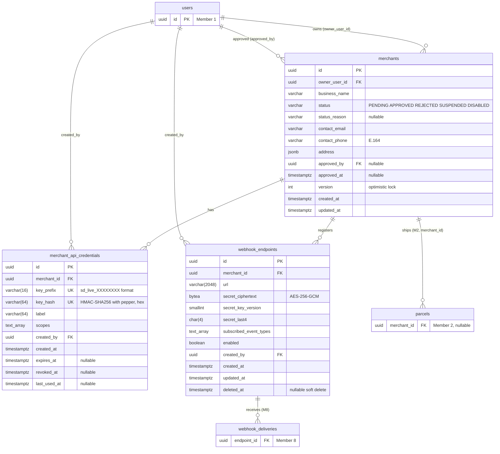

# Document 5 — Data & Persistence Specification

> **Status:** Post-Review Aligned (v2.0.0) — 25 October 2026  
> **Author:** Member 4 — Merchant Integration  
> **Target Module / Location:** `core-api/internal/merchants/infrastructure/`, `core-api/migrations/`  
> **Key Upstream Dependencies:** Member 1 (`users`, `audit_logs`), Member 2 (`parcels.merchant_id`, `idempotency_keys`), Member 8 (`webhook_deliveries` FK, worker DB role via `merchant_webhook_targets_view`), Member 9 (DB roles, secrets), DB coordinator (migration ordering)  
> **Alignment Status:** All open questions U-01–U-31 resolved. See `MEMBER_04_ALIGNMENT_AND_SPECIFICATION_GUIDE.md` §3.

This document references the system ERD in [`docs/architecture/database-schema.md`](../../architecture/database-schema.md) and only details Member 4's tables. [§10](#10-requested-changes-to-the-canonical-schema) lists the changes Member 4 asks the canonical schema to adopt.

---

## 1. Deliverables in This Folder

| Artifact | Path | Verified |
|---|---|---|
| Draft migrations (golang-migrate up/down pairs) | [`migrations-draft/`](./migrations-draft/) | ✅ Executed 2026-10-24 on PostgreSQL 16.15: up → 41 assertions → down → up → 41 assertions, all passed ([evidence](./doc6-tests/migrations/migration-test-output.txt), Doc 6). Also applied by the real **golang-migrate v4.17.1** in the Doc 8 local stack (`doc8-local/`). |
| Webhook view contract | [`contracts/webhook-config-read-contract.sql`](./contracts/webhook-config-read-contract.sql) | Same view as migration `…000400` |
| ERD, data dictionary, ownership, migration plan | This document | — |

---

## 2. Entity-Relationship Diagram (Member 4 scope)



Plus one view: `merchant_webhook_targets` (enabled ∧ not deleted ∧ merchant APPROVED), read by Member 8 via `swiftdrop_worker` role.

---

## 3. Data Dictionary

### 3.1 `merchants`

| Column | Type | Null | Default | Constraint / Rule | Source rule |
|---|---|---|---|---|---|
| `id` | `uuid` | N | `gen_random_uuid()` | PK | DB std §3.1 |
| `owner_user_id` | `uuid` | N | — | FK `users(id)` RESTRICT | Doc 2 A2 |
| `business_name` | `varchar(150)` | N | — | trimmed length 2–150 | BR-M-01 |
| `status` | `varchar(32)` | N | `'PENDING'` | IN (PENDING, APPROVED, REJECTED, SUSPENDED, DISABLED) | Doc 2 §2.1, U-02 resolved |
| `status_reason` | `varchar(500)` | Y | — | Last reject/suspend/disable reason, for admin display. Full history in `audit_logs`. | BR-M-08 |
| `contact_email` | `varchar(254)` | N | — | contains `@` (full validation in domain) | BR-M-02 |
| `contact_phone` | `varchar(16)` | N | — | `^\+[1-9][0-9]{6,14}$` | BR-M-03 |
| `address` | `jsonb` | N | — | object with `line1`, `city`, `country`; optional `line2`, `postal_code` | BR-M-04 |
| `approved_by` | `uuid` | Y | — | FK `users(id)` RESTRICT; required when status ∈ {APPROVED, SUSPENDED, DISABLED} | F-02 |
| `approved_at` | `timestamptz` | Y | — | same as above | F-02 |
| `version` | `integer` | N | `1` | ≥ 1; incremented on every update | BR-M-09, DB std §3.3 |
| `created_at` | `timestamptz` | N | `now()` | UTC | DB std §3.5 |
| `updated_at` | `timestamptz` | N | `now()` | set by application on update (no trigger) | — |

**Indexes:**

| Name | Definition | Purpose |
|---|---|---|
| `merchants_pkey` | `(id)` | PK lookups |
| `uq_merchants_active_owner` | UNIQUE `(owner_user_id) WHERE status IN ('PENDING','APPROVED','SUSPENDED')` | One active merchant per user (BR-M-05), race-safe |
| `idx_merchants_owner_created` | `(owner_user_id, created_at DESC)` | Applicant → own merchant/application history (`GET /merchants/me` before `tenant_id` exists, DD-12) |
| `idx_merchants_status_created` | `(status, created_at DESC)` | Admin list by status |

Address is `jsonb` (as in the canonical ERD) because merchant address is display/contact data only. It is never used for pricing or routing (pickup addresses are per-order, owned by M2).

### 3.2 `merchant_api_credentials`

| Column | Type | Null | Default | Constraint / Rule | Source rule |
|---|---|---|---|---|---|
| `id` | `uuid` | N | `gen_random_uuid()` | PK; exposed as `key_id` | — |
| `merchant_id` | `uuid` | N | — | FK `merchants(id)` ON DELETE CASCADE | Tenant |
| `key_prefix` | `varchar(16)` | N | — | UNIQUE; `sd_live_` (8 chars) + 8 hex chars | BR-K-02, DD-03, **Align §4.3** |
| `key_hash` | `varchar(64)` | N | — | UNIQUE; hex HMAC-SHA256 with `API_KEY_PEPPER` | BR-K-03, DD-02, **Align §4.3** |
| `label` | `varchar(64)` | N | — | trimmed 1–64; unique per merchant among non-revoked | BR-K-05 |
| `scopes` | `text[]` | N | `{parcels:create,parcels:read}` | non-empty ⊆ `{parcels:create, parcels:read}` (ADR-003 names) | BR-K-07 |
| `created_by` | `uuid` | N | — | FK `users(id)` RESTRICT | Audit |
| `created_at` | `timestamptz` | N | `now()` | — | — |
| `expires_at` | `timestamptz` | Y | — | > `created_at` (1–365 days enforced in domain) | BR-K-08 |
| `revoked_at` | `timestamptz` | Y | — | ≥ `created_at`; set once, never cleared | BR-K-10 |
| `last_used_at` | `timestamptz` | Y | — | throttled update | BR-K-14, U-17 |

**Derived status** (not stored): `REVOKED` if `revoked_at` set → else `EXPIRED` if `expires_at <= now()` → else `ACTIVE`.

**Indexes:**

| Name | Definition | Purpose |
|---|---|---|
| `uq_credentials_key_prefix` | UNIQUE `(key_prefix)` | Hot authentication lookup (F-06), one row |
| `uq_credentials_merchant_label_active` | UNIQUE `(merchant_id, label) WHERE revoked_at IS NULL` | BR-K-05 |
| `idx_credentials_merchant_created` | `(merchant_id, created_at DESC)` | Key list; active count |

### 3.3 `webhook_endpoints`

| Column | Type | Null | Default | Constraint / Rule | Source rule |
|---|---|---|---|---|---|
| `id` | `uuid` | N | `gen_random_uuid()` | PK; exposed as `webhook_id` | — |
| `merchant_id` | `uuid` | N | — | FK `merchants(id)` ON DELETE CASCADE | Tenant |
| `url` | `varchar(2048)` | N | — | starts `https://` (SSRF policy in domain; `http://` only in local dev) | BR-W-02…06 |
| `secret_ciphertext` | `bytea` | N | — | AES-256-GCM `nonce‖ct‖tag`, ≥ 28 bytes | BR-W-10, DD-05 |
| `secret_key_version` | `smallint` | N | — | Encryption key version; allows key rotation | U-22 |
| `secret_last4` | `char(4)` | N | — | Last 4 chars of plaintext secret for UI hint only | — |
| `subscribed_event_types` | `text[]` | N | — | non-empty; validated against catalog in application | BR-W-07, U-06 |
| `enabled` | `boolean` | N | `true` | `false` when disabled or soft-deleted | F-10 |
| `created_by` | `uuid` | N | — | FK `users(id)` ON DELETE RESTRICT | Audit |
| `created_at` | `timestamptz` | N | `now()` | — | — |
| `updated_at` | `timestamptz` | N | `now()` | — | — |
| `deleted_at` | `timestamptz` | Y | — | soft delete; requires `enabled = false` | BR-W-12 |

**Indexes:**

| Name | Definition | Purpose |
|---|---|---|
| `uq_webhooks_merchant_url_live` | UNIQUE `(merchant_id, url) WHERE deleted_at IS NULL` | BR-W-08; allows re-register after delete |
| `idx_webhooks_merchant_live` | `(merchant_id, created_at DESC) WHERE deleted_at IS NULL` | Dashboard list; count for limit |
| `idx_webhooks_merchant_enabled` | `(merchant_id) WHERE enabled AND deleted_at IS NULL` | Worker lookup via view |

### 3.4 View `merchant_webhook_targets`

> **Naming note (2026-10-26 audit):** The canonical view name is `merchant_webhook_targets`. The alignment guide had proposed `merchant_webhook_targets_view`; the new system audit overruled this because Member 8's worker already references the shorter name in its implementation.

| Column | From |
|---|---|
| `endpoint_id` | `webhook_endpoints.id` |
| `merchant_id` | `webhook_endpoints.merchant_id` |
| `url` | `webhook_endpoints.url` |
| `secret_ciphertext`, `secret_key_version` | `webhook_endpoints` |
| `subscribed_event_types` | `webhook_endpoints` |
| `updated_at` | `webhook_endpoints` |

Filter: `enabled = TRUE AND deleted_at IS NULL AND merchants.status = 'APPROVED'`. Member 8's `swiftdrop_worker` role has `SELECT` on this view only. Contract rules in [Doc 4 §10.3](./doc-04-interface-and-integration-contract.md#103-database-view-i-08).

### 3.5 Why the check constraints duplicate domain rules

The domain layer is the primary enforcement point. DB constraints are a **second line of defence** against bugs, manual SQL, and future code paths (SRS risk table: "DB constraints where useful"). They are kept deliberately coarse (e.g. email only checks `@`) so they never reject data the domain accepts.

---

## 4. Ownership and Permission Boundaries

| Object | Owner | Writer | Readers | Enforcement |
|---|---|---|---|---|
| `merchants` | M4 | `merchants/infrastructure` only | M4; view | Code review + depguard (U-21); FK from `parcels` (M2) is reference only |
| `merchant_api_credentials` | M4 | `merchants/infrastructure` only | M4 only | Code review; **no** view, **no** grant to other roles |
| `webhook_endpoints` | M4 | `merchants/infrastructure` only | M4; view | Code review |
| `merchant_webhook_targets` | M4 | — | M8 worker (`swiftdrop_worker` SELECT) | DB grant |

**Database roles (per Member 9 Agreement A5):**

| Role | Used by | Rights on M4 objects |
|---|---|---|
| `swiftdrop_migrator` | Migration job | DDL on all |
| `swiftdrop_app` | Core API process | SELECT/INSERT/UPDATE on the three tables; **no DELETE** on `merchants` and `merchant_api_credentials` (never hard-deleted by the app) |
| `swiftdrop_worker` | M8 Event Worker | SELECT on `merchant_webhook_targets` view only |
| `swiftdrop_tracking` | M5 Tracking API | **none** |

Since the Core API is one process, module-level isolation inside it is a code rule, not a DB rule (`domain-boundaries.md` §4.2). Separate DB roles isolate **services**.

---

## 5. Migration Strategy and Ordering

### 5.1 Tooling and conventions

- **golang-migrate** v4.17+ (`docs/operations/local-development.md`), files in `core-api/migrations/`.
- Pair per change: `<version>_<verb>_<object>.up.sql` / `.down.sql`.
- One logical change per migration; never edit a merged migration — add a new one.
- `gen_random_uuid()` is built-in from PostgreSQL 13 (no extension needed).
- New tables use plain `CREATE INDEX`. Indexes on existing large tables later use `CREATE INDEX CONCURRENTLY` in their own migration file (cannot run in a transaction).

### 5.2 Ordering across members

```mermaid
flowchart LR
    A["000001_create_users_and_roles\n(Member 1)"] --> B["000002_create_delivery_zones\n(Member 7)"]
    B --> C["000003_create_merchants_and_credentials\n(Member 4 — all tables + view)"]
    C --> D["000004_create_pricing_rules\n(Member 2)"]
    D --> E["000005_create_parcels_and_quotes\n(Member 2 — parcels.merchant_id FK)"]
    E --> F["000006_create_couriers\n(Member 3)"]
    F --> G["000007_create_dispatch_and_delivery\n(Member 3)"]
    G --> H["000008_create_outbox_events\n(Member 8)"]
    H --> I["000009_create_worker_dedup_and_webhooks\n(Member 8 — webhook_deliveries)"]
```



| Order | Migration file | Owner | Hard dependency |
|---|---|---|---|
| 1 | `000001_create_users_and_roles.up.sql` | M1 | — |
| 2 | `000002_create_delivery_zones.up.sql` | M7 | `users` |
| **3** | **`000003_create_merchants_and_credentials.up.sql`** | **M4** | **`users` (owner_user_id, created_by, approved_by FKs)** |
| 4 | `000004_create_pricing_rules.up.sql` | M2 | `delivery_zones` |
| 5 | `000005_create_parcels_and_quotes.up.sql` | M2 | `merchants` (for `merchant_id` FK) |
| 9 | `000009_create_worker_dedup_and_webhooks.up.sql` | M8 | `webhook_endpoints` (for `webhook_deliveries.endpoint_id` FK) |

**Important for Member 2:** `parcels` cannot be created before `merchants`. Version numbers must reflect this (U-28).

### 5.3 Migration naming — PENDING GROUP DECISION (D2/D3)

> **Status (2026-10-26 audit):** The migration naming decision (D2) is **still open** — the audit confirms no binding vote has been recorded. Additionally, `000003` is **in collision** with Member 3's draft migrations. This must be resolved in the next group meeting before Member 4's migration file can be named.
>
> **Current proposal:** 6-digit sequential (`000003`) once the collision is resolved with M3. Until then, Member 4's draft retains the placeholder name `000003_create_merchants_and_credentials.up.sql` with the understanding that the final number may change.

### 5.4 Changing the schema later (expand → migrate → contract)

| Step | Example: rename `status_reason` → `last_status_reason` |
|---|---|
| Expand | Add new column, nullable. App writes both. |
| Migrate | Backfill new from old. App reads new. |
| Contract | Separate later migration drops old column after all replicas run the new code. |

Columns used by the view (Doc 4 §10.3) additionally require Member 8 sign-off before the contract step.

### 5.5 Rollback

- Down migrations exist for local/dev. In shared environments, roll forward with a fix instead of rolling back destructive steps.
- `merchants` down fails if `parcels` rows reference it — intentional.
- Rollback order is the reverse of §5.2 (M8 → M2 → M4 view → M4 tables → M1).

---

## 6. Transactions, Isolation, and Concurrency

Isolation: PostgreSQL **READ COMMITTED** for all Member 4 transactions. Correctness comes from constraints, optimistic versions, and explicit row locks, not from SERIALIZABLE.

| Concern | Mechanism | Where |
|---|---|---|
| Two admins change the same merchant | `UPDATE … WHERE id=$1 AND version=$2`; 0 rows → `409` | ChangeStatus, UpdateProfile |
| Two applications by the same user | Partial unique index → unique violation → `409 MERCHANT_ALREADY_EXISTS` | SubmitApplication |
| Exceed key / webhook limit with parallel requests | `SELECT … FROM merchants WHERE id=$1 FOR UPDATE` before COUNT + INSERT | CreateAPIKey, RegisterWebhook |
| Duplicate webhook URL in parallel | Partial unique index on `(merchant_id, url)` | RegisterWebhook, UpdateWebhook |
| Prefix collision | UNIQUE `key_prefix` → regenerate (max 3) | CreateAPIKey |
| Revoke races | `UPDATE … WHERE revoked_at IS NULL` (first wins, others no-op) | RevokeAPIKey |
| Disable vs. create key | Both lock the merchant row; serialised | ChangeStatus(DISABLE), CreateAPIKey |
| Deadlocks | Lock order: `merchants` row → child rows. No transaction locks two merchants. | All |
| Long transactions | No DNS/HTTP/crypto-heavy work inside tx; key generation, hashing, encryption, DNS done before BEGIN | Doc 3 §8 |

Statement timeout for the Core API role (proposed): `SET statement_timeout = '5s'`; lock wait: `lock_timeout = '2s'` → surfaces as `503`-class error rather than hanging requests (U-30).

---

## 7. Data Validation and Integrity Rules

| Layer | Validates |
|---|---|
| Transport | JSON shape, types, required fields, max lengths (OpenAPI schema) |
| Domain | Business rules BR-M/K/W (formats, transitions, SSRF policy, scopes) |
| Application | Cross-aggregate rules (limits, merchant status, duplicates) |
| Database | PK/FK/UNIQUE, CHECK constraints in §3, NOT NULL |

Integrity guarantees:

1. Every credential and webhook belongs to exactly one existing merchant (FK, RESTRICT).
2. A merchant cannot be hard-deleted while credentials, webhooks, or parcels reference it.
3. An approved/suspended/disabled merchant always has `approved_by` and `approved_at`.
4. A soft-deleted webhook is always disabled.
5. A revoked key can never become un-revoked (application never writes `revoked_at = NULL`; no code path exists; covered by tests).
6. Event type strings are validated in the application against the catalog because the catalog evolves with code (U-06). A DB enum would require a migration per new event type.

---

## 8. Retention, Deletion, Audit, and Privacy

### 8.1 Data classification

| Data | Classification | Notes |
|---|---|---|
| `business_name`, `address` | Business info | Not personal by default; may contain a sole trader's name/home address → treat as PII |
| `contact_email`, `contact_phone` | **PII** | Never in logs; masked in admin list views if required by M7 (U-31) |
| `key_hash`, `key_prefix` | Security metadata | Hash is not reversible; prefix is public |
| `secret_ciphertext` | **Secret (encrypted)** | Never logged, never returned by API, never in audit state |
| API key plaintext, signing secret plaintext | **Secret** | **Never stored anywhere** |
| `webhook_endpoints.url` | Business config | May contain merchant-internal path; shown only to that merchant and admins |

### 8.2 Retention and deletion

| Data | Retention | Deletion method |
|---|---|---|
| `merchants` | Life of the platform; parcels reference them | Never hard-deleted. After `DISABLED` or `REJECTED` + 2 years: anonymise `contact_email`, `contact_phone`, `address` (job, U-31) |
| `merchant_api_credentials` | Revoked/expired rows kept 2 years (aligned with audit retention) | Hard delete by maintenance job after 2 years past `revoked_at`/`expires_at` |
| `webhook_endpoints` (soft-deleted) | 30 days after `deleted_at` (aligned with M8's 30-day `webhook_deliveries` retention) | Hard delete by maintenance job **after** M8 has purged referencing deliveries |
| `audit_logs` entries written by M4 | ≥ 2 years (`database-schema.md` §5) | Owned by M1/M7 |

Maintenance jobs (proposed: one Go CLI subcommand `core-api maintenance merchants-retention`, run as K8s CronJob daily by M9) are idempotent and batch-limited (e.g. 500 rows per run).

### 8.3 Audit

All security-sensitive changes write `audit_logs` in the same transaction (BR-X-04, BR-M-10):

| Action | `target_type` | `previous_state` / `new_state` contain | Must NOT contain |
|---|---|---|---|
| `MERCHANT_APPROVED` / `REJECTED` / `SUSPENDED` / `REINSTATED` / `DISABLED` | `MERCHANT` | `{status, version}`, `reason` | contact PII |
| `API_KEY_CREATED` / `API_KEY_REVOKED` | `MERCHANT` (target_id = merchant) | `{key_id, key_prefix, label, scopes}` | plaintext key, hash |
| `WEBHOOK_CREATED` / `UPDATED` / `DELETED` / `SECRET_ROTATED` | `MERCHANT` | `{webhook_id, url, events, enabled}` | secret plaintext, ciphertext |

(`target_type` values in the canonical schema are `PARCEL, MERCHANT, USER`; using `MERCHANT` for all keeps it within that list — U-31 asks whether `API_KEY`/`WEBHOOK` should be added.)

### 8.4 Privacy rules

1. Merchant data is visible only to that merchant's owner and to admins.
2. Merchants never see other merchants' data; Member 5's public tracking never exposes `merchant_id` or merchant contact data.
3. Logs: `merchant_id` and `key_prefix` allowed; email, phone, URL query strings, secrets not allowed.

---

## 9. Caching Policy

| Data | Cached? | Reason |
|---|---|---|
| API key verification result | **No** (DD-08) | Revocation must be immediate across replicas |
| Merchant status | **No** | Suspension must be immediate |
| Webhook config for M8 | M8 may cache ≤ 60 s (view contract) | Bounded staleness acceptable for delivery; M8 re-reads before retry |
| Webhook event type catalog | In-memory constant (compiled in) | Changes only with a deploy |
| `last_used_at` throttle map | In-memory per replica, max 1 write/key/min | Write reduction; loss on restart is harmless |

Future option (only if measured hot): ≤ 5 s TTL cache for credential lookups with invalidation via PostgreSQL `LISTEN/NOTIFY` on revoke/status change.

---

## 10. Requested Changes to the Canonical Schema

Changes Member 4 asks the DB coordinator to apply to `docs/architecture/database-schema.md` after Meeting 2:

| # | Current (`database-schema.md`) | Proposed | Reason | Ref |
|---|---|---|---|---|
| 1 | `merchants.status`: PENDING, APPROVED, REJECTED, SUSPENDED | add `DISABLED` | SRS FR-ADM-005 | U-02 |
| 2 | `merchants` has no `version` in ERD (but §3.3 says it must) | add `version integer` | Optimistic locking | U-11 |
| 3 | — | add `merchants.status_reason` | Admin display of last reason | — |
| 4 | `merchant_api_credentials.key_hash "Argon2id or SHA-256 hash"` | "HMAC-SHA256 with pepper", add `pepper_version` | DD-02 | U-29 |
| 5 | `scopes`: `parcels:read, parcels:write, tracking:read` | `parcels:create, parcels:read` (ADR-003 names); drop `tracking:read`; `webhooks:manage` not grantable to keys | Align with ADR-003; public tracking needs no key | Doc 7 C-2, C-3 |
| 6 | — | add `created_by`, `last_used_at` to credentials | Audit; safe rotation | U-17 |
| 7 | `webhook_endpoints.secret_hash` | `secret_ciphertext bytea`, `secret_key_version`, `secret_last4` | HMAC signing needs the secret | U-03 |
| 8 | — | add `webhook_endpoints.created_by`, `deleted_at` | Audit; soft delete keeps M8 FK valid | U-19 |
| 9 | Module `README.md` names `merchant_api_keys`, `webhook_subscriptions` | Use canonical names `merchant_api_credentials`, `webhook_endpoints` | Consistency | U-01 |
| 10 | — | add view `merchant_webhook_targets` to ownership matrix (owner M4, reader M8) | Read contract | U-08 |

---

## 11. Seed Data and Test Data

### 11.1 Local demo seed

Because API key hashes depend on the pepper, seed data is created through the **application**, not raw SQL:

```bash
# Proposed (Doc 8 finalises):
go run ./cmd/api seed merchants-demo
```

| Seeded record | Values |
|---|---|
| Demo merchant user (from M1 seed) | `merchant.demo@swiftdrop.com` |
| Merchant | "SwiftDrop Demo Store", status `APPROVED`, approved by seeded admin |
| API key | label `demo-local`; plaintext printed **once to stdout** on seed run; prefix `sd_test_` in local profile (U-30 key prefix per env) |
| Webhook | `http://webhook-sink:8089/hooks` (local mock receiver, allowed because `WEBHOOK_ALLOW_HTTP=true` locally), events `parcel.booked.v1`, `parcel.delivered.v1` |
| Extra merchants | one each in `PENDING`, `SUSPENDED`, `REJECTED` for admin UI demo (M7) |

Seed is idempotent (re-run does not duplicate; existing demo merchant is left as is, a new key is not created unless `--rotate-key`).

**Never** seed non-local environments with demo keys.

### 11.2 Automated test data

| Need | Approach |
|---|---|
| Domain unit tests | Pure constructors/builders: `domain.NewMerchant(...)`, test helper `aMerchant().WithStatus(SUSPENDED).Build()` |
| Application tests | In-memory fake repositories + fixed `Clock` + deterministic `KeyGenerator` |
| Repository/integration tests | Testcontainers PostgreSQL 16, run real migrations, each test in its own transaction rolled back (or truncate per test) |
| Multi-tenant tests | Always create **two** merchants (A, B) with keys and webhooks; assert A cannot see B (AT-011) |
| Status matrix | Fixture merchant in each of the 5 statuses |
| SSRF table tests | Static list of URLs/IPs from `webhook-security.md` §3.1 + IPv4-mapped IPv6 + edge ports |
| Repeatability | No dependence on wall clock (inject clock), no real DNS (fake resolver), random IDs only where uniqueness matters |

Full test matrix in Document 6.

---

## 12. New Open Questions

| ID | Question | Proposal | Needs |
|---|---|---|---|
| U-28 | Migration version scheme across 10 members. | Timestamp versions; DB coordinator orders at merge; M2's `parcels` after M4's `merchants`. | DB coordinator, M2 |
| U-29 | API key pepper rotation procedure. | `pepper_version` column; new keys use the latest pepper; old keys verified with their version; old pepper retired when no active keys use it. | M9 |
| U-30 | DB timeouts (`statement_timeout`, `lock_timeout`) and per-environment key prefix (`sd_test_` locally, `sd_live_` in production). | 5 s / 2 s; prefix from `MERCHANT_API_KEY_PREFIX`. | M9, platform owner |
| U-31 | PII handling details: anonymisation job after 2 years; masking contact data in admin lists; extending `audit_logs.target_type` with `API_KEY`, `WEBHOOK`. | Anonymise; no masking for admins in baseline; keep `MERCHANT` only. | M1, M7 |
