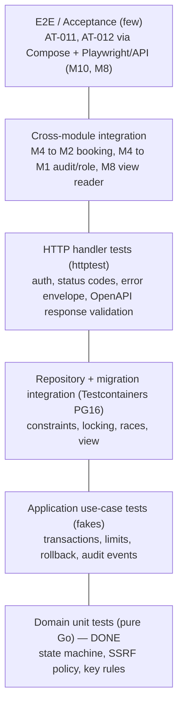

# Document 6 — Testing Strategy & Acceptance Specification

> **Status:** Draft / Proposed (For Review in Meeting 2)  
> **Author:** Member 4 — Merchant Integration  
> **Target Module / Location:** `core-api/internal/merchants/**/*_test.go`, `core-api/tests/`, CI workflow  
> **Key Upstream Dependencies:** Member 1 (JWT test helper, users seed), Member 2 (parcel booking for integration tests), Member 8 (webhook worker for AT-012), Member 9 (CI runners, Compose), Member 10 (E2E coordination)  
> **Open Questions / Needs Clarification:** Inherits U-01 … U-31. New: U-32 … U-35 (see [§13](#13-new-open-questions)).

---

## 1. Summary of Evidence Produced Today

Starter tests were written and **executed** for this document ([`doc6-tests/`](./doc6-tests/)):

| Suite | Scope | Result | Evidence |
|---|---|---|---|
| Domain + keycrypto unit tests | Status machine, reasons, key format/redaction, scopes, credential status, webhook URL + SSRF policy, key generation/hashing | ✅ **119 passed, 0 failed**, `-race`, coverage **96.2 %** (re-run after ADR-003 alignment) | [`go-test-output.txt`](./doc6-tests/merchants-domain/go-test-output.txt) |
| Fuzz | `ParseWebhookURL` + `CheckHost` never panic | ✅ 30 s, ~6.5 M executions, 0 crashes | console run (§11.3) |
| Migration test (PostgreSQL 16.15) | up → 41 assertions → down → clean → up → 41 assertions | ✅ **41/41 passed twice**, down leaves nothing | [`migration-test-output.txt`](./doc6-tests/migrations/migration-test-output.txt) |

Not yet executable (no Core API code exists yet): application use-case tests, repository integration tests, HTTP handler tests, cross-module and E2E tests. They are specified below with IDs so they can be implemented 1:1.

---

## 2. Test Strategy Overview



Principles:

1. **Business rules are proven at the lowest level possible** (domain), then **wiring is proven once** at higher levels.
2. **Security rules get their own tests at every level they are enforced** (domain policy, DB constraint, handler).
3. **Every requirement and business rule maps to at least one test ID** (§4). A rule with no test is a gap.
4. **No shared mutable state between tests**; every test can run alone and in any order (`-count=1 -shuffle=on`).

---

## 3. Test Levels

| Level | What | Tools | Real vs fake | Owner | Status |
|---|---|---|---|---|---|
| L1 Domain unit | Aggregates, value objects, policies (Doc 3 §5) | `go test`, table tests, fuzz | All real (pure) | M4 | ✅ Done (starter) |
| L2 Application | Use cases with ports faked (Doc 3 §6.2) | `go test`, in-memory fakes | Fake repos, fake clock, fake resolver, fake M1/M2 adapters | M4 | Planned |
| L3 Repository / migration | SQL, constraints, row locks, optimistic version, view | Testcontainers `postgres:16`; golang-migrate | Real PG; real migrations | M4 | ✅ Migration part done; repo tests planned |
| L4 HTTP handler | Routing, auth middleware, DTO validation, error mapping | `net/http/httptest`, `kin-openapi/openapi3filter` | Real transport + application; fake infra or real PG | M4 | Planned |
| L5 Contract | OpenAPI validity; responses match OpenAPI; view contract; event schema | `redocly lint`; openapi3filter; SQL assertions; JSON Schema validator | Real | M4 (+ consumers review) | ✅ OpenAPI lint + view assertions done |
| L6 Cross-module integration | M4 → M2 `CreateForMerchant`; M4 → M1 audit/role in same tx; M8 reads view | `go test` in `core-api/tests/`, Testcontainers | Real modules, real PG | M4 with M1, M2, M8 | Planned |
| L7 Security | AuthN/Z, tenant isolation, SSRF, secret leakage, rate limits | L1–L4 tests tagged `security`, plus gateway tests (M7) | Mixed | M4 | Partly done (L1 SSRF + redaction) |
| L8 E2E acceptance | AT-011, AT-012 on Compose stack | API scripts / Playwright (M10), webhook sink | Full stack | M10 coordinates; M4 + M8 provide | Planned |
| L9 Performance smoke | Auth lookup p95, order create p95 | `k6` or Go benchmark | Real PG | M4 | Planned (optional) |

---

## 4. Test-Case Matrix

Legend — **Type:** H happy · I invalid input · A authorization · R race/concurrency · D dependency failure · S security · **Status:** ✅ automated & passing · ⏳ planned.

### 4.1 Merchant application and status

| ID | Requirement / Rule | Scenario | Level | Type | Status |
|---|---|---|---|---|---|
| TC-M-01 | FR-MER-001, BR-M-06 | New application → PENDING, version 1 | L1 / L3 | H | ✅ `TestApproveSetsApprovalFieldsAndEvent`, M-01, M-02 |
| TC-M-02 | BR-M-01 | Business name 1 char / 151 chars / whitespace rejected; Sinhala name accepted (rune count) | L1 / L3 | I | ✅ `TestBusinessNameValidation`, M-07 |
| TC-M-03 | BR-M-02..04 | Invalid email / non-E.164 phone / address missing city | L1 / L3 / L4 | I | ✅ M-06, M-08 · ⏳ L1 email, L4 422 envelope |
| TC-M-04 | BR-M-05 | Second active application by same user → 409 | L3 / L4 | I | ✅ M-03 · ⏳ L4 |
| TC-M-05 | BR-M-05, U-16 | Rejected applicant may reapply | L3 | H | ✅ M-13 |
| TC-M-06 | BR-M-05 | Two parallel applications by same user → exactly one succeeds | L3 | R | ⏳ |
| TC-M-07 | Doc 2 §2.1 | All 25 (status × action) pairs: 6 allowed, 19 rejected, state unchanged on reject, no event | L1 | H/I | ✅ `TestStatusMachine_AllPairs` (25 subtests) |
| TC-M-08 | Doc 2 §2.1 | Terminal states REJECTED/DISABLED accept no action | L1 | I | ✅ `TestTerminalStatesAllowNothing` |
| TC-M-09 | BR-M-08 | Reason required for reject/suspend/disable; 4/5/500/501 char boundaries | L1 | I | ✅ `TestReasonRules` (10 cases) |
| TC-M-10 | F-02 | Approve sets approved_by/at; reinstate keeps original approver | L1 / L3 | H | ✅ `TestApproveSets…`, `TestSuspendReinstateKeepsApproval`, M-05, M-11 |
| TC-M-11 | BR-M-09 | Stale `expected_version` → 0 rows → 409 MERCHANT_VERSION_CONFLICT | L3 / L4 | R | ✅ M-12 · ⏳ L4 |
| TC-M-12 | BR-M-09 | Two admins approve/reject concurrently → one 200, one 409 | L3 | R | ⏳ |
| TC-M-13 | BR-M-10 | Audit write fails → status change rolled back | L2 / L6 | D | ⏳ |
| TC-M-14 | F-02 A4 | Disable revokes all active keys and disables all webhooks in same tx | L2 / L3 | H | ⏳ |
| TC-M-15 | U-15 | Approve grants MERCHANT role in same tx; role grant failure rolls back | L2 / L6 | D | ⏳ |
| TC-M-16 | FR-ADM-005 | Non-admin calling AdminService → ErrNotAdmin / 403 | L2 / L4 | A | ⏳ |
| TC-M-17 | BR-M-11 | PATCH /merchants/me ignores `status`, `business_name` | L4 | S | ⏳ |
| TC-M-18 | DB integrity | Merchant with credentials cannot be hard-deleted | L3 | I | ✅ K-11 |

### 4.2 API keys and authentication

| ID | Requirement / Rule | Scenario | Level | Type | Status |
|---|---|---|---|---|---|
| TC-K-01 | BR-K-02 | ADR-003 key format `<env><8>_<32>`: valid live/test; wrong env, `sk_live_`, missing/misplaced `_`, 7-char prefix, 31/33-char secret, non-base62 in prefix or secret, unicode, `Bearer ` prefix rejected; round-trip build | L1 | I | ✅ `TestParseAPIKey` (16 cases), `TestNewPlainAPIKeyRoundTrip` |
| TC-K-02 | BR-K-02 | Generated keys match ADR regex and parse; 2000 keys unique; all 62 chars appear (no bias bug); random-source failure returns error, never a weak key (FM-08) | L1 | H/D | ✅ `TestGeneratedKeyMatchesADRFormat`, `TestGeneratedKeysAreUnique…`, `TestRandomSourceFailure` |
| TC-K-03 | BR-K-03, DD-02 | HMAC deterministic; pepper/key change → different hash; 64 lowercase hex matches DB check | L1 / L3 | H | ✅ `TestHash`, K-04 |
| TC-K-04 | Doc 1 inv. 11 | Constant-time compare | L1 | S | ✅ `TestEqual` |
| TC-K-05 | BR-K-04, BR-X-03 | Plaintext never in `%v`, `%s`, `%+v`, `%#v`, logger, JSON | L1 | S | ✅ `TestPlainAPIKeyIsRedactedEverywhere` |
| TC-K-06 | BR-K-04 | Plaintext absent from DB row, audit row, and logs after F-04 | L3 / L4 | S | ⏳ (scan DB + captured log for secret part) |
| TC-K-07 | BR-K-01 | Create key when merchant PENDING / SUSPENDED → 403 | L2 / L4 | A | ⏳ |
| TC-K-08 | BR-K-05 | Duplicate active label → 409; reuse after revoke; same label other merchant OK | L3 | I | ✅ K-07, K-08, K-09 |
| TC-K-09 | BR-K-07 | Scope default `parcels:create`+`parcels:read`; dedupe; `parcels:write` (old name), `webhooks:manage` (C-3), `tracking:read`, `parcels:*` rejected | L1 / L3 | I | ✅ `TestScopeSet`, K-05, K-05b, K-05c, K-05d, K-06 |
| TC-K-10 | BR-K-08 | Expiry 23h / 1d / 365d / 366d / past | L1 / L3 | I | ✅ `TestValidateExpiry`, K-10 |
| TC-K-11 | BR-K-09 | 6th key at limit 5 → 409 | L2 | I | ⏳ |
| TC-K-12 | BR-K-09 | 2 parallel creates at limit−1 → one succeeds (merchant row lock) | L3 | R | ⏳ |
| TC-K-13 | BR-K-02 | Prefix collision → regenerate (fake generator returns duplicate twice) | L2 | D | ⏳ |
| TC-K-14 | Doc 2 §2.2 | Derived status: active / expired at boundary / revoked wins over expired | L1 | H | ✅ `TestCredentialStatus` (6 cases) |
| TC-K-15 | BR-K-10, 11 | Revoke idempotent, revoked_at not overwritten | L1 / L4 | H | ✅ `TestRevokeIdempotent` · ⏳ L4 204 twice |
| TC-K-16 | Doc 1 inv. 12 | Request after revoke commit → 401 API_KEY_REVOKED (no cache) | L4 / L6 | S | ⏳ |
| TC-K-17 | F-06 | Missing header → 401 API_KEY_MISSING; unknown prefix / wrong hash → 401 API_KEY_INVALID (same response) | L4 | A | ⏳ |
| TC-K-18 | F-06, AT-011 | Valid key of SUSPENDED / DISABLED / PENDING merchant → 403 / 401 | L4 | A | ⏳ |
| TC-K-19 | EC-04 | `?api_key=` in query ignored → 401 | L4 | S | ⏳ |
| TC-K-20 | U-25 | Both `X-API-Key` and `Authorization` → 400 | L4 | S | ⏳ |
| TC-K-21 | Doc 4 §3.1 rule 5 | API key used on `/merchants/me/api-keys` → 401 (keys cannot manage keys) | L4 | A | ⏳ |
| TC-K-22 | BR-K-14 | `last_used_at` updated at most once/min; failure does not fail request | L2 | D | ⏳ |
| TC-K-23 | Perf | Auth lookup uses `uq_credentials_key_prefix` index | L3 | H | ✅ I-02 (EXPLAIN) |

### 4.3 Merchant orders (with Member 2)

| ID | Requirement / Rule | Scenario | Level | Type | Status |
|---|---|---|---|---|---|
| TC-O-01 | FR-MER-005 | Valid order → 201 with parcel_id, tracking_number, status, fee | L4 / L6 | H | ⏳ |
| TC-O-02 | BR-O-02 | Missing / non-UUID Idempotency-Key → 400 | L4 | I | ⏳ |
| TC-O-03 | FR-MER-006 | Same key + same body → same parcel, `Idempotent-Replay: true`, one row in parcels | L6 | H | ⏳ |
| TC-O-04 | FR-MER-006 | Same key + different body → 409 IDEMPOTENCY_KEY_PAYLOAD_MISMATCH | L6 | I | ⏳ |
| TC-O-05 | BR-O-03 | Same key used by merchant A and B → two parcels (scope per merchant) | L6 | S | ⏳ |
| TC-O-06 | FR-MER-006 | 10 parallel identical requests same key → exactly 1 parcel | L6 | R | ⏳ |
| TC-O-07 | BR-O-04, EC-01 | Body `merchant_id` = B, caller A → parcel owned by A | L4 / L6 | S | ⏳ |
| TC-O-08 | BR-O-01 | Key with only `parcels:read` → 403 MERCHANT_SCOPE_DENIED on create | L4 | A | ⏳ |
| TC-O-09 | BR-O-05 | M2 validation error code passed through unchanged (422 PARCEL_…) | L2 / L6 | D | ⏳ |
| TC-O-10 | BR-O-07, AT-011 | A lists orders → only A's; A GET B's parcel → 404 | L6 | S | ⏳ |
| TC-O-11 | BR-O-08 | Filters + pagination; per_page 101 handled per conventions | L4 | I | ⏳ |
| TC-O-12 | E6 / EC-05 | Merchant suspended mid-flight → requests after commit rejected | L6 | R | ⏳ |
| TC-O-13 | E7 | DB unavailable → 5xx with correlation_id; retry with same key succeeds once DB back | L6 | D | ⏳ |

### 4.4 Webhooks

| ID | Requirement / Rule | Scenario | Level | Type | Status |
|---|---|---|---|---|---|
| TC-W-01 | BR-W-02, 03 | URL syntax: https ok; http rejected (prod) / allowed (local); ftp/file/gopher; ports 8443/5432; http on 443; userinfo; `shop@127.0.0.1` trick; fragment; relative; no host; >2048; IDN not punycoded; IPv6 literal | L1 | I/S | ✅ `TestParseWebhookURL` (24 cases) |
| TC-W-02 | BR-W-04, 05, EC-09 | Blocked names + literals: localhost, `.local`, `.internal`, `.svc`, `.cluster.local`, every canonical CIDR, metadata IP, `[::]`, zone-id `fe80::1%eth0`, IPv4-mapped IPv6, decimal / short / hex IPv4 forms | L1 | S | ✅ `TestPolicyCheckHost` (26 blocked, 8 allowed incl. boundary 172.15/172.32) |
| TC-W-03 | BR-W-04, EC-10 | Resolved addresses: any private among public → reject; none → unresolvable | L1 | S | ✅ `TestPolicyCheckResolved` (7 cases) |
| TC-W-04 | U-23 | Blocklist contains every CIDR from `webhook-security.md` §3.1 | L1 | S | ✅ `TestBlockedPrefixesContainCanonicalList` |
| TC-W-05 | Robustness | Parser never panics on arbitrary input | L1 | S | ✅ `FuzzParseWebhookURL` (30 s, ~6.5 M execs) |
| TC-W-06 | BR-W-06 | DNS timeout (fake resolver sleeps 3 s) → 422 WEBHOOK_URL_UNRESOLVABLE in ≈2 s; no DB tx held | L2 | D | ⏳ |
| TC-W-07 | BR-W-07 | Unknown event type / empty list → 422 | L2 / L3 | I | ✅ W-04 (DB) · ⏳ L2 catalog |
| TC-W-08 | BR-W-08 | Duplicate live URL → 409; re-register after soft delete OK | L3 | I | ✅ W-02, W-07 |
| TC-W-09 | BR-W-09 | 11th endpoint → 409; parallel at limit−1 → one wins | L2 / L3 | I/R | ⏳ |
| TC-W-10 | BR-W-10 | Client-supplied `secret` → 400; secret returned once; never in list/get; `Cache-Control: no-store` | L4 | S | ⏳ |
| TC-W-11 | BR-W-10, DD-05 | Stored ciphertext decrypts to returned secret; ciphertext ≠ plaintext; wrong key version fails | L2 / L3 | S | ⏳ (needs cipher impl) · ✅ W-05 length check |
| TC-W-12 | BR-W-11 | PATCH url / enable re-runs validation (private URL on PATCH → 400) | L2 / L4 | S | ⏳ |
| TC-W-13 | BR-W-12 | Delete = soft delete; enabled forced false; second delete → 404 | L3 / L4 | H | ✅ W-06, W-07 · ⏳ L4 |
| TC-W-14 | FR-MER-008, AT-011 | Merchant A cannot GET/PATCH/DELETE/rotate B's webhook → 404 | L4 | S | ⏳ |
| TC-W-15 | BR-W-13, I-08 | View returns only enabled ∧ not deleted ∧ APPROVED; event filter; suspension hides endpoints | L3 / L5 | H | ✅ V-01..V-04 |
| TC-W-16 | Doc 5 §4 | Worker role can read view, not base tables or credentials | L3 | S | ✅ V-05 |
| TC-W-17 | AT-012 | Configured webhook receives signed event; retry after simulated 500 (with M8) | L8 | H/D | ⏳ |

### 4.5 Cross-cutting

| ID | Requirement / Rule | Scenario | Level | Type | Status |
|---|---|---|---|---|---|
| TC-X-01 | BR-X-02 | Every error response matches `ErrorResponse` schema, has correlation_id, no stack trace / SQL text | L4 / L5 | S | ⏳ |
| TC-X-02 | Doc 4 §11 | Every 2xx/4xx response validated against OpenAPI | L5 | H | ⏳ |
| TC-X-03 | OpenAPI | Spec lint | L5 | H | ✅ `redocly lint` 0 errors |
| TC-X-04 | BR-X-04 | Each security action writes exactly one audit row with expected action, no secrets | L3 / L6 | S | ⏳ |
| TC-X-05 | BR-X-03 | Captured logs from full test run contain no match for `sd_(live\|test)_[0-9A-Za-z]{8}_[0-9A-Za-z]{32}` and no `whsec_` + 43 chars | L4 / L6 | S | ⏳ (log scanner in test helper) |
| TC-X-06 | AGENTS.md §4.2 | `domain/` imports stdlib only; other modules import facade only | L5 | S | ⏳ depguard (U-21) |
| TC-X-07 | Migrations | up → down → up clean; all indexes exist | L3 | H | ✅ migration test |
| TC-X-08 | SEC-007 | Merchant API and webhook registration rate limited (gateway) | L8 | S | ⏳ with M7 |

**Totals:** 79 test-case IDs; **35 already have at least one automated, passing test** (some only at one of their levels, e.g. TC-W-11 only the DB length check); the rest are planned at the levels that need real application/HTTP code.

---

## 5. Race-Condition Test Design

Race tests run against real PostgreSQL (L3/L6) because the protection lives in the database (locks, unique indexes, version checks).

```go
// Pattern used by TC-M-06, TC-M-12, TC-K-12, TC-W-09, TC-O-06
func runConcurrently(t *testing.T, n int, fn func(i int) error) []error {
    t.Helper()
    var wg sync.WaitGroup
    start := make(chan struct{})
    errs := make([]error, n)
    for i := 0; i < n; i++ {
        wg.Add(1)
        go func(i int) {
            defer wg.Done()
            <-start           // release all goroutines at once
            errs[i] = fn(i)
        }(i)
    }
    close(start)
    wg.Wait()
    return errs
}
// Assert: exactly 1 nil error; the others are the expected domain error
// (ErrVersionConflict / ErrAPIKeyLimitReached / ErrMerchantExists); DB row count matches.
```

Each race test repeats 20 times (`for range 20`) to make flakes visible, and runs with `-race` to catch Go-level data races too.

---

## 6. Dependency-Failure Tests

| Dependency | Failure injected | Expected | Test |
|---|---|---|---|
| DNS | Timeout (> 2 s), NXDOMAIN, returns private IP | 422 unresolvable / 400 SSRF, no tx opened | TC-W-06, TC-W-03 |
| PostgreSQL | Connection refused; `lock_timeout` hit | 5xx with correlation_id; no partial writes | TC-O-13 |
| Audit writer (M1) | Returns error | Whole status change rolled back | TC-M-13 |
| Role assigner (M1) | Returns error | Approval rolled back | TC-M-15 |
| Parcel booking (M2) | Validation error, conflict, internal error | Code passed through / 5xx; M4 writes nothing | TC-O-09 |
| Random source | `rand.Read` error | Key creation fails cleanly (500), nothing inserted | L2 with fake generator |
| Key generator | Prefix collision ×2 then unique | Succeeds on 3rd try; ×4 → 500 | TC-K-13 |

---

## 7. Mocking Strategy

| Collaborator | L1 | L2 | L3 | L4 | L6 | L8 |
|---|---|---|---|---|---|---|
| Domain | real | real | real | real | real | real |
| Repositories | — | **in-memory fake** | real PG | fake or real PG | real PG | real |
| `TxRunner` | — | fake (records commit/rollback) | real | real/fake | real | real |
| `Clock` | passed in | **fixed fake** | fixed fake | fixed fake | real | real |
| `KeyGenerator` | — | **deterministic fake** | real | deterministic | real | real |
| `KeyHasher` | real | real (fixed pepper) | real | real | real | real |
| `SecretCipher` | — | real with test key | real | real | real | real |
| `HostResolver` | addresses passed in | **fake map host→IPs** | fake | fake | fake | real or stub DNS |
| M1 `AuditWriter`/`RoleAssigner` | — | **spy fakes** | real tables (stub users) | fake | real M1 | real |
| M2 `ParcelBooking` | — | **fake** | — | fake | **real M2** | real |
| JWT | — | — | — | test token helper from M1 | M1 helper | real login |
| M8 worker | — | — | — | — | view reader query | real worker + webhook sink |

Rules: fakes are hand-written (no mocking framework) and live in `application/fakes_test.go`; fakes implement the same port interfaces, so a port change breaks fakes at compile time. Real DNS and real internet are **never** used in automated tests.

---

## 8. Test Environment and Dependencies

| Environment | Used for | Provided by |
|---|---|---|
| Developer machine | L1–L5 | Go 1.22+, Docker |
| Testcontainers PostgreSQL 16 | L3, L6 | `testcontainers-go` module started per test package |
| Docker Compose stack | L8 | Member 9 (`docker compose up`), plus a **webhook sink** container that records requests (with M8, U-34) |
| CI (GitHub Actions, ubuntu) | L1–L6 on every PR; L8 nightly/on demand | Member 9 |

Windows note found during this work: `go test -race` needs CGO and a 64-bit C compiler. The team's Windows machines may not have one; run race tests in CI or via `docker run golang:1.22-bookworm` (as done for the saved evidence).

---

## 9. Fixtures, Seed Data, and Repeatability

| Requirement | How |
|---|---|
| Deterministic time | Inject `Clock`; fixed `t0 = 2026-10-24T09:00Z` in tests |
| Deterministic randomness | Fake `KeyGenerator` in L2; real generator only in tests about generation itself |
| Isolation | L3: each test in a transaction rolled back, or per-test schema; L6: truncate M4 tables between tests |
| Two tenants always | Fixture `twoMerchants(t)` creates A and B with one key and one webhook each (AT-011 tests depend on it) |
| Status fixtures | `merchantIn(t, status)` builder for each of the 5 statuses |
| SSRF data | Static tables in `webhook_url_test.go` (from `webhook-security.md` §3.1 + bypass forms) |
| Stub upstream tables | `users` stub (see `doc6-tests/migrations/00_prereq_stub.sql`) until M1 migrations exist |
| No order dependence | `go test -shuffle=on -count=1` in CI |
| Seed for demo (not tests) | Doc 5 §11.1 `seed merchants-demo` |

---

## 10. Coverage Expectations

| Package | Line coverage target | Must be 100 % branch-covered | Current (starter) |
|---|---|---|---|
| `merchants/domain` | ≥ 90 % | `Merchant.Do` (state machine), `WebhookURLPolicy`, `ParseWebhookURL`, `ParseAPIKey`, `APICredential.Status` | **95.7 %**; all listed functions 100 % except helpers `isBlocked` 85.7 %, `looksNumericHost` 90 % |
| key generation / hashing | ≥ 90 % | `Hash`, `Equal`, `NewAPIKey` | **100 %** (random-source failure paths tested via a test seam) |
| `merchants/application` | ≥ 85 % | Every rollback path; limit checks; ChangeStatus side effects | — |
| `merchants/transport` | ≥ 75 % | Auth middleware every branch; error mapping table | — |
| `merchants/infrastructure` | ≥ 70 % (integration) | Error translation (unique/FK → domain errors) | — |

Coverage is a floor, not a goal: every row in §4 must exist regardless of percentage. CI fails if domain < 90 % or application < 85 %.

---

## 11. How Tests Are Run

### 11.1 Locally

```bash
# All unit tests in the module (once real code exists)
cd core-api && go test -race -count=1 -shuffle=on -cover ./internal/merchants/...

# Integration tests (Docker required; build tag keeps them out of quick runs)
cd core-api && go test -race -count=1 -tags=integration ./internal/merchants/... ./tests/merchants/...

# OpenAPI lint
npx @redocly/cli@1.25.0 lint docs/drafts/member-04-merchants/contracts/merchants-openapi.v1.yaml

# Starter evidence in this folder
see doc6-tests/README.md
```

### 11.2 CI (proposal for Member 9)

```yaml
# .github/workflows/merchants.yml (excerpt)
jobs:
  merchants:
    runs-on: ubuntu-latest
    steps:
      - uses: actions/checkout@v4
      - uses: actions/setup-go@v5
        with: { go-version: '1.22' }
      - run: cd core-api && gofmt -l ./internal/merchants | (! grep .)
      - run: cd core-api && golangci-lint run ./internal/merchants/...
      - run: cd core-api && go test -race -count=1 -shuffle=on -coverprofile=cover.out ./internal/merchants/...
      - run: cd core-api && go test -race -count=1 -tags=integration ./internal/merchants/... ./tests/merchants/...
      - run: npx @redocly/cli@1.25.0 lint docs/contracts/merchants-openapi.v1.yaml
      - run: cd core-api && go run ./tools/covercheck -min domain=90 -min application=85 cover.out
```

Testcontainers works on GitHub-hosted Ubuntu runners without extra setup.

### 11.3 Commands used for today's evidence

```bash
docker run --rm -v "$PWD:/src" -w /src golang:1.22-bookworm go test -race -count=1 -v -coverprofile=/tmp/c.out ./...
go test -run '^$' -fuzz FuzzParseWebhookURL -fuzztime 30s ./domain
./doc6-tests/migrations/run_migration_test.sh m4-migr-test      # postgres:16-alpine
```

---

## 12. Acceptance Criteria and Required Evidence

Maps Doc 1 §11 to tests and the evidence a reviewer must see before Member 4's work is accepted.

| # | Acceptance criterion (Doc 1 §11) | Tests | Evidence required |
|---|---|---|---|
| AC-1 | Application stored as PENDING | TC-M-01, M-01/02 | CI green + L4 test output |
| AC-2 | Admin transitions per state machine, illegal rejected, audit row each | TC-M-07..10, TC-M-13, TC-X-04 | Test output; one audit row per action in L6 test |
| AC-3 | Concurrent status change → one 200, one 409 | TC-M-11, TC-M-12 | Race test output (20 repetitions) |
| AC-4 | Key plaintext once, not in DB/logs | TC-K-05, TC-K-06, TC-X-05 | Test output + log-scan result |
| AC-5 | Revoked/expired/non-approved keys rejected on next request (AT-011) | TC-K-14..18 | L4/L6 output |
| AC-6 | Order via key reaches M2, returns parcel_id + tracking_number | TC-O-01 | L6 output; demo recording |
| AC-7 | Same idempotency key → no duplicate | TC-O-03, TC-O-06 | L6 output incl. parallel test |
| AC-8 | Cross-tenant access → 404 for orders, keys, webhooks (AT-011) | TC-O-10, TC-W-14, TC-K-21 | L4/L6 output |
| AC-9 | Webhook registration rejects http (prod), private/metadata IPs, bad ports, unknown events | TC-W-01..07 | ✅ L1 output today + L4 output |
| AC-10 | Secret server-generated, shown once, never listed | TC-W-10, TC-W-11 | L4 output |
| AC-11 | Signed webhook delivered with retry (AT-012, with M8) | TC-W-15..17 | E2E output + webhook-sink log showing retry and valid signature |
| AC-12 | Docs match implementation | TC-X-02, TC-X-03 | OpenAPI validation in handler tests; lint green |
| AC-13 | Migrations reproducible | TC-X-07 | ✅ migration-test-output.txt today; CI job later |

**Definition of done for testing:** all ⏳ rows for the implemented features are ✅ in CI, coverage gates pass, AT-011 and AT-012 demonstrated on the Compose stack, and outputs attached to the PR.

---

## 13. New Open Questions

| ID | Question | Proposal | Needs |
|---|---|---|---|
| U-32 | Should the canonical SSRF blocklist (`webhook-security.md` §3.1) add `::/128` (IPv6 unspecified — connects to localhost on Linux), `100.64.0.0/10` (CGNAT), `224.0.0.0/4` (multicast), `255.255.255.255/32`, `64:ff9b::/96` (NAT64, can embed private IPv4)? Starter code already blocks `::/128`. | Add all five; both M4 and M8 implement the same list. | M8 |
| U-33 | Integration DB in CI: Testcontainers per package vs one Compose PostgreSQL service. | Testcontainers (isolated, parallel-safe). | M9 |
| U-34 | AT-012 needs a webhook sink container that records requests and can return 500 on demand. Who builds it? | M8 builds it (they own delivery); M4 provides seed merchant + webhook. | M8, M10 |
| U-35 | Windows developers cannot run `-race` without a 64-bit C compiler. | Document Docker command (done) and rely on CI for race. | M9 |
