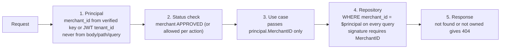

# Document 7 — Security, Failure & Recovery Specification

> **Status:** Draft / Proposed (For Review in Meeting 2)  
> **Author:** Member 4 — Merchant Integration  
> **Target Module / Location:** `core-api/internal/merchants/`  
> **Key Upstream Dependencies:** Member 1 (JWT, RBAC, audit, ADR-003), Member 7 (gateway rate limits, admin UI escaping), Member 8 (send-time SSRF, signing, DLQ), Member 9 (secrets, network policy)  
> **Open Questions / Needs Clarification:** Inherits U-01 … U-35. New: U-36 … U-42 (see [§14](#14-new-open-questions)). **§2 lists conflicts with ADR-003 that must be resolved first.**

This document **supplements** the shared security baseline — it does not redefine it:

- SRS §8 (SEC-001 … SEC-017) — requirement numbering used in this document
- [`docs/security/security-notes.md`](../../security/security-notes.md) — threat model, rate-limit schedule, CORS, secrets
- [`docs/architecture/adr-003-authentication-strategy.md`](../../architecture/adr-003-authentication-strategy.md) — JWT and merchant API key architecture
- [`docs/contracts/webhook-security.md`](../../contracts/webhook-security.md) — SSRF blocklist, signing, retry/DLQ

Where this document is stricter than the baseline, it applies to the merchants module only.

---

## 1. Deliverables

| Deliverable | Section |
|---|---|
| Module-specific security checklist | [§13](#13-module-security-checklist) |
| Failure-mode matrix | [§9](#9-failure-mode-matrix) |
| Threat and abuse-case catalogue | [§5](#5-threats-and-abuse-cases) |
| Recovery runbooks (key, secret, pepper, merchant compromise) | [§10](#10-recovery-reconciliation-and-compensation) |
| Security test scenarios | [§12](#12-security-test-scenarios) |

---

## 2. Conflicts with Accepted Baseline Documents (resolve first)

While writing this document, Member 4's drafts (Docs 2–6) were compared against ADR-003 and `security-notes.md`. ADR-003 is an accepted decision and ranks above these drafts, so **the default is to align with ADR-003** unless the team agrees to amend it.

**Status (24 Oct 2026):** C-1, C-2, and C-4 have been **applied** across Docs 1–6, the OpenAPI contract, the draft migrations, and the starter tests (re-run: 119 Go tests and 41 DB assertions pass). C-3 is applied in Member 4's drafts but **needs an ADR-003 amendment** by Member 1. C-5 is compatible. C-6 and C-7 are requests to Members 7 and 1.

| # | Topic | ADR-003 / security-notes | Member 4 drafts (before alignment) | Recommendation → Status |
|---|---|---|---|---|
| C-1 | API key format | `sd_live_<8-char prefix>_<32 random>` (§6.1); table in §2 says `sk_live_…` | `sd_live_<43 base62>`, prefix = first 8 of body | **Align with ADR §6.1** (`sd_live_`/`sd_test_` + `_` separator). Fix ADR §2 `sk_live_` typo. Require ≥ 128 bits in the random part. → ✅ **Applied**: `sd_(live\|test)_<8 base62>_<32 base62>` (≈ 190 bits). |
| C-2 | Scope names | `parcels:create`, `parcels:read`, `webhooks:manage` | `parcels:read`, `parcels:write` (schema also had `tracking:read`) | Adopt ADR names for parcels (`parcels:create`, `parcels:read`). **Do not** grant `webhooks:manage` to API keys in the baseline (see C-3). → ✅ **Applied** (code, DB CHECK, OpenAPI enum). |
| C-3 | Can API keys manage webhooks? | Implied yes (`webhooks:manage` scope) | No — keys only for orders; webhooks/keys managed via JWT (Doc 4 §3.1 rule 5) | Keep "no" for baseline: a leaked order key must not be able to redirect parcel data to an attacker URL. If needed later, add `webhooks:manage` as an opt-in scope, never default. → ⏳ Applied in M4 drafts; **ADR-003 amendment needed (M1)**. |
| C-4 | Merchant identity for JWT callers | `tenant_id` claim in JWT (§3.2) | Look up merchant by `owner_user_id` every request (DD-12) | **Use the `tenant_id` claim** as the merchant ID (signed by M1, avoids a lookup), **but still check merchant status on every request** (one indexed PK read) so suspension is immediate. → ✅ **Applied** (DD-12 revised in Doc 3; Docs 2, 4, 5, OpenAPI updated). |
| C-5 | Key hash algorithm | "Argon2id or salted SHA-256" (ADR §6.1); "salted hashes" (security-notes) | HMAC-SHA256 with secret pepper (DD-02) | Compatible: HMAC with a server-side pepper is a keyed hash, stronger than a stored salt for high-entropy keys. Record DD-02 as the chosen option in ADR-003. |
| C-6 | Rate-limit route | `/api/v1/merchants/*` — 120/min per API key | Orders are at `/api/v1/merchant/orders` (SRS path) | Gateway rule must cover **both** `/api/v1/merchant/*` and `/api/v1/merchants/*` (U-36). |
| C-7 | SEC numbering | `security-notes.md` table numbers differ from SRS (e.g. its SEC-007 = crypto; SRS SEC-007 = rate limits) | Drafts cite SRS numbers | Re-number `security-notes.md` to match SRS (U-37). This document uses **SRS** numbers. |

---

## 3. Authentication, Authorization, Ownership, Tenant Isolation

### 3.1 Authentication per interface

| Interface | Mechanism | Verified by | Notes |
|---|---|---|---|
| `/merchants/applications` | JWT (any role) | M1 middleware | Creates merchant owned by `sub` |
| `/merchants/me/**` | JWT, role `MERCHANT` | M1 middleware + M4 owner/tenant check | API key **rejected** (C-3) |
| `/merchant/orders**` | `X-API-Key` **or** JWT `MERCHANT` | M4 `CredentialVerifier` / M1 | Both headers → 400 (U-25) |
| `/admin/merchants/**` | JWT, role `ADMIN` | M1 middleware in M7 handler, **re-checked** in `AdminService` | Defence in depth |
| `merchants.AdminService` (Go) | `Actor.Role == ADMIN` | M4 | Never trust caller blindly |
| `merchant_webhook_targets` view | DB role `swiftdrop_worker` | PostgreSQL | SELECT only |

### 3.2 Authorization matrix (who may do what)

| Action | Applicant | Merchant owner (JWT) | Merchant system (API key) | Admin | Other merchant |
|---|---|---|---|---|---|
| Submit application | ✅ (one active) | — | ❌ | ❌ | — |
| View own merchant | ✅ | ✅ | ❌ | ✅ (any) | ❌ 404 |
| Update contact details | ✅ (PENDING) | ✅ | ❌ | ❌ (baseline) | ❌ 404 |
| Change status | ❌ | ❌ | ❌ | ✅ | ❌ |
| Create / revoke API key | ❌ | ✅ (APPROVED) | ❌ | ❌ | ❌ 404 |
| Manage webhooks | ❌ | ✅ (APPROVED) | ❌ (C-3) | ❌ | ❌ 404 |
| Create order | ❌ | ✅ | ✅ `parcels:create` | ❌ | — |
| List / get own orders | ❌ | ✅ | ✅ `parcels:read` | via M2 admin views | ❌ 404 |

Admins deliberately cannot create API keys or webhooks for a merchant: keys are secrets only the merchant should ever see.

### 3.3 Tenant isolation — enforcement points

Rules:
1. The **only** non-tenant-scoped query is `FindByPrefix` (authentication). It returns the merchant ID; it never returns other merchants' data to the caller.
2. Tenant isolation tests always use two merchants (Doc 6 §9).
3. Code review checklist item: "every new repository method takes `MerchantID`".

### 3.4 Ownership

A merchant has exactly one owner user (baseline, Doc 2 A2). Ownership transfer is out of scope; if the owner account is compromised, the admin suspends the merchant (§10.4).

---

## 4. Sensitive Data

| Data | Class | Stored | Must never appear in | Control |
|---|---|---|---|---|
| API key plaintext | **Secret** | Nowhere | DB, logs, audit, traces, error messages, URLs, analytics, browser storage | Redacting type (Doc 3 §5.2, tested TC-K-05); `Cache-Control: no-store`; header-only |
| Webhook signing secret plaintext | **Secret** | Nowhere (encrypted only) | same as above | Server-generated; AES-256-GCM at rest; shown once |
| `secret_ciphertext` | Secret (encrypted) | `webhook_endpoints` | API responses, logs, audit | Not mapped into any DTO |
| `key_hash` | Security metadata | `merchant_api_credentials` | API responses, logs, other modules | No DTO field; no grant |
| Pepper, encryption key | **Secret** | K8s Secret / `.env` (local) | Repo, images, logs, ConfigMaps | M9 secret injection (SRS SEC-003) |
| `key_prefix` | Public identifier | DB | — (safe to log and display) | — |
| Contact email/phone, address | **PII** | `merchants` | Logs, other merchants, public tracking | Tenant scoping; log policy |
| Webhook URL | Confidential business config | `webhook_endpoints` | Other merchants, logs (path/query may contain tokens) | Log host only |
| `Authorization` / `X-API-Key` headers | Secret | — | Access logs | Gateway and app log redaction (M7, M4) |

Log policy for this module (stricter than baseline): allowed fields are `correlation_id`, `merchant_id`, `key_prefix`, `credential_id`, `webhook_id`, `webhook_host`, `use_case`, `outcome`, `error_code`, `latency_ms`. Everything else is opt-in by review.

---

## 5. Threats and Abuse Cases

STRIDE category: **S**poofing, **T**ampering, **R**epudiation, **I**nformation disclosure, **D**enial of service, **E**levation of privilege.

| ID | Threat / abuse case | STRIDE | Likelihood | Impact | Mitigation | Test |
|---|---|---|---|---|---|---|
| AB-01 | Leaked API key used by attacker to create orders as the merchant | S | Medium | High | Revocation effective next request; optional expiry; scopes; `last_used_at` visible to merchant; rotation runbook §10.1; rate limit per key | TC-K-16 |
| AB-02 | Brute-forcing API keys | S | Low | High | ≥ 128-bit entropy (C-1) makes guessing infeasible; same 401 for unknown prefix and wrong hash; per-IP limit on 401s at gateway; alert on spikes | TC-K-17, §11 alert |
| AB-03 | Timing attack on key comparison | I | Low | Medium | Constant-time compare (tested TC-K-04); prefix lookup timing reveals only "prefix exists", and prefixes are not secret | TC-K-04 |
| AB-04 | IDOR: guessing another merchant's parcel/key/webhook IDs | I/T | Medium | High | Tenant-scoped repositories; 404 for foreign IDs; UUIDs | TC-O-10, TC-W-14 |
| AB-05 | Mass assignment: applicant sends `status: APPROVED` or another `merchant_id` | E | Medium | High | DTOs with `additionalProperties: false` on self-service; status/owner ignored; order body `merchant_id` ignored | TC-M-17, TC-O-07 |
| AB-06 | SSRF: webhook URL pointing at metadata, cluster services, localhost | I/E | High (common attack) | Critical | Registration-time policy (tested, 26 blocked forms) + M8 send-time safe dialer; no redirects followed | TC-W-01..05 |
| AB-07 | DNS rebinding: public at registration, private at delivery | I/E | Medium | Critical | M8 resolves once and dials verified IP (webhook-security §3.2); M4 re-validates on enable/URL change | EC-12 (M8 test) |
| AB-08 | Webhook as DDoS amplifier: merchant registers a victim's URL | D | Low | Medium | Only the merchant's own parcel events are sent (low volume); max 10 endpoints; 5 s timeout; bounded retries (M8); admin can disable merchant; endpoint ownership verification is future work (U-38) | — |
| AB-09 | Stolen merchant owner session creates new key and exfiltrates orders | S/E | Low | High | Short-lived JWT (ADR-003); audit `API_KEY_CREATED` with IP; notify owner email on key creation (U-39); admin suspend | TC-X-04 |
| AB-10 | Secrets leaked through logs/errors/traces | I | Medium | High | Redacting types; log allow-list (§4); log scanner test | TC-K-05, TC-X-05 |
| AB-11 | Stored XSS: `business_name` or `label` rendered unescaped in admin/merchant UI | T/E | Medium | High | M6/M7 must render as text (React escapes by default; no `dangerouslySetInnerHTML`); M4 rejects control characters (U-40) | M6/M7 tests |
| AB-12 | Log injection: newline/control chars in names/labels forge log lines | T/R | Low | Low | Structured JSON logging; control-char rejection | L4 test |
| AB-13 | SQL injection | T/I | Low | Critical | Parameterized queries only (SRS SEC-006); no string-built SQL; `gosec` lint | lint |
| AB-14 | Resource exhaustion: unlimited keys, webhooks, applications, huge payloads | D | Medium | Medium | Limits §6; 64 KB body limit; per-route rate limits | TC-K-11, TC-W-09 |
| AB-15 | Slow DNS used to tie up request goroutines | D | Low | Medium | 2 s DNS timeout; webhook registration rate limit | TC-W-06 |
| AB-16 | Suspended merchant keeps operating via cached auth | E | Low | High | No auth cache (DD-08); status checked per request (C-4) | TC-K-18 |
| AB-17 | Insider: admin approves a fraudulent merchant or disables a competitor | R/E | Low | High | Audit row with actor, IP, reason (SEC-015); reason mandatory for negative actions; audit retention 2 years | TC-X-04 |
| AB-18 | Repudiation: merchant denies creating orders | R | Medium | Medium | Parcel stores merchant + credential used (request M2 to store `credential_id`, U-41); request IDs; audit of key lifecycle | — |
| AB-19 | Replay of order request creates duplicate parcels | T | Medium | Medium | Mandatory idempotency key, 24 h window | TC-O-03..06 |
| AB-20 | Key sent in URL query, captured in proxy logs/browser history | I | Medium | High | Header-only; query param ignored | TC-K-19 |
| AB-21 | Merchant evades suspension by registering a new merchant with a new user | S | Low | Medium | Admin review of every application; same contact email/phone highlighted in admin list (future) | — |
| AB-22 | Webhook secret disclosed via merchant UI caching/history | I | Low | Medium | `Cache-Control: no-store`; M6 never stores secret | TC-W-10 |

---

## 6. Validation, Rate Limiting, and Resource Limits

### 6.1 Input validation (summary; details in Doc 2 §3 and OpenAPI)

| Input | Rule |
|---|---|
| All JSON bodies | Max **64 KB** for merchant endpoints (system max 1 MB per security-notes); `Content-Type: application/json` required; unknown fields rejected on self-service/admin DTOs |
| Text fields (`business_name`, `label`, `reason`) | Length limits; reject all ASCII control characters (U+0000–U+001F, U+007F), including newlines; trim |
| Email / phone / country | Format validation (BR-M-02..04) |
| `X-API-Key` | Exact format check before any DB access (cheap rejection) |
| `Idempotency-Key` | UUID v4 |
| Webhook URL | Full policy BR-W-02..06 (tested) |
| Path IDs | UUID parse before DB; invalid → 404 (not 400, to avoid probing differences) |
| Pagination | `per_page` ≤ 100 |

### 6.2 Rate limits

Baseline (security-notes §3): `/api/v1/merchants/*` 120 req/min per API key, burst 20. Module-specific additions proposed for the gateway (M7, U-36):

| Route | Key | Limit | Reason |
|---|---|---|---|
| `/api/v1/merchant/orders` (POST) | API key prefix | 120/min, burst 20 (baseline, extend path) | C-6 |
| `/api/v1/merchant/orders` (GET) | API key prefix | 300/min | Read-heavy polling |
| Any merchant route returning 401 | Client IP | 20/min, then 429 for 5 min | Brute-force damping (AB-02) |
| `POST /merchants/applications` | User | 3/hour | Spam applications |
| `POST /merchants/me/api-keys` | User | 10/hour | AB-09 damping |
| `POST/PATCH /merchants/me/webhooks*` | User | 10/hour | SRS SEC-007 (webhook registration), AB-15 |

### 6.3 Resource limits (enforced in M4)

| Resource | Limit | Config |
|---|---|---|
| Active API keys per merchant | 5 | `MERCHANT_MAX_ACTIVE_KEYS` |
| Webhook endpoints per merchant | 10 | `WEBHOOK_MAX_ENDPOINTS_PER_MERCHANT` |
| Event types per webhook | ≤ catalog size | — |
| Active merchants per user | 1 | DB partial unique index |
| DNS lookup | 2 s, ≤ 16 addresses considered | code constant |
| Request context | 8 s orders, 5 s others | Doc 4 §8 |
| DB statement / lock timeout | 5 s / 2 s | U-30 |

---

## 7. Dependency Timeouts and Retries

| Dependency | Timeout | Retry by M4 | On failure |
|---|---|---|---|
| PostgreSQL | statement 5 s, lock 2 s | None in-request (client retries; idempotent where needed) | 503 `SERVICE_UNAVAILABLE` + correlation ID |
| DNS (webhook validation) | 2 s | None | 422 `WEBHOOK_URL_UNRESOLVABLE`; nothing saved |
| M2 booking (in-process) | Inherits 8 s ctx | None | Pass through M2 error; nothing written by M4 |
| M1 audit / role (in-process, same tx) | Inherits tx | None | Rollback whole operation |
| Crypto (rand, AES) | n/a | None | 500; nothing written |

No circuit breaker is needed: Member 4 has no remote synchronous dependencies (all in-process or the local DB). Retries are the **client's** responsibility, made safe by idempotency (orders) or natural idempotency (revoke, PATCH).

---

## 8. Duplicate Requests, Partial Failures, Concurrency

| Scenario | Guarantee | Mechanism | Ref |
|---|---|---|---|
| Duplicate order request | At most one parcel per (merchant, key) | M2 idempotency in same tx | TC-O-03..06 |
| Duplicate key creation | Each call creates a key (by design); bounded by limit | Merchant row lock + limit | Doc 2 §5 |
| Duplicate webhook registration | One live endpoint per URL | Partial unique index | W-02 |
| Status change + audit + role grant | All or nothing | Single transaction | TC-M-13, TC-M-15 |
| Disable + revoke all keys + disable webhooks | All or nothing | Single transaction | TC-M-14 |
| Response lost after commit (key create) | Key exists, plaintext lost | Merchant revokes unknown key (visible by prefix/label) | EC-08 |
| Response lost after commit (order) | Retry with same key returns same parcel | Idempotency | TC-O-03 |
| Concurrent admin actions | One wins, other 409 | Optimistic version | TC-M-12 |
| Revoke vs. in-flight request | In-flight completes; next fails | Per-request DB check | Doc 2 §5 race 2 |
| Crash mid-transaction | No partial state | PostgreSQL atomicity | — |

There are no multi-step distributed transactions in this module, so **no compensation (saga) logic is required**.

---

## 9. Failure-Mode Matrix

| ID | Component / dependency | Failure mode | Detection | User-visible effect | Module behaviour | Recovery |
|---|---|---|---|---|---|---|
| FM-01 | PostgreSQL | Down / unreachable | Readiness probe fails; `db_errors_total` | 503 on all merchant routes | Fail fast; no partial writes | Auto when DB returns; clients retry (orders idempotent) |
| FM-02 | PostgreSQL | Lock contention on merchant row | `lock_timeout` errors | 503 on key/webhook create for that merchant | Short tx; lock order | Retry; investigate long tx |
| FM-03 | PostgreSQL | Unique/FK violation not mapped | 500 with correlation ID | 500 | Bug | Add mapping + test |
| FM-04 | DNS resolver | Timeout / SERVFAIL | `webhook_dns_errors_total` | 422 unresolvable on register/update | Nothing saved | Merchant retries later |
| FM-05 | Pepper secret | Missing at startup | Startup check | Pod not ready | **Refuse to start** (no insecure default) | M9 fixes secret |
| FM-06 | Pepper secret | Wrong value deployed | Spike in `API_KEY_INVALID` for known prefixes | All merchant API calls 401 | — | Roll back secret; alert on spike |
| FM-07 | Encryption key | Missing / wrong version | Startup check; M8 decrypt errors | Webhook create fails 500; M8 cannot sign | Refuse to start if missing | Restore key; never delete old key versions while rows use them |
| FM-08 | Random source | `crypto/rand` error | Error log | 500 on key/secret create | Nothing saved | Investigate host |
| FM-09 | M2 booking | Returns error | Error code in response | 4xx/5xx passed through | No M4 writes | Depends on M2 |
| FM-10 | M1 audit writer | Fails | Error log | 500 on status/key/webhook change | Rollback | Fix audit table; retry action |
| FM-11 | Gateway (M7) | Rate limit misconfigured | 429 spikes or none | Over/under-limiting | — | Fix gateway config |
| FM-12 | M8 worker | Reads stale/deleted endpoint | M8 delivery logs | Event sent to disabled endpoint (≤ 60 s window) | View filter; M8 re-reads before retry | Within contract; tighten cache if needed |
| FM-13 | M8 worker | Endpoint exhausted retries (DLQ) | M8 DLQ metrics; endpoint `DEGRADED` (M8 data) | Merchant misses events | M4 shows health if M8 exposes it (U-13) | Merchant fixes endpoint; M8 DLQ replay (M8-owned) |
| FM-14 | Merchant | Lost API key plaintext | Merchant report | Cannot call API | — | Revoke + create (EC-08) |
| FM-15 | Merchant | Key compromised | Merchant report / anomaly alert | Fraudulent orders | — | §10.1 runbook |
| FM-16 | Merchant | Webhook secret compromised | Merchant report | Forged webhooks to merchant possible | — | Rotate secret (F-10) |
| FM-17 | Admin | Wrong status applied (e.g. disabled by mistake) | Audit review / merchant complaint | Merchant locked out | DISABLED is terminal | §10.5 compensation |
| FM-18 | App bug | Invariant drift (e.g. disabled merchant with active key) | Reconciliation job §10.6 | Possible unauthorized access | Auth still checks merchant status, so key fails anyway | Job repairs + alerts |

---

## 10. Recovery, Reconciliation, and Compensation

### 10.1 Runbook — merchant API key compromised

1. Merchant (or admin on merchant's request) creates a replacement key (F-04) and deploys it.
2. Revoke the compromised key (F-05). Effective on the next request.
3. If the merchant cannot act quickly: **admin suspends the merchant** (all keys stop instantly), then reinstates after rotation.
4. Review audit + `last_used_at`; M2 lists orders created with the compromised `credential_id` (needs U-41) for the merchant to cancel.
5. Record incident in the decision log.

### 10.2 Runbook — webhook signing secret compromised

1. Merchant rotates secret (`POST …/rotate-secret`); M8 signs with the new secret from the next attempt.
2. Merchant updates their verifier. Requests signed with the old secret will fail verification at the merchant (desired).

### 10.3 Runbook — pepper or encryption key compromised (platform incident)

| Secret | Impact | Procedure |
|---|---|---|
| `MERCHANT_API_KEY_PEPPER` | With a DB dump, attacker could test guessed keys offline (still needs 128-bit guess) | Low urgency; introduce new pepper version (U-29); ask merchants to rotate keys; retire old version when unused |
| `WEBHOOK_SECRET_ENCRYPTION_KEY` | With a DB dump, attacker can decrypt signing secrets and forge webhooks to merchants | High urgency: add new key version; re-encrypt job; **force secret rotation** for all endpoints and notify merchants |

### 10.4 Merchant owner account compromised

Admin suspends merchant → M1 invalidates owner sessions → owner recovers account (M1 flow) → owner rotates all keys and webhook secrets → admin reinstates.

### 10.5 Compensation for wrong admin actions

| Wrong action | Compensation |
|---|---|
| Wrong approve | Suspend (then disable if fraudulent) |
| Wrong suspend | Reinstate (no data lost) |
| Wrong reject | Applicant re-applies (BR-M-05 allows); admin approves |
| Wrong disable | **Terminal by design.** Merchant re-applies as new merchant; old keys stay revoked. A "restore" procedure is not supported in the baseline (U-42). |

### 10.6 Reconciliation job (invariant checker)

Runs daily (with the retention job, Doc 5 §8.2); read-only by default, `--repair` flag for safe fixes; emits a metric per violation type.

| Check | Query (sketch) | Repair |
|---|---|---|
| Disabled merchant with active key | `credentials c JOIN merchants m … WHERE m.status='DISABLED' AND c.revoked_at IS NULL` | Revoke |
| Disabled merchant with enabled webhook | `… m.status='DISABLED' AND w.enabled` | Disable |
| Approved-family status without approval fields | prevented by CHECK — sanity only | Alert |
| Webhook subscribed to unknown event type (catalog changed) | `unnest(subscribed_event_types) NOT IN catalog` | Alert merchant; no auto-repair |
| Key past expiry never used | informational | — |

### 10.7 DLQ

Member 4 owns no queues. Webhook DLQ handling and replay are Member 8's (webhook-security §4). Member 4's role is limited to: the merchant can fix/re-enable the endpoint (F-10), after which M8 may replay.

---

## 11. Audit Logging and Security Monitoring

### 11.1 Audit events (written in the same transaction, SRS SEC-015)

| Action | Actor | Reason | Extra fields |
|---|---|---|---|
| `MERCHANT_APPROVED` / `REINSTATED` | Admin | optional | previous/new status, version |
| `MERCHANT_REJECTED` / `SUSPENDED` / `DISABLED` | Admin | **required** | + counts of revoked keys/disabled webhooks for DISABLED |
| `API_KEY_CREATED` / `API_KEY_REVOKED` | Merchant owner | — | key_id, key_prefix, label, scopes |
| `WEBHOOK_CREATED` / `UPDATED` / `DELETED` / `SECRET_ROTATED` | Merchant owner | — | webhook_id, host, events, enabled |

Every row includes `actor_id`, `actor_role`, `client_ip`, `user_agent`, `request_id`, `created_at` (schema `audit_logs`). No secrets, no hashes, no contact PII.

### 11.2 Security alerts (proposed; Prometheus rules owned by M9)

| Alert | Condition | Why |
|---|---|---|
| `MerchantAuthFailureSpike` | `rate(merchant_api_auth_total{result!="ok"}[5m]) > 1/s` | Brute force / wrong pepper (AB-02, FM-06) |
| `MerchantAuthFailuresSinglePrefix` | > 50 failures for one prefix in 10 min | Key misuse or misconfigured client |
| `WebhookSSRFBlocks` | `increase(webhook_ssrf_blocked_total[1h]) > 10` | Probing (AB-06) |
| `MerchantKeyCreationBurst` | > 5 keys created by one merchant in 1 h | Account takeover (AB-09) |
| `MerchantInvariantViolation` | reconciliation metric > 0 | FM-18 |

---

## 12. Security Test Scenarios

| ID | Scenario | Expected | Doc 6 ID | Status |
|---|---|---|---|---|
| SEC-T-01 | 26 SSRF URL forms incl. metadata, zone IDs, mapped IPv6, numeric hosts | All blocked | TC-W-02 | ✅ |
| SEC-T-02 | Public + private resolved addresses | Blocked | TC-W-03 | ✅ |
| SEC-T-03 | Key plaintext in `%v`/logger/JSON | Never present | TC-K-05 | ✅ |
| SEC-T-04 | Constant-time compare | Correct results | TC-K-04 | ✅ |
| SEC-T-05 | Worker DB role reads view only | Base tables denied | TC-W-16 | ✅ |
| SEC-T-06 | Cross-tenant GET/PATCH/DELETE on orders, keys, webhooks | 404 | TC-O-10, TC-W-14 | ⏳ |
| SEC-T-07 | Mass assignment of `status`, `merchant_id` | Ignored | TC-M-17, TC-O-07 | ⏳ |
| SEC-T-08 | Revoked / expired / suspended-merchant key | 401 / 403 next request | TC-K-16, TC-K-18 | ⏳ |
| SEC-T-09 | API key on `/merchants/me/**` | 401 | TC-K-21 | ⏳ |
| SEC-T-10 | Both auth headers | 400 | TC-K-20 | ⏳ |
| SEC-T-11 | Key in query string | 401 | TC-K-19 | ⏳ |
| SEC-T-12 | Client-supplied webhook secret | 400 | TC-W-10 | ⏳ |
| SEC-T-13 | Error responses contain no stack trace / SQL | Clean envelope | TC-X-01 | ⏳ |
| SEC-T-14 | Log scan after full suite | No key/secret patterns | TC-X-05 | ⏳ |
| SEC-T-15 | Control chars / `<script>` in `business_name` | Control chars rejected; markup stored as text and escaped by UI | new (L4 + M6/M7) | ⏳ |
| SEC-T-16 | Rate limits on 401s, applications, webhooks | 429 with `Retry-After` | TC-X-08 | ⏳ (M7) |
| SEC-T-17 | Non-admin calls `AdminService` | ErrNotAdmin | TC-M-16 | ⏳ |
| SEC-T-18 | Missing pepper/encryption key at startup | Process refuses to start | new (L4 startup test) | ⏳ |
| SEC-T-19 | `gosec` + `govulncheck` on module | No high findings | CI | ⏳ |

---

## 13. Module Security Checklist

Use as a PR review checklist for any change in `internal/merchants/`.

**Authentication & authorization**
- [ ] Every handler obtains a principal from middleware; none read `merchant_id` from body/path/query.
- [ ] Every new repository method on tenant data takes `MerchantID`.
- [ ] Foreign or missing tenant resources return 404.
- [ ] Merchant status is checked per request for API key and JWT callers (C-4).
- [ ] API keys are rejected on key/webhook management routes (C-3).
- [ ] `AdminService` re-checks `Actor.Role == ADMIN`.

**Secrets**
- [ ] Plaintext key/secret only in the single create/rotate response, with `Cache-Control: no-store`.
- [ ] Plaintext types are the redacting types; no `string` copies logged.
- [ ] No secret, hash, or ciphertext in DTOs, logs, audit rows, traces, or error messages.
- [ ] Pepper and encryption key read from environment; process fails to start if missing.

**Input & SSRF**
- [ ] DTO validation (lengths, formats, unknown fields) matches OpenAPI.
- [ ] Webhook URL changes go through `ParseWebhookURL` + `CheckHost` + DNS + `CheckResolved`.
- [ ] DNS lookups have a timeout and run outside DB transactions.
- [ ] SQL uses parameters only.

**Integrity & concurrency**
- [ ] State changes + audit in one transaction.
- [ ] Optimistic version on merchant updates; merchant row lock before limit checks.
- [ ] Order creation requires `Idempotency-Key`.

**Observability**
- [ ] Logs use the allow-listed fields (§4).
- [ ] Security metrics incremented (auth result, SSRF blocks).

**Tests**
- [ ] Two-tenant test for every new tenant-scoped endpoint.
- [ ] Security scenario from §12 added or updated.
- [ ] `gosec`/`govulncheck` clean.

---

## 14. New Open Questions

| ID | Question | Proposal | Needs |
|---|---|---|---|
| U-36 | Gateway rate-limit rules for `/api/v1/merchant/*` and the module-specific limits in §6.2. | Add to Traefik config and update `security-notes.md` §3. | M7 |
| U-37 | `security-notes.md` SEC numbering differs from SRS; ADR-003 §2 says `sk_live_`. | Renumber to SRS; fix typo. | M1 |
| U-38 | Should webhook endpoints be ownership-verified (challenge request) before activation, to prevent pointing at third parties (AB-08)? | Future work; not baseline. | M8 |
| U-39 | Notify merchant owner by email on API key creation / webhook change (AB-09)? | Yes, via M8 notification pipeline if `merchant.*` events approved (U-09). | M8 |
| U-40 | Reject control characters in merchant text fields at API boundary (all modules?). | Yes, shared validator helper in platform. | M1, platform |
| U-41 | Store `credential_id` on parcels created via API key (forensics, AB-18, §10.1). | Nullable `created_via_credential_id` on `parcels`. | M2 |
| U-42 | Should a wrongly DISABLED merchant be restorable by a privileged procedure? | No in baseline (terminal); revisit if needed. | M7, team |
| — | **C-3 in §2 needs an ADR-003 amendment** (API keys cannot manage webhooks). C-1, C-2, C-4 already aligned. | Amend ADR-003 §6.1 scope list. | M1, team |
