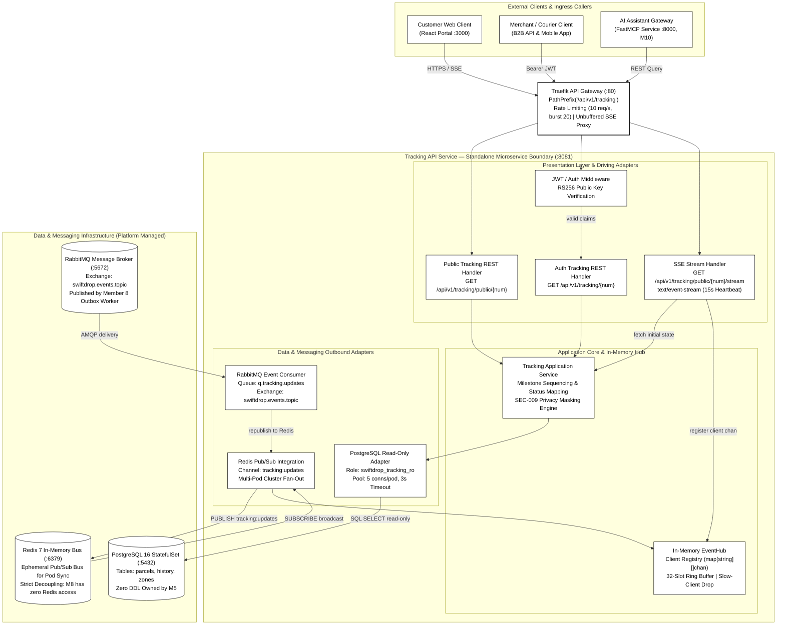
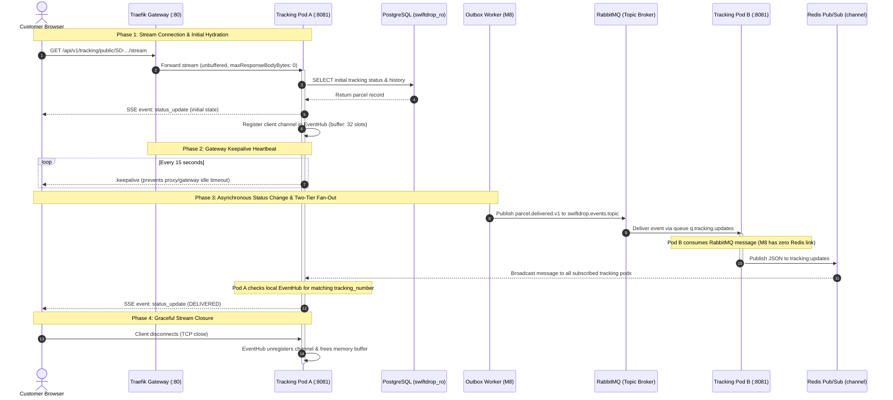
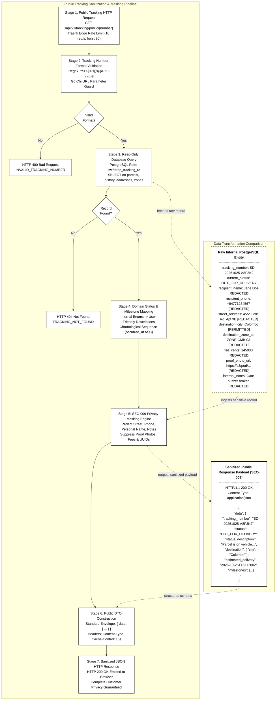

# Member 5 — Chapter 8 Architecture Diagrams Specification & Mapping Report

> **Service:** Standalone Real-Time Tracking API & Event Fan-Out Service (`services/tracking`, Port `:8081`)
> **Author / Domain Owner:** Member 5 (Senuji)
> **Status:** Ratified & Lucidchart Synchronized (Folder ID: `453693353`)
> **Date:** 01 November 2026 | **Version:** 2.0.0

---

## 1. Chapter 8 Figure Mapping Table

| Figure Number | Figure Title | Authoritative Source | Existing Closest Diagram | Decision | Document ID | Lucidchart Edit Link |
| :--- | :--- | :--- | :--- | :---: | :--- | :--- |
| **Figure 8.1** | Standalone Architecture for Real-Time Tracking Service | `services/tracking/README.md`, `doc-03` §1 | M5-D01 (Hexagonal code tiers), M5-D02 (K8s deployment topology) | **CREATE NEW** | `ae5378ba-f2a7-43a6-8953-38d62ddabb8f` | [Figure 8.1 Edit Link](https://lucid.app/lucidchart/ae5378ba-f2a7-43a6-8953-38d62ddabb8f/edit) |
| **Figure 8.2** | Server-Sent Events (SSE) Live Tracking Stream Fan-Out Flow | `docs/architecture/sequence-diagrams.md` §3, `doc-03` §2 | M5-D04 (Real-Time SSE Stream Sequence) | **REUSE** | `36bf9c69-d7a0-44af-b088-8103faa4ff23` | [Figure 8.2 Edit Link](https://lucid.app/lucidchart/36bf9c69-d7a0-44af-b088-8103faa4ff23/edit) |
| **Figure 8.3** | Public Tracking Query Sanitization & PII Masking Pipeline | `docs/contracts/api-conventions.md` §5, `doc-04` §1, SEC-009 | M5-D05 (Network sequence diagram) | **CREATE NEW** | `e1c16cba-cab0-4d9c-908f-d030b31201d7` | [Figure 8.3 Edit Link](https://lucid.app/lucidchart/e1c16cba-cab0-4d9c-908f-d030b31201d7/edit) |

---

## 2. Professional Academic Figure Captions

### Figure 8.1 Caption
> **Figure 8.1: Standalone Architecture for Real-Time Tracking Service.**
> Architectural component diagram illustrating the internal software composition of the standalone SwiftDrop Tracking API microservice (`services/tracking`) executing on container port `:8081`. The diagram delineates the microservice boundary, separating presentation handlers (Public REST, Authenticated REST, RS256 JWT Middleware, and Server-Sent Events Stream Handler) from core application orchestration and in-memory channel management (`EventHub`). External dependencies are strictly decoupled: HTTP traffic enters via the Traefik API Gateway (`:80`), transactional persistence is queried through a read-only PostgreSQL role (`swiftdrop_tracking_ro`) bounded by a 5-connection pool, and real-time lifecycle updates are ingested from RabbitMQ queue `q.tracking.updates` and distributed horizontally across pods via Redis Pub/Sub channel `tracking:updates`.

### Figure 8.2 Caption
> **Figure 8.2: Server-Sent Events (SSE) Live Tracking Stream Fan-Out Flow.**
> UML sequence diagram detailing the four-phase asynchronous event streaming lifecycle between customer web clients, edge routing, and the distributed tracking service. Phase 1 demonstrates initial HTTP/2 stream negotiation via Traefik without response buffering (`buffering.maxResponseBodyBytes: 0`) and immediate state hydration from the read-only database. Phase 2 maintains connection persistence against gateway timeouts through periodic 15-second keepalive heartbeat comments (`:keepalive\n\n`). Phase 3 illustrates decoupled outbox publishing by Member 8 to topic exchange `swiftdrop.events.topic`, subsequent AMQP consumption on queue `q.tracking.updates` by an arbitrary tracking replica (Pod B), and cross-pod fan-out via Redis channel `tracking:updates` to the client-connected replica (Pod A). Phase 4 ensures deterministic memory deallocation upon browser disconnection.

### Figure 8.3 Caption
> **Figure 8.3: Public Tracking Query Sanitization and PII Masking Pipeline.**
> Multi-stage data transformation pipeline executing under security standard SEC-009 to protect customer privacy on unauthenticated tracking lookups (`GET /api/v1/tracking/public/{tracking_number}`). The pipeline illustrates the progression from edge rate-limiting and regex syntax validation through read-only database projection, customer-facing milestone status mapping, field-level PII redaction, and standardized DTO encapsulation. The accompanying side-by-side comparative inspection contrasts raw PostgreSQL domain entities against the sanitized public JSON response, demonstrating the strict suppression of recipient street addresses, contact phone numbers, personal names, courier IDs, proof-of-delivery photos, and commercial billing amounts while preserving general destination city and event milestones.

---

## 3. Comparison & Decision Rationale

### 3.1 Figure 8.1 — Standalone Architecture
- **Required:** Complete standalone service component architecture showing internal layers, Traefik API gateway, and external infrastructure dependencies.
- **Closest Diagrams:**
  - `M5-D01` (Clean Hexagonal Architecture & Module Layers): Only models internal code package tiers (Driving Adapters, Application Core, Driven Adapters). Lacks Traefik API gateway, external client callers, and external system boundaries.
  - `M5-D02` (Distributed Deployment & Multi-Pod Infrastructure Topology): Models Kubernetes cluster infrastructure, pods, CPU autoscaling thresholds, and secrets. Lacks internal software components (Public REST API, Authenticated REST API, JWT middleware, SSE Handler, Application Service, EventHub).
- **Decision:** **CREATE NEW**.
- **Result:** Native Lucidchart document created (`ae5378ba-f2a7-43a6-8953-38d62ddabb8f`), placed in folder `453693353`, styled in strict academic monochrome with zero validation errors.

### 3.2 Figure 8.2 — SSE Live Tracking Stream Fan-Out Flow
- **Required:** Sequence flow validating the 10-step SSE fan-out lifecycle from customer connection through RabbitMQ event ingestion and Redis cross-pod fan-out.
- **Closest Diagram:** `M5-D04` (`36bf9c69-d7a0-44af-b088-8103faa4ff23`).
- **Coverage Assessment:** `M5-D04` models all 10 required architectural steps with 100% technical fidelity:
  1. Customer starts SSE stream.
  2. Traefik forwards stream without response buffering.
  3. Tracking service queries initial status from PostgreSQL (`swiftdrop_ro`).
  4. Initial SSE update pushed down connection.
  5. 15-second heartbeat (`:keepalive\n\n`) maintains connection.
  6. Outbox Worker (M8) commits event.
  7. Event published to RabbitMQ topic exchange `swiftdrop.events.topic`.
  8. Pod B consumes from queue `q.tracking.updates`.
  9. Pod B republishes to Redis channel `tracking:updates`; Redis broadcasts to Pod A.
  10. Pod A delivers SSE status update to connected browser.
- **Decision:** **REUSE**.
- **Result:** Existing document `36bf9c69-d7a0-44af-b088-8103faa4ff23` accurately fulfills all technical criteria and is preserved.

### 3.3 Figure 8.3 — Public Tracking Query Sanitization & PII Masking Pipeline
- **Required:** Data-processing pipeline / activity diagram showing how sensitive data is transformed into a safe public API response under SEC-009.
- **Closest Diagram:** `M5-D05` (`156b36ae-e970-4d1a-9b4d-8e88514e98ea`).
- **Coverage Assessment:** `M5-D05` is an interaction sequence diagram modeling HTTP request/response hops between network participants. It does not illustrate the data-transformation pipeline stages, nor does it display field-level redaction rules or compare raw internal database records against sanitized public DTO payloads.
- **Decision:** **CREATE NEW**.
- **Result:** Native Lucidchart document created (`e1c16cba-cab0-4d9c-908f-d030b31201d7`), placed in folder `453693353`, styled in strict academic monochrome with zero validation errors.

---

## 4. Source Specifications for Future Modification

### 4.1 Figure 8.1 — Mermaid Source

### 4.2 Figure 8.2 — Mermaid Source

### 4.3 Figure 8.3 — Mermaid Source

---

## 5. Architectural Verification Matrix

| Architecture Dimension | Repository Verified Standard | Figure 8.1 Status | Figure 8.2 Status | Figure 8.3 Status |
| :--- | :--- | :---: | :---: | :---: |
| **Service Root Path** | `services/tracking/` | Aligned | Aligned | Aligned |
| **Container Port** | `:8081` (`PORT=8081`) | Aligned | Aligned | Aligned |
| **Edge Gateway** | Traefik (:80), `PathPrefix('/api/v1/tracking')` | Aligned | Aligned | Aligned |
| **Rate Limiter** | 10 req/s, burst 20 per IP | Aligned | N/A | Aligned |
| **Public Endpoint** | `GET /api/v1/tracking/public/{tracking_number}` | Aligned | N/A | Aligned |
| **Stream Endpoint** | `GET /api/v1/tracking/public/{tracking_number}/stream` | Aligned | Aligned | N/A |
| **Heartbeat Ping** | `:keepalive\n\n` emitted every 15s | Aligned | Aligned | N/A |
| **PostgreSQL Role** | `swiftdrop_tracking_ro` (Read-only, max 5 conns/pod) | Aligned | Aligned | Aligned |
| **Migration Ownership** | Zero DDL owned by M5 (Maintained by M9/M2) | Aligned | Aligned | Aligned |
| **RabbitMQ Queue** | `q.tracking.updates` on `swiftdrop.events.topic` | Aligned | Aligned | N/A |
| **Redis Channel** | `tracking:updates` (Multi-pod fan-out) | Aligned | Aligned | N/A |
| **M8 Decoupling** | Member 8 has ZERO connection to Redis | Aligned | Aligned | N/A |
| **SEC-009 Masking** | Redact street, phone, name, notes, fees, photos | Aligned | Aligned | Aligned |
