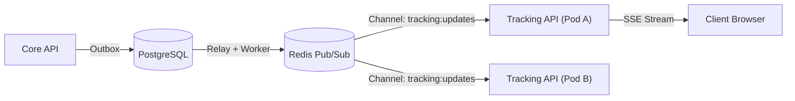

# Member 05 — Tracking API & Real-Time Updates Alignment Guide

> **Author / Domain Owner:** Member 5 — Tracking API & Real-Time Updates (Senuji)  
> **Target Service:** `services/tracking/` (Standalone Deployable Service)  
> **Status:** Authoritative Architectural Alignment & Action Sheet for Team Meeting 2  
> **Date:** 25 October 2026 | **Version:** 1.0.0

---

## 1. Domain Overview & Scope of Work

Member 5 owns the read-heavy, high-concurrency public surface of SwiftDrop: the **Standalone Tracking API** and **Server-Sent Events (SSE) Real-Time Projection Service**.

### 1.1 In-Scope Responsibilities
- Public tracking queries (`GET /api/v1/tracking/public/{trackingNumber}`).
- Authenticated tracking queries (`GET /api/v1/tracking/{trackingNumber}`).
- Real-time Server-Sent Events (SSE) streaming (`GET /api/v1/tracking/{trackingNumber}/stream`).
- Recipient and customer PII sanitization (SEC-008).
- Read-only database connection pooling via dedicated role `swiftdrop_tracking_ro`.
- Multi-replica horizontal fan-out via Redis Pub/Sub.
- Connection keepalive heartbeat pings (every 15 seconds) to prevent gateway timeouts.

### 1.2 Out-of-Scope Responsibilities
- Mutating parcel status or recording delivery attempts (Strictly owned by Members 2 and 3).
- Publishing domain events to RabbitMQ (Owned by Member 8).
- Edge rate limiting (Configured by Member 7 at Traefik Gateway).

---

## 2. Document Audit & Current State

- **Current Status in `docs/drafts/`:** Only a basic checklist `README.md` was submitted. Full 8-document suite is pending.
- **Root Codebase Baseline:** Living docs exist in `services/tracking/README.md` and `API.md`.
- **Immediate Action:** Member 5 must author `doc-01` through `doc-08` adhering to the specifications below.

---

## 3. Strict Public Privacy & PII Masking Standards (SEC-008)

Public tracking must NEVER expose sensitive customer PII. Any unauthenticated query to `GET /api/v1/tracking/public/{trackingNumber}` MUST enforce the following redaction rules:

```json
{
  "data": {
    "tracking_number": "SD-20261025-48192",
    "status": "OUT_FOR_DELIVERY",
    "status_description": "Your parcel is on the vehicle for final delivery.",
    "destination": {
      "city": "Colombo",
      "district": "Colombo 03"
    },
    "estimated_delivery": "2026-10-25T16:00:00Z",
    "milestones": [
      {
        "status": "CREATED",
        "description": "Shipment booked and label generated",
        "timestamp": "2026-10-25T08:30:00Z"
      },
      {
        "status": "PICKED_UP",
        "description": "Collected by courier",
        "timestamp": "2026-10-25T10:15:00Z"
      },
      {
        "status": "IN_TRANSIT",
        "description": "Processed at Regional Sorting Facility",
        "timestamp": "2026-10-25T12:00:00Z"
      },
      {
        "status": "OUT_FOR_DELIVERY",
        "description": "With courier for delivery",
        "timestamp": "2026-10-25T13:45:00Z"
      }
    ]
  }
}
```

### Strictly Forbidden in Public Responses:
- Recipient full street address or GPS coordinates.
- Recipient phone number, email, or personal name.
- Sender street address or contact details.
- Proof-of-delivery photos or signature SVGs.
- Internal operational notes or courier employee IDs.

---

## 4. Server-Sent Events (SSE) Streaming Protocol

### 4.1 Endpoint Contract
- **Path:** `GET /api/v1/tracking/{trackingNumber}/stream`
- **Headers:** `Accept: text/event-stream`, `Cache-Control: no-cache`, `Connection: keep-alive`

### 4.2 SSE Wire Format
```
:keepalive

event: status_update
id: evt_01J9XYZ8899AABBCCDDEEFF01
data: {"tracking_number":"SD-20261025-48192","current_status":"DELIVERED","occurred_at":"2026-10-25T14:15:00Z"}

:keepalive
```

### 4.3 Heartbeat Invariant (Agreement A2 & Member 7 U-17)
The server MUST emit a comment line heartbeat (`:keepalive\n\n`) **every 15 seconds**. This prevents Traefik Gateway, Cloudflare, and browser proxies from terminating idle SSE connections.

---

## 5. Horizontal Multi-Replica Scaling & Redis Pub/Sub

When `tracking-api` scales horizontally (HPA 2 to 5 pods in Kubernetes):
1. A client browser connects to Pod A via Traefik.
2. A courier delivers the parcel, updating PostgreSQL via Core API.
3. Member 8's Event Worker consumes `parcel.delivered.v1` and publishes to Redis channel `tracking:updates`.
4. Pod A receives the Redis event and immediately flushes the update down the client's SSE connection.



---

## 6. Member 9 DevOps & Infrastructure Configuration

| Config Parameter | Required Specification | Alignment Rule |
| :--- | :--- | :--- |
| **Service Name & Port**| `tracking-api` binding to port `:8081` | Agreement A1 |
| **Health Probes** | Liveness: `/health/live`; Readiness: `/health/ready` (checks DB read replica); Metrics: `/metrics` | Agreement A2 |
| **Database Role** | `swiftdrop_tracking_ro` (Read-only `SELECT` on `parcels`, `parcel_status_history`, `delivery_zones`) | Agreement D6 |
| **Autoscaling** | HPA: Min 2, Max 5 pods based on CPU (70%) and memory | `hpa-tracking.yml` |
| **Ingress Route** | Traefik path route: `/api/v1/tracking/*` $\to$ `tracking-api:8081` | Agreement A9 |

---
*End of Member 05 Specification & Alignment Guide.*
