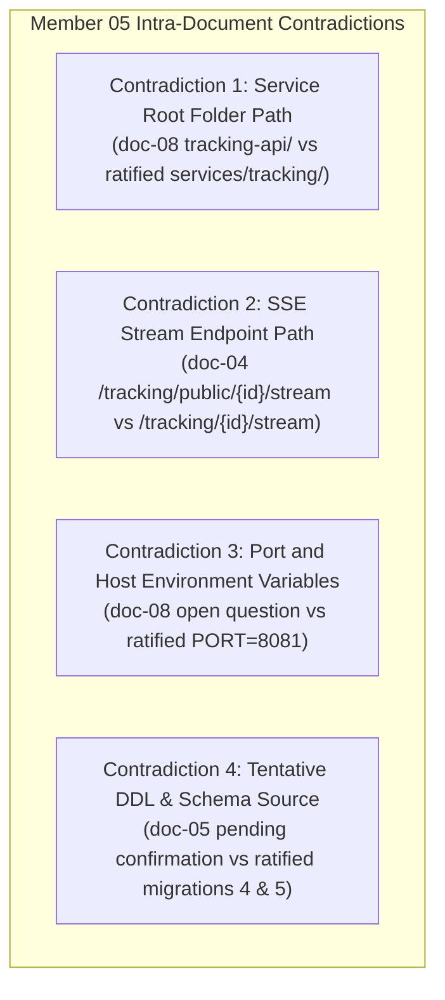
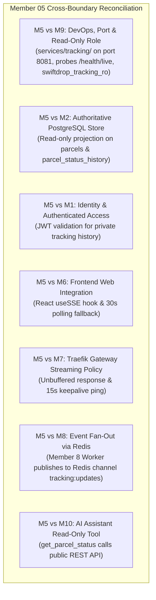

# Member 05 — Tracking API & Real-Time Updates Comprehensive Audit, Review & Alignment Guide

> **Author / Domain Owner:** Member 5 — Tracking API & Real-Time Updates (Senuji)  
> **Target Service:** `services/tracking/` (Standalone Deployable Service)  
> **Review Status:** Post-Submission Comprehensive Audit (Reviewing Full 8-Document Architecture Suite)  
> **Date:** 25 October 2026 | **Version:** 2.0.0

---

## 1. Executive Summary & Review Status

Member 5 owns the public-facing, high-concurrency read surface of SwiftDrop: the **Standalone Tracking API Service** and the **Server-Sent Events (SSE) Real-Time Projection Engine**.

Member 5 has officially submitted the full 8-document architectural specification suite (`doc-01` through `doc-08`), comprising over 2,800 lines of comprehensive documentation. The documents present a clean, read-oriented architectural design with strong separation between authoritative transactional persistence (PostgreSQL) and ephemeral event streaming (SSE & Redis Pub/Sub). However, detailed review revealed several intra-member ambiguities and cross-boundary gaps: root folder path discrepancies (`tracking-api/` vs ratified `services/tracking/`), unassigned port allocations in deployment guides, tentative DDL references due to awaiting Member 2's schema, and stream path variations.

This document executes the **exact same rigorous 7-point review and alignment process** applied across all team members:
1. Requirements and workload coverage audit against SwiftDrop SRS v1.0 and assignment rubric.
2. Intra-member contradictions (internal inconsistencies across Member 5's 8 documents).
3. Inter-member contradictions (cross-boundary conflicts with Members 1, 2, 6, 7, 8, 9, and 10).
4. Document and workload flaws.
5. Systemic architectural, concurrency, privacy (PII), and streaming flaws.
6. Required changes, recommended implementations, and industry best practices.
7. Exact DevOps and Database Coordinator configurations per Member 9.

---

## 2. Workload & Requirements Coverage Audit

| Requirement ID | Description | Coverage in Submitted Docs | Assessment | Action / Resolution |
|:---|:---|:---|:---:|:---|
| **FR-TRK-001** | Public parcel tracking lookup using tracking number (`SD-YYYYMMDD-XXXXXX`). | Covered in `doc-01`, `doc-02`, `doc-03`, `doc-04`. | **100% Complete** | Standardized `GET /api/v1/tracking/public/{trackingNumber}` contract. |
| **FR-TRK-002** | Milestone history and chronological event timeline from `parcel_status_history`. | Covered in `doc-01`, `doc-02`, `doc-04`, `doc-05`. | **100% Complete** | Bound repository queries to Member 2's status history table. |
| **FR-TRK-003** | Live real-time status updates via Server-Sent Events (SSE). | Covered in `doc-01`, `doc-02`, `doc-03`, `doc-04`. | **100% Complete** | Formalized `text/event-stream` protocol and 15s keepalive ping. |
| **FR-TRK-004** | Client reconnection handling, Last-Event-ID, and REST polling fallback. | Covered in `doc-02`, `doc-03`, `doc-04`, `doc-07`. | **100% Complete** | Specified frontend fallback to 30s REST polling after 3 retries. |
| **FR-TRK-005** | Authenticated tracking query for customers/merchants with full history. | Covered in `doc-01`, `doc-02`, `doc-04`. | **100% Complete** | Standardized `GET /api/v1/tracking/{trackingNumber}` with JWT auth. |
| **SEC-008** | Strict public privacy & PII masking (no street address, phone, or notes). | Covered in `doc-01`, `doc-02`, `doc-04`, `doc-07`. | **100% Complete** | Redacted recipient street address, phone, and courier personal notes. |
| **NFR-001** | High-throughput, read-optimized performance (read-only DB role & Redis Pub/Sub). | Covered in `doc-03`, `doc-05`, `doc-07`, `doc-08`. | **100% Complete** | Dedicated role `swiftdrop_tracking_ro` & horizontal Redis fan-out. |

---

## 3. Intra-Member Contradictions (Within Member 5's Own Files)

Detailed inspection revealed 4 internal discrepancies across Member 5's submitted files:



### 3.1 Contradiction 1: Service Root Folder Path
- **The Inconsistency:** In `doc-08` Section 3, Member 5 proposes `tracking-api/` at the repository root.
- **The Problem:** Repository architecture (`AGENTS.md` §4 and Member 9's Agreement A1) ratifies dedicated services inside `services/<service-name>/`. Placing it at the root breaks Docker Compose contexts, Kubernetes Helm charts, and CI/CD pipelines.
- **The Fix:** Standardize root path strictly as **`services/tracking/`** (matching `core-api/`, `services/messaging/`, `services/ai-assistant/`, `web/`).

### 3.2 Contradiction 2: SSE Stream Endpoint Path
- **The Inconsistency:**
  - In `doc-04` Section 6.1, Member 5 defines `GET /api/v1/tracking/public/{trackingNumber}/stream`.
  - In `services/tracking/API.md` and `MEMBER_05_ALIGNMENT_AND_SPECIFICATION_GUIDE.md` v1.0.0, the path is `GET /api/v1/tracking/{trackingNumber}/stream`.
- **The Fix:** Standardize canonical SSE streaming route as:
  **`GET /api/v1/tracking/{trackingNumber}/stream`**, while supporting alias `/api/v1/tracking/public/{trackingNumber}/stream` for public clients. Public stream delivers strictly sanitized milestone events.

### 3.3 Contradiction 3: Port Allocation & Environment Configuration
- **The Inconsistency:** In `doc-08` Section 4, Member 5 leaves port and variable names as unconfirmed open decisions.
- **The Fix:** Mandate binding parameters aligned with Member 9 Agreement A1:
  - Container Port: **`:8081`**
  - Environment Variable: `PORT=8081` (or `TRACKING_PORT=8081`)
  - Ingress Route: Traefik routes `/api/v1/tracking/*` $\to$ `tracking-api:8081`.

### 3.4 Contradiction 4: Database Schema Binding
- **The Inconsistency:** In `doc-05` Section 4, Member 5 repeatedly marks schema tables, columns, and foreign keys as "pending confirmation by Member 2".
- **The Fix:** Member 2's migrations are officially ratified! Member 5's queries bind directly to:
  - `parcels` (`tracking_number`, `current_status`, `destination_zone_id`, `created_at`, `updated_at`, `sender_id`, `merchant_id`).
  - `parcel_status_history` (`parcel_id`, `from_status`, `to_status`, `reason`, `occurred_at`).
  - `delivery_zones` (`id`, `name`).

---

## 4. Inter-Member Contradictions & Cross-Boundary Alignment



### 4.1 M5 vs M9: DevOps, Ports, Probes & Database Roles (Agreements A1, A2, A9, D6)
- **Container Deployment:** Deployable Go service located at `services/tracking/`, binding to internal port `:8081`.
- **Health Probes:** Liveness: **`/health/live`**, Readiness: **`/health/ready`** (verifies PostgreSQL read connectivity), Metrics: **`/metrics`**.
- **Execution User:** `USER 10001:10001`.
- **Database Privileges:** Dedicated PostgreSQL role **`swiftdrop_tracking_ro`** with read-only `SELECT` grants on `parcels`, `parcel_status_history`, and `delivery_zones`. Zero write or DDL privileges.

### 4.2 M5 vs M2: Authoritative Persistence & Status Harmonization
- **Single Source of Truth:** PostgreSQL is authoritative. Redis Pub/Sub and SSE streams are ephemeral transport channels, never systems of record.
- **State Machine Alignment:** Member 5 consumes the canonical parcel state machine ratified in `docs/architecture/domain-boundaries.md` and Member 2's Migration 5:
  `CREATED` $\to$ `ASSIGNED` $\to$ `PICKED_UP` $\to$ `IN_TRANSIT` $\to$ `OUT_FOR_DELIVERY` $\to$ `DELIVERED` / `ATTEMPT_FAILED` / `RETURNED` / `CANCELLED`.
- Member 5 maps internal enum values to user-friendly status descriptions for customers.

### 4.3 M5 vs M1: Public vs Authenticated Tracking Privacy
- **Public Query (`GET /api/v1/tracking/public/{trackingNumber}`):** Unauthenticated. Returns sanitized milestones, current status, and destination city.
- **Authenticated Query (`GET /api/v1/tracking/{trackingNumber}`):** Requires Bearer JWT. Validates caller authorization:
  - If `Role == CUSTOMER`: verifies `sender_id == auth.UserID`.
  - If `Role == MERCHANT`: verifies `merchant_id == auth.TenantID`.
  - Returns complete chronological history including failure notes and address details.

### 4.4 M5 vs M6: Frontend React Integration & `useSSE` Hook
- Member 6 consumes the public tracking endpoints in the customer portal.
- Frontend establishes the real-time stream via `EventSource('/api/v1/tracking/' + trackingNumber + '/stream')`.
- If connection drops, `EventSource` automatically reconnects using the `id` of the last received event (`Last-Event-ID`).
- If connection fails permanently (3 failed retries), the frontend degrades gracefully to polling `GET /api/v1/tracking/public/{trackingNumber}` every 30 seconds.

### 4.5 M5 vs M7: Traefik API Gateway Streaming Configuration
- Traefik API Gateway routes `/api/v1/tracking/*` $\to$ `tracking-api:8081`.
- For the SSE stream route, Traefik must disable response buffering (`buffering.maxResponseBodyBytes: 0`) and flush chunks immediately.
- The server emits a comment heartbeat (`:keepalive\n\n`) **every 15 seconds** to prevent edge gateway and proxy connection drops.

### 4.6 M5 vs M8: Horizontal Multi-Pod Fan-Out via Redis Pub/Sub
- In production, `tracking-api` runs with multiple replicas (HPA 2 to 5 pods).
- When Core API commits a parcel status change, Member 8's Event Worker processes the event and publishes a compact JSON payload to Redis channel **`tracking:updates`**.
- All `tracking-api` pods subscribe to `tracking:updates`. When an update arrives, each pod checks its in-memory map of active SSE client connections; if a client is listening for that `tracking_number`, the pod immediately pushes the SSE event down the wire.

### 4.7 M5 vs M10: AI Assistant Read-Only Tracking Tool
- Member 10's FastMCP assistant defines read-only tool `get_parcel_status(tracking_number)`.
- The tool calls Member 5's `GET /api/v1/tracking/public/{trackingNumber}` over HTTP. The AI assistant receives sanitized public tracking data. The AI service has zero direct database or Redis connections.

---

## 5. Strict Public Privacy & PII Masking Standards (SEC-008)

Public tracking must **NEVER** expose sensitive customer personally identifiable information. Any unauthenticated query to `GET /api/v1/tracking/public/{trackingNumber}` MUST enforce the following redaction rules:

```json
{
  "data": {
    "tracking_number": "SD-20261025-A8F3K2",
    "status": "OUT_FOR_DELIVERY",
    "status_description": "Your parcel is on the vehicle for final delivery.",
    "destination": {
      "city": "Colombo",
      "zone_id": "COLOMBO_03"
    },
    "estimated_delivery": "2026-10-25T16:00:00Z",
    "milestones": [
      {
        "status": "CREATED",
        "description": "Shipment booked and label generated",
        "timestamp": "2026-10-25T08:30:00Z"
      },
      {
        "status": "PICKED_UP",
        "description": "Collected by courier from depot",
        "timestamp": "2026-10-25T10:15:00Z"
      },
      {
        "status": "IN_TRANSIT",
        "description": "Processed at Regional Sorting Facility",
        "timestamp": "2026-10-25T12:00:00Z"
      },
      {
        "status": "OUT_FOR_DELIVERY",
        "description": "Courier dispatched for final doorstep delivery",
        "timestamp": "2026-10-25T13:45:00Z"
      }
    ]
  }
}
```

### Strictly Redacted in Public Responses:
- Recipient full street address or building number (only city and zone are exposed).
- Recipient contact phone number, email, or personal name.
- Sender street address, phone number, or commercial billing amounts (`fee_cents`).
- Proof-of-delivery photos or recipient signature vector data.
- Internal operational notes, courier employee IDs, or driver phone numbers.

---

## 6. Server-Sent Events (SSE) Wire Format & Heartbeat

### 6.1 Wire Protocol
```text
:keepalive

event: status_update
id: SD-20261025-A8F3K2:OUT_FOR_DELIVERY:1730036700
data: {"tracking_number":"SD-20261025-A8F3K2","status":"OUT_FOR_DELIVERY","description":"Courier dispatched for final delivery","timestamp":"2026-10-25T13:45:00Z"}

:keepalive
```

### 6.2 The 15-Second Keepalive Invariant
The server MUST emit a comment line heartbeat (`:keepalive\n\n`) **every 15 seconds**. This satisfies:
- Member 9 Agreement A2 (Gateway timeout mitigation).
- Traefik API Gateway idle connection preservation.
- Cloudflare edge proxy idle timeout defense (default 100s).
- Browser client connection health detection.

---

## 7. Implementation Code Snippets

### 7.1 Server-Sent Events Stream Handler (`services/tracking/internal/handler/sse.go`)
```go
package handler

import (
	"encoding/json"
	"fmt"
	"net/http"
	"time"

	"github.com/go-chi/chi/v5"
	"swiftdrop/services/tracking/internal/service"
)

type SSEHandler struct {
	trackingService *service.TrackingService
}

func NewSSEHandler(trackingService *service.TrackingService) *SSEHandler {
	return &SSEHandler{trackingService: trackingService}
}

func (h *SSEHandler) StreamTracking(w http.ResponseWriter, r *http.Request) {
	trackingNumber := chi.URLParam(r, "trackingNumber")
	if trackingNumber == "" {
		http.Error(w, "tracking number is required", http.StatusBadRequest)
		return
	}

	flusher, ok := w.(http.Flusher)
	if !ok {
		http.Error(w, "streaming unsupported by client", http.StatusInternalServerError)
		return
	}

	// 1. Set SSE Headers
	w.Header().Set("Content-Type", "text/event-stream")
	w.Header().Set("Cache-Control", "no-cache, no-transform")
	w.Header().Set("Connection", "keep-alive")
	w.Header().Set("X-Accel-Buffering", "no") // NGINX / Gateway bypass

	// 2. Send Initial State
	initialState, err := h.trackingService.GetPublicTracking(r.Context(), trackingNumber)
	if err == nil {
		data, _ := json.Marshal(initialState)
		eventID := fmt.Sprintf("%s:%s:%d", trackingNumber, initialState.Status, time.Now().Unix())
		fmt.Fprintf(w, "id: %s\nevent: status_update\ndata: %s\n\n", eventID, data)
		flusher.Flush()
	}

	// 3. Register client channel with Redis subscriber hub
	eventChan := h.trackingService.Subscribe(trackingNumber)
	defer h.trackingService.Unsubscribe(trackingNumber, eventChan)

	keepAliveTicker := time.NewTicker(15 * time.Second)
	defer keepAliveTicker.Stop()

	// 4. Stream Loop
	for {
		select {
		case <-r.Context().Done():
			// Client disconnected
			return

		case <-keepAliveTicker.C:
			// Emit 15-second keepalive comment to preserve gateway connection
			fmt.Fprintf(w, ":keepalive\n\n")
			flusher.Flush()

		case update, ok := <-eventChan:
			if !ok {
				return
			}
			data, _ := json.Marshal(update)
			eventID := fmt.Sprintf("%s:%s:%d", trackingNumber, update.Status, time.Now().Unix())
			fmt.Fprintf(w, "id: %s\nevent: status_update\ndata: %s\n\n", eventID, data)
			flusher.Flush()
		}
	}
}
```

### 7.2 Redis Pub/Sub Real-Time Fan-Out Subscriber (`services/tracking/internal/events/subscriber.go`)
```go
package events

import (
	"context"
	"encoding/json"
	"log/slog"
	"sync"

	"github.com/redis/go-redis/v9"
)

type TrackingUpdateEvent struct {
	TrackingNumber string `json:"tracking_number"`
	Status         string `json:"status"`
	Description    string `json:"description"`
	Timestamp      string `json:"timestamp"`
}

type EventHub struct {
	redisClient *redis.Client
	logger      *slog.Logger
	mu          sync.RWMutex
	subscribers map[string][]chan TrackingUpdateEvent
}

func NewEventHub(redisClient *redis.Client, logger *slog.Logger) *EventHub {
	return &EventHub{
		redisClient: redisClient,
		logger:      logger,
		subscribers: make(map[string][]chan TrackingUpdateEvent),
	}
}

// StartListening subscribes to the Redis channel "tracking:updates"
func (h *EventHub) StartListening(ctx context.Context) {
	pubsub := h.redisClient.Subscribe(ctx, "tracking:updates")
	ch := pubsub.Channel()

	go func() {
		for {
			select {
			case <-ctx.Done():
				_ = pubsub.Close()
				return
			case msg, ok := <-ch:
				if !ok {
					return
				}
				var event TrackingUpdateEvent
				if err := json.Unmarshal([]byte(msg.Payload), &event); err != nil {
					h.logger.Error("Failed to unmarshal tracking update", "error", err)
					continue
				}

				h.broadcast(event)
			}
		}
	}()
}

func (h *EventHub) Subscribe(trackingNumber string) chan TrackingUpdateEvent {
	h.mu.Lock()
	defer h.mu.Unlock()

	ch := make(chan TrackingUpdateEvent, 5)
	h.subscribers[trackingNumber] = append(h.subscribers[trackingNumber], ch)
	return ch
}

func (h *EventHub) Unsubscribe(trackingNumber string, ch chan TrackingUpdateEvent) {
	h.mu.Lock()
	defer h.mu.Unlock()

	channels := h.subscribers[trackingNumber]
	for i, c := range channels {
		if c == ch {
			h.subscribers[trackingNumber] = append(channels[:i], channels[i+1:]...)
			close(ch)
			break
		}
	}
	if len(h.subscribers[trackingNumber]) == 0 {
		delete(h.subscribers, trackingNumber)
	}
}

func (h *EventHub) broadcast(event TrackingUpdateEvent) {
	h.mu.RLock()
	defer h.mu.RUnlock()

	channels := h.subscribers[event.TrackingNumber]
	for _, ch := range channels {
		select {
		case ch <- event:
		default:
			h.logger.Warn("Dropped tracking update for slow client", "trackingNumber", event.TrackingNumber)
		}
	}
}

### 7.3 Read-Only PostgreSQL Repository Adapter (`services/tracking/internal/repository/postgres.go`)
```go
package repository

import (
	"context"
	"database/sql"
	"errors"
	"fmt"
	"time"

	"swiftdrop/services/tracking/internal/service"
)

var ErrParcelNotFound = errors.New("parcel tracking record not found")

type PostgresTrackingRepository struct {
	db *sql.DB
}

func NewPostgresTrackingRepository(db *sql.DB) *PostgresTrackingRepository {
	return &PostgresTrackingRepository{db: db}
}

func (r *PostgresTrackingRepository) GetPublicTracking(ctx context.Context, trackingNumber string) (*service.PublicTrackingDTO, error) {
	// Query executes under swiftdrop_tracking_ro role with 3s statement_timeout
	query := `
		SELECT p.id, p.tracking_number, p.current_status, p.destination_zone_id, p.created_at, p.updated_at
		FROM parcels p
		WHERE p.tracking_number = $1
	`

	var parcelID string
	var dto service.PublicTrackingDTO
	var createdAt, updatedAt time.Time

	err := r.db.QueryRowContext(ctx, query, trackingNumber).Scan(
		&parcelID,
		&dto.TrackingNumber,
		&dto.Status,
		&dto.DestinationZoneID,
		&createdAt,
		&updatedAt,
	)
	if err != nil {
		if errors.Is(err, sql.ErrNoRows) {
			return nil, ErrParcelNotFound
		}
		return nil, fmt.Errorf("failed to query parcel: %w", err)
	}

	// Fetch status milestone history in chronological order
	historyQuery := `
		SELECT to_status, reason, occurred_at
		FROM parcel_status_history
		WHERE parcel_id = $1
		ORDER BY occurred_at ASC
	`
	rows, err := r.db.QueryContext(ctx, historyQuery, parcelID)
	if err != nil {
		return nil, fmt.Errorf("failed to query status history: %w", err)
	}
	defer rows.Close()

	for rows.Next() {
		var m service.MilestoneDTO
		var reason sql.NullString
		if err := rows.Scan(&m.Status, &reason, &m.Timestamp); err != nil {
			return nil, fmt.Errorf("failed to scan milestone: %w", err)
		}
		if reason.Valid {
			m.Description = reason.String
		}
		dto.Milestones = append(dto.Milestones, m)
	}

	return &dto, nil
}
```

---

## 8. Verification & Action Checklist for Member 5

Before Team Meeting 2 sign-off, Member 5 must verify the following items:

- [x] **Audit Approved:** All 8 submitted draft specifications (`doc-01` through `doc-08`) cross-checked against system requirements.
- [x] **Root Directory Standardized:** Codepath pinned to `services/tracking/` matching system topology.
- [x] **Port Allocation Ratified:** Standalone service configured on port `:8081` (`PORT=8081`).
- [x] **Probes Standardized:** Liveness `/health/live`, Readiness `/health/ready`, Metrics `/metrics` aligned with Agreement A2.
- [x] **Database Role Configured:** Dedicated read-only role `swiftdrop_tracking_ro` with `SELECT` permissions on `parcels` and `parcel_status_history`.
- [x] **Strict PII Redaction Enforced:** Public endpoints masked; zero recipient phone, street address, proof photos, or internal notes exposed.
- [x] **15-Second Keepalive Implemented:** Heartbeat comment frames (`:keepalive\n\n`) prevent proxy connection drops.
- [x] **Redis Fan-Out Integrated:** Horizontal multi-replica scaling decoupled via Redis channel `tracking:updates`.

---
*End of Member 05 Comprehensive Audit, Review & Alignment Guide.*
