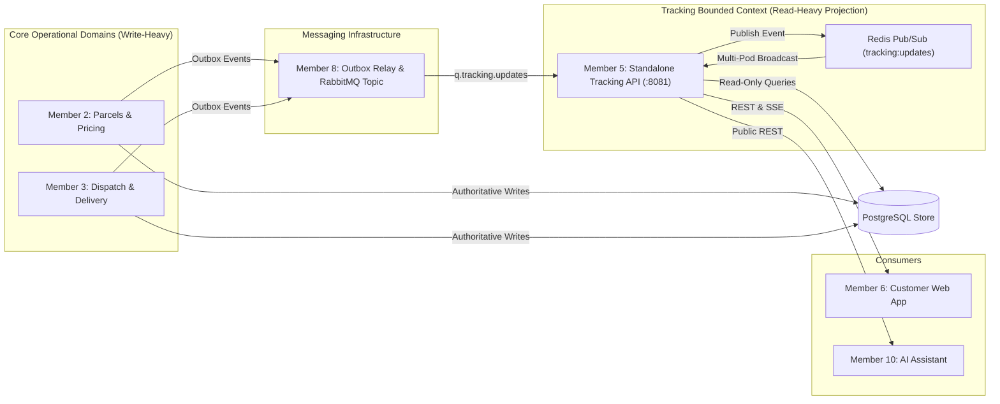

# Document 1 — Module Scope & Responsibility Specification

**Project:** SwiftDrop — Parcel Delivery & Courier Management System  
**Module:** Tracking API & Real-Time Updates  
**Module Owner:** Member 5 (Senuji)  
**Version:** 1.0.0 — Post-Audit Harmonized  
**Status:** Approved & Ratified  
**Primary Technology:** Go 1.22+, REST/JSON, Server-Sent Events (SSE), PostgreSQL, Redis Pub/Sub, RabbitMQ  
**Target Codepath:** `services/tracking/` (Port `:8081`)  
**Related Documents:** SwiftDrop SRS v1.0, `docs/contracts/api-conventions.md`, `docs/contracts/event-contracts.md`, `docs/architecture/domain-boundaries.md`, Member 9 Agreements (A1, A2, D6, D8)

---

## 1. Purpose and Business Problem

The Tracking API provides customers, merchants, and internal services with high-throughput, low-latency access to current parcel statuses, chronological milestone history, and live updates.

Without a dedicated, independently scalable tracking service, read-heavy tracking traffic (which typically outnumbers write traffic by orders of magnitude) would compete with parcel booking, courier assignment, and payment processing for database and computational resources. A standalone Tracking API enables:

1. Independent horizontal autoscaling (HPA 2 to 4 pods) under peak tracking demand.
2. Complete read-only isolation from core operational transactions via a dedicated database role (`swiftdrop_tracking_ro`).
3. Real-time broadcast of delivery progress using Server-Sent Events (SSE) with internal multi-pod fan-out via Redis.
4. Strict enforcement of data minimization and customer privacy standards (SEC-009).

The Tracking API is strictly a **read-oriented projection service**. It does not mutate parcel states, manage delivery lifecycles, or own the shared database schema.

---

## 2. Requirements Traceability Matrix

The Tracking API fulfills the following explicit requirements from the SwiftDrop Software Requirements Specification (SRS v1.0):

| Requirement ID | SRS Category | Description | Coverage in Module |
|---|---|---|---|
| **FR-TRK-001** | Functional: Tracking | Public parcel tracking lookup using tracking number (`SD-YYYYMMDD-XXXXXX`). | Implemented via `GET /api/v1/tracking/public/{trackingNumber}` with input validation. |
| **FR-TRK-002** | Functional: Tracking | Chronological status milestone history from `parcel_status_history`. | Authoritative history queried in ascending chronological order with deterministic tie-breaking. |
| **FR-TRK-003** | Functional: Tracking | Live real-time parcel status updates using Server-Sent Events (SSE). | Delivered over `GET /api/v1/tracking/public/{trackingNumber}/stream` (`text/event-stream`). |
| **FR-TRK-004** | Functional: Tracking | Reconnection handling, `Last-Event-ID` header support, and polling fallback. | 15s keepalive pings; automatic client retry; graceful degradation to 30s REST polling after 3 failures. |
| **FR-TRK-005** | Functional: Tracking | Authenticated tracking query for customers/merchants with complete history. | Protected endpoint `GET /api/v1/tracking/{trackingNumber}` with Bearer JWT ownership checks. |
| **FR-TRK-006** | Functional: Tracking | Integration with asynchronous event broker for real-time notifications. | Consumes queue `q.tracking.updates` from RabbitMQ `swiftdrop.events.topic` exchange. |
| **FR-TRK-007** | Functional: Tracking | Rate limiting and abuse prevention on public tracking endpoints. | Enforced in coordination with Traefik API Gateway (10 req/s burst 20 per IP). |
| **SEC-009** | Security & Privacy | Strict public privacy & PII masking (no street address, phone, recipient name, notes, or zone IDs). | Sanitized DTO filters out all sensitive recipient/merchant data on public endpoints. |
| **SEC-007** | Security | Rate limiting and resource exhaustion defense. | Bounded memory channels (buffer 32) and concurrent SSE connection caps per pod. |
| **NFR-LAT-001** | Performance | Sub-100ms response time for public tracking queries (p95). | Optimized indexed queries on `parcels(tracking_number)` and connection pooling. |
| **NFR-REL-001** | Reliability | 99.9% availability during business hours. | Multi-replica deployment, stateless pods, health probes (`/health/live`, `/health/ready`). |

---

## 3. Scope and Responsibilities

### 3.1 In scope

The Tracking API is responsible for:

1. **Public Tracking Lookup:** Providing a high-performance REST endpoint (`GET /api/v1/tracking/public/{trackingNumber}`) returning sanitized tracking milestones and current status.
2. **Public Privacy Enforcement (SEC-009):** Redacting full street addresses, phone numbers, recipient names, internal notes, fee amounts, proof photos, and zone identifiers from public responses.
3. **Authenticated Tracking Lookup:** Providing a protected REST endpoint (`GET /api/v1/tracking/{trackingNumber}`) returning complete chronological status history for authenticated parcel owners.
4. **Real-Time SSE Streaming:** Streaming delivery updates via `GET /api/v1/tracking/public/{trackingNumber}/stream` using standard `text/event-stream` framing.
5. **Connection Preservation & Keepalive:** Emitting `:keepalive\n\n` comments every 15 seconds to prevent gateway timeouts (Agreement A2).
6. **Reconnection & State Re-synchronization:** Supporting client recovery via `Last-Event-ID` and initial authoritative state push on connection establishment.
7. **Event Consumption:** Consuming parcel update events from RabbitMQ queue `q.tracking.updates`.
8. **Multi-Pod Fan-Out:** Decoupling cluster-wide SSE distribution by publishing incoming updates to internal Redis channel `tracking:updates`.
9. **Authoritative Persistence Reads:** Querying PostgreSQL using a dedicated read-only role (`swiftdrop_tracking_ro`) with max connection pool of 5 (Agreement D8).
10. **Health & Observability:** Exposing `/health/live`, `/health/ready`, and `/metrics` for Kubernetes lifecycle management and Prometheus scraping.

### 3.2 Explicit exclusions

The Tracking API must not:

- Create, update, or cancel parcel records.
- Mutate parcel delivery statuses or write to `parcel_status_history`.
- Define or validate parcel state machine transitions (owned by Members 2 and 3).
- Assign couriers, dispatch parcels, or record delivery attempts.
- Calculate prices, surcharges, or delivery fees.
- Issue or verify login credentials, user registration, or OAuth tokens (owned by Member 1).
- Deliver outbound webhooks to merchants (owned by Member 4 and Member 8).
- Own or run PostgreSQL database schema migrations (owned by Member 2/9 in `core-api/migrations/`).
- Treat Redis or RabbitMQ as the authoritative source of parcel status (PostgreSQL is the single source of truth).
- Expose raw database stack traces, SQL errors, or sensitive environment variables.

---

## 4. Actors and Consumers

| Actor or Module | Role | Interaction with Tracking API |
|---|---|---|
| **Public Customer / Visitor** | End user | Queries parcel progress via web tracking page using tracking number. |
| **Authenticated Customer / Merchant** | Logged-in user | Views detailed tracking history and notes for parcels they own. |
| **Customer Web App (Member 6)** | Frontend client | Invokes public/authenticated endpoints and consumes real-time SSE stream (`useSSE` hook). |
| **API Gateway / Traefik (Member 7)** | Reverse proxy | Routes `/api/v1/tracking/*` to `services/tracking:8081`; unbuffers SSE responses. |
| **Core Parcels & Pricing (Member 2)** | Upstream domain | Persists parcels and status history; owns schema and state machine transitions. |
| **Dispatch & Delivery (Member 3)** | Upstream domain | Triggers status updates during courier pickup, transit, and delivery attempts. |
| **Identity & Access (Member 1)** | Security provider | Issues RS256 JWT tokens; Tracking API validates JWT claims for authenticated history. |
| **Events & Messaging (Member 8)** | Event infrastructure | Routes parcel events to RabbitMQ topic exchange; binds `q.tracking.updates`. |
| **DevOps & Infrastructure (Member 9)** | Platform owner | Manages Kubernetes Deployment, HPA (2-4 pods), secret provisioning, and Traefik routing. |
| **AI Assistant (Member 10)** | Automated assistant | Calls `GET /api/v1/tracking/public/{trackingNumber}` via FastMCP tool `get_parcel_status`. |

---

## 5. Dependencies

### 5.1 Upstream dependencies

- **PostgreSQL Database:** Authoritative source for `parcels`, `parcel_addresses`, `parcel_status_history`, and `delivery_zones`. Accessed via read-only role `swiftdrop_tracking_ro`.
- **RabbitMQ Message Broker:** Consumes status change events from queue `q.tracking.updates` bound to exchange `swiftdrop.events.topic` (routing keys `parcel.#`, `courier.#`).
- **Redis Cluster / Instance:** Ephemeral Pub/Sub message broker on channel `tracking:updates` for cross-pod SSE fan-out.
- **Identity Service (Member 1):** RS256 public key (via `JWT_PUBLIC_KEY_PEM`) for verifying incoming Bearer tokens.

### 5.2 Downstream consumers

- **Frontend Client (Member 6):** Real-time web tracking widget and customer portal parcel tracking views.
- **AI Assistant (Member 10):** Read-only tracking status queries for customer support conversational workflows.

---

## 6. Bounded Context and Data Ownership

### 6.1 Bounded context boundary

The Tracking API operates within the **Parcel Tracking & Real-Time Projection Bounded Context**.

### 6.2 Data ownership matrix

| Data Entity | Authoritative Owner | Member 5 Boundary & Access |
|---|---|---|
| `parcels` | Member 2 | Read-only (`SELECT`). Reads `id`, `tracking_number`, `current_status`, `sender_id`, `merchant_id`, `created_at`, `updated_at`. |
| `parcel_addresses` | Member 2 | Read-only (`SELECT`). Reads `city`, `postal_code` where `address_type = 'DROPOFF'`. Full street address is redacted. |
| `parcel_status_history` | Member 2 / 3 | Read-only (`SELECT`). Reads `from_status`, `to_status`, `reason_code`, `occurred_at`. Internal `note` is redacted. |
| `delivery_zones` | Member 7 | Read-only (`SELECT`). Reads `name` for zone resolution. `zone_id` is redacted from public output. |
| In-Memory SSE Connections | Member 5 | Full ownership. Tracks active SSE client streams, buffer channels, and cancellation contexts. |
| Redis Channel `tracking:updates` | Member 5 / Team | Shared ephemeral transport. Used strictly for horizontal cross-pod fan-out; never a database. |

---

## 7. Core Architectural Invariants

The Tracking API guarantees the following invariants:

1. **PostgreSQL Is Authoritative:** Ephemeral events and cached data never supersede committed PostgreSQL state. If a discrepancy exists, PostgreSQL wins.
2. **Strict Public Data Minimization (SEC-009):** Public endpoints must NEVER return customer names, contact phone numbers, street addresses, postal codes, courier IDs, internal notes, fee cents, or `zone_id`.
3. **No Database Mutations:** Under no circumstances does the Tracking API issue `INSERT`, `UPDATE`, `DELETE`, or DDL statements against PostgreSQL.
4. **15-Second Heartbeat Invariant:** The SSE stream must emit `:keepalive\n\n` comments every 15 seconds to prevent gateway or edge proxy connection timeouts (Agreement A2).
5. **Idempotent Client Recovery:** Reconnecting clients receive the current authoritative state immediately upon establishing an SSE stream, ensuring no missed status changes.
6. **Graceful Degradation:** If SSE connections fail repeatedly (3 failed attempts), frontend clients degrade to 30-second polling against `GET /api/v1/tracking/public/{trackingNumber}` without service disruption.
7. **Clean Hexagonal Architecture:** Application use cases and domain models are decoupled from transport protocols (HTTP/SSE) and database adapters via Go interfaces.

---

## 8. Ratified Interface Boundaries

The following endpoints are officially ratified and aligned across all team members:

| Endpoint | Method | Auth | Response Type | Purpose |
|---|---|---|---|---|
| `/api/v1/tracking/public/{trackingNumber}` | `GET` | None (Public) | `application/json` | Privacy-safe current status and public milestone timeline. |
| `/api/v1/tracking/public/{trackingNumber}/stream` | `GET` | None (Public) | `text/event-stream` | Real-time SSE stream for tracking updates (public alias). |
| `/api/v1/tracking/{trackingNumber}/stream` | `GET` | None (Public) | `text/event-stream` | Canonical real-time SSE stream for tracking updates. |
| `/api/v1/tracking/{trackingNumber}` | `GET` | Bearer JWT | `application/json` | Authenticated tracking history with full milestone details for parcel owner. |
| `/health/live` | `GET` | None (Internal) | `application/json` | Kubernetes liveness probe (Agreement A2). |
| `/health/ready` | `GET` | None (Internal) | `application/json` | Kubernetes readiness probe — verifies PostgreSQL connectivity (Agreement A2). |
| `/metrics` | `GET` | None (Internal) | `text/plain` | Prometheus operational metrics scraper. |

---

## 9. Code & Service Organization

The Tracking API is deployed as a standalone Go microservice:

- **Root Codepath:** `services/tracking/` (matching repository standard).
- **Service Name:** `tracking-api`
- **Internal Port:** `:8081` (Agreement A1)
- **Deployment User:** `USER 10001:10001` (non-root security standard).
- **Database Role:** `swiftdrop_tracking_ro` (Agreement D6).
- **Max Database Connections:** 5 (Agreement D8).

---

## 10. Ratified Technical Decisions

All previously open architectural items are now formally resolved and ratified:

| Decision Item | Ratified Resolution | Authoritative Reference |
|---|---|---|
| **Service Language** | Go 1.22+ with standard library and minimal dependencies (`chi/v5`, `go-redis/v9`, `pgx/v5`). | Architecture Standards |
| **Service Root Path** | `services/tracking/` | Agreement A1 |
| **Port Allocation** | Internal container port `:8081` (`PORT=8081`). | Agreement A1 |
| **Database Role** | Dedicated read-only role `swiftdrop_tracking_ro` with `SELECT` grants. | Agreement D6 |
| **Database Pool Limits** | Max open connections: 5, Max idle: 2, Statement timeout: 3000ms. | Agreement D8 |
| **RabbitMQ Queue** | Consumes queue `q.tracking.updates` bound to `swiftdrop.events.topic` (keys `parcel.#`, `courier.#`). | CR-M05-01 / `event-contracts.md` |
| **Multi-Pod Fan-Out** | Ingested events republished to Redis Pub/Sub channel `tracking:updates` for cross-pod broadcast. | Guide v2.0.0 & ADR-002 |
| **Health Check Paths** | `/health/live`, `/health/ready`, `/metrics`. | Agreement A2 |
| **Response Format** | snake_case keys wrapped in `{ "data": ... }` envelope. | `api-conventions.md` |
| **Tracking Number Format** | `SD-YYYYMMDD-XXXXXX` (e.g. `SD-20261025-A8F3K2`). | Master Audit / SRS |
| **Public Privacy Scope** | Destination city exposed; street address, phone, recipient name, notes, and `zone_id` redacted. | SEC-009 / Master Audit |
| **Authenticated SSE Auth** | Public stream is unauthenticated; authenticated streaming uses query token `?token=` or REST polling fallback. | Architecture Review |

---

## 11. Definition of Done for Scope Specification

This document is formally ratified and satisfies all exit criteria:
- Complete traceability to SRS requirements FR-TRK-001..007, SEC-007, and SEC-009.
- Unambiguous boundary separation from core parcel mutation modules.
- Ratified port, role, queue, and endpoint contracts.
- Alignment with all cross-team agreements (A1, A2, D6, D8, CR-M05-01).

---
*End of Document 1 — Module Scope & Responsibility Specification (v1.0.0)*
