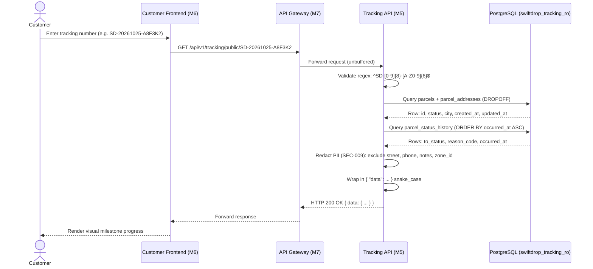
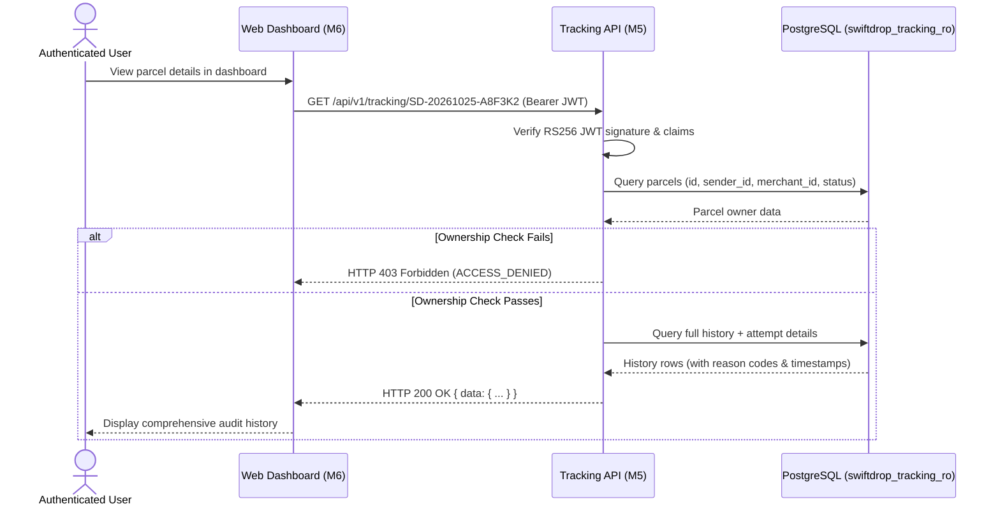
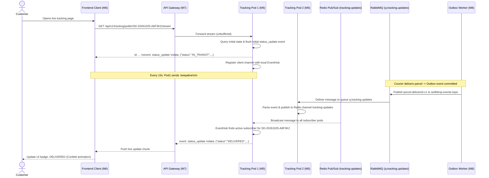

# Document 2 — Functional Flows & Business Rules

**Project:** SwiftDrop — Parcel Delivery & Courier Management System  
**Module:** Tracking API & Real-Time Updates  
**Module Owner:** Member 5 (Senuji)  
**Version:** 1.0.0 — Post-Audit Harmonized  
**Status:** Approved & Ratified  
**Primary Technology:** Go 1.22+, REST/JSON, Server-Sent Events (SSE), PostgreSQL, Redis Pub/Sub, RabbitMQ  
**Target Codepath:** `services/tracking/` (Port `:8081`)  
**Related Documents:** Document 1 (Scope), `docs/contracts/api-conventions.md`, `docs/contracts/event-contracts.md`, `docs/architecture/domain-boundaries.md`

---

## 1. Purpose & Scope

This document specifies the operational flows, interaction sequences, business rules, and state machine mappings governing the Tracking API.

The Tracking API is a **pure read-oriented service**. It evaluates no state transitions, executes no mutations, and calculates no business pricing. Instead, it reads authoritative parcel data and milestones from PostgreSQL, ingests committed status events from RabbitMQ (`q.tracking.updates`), broadcasts live updates through Server-Sent Events (SSE) via Redis Pub/Sub (`tracking:updates`), and enforces strict privacy redaction rules (SEC-009).

### 1.1 In-Scope Functional Areas

1. **Public Parcel Tracking Lookup:** Fast, unauthenticated lookup using standard tracking numbers (`SD-YYYYMMDD-XXXXXX`).
2. **Authenticated Parcel Tracking History:** Role-based lookup for customers and merchants with complete milestone details and access control checks.
3. **Live Server-Sent Events (SSE) Streaming:** Persistent HTTP streaming with 15-second keepalive frames, initial state hydration, and multi-pod fan-out.
4. **SSE Connection Recovery & Polling Fallback:** Automatic client retry, `Last-Event-ID` state recovery, and 30-second REST polling fallback after 3 failures.
5. **Event Consumption & Deduplication:** Handling out-of-order or duplicate notifications safely without corrupting client views.
6. **State Machine Projection & Customer-Facing Status Mapping:** Transforming internal domain enums into user-friendly descriptions.

---

## 2. Actors and Triggering Conditions

| Actor | Domain / Boundary | Trigger / Interaction |
|---|---|---|
| **Public Visitor** | Web User | Enters tracking number on public portal to check delivery status. |
| **Authenticated Customer / Merchant** | Logged-in User | Opens portal dashboard to view full historical journey of booked parcels. |
| **Customer Frontend (Member 6)** | React Web App | Subscribes to SSE stream via `useSSE` hook; initiates REST polling on failure. |
| **API Gateway / Traefik (Member 7)** | Reverse Proxy | Routes `/api/v1/tracking/*` to `services/tracking:8081`; unbuffers SSE streams. |
| **Core Parcels & Pricing (Member 2)** | Domain Owner | Commits parcel creation, state transitions, and status history in PostgreSQL. |
| **Dispatch & Delivery (Member 3)** | Domain Owner | Commits courier assignment, pickup, transit, and delivery attempt events. |
| **Events & Messaging (Member 8)** | Event Broker | Routes committed domain events to RabbitMQ queue `q.tracking.updates`. |
| **AI Assistant (Member 10)** | FastMCP Client | Queries `GET /api/v1/tracking/public/{trackingNumber}` via read-only tool. |
| **PostgreSQL Database** | Storage Layer | Serves authoritative parcel and status history data via `swiftdrop_tracking_ro`. |
| **Redis Cluster** | In-Memory Broker | Ephemeral fan-out channel `tracking:updates` across active `tracking-api` pods. |

---

## 3. Main Functional Flow — Public Tracking Lookup

### 3.1 Preconditions

1. The `tracking-api` service is operational and passing health checks (`/health/ready`).
2. The customer provides a valid tracking number in format `SD-YYYYMMDD-XXXXXX`.
3. PostgreSQL is reachable with the `swiftdrop_tracking_ro` role.

### 3.2 Success Flow

1. Customer submits a tracking number on the public tracking page.
2. Frontend sends `GET /api/v1/tracking/public/{trackingNumber}` to API Gateway.
3. Gateway validates rate limits (10 req/s, burst 20 per IP) and forwards to `services/tracking:8081`.
4. Tracking API validates the tracking number syntax using regex `^SD-[0-9]{8}-[A-Z0-9]{6}$`.
5. API queries PostgreSQL `parcels` table joined with `parcel_addresses` (`address_type = 'DROPOFF'`) to obtain current status and destination city.
6. API queries `parcel_status_history` ordered by `occurred_at ASC` to build the chronological milestone timeline.
7. API maps internal enum statuses to customer-friendly descriptions.
8. API enforces **SEC-009 Privacy Masking**: strictly omitting street addresses, phone numbers, recipient names, internal notes, fee cents, and `zone_id`.
9. API returns JSON wrapped in `{ "data": ... }` with HTTP `200 OK`.
10. Frontend displays current status and visual milestone timeline.

### 3.3 Sequence Diagram — Public Tracking Lookup



### 3.4 Alternative and Error Flows

| Scenario | Condition | HTTP Status | Error Code | Response Behavior |
|---|---|:---:|---|---|
| **Invalid Format** | Tracking number fails regex validation | `400` | `INVALID_TRACKING_NUMBER` | Safe validation message: "Tracking number format must be SD-YYYYMMDD-XXXXXX". |
| **Parcel Not Found** | Valid format, but no matching record in `parcels` | `404` | `TRACKING_NOT_FOUND` | Safe message: "No shipment found for the provided tracking number". |
| **Database Failure** | PostgreSQL pool exhausted or connection down | `503` | `DEPENDENCY_UNAVAILABLE` | Controlled error without SQL query or stack trace leakage. |
| **Rate Limit Exceeded** | IP exceeds gateway threshold | `429` | `RATE_LIMIT_EXCEEDED` | Gateway returns `429 Too Many Requests` with `Retry-After: 60`. |

---

## 4. Functional Flow — Authenticated Tracking History

### 4.1 Preconditions

1. Caller provides a valid Bearer JWT issued by Identity Service (Member 1).
2. JWT signature verifies against `JWT_PUBLIC_KEY_PEM` (RS256).
3. Caller holds `CUSTOMER`, `MERCHANT`, `ADMIN`, or `DISPATCHER` role.

### 4.2 Authorization Rules (Ownership Verification)

- **CUSTOMER:** `auth.UserID` must match `parcels.sender_id`.
- **MERCHANT:** `auth.TenantID` must match `parcels.merchant_id`.
- **ADMIN / DISPATCHER:** Access granted to all parcels for operational review.
- If an authenticated user attempts to access a parcel they do not own, the service returns **HTTP 403 Forbidden** (error code `ACCESS_DENIED`).

### 4.3 Success Flow

1. Authenticated user requests `GET /api/v1/tracking/{trackingNumber}` with `Authorization: Bearer <token>`.
2. Tracking API verifies token signature, expiration (`exp`), and extracts `sub` (UserID), `tenant_id`, and `role`.
3. API queries `parcels` to retrieve parcel metadata and owner foreign keys (`sender_id`, `merchant_id`).
4. API validates ownership against caller claims.
5. API queries `parcel_status_history` and `delivery_attempts` to compile detailed audit history.
6. Returns HTTP `200 OK` with complete milestone history, including operational reason codes and attempt notes.



---

## 5. Functional Flow — Live Real-Time Tracking via SSE

### 5.1 Protocol Standards

- **Endpoint:** `GET /api/v1/tracking/public/{trackingNumber}/stream` (canonical alias `GET /api/v1/tracking/{trackingNumber}/stream`).
- **MIME Type:** `text/event-stream; charset=utf-8`
- **Cache-Control:** `no-cache, no-transform`
- **Keepalive Heartbeat:** Comment frame `:keepalive\n\n` emitted every **15 seconds** (Agreement A2).
- **Event Name:** `event: status_update`
- **Event ID:** Formatted as `{tracking_number}:{status}:{unix_timestamp}`.

### 5.2 Stream Lifecycle Flow

1. Frontend initiates SSE connection via native `EventSource` (or polyfill).
2. Traefik Gateway routes request to `services/tracking:8081` with response buffering disabled (`buffering.maxResponseBodyBytes: 0`).
3. `tracking-api` sets SSE headers and flushes immediately.
4. **Initial State Push:** API queries PostgreSQL for the parcel's current status and immediately flushes an initial `status_update` event so the client view is instantly hydrated.
5. **Subscription Registration:** Handler registers a client channel (buffered to 32 slots) with the local `EventHub` for that `tracking_number`.
6. **Heartbeat Loop:** A 15-second ticker fires `:keepalive\n\n` comments down the connection to prevent gateway/proxy idle timeouts.
7. **Broadcast Delivery:** When a status update arrives via Redis Pub/Sub, `EventHub` pushes the event to all registered client channels listening for that tracking number.
8. **Disconnection Cleanup:** When the client disconnects or the context cancels, handler unregisters the channel, stops the keepalive ticker, and reclaims all memory buffers.

### 5.3 Sequence Diagram — SSE Stream & Multi-Pod Fan-Out



---

## 6. Functional Flow — SSE Reconnection & Polling Fallback

### 6.1 Reconnection Sequence

1. Browser detects socket closure (e.g. Wi-Fi drop, gateway restart, pod redeployment).
2. Native `EventSource` triggers automatic reconnection using exponential backoff (1s, 2s, 4s).
3. The reconnect request includes the HTTP header `Last-Event-ID: <id>`.
4. The server receives the connection, extracts `trackingNumber`, queries PostgreSQL for current authoritative status, and sends the latest `status_update`.
5. If the connection fails permanently (3 consecutive failures over 30 seconds), frontend gracefully degrades to **REST Polling Fallback**.

### 6.2 Polling Fallback Rules

- The frontend calls `GET /api/v1/tracking/public/{trackingNumber}` every **30 seconds**.
- Polling ceases automatically when:
  - Parcel reaches a terminal state (`DELIVERED`, `RETURNED`, `CANCELLED`).
  - User navigates away from the tracking screen.
  - An SSE connection is successfully re-established.

```mermaid
flowchart TD
    Start([Client Opens Tracking Stream]) --> Connect[Open SSE Connection]
    Connect --> InitialPush[Receive Initial status_update]
    InitialPush --> Listen[Listen for Stream Events & 15s Keepalives]
    Listen --> CheckStatus{Status Terminal?}
    CheckStatus -- Yes (DELIVERED/CANCELLED) --> CloseStream[Close Stream Gracefully]
    CheckStatus -- No --> DropCheck{Connection Dropped?}
    DropCheck -- No --> Listen
    DropCheck -- Yes --> Retry1[Reconnect Attempt 1 (1s)]
    Retry1 --> Success1{Connected?}
    Success1 -- Yes --> Hydrate[Send Current Status & Resume]
    Hydrate --> Listen
    Success1 -- No --> Retry2[Reconnect Attempt 2 (2s)]
    Retry2 --> Success2{Connected?}
    Success2 -- Yes --> Hydrate
    Success2 -- No --> Retry3[Reconnect Attempt 3 (4s)]
    Retry3 --> Success3{Connected?}
    Success3 -- Yes --> Hydrate
    Success3 -- No --> Fallback[Degrade to REST Polling Fallback]
    Fallback --> PollWait[Wait 30 Seconds]
    PollWait --> PollReq[GET /api/v1/tracking/public/{id}]
    PollReq --> PollCheck{Status Terminal or SSE Recovered?}
    PollCheck -- Terminal --> CloseStream
    PollCheck -- SSE Recovered --> Connect
    PollCheck -- Still Active --> PollWait
```

---

## 7. Parcel State Machine & Customer Presentation Mapping

The Tracking API consumes the authoritative parcel lifecycle defined in `docs/architecture/domain-boundaries.md` and Member 2's Migration 5. The service maps internal enum codes to customer-facing descriptions:

| Canonical Domain Status | Milestone Description (Customer-Facing) | Terminal? | Typical Duration / Context |
|---|---|:---:|---|
| `CREATED` | "Shipment booked and delivery label generated." | No | Initial booking by customer or merchant. |
| `ASSIGNED` | "Courier assigned for pickup." | No | Dispatcher or auto-assignment matched courier. |
| `PICKED_UP` | "Parcel collected by courier from sender." | No | Courier scanned parcel barcode at pickup location. |
| `IN_TRANSIT` | "Parcel sorted and in transit between hubs." | No | Processed at central sorting facility. |
| `OUT_FOR_DELIVERY` | "Courier is out for final doorstep delivery." | No | Loaded onto local delivery vehicle. |
| `ATTEMPT_FAILED` | "Delivery attempt unsuccessful. Reattempt scheduled." | No | Recipient unavailable; reattempt scheduled next business day. |
| `DELIVERED` | "Parcel successfully delivered to recipient." | **Yes** | Pod photo captured / signed; stream terminates. |
| `RETURNED` | "Parcel returned to sender depot." | **Yes** | 3 failed delivery attempts reached; returned to merchant. |
| `CANCELLED` | "Shipment cancelled by sender." | **Yes** | Cancelled prior to pickup; stream terminates. |

---

## 8. Event Handling & Concurrency Rules

1. **At-Least-Once Delivery Resilience:** RabbitMQ delivery guarantees at-least-once delivery. The `tracking-api` event consumer checks if an incoming event timestamp is older than the currently recorded status in PostgreSQL before broadcasting, preventing stale regressions.
2. **Out-of-Order Message Protection:** If an `IN_TRANSIT` message arrives after `OUT_FOR_DELIVERY` has already been committed and broadcast, the consumer detects that `parcel_status_history` is ahead and discards the older event.
3. **Slow Consumer Protection:** Client channels inside `EventHub` have a fixed buffer size of **32 slots**. If a slow browser client cannot consume events fast enough to drain the buffer, the `broadcast()` select statement uses a `default:` fall-through branch to drop the event for that specific client rather than blocking the hub or degrading other subscribers.
4. **PostgreSQL Read-Only Invariant:** Under high traffic spikes, `swiftdrop_tracking_ro` queries never acquire row-level locks (`FOR UPDATE` is prohibited). All reads use `READ COMMITTED` isolation with a 3-second statement timeout.

---

## 9. Ratified Functional Decisions Table

| Decision Item | Ratified Resolution | Rationale |
|---|---|---|
| **Public SSE Route** | `/api/v1/tracking/public/{trackingNumber}/stream` (alias `/api/v1/tracking/{trackingNumber}/stream`) | Unifies public access and aligns with frontend expectations. |
| **Keepalive Interval** | Exactly **15 seconds** (`:keepalive\n\n`) | Satisfies Agreement A2; prevents Cloudflare/Traefik 100s idle drop. |
| **SSE Event Name** | `status_update` | Confirmed across M5, M6, and M7. |
| **Polling Fallback Interval** | **30 seconds** | Balances UI freshness with database protection during network outages. |
| **Buffer Capacity** | **32 slots** per client channel | Prevents slow client blocking while providing ample cushion for bursts. |
| **Privacy Redaction** | Strict SEC-009 enforcement (city only, zero street/phone/notes/zone) | Mandated by system privacy review and team audit. |

---
*End of Document 2 — Functional Flows & Business Rules (v1.0.0)*
