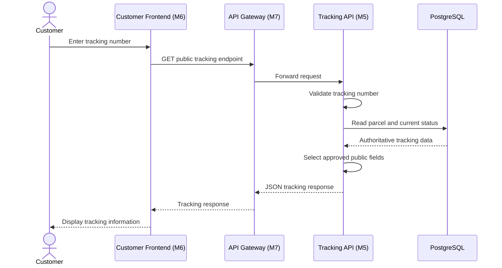
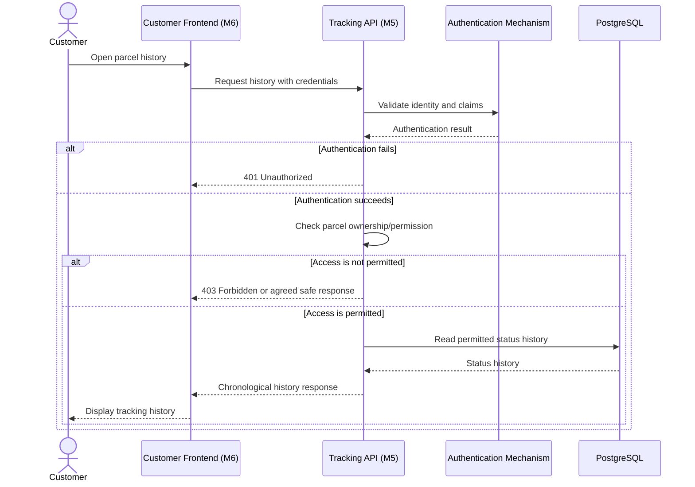
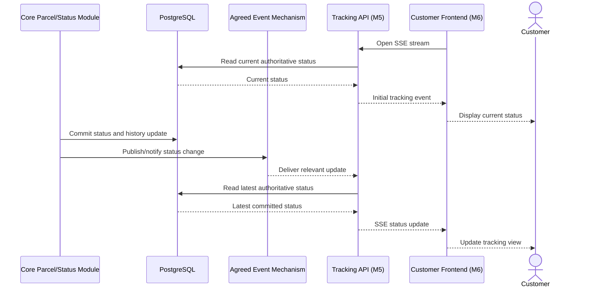
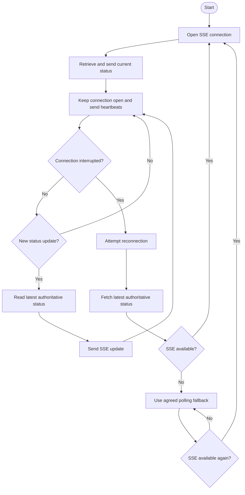
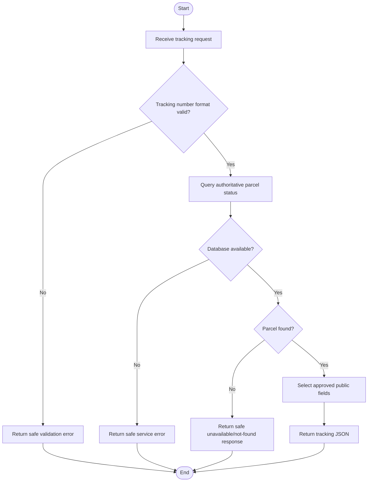

# Document 2 — Functional Flows & Business Rules

**Project:** SwiftDrop — Parcel Delivery & Courier Management System  
**Module:** Tracking API & Real-Time Updates  
**Module Owner:** Member 5  
**Version:** 0.1 — Initial Draft  
**Status:** Draft for team review  
**Primary Technology:** Go, REST/JSON, Server-Sent Events (SSE), PostgreSQL  
**Related Documents:** Document 1 — Module Scope & Responsibility Specification; SwiftDrop SRS; Engineering Standards & Best Practices; Team Work Division

---

## 1. Purpose

This document defines how the Tracking API behaves when users request parcel tracking information, view permitted tracking history, and receive live parcel status updates.

It specifies the main success flows, alternative flows, failure behavior, business rules, and interactions with other modules.

The Tracking API is a read-oriented service. It reads authoritative parcel information and delivers it to authorized consumers. It does not create parcels or change parcel statuses.

### 1.1 Scope

This document covers:

- Public parcel tracking lookup.
- Authenticated parcel tracking history.
- Live tracking updates using SSE.
- Connection loss and reconnection.
- Invalid tracking identifiers and unavailable dependencies.
- Duplicate or out-of-order event handling.
- Privacy, authorization, consistency, and reliability rules.

The actual database table names, final RabbitMQ event contract, and authenticated-history endpoint remain subject to confirmation by the relevant module owners.

## 2. Actors and Triggering Conditions

| Actor | Responsibility | Trigger |
|---|---|---|
| Public customer | Views current parcel tracking information | Enters a tracking number and requests tracking. |
| Authenticated customer | Views permitted tracking history | Requests history for a parcel they are authorized to access. |
| Customer frontend — Member 6 | Displays tracking data and live updates | Calls the Tracking API or opens an SSE connection. |
| API Gateway — Member 7 | Routes and controls external requests | Receives an incoming API request. |
| Tracking API — Member 5 | Retrieves and returns tracking data | Receives a valid tracking request or status-update notification. |
| Core parcel/status modules — Members 2 and 3 | Own parcel data and status changes | A parcel is created or its status changes through an authorized business operation. |
| Event integration — Member 8 | Coordinates event publication and delivery | A relevant parcel status update is committed and published through the agreed mechanism. |
| PostgreSQL | Stores authoritative parcel and status-history data | The Tracking API performs a read operation. |

## 3. Main Functional Flow — Public Tracking Lookup

### 3.1 Preconditions

- The Tracking API is running and reachable.
- The customer has a tracking number.
- The gateway routes the request to the Tracking API.
- The database is available for authoritative reads.

### 3.2 Success flow

1. The customer enters a tracking number on the tracking page.
2. The frontend sends a GET request to the public tracking endpoint.
3. The gateway forwards the request to the Tracking API.
4. The Tracking API validates the tracking number's format.
5. The API queries the authoritative data store for the parcel and its current status.
6. The API selects only approved public response fields.
7. The API returns a JSON response containing the permitted tracking information.
8. The frontend displays the current status and relevant delivery summary.

### 3.3 Sequence diagram — Public tracking lookup

### 3.4 Alternative and failure flows

| Condition | Expected behavior |
|---|---|
| Tracking number has an invalid format | Return a safe validation error, proposed as HTTP 400. |
| Tracking number is valid but no parcel exists | Return a safe unavailable/not-found response, proposed as HTTP 404. |
| Database is unavailable | Return a safe service error, normally HTTP 503 when the dependency is unavailable. |
| Request exceeds the agreed rate limit | Return HTTP 429 or the agreed gateway error format. |
| Unexpected internal error occurs | Return a generic error without exposing SQL, stack traces, credentials, or internal implementation details. |

The final response format must follow the team's agreed API error envelope. Unknown tracking numbers must not reveal internal database details.

## 4. Functional Flow — Authenticated Tracking History

### 4.1 Preconditions

- The customer has authenticated using the agreed authentication mechanism.
- The request identifies a parcel using the agreed API contract.
- The Tracking API can validate the caller's identity and authorization.

### 4.2 Success flow

1. The customer opens their parcel history view.
2. The frontend sends an authenticated request to the history endpoint.
3. The Tracking API validates the authentication credentials.
4. The API verifies that the customer is permitted to access the requested parcel.
5. The API retrieves the permitted status history from the authoritative data store.
6. The API returns the history in chronological order using the agreed timestamp and sorting rules.
7. The frontend displays the history.

### 4.3 Sequence diagram — Authenticated history

### 4.4 Business rules

- Authentication alone does not grant access to every parcel.
- The API must enforce parcel ownership or another explicitly approved permission rule.
- The frontend cannot be trusted to enforce authorization by hiding or disabling UI controls.
- Private fields must not be returned through public tracking endpoints.
- The exact history route and authorization claims must be agreed with the authentication and API owners.

## 5. Functional Flow — Live Tracking Updates Using SSE

### 5.1 Purpose

Server-Sent Events (SSE) allow the server to send tracking updates to a browser over a long-lived HTTP connection.

The customer should not need to manually refresh the page for every status change during normal operation. Network failures can still interrupt the stream, so reconnect behavior is required.

### 5.2 Preconditions

- The public tracking endpoint can identify the parcel.
- The SSE route is configured in the gateway to support streaming.
- Response buffering is disabled for the SSE route where supported.
- The event-delivery mechanism has been agreed with Member 8.
- The Tracking API can retrieve the authoritative current status.

### 5.3 Proposed success flow

1. The frontend opens an SSE connection for the tracking number.
2. The gateway forwards the long-lived request to the Tracking API.
3. The Tracking API validates the tracking number and retrieves the current authoritative status.
4. The API sends an initial tracking event containing approved public fields.
5. The API keeps the connection open and sends heartbeat comments at the agreed interval.
6. A parcel status change is committed by the authoritative core module.
7. The agreed event mechanism informs the Tracking API of the change.
8. The Tracking API obtains the latest authoritative state and creates an approved client-facing event.
9. The API sends the update over SSE to connected clients.
10. The frontend updates the tracking interface.

### 5.4 Sequence diagram — Live tracking updates

The following diagram shows the proposed event flow. The exact broker topology and queue names must be confirmed with Member 8.

### 5.5 Proposed SSE endpoint

`GET /api/v1/tracking/public/{trackingNumber}/stream`

This path is proposed and must be confirmed with Members 6, 7, and 9 before being treated as final.

### 5.6 Event behavior

- SSE events must contain only approved public fields.
- Event IDs should be used where supported by the agreed reconnect design.
- Heartbeats should use SSE comment lines, for example `: keepalive`, at the agreed interval.
- The heartbeat interval and gateway idle timeout must be compatible.
- A heartbeat indicates connection activity; it does not mean the parcel's status has changed.
- The event-delivery mechanism and exact event payload must be documented in Document 4 after confirmation.

## 6. Functional Flow — SSE Reconnection

### 6.1 Triggering conditions

A connection may be interrupted because of network loss, browser sleep, gateway restart, deployment, or service failure.

### 6.2 Reconnection flow

1. The browser detects that the SSE connection has closed.
2. The client attempts to reconnect using the agreed retry behavior.
3. The client retrieves the latest authoritative tracking state after reconnecting or detecting a possible missed update.
4. The API returns the current approved status.
5. The client resumes receiving live updates.
6. If the stream remains unavailable, the frontend uses the agreed fallback behavior, such as periodic status retrieval, with appropriate limits.

### 6.3 Activity diagram — SSE reconnection

The diagram describes the intended behavior. Exact retry intervals, polling frequency, and fallback limits remain configuration decisions.

## 7. Activity Diagram — Public Tracking Request

## 8. Business Rules, Preconditions, and Postconditions

### 8.1 Business rules

**BR-01 — Authoritative status:** The current status returned by the Tracking API must reflect the latest committed authoritative data available to the query.

**BR-02 — Public data minimization:** Public tracking responses may contain only deliberately approved tracking fields.

**BR-03 — Protected history:** Private history requires authentication and authorization for the requested parcel.

**BR-04 — Read-only behavior:** Tracking endpoints must not modify parcel records or status history.

**BR-05 — Chronological history:** Status history must be returned in the agreed chronological order using authoritative timestamps.

**BR-06 — Safe errors:** Error responses must not disclose SQL queries, stack traces, secrets, internal hostnames, or other sensitive implementation details.

**BR-07 — Live update recovery:** After reconnection or a missed event, the client must retrieve current authoritative state instead of assuming that all previous events were received.

**BR-08 — Event consistency:** An event notification does not replace the durable parcel/status record in PostgreSQL.

**BR-09 — No unapproved stale cache:** Any future cache requires explicit freshness, invalidation, and consistency rules.

**BR-10 — Contract compatibility:** Changes to public API paths, response fields, or event schemas must be coordinated with affected consumers.

### 8.2 Preconditions and postconditions

| Operation | Preconditions | Postconditions |
|---|---|---|
| Public lookup | Tracking identifier is supplied | Returns approved tracking information or a safe failure response. |
| Authenticated history | Valid identity and permission for the parcel | Returns permitted chronological history or denies access. |
| Open SSE stream | Valid tracking identifier and supported streaming connection | Sends initial status and attempts to deliver live updates. |
| Reconnect | A previous stream was interrupted | Client obtains current authoritative state and resumes updates or falls back safely. |
| Event handling | A relevant event is received through the agreed mechanism | The API reconciles with authoritative state and delivers an appropriate update. |

## 9. State and Event Handling Rules

The Tracking API does not own the parcel lifecycle state machine. Permitted parcel status transitions remain the responsibility of the core parcel/status modules.

This module does need to manage its own stream and event-processing behavior.

### 9.1 SSE connection states

A stream can be considered to be in one of these operational states:

- **Disconnected:** No active SSE connection.
- **Connecting:** A client is attempting to establish a stream.
- **Connected:** The stream is active and can send events.
- **Recovering:** The client is reconnecting or retrieving the latest status.
- **Fallback:** The stream is unavailable and the frontend uses the agreed alternative.

These are operational states, not parcel statuses.

### 9.2 Duplicate and out-of-order events

Events may be delivered more than once or arrive in an unexpected order depending on the final event architecture.

The Tracking API must not blindly assume every incoming event represents a newer status than the previously processed event.

The proposed approach is:

1. Validate the incoming event according to the agreed event schema.
2. Use the agreed event identifier to support duplicate detection where needed.
3. Retrieve or reconcile against the authoritative current status when required.
4. Avoid sending an older status as though it were newer than the current authoritative state.
5. Keep durable status history in PostgreSQL rather than using the event stream as history storage.

The final deduplication strategy and ordering guarantees must be agreed with Member 8.

## 10. Idempotency and Concurrency

The Tracking API is read-oriented, so its public lookup and history operations do not create business records and generally do not require write-operation idempotency keys.

However:

- Repeated tracking lookups should not modify data.
- Repeated SSE connections must not create parcel or status-history records.
- Duplicate event delivery must not create duplicate durable history in the Tracking API.
- Concurrent clients must receive data based on authoritative committed state.
- If the same event is processed more than once, the API should avoid unnecessary duplicate notifications where the agreed event contract allows reliable detection.
- The API must not introduce its own parcel-status mutation logic to resolve concurrency conflicts.

The core domain modules remain responsible for transaction integrity and preventing duplicate status-history records during status changes.

## 11. Privacy and Authorization Rules

The Tracking API must apply the following rules:

1. Public tracking returns only the approved public fields.
2. Full delivery addresses, phone numbers, credentials, merchant secrets, and other unapproved private data must not be exposed.
3. Authenticated history must enforce parcel ownership or another explicitly approved access policy.
4. Authorization must be checked in backend logic, not only in the frontend.
5. Unknown identifiers and internal errors must produce safe responses.
6. Logs must not contain secrets or unnecessary sensitive personal data.
7. SSE events must follow the same public/private field restrictions as REST responses.

The final public-field matrix and authentication contract will be documented in Documents 4 and 7.

## 12. Examples and Edge Cases

| Scenario | Expected behavior |
|---|---|
| Valid tracking number with an existing parcel | Return the latest committed status and approved tracking information. |
| Tracking number has an invalid format | Return a safe validation error. |
| Tracking number does not identify a parcel | Return a safe unavailable/not-found response. |
| Customer requests another customer's private history | Deny access according to the agreed authorization policy. |
| Database becomes unavailable during a lookup | Return a safe service error; do not fabricate a status. |
| SSE connection drops after a status change | Reconnect and fetch current authoritative status. |
| The same event is delivered more than once | Avoid treating it as multiple distinct status changes. |
| An older event arrives after a newer status has been committed | Reconcile against authoritative state before presenting an update. |
| Several clients track the same parcel | Each authorized stream receives the appropriate privacy-safe updates. |
| Clients connect to different Tracking API replicas | The selected fan-out mechanism must deliver relevant updates across replicas when required. |
| An event contains unexpected or missing fields | Reject or safely handle it according to the agreed schema and error policy. |
| Rate limit is exceeded | Apply the agreed rate-limit response without exposing internal details. |

## 13. Assumptions and Unresolved Decisions

| Item | Current position | Required confirmation |
|---|---|---|
| Public tracking endpoint | Proposed versioned REST path | Confirm with Members 6 and 7. |
| Authenticated history endpoint | Not finalized | Confirm API path and authorization contract. |
| Database tables and columns | PostgreSQL is authoritative | Member 2 provides the approved schema. |
| RabbitMQ exchange, queue, and routing key | Not confirmed | Member 8 confirms the event contract. |
| Event payload and version | Not confirmed | Member 8 provides the agreed schema and example. |
| Redis or alternative fan-out | Conditional on the selected multi-replica design | Coordinate with Members 8 and 9. |
| Heartbeat and reconnect intervals | Initial proposals only | Confirm gateway support and test under the expected workload. |
| Error envelope | Must follow the team API standard | Confirm the shared response format. |
| Polling fallback behavior | Required if the stream cannot be maintained | Coordinate with Member 6. |
| Public tracking disclosure fields | Must follow the approved privacy policy | Confirm the final field matrix. |

## 14. Acceptance Criteria

The functional behavior described in this document is acceptable when:

- A valid tracking number returns the latest committed status.
- Public responses expose only approved tracking fields.
- Authenticated customers can retrieve only permitted parcel history.
- Invalid or unknown tracking identifiers produce safe responses.
- SSE clients receive an initial current status and subsequent updates when the event integration is available.
- A disconnected client can reconnect and retrieve the latest authoritative status.
- Duplicate or out-of-order events do not cause the API to present an older status as current.
- Database and event-delivery failures are handled without inventing parcel information.
- The API does not mutate parcel status or create duplicate parcel history.
- The final API and event contracts are documented and tested.

## 15. Definition of Done

This document is ready for approval when:

- Functional flows and alternative/failure flows are reviewed.
- The public and authenticated history rules are agreed.
- The sequence and activity diagrams match the final integration design.
- Member 2's schema and Member 8's event contract are incorporated where applicable.
- Endpoint paths, error formats, and fallback behavior are agreed with the frontend and gateway owners.
- Test scenarios are mapped to the acceptance criteria.
- All remaining unresolved decisions have an owner and follow-up action.

---

**End of Document 2 — Initial Draft**
