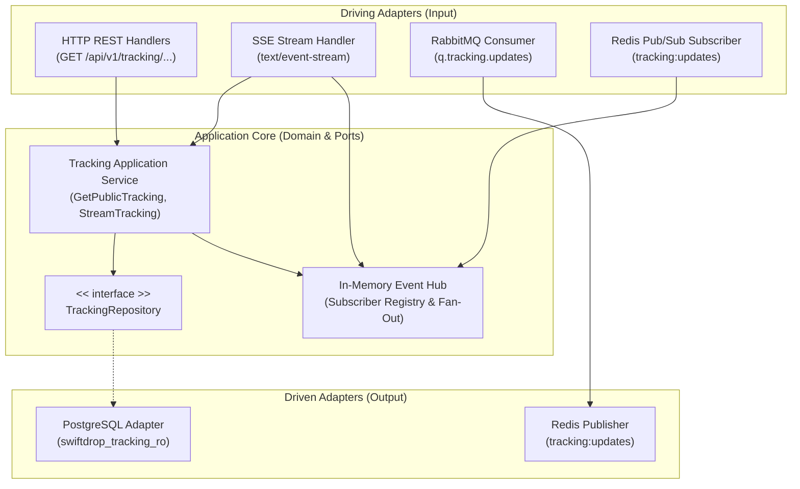
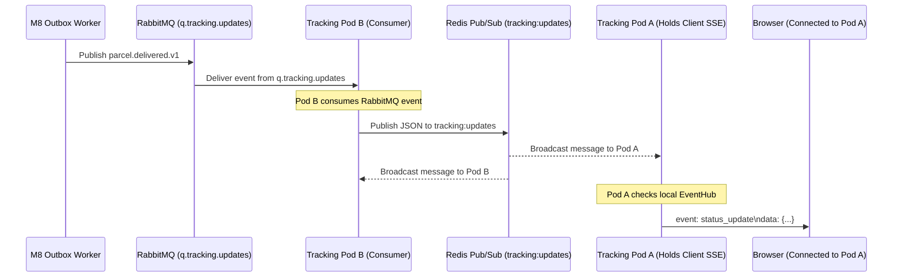

# Document 3 — Internal Architecture & Design Specification

**Project:** SwiftDrop — Parcel Delivery & Courier Management System  
**Module:** Tracking API & Real-Time Updates  
**Module Owner:** Member 5 (Senuji)  
**Version:** 1.0.0 — Post-Audit Harmonized  
**Status:** Approved & Ratified  
**Primary Technology:** Go 1.22+, Chi Router v5, PostgreSQL (pgx/v5), Redis Pub/Sub (go-redis/v9), RabbitMQ (amqp091-go)  
**Target Codepath:** `services/tracking/` (Port `:8081`)  
**Related Documents:** Documents 1 & 2, `docs/contracts/api-conventions.md`, `docs/contracts/event-contracts.md`, `docs/architecture/domain-boundaries.md`, Member 9 Agreements (A1, A2, D6, D8)

---

## 1. Architectural Purpose & Principles

This document specifies the internal software architecture of the standalone Tracking API microservice.

The Tracking API is designed around **Clean Architecture / Ports & Adapters (Hexagonal)** principles:
- **Core Independence:** Core tracking models and use cases have zero dependencies on HTTP frameworks, SQL drivers, or message broker libraries.
- **Port Interfaces:** External drivers (HTTP server, PostgreSQL, Redis, RabbitMQ) communicate with application logic solely through Go interfaces defined in the domain/application layer.
- **Read-Only Persistence:** Complete physical separation from database mutations via PostgreSQL role `swiftdrop_tracking_ro`.
- **Horizontal Scalability:** High-concurrency SSE connections fan out cleanly across multiple stateless Kubernetes pods (HPA 2 to 4) using an internal Redis Pub/Sub bus.



---

## 2. Multi-Replica Horizontal Scaling & Fan-Out Design (CR-M05-01 Resolved)

### 2.1 The Distributed SSE Problem

In production, the Tracking API runs behind Traefik as a horizontally autoscaling Kubernetes Deployment (2 to 4 pods).
When a browser opens an SSE stream for parcel `SD-20261025-A8F3K2`, Traefik load-balances the TCP connection to a specific pod (e.g. **Pod A**).

When Member 8's Worker commits a status change, it publishes a domain event to RabbitMQ topic exchange `swiftdrop.events.topic`. The queue `q.tracking.updates` receives the message. If the queue distributes messages across multiple pods via round-robin, the message might be consumed by **Pod B**. Since the client is connected to **Pod A**, a naive single-queue architecture would fail to deliver the update to the client.

### 2.2 Ratified Solution: Two-Tier Ingestion & Internal Fan-Out

To resolve Member 8's change request (**CR-M05-01**) and guarantee 100% delivery across all pods:

1. **RabbitMQ Ingestion:** Member 5's service runs a RabbitMQ consumer worker bound to queue `q.tracking.updates`. (Note: **Member 8 has no connection to Redis**; Member 8 publishes only to RabbitMQ).
2. **Internal Redis Fan-Out:** The `tracking-api` pod that pulls a message from `q.tracking.updates` immediately republishes the compact payload to Redis channel **`tracking:updates`**.
3. **Cluster-Wide Broadcast:** Every running `tracking-api` pod runs a background Redis subscriber listening to channel `tracking:updates`.
4. **Local Channel Delivery:** Each pod inspects its internal memory map (`EventHub`). If it has any active SSE client channels registered for that `tracking_number`, it writes the event to those channels.



---

## 3. Package Structure & Layout (`services/tracking/`)

In strict accordance with Agreement A1 and the SwiftDrop repository standard (`AGENTS.md` §4), the service lives inside `services/tracking/`.

> **Important Schema Rule:** Member 5 owns **zero database migrations**. All migrations are executed centrally by Member 9 and Member 2 in `core-api/migrations/`. Therefore, `services/tracking/` contains **no `migrations/` folder**.

```text
services/tracking/
├── cmd/
│   └── tracking/
│       └── main.go                 # Dependency injection, wiring & graceful shutdown
├── internal/
│   ├── config/
│   │   └── config.go               # Validated env loading (PORT, DATABASE_URL, REDIS_URL)
│   ├── domain/
│   │   ├── tracking.go             # Parcel, Milestone, and TrackingStatus entities
│   │   └── errors.go               # Domain sentinel errors (ErrNotFound, ErrUnauthorized)
│   ├── service/
│   │   ├── tracking_service.go     # Application orchestrator (GetPublic, GetAuthenticated)
│   │   └── dto.go                  # Snake_case response DTOs with {data} envelope
│   ├── ports/
│   │   └── repository.go           # TrackingRepository interface contract
│   ├── repository/
│   │   └── postgres.go             # Read-only SQL adapter (swiftdrop_tracking_ro)
│   ├── events/
│   │   ├── hub.go                  # Thread-safe in-memory SSE client registry
│   │   ├── rabbit_consumer.go      # RabbitMQ subscriber for q.tracking.updates
│   │   └── redis_pubsub.go         # Redis publisher & subscriber for tracking:updates
│   └── handler/
│       ├── rest.go                 # REST endpoints (public lookup & auth history)
│       ├── sse.go                  # SSE streaming handler with 15s keepalive
│       ├── health.go               # Liveness & readiness probes (/health/live, /health/ready)
│       └── middleware.go           # JWT RS256 validation, CORS & request logging
├── Dockerfile                      # Multi-stage non-root container (USER 10001:10001)
├── go.mod                          # Go 1.22+ module definition
├── go.sum                          # Checksums
└── README.md                       # Service documentation & run instructions
```

---

## 4. Component Deep-Dive & Design Decisions

### 4.1 In-Memory `EventHub` Concurrency Model

The `EventHub` manages local SSE client connections using a thread-safe mutex and bounded Go channels:

```go
type EventHub struct {
    mu          sync.RWMutex
    subscribers map[string][]chan TrackingUpdateEvent // key: tracking_number
    logger      *slog.Logger
}
```

#### Buffer Capacity & Slow-Client Policy (Audit Fix)
- **Buffer Size = 32 Slots:** In the initial draft, client channels were allocated with a buffer of 5 slots. High burst volumes could cause channel saturation. The buffer capacity is now standardized at **32 slots** (`make(chan TrackingUpdateEvent, 32)`).
- **Non-Blocking Drop with Warning:** The `broadcast()` function sends to channels inside a non-blocking `select`:
  ```go
  select {
  case ch <- event:
  default:
      h.logger.Warn("Dropped tracking update for slow client channel", "trackingNumber", event.TrackingNumber)
  }
  ```
  If a slow client network connection causes the 32-slot buffer to fill completely, the event is dropped for that specific client rather than blocking the hub or causing goroutine leaks. The client will catch up via its next REST refresh or reconnection.

### 4.2 Authenticated SSE Bearer Token Design Gap Resolution

Browser-native `EventSource` does not support custom HTTP request headers (such as `Authorization: Bearer <token>`). To resolve this architectural design gap:

1. **Public Stream Is Unauthenticated:** `GET /api/v1/tracking/public/{trackingNumber}/stream` requires **no credentials**. It streams sanitized status updates that satisfy SEC-009.
2. **Authenticated Streaming Options:** For customer/merchant portals requiring private stream data:
   - **Recommended Primary Approach:** The frontend uses standard public SSE streaming for real-time visual milestone progress. Detailed confidential history is queried via authenticated REST `GET /api/v1/tracking/{trackingNumber}` with Bearer token.
   - **Alternative Streaming Approach:** If authenticated SSE is specifically required, the client passes a short-lived query token (`GET /api/v1/tracking/{trackingNumber}/stream?token=<jwt>`), which middleware validates before upgrading to SSE.

---

## 5. Persistence Adapter Design (`swiftdrop_tracking_ro`)

### 5.1 Connection Pool Settings (Agreement D8)

The PostgreSQL adapter uses `database/sql` with `pgx/v5` driver, configured strictly within Member 9's connection pool budget:

```go
db.SetMaxOpenConns(5)                  // Agreement D8: strictly 5 connections per pod
db.SetMaxIdleConns(2)
db.SetConnMaxLifetime(15 * time.Minute)
db.SetConnMaxIdleTime(5 * time.Minute)
```

### 5.2 Query Isolation & Statement Timeouts

Every query executes with an explicit 3-second context timeout (`context.WithTimeout(ctx, 3*time.Second)`):

```sql
SET statement_timeout = '3000ms';
```

Queries are read-only and use parameterized inputs to eliminate SQL injection risks.

---

## 6. Observability & Health Probes Architecture (Agreement A2)

The Tracking API implements three standard operational endpoints:

1. **Liveness Probe (`GET /health/live`):** Returns HTTP 200 `{"status":"UP"}` as long as the HTTP server process is running. Used by Kubernetes to detect process deadlocks.
2. **Readiness Probe (`GET /health/ready`):** Pings PostgreSQL (`db.PingContext(ctx)`) and Redis. If PostgreSQL is unreachable, returns HTTP 503 `{"status":"DOWN","reason":"database unreachable"}`. Kubernetes immediately pulls the pod from the Traefik service endpoints, preventing failed user requests.
3. **Metrics Endpoint (`GET /metrics`):** Exposes Prometheus metrics:
   - `swiftdrop_tracking_active_sse_connections` (Gauge)
   - `swiftdrop_tracking_http_requests_total{code, endpoint}` (Counter)
   - `swiftdrop_tracking_http_duration_seconds{endpoint}` (Histogram)
   - `swiftdrop_tracking_events_ingested_total` (Counter)

---

## 7. Ratified Architecture Decisions Summary

| Architecture Item | Decision / Resolution |
|---|---|
| **Root Codepath** | Standardized to `services/tracking/` (Agreement A1). |
| **Port Allocation** | Internal port `:8081` (`PORT=8081`). |
| **DB Role** | `swiftdrop_tracking_ro` with read-only `SELECT` grants (Agreement D6). |
| **DB Pool Size** | Max 5 open connections per pod (Agreement D8). |
| **Queue Binding** | Consumes `q.tracking.updates` on RabbitMQ `swiftdrop.events.topic` (CR-M05-01). |
| **Fan-Out Bus** | Redis Pub/Sub channel `tracking:updates` (M8 has no Redis dependency). |
| **Channel Buffer** | Increased to **32 slots** with non-blocking slow client warning. |
| **SSE Heartbeat** | Emits `:keepalive\n\n` comment frame every **15 seconds** (Agreement A2). |
| **Migrations** | Zero migrations owned by M5; `migrations/` folder omitted. |
| **Health Probes** | `/health/live`, `/health/ready`, `/metrics` (Agreement A2). |

---
*End of Document 3 — Internal Architecture & Design Specification (v1.0.0)*