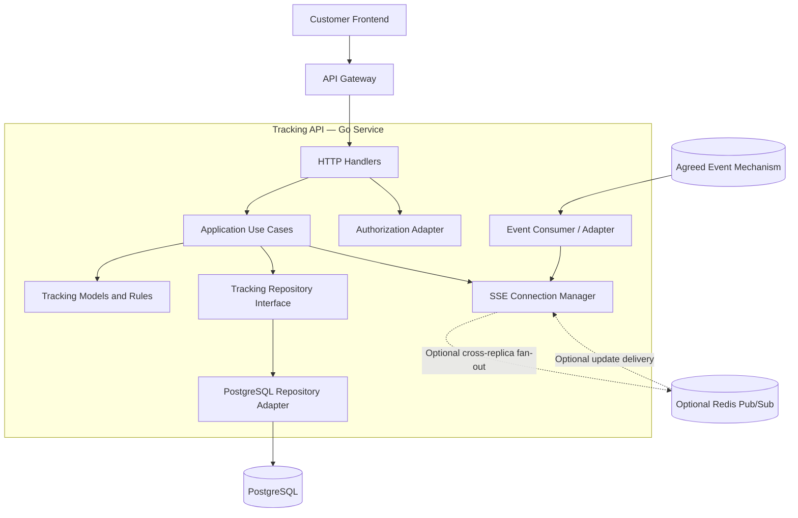
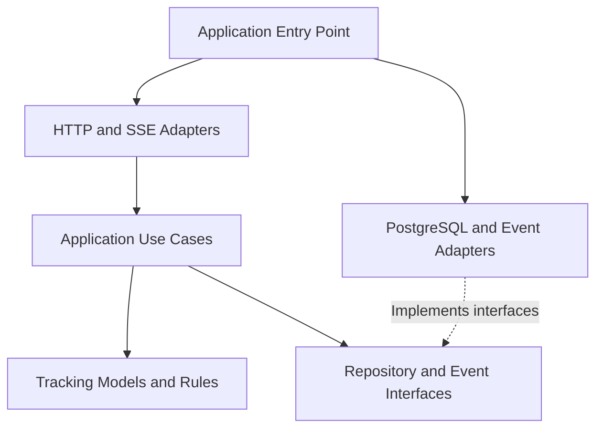

# Document 3 — Internal Architecture & Design Specification

**Project:** SwiftDrop — Parcel Delivery & Courier Management System  
**Module:** Tracking API & Real-Time Updates  
**Module Owner:** Member 5  
**Version:** 0.1 — Initial Draft  
**Status:** Draft for team review  
**Primary Technology:** Go, REST/JSON, Server-Sent Events (SSE), PostgreSQL  
**Related Documents:** Documents 1 and 2, SwiftDrop SRS, Engineering Standards & Best Practices, Team Work Division

---

## 1. Purpose

This document defines the proposed internal architecture of the Tracking API, including its components, package structure, dependency rules, persistence strategy, event handling, and scaling considerations.

The Tracking API is a separately deployable, read-oriented service. It provides privacy-safe parcel tracking information and live updates without owning parcel creation or status transitions.

The architecture follows separation of concerns and Clean/Hexagonal Architecture principles, as recommended by the team's Engineering Standards.

## 2. Architectural Goals

The design aims to:

1. Keep HTTP handling separate from tracking business logic.
2. Read current tracking data from the authoritative PostgreSQL database.
3. Expose only approved public fields.
4. Enforce authorization for private tracking history.
5. Support live updates through SSE.
6. Allow independent deployment and scaling.
7. Make components easy to test without requiring every external dependency.
8. Keep database and event-infrastructure details isolated from the core application logic.
9. Handle connection loss, dependency failures, and duplicate events safely.

## 3. High-Level Architecture

The service is organized into an HTTP layer, an application layer, a tracking domain/model layer, and infrastructure adapters.

The HTTP layer receives requests. The application layer coordinates use cases. The domain/model layer defines tracking-specific rules and data structures. Infrastructure adapters implement database access and integration with the agreed event mechanism.

### 3.1 Component diagram



**Diagram notes:**

- PostgreSQL is the authoritative source of parcel and status-history data.
- The repository interface separates application logic from database implementation.
- The event adapter and SSE connection manager support live update delivery.
- Redis is optional and must not become the authoritative status store.
- The exact broker-to-consumer and cross-replica arrangement remains subject to team agreement.

## 4. Component Responsibilities

| Component | Responsibility |
|---|---|
| HTTP handlers | Parse requests, validate transport-level input, invoke use cases, and return HTTP responses. |
| Application use cases | Coordinate tracking lookup, history retrieval, authorization checks, and current-state retrieval. |
| Tracking models and rules | Represent tracking information and enforce tracking-specific response rules. |
| Repository interface | Define the data-reading operations required by application use cases. |
| PostgreSQL repository adapter | Execute queries against the approved shared schema and map results into application models. |
| Authorization adapter | Integrate with the agreed authentication and authorization mechanism for protected requests. |
| SSE connection manager | Manage active streams, send approved events, and handle disconnected clients. |
| Event adapter | Receive updates through the agreed event mechanism, validate them, and pass relevant notifications to the application/SSE layer. |
| Configuration | Load validated environment-based configuration without embedding secrets in source code. |
| Observability | Provide structured logs, health endpoints, and metrics for operational monitoring. |

The final component boundaries may be refined during implementation, but HTTP handlers should not contain database query logic or parcel lifecycle rules.

## 5. Proposed Go Package Structure

The following structure is a proposed starting point. It should be aligned with the actual repository conventions before files are created.

```text
tracking-api/
├── cmd/
│   └── tracking-api/
│       └── main.go
├── internal/
│   ├── config/
│   │   └── config.go
│   ├── tracking/
│   │   ├── model.go
│   │   ├── service.go
│   │   └── errors.go
│   ├── application/
│   │   ├── get_public_tracking.go
│   │   ├── get_tracking_history.go
│   │   └── tracking_updates.go
│   ├── ports/
│   │   ├── tracking_repository.go
│   │   └── event_source.go
│   ├── adapters/
│   │   ├── http/
│   │   │   ├── handlers.go
│   │   │   ├── routes.go
│   │   │   ├── dto.go
│   │   │   └── sse.go
│   │   ├── postgres/
│   │   │   └── tracking_repository.go
│   │   └── events/
│   │       └── consumer.go
│   └── observability/
│       ├── health.go
│       └── metrics.go
├── migrations/
├── tests/
├── Dockerfile
├── go.mod
├── go.sum
└── README.md
```

### 5.1 Package responsibilities

- `cmd/tracking-api`: Application entry point and dependency wiring.
- `internal/config`: Configuration loading and validation.
- `internal/tracking`: Tracking-specific models, rules, and domain errors.
- `internal/application`: Use cases that coordinate reads and update delivery.
- `internal/ports`: Interfaces defining the dependencies required by application logic.
- `internal/adapters/http`: REST endpoints, request/response DTOs, and SSE transport.
- `internal/adapters/postgres`: Database queries and row-to-model mapping.
- `internal/adapters/events`: Integration with the agreed event-delivery mechanism.
- `internal/observability`: Health checks and metrics.
- `tests`: Integration and end-to-end test support, where appropriate.
- `migrations`: Only tracking-owned migrations, if the team approves any tracking-specific tables. The shared parcel schema must not be duplicated.

The exact package boundaries can be simplified if the initial implementation is small. Avoid creating unnecessary abstractions that add complexity without improving testability or separation of concerns.

## 6. Dependency Direction

The architecture should follow these rules:

1. HTTP handlers may depend on application use cases.
2. Application use cases may depend on domain models and repository/event interfaces.
3. Infrastructure adapters implement interfaces defined by the application's required contracts.
4. Domain models must not import HTTP frameworks, database drivers, or RabbitMQ/Redis clients.
5. Database queries must remain inside the PostgreSQL adapter.
6. Authentication and authorization checks must not exist only in frontend code.
7. The SSE transport must not become the owner of parcel business rules.
8. The entry point is responsible for constructing and connecting dependencies.

### 6.1 Dependency diagram



The purpose of this dependency direction is to make business behavior testable without requiring a live database, broker, or HTTP server for every unit test.

## 7. Application Use Cases

### 7.1 Public tracking lookup

The public tracking use case:

1. Receives a validated tracking identifier.
2. Reads the current parcel and status information through the repository interface.
3. Handles an unknown parcel without exposing internal details.
4. Maps the result to a public tracking response DTO.
5. Returns only the approved public fields.

The use case must not return raw database records directly.

### 7.2 Authenticated tracking history

The history use case:

1. Receives the authenticated caller's identity and requested parcel reference.
2. Verifies that the caller is permitted to access that parcel.
3. Reads the permitted history from the repository.
4. Orders records using the agreed timestamp and tie-breaking rules.
5. Returns the history through an explicit response DTO.

The actual ownership query and authentication claims depend on the approved database and authentication contracts.

### 7.3 Live update delivery

The live-update flow:

1. Establishes an SSE connection for a valid tracking identifier.
2. Retrieves and sends the initial authoritative status.
3. Registers the connection with the SSE manager.
4. Receives relevant status-change notifications through the agreed event mechanism.
5. Reconciles notifications against authoritative data when required.
6. Sends approved tracking events to the appropriate active clients.
7. Removes disconnected clients and releases associated resources.

The event notification indicates that tracking information may have changed. It is not itself the authoritative status record.

## 8. Persistence Architecture

### 8.1 Read-only database access

The Tracking API should use a dedicated database role with read-only permissions over the approved parcel/status data it needs.

The repository adapter must:

- Use the approved table and column names from Member 2's schema.
- Use parameterized SQL queries.
- Select only the fields required for the use case.
- Avoid modifying parcel records or status history.
- Avoid creating a competing parcel/status schema.
- Return safe application errors rather than exposing raw database errors.
- Respect configured connection-pool limits.

The exact database username, schema, table names, indexes, and connection-pool values remain pending confirmation.

### 8.2 Data consistency

PostgreSQL remains the authoritative data store.

The application must not rely on an unapproved tracking projection or stale cache for the current status. If caching is introduced later, its freshness and invalidation rules must be explicitly agreed and tested.

For the initial implementation, the recommended approach is to read current status from PostgreSQL rather than introduce a separate status cache.

### 8.3 Transaction boundaries

The Tracking API is primarily read-only and should not create business transactions that mutate parcel status.

Status changes and their history records are committed by the relevant core domain modules. The Tracking API reads committed state and delivers the result.

The exact query transaction/isolation strategy can be selected during implementation based on the approved schema and consistency requirements.

## 9. Event Integration and SSE Design

### 9.1 Event adapter

The event adapter isolates the application from the specific broker or delivery mechanism. It should validate incoming event payloads and convert them into the internal representation required by the tracking application.

The final exchange, queue, routing key, event version, and payload must be confirmed with Member 8 before implementation is treated as final.

### 9.2 SSE connection manager

The SSE manager should:

- Track active connections by the agreed parcel/tracking identifier.
- Send only approved response fields.
- Support initial status delivery.
- Send periodic heartbeat comments.
- Remove disconnected clients and release resources.
- Apply bounded buffering or backpressure behavior so slow clients do not consume unbounded memory.
- Support graceful shutdown of active streams.
- Coordinate with the selected cross-replica fan-out mechanism if required.

The heartbeat interval, stream limits, and retry behavior are configurable operational decisions, not hard-coded business rules.

### 9.3 Multi-replica behavior

If multiple Tracking API replicas are running, a status notification received by one replica must reach relevant clients connected to other replicas.

The team must choose an explicit design, such as:

- A broker topology that independently delivers updates to each required replica; or
- A shared fan-out mechanism such as Redis Pub/Sub.

A shared work queue must not be assumed to broadcast every message to every replica. The chosen design must be documented and tested.

Redis is optional and is not the source of truth for parcel status.

## 10. Error Handling

The application should translate internal failures into safe, consistent errors.

| Failure | Proposed handling |
|---|---|
| Invalid tracking identifier | Return a validation error. |
| Unknown parcel | Return a safe not-found/unavailable response. |
| Unauthenticated protected request | Return HTTP 401. |
| Authenticated but unauthorized request | Return HTTP 403 or the agreed safe response. |
| Database unavailable | Return an appropriate service error, normally HTTP 503. |
| Rate limit exceeded | Return HTTP 429 where the gateway/API contract specifies it. |
| Invalid event payload | Reject or safely ignore the event and record a sanitized diagnostic. |
| SSE client disconnect | Release connection resources and allow reconnection. |
| Broker unavailable | Use the agreed recovery mechanism and reconcile from authoritative state; do not fabricate status updates. |

The final status codes and response body must follow the shared API error contract.

## 11. Design Patterns and Justification

### 11.1 Repository pattern

The repository interface isolates SQL and database-driver details from the application use cases.

**Benefit:** Application tests can use a fake repository, and the approved schema can evolve without spreading SQL through HTTP handlers.

### 11.2 Dependency injection

Dependencies such as repositories, event sources, and configuration are passed into application components rather than constructed inside business logic.

**Benefit:** The service is easier to test and configure.

### 11.3 Adapter pattern

HTTP, PostgreSQL, authentication, and event-system integrations are implemented as adapters around application-facing interfaces.

**Benefit:** Infrastructure changes remain localized.

### 11.4 Explicit DTO mapping

REST and SSE responses are mapped to dedicated data-transfer objects instead of serializing database rows directly.

**Benefit:** Public data minimization and API compatibility are easier to enforce.

These patterns are proposed implementation choices consistent with the team's separation-of-concerns guidance.

## 12. Alternatives Considered

| Alternative | Decision | Reason |
|---|---|---|
| Put tracking endpoints inside the Core API | Not selected by the current architecture baseline | A separate Tracking API can scale independently from core business operations. |
| Read parcel/status data from PostgreSQL | Selected | PostgreSQL is the authoritative data store. |
| Maintain a separate tracking database or projection | Not proposed initially | It adds consistency, synchronization, and operational complexity. |
| Use REST polling only | Fallback option | SSE is required by the current tracking requirements, with fallback after interruption. |
| Use SSE for browser updates | Proposed primary approach | Supports server-to-browser status updates over HTTP. |
| Use Redis for every deployment | Not required by default | Redis is only needed if the selected multi-replica fan-out design requires it. |
| Embed SQL inside HTTP handlers | Not selected | It couples transport handling to persistence and makes testing harder. |

The final event and fan-out choices must be confirmed with the responsible team members.

## 13. Scaling and Performance

The service should support read-heavy workloads and long-lived SSE connections without compromising the Core API.

Recommended considerations:

- Scale the Tracking API independently from the Core API.
- Configure bounded PostgreSQL connection pools.
- Avoid expensive unbounded history queries.
- Add indexes only after reviewing the approved schema and expected query patterns.
- Paginate history if the API contract permits large result sets.
- Apply public request rate limits and concurrent SSE connection limits.
- Use bounded buffers and cleanup for disconnected streams.
- Measure active SSE connections, request latency, database latency, errors, and event-delivery delay.
- Use the selected fan-out design when clients can be connected to different replicas.
- Avoid caching authoritative status until freshness and invalidation are explicitly defined.
- Validate resource and scaling settings through repeatable load tests.

Exact replica counts, CPU thresholds, connection limits, and performance targets belong in the deployment/operations documentation after agreement with Member 9.

## 14. Testing Strategy for the Architecture

The design should support:

- **Unit tests:** Application use cases with fake repository and event interfaces.
- **Repository integration tests:** Queries against a test PostgreSQL database using the approved schema.
- **HTTP tests:** Request validation, response DTOs, and error handling.
- **Authorization tests:** Private history access and parcel ownership.
- **SSE tests:** Initial status, heartbeat, event delivery, disconnection, and reconnect behavior.
- **Event tests:** Invalid payloads, duplicate notifications, and out-of-order events.
- **Fan-out tests:** Cross-replica delivery if a shared fan-out design is selected.
- **End-to-end tests:** Frontend-to-gateway-to-Tracking API tracking flow.

The exact fixtures and test environment will be specified in Document 6.

## 15. Unresolved Decisions

| Item | Status | Required action |
|---|---|---|
| Database tables and columns | Pending | Member 2 provides the approved schema. |
| Authentication interface | Pending | Confirm with Member 1. |
| RabbitMQ exchange, queue, routing key, and payload | Pending | Confirm with Member 8. |
| Redis or alternative fan-out topology | Pending | Agree with Members 8 and 9. |
| Final HTTP routes and gateway behavior | Pending | Confirm with Members 6, 7, and 9. |
| Database role and pool size | Pending | Coordinate with Members 2 and 9. |
| Package names and actual repository structure | Proposed | Align with the existing repository. |
| Performance and scaling limits | Pending | Validate through testing with Member 9. |

## 16. Definition of Done

The architecture specification is ready for approval when:

- Component responsibilities and dependency direction are clear.
- The Go package structure aligns with the repository conventions.
- Database access remains read-only and follows the approved schema.
- The SSE and event integration design is agreed.
- The chosen multi-replica fan-out mechanism is documented if required.
- Security, error handling, observability, and testing responsibilities are defined.
- Unresolved decisions have owners and follow-up actions.
- The implementation remains consistent with Documents 1 and 2 and the approved project requirements.

---

**End of Document 3 — Initial Draft**