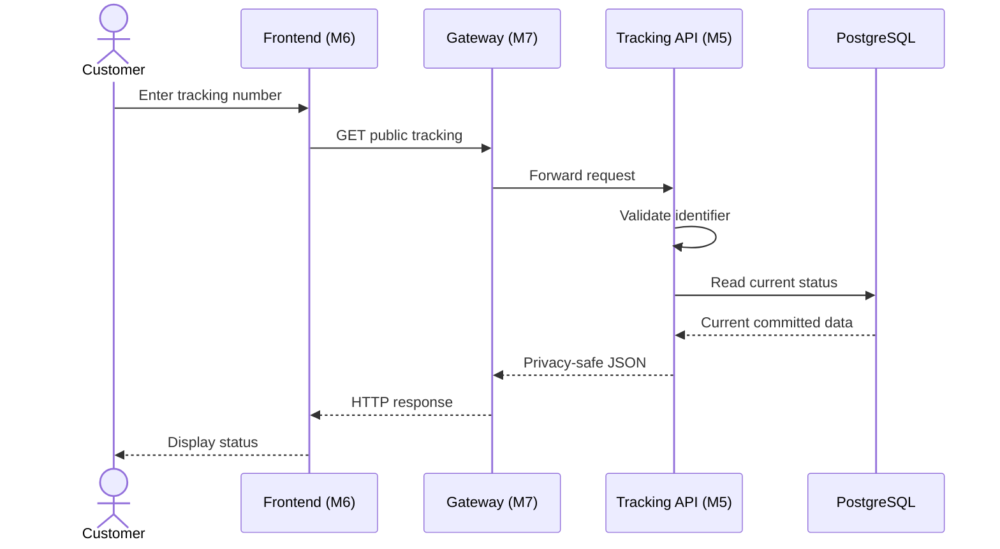
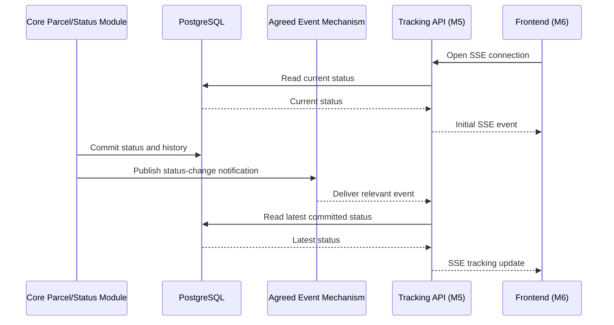

# Document 4 — Interface & Integration Contract

**Project:** SwiftDrop — Parcel Delivery & Courier Management System  
**Module:** Tracking API & Real-Time Updates  
**Module Owner:** Member 5  
**Version:** 0.1 — Initial Draft  
**Status:** Draft for team review  
**Primary Technology:** Go, REST/JSON, Server-Sent Events (SSE), PostgreSQL  
**Related Documents:** Documents 1, 2, and 3; SwiftDrop SRS; Engineering Standards & Best Practices; Team Work Division

---

## 1. Purpose

This document defines the proposed communication contracts between the Tracking API and its consumers and dependencies.

It describes:

- REST API endpoints, request parameters, and response formats.
- HTTP status codes and error responses.
- Authentication and authorization requirements.
- SSE connection behavior and event formats.
- Database access boundaries.
- Integration with the agreed event-delivery mechanism.
- Timeout, retry, duplicate-event, and failure behavior.
- API versioning and compatibility requirements.

This is an initial contract draft. Proposed routes and JSON examples must be aligned with the team's approved schemas and integration decisions before implementation is considered final.

## 2. Interface Overview

| Interface | Direction | Purpose |
|---|---|---|
| Public tracking lookup | Consumer → Tracking API | Retrieve privacy-safe current tracking information. |
| Authenticated tracking history | Customer frontend → Tracking API | Retrieve history for an authorized customer. |
| SSE tracking stream | Customer frontend → Tracking API | Receive live tracking updates. |
| PostgreSQL read access | Tracking API → PostgreSQL | Retrieve authoritative parcel and status-history data. |
| Authentication validation | Tracking API → agreed authentication mechanism, if required | Validate the caller and permissions. |
| Status-update events | Agreed event mechanism → Tracking API | Notify the service of relevant parcel status changes. |
| Gateway routing | API Gateway → Tracking API | Route external requests to the appropriate endpoint. |

## 3. REST API Conventions

### 3.1 Base path

The proposed API base path is:

`/api/v1`

The `/v1` segment identifies the API contract version. Gateway routing and the final external base URL must be confirmed with Member 7.

### 3.2 General conventions

- Use HTTP methods according to their intended semantics.
- Use JSON for ordinary REST request and response bodies.
- Use explicit response DTOs rather than returning database records directly.
- Validate incoming tracking identifiers and request parameters.
- Use consistent error responses.
- Do not expose SQL errors, stack traces, credentials, or internal infrastructure details.
- Return only approved public fields from public endpoints.
- Apply authentication and authorization to protected endpoints.
- Keep tracking endpoints read-only with respect to parcel business data.

## 4. Public Tracking Lookup

### 4.1 Endpoint

| Property | Proposed contract |
|---|---|
| Method | `GET` |
| Path | `/api/v1/tracking/public/{trackingNumber}` |
| Authentication | Public endpoint; no customer login required |
| Content type | `application/json` |
| Purpose | Retrieve the latest privacy-safe tracking summary |

The route is proposed and must be confirmed with Members 6, 7, and 9.

### 4.2 Path parameter

| Parameter | Type | Description |
|---|---|---|
| `trackingNumber` | String | The parcel tracking identifier supplied by the customer. |

The actual identifier format and validation rules must follow the approved domain schema and business rules.

### 4.3 Proposed successful response

HTTP status: `200 OK`

```json
{
  "trackingNumber": "SWD-EXAMPLE-001",
  "status": "IN_TRANSIT",
  "lastUpdatedAt": "2026-10-24T10:30:00Z",
  "history": [
    {
      "status": "PICKED_UP",
      "timestamp": "2026-10-23T08:15:00Z"
    },
    {
      "status": "IN_TRANSIT",
      "timestamp": "2026-10-24T10:30:00Z"
    }
  ]
}
```

**Example only:** The field names, status values, timestamp semantics, and inclusion of history in the lookup response are proposed. They must be aligned with Member 2's approved schema and the team's public disclosure policy.

The API must not return full addresses, phone numbers, merchant secrets, credentials, or other unapproved private information.

### 4.4 Proposed behavior

1. Validate the tracking identifier.
2. Retrieve the parcel and latest committed status from the authoritative data source.
3. Select only the approved public fields.
4. Return the response using the agreed DTO.
5. Return a safe error if the identifier is invalid, the parcel is unavailable, or a dependency fails.

## 5. Authenticated Tracking History

### 5.1 Endpoint

The exact path remains **pending team agreement**.

A possible proposal is:

`GET /api/v1/tracking/{trackingNumber}/history`

This path must not be treated as final until it is agreed with the frontend, authentication, and gateway owners.

### 5.2 Authentication and authorization

- The endpoint requires the agreed authentication mechanism.
- The Tracking API must validate the caller's identity.
- The API must verify that the caller is authorized to access the requested parcel.
- A tracking number alone is not proof of ownership.
- The API must not rely solely on frontend checks to protect history.

### 5.3 Proposed successful response

HTTP status: `200 OK`

```json
{
  "trackingNumber": "SWD-EXAMPLE-001",
  "history": [
    {
      "status": "PICKED_UP",
      "timestamp": "2026-10-23T08:15:00Z"
    },
    {
      "status": "IN_TRANSIT",
      "timestamp": "2026-10-24T10:30:00Z"
    }
  ]
}
```

This is an illustrative DTO. The final history fields, pagination behavior, ownership query, and response schema must be confirmed against the approved database and authentication contracts.

### 5.4 Expected status codes

| Status | Meaning |
|---|---|
| `200 OK` | History retrieved successfully. |
| `400 Bad Request` | Invalid request or tracking identifier format. |
| `401 Unauthorized` | Authentication is missing or invalid. |
| `403 Forbidden` | Caller is authenticated but is not permitted to access the parcel. |
| `404 Not Found` | Parcel or requested resource is unavailable under the agreed disclosure policy. |
| `429 Too Many Requests` | The request exceeds the agreed rate limit. |
| `503 Service Unavailable` | A required dependency is unavailable. |

The final error behavior must follow the shared API error contract.

## 6. SSE Live Tracking Stream

### 6.1 Endpoint

| Property | Proposed contract |
|---|---|
| Method | `GET` |
| Path | `/api/v1/tracking/public/{trackingNumber}/stream` |
| Authentication | Public stream; only approved public fields may be delivered |
| Response content type | `text/event-stream` |
| Connection type | Long-lived HTTP response |
| Purpose | Deliver current tracking status and subsequent updates |

The route is proposed and must be confirmed with Members 6, 7, and 9.

### 6.2 Connection behavior

1. The client opens the SSE endpoint.
2. The Tracking API validates the tracking identifier.
3. The API retrieves the current authoritative status.
4. The API sends an initial status event.
5. The connection remains open while the client is connected.
6. Relevant status updates are delivered through the agreed event mechanism.
7. Heartbeat comments keep the connection active when no status event occurs.
8. The server releases connection resources when the client disconnects.

The gateway must support streaming and disable response buffering for this route where supported.

### 6.3 Proposed SSE event format

```text
id: evt-example-001
event: tracking-update
data: {"trackingNumber":"SWD-EXAMPLE-001","status":"IN_TRANSIT","lastUpdatedAt":"2026-10-24T10:30:00Z"}

: keepalive
```

The example illustrates SSE framing. The actual event ID, event type, payload fields, and heartbeat interval require team agreement.

### 6.4 Proposed event payload

```json
{
  "trackingNumber": "SWD-EXAMPLE-001",
  "status": "IN_TRANSIT",
  "lastUpdatedAt": "2026-10-24T10:30:00Z"
}
```

The payload must contain only fields approved for public tracking. Internal event metadata must not be forwarded to customers unless explicitly approved.

### 6.5 Reconnection behavior

- The client should use the agreed SSE reconnection strategy.
- Event IDs may support resumption where the event-delivery design can guarantee the required semantics.
- The client must retrieve the latest authoritative status after reconnecting or detecting a possible missed update.
- The API must not assume that a reconnecting client received every previous event.
- If SSE remains unavailable, the frontend may use the agreed REST polling fallback with appropriate limits.
- The server must clean up disconnected clients and release resources.

## 7. HTTP Error Contract

The following is a proposed error envelope for review against the shared Engineering Standards.

### 7.1 Example error response

```json
{
  "error": {
    "code": "TRACKING_NOT_FOUND",
    "message": "Tracking information is unavailable.",
    "requestId": "req-example-001"
  }
}
```

### 7.2 Error definitions

| HTTP status | Proposed error code | Description |
|---|---|---|
| `400` | `INVALID_TRACKING_NUMBER` | Tracking identifier or request format is invalid. |
| `401` | `UNAUTHENTICATED` | Authentication is missing or invalid for a protected endpoint. |
| `403` | `ACCESS_DENIED` | Caller lacks permission to access the requested history. |
| `404` | `TRACKING_NOT_FOUND` | Tracking information is unavailable. |
| `429` | `RATE_LIMIT_EXCEEDED` | Request limit has been exceeded. |
| `500` | `INTERNAL_ERROR` | Unexpected internal error. |
| `503` | `DEPENDENCY_UNAVAILABLE` | A required dependency is unavailable. |

These codes are proposed examples, not confirmed shared error codes.

The final contract must use the team's agreed error envelope and preserve privacy when distinguishing unknown parcels from unauthorized access.

## 8. Authentication and Authorization Matrix

| Interface | Authentication | Authorization requirement |
|---|---|---|
| Public tracking lookup | Not required, subject to the public access policy | Return approved public fields only. |
| Public SSE stream | Not required, subject to the public access policy | Return approved public fields only. |
| Authenticated history | Required | Verify permission to access the requested parcel. |
| Health endpoints | Depends on internal deployment policy | Must not expose sensitive diagnostics publicly. |
| Metrics endpoint | Depends on monitoring/network policy | Should be restricted to approved monitoring access. |
| PostgreSQL connection | Service credential required | Read-only permissions for approved tracking data. |
| Event consumer | Broker authentication required where applicable | Consume only the agreed event stream. |

The exact authentication mechanism, token claims, database credentials, and broker permissions must follow the team's shared security and infrastructure contracts.

## 9. Event Integration Contract

### 9.1 Direction

The Tracking API consumes relevant parcel status-update notifications from the agreed event-delivery mechanism.

The API does not own parcel status changes and must not publish an event that falsely claims to have performed a business status transition.

### 9.2 Event contract requirements

The final event schema should define, as applicable:

- Event identifier.
- Event type and schema version.
- Parcel or tracking identifier.
- New status or indication that the status changed.
- Authoritative event timestamp.
- Correlation or tracing identifier where required.
- Rules for duplicate and out-of-order delivery.

### 9.3 Illustrative event payload

```json
{
  "eventId": "evt-example-001",
  "eventType": "parcel.status.updated",
  "schemaVersion": 1,
  "trackingNumber": "SWD-EXAMPLE-001",
  "occurredAt": "2026-10-24T10:30:00Z",
  "status": "IN_TRANSIT"
}
```

This is an illustrative proposal only. The actual event envelope, field names, event versioning, exchange, queue, and routing key must be provided or approved by Member 8.

### 9.4 Event processing rules

- Validate incoming events against the agreed schema.
- Handle duplicate delivery safely.
- Do not assume that event arrival order always equals status-change order.
- Reconcile against authoritative PostgreSQL data when necessary.
- Avoid delivering an older status as if it were the latest state.
- Do not expose internal event metadata to public clients.
- Use the agreed retry, acknowledgement, and dead-letter behavior for broker failures.
- Ensure that updates reach relevant clients across replicas using the selected fan-out design.

The exact broker acknowledgement and retry behavior remains pending confirmation with Member 8.

## 10. Database Access Contract

The Tracking API uses PostgreSQL as the authoritative source of parcel and status-history information.

### 10.1 Rules

- Use the approved shared schema from Member 2.
- Use a dedicated read-only database role.
- Execute parameterized queries.
- Retrieve only fields needed by the tracking use case.
- Do not mutate parcel or status-history records.
- Do not introduce a duplicate source of truth.
- Apply the approved database connection-pool limits.
- Return safe application errors when database access fails.

### 10.2 Pending database details

The following must be confirmed before the database contract is finalized:

- Actual parcel and history table names.
- Actual column names and relationships.
- Tracking-number uniqueness and lookup index.
- Authoritative status timestamp and history ordering.
- Read-only database role name.
- Connection-pool limits.
- Query timeout and transaction requirements.

## 11. Timeout, Retry, and Failure Behavior

| Operation | Proposed behavior |
|---|---|
| REST database read | Apply a bounded configurable query/operation timeout. |
| SSE connection | Allow long-lived streaming; use compatible heartbeat and gateway timeout settings. |
| SSE disconnect | Clean up resources and allow client reconnection. |
| Database failure | Return a safe dependency error; do not invent tracking data. |
| Event delivery failure | Follow the agreed broker retry/recovery policy and reconcile from authoritative state. |
| Duplicate event | Detect where possible and avoid unnecessary duplicate updates. |
| Out-of-order event | Reconcile with authoritative status before sending an update. |
| Rate limit exceeded | Return the agreed rate-limit response. |
| Shutdown or deployment | Stop accepting new work as appropriate, clean up connections, and allow clients to reconnect. |

Specific timeout values, retry intervals, and event acknowledgement rules must be finalized with the gateway, database, and event-system owners.

## 12. API Versioning and Compatibility

The proposed REST base path is `/api/v1`.

The following rules apply:

- Existing response fields should not be removed or change meaning without coordinated review.
- New optional response fields may be introduced when compatible with existing consumers.
- Breaking API changes require an agreed versioning and migration strategy.
- Event payloads should include a schema version if required by the shared event contract.
- Producers and consumers must agree on event compatibility before deploying incompatible changes.
- Frontend, gateway, and service documentation must be updated together for contract changes.

The team must follow any more specific versioning rules in the shared Engineering Standards.

## 13. Integration Sequence Diagrams

### 13.1 Public tracking lookup



### 13.2 Live update integration



The second diagram shows a proposed integration flow. The exact event-delivery topology must be aligned with Member 8's contract.

## 14. Contract Testing Requirements

The following tests should verify the published interfaces:

- Public tracking returns only approved fields.
- Invalid and unknown tracking identifiers return the agreed safe errors.
- Authenticated history rejects unauthenticated requests.
- Authenticated users cannot retrieve unauthorized parcel history.
- REST responses conform to the documented JSON schema.
- SSE uses the correct content type and event framing.
- Initial SSE status reflects authoritative data.
- Heartbeats do not appear as parcel status changes.
- Reconnection retrieves the latest authoritative status.
- Duplicate and out-of-order events do not produce incorrect current status.
- Database and broker failures follow the documented error/recovery behavior.
- Cross-replica delivery works if a shared fan-out mechanism is selected.

## 15. Unresolved Decisions and Owners

| Decision | Owner to coordinate with | Status |
|---|---|---|
| Approved parcel/status schema | Member 2 | Pending |
| Authentication and ownership contract | Member 1 | Pending |
| Frontend routes and DTO expectations | Member 6 | Pending |
| Gateway routing and SSE configuration | Member 7 | Pending |
| Event schema, exchange, queue, and routing key | Member 8 | Pending |
| Deployment, health paths, secrets, and pool limits | Member 9 and relevant database owner | Pending |
| Public tracking disclosure fields | Team's approved privacy/security policy owners | Pending |
| Final API error envelope | Shared engineering/API standards owners | Pending |

## 16. Definition of Done

This document is ready for approval when:

- REST paths and DTOs are agreed with consumers.
- Authentication and authorization requirements are confirmed.
- The public field matrix is approved.
- SSE route, event format, heartbeat, and reconnect behavior are agreed.
- The event integration contract is confirmed by the responsible owner.
- Database access rules match the approved schema.
- Error responses, timeouts, retries, and versioning are documented.
- Contract tests cover success, failure, privacy, authorization, and reconnection.
- All unresolved decisions have been assigned to the appropriate owners.

---

**End of Document 4 — Initial Draft**