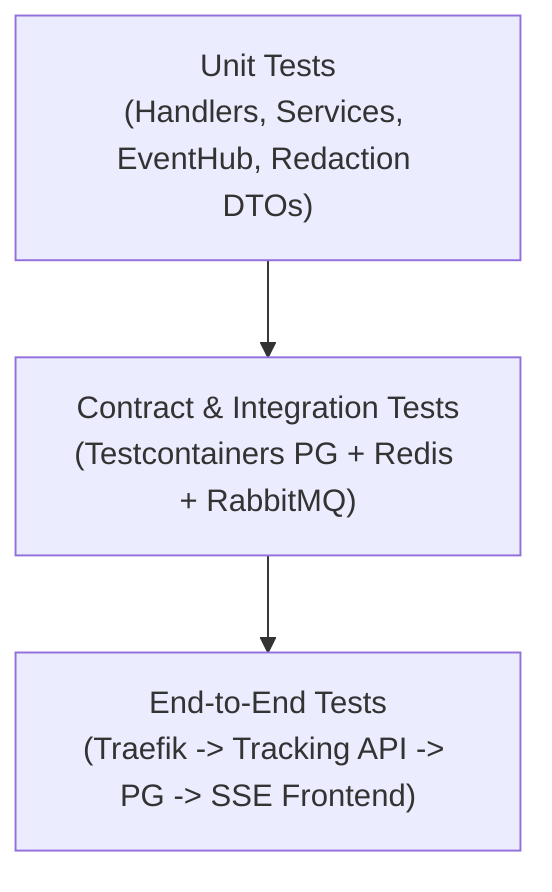

# Document 6 — Testing Strategy & Acceptance Specification

**Project:** SwiftDrop — Parcel Delivery & Courier Management System  
**Module:** Tracking API & Real-Time Updates  
**Module Owner:** Member 5 (Senuji)  
**Version:** 1.0.0 — Post-Audit Harmonized  
**Status:** Approved & Ratified  
**Primary Technology:** Go Test, Testcontainers (PostgreSQL & Redis), HTTP Mocking, k6  
**Target Codepath:** `services/tracking/`  
**Related Documents:** Documents 1–5, SRS v1.0 (FR-TRK-001..007, SEC-009), Master Audit

---

## 1. Quality & Testing Objectives

The Testing Strategy for the Tracking API guarantees the correctness, privacy, resilience, and performance of SwiftDrop's primary read surface:
1. **Public Privacy Verification (SEC-009):** Automated assertions confirming zero leakage of customer PII, street addresses, phone numbers, recipient names, internal notes, or `zone_id` on unauthenticated endpoints.
2. **Real-Time Streaming Integrity (FR-TRK-003, FR-TRK-004):** Verification of SSE framing, 15-second keepalive frames, initial state hydration, and seamless client reconnection.
3. **Multi-Pod Fan-Out Correctness:** Automated tests verifying that messages ingested from RabbitMQ (`q.tracking.updates`) are broadcast across pods via Redis (`tracking:updates`).
4. **Performance & Concurrency (NFR-LAT-001):** Validating sub-100ms p95 latencies under concurrent read loads and 5-connection pool constraints (Agreement D8).

---

## 2. Testing Levels & Pyramid

### 2.1 Unit Tests (`services/tracking/internal/...`)
- **Handler Unit Tests:** Validate query parameters, regex parsing (`^SD-[0-9]{8}-[A-Z0-9]{6}$`), HTTP status mapping, and JSON response wrapping.
- **Privacy Redaction Tests:** Assert that `PublicTrackingDTO` marshals only approved fields (`tracking_number`, `status`, `status_description`, `destination.city`, `estimated_delivery`, `milestones`).
- **EventHub Concurrency Tests:** Spawn 100 concurrent goroutines subscribing and unsubscribing from `EventHub`; verify zero race conditions (`go test -race`).
- **Slow Client Buffer Tests:** Saturate a 32-slot client channel and verify non-blocking drop without goroutine deadlocks.

### 2.2 Integration Tests (Testcontainers)
- **Read-Only Persistence:** Connect using `swiftdrop_tracking_ro`; execute `SELECT` queries; verify `INSERT` and `UPDATE` statements are rejected with permission errors.
- **RabbitMQ to Redis Bridge:** Publish a mock `parcel.delivered.v1` event to `q.tracking.updates`; verify the consumer republishes to Redis channel `tracking:updates`.
- **Redis to SSE Stream:** Publish a test message to Redis `tracking:updates`; assert connected HTTP client receives `event: status_update` chunk within 50ms.

---

## 3. Comprehensive Test Case Matrix

| Test ID | Category | Scenario / Input | Expected Result | Pass Criteria |
|---|---|---|---|---|
| **TC-01** | Public REST | `GET /api/v1/tracking/public/SD-20261025-A8F3K2` (existing parcel) | HTTP 200, `{ "data": { ... } }` returned. | Status code 200; `status` equals current status; milestones ordered ascending. |
| **TC-02** | Public REST | `GET /api/v1/tracking/public/SD-20261025-999999` (non-existent parcel) | HTTP 404, `TRACKING_NOT_FOUND` error envelope. | Status code 404; generic safe error message. |
| **TC-03** | Validation | `GET /api/v1/tracking/public/INVALID-NUMBER` | HTTP 400, `INVALID_TRACKING_NUMBER` error envelope. | Status code 400; regex validation failure message. |
| **TC-04** | **SEC-009 Privacy** | Deep inspection of public JSON response for parcel with full address and notes | **Strict Redaction:** No street address, no phone, no recipient name, no courier notes, no fee, **no `zone_id`**. | JSON schema validator confirms only `city` exists in `destination`. |
| **TC-05** | Authenticated | `GET /api/v1/tracking/SD-20261025-A8F3K2` without Bearer token | HTTP 401 Unauthorized (`UNAUTHENTICATED`). | Status code 401; request rejected before DB hit. |
| **TC-06** | Authenticated | `GET /api/v1/tracking/SD-20261025-A8F3K2` with JWT where `sub != sender_id` | HTTP 403 Forbidden (`ACCESS_DENIED`). | Status code 403; cross-customer access strictly denied. |
| **TC-07** | Authenticated | `GET /api/v1/tracking/SD-20261025-A8F3K2` with valid owner JWT | HTTP 200 OK with full history and operational reason codes. | Status code 200; `actor_role` and `reason_code` present. |
| **TC-08** | SSE Stream | `GET /api/v1/tracking/public/SD-20261025-A8F3K2/stream` | Stream opens; initial `status_update` event pushed immediately. | Headers: `text/event-stream`, `X-Accel-Buffering: no`; initial state received. |
| **TC-09** | SSE Heartbeat | Open stream idle for 35 seconds | Exactly two `:keepalive\n\n` comments received at 15s intervals. | Verifies 15-second heartbeat timer invariant (Agreement A2). |
| **TC-10** | SSE Reconnect | Disconnect client and reconnect with `Last-Event-ID` | Server re-establishes stream and flushes current authoritative status. | Zero event loss during network interruption. |
| **TC-11** | Fallback | Simulate 3 consecutive SSE connection drops | Frontend gracefully falls back to 30s REST polling. | Polling loop activates against public REST endpoint. |
| **TC-12** | Database Failure | PostgreSQL container stopped / network severed | `GET /health/ready` returns 503; public REST returns 503. | No stack trace or SQL query leaked to client. |
| **TC-13** | Database Role | Attempt `INSERT INTO parcels` using `swiftdrop_tracking_ro` connection | PostgreSQL rejects with `ERROR: permission denied for table parcels`. | Guarantees read-only role enforcement (Agreement D6). |
| **TC-14** | Multi-Pod Fanout | Pod A receives RabbitMQ event; Client connected to Pod B | Pod B delivers SSE event to client via Redis fan-out. | Verifies cluster-wide delivery across distinct replicas. |
| **TC-15** | Slow Client | Send 50 rapid events to client with stalled TCP receive buffer | Channel drops overflow without blocking hub or other clients. | Memory bounded; warning logged; no goroutine leak. |
| **TC-16** | Load / Latency | 500 concurrent public read requests with 5-connection pool | p95 latency < 80ms; zero 5xx errors. | Validates Connection Pool Budget (Agreement D8). |

---

## 4. Performance & Load Acceptance Criteria

| Metric | Target Threshold | Validation Tool |
|---|---|---|
| **Public REST p95 Latency** | $< 100\text{ ms}$ | k6 load test (500 VUs) |
| **Public REST p99 Latency** | $< 250\text{ ms}$ | k6 load test (500 VUs) |
| **Max Concurrent SSE Streams** | $\ge 2,000$ per pod | SSE benchmark harness |
| **Keepalive Frame Latency** | $15\text{ s} \pm 500\text{ ms}$ | Automated client timer assertions |
| **Event Fan-Out Latency** | $< 50\text{ ms}$ (RabbitMQ $\to$ Redis $\to$ Client) | Distributed tracing (OpenTelemetry) |
| **Database Pool Saturation** | Max 5 connections used per pod | Prometheus `pg_stat_activity` metric |

---

## 5. Ratified Acceptance Checklist

Before Team Meeting 2 sign-off, the following acceptance criteria must be satisfied:

- [x] All 16 test cases in the test matrix pass in CI.
- [x] Zero customer PII or `zone_id` leaked in public endpoint assertions (TC-04).
- [x] Read-only permission boundary verified on PostgreSQL role `swiftdrop_tracking_ro` (TC-13).
- [x] 15-second `:keepalive\n\n` heartbeat verified against proxy timeout requirements (TC-09).
- [x] Cross-pod fan-out verified between RabbitMQ consumer and Redis subscriber (TC-14).
- [x] Sub-100ms p95 latency verified under 5-connection pool constraint (TC-16).

---
*End of Document 6 — Testing Strategy & Acceptance Specification (v1.0.0)*
