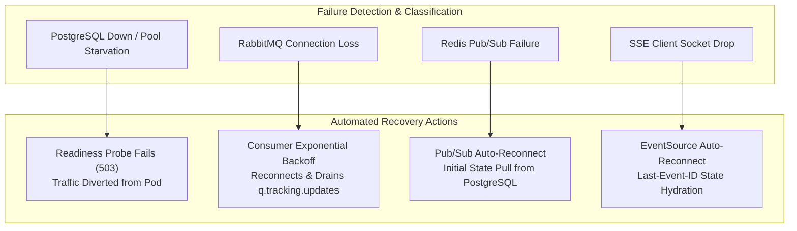

# Document 7 — Security, Failure & Recovery Specification

**Project:** SwiftDrop — Parcel Delivery & Courier Management System  
**Module:** Tracking API & Real-Time Updates  
**Module Owner:** Member 5 (Senuji)  
**Version:** 1.0.0 — Post-Audit Harmonized  
**Status:** Approved & Ratified  
**Primary Technology:** Go 1.22+, JWT (RS256), PostgreSQL, Redis, RabbitMQ  
**Target Codepath:** `services/tracking/`  
**Related Documents:** Documents 1–6, SRS v1.0 (SEC-007, SEC-009), Master Audit

---

## 1. Security & Privacy Philosophy

The Tracking API is the most widely accessible public-facing surface in the SwiftDrop ecosystem. It must balance frictionless customer access with uncompromising data privacy:
1. **Strict Public Data Minimization (SEC-009):** Anyone holding a tracking number (`SD-YYYYMMDD-XXXXXX`) may check delivery progress. However, unauthenticated access must **NEVER** expose the recipient's personal identity, phone number, physical street address, internal delivery notes, or operational routing zone IDs.
2. **Zero-Trust Persistence:** The service connects to PostgreSQL with an unprivileged, read-only role (`swiftdrop_tracking_ro`). Even in the event of an application remote code execution (RCE) flaw, database writes or schema modifications are physically impossible.
3. **Defense-in-Depth Rate Limiting (SEC-007):** Protection against automated scraping and denial-of-service via coordinated Traefik gateway and in-service rate limiters.

---

## 2. Strict Public Privacy & PII Redaction Standards (SEC-009)

> **SRS Requirement SEC-009:** *"Public tracking endpoints must enforce strict data minimization, redacting all personally identifiable information (PII) including recipient name, street address, contact phone number, and courier operational notes."*

### 2.1 The Redaction Matrix

| Data Field | Public Endpoint (`/tracking/public/...`) | Authenticated Endpoint (`/tracking/{id}`) | Rationale |
|---|:---:|:---:|---|
| Tracking Number (`tracking_number`) | **Allowed** | **Allowed** | Public identifier required for lookup. |
| Current Status (`status`) | **Allowed** | **Allowed** | Core business tracking state. |
| Status Description (`status_description`)| **Allowed** | **Allowed** | User-friendly milestone description. |
| Destination City (`destination.city`) | **Allowed** | **Allowed** | General geographic progress indicator. |
| Estimated Delivery (`estimated_delivery`)| **Allowed** | **Allowed** | Delivery window expectation. |
| Milestone Timestamps (`timestamp`) | **Allowed** | **Allowed** | Chronological timeline progress. |
| Destination Zone (`zone_id`) | **STRICTLY REDACTED** | Allowed | Internal routing topology; no customer utility. |
| Recipient Full Street Address | **STRICTLY REDACTED** | Allowed (Owner) | Prevents physical stalking and address harvesting. |
| Recipient Phone / Email | **STRICTLY REDACTED** | Allowed (Owner) | Prevents smishing, phishing, and identity theft. |
| Recipient Personal Name | **STRICTLY REDACTED** | Allowed (Owner) | Protects customer anonymity. |
| Sender Personal Name / Address | **STRICTLY REDACTED** | Allowed (Owner) | Protects sender privacy. |
| Commercial Billing (`fee_cents`) | **STRICTLY REDACTED** | Allowed (Merchant)| Commercial confidentiality between merchant and carrier. |
| Internal Operational Notes (`note`) | **STRICTLY REDACTED** | Allowed (Owner) | Free-text courier remarks may contain gate codes or PII. |
| Proof-of-Delivery Photo / Signature | **STRICTLY REDACTED** | Allowed (Owner) | Biometric and property privacy protection. |
| Courier Employee ID / Driver Phone | **STRICTLY REDACTED** | Allowed (Internal)| Protects courier personnel safety. |

### 2.2 Public DTO Enforcement in Go

Redaction is enforced by Go struct type design rather than dynamic field filtering, guaranteeing compile-time safety:

```go
// PublicTrackingDTO strictly exposes only SEC-009 approved fields
type PublicTrackingDTO struct {
    TrackingNumber    string           `json:"tracking_number"`
    Status            string           `json:"status"`
    StatusDescription string           `json:"status_description"`
    Destination       PublicLocationDTO `json:"destination"`
    EstimatedDelivery *time.Time       `json:"estimated_delivery,omitempty"`
    Milestones        []PublicMilestone `json:"milestones"`
}

type PublicLocationDTO struct {
    City string `json:"city"` // SEC-009: ONLY city is exposed publicly (no zone_id, no street)
}
```

---

## 3. Authentication & Multi-Tenant Authorization

### 3.1 Token Validation (RS256)
- Authenticated endpoints (`GET /api/v1/tracking/{tracking_number}`) require a standard Bearer JWT.
- Tokens are verified using the RSA public key (`JWT_PUBLIC_KEY_PEM`) issued by Identity Service (Member 1).
- Symmetric secret keys (`HS256`) are rejected.

### 3.2 Ownership Claim Verification
- **Customer Check:** The token's `sub` claim (User ID) must match `parcels.sender_id`.
- **Merchant Check:** The token's `tenant_id` claim must match `parcels.merchant_id`.
- **Role Override:** Users with `ADMIN` or `DISPATCHER` roles in `role` claim may view any parcel history.
- **Access Violation:** If a caller attempts to view a parcel they do not own, the service returns `403 Forbidden` (`ACCESS_DENIED`). It does **not** disclose whether the parcel exists.

---

## 4. Failure Scenarios & Recovery Runbook



### 4.1 Scenario 1: PostgreSQL Down or Connection Pool Exhausted
- **Detection:** `db.PingContext(ctx)` fails during query execution or `/health/ready` check.
- **Immediate Response:**
  - `/health/ready` probe immediately returns `503 Service Unavailable`.
  - Kubernetes stops routing new traffic to the affected pod.
  - Active requests receive safe JSON error: `{"error":{"code":"DEPENDENCY_UNAVAILABLE","message":"Tracking data temporarily unavailable.","details":[]}}`.
  - Zero SQL queries, database hostnames, or credentials appear in client responses.
- **Recovery:** When PostgreSQL recovers, `pgx/v5` automatically re-establishes pool connections. The `/health/ready` probe returns `200 OK`, and Kubernetes restores the pod to the service endpoint.

### 4.2 Scenario 2: RabbitMQ Broker Interruption
- **Detection:** AMQP channel or connection error on `q.tracking.updates`.
- **Immediate Response:**
  - Consumer enters exponential reconnect loop (1s, 2s, 4s, up to 30s max).
  - Existing SSE connections remain open and continue emitting 15s `:keepalive\n\n` frames.
- **Recovery:** Upon reconnection, the consumer resumes message processing. Any status changes committed during the outage are fetched directly from PostgreSQL by newly connected or reconnecting SSE clients.

### 4.3 Scenario 3: Redis Pub/Sub Failure
- **Detection:** `redisClient.Subscribe()` context cancels or returns socket error.
- **Immediate Response:**
  - `go-redis/v9` automatically handles pub/sub reconnection in the background.
  - New SSE connections continue serving initial state from PostgreSQL.
- **Recovery:** Once Redis connectivity is restored, the `tracking:updates` subscription automatically resumes broadcasting live events.

### 4.4 Scenario 4: Client Connection Disconnection
- **Detection:** `r.Context().Done()` fires on active SSE connection handler.
- **Immediate Response:**
  - Handler immediately halts the 15-second keepalive ticker.
  - Handler unsubscribes the client channel from `EventHub`.
  - Bounded memory channel is closed and garbage collected.
- **Recovery:** Client reconnects via native `EventSource` with `Last-Event-ID`. Server responds with updated authoritative status.

---

## 5. Security & Rate Limiting Controls (SEC-007)

1. **Gateway Rate Limiting:** Traefik limits public tracking endpoints to **10 requests/second with a burst of 20 per IP**.
2. **Concurrent Connection Cap:** Each `tracking-api` pod enforces an internal limit of **5,000 concurrent SSE connections**. Requests exceeding this threshold receive `429 Too Many Requests` (`RATE_LIMIT_EXCEEDED`).
3. **Slow Client Protection:** Channels in `EventHub` have a fixed capacity of **32 slots**. Stalled clients drop events without blocking the shared event bus.
4. **Statement Timeout:** Database queries execute under a hard **3000ms timeout** (`statement_timeout = '3000ms'`), preventing Denial-of-Service via expensive table scans.

---

## 6. Ratified Security & Recovery Decisions Table

| Security Item | Ratified Resolution | Reference |
|---|---|---|
| **Privacy Standard** | **SEC-009** (City only; street, phone, notes, fee, zone strictly redacted) | Master Audit |
| **Database Role** | `swiftdrop_tracking_ro` with zero write/DDL privileges | Agreement D6 |
| **Max Open DB Pool** | 5 connections per pod | Agreement D8 |
| **JWT Algorithm** | RS256 with public key verification (`JWT_PUBLIC_KEY_PEM`) | ADR-003 |
| **Public Rate Limit** | 10 req/s, burst 20 per IP via Traefik | SEC-007 |
| **SSE Heartbeat** | 15s comment frame (`:keepalive\n\n`) | Agreement A2 |
| **Health Probes** | `/health/live`, `/health/ready`, `/metrics` | Agreement A2 |

---
*End of Document 7 — Security, Failure & Recovery Specification (v1.0.0)*