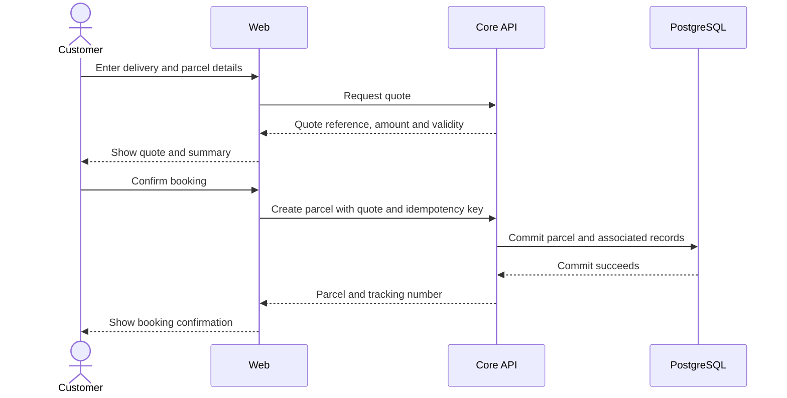
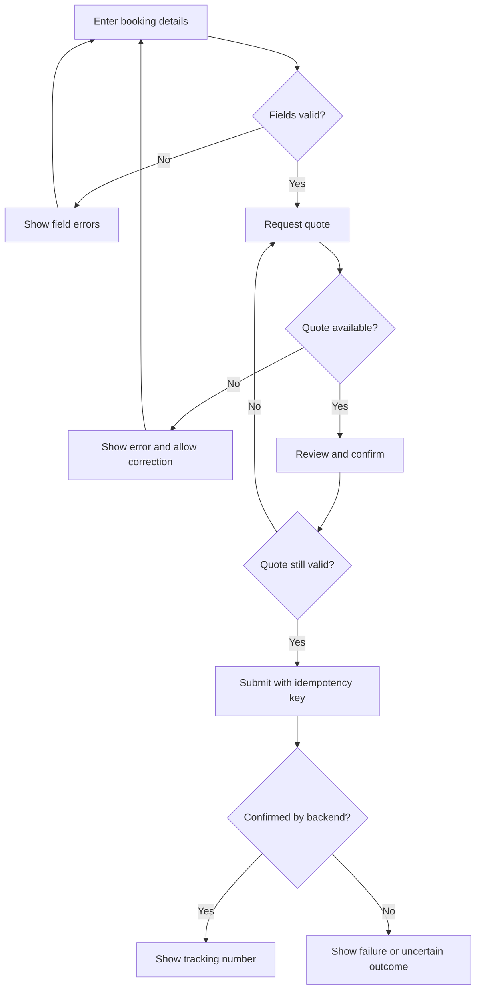

# Customer and Merchant Frontend: Functional Flows

Owner: Sajini, Member 6  
Date: 24 October 2026  
Status: Planned workflows; not a report of completed features

## Registration and login

The user opens the shared login screen or the registration screen. I collect the required fields and show basic form errors before submission. The backend validates the request and returns either a usable authenticated context or a safe error. After login, the shared router sends customers and merchants to the portal and operational roles to their agreed routes.

For Google sign-in, the browser starts the backend-controlled Google flow. The backend validates the identity-provider response. I will not put the Google client secret in frontend code or treat URL parameters as proof of authentication. The callback route and how the application obtains its access token still need agreement with M1.

If login fails, the screen shows a generic message. If a protected request returns 401, the shared client attempts the agreed refresh flow once. If refresh fails, I clear the authenticated frontend state and ask the user to sign in again.

## Customer booking

Actor: signed-in customer. Merchant booking uses the merchant-authorized contract.  
Preconditions: an active account, supported delivery zones and an available pricing API.

1. The user enters pickup and delivery contacts and addresses.
2. The user enters parcel weight, dimensions and the supported service option.
3. I validate required fields and formats and request a quote from M2's API.
4. I display the returned amount, currency and any quote expiry.
5. The user checks the summary and confirms.
6. I send the booking with its quote reference and one idempotency key for that submission.
7. The backend returns the accepted parcel and tracking number.
8. I display confirmation and links to tracking, history and the receipt where available.

Postcondition: the screen shows a booking confirmed by the backend. A pending request alone is not a confirmed booking.

### Alternate and failure flows

| Situation | Frontend behavior |
| --- | --- |
| Missing or invalid field | Show the field error and keep entered values |
| Unsupported zone/weight | Show the backend validation message; do not confirm |
| Quote inputs change | Invalidate the displayed quote and request a new one |
| Quote expires | Require a fresh quote and user confirmation |
| User double-clicks | Disable duplicate submission while pending |
| Request times out | Explain that the outcome is uncertain; retry the same payload with the same key |
| Payload is edited after failure | Treat it as a new submission with a new key and fresh quote where needed |
| Conflict | Display the safe conflict message and follow the backend contract |

The backend still enforces uniqueness and idempotency; disabling a button is only a usability measure.

## Tracking

A public visitor opens `/track/:trackingNumber`. I fetch the privacy-safe tracking response, show the current status and timeline, and subscribe to the agreed SSE stream. On reconnect I fetch current state again. If streaming is unavailable, the page uses a bounded polling fallback agreed with M5. I close the connection and polling timer when the user leaves the page.

Unknown tracking numbers show a clear not-found state. Network failures show an unavailable state. I will not label a previous response as a live update after the connection fails.

The repository overview adds ASSIGNED, CANCELLED, ATTEMPT_FAILED and RETURNED to the earlier lifecycle. I will use the approved backend status contract and a shared display mapping. I will not create a second transition policy. An unfamiliar status must have a safe generic display rather than crashing the page.

## History and receipts

An authenticated customer opens their delivery list, chooses a parcel and views the permitted details/history. Lists use the API's pagination. The receipt action requests the authorized receipt endpoint. A missing receipt, denied request or download failure gets a visible message. I will not fabricate a receipt from an estimated quote.

## Merchant application and orders

A business submits the agreed application fields. The portal displays the backend approval state. Pending, rejected or disabled merchants receive the appropriate message and cannot use order creation when the backend denies it. Approved merchants can list and create their own orders. A tenant ID supplied by the browser is never sufficient authorization on its own.

Webhook settings use the merchant API only. I show saved settings after backend confirmation; M4 validates configuration and M8 handles delivery, signatures and retries.

## Booking interaction

## Booking screen decisions

