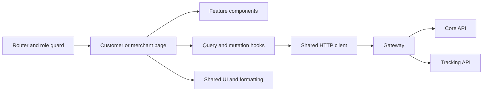

# Customer and Merchant Frontend: Architecture

Owner: Sajini, Member 6  
Date: 24 October 2026  
Status: Proposed implementation design

## Approach

I will build my screens inside the shared React single-page application. M7 and I will use the same application shell, authentication context and shared components. My feature code stays under `src/features/customer-merchant/`.

The stack is React, TypeScript, Vite, Tailwind CSS, TanStack Query and React Router. Exact dependency versions must be recorded in `package.json` and its lockfile when the workspace is created. I will agree on form/validation dependencies with M7 before adding them; Zod is included in the frontend testing plan but its installation is not verified.

## Proposed structure

```text
web/src/
  app/
    routes/
    providers/
    layouts/
    guards/
  shared/
    api/
    components/
    hooks/
    types/
    utils/
  features/customer-merchant/
    auth/
    booking/
    tracking/
    history/
    receipts/
    orders/
    settings/
```

The additional `auth`, `history` and `receipts` folders are proposals to make my required workflows explicit. I will coordinate shared login code with M7. Address-book and CSV-import folders can be added after scope agreement.

## Responsibilities inside the frontend

| Part | Responsibility |
| --- | --- |
| Page | Read route parameters and compose a workflow |
| Component | Render data and capture user input |
| Feature hook | Coordinate query/mutation state for the workflow |
| API function | Call a documented endpoint and normalize the response |
| Shared client | Base URL, auth headers, request errors and coordinated refresh |
| Query cache | Temporary server-data cache and invalidation |
| Auth provider | In-memory access token and current-user context |
| Utility | Formatting and other small pure operations |

I will keep form state local where possible. Server records belong in TanStack Query rather than duplicated global state. Shared authentication belongs in the agreed provider. I do not need a separate global-state library unless a concrete requirement justifies it.

## Dependency direction

Feature pages use feature components/hooks, which use the shared API client and types. Shared code must not import feature-specific components. My feature must not directly import M7's feature internals. Shared contracts belong in a shared location after agreement.



## Design choices

- I will reuse shared inputs, buttons, status badges and error displays to avoid inconsistent behavior.
- API calls will go through a service layer so components do not repeat token and error handling.
- Query keys will include relevant user/tenant context. Logout or account changes clear private cached data.
- I will lazy-load route features where practical. This reduces unnecessary initial downloads but is not a security boundary.
- Backend business rules remain on the server. DDD aggregates, repositories and database transactions are backend responsibilities; I will not add artificial domain layers to UI code.
- SSE connections act as change notifications. Re-fetching authoritative state prevents the browser from relying on a missed event.

## Proposed interfaces

The following are frontend interface responsibilities, not finalized DTO definitions:

| Interface | Expected operation |
| --- | --- |
| Auth service | Register, log in, refresh, log out and obtain current user |
| Booking service | Request quote and submit booking with a stable key |
| Parcel service | List authorized parcels, get details/history and request receipt |
| Tracking service | Get public state and manage a stream subscription |
| Merchant service | Submit application and manage authorized orders/settings |

Their exact TypeScript types will follow the approved OpenAPI schemas. Network responses need validation/defensive handling; a TypeScript type alone does not validate external JSON.

## Consistency and performance

The backend owns transaction boundaries. After a confirmed mutation, I will invalidate affected lists/detail queries. I will avoid showing a booking as confirmed before the API responds. Quotes are not authoritative after expiry or changed inputs.

Lists will use bounded pagination. Search/quote requests can be debounced and stale requests cancelled. Streams and timers must be cleaned up on unmount. No measured performance results are available yet.

## Alternatives

A separate portal app would isolate deployment but duplicate authentication and shared UI. I will use the agreed unified SPA. Raw fetch calls in each component would be quick initially but repeat error handling, so I will use the shared client. Client-side fee calculations would reduce requests but could disagree with the backend, so I will display server quotes instead.
