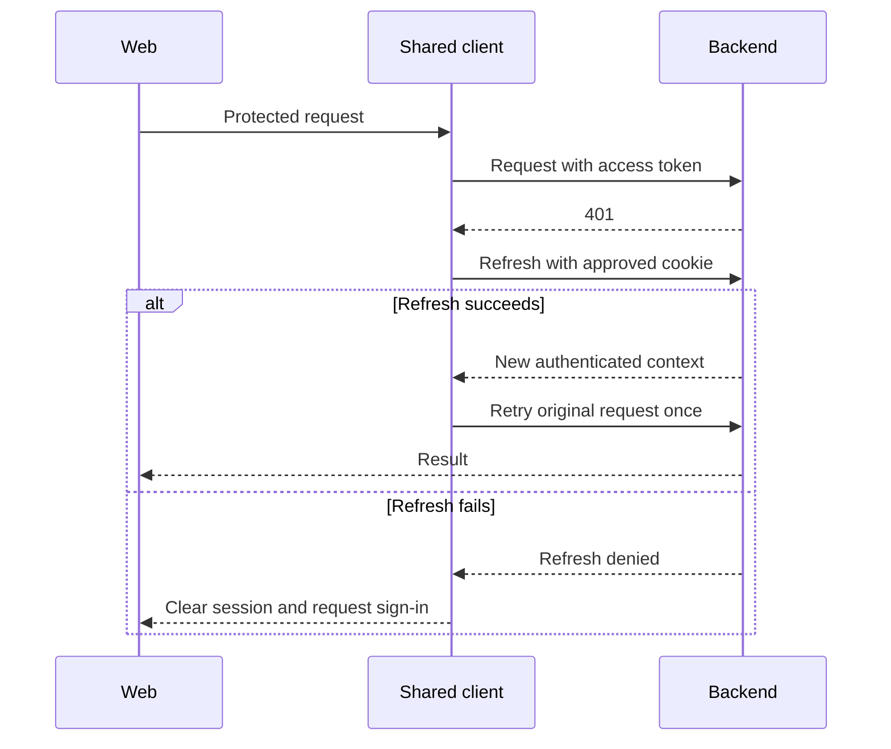

# Customer and Merchant Frontend: Interface and Integration Contract

Owner: Sajini, Member 6  
Date: 24 October 2026  
Status: Integration inventory; backend contracts still need confirmation

## HTTP configuration

I propose `VITE_API_BASE_URL=/api/v1`. API functions then use suffixes such as `/parcels`, avoiding a duplicated `/api/v1` prefix. Requests use the same public origin through the gateway. The more specific tracking route must reach Tracking API.

The frontend exposes browser routes, not backend HTTP endpoints. My main routes are `/auth/register`, `/track/:trackingNumber`, `/portal/dashboard`, `/portal/book` and `/portal/merchants/orders`. History, receipt and settings paths need agreement with the shared router owner.

## Consumed API inventory

Paths below come from the supplied project material. They must be checked against the module owners' current contracts before implementation.

| Method | Path after base URL | Owner | Use / access |
| --- | --- | --- | --- |
| POST | `/auth/register` | M1 | Registration; public |
| POST | `/auth/login` | M1 | Local login; public |
| GET | `/auth/google` | M1 | Start Google login |
| GET | `/auth/google/callback` | M1 | Backend identity callback |
| POST | `/auth/refresh` | M1 | Refresh using agreed cookie flow |
| POST | `/auth/logout` | M1 | End session |
| POST | `/pricing/quotes` or `/pricing/quote` | M2 | Obtain quote; singular/plural conflict unresolved |
| POST | `/parcels` | M2 | Customer booking |
| GET | `/parcels` | M2 | Caller-visible paginated list |
| GET | `/parcels/{id}` | M2 | Authorized details |
| GET | `/parcels/{id}/history` | M2 / M5 | Authorized history; confirm owner |
| GET | `/parcels/{id}/receipt` | M2 | Authorized receipt |
| GET | `/tracking/{trackingNumber}` | M5 | Privacy-safe public lookup |
| GET | `/tracking/{trackingNumber}/events` | M5 | SSE stream |
| POST | `/merchant/orders` | M4 | Merchant order creation |
| GET | `/merchant/orders` | M4 | Tenant-scoped order list |
| POST | `/merchant/webhooks` | M4 | Configure webhook |
| TBD | Merchant application/profile/approval-state lookup | M4 | Contract required |

## Headers and authorization

JSON operations use `Content-Type: application/json`. Protected requests send `Authorization: Bearer <accessToken>` through the shared client. The exact use of `X-Tenant-ID` must be confirmed with M4; the backend must validate membership rather than trust the header.

Booking creation uses `Idempotency-Key: <uuid>`. The same logical request reuses its key on retry; an edited payload requires a new request identity. I will not automatically retry arbitrary mutations without their approved idempotency behavior.

Native EventSource cannot attach an arbitrary bearer header. Public-safe streaming can avoid that requirement. Any private streaming flow needs an agreed cookie-based or compatible client strategy; tokens must not be placed in URLs.

## Payloads

The SRS proposes quotes containing zone IDs, weight, dimensions and service level. A quote response includes `quote_id`, currency, integer minor-unit amount, pricing version and validity. Booking includes that quote reference, pickup/drop-off contact/address fields and parcel details.

Exact required fields, lengths, units, nullability and enums must come from M2's schema. Receipt media type, download filename and merchant approval response need confirmation. Illustrative SRS payloads are not a replacement for approved machine-readable schemas.

## Envelopes and failures

The supplied repository overview uses:

```json
{"data": {"id": "example"}}
```

Collections use `data` plus pagination metadata. The shared client should handle the agreed error envelope containing `error.code`, `error.message`, `error.correlation_id`, `error.timestamp` and optional field details.

| Result | Screen behavior |
| --- | --- |
| 200 / 201 | Show confirmed data; follow endpoint-specific response |
| 204 | Do not attempt to parse an empty JSON body |
| 400 / 422 | Show supported field errors and safe summary |
| 401 | One coordinated refresh attempt; sign-in prompt if it fails |
| 403 | Access-denied state |
| 404 | Not-found state without private record disclosure |
| 409 | Conflict message; refresh state where appropriate |
| 429 | Respect Retry-After where supplied; avoid rapid retries |
| 5xx / network failure | Show unavailable state and safe retry option |

## SSE integration

I need the event names, payload schema/version, heartbeat policy, reconnect behavior and any replay window from M5. I will refresh authoritative tracking state on reconnect, ignore demonstrably older versions where the contract supports versioning, and stop listeners on navigation. The fallback polling interval and timeout values remain to be agreed.

The frontend does not publish RabbitMQ events, own queues, deliver webhooks or query database tables.

## Compatibility and contract handoff

I will use approved versioned backend schemas and request a coordinated change when a field or status changes. M1/M2/M4/M5 should provide OpenAPI definitions and sample success/failure responses. `integration-inventory.json` records this inventory in machine-readable form; it is not a complete OpenAPI specification and must not be treated as one.

## Login refresh interaction


